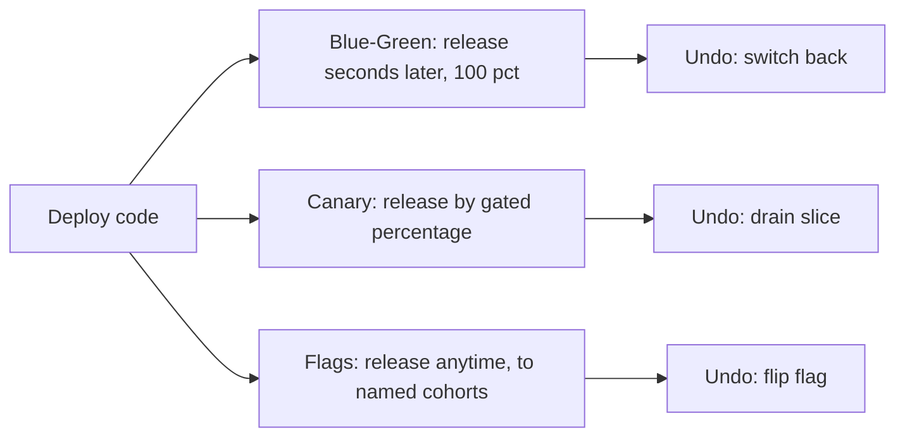
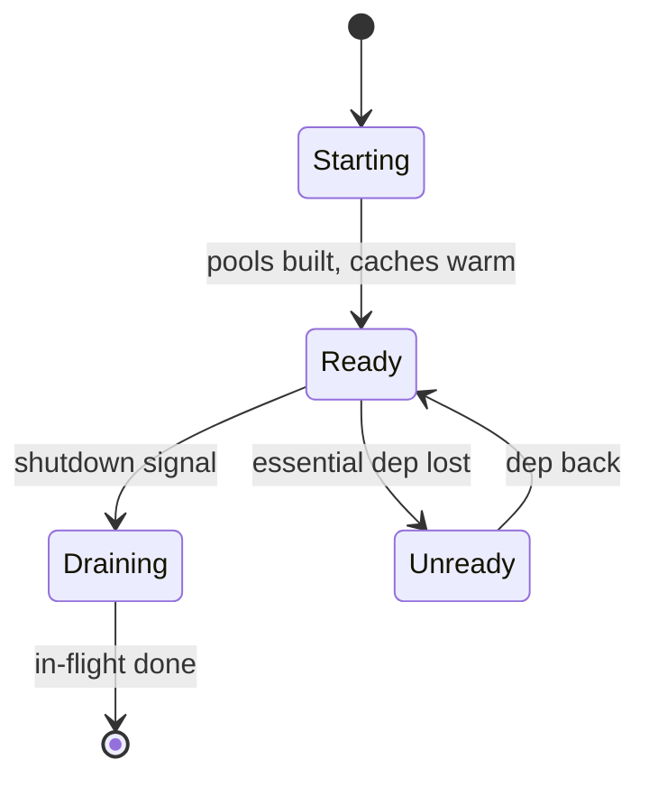
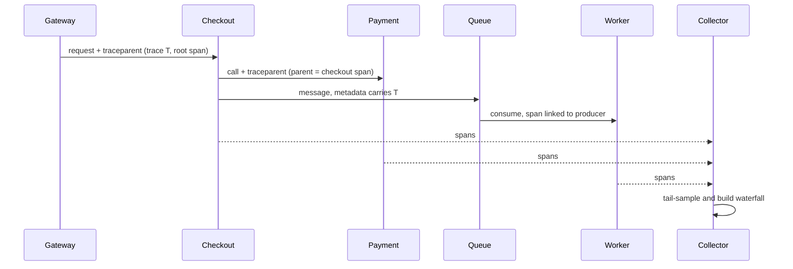
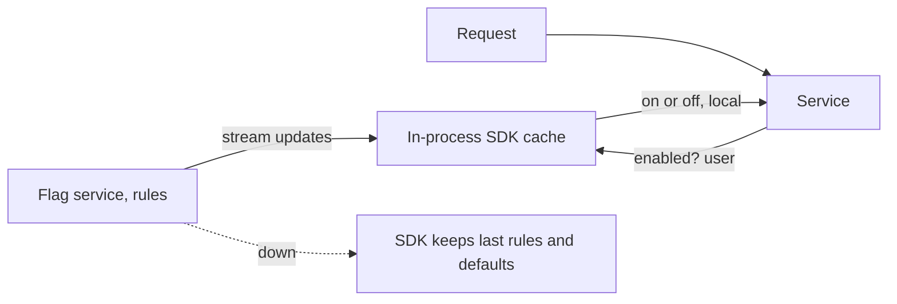
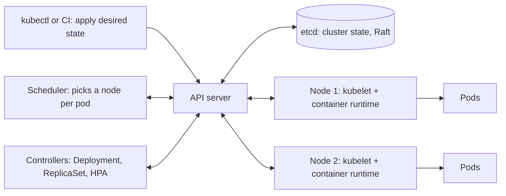
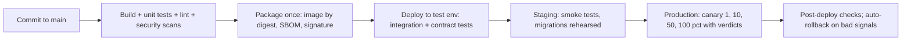
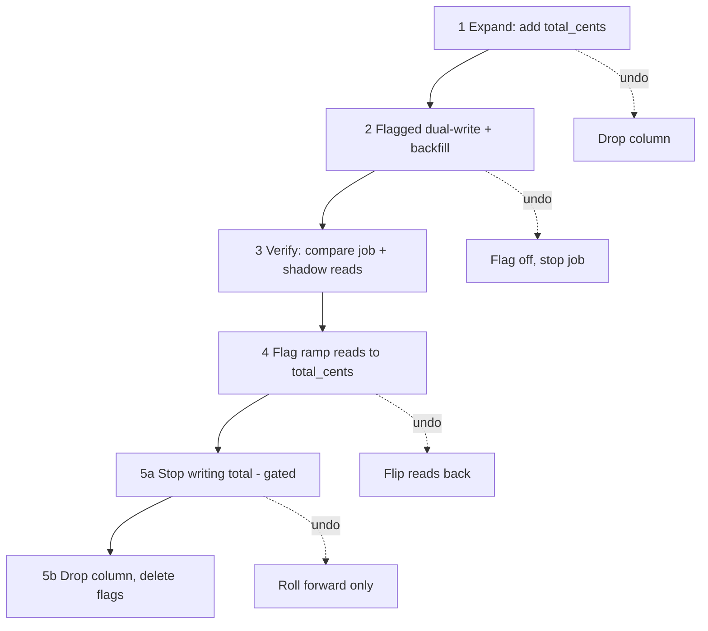

# Module 9 — Operating in Production (Observability and Delivery)

## Module Introduction
*Original lesson: [Module introduction on DesignGurus ↗](https://www.designgurus.io/course-play/system-design-patterns/doc/6a53675b9bf81a86ec3a1943)*


**What this module is about.** Some outages come from hardware, spikes or attackers, but most come from *changes we make ourselves*: a deploy (putting new code on servers), a config tweak or a database migration (a scripted change to tables or stored data) touches a healthy system and breaks it. The reliability module covered failures from outside; this one turns inward — shipping your own changes safely and *watching* production closely while each goes out.

**Analogy.** An operating room: the surgery is the deploy, the monitors are observation, and the ability to pause or reverse any step when a monitor turns red is rollback. Monitors first, then careful surgery.

**The five patterns (plus two added lessons) and the job each does**

| The situation | The pattern |
|---|---|
| Is this one server fit to take traffic at this moment? | Health Check |
| A single slow request passed through thirty services — which one ate the time? | Distributed Tracing |
| Replace the old version with the new one in a single move, and keep an instant way back | Blue-Green Deployment |
| Make the new version earn trust on a small slice of real traffic before everyone gets it | Canary Deployment |
| Put the code in production "dark" (there, but switched off), then turn the feature on later — step by step, and with an off switch | Feature Flags |
| Package every service the same way and keep a fleet of them running in the declared state | Containers and Kubernetes *(added lesson)* |
| Get every change from commit (one saved, recorded code change) to production through one automated, trusted path, with the right rollout strategy | CI/CD Pipelines and Deployment Strategies *(added lesson)* |

Two patterns **observe** ("is this server okay?", "where did this request spend its time?"); three **change** production without betting every user on each deploy. Observation comes first because every safe delivery technique depends on spotting failure fast — "roll back if the metrics look bad" means nothing without metrics.

**Two facts that organize the module**

1. **Deploying and releasing are two separate events.** *Deploy* = new code on servers; *release* = users experience it. Traditionally they're fused. The delivery patterns separate them by different amounts:
   - Blue-green readies new code in an idle environment and releases seconds later by moving traffic.
   - Canary releases already-deployed code to a small percentage of users.
   - Feature flags separate them fully — deploy Tuesday, release to a beta group next week, turn it off instantly.
   The design question for any change: *how far apart should deploy and release be?*

2. **Rolling back should be an everyday move.** Blue-green switches back in seconds, canary drains in seconds, a flag turns off instantly — versus building a revert and pushing it through CI (continuous integration, the automated build-and-test pipeline), which can prolong an outage for tens of minutes. Rule: **every delivery design needs a built-in undo design.** The capstone keeps a safe way back open at every stage of a live migration.

*Delivery patterns placed on the deploy-to-release separation spectrum*

All three share "deploy code"; they differ in *when, and for whom,* release happens, and each has its own cheap undo.

**Four terms used throughout** (basics: [Module 0 — Deployment strategies and rollback](../00-system-design-fundamentals/README.md#deployment-strategies-and-rollback), [Observability](../00-system-design-fundamentals/README.md#observability-logs-metrics-and-traces))
- **Deploy vs. release** — code on servers vs. users feeling it (Fact 1); the module's most important distinction.
- **Exposure scope (blast radius)** — how many users a bad change can hurt before it's stopped: naive release 100%; blue-green 100% but fast to undo; canary ~1%; a flag can shrink it to one named team.
- **Roll back vs. roll forward** — reversing the change vs. pushing a fix on top. Rollback is usually quicker when available; the capstone reshapes a migration to keep it available where the naive plan wouldn't.
- **Golden signals** — the four numbers to watch during any change: **traffic**, **error** rate, **latency** and **saturation** (how close resources are to full). A canary's verdict comes from them — why observation is taught first.

**How to read the module.** Health Check (extends the load-balancer lesson's endpoints: shallow vs. deep, and a fleet-wide outage from one dependency) → Distributed Tracing (one request across services — the evidence every "watch the canary" step relies on) → delivery from simplest reversal to most flexible: Blue-Green (two environments, one switch) → Canary (widen exposure as measurements pass) → Feature Flags (deploy fully separated from release; "flag debt"). Two added lessons zoom out to the platform: **Containers and Kubernetes** (images, pods, Services, probes, rolling updates, control loops) and **CI/CD Pipelines and Deployment Strategies** (build once and promote, infrastructure as code, GitOps, and a comparison of recreate, rolling, blue-green, canary and shadow). The capstone uses them all in a zero-downtime database migration.

> Short on time? Start with **Canary Deployment** — interviewers probe it most. Health Check is brief; don't skip it.

**Before you start — three questions about a system you know**
- Your most recent bad deploy: how long until someone *noticed*, and until it was *undone*? This module shrinks both numbers.
- When a request is slow, can you tell which service used the time — or do you grep thirty log files and guess?
- Could your newest feature be switched off this minute, with no deploy? Who could do it?

---

## Health Check Endpoint
*Original lesson: [Health Check Endpoint on DesignGurus ↗](https://www.designgurus.io/course-play/system-design-patterns/doc/6a5367889bf81a86ec3a1dad)*


**What it is.** A tiny HTTP endpoint on each instance (e.g., `/healthz`) answering one question: *"should this instance get traffic right now?"* The load balancer, the container orchestrator (e.g., Kubernetes, which starts, stops and places containerised apps) and the auto-scaler call it every couple of seconds and act drastically on the answer: stop sending traffic, or kill and restart the instance.

**Analogy.** A manager asks a shop assistant "Are you conscious?" (no → ambulance, i.e., restart) and "Can you serve customers this minute?" (no → often harmless: the till is being set up; send customers to the next counter). Confuse them and you call an ambulance whenever the till is slow.

### The problem: naive health checks lie in both directions

From the [load-balancer lesson](../06-scaling/README.md#load-balancing):
- A **shallow** check ("I'm alive, HTTP 200") stays green while the instance can't reach the databases or services it needs, so users keep being routed to a useless server.
- A **deep** check probes dependencies (e.g., pings the database). When the *shared* database hiccups, **every** instance fails at once and the load balancer pulls *the whole fleet* — a partial slowdown becomes a full outage.

Ask a better question — not "is the architecture healthy?" but "should *this instance* get traffic?" — and, as modern platforms do, split it into two questions with different consequences.

### How it works: two verdicts, two consequences

1. **Liveness — "am I broken at a basic level?"** Failure → the platform **restarts** the process. So liveness covers *only* problems a restart cures: unresponsive, deadlocked (threads waiting on each other forever), or permanently stuck. **Dependencies never go here**: restarting your app can't fix a broken database, and a shared outage would fail every instance's liveness, restarting healthy processes over and over — a *restart storm*.

2. **Readiness — "should traffic come to me right now?"** Failure → the platform **de-routes** the instance temporarily — mild and reversible. A perfectly healthy instance can honestly be *not ready*: starting up, filling caches, building connection pools, or draining before shutdown. Each check must fit the consequence it triggers.

3. **Lifecycle honesty.**
   - At **startup**, readiness starts false; the instance builds pools and warms caches, then flips to true — no user hits a cold instance.
   - At **shutdown**, readiness goes false first; in-flight requests finish while the load balancer steers away; then it exits.
   During a rolling deploy this stops each new instance being slow for its first ~30 seconds.

*Instance lifecycle as seen by readiness*

Ready only after warm-up; Unready briefly if a truly essential dependency is lost; always Draining on the way out.

### Three rules that keep health checks safe

- **Check yourself, not the architecture.** Handle dependency failures *inside* the service with circuit breakers and fallbacks, staying "ready" in a reduced mode. Exception: a service useless without one dependency (a pure database proxy) *may* include it in readiness — accepting, eyes open, that its failure de-routes every instance.
- **Cost almost nothing.** 30 services × 40 instances probed every 2 seconds = **600 checks per second**, forever. A DB query per probe is 600 useless queries per second, and a slow probe can *time out*, making healthy capacity look failed — a self-made outage. Aim for an in-memory check of roughly **1 ms**.
- **Tell the truth at every lifecycle stage** — not ready until warm, not ready while draining.

### Routing checks vs. monitoring checks

Routing checks are per instance, frequent and cheap. **Monitoring checks** exercise the whole system with **synthetic transactions** (scripted pretend requests, like a test checkout) and deeper dependency probes, centrally and less often, producing *alerts for people*, never routing decisions. Keep them on separate endpoints; merging them is how deep dependency tests creep into fleet-wide routing and restarts.

**Treat every probe condition as a reviewed policy.** Don't casually add "one more network call" to readiness for a new dependency. Write down: condition → action on failure → how that action aids recovery. If neither restart nor de-routing fixes it, it doesn't belong in that probe.

**Response format.** Pass/fail is all the platform needs; diagnostic fields naming the failing local condition are fine, but never secrets or sensitive config, and no costly work to produce them.

### Liveness vs. readiness (comparison)

| | Liveness | Readiness |
|---|---|---|
| Question | Am I broken at a basic level? | Should traffic come to me right now? |
| Consequence | Restart (drastic) | De-route (mild, reversible) |
| May include dependencies? | Never | Only the essential ones, picked on purpose |
| Can honestly say "no" while healthy? | No | Yes — while warming up or draining |
| What goes wrong if designed badly | Restart storms whenever a dependency fails | The whole fleet removed whenever a shared dependency fails |

### Trade-offs

**You gain:** failing instances removed at machine speed (seconds); safely ordered deploys (only warm instances admitted, each drained before termination); self-healing (instances failing liveness are replaced).

**You pay:**
- **Fleet-wide mistakes.** ~10 lines of code, but dependencies in liveness → restart loops; in readiness → the whole fleet pulled; slow probes → timeouts inventing failures.
- **Probe load** — tiny per probe, never-ending, on every instance; needs discipline as services grow.
- **False confidence** — green means one narrow question was answered, not that a customer can check out; that proof comes from central monitoring.

### When not to use it (or how to scope it)

Every service receiving routed traffic needs health checks; keep them narrow:
- **Don't use one endpoint for routing, restarting and alerting** — three consequences, three designs.
- **Don't make readiness depend on optional dependencies** — if recommendations are down, hide the widget (degrade), don't take the fleet offline.
- **Batch workers and queue consumers** get no routed traffic: "health" is liveness plus **backlog age** (age of the oldest unprocessed message); the queue's metrics are the readiness signal.

### In the interview

Expect "what does your health endpoint check?" after almost any load-balancer or Kubernetes design. The interviewer listens for the liveness/readiness split and the shared-dependency danger.

> **30-second answer:** "Two endpoints. Liveness: am I broken in a way a restart fixes — responsive, not deadlocked — never dependencies, because a restart won't repair the database and a shared outage becomes a restart storm. Readiness: should I get traffic now — false while warming and draining; dependencies only if the service is genuinely useless without one, since degraded serving beats removal. Both cheap: probes hit the fleet every two seconds, so a DB query means hundreds of wasted queries a second, and a timeout can create an outage. Deep system checks belong to central monitoring feeding alerts, never routing."

**Likely follow-ups (with answers):**
- *"How does an instance avoid serving while cold?"* — Readiness stays false until pools are built and caches warm; shutdown reverses it: unready, drain in-flight requests, exit.
- *"Your database-proxy service has no degraded mode. Should readiness include the DB?"* — Yes, deliberately: it can't work without it. Accept that a DB failure de-routes every instance and make *callers* degrade gracefully. The rule follows the consequence, not a blanket "never".

**Mistake that fails candidates:** dependencies in liveness; one endpoint for routing and alerting; "ping the database" without seeing how it removes the whole fleet.

**Self-check:**
- **Q1.** The two questions and their consequences; why are dependencies forbidden in one and rationed in the other? → Liveness → restart; no dependencies, since restarting me can't repair another system. Readiness → de-route; only dependencies without which the service is useless — optional ones should cause degradation, not lost capacity.
- **Q2.** A service uses a database (essential), Redis as a cache (misses fall back to the DB) and a recommendations service (optional widget). Where does each check go? → Liveness: in-memory process check only. Readiness: the database plus warm-up/draining state. Redis and recommendations: neither. A synthetic checkout: central monitoring.
- **Q3.** At 3:07 AM the database undergoes a 90-second **failover** (a replica promoted to primary); every instance of six services restarts, some repeatedly; the outage lasts 20 minutes. Why? → Liveness included a DB call: every instance looked "broken" and restarted, discarding in-flight work, returning cold, failing again — and every restart rebuilt its connection pools, hammering the recovering database. Fix: liveness checks only the process; the DB goes in readiness only if truly essential, otherwise breakers handle degradation; deployment review blocks liveness conditions a restart can't fix.

**Related patterns:**
- **Load Balancing** — the main consumer; readiness drives removal and draining.
- **Graceful Degradation** — where dependency problems belong: degrade and stay ready.
- **Sidecar** — the app reports not-ready until its proxy is ready; the sidecar drains last.
- **Auto-Scaling** — failed liveness triggers replacement; the fleet's self-healing.

**TL;DR**
- **Problem:** routing and restart machinery wants a per-instance verdict every ~2 s; naive endpoints mislead both ways — shallow stays green while useless, deep turns the fleet red on a shared blip.
- **Mechanism:** liveness covers only restart-fixable brokenness, never dependencies; readiness covers traffic-worthiness — false while warming or draining, only essential dependencies. Both ~1 ms. Deep checks belong to central monitoring.
- **Costs:** tiny code with fleet-wide failure modes (restart storms, mass removal, timeout-invented failures), plus endless probe load.
- **Skip it when:** never — but don't let one endpoint do routing, restarts and alerting, and let queue workers report backlog age.

---
## Distributed Tracing
*Original lesson: [Distributed Tracing on DesignGurus ↗](https://www.designgurus.io/course-play/system-design-patterns/doc/6a5367b5f5fad4cc634162de)*


**What it is.** Capturing one request's whole trip across services. At entry it gets a **trace ID**; every service and database call it touches records a timed **span** carrying the trace ID and its triggering call. A collector rebuilds the spans into one timeline — a **waterfall** — showing exactly where the time went.

**Analogy.** A parcel tracking number: each depot's scan alone says little; the tracking page joins them and reveals the parcel sat three days at one sorting centre.

### The problem: the time hides *between* the logs

Checkout is "slow sometimes": **p99** (latency only the slowest 1% exceed; see [percentiles](../00-system-design-fundamentals/README.md#percentiles-tail-latency-and-why-averages-lie)) is **4.2 seconds** against an **800 ms** budget, hitting some requests unpredictably. One checkout crosses **12 services through 40+ calls** — gateway, **BFF**, checkout, inventory, payment, fraud, pricing and more.

Twelve engineers each search one service's logs; every service says "I was fast" (checkout logged 8 ms of its own work). Every log is *correct* and none answers the question, because **the 4.2 seconds was spent between the records**, along a specific call sequence no single log captures. Three engineers then spend two days aligning timestamps from machines whose clocks disagree by milliseconds (the vector-clocks lesson explains why physical timestamps can't order cross-machine events); they ship a fix and p99 doesn't move. Logs answer *"what did this component do?"*; the question was *"which path did this request take, and where did its time go?"* — and nothing recorded that.

### Why the obvious fixes fail

- **"Add more logging."** More records, still not *linked*. Relationships were missing, not detail.
- **"Put a correlation ID in every log line."** Helps partly — searching the ID finds every line for the request — but there are no **parent/child relationships** (which call triggered which), clock skew muddles timing, and nothing draws the path.
- **"Send synthetic test requests."** They recreate only known conditions; nobody knows what triggers this one.

### How it works

1. **The entry point creates a trace ID.** The API gateway sees every external request first, so it becomes the *root* of every trace tree (why the gateway lesson gave it request-ID creation).
2. **Each operation records a span** — handling a request, an outbound call, a query — with a name, start and end times, its **parent span**, and attributes (URL, status, error). Spans nest into a tree; drawn on a timeline, that's the waterfall.
3. **Context propagation carries the IDs forward.** On synchronous HTTP calls in a standard header (W3C **`traceparent`**); on asynchronous queue work in **queue message metadata** (labelled fields travelling with a message, separate from its body). The consumer's span *links* to the producer's, and the gap shows queue wait. **If one service fails to pass the header on, every later span is an orphan** and drops out of the trace.
4. **Spans go to a collector**, which reassembles searchable waterfalls.

The slow checkout's trace (indentation = parent/child):

```
Trace 7f3a...  (checkout, 4,214 ms total)
├── gateway                    2 ms
├── mobile BFF                 11 ms
│   ├── checkout svc           4,190 ms   ← there
│   │   ├── inventory          12 ms
│   │   ├── payment svc        4,110 ms   ← in here
│   │   │   ├── fraud check    1,210 ms  (timeout)
│   │   │   ├── fraud check    1,240 ms  (retry 1)
│   │   │   ├── fraud check    1,190 ms  (retry 2)   ← found it
│   │   │   └── charge         180 ms
│   │   └── pricing            9 ms
```

*Context propagation through sync and async hops*


**Instrumentation — three layers, least to most effort:**
- **Service-mesh sidecars** capture every inter-service hop with no application change.
- **Auto-instrumentation libraries** such as **OpenTelemetry** wrap HTTP clients, database drivers and queue clients in-process.
- **Manual domain spans** for steps no library can guess ("apply discount rules") — only where the same investigations recur. The two automatic layers already crack many latency puzzles.

**Sampling — you can't keep everything.** 40,000 requests/s × ~40 spans = **1.6 million spans per second**.
- **Head sampling** decides at the *start* (say keep 1%): cheap and simple, but blind to the outcome — a **99% chance of discarding** the slow or failing trace you want.
- **Tail sampling** decides *after* completion: keep every error, every request missing its latency objective, plus a small random baseline. The price: **buffering every trace** until the decision — real infrastructure, and a favorite interview topic.
- In practice: tail rules for errors and outliers plus a head-sampled baseline.

### Walkthrough with numbers: the same incident, with tracing

- **Minute 1:** filter `duration > 4s` — dozens of traces, kept by tail sampling as outliers.
- **Minute 2:** the waterfall shows, inside payment's 4,110 ms, **three sequential fraud-check spans of ~1.2 s each** — a timeout and two retries. Retries behaved as configured; fraud's p99 had crept past payment's timeout, so affected checkouts spend timeout × 3 ≈ **3.9 s**.
- **Minute 4:** root cause: fraud's slowdown, with payment's timeout/retry settings shaping the symptom. The wrong theory had cost six engineer-days; tracing turns **days of reconstruction into minutes of reading**.
- **Bonus:** aggregated traces form a live **dependency map** (who calls whom, how often, how fast), often exposing undocumented paths.
- **The bill:** errors + outliers + a 0.1% baseline ≈ **2,000 spans/s** stored — manageable — but the tail-decision buffering tier belongs in capacity planning.

### The three pillars of observability

| | Metrics | Traces | Logs |
|---|---|---|---|
| Question | "How much, how fast — overall?" | "Which path did this request take?" | "What exactly happened at this spot?" |
| Shape | Numbers over time; cheap enough to keep forever | Trees of timed spans; sampled | Text events; very high volume |
| Alerting | *The* layer that alerts (golden signals) | Seldom alerts; explains the alerts | Sometimes (on error patterns) |
| Cost | Small | Medium, kept in check by sampling | The largest |

Use them in order: **metrics ring the alarm** (p99 over objective), **traces localize it** (fraud retries inside payment), **logs explain it** (the exception and its parameters). Put the trace ID in log lines to jump from a waterfall to its logs. Without traces, teams leap from a global alarm to searching every log — the opening incident.

### Trade-offs

**You gain:**
- Per-request evidence across any number of services — something separate logs can't express.
- Faster latency diagnosis: retry storms (waves of retries piling load on a struggling service), lock contention and **N+1 queries** (one query per item instead of one for all) appear as visible sequences.
- Cross-service error attribution — which component actually returned the 500.
- A free live dependency map.

**You pay:**
- **Propagation discipline forever.** Every service, client library and queue consumer must pass context; traces are only as good as the *weakest* client.
- **Sampling infrastructure** — the tail buffer and decision layer, plus tuning what counts as "interesting".
- **Instrumentation work** beyond the automatic skeleton, only where puzzles recur.
- **Privacy exposure** — spans can hold URLs, parameters and arbitrary attributes, so **PII scrubbing** (removing personal data) belongs in the collection pipeline (the event-driven-architecture lesson's rule).

### When not to use it

- **A monolith** — a profiler explains time inside one process far better; tracing pays off when latency is scattered *between* processes.
- **Three services and a queue** — structured logs (named fields, e.g., JSON) with correlation IDs may suffice; tracing's value grows with hop count.
- **In place of logs** — spans are the skeleton (timing, structure); logs are the story.
- Common misuses: keeping 100% of traces forever (cost explodes with traffic) and hand-instrumenting every function from day one.

### Real-world examples

- **Google's Dapper paper** — distributed tracing at planet scale via heavy sampling; most modern ideas descend from it.
- **OpenTelemetry** — vendor-neutral instrumentation, `traceparent` propagation and export; *the* standard to name in interviews.
- **Jaeger, Zipkin, Grafana Tempo** store and show traces; **Honeycomb, Datadog** are all-in-one observability platforms.
- **Service meshes** — produce the service-level skeleton for free.
- **For AI engineers:** observing an agent (an LLM-driven program planning steps and calling tools) *is* tracing: a run is a trace; each model call, tool call and retrieval is a span with token count, cost and model version. A waterfall might show a 40-second, $0.30 run making three mergeable sequential model calls, or the failing tool call. LLM tracing tools like **LangSmith** descend from Dapper, and context must pass through an LLM gateway just as through HTTP headers.

### In the interview

Common prompt: "a slow request passes through thirty services — how do you find the delay?" "Search the logs" won't do; follow-ups probe sampling cost and async propagation.

> **30-second answer:** "Distributed tracing: the gateway mints a trace ID, every operation records a timed, parented, tagged span, and context travels in headers across every hop — queue messages included — so any slow request becomes a waterfall and the hidden time shows up in minutes. Two design choices: tail sampling that keeps errors and latency outliers plus a small baseline, because head sampling discards the interesting 1% before knowing it's interesting; and propagation discipline, because one service dropping the header orphans everything after it. The mesh gives the service-level skeleton free; OpenTelemetry adds in-process detail where mysteries recur."

**Likely follow-ups (with answers):**
- *"Head or tail sampling?"* — Tail for errors and outliers (outcome unknown until the end) plus a head-sampled baseline; tail means buffering every trace until decided. Head-only sampling tends to discard the rare p99 examples you need.
- *"How does a trace cross a queue hop?"* — Trace context in message metadata; the consumer's span *links* to the producer's, and the gap is queue wait, so backlog delay appears in the same waterfall. Non-propagating queues are where traces break most.

**Mistake that fails candidates:** more logs; 100% retention without a cost model; propagation dying at the first queue.

**Self-check:**
- **Q1.** Define trace, span and context propagation; where is the trace ID created, and why? → A trace is one request's full path (trace ID); a span is one timed operation with start/end, parent and attributes; propagation carries trace and span IDs across every HTTP call and queue message so new spans attach correctly. The gateway creates the ID as the first component seeing every external request — the natural root.
- **Q2.** Team A is cost-sensitive with ordinary traffic; Team B has rare p99 spikes gone before anyone looks. Design sampling. → A: modest head sample (e.g., 1%) plus always-kept errors — predictable cost. B: tail sampling keeping every error and over-limit trace plus a small baseline, deliberately accepting the buffer cost, because rare unpredictable outliers are exactly what head sampling loses.
- **Q3.** Since Tuesday every checkout trace stops at payment; fraud and charge spans are gone though the calls still happen. → Payment stopped forwarding `traceparent` — likely a dependency update swapped the HTTP client or framework, orphaning fraud's spans. Apply OpenTelemetry auto-instrumentation to the new client; guard the whole class with **trace-completeness monitoring** (alert on rising orphan-span rates or missing expected children) and propagation tests in the service template.

**Related patterns:**
- **API Gateway** — mints the trace ID and root span.
- **Service Mesh** — sidecars supply the free skeleton.
- **Message Queue** — metadata carries context, keeping async work and queue delay in the waterfall.
- **Retry with Exponential Backoff** — tracing exposes retry storms (as in the walkthrough).
- **Canary Deployment** — canary verdicts rely on this telemetry.

**TL;DR**
- **Problem:** a slow request's time hides between per-service logs; every service says "I was fast," and stitching timestamps takes days and ends in a guess.
- **Mechanism:** gateway-created trace ID; a timed, parented span per operation; context in headers and queue metadata; collector-built waterfalls; tail sampling selecting errors and outliers from 1.6M spans/s.
- **Costs:** permanent propagation discipline, sampling infrastructure, instrumentation beyond the mesh skeleton, PII scrubbing.
- **Skip it when:** a single process (use a profiler), about 3 services (correlation IDs may do), or you hoped it would replace logs.

---

## Blue-Green Deployment
*Original lesson: [Blue-Green Deployment on DesignGurus ↗](https://www.designgurus.io/course-play/system-design-patterns/doc/6a53682c7a313d4e87bebde6)*


**What it is.** Two identical production environments: **blue** is live, **green** idle. Deploy the new version to green, test it on genuine production infrastructure with no users, then flip the router — within seconds all traffic is on green. Rollback is the same flip in reverse.

**Analogy.** A theatre with two matching stages: the audience watches Blue while the crew builds and rehearses the next scene on Green; the seats swivel when Green is ready, and swivel back if anything goes wrong — Blue's set is still up.

### The problems it solves

- **Slow rollback.** In-place rollback means rebuilding and redeploying the old version through CI, artifact storage (where built packages are kept) and rollout — **15–25 minutes** of limping even when engineers know exactly what to do. Rollback becomes one more deployment.
- **The verification gap.** Staging isn't production (data, config, integrations, load all differ); without a second *production* environment, a release's first full test happens with users on it.

### How it works

1. **Deploy to green** while blue serves everyone. Green *is* production — same infrastructure, config and database; **infrastructure-as-code** (environments described in version-controlled files) prevents quiet **environment drift**, which would break the idea.
2. **Verify green before any user reaches it**: **smoke tests** (fast basic checks) on real infrastructure, readiness green, caches and pools warm. Deploy and release separated by seconds.
3. **Switch.** The router sends new traffic to green (change the load balancer target, or flip a Kubernetes Service selector). Blue **drains** — in-flight requests finish where they began. Sessions survive because they live in a shared store (the statelessness lessons).
4. **Keep blue on standby** for an undo window, usually hours. Switching back *is* the rollback: about **10 seconds**, no CI, no build. Afterward, blue becomes the next release's green.


*Figure — Blue-Green Deployment (course diagram)*

The router sends 100% to blue (v1.41, live) and 0% to green (v1.42, smoke-tested and warm) until the switch; blue then stays up for hours as the undo button. The one shared database in the middle is the component that does not switch.

### The database does not blue-green

Both versions use the **same database**, so throughout the rollback window old and new code must both safely read and write the shared schema and data. Schema changes therefore follow **expand-contract**:
- **Expand:** add new structures non-destructively, write both old and new forms, ensure either version reads safely.
- **Contract:** remove the old structure only when *no* version depending on it could return — after the rollback window closes.

This is API versioning's "additive first" applied to data. Blue-green swaps stateless application environments; *state* needs its own compatibility discipline — the subject of the capstone.

### Blue-green vs. rolling deploy

A **rolling deploy** replaces instances in place, a few at a time.

| | Rolling (replace in place) | Blue-Green |
|---|---|---|
| Extra capacity | About 1 instance's worth | 2× for the duration of the window |
| Rollback | Redeploy: minutes | Switch back: seconds |
| Version mixing | v1 and v2 both serve for the whole rollout | Never — the switch is atomic |
| Blast radius at cutover | Grows gradually, instance by instance | 100% at the moment of the switch |
| Fits | A cheap default; versions that are compatible with each other | When you need instant undo; changes that can't cope with mixed versions |

Rolling is a cheap, universally supported default; blue-green earns its double capacity when reversal speed matters or versions can't coexist. Both choose who gets new code by *infrastructure location*; flags choose by *user*.

### Trade-offs

**You gain:** rollback in seconds (a routing change, not a build); whole-environment verification before any user; never a mixed-version fleet (with rolling, v1.41 and v1.42 responses interleave, so they must coexist safely).

**You pay:**
- **2× capacity** during the window — cheap in the cloud (create green for hours, then delete), possibly permanently idle hardware on-premises. Weigh it against the outages prevented.
- **All-or-nothing exposure** — the switch moves **100% of users at once**; a bug that slipped verification hits everyone (canary fixes this).
- **Ongoing schema discipline** — every migration must stay expand-contract compatible, or the rollback button stops working.
- **Tricky draining** — long-lived connections (SSE, websockets) keep blue busy until they close or move.

### When not to use it

- **You need step-by-step validation.** Blue-green checks the environment, not the variety of user behavior; a bug affecting 3% still reaches 100% — use a canary.
- **2× costs serious money** — large fleets favor canaries on existing capacity; on-prem teams may reserve blue-green for risky releases.
- **State is the main concern** — in database-heavy systems the migration is where risk lives.
- **Common misuse:** flawless app-tier blue-green with a destructive schema rename or dropped column; the router can return to blue, but blue can't read the altered data, so "rollback" makes things worse.

### In the interview

Prompt: "zero-downtime deployment with instant rollback." Expect a follow-up on the shared database — it decides whether your rollback really works.

> **30-second answer:** "Two identical environments: deploy to the idle one, verify on real infrastructure with zero users, gated on health and warm-up, then switch the load balancer — all traffic moves in seconds, and rollback is switching back, a reflex rather than a 20-minute redeploy. Blue drains and stays ready through the undo window. The database doesn't switch: both versions share it, so schema changes follow expand-contract — additive first, write both forms, contract only when rollback can't need the old shape — or the rollback button doesn't work. Limits: 2× capacity in the window, and 100% exposure at the switch; gradual exposure is the canary's job."

**Likely follow-ups (with answers):**
- *"Walk me through the database during one cycle."* — Expand additively (works for both versions) → deploy and switch → stay compatible through the observation/rollback window → contract once blue can never return. The rollback window and schema-compatibility window must be the same length.
- *"Sessions and in-flight requests at the switch?"* — Blue drains its requests while green takes new ones; shared-store sessions mean nobody is logged out.

**Mistake that fails candidates:** forgetting the database; claiming rollback is safe after green wrote a format blue can't read; choosing blue-green when gradual behavioral validation is needed.

**Self-check:**
- **Q1.** What switches, what drains, what never switches, and what keeps it safe? → The router target switches; blue drains in-flight requests; the shared database never switches and is protected by expand-contract (additive, dual-version compatible, removal only after the window).
- **Q2.** Team A (cloud, two deploys a day) vs. Team B (on-prem, 60% utilization): what does blue-green cost each? → A creates green for a few hours per release and deletes it — small next to one avoided 20-minute outage. B needs permanently idle hardware, so might reserve blue-green for high-risk releases and use rolling deploys or flags otherwise.
- **Q3.** Green (v1.42) went live at 14:00; at 14:30 you switch back and blue fails to read recent orders. → v1.42's migration renamed, removed or retyped a column, or wrote an incompatible format, so the rollback caused an outage. Now: fix v1.42 and **roll forward** (blue is incompatible), then examine data written 14:00–14:30. Prevention: expand-contract with contraction held until the window closes.

**Related patterns:**
- **Load Balancing** — the switch is a routing change; draining executes it.
- **Health Check** — readiness says when green is genuinely warm.
- **Canary Deployment** — the gradual alternative to 100% exposure.
- **API Versioning** — expand-contract is additive-first applied to schemas.

**TL;DR**
- **Problem:** in-place deploys make rollback a ~20-minute redeploy, and new versions meet real infrastructure only once users are on them.
- **Mechanism:** two identical environments: deploy to the idle one and verify, flip the router in seconds, drain the old one, keep it ready through the undo window, protect the shared DB with expand-contract.
- **Costs:** 2× capacity (permanent if on-prem), 100% exposure at the switch, tricky draining, permanent schema discipline.
- **Skip it when:** you need gradual validation across varied traffic, 2× is serious money, or the risk is in the data layer.

---
## Canary Deployment
*Original lesson: [Canary Deployment on DesignGurus ↗](https://www.designgurus.io/course-play/system-design-patterns/doc/6a5377c1f5fad4cc6341da82)*


**What it is.** Release the new version to a small group of real users (e.g., 1%) and compare its vital signs with the old version's *live*. If it's as healthy, widen in steps (5%, 25%, 100%), each approved by a measured verdict; if worse, drain it within seconds. Only that small group was ever exposed.

**Analogy.** Miners carried canaries because the bird reacted to bad air first — but *watching* it was the point. A canary release without observation and automatic response is worthless.

### The problem: "it runs" is not "it behaves"

v1.43 passes the full blue-green process — health checks, production smoke tests, warm-up — and switches at 14:00. At 14:08 support reports checkout failing for users with **a saved payment method *and* a non-US locale** — **3% of traffic**. No test covered that pairing (tests with either condition alone passed). The atomic switch exposed every affected user at once, and thousands of checkouts failed before rollback.

Green proved the version *runs*, not that it *behaves* for real users. Production combinations (payment state, locale, account age, device, usage) multiply faster than any test suite. **Real user traffic is the only complete test suite** — the goal is to use it without exposing everyone before a verdict.

### Why the obvious fixes fail

- **"Improve the staging data."** Helps with known risks, but staging is always a partial, ageing copy of user behavior; it can't prove there are no unknown interactions.
- **"Mirror (shadow) production traffic to green first."** Shadowing copies live requests to the new version and discards its answers — fine for reads, unsafe for side-effecting writes like payments (a replayed charge bills twice; blocking it skips the path you wanted to test), and discarded responses produce no business outcomes. v1.43 broke in a write flow.
- **"Deploy at 3 AM."** Fewer failures per minute, but the same users hit the bug eventually, the team is exhausted, and light traffic gives *weaker* evidence, so percentage regressions surface later.

### How it works

1. **The split.** Load-balancer weights or a mesh traffic policy route a controlled percentage (say 1%) to the new version (flag-based cohort routing is a close alternative).
2. **Sticky slicing.** Each user stays on *one* version for the whole workflow — bouncing between v1.42 and v1.43 could break a multi-step checkout and muddy the comparison. Hashing the **user ID** onto a hash ring (as in consistent hashing) gives a stable 1% cohort; growing it adds users without moving earlier ones, and lets engineers tell which version served a reported session.
3. **Compare against the baseline, not a fixed threshold.** Ask "is the canary *worse than the baseline right now*?" The other 99% — the **concurrent baseline** — sees the same traffic, dependency conditions and cache state at the same instant; yesterday's figures or fixed thresholds mistake daily swings for regressions. **Netflix Kayenta** automates this canary-vs-baseline analysis over many metrics.
4. **Compare the right things.** Golden signals **plus business metrics** (conversion — share of visitors completing a purchase — and add-to-cart rate) **plus traces**. A broken button may raise no errors or latency yet stop purchases; trace comparison can expose a new 200 ms span while overall p99 still looks fine. Without a conversion metric, a commercially broken release sails through.
5. **Automated gates and rollback.** Timed analysis advances each stage (1 → 5 → 25 → 100%) when its evidence window ends, or rejects it — no humans staring at dashboards (they lose focus and apply statistics inconsistently). A failing score **drains the canary automatically in seconds**.
6. **Respect small-group statistics.** At 40,000 req/s a 1% canary gets **400 req/s**; a bug hitting 0.1% of requests yields about **24 bad events per minute** — caught fast. Something affecting 0.01% of users may take hours or need a bigger slice. **Detection time depends on cohort size × effect frequency**, so compute expected event counts *before* choosing percentages and windows, or a "clean" gate may just mean too few samples.
7. **The database rule still holds.** Canary and baseline share one schema (expand-contract required), and unlike blue-green the two versions **coexist during every rollout**, so both must read and write the same in-between data safely — mixed-version compatibility becomes a permanent trait of your delivery system.


*Figure — Canary Deployment (course diagram)*

A splitter (LB weight or mesh dial) sends 99% to baseline v1.42 and 1% to canary v1.43; both feed a live comparison of errors, latency and conversion. Canary ≈ baseline → grow 5% → 25% → 100%; worse → drained in seconds.

### Walkthrough with numbers

- **v1.43 again, as a canary.** 14:00: a stable 1% cohort gets v1.43. 14:06: analysis sees **2.1%** errors on the canary vs. **0.3%** on the baseline and drains it. About 1% of users were affected for six minutes, and idempotent clients retried failed checkouts harmlessly. A fixed canary starts at 15:30 and clears 1%, 5%, 25%, 100%.
- **A subtler rescue, two weeks later.** v1.44 changes no errors or latency, but canary-cohort checkout **conversion drops 8%**: a CSS bug hid the payment button on small screens, throwing no exceptions. The business-metric gate drained it — technical metrics alone don't tell the whole story.
- **The bill.** Rollouts take **hours** of observation windows instead of seconds; those hours buy evidence, worth it for risky changes.

### Canary vs. blue-green

| | Blue-Green | Canary |
|---|---|---|
| Exposure | 100% at the switch | 1% → 5% → 25% → 100%, each step gated |
| Verifies | The environment (it runs, connects and serves) | How it behaves across the variety of real traffic |
| Rollback | Switch back: seconds | Drain the slice: seconds, with fewer people hurt |
| Version mixing | Not allowed (atomic) | Required (the mix *is* how it works) |
| Capacity | 2× for the window | About 1% extra |
| Speed | Seconds | Hours |

Mature teams combine them: build green, then shift traffic onto it through a canary ladder — environmental verification *and* behavioral evidence. **A/B testing** uses similar routing for a different question: a canary asks "does this release work?", an A/B test "which product option does better?" over a longer experiment.

### Trade-offs

**You gain:** blast radius as a dial (the current percentage, for minutes); verification by the only complete test suite, with explicit verdicts; compounding confidence — trusted canaries lead to smaller, more frequent, easier-to-reverse deploys.

**You pay:**
- **Time** — hours per rollout (skipping the ladder can be justified in emergencies).
- **Permanent mixed-version compatibility** for schemas, APIs and messages.
- **Statistical and telemetry discipline** — weak baselines, missing business metrics or unstable cohorts approve bad releases or block good ones.
- **Harder diagnosis** — every metric, log and trace needs a version label, or the canary's regression drowns in baseline totals.
- **Infrastructure** — traffic splitting, stickiness and automated analysis via a mesh, **Argo Rollouts** or **Flagger**.

### When not to use it

- **Low traffic** — 1% of 300 req/s is **3 req/s**, barely any signal; use blue-green, solid tests or flags targeting hand-picked users.
- **Versions that can't coexist** — use blue-green's atomic switch.
- **Emergencies** — restore production first; canary the *next* release.
- **Bugs too rare or cohort-specific** for the slice to detect (self-check Q3); a canary is one layer, not a guarantee.
- **"Canary theater":** a cron job stepping up the percentage with no automated analysis or rollback — a staged rollout that never produces a verdict.

### Real-world examples

- **Netflix Kayenta** (with Spinnaker) — automated concurrent canary-vs-baseline scoring across metric sets.
- **Argo Rollouts and Flagger** — Kubernetes rollout stages, analysis runs and automatic rollback, with the mesh splitting traffic.
- **Google's percent rollouts** — the same idea at huge scale.
- **For AI engineers:** a *model* canary routes 1% of live requests to the new model and compares, over the same period, answer-quality evals (automated scoring of answers), negative feedback, refusal rate, cost per request and per-token latency; a mesh or LLM gateway splits, automated evals decide.

### In the interview

Any "risky release" question expects a canary at the center; follow-ups probe gate metrics, the concurrent baseline, stickiness and statistical limits.

> **30-second answer:** "Release to a sticky 1% cohort hashed by user, so nobody switches version mid-flow. Compare against the concurrent baseline, never yesterday — errors, latency and business metrics like conversion, since the worst bugs throw no errors. Automated analysis gates each step, 1-5-25-100, and a failing score drains the canary in seconds, so the blast radius is the current percentage. Permanent requirement: versions coexist during every rollout, so schemas and APIs stay mixed-version compatible — expand-contract always. Limit: small slices can't see very rare effects, so canaries complement flags and tests."

**Likely follow-ups (with answers):**
- *"Why baseline instead of a threshold?"* — Errors and latency swing with time of day and traffic mix; only the concurrent 99% shares current conditions.
- *"How long at 1%?"* — Until an effect of the size you care about would have appeared at that cohort's volume: minutes for big failures at high traffic, hours (or a bigger slice) for subtle ones — cohort size × effect frequency.

**Mistake that fails candidates:** historical comparisons, manual dashboard watching, non-sticky routing, canaries on versions that can't coexist.

**Self-check:**
- **Q1.** The split, stickiness, verdict basis and gate-failure behavior. → LB or mesh weights send 1%; user-ID hashing keeps cohorts stable; golden signals, business metrics and trace shapes compared with the concurrent baseline; a failed gate drains automatically, exposing only the current slice.
- **Q2.** What can a canary catch that blue-green can't, and vice versa? → Canary: behavior bugs only real traffic reveals (locale combinations, conversion drops). Blue-green: an atomic one-version switch, needed when versions can't coexist. Green plus staged traffic gives both.
- **Q3.** v1.45 clears every gate to 100%; two days later screen-reader users (~0.4% of traffic) can't check out. Why missed, and what catches it? → In a 1% canary they're 0.4% × 1% = **0.004%** of traffic — too few sessions; no server error, and the overall conversion shift is below noise. Catch it with CI accessibility tests (deterministic), a flag-targeted beta deliberately including that cohort, and conversion monitoring broken out for assistive-technology users.

**Related patterns:**
- **Blue-Green Deployment** — the environmental half; combine as "stand up green, then shift traffic canary-style".
- **Feature Flags** — exposure by *chosen* cohort rather than statistics.
- **Service Mesh** — the traffic split as one line of config.
- **Distributed Tracing** — raw material for the verdict.
- **Consistent Hashing** — the ring behind cohort stickiness.

**TL;DR**
- **Problem:** environment checks prove a version runs, not that it behaves; real traffic is the only complete test suite, and blue-green runs it on 100% at once.
- **Mechanism:** a sticky hashed 1% cohort; verdicts from live canary-vs-baseline comparison of golden signals and business metrics; automated 1-5-25-100 gates draining on failure; permanent mixed-version compatibility.
- **Costs:** hours per rollout, permanent expand-contract, statistical and telemetry rigor, rare cohorts too small to detect.
- **Skip it when:** traffic is too low, versions can't coexist, or it's an emergency — and never run canary theater.

---

## Feature Flags
*Original lesson: [Feature Flags on DesignGurus ↗](https://www.designgurus.io/course-play/system-design-patterns/doc/6a537b9bf5fad4cc6341f4b8)*


**What it is.** A switch in running code — `if flags.enabled("wishlist-sharing", user)` — whose rules change *without a deploy*. Code ships "dark"; you **release** by editing the rule (all at once, by percentage, or for chosen groups) and **kill** by flipping it back — seconds, affecting only that feature.

**Analogy.** A new wing wired during construction with its switches off: on opening day lights go on for staff, then everyone; if a circuit sparks, you cut only that wing.

### The problem: deployment is doing release's job

Three teams share one pipeline, and marketing has promised a launch date:
- **Timing.** *Wishlist-sharing* must go live **Tuesday 9:00 AM** on web and both mobile apps, with press and influencer posts scheduled. It's risky, so it should canary — over hours — and app-store review takes days, so mobile code ships early. Deploy time and release time can't be *the same* moment.
- **Integration.** The checkout refactor and search fixes ride the same **release trains** (scheduled deploys bundling every team's changes). Half-built wishlist code can't merge (users would see it), so it lives on a **six-week feature branch** while main changes daily; the final merge takes **two days** of conflict resolution.
- **Reversal.** At **11 AM Tuesday**, at peak, wishlist swamps the database with an **N+1 query** the low-volume canary never surfaced. The only off switch is a rollback that also removes the checkout refactor and search fixes. **Killing one feature kills three.**

Timing, audience and reversal all hinge on which binary is running. Fact 1 says they can be separated; flags finish the job.

### Why the obvious fixes fail

- **"Keep half-finished work on branches."** Long-lived branches drift and produce huge merges. **Trunk-based development** (everyone merges to main daily) prevents that — but then unfinished code reaches production and must be deployed dark.
- **"Just deploy at 9 AM on Tuesday."** Turns deploys back into coordinated events, and can't work cross-platform: the iOS build entered app-store review the Thursday before.
- **"Roll back to kill the feature."** Undoes the whole release train. You need an off switch per *feature*, not per *binary*.

### How it works

1. **Evaluate locally and cheaply.** Flag checks sit on **hot paths** (code running on every request), so the **SDK** in each service evaluates *cached* rules in-process in microseconds, no network call per check. Rule changes **stream** to instances over long-lived connections, like a mesh pushing config (xDS).
2. **Fail static.** If the flag service goes down, instances keep the **last known rules**, and every flag has a **safe default**. Users notice nothing; operators just can't edit rules. A flag-service outage must never switch features off or take the site down.
3. **Targeting gives each release a defined audience** — employees → opted-in beta → 1% → 10% → 100%. A **cohort** is a named user group; naming lets you include rare groups deliberately, like screen-reader users lost in the canary's 1% sample. Division of labor: a canary asks "*is the binary safe?*"; flags ask "*who should get this feature, and when?*"
4. **Know which type of flag you're creating — each has its own lifecycle:**

| Type | Purpose | Lifecycle |
|---|---|---|
| Release flag | Ship dark, ramp up, launch | Temporary (weeks); has to be removed once at 100% |
| Ops kill-switch | Switch off costly or risky behavior when the system is under stress | Permanent, documented and tested on a regular schedule |
| Experiment flag | A/B test: which variant wins? | Lasts for the experiment's statistical window, then gets removed |
| Permission flag | Entitlements: plan tiers, enterprise features | Permanent — really product configuration rather than a flag |

5. **Flag debt is the biggest danger.** Every forgotten release flag leaves a dead, untested, unowned `else` branch. **Knight Capital** is the industry's cautionary tale: a deployment reused an old flag name; the dead code tied to it still existed on **one server that missed the rollout**; the revived code traded out of control and lost **$460 million in 45 minutes**. Prevention: an **owner and expiry date** at creation; cleanup as scheduled work — 100% doesn't finish a flag, *deleting the `if`* does; **never reuse a flag name**.
6. **The limit:** flags switch **code paths, not data shapes**. Schema changes still need expand-contract; a flag in front of a destructive migration doesn't make it reversible.

*Flag evaluation architecture with fail-static*

The service asks its *local* SDK cache; the flag service only streams rule updates into it, and if it goes down the SDK keeps the last rules and defaults.

### Walkthrough with numbers: wishlist with flags

- **Weeks before launch:** small pieces merge to main daily behind the dark `wishlist-sharing` flag, spreading integration effort thin; mobile builds clear app-store review with the feature off.
- **Wednesday:** on for **500 employees**.
- **Thursday:** on for the opted-in beta, deliberately including the accessibility cohort — a screen-reader bug affects dozens of beta users instead of generating thousands of tickets.
- **Tuesday 9:00:** exposure reaches 100% over **ten minutes** on web, iOS and Android simultaneously — a rule change, since every binary has carried the code for weeks.
- **11:04 AM:** the N+1 bug hits at peak; an operator flips the kill-switch within **30 seconds**. Wishlist vanishes, checkout and search keep running, the DB recovers. Fix deployed Wednesday, re-ramped Thursday, flag deleted the next sprint.
- **Side by side:** without flags — an impossible cross-platform 9 AM deploy, an 11 AM rollback pulling three features, a six-week merge. With flags — three rule updates and one deleted `if`.

### Trade-offs

**You gain:** deploy and release fully separated (marketing sets timing, cohorts set audience, one rule change reaches every platform); a per-feature kill switch; trunk-based development with dark integration; the most precise control in progressive delivery, complementing canaries.

**You pay:**
- **Flag debt** — dead branches edging toward another Knight Capital; defend with owners, expiry dates, "done means deleted".
- **State combinations** — N flags yield **2^N** code paths; keep N small; test the combinations actually live in production plus each default.
- **A new critical dependency** — local evaluation and fail-static soften it, but a *bad rule* spreads at config speed; govern rule changes like deployments (the mesh lesson's warning).
- **Runtime indirection** — each check is a branch (microseconds on hot paths), and knowing which code served a request requires its flag state; record evaluated flags as trace attributes.

### The progressive delivery stack

**Progressive delivery** releases in measured stages, observing each before moving on. The three patterns stack:

| Layer | Question it answers | Mechanism | Undo |
|---|---|---|---|
| Blue-Green | Is the environment healthy? | Switch from one environment to the other | Switch back: seconds |
| Canary | Is the binary safe with real traffic? | A statistical slice with measured verdicts | Drain: seconds |
| Flags | Should *this user* see *this feature* right now? | Rules at runtime, named cohorts | Flip: instant |

Mature pipelines create green, canary traffic onto it, then switch features on inside it on their own timetables. In one line: **canaries select traffic statistically; flags select people by name** — so flags can include rare cohorts a sample would miss.

### When not to use it

- **Every change** — flagging trivial changes "to be safe" builds debt without protection; canaries cover them.
- **As authorization** — a flag controls *visibility*; **AuthZ** controls *access*. A flag SDK isn't a permission system.
- **Long-running business logic branches** — plan tiers and regional rules are product configuration (the "permission" category), not release flags.
- **Around schema changes** — expand-contract governs data.
- **The classic misuse: the flag nobody deleted** — 10,000 three-year-old flags with departed owners and unknown defaults; the code no longer tells anyone what production does. Keep the count small.

### Real-world examples

- **LaunchDarkly, Unleash, OpenFeature** — streamed rules, local evaluation, targeting; OpenFeature is the vendor-neutral flag standard (as OpenTelemetry is for tracing).
- **Facebook's Gatekeeper** — dark launches widened cohort by cohort to billions, before commercial flag products existed.
- **GitHub ships dark** — features can sit in production for months, staff-only, before customers see them.
- **Knight Capital** — the $460M lesson: reused name + dead code + an incomplete deployment, within 45 minutes.
- **For AI engineers:** flags are becoming LLM products' operating controls — prompt versions changed via config, new models to named cohorts before canary verdicts, kill-switches for provider-failure fallbacks, disabling costly features like AI summaries at peak, limiting agent tools to approved cohorts. Module 5's degradation sequence says *what* to shed; flags give on-call engineers the switches.

### In the interview

Prompts: "launch at a precise time on web and mobile", "pull one bad feature without rolling back others", "merge unfinished work continuously". Flags solve all three; follow-ups probe flag debt and flag-service outages.

> **30-second answer:** "Flags separate deploy from release entirely: code ships dark with every trunk-based release, and releasing is a runtime rule change — instant for marketing's 9 AM, by percentage, or to named cohorts like employees and beta users, catching what canary statistics miss. Killing is a flip: one feature, thirty seconds, nothing else rolled back. Three disciplines: local cached evaluation with fail-static defaults so the flag service can't take the site down; a taxonomy where release flags are deleted after launch and kill-switches are permanent and tested; and an owner plus expiry on every flag, because dead flags cost Knight Capital $460 million in 45 minutes."

**Likely follow-ups (with answers):**
- *"The flag service goes down?"* — Nothing user-visible: SDKs evaluate cached rules with declared defaults (fail static, like the mesh); operators can't change rules for a while. Never a network call per evaluation.
- *"How do flags not pile up forever?"* — A lifecycle policy: owner and expiry at creation, deletion in the definition of done, automatic expiry reminders, **lint rules** blocking name reuse, scheduled cleanups, and monitoring flag count and age.

**Mistake that fails candidates:** flags as authorization, per-evaluation network calls, no deletion plan, claiming a flag makes a destructive migration safe.

**Self-check:**
- **Q1.** The four flag types, their lifetimes, and the practice preventing Knight Capital failures. → Release (delete at 100%), ops kill-switch (permanent, documented, tested), experiment (statistical window), permission (permanent product config). Prevention: deletion as the definition of done — remove the `if` and its dead branch — plus no name reuse.
- **Q2.** Place the three delivery patterns on the deploy/release split and fit them together. → Blue-green separates by seconds ("is the environment healthy?"); canary by percentage ("is the binary safe?"); flags fully — time, audience, platform ("should this user get it now?"). Pipeline: create green → canary traffic onto it → features stay dark until rules release them to cohorts.
- **Q3.** A new discount engine uses flag `new-pricing`, last used two years ago by a dead experiment whose `else` branch was never fully removed. The deploy lands on 19 of 20 servers (one fails silently), then the flag is turned on. → 19 servers run the new engine; the stale one runs old code where `new-pricing=on` revives the half-deleted experiment, and the load balancer sends it ~5% of pricing requests → intermittent, inconsistent, possibly expensive prices — Knight Capital's recipe. Rules: (1) never reuse names (a registry remembers retired ones); (2) dead branches die with their flags; (3) flips wait for deploy convergence (block or warn while instances report different versions). Flags need code review *and* config governance.

**Related patterns:**
- **Canary Deployment** — canaries for binaries, flags for features.
- **Graceful Degradation** — kill-switches are the manual levers of Module 5's degradation sequence.
- **Circuit Breaker** — the kill-switch's automatic twin: breakers react to measurements, switches to people; production needs both.

**TL;DR**
- **Problem:** deploys do release's job — launch timing chained to release trains, half-done work on drifting branches, killing one feature rolls back everyone's.
- **Mechanism:** runtime switches evaluated locally against streamed, cached rules with fail-static defaults: deploy dark; release by flip, percentage or named cohort; kill any feature in seconds; a four-type taxonomy and "done means deleted".
- **Costs:** flag debt (Knight Capital), 2^N state combinations, a config surface whose mistakes reach everyone, code that no longer fully describes production.
- **Skip it when:** the change has no release risk (canary suffices), the "flag" is really auth or product configuration, or the risk is in the data layer (expand-contract).

---
## Containers and Kubernetes
*Added lesson (not part of the DesignGurus course). Written from primary sources listed under "Sources" at the end of the lesson.*


**What it is.** A **container** is an ordinary process the Linux kernel isolates and limits: it sees its own filesystem, network and process list and may use only the CPU and memory it was given. It starts from an **image** — a packaged, read-only filesystem with the app and everything it needs. **Kubernetes** runs containers across a fleet and keeps them in the state you declared ("20 copies of checkout, version 4.2, each with 1 CPU and 1 GiB (gibibyte, ≈1.07 billion bytes), reachable as `checkout`"); when reality drifts (a machine dies, a process crashes) it notices and corrects it. (Basics: [Module 0 — Virtual machines, containers and Docker](../00-system-design-fundamentals/README.md#virtual-machines-containers-and-docker), [Kubernetes basics](../00-system-design-fundamentals/README.md#kubernetes-basics).)

**Analogy.** Shipping containers let any crane, ship or truck move any cargo unseen; Kubernetes is the port authority whose cranes keep making the port match your manifest.

### The problem: 30 services, 440 hand-kept servers

~30 services run as **440 instances on 440 virtual machines** (VMs — software-emulated computers with their own OS sharing a physical host). One month:
- **"It works on my machine."** A service passed every test on build servers with one TLS library version and crashed in production with another; every VM is a snowflake built by years of scripts.
- **Waste.** One VM per instance "for isolation"; average fleet CPU **15%**.
- **Slow change.** Baking a VM image takes **40 minutes**, booting minutes more; every team wrote its own deploy script.
- **3 AM restarts.** A dead process pages a human — or stays dead until noticed.

The unit of deployment is a *machine* set up by imperative scripts; it should be the *application*, described once and placed wherever there's room.

### Why the obvious fixes fail

- **"Better configuration-management scripts"** (Ansible, Chef, Puppet) reduce drift, but dependencies are still installed *onto* machines rather than travelling *with* the app.
- **"Several services per VM"** — without isolation they fight over library versions and ports, and one memory leak sinks its neighbours (**noisy neighbour**).
- **"Smaller VMs"** — still an OS per instance, still minutes to boot.

### How it works

**Part 1 — what a container really is.** Three Linux features:
1. **Namespaces — what the process can see.** PID (its own process list; it thinks it's process 1), network (own interfaces and ports), mount (own filesystem view), plus hostname, users and IPC.
2. **Control groups (cgroups) — what it may use.** Limits and accounting for CPU, memory and I/O. Over the memory limit → killed (**OOMKilled**); over the CPU limit → **throttled** (paused until the next scheduling period).
3. **Layered images.** A stack of read-only layers (base OS files, runtime such as Java or Python, libraries, app) plus metadata like the start command; a running container adds a thin writable layer (**copy-on-write**). Layers are shared and cached — 20 services on one Java base store it once per machine. Images follow the **OCI** (Open Container Initiative) format, runnable by any compliant runtime (containerd, CRI-O).

Sharing the host kernel, containers start in well under a second with little memory overhead — far lighter than a VM booting its own kernel — but a kernel bug is shared, so isolation is weaker (why serverless platforms run tenants in microVMs; see the Scaling module's multi-region lesson).

**Image practices that matter:**
- **Multi-stage builds** — compile in a large builder image, copy only the result into a small runtime image: smaller attack surface, faster pulls.
- **Order layers for the cache** — dependencies first, source last, so code changes rebuild only the top layer.
- **Build once, deploy by digest** — the **digest** is the content hash; tags like `latest` move, digests don't, so the tested image is the deployed image.
- **No secrets in images** (anyone pulling can read every layer); run **non-root**; one main process per container; logs to standard output.
- The Java side (layered jars, buildpacks) is in the Spring book's [Faster startup and container images](../../../spring/chapters/15-observability-and-production/README.md#1511-faster-startup-extracted-jars-cds-aot-cache-native-images).

**Part 2 — Kubernetes: desired state and control loops.** You never say "start a container on host 12"; you submit a **desired state**, and **controllers** — control loops like Auto-Scaling's — keep comparing it with actual state and closing the gap.

*Kubernetes control plane and nodes*

Everything goes through the **API server**, which stores cluster state in **etcd** (a small key-value store kept consistent with Raft). The **scheduler** assigns new pods to nodes with free resources; **controllers** watch for desired/actual differences; each node's **kubelet** starts and stops containers via the runtime and reports back.

**The objects you use every day:**

| Object | What it is | Why it exists |
|---|---|---|
| **Pod** | One or more containers scheduled together, sharing a network address and volumes | The unit of scheduling; usually one app container, sometimes plus helpers |
| **Deployment** | "Keep N identical pods of this template running; roll out changes gradually" | Stateless services — the horizontal-scaling fleet |
| **Service** | A stable name and virtual IP in front of the pods matching a label | Pods come and go with new IPs; callers use the Service name (built-in discovery) |
| **Ingress / Gateway API** | HTTP routing from outside the cluster to Services | The cluster's L7 front door (behind your edge and API gateway) |
| **ConfigMap / Secret** | Configuration and credentials injected as files or environment variables (named settings a process reads at startup) | Same image in every environment; config varies |
| **StatefulSet** | Pods with stable names and their own persistent volumes (disk storage that survives pod restarts) | Databases, brokers — things that are not interchangeable |
| **DaemonSet** | One pod on every node | Log shippers, monitoring agents |
| **Job / CronJob** | Run to completion, once or on a schedule | Batch work, the nightly report |
| **HorizontalPodAutoscaler** | Changes a Deployment's replica count from a metric | The Auto-Scaling control loop, built in |

Service types: **ClusterIP** (in-cluster only, the default), **NodePort** (a port on every node), **LoadBalancer** (requests a cloud load balancer), **headless** (no virtual IP; DNS returns each pod, used by StatefulSets). Why a Kubernetes Service usually replaces a separate discovery server: [Service discovery on Kubernetes](../../../spring/chapters/16-spring-cloud-and-microservices/README.md#164-service-discovery-eureka-consul-kubernetes).

**Part 3 — the settings that decide whether it works in production.**
- **Requests and limits.** A **request** is what the scheduler reserves ("0.5 CPU, 1 GiB"); a **limit** is the kernel-enforced ceiling. Memory over limit → OOMKilled; CPU at limit → throttled, appearing as mysterious latency spikes. Many teams set memory limit = request and leave CPU unlimited or generous.
- **Probes.** **Readiness** controls traffic, **liveness** controls restarts, **startup** gives slow starters time before liveness begins — the [Health Check Endpoint](#health-check-endpoint) lesson's verdicts, with the same rule: liveness must never depend on a shared downstream. Spring Boot's mapping: [Kubernetes probes](../../../spring/chapters/15-observability-and-production/README.md#153-health-health-groups-and-kubernetes-probes).
- **Graceful shutdown.** On rollout or scale-down Kubernetes sends **SIGTERM** (the OS's polite shutdown signal), removes the pod from the Service's endpoints, and waits up to `terminationGracePeriodSeconds` (default 30 s) before killing it. Endpoint removal and SIGTERM happen almost together, so the app should keep serving a few seconds (a short `preStop` sleep), then drain in-flight work — per-pod load-balancer draining. See [Graceful shutdown in Kubernetes](../../../spring/chapters/15-observability-and-production/README.md#159-graceful-shutdown).
- **Rolling updates.** A Deployment replaces pods in waves bounded by **maxSurge** (extra pods allowed) and **maxUnavailable** (pods allowed missing); new pods count only once ready, so a broken version stalls the rollout instead of replacing everything. (Blue-green and canary on Kubernetes: next lesson.)
- **PodDisruptionBudget** — "never take more than 2 of my 20 pods down at once for maintenance", honored when nodes drain for upgrades.
- **Spread across failure domains** — topology spread constraints place replicas across nodes and zones, so a zone loss removes a third of the pods, not all.

**Part 4 — design patterns for containers.** Pods can hold several containers sharing a network address and disk, so helper jobs become reusable containers:
- **Sidecar** — a helper beside the app (proxy, log shipper, certificate refresher); the API module's [Sidecar](../08-api-and-edge/README.md#sidecar) lesson.
- **Ambassador** — a local proxy representing a remote service (the app talks to `localhost`; the ambassador handles sharding, retries or TLS).
- **Adapter** — converts the app's output to a standard form (e.g., custom metrics in the monitoring system's format).
- **Init container** — runs to completion *before* the app starts (wait for a dependency, fetch config, run a check).
- Across pods: **leader election** (one replica runs the scheduled job — the horizontal-scaling checklist's distributed lock), **work queue** (a Job's pods pull tasks), **scatter-gather**.

### Walkthrough with numbers: the 440 instances, containerised

- **Packing.** ~**0.5 CPU and 1 GiB** per instance: 440 × 0.5 = **220 CPUs**. A 16-CPU node has ~14 allocatable → 220 / 14 ≈ **16 nodes**; add a 25% rollout surge and one zone of failure (zone-level N+1) → **~24 nodes** instead of 440 VMs. Utilisation ~15% → ~60%.
- **Deploy time.** Cached image build **~3 minutes** (only the app layer changes); a rolling update of 20 replicas with maxSurge 5, maxUnavailable 0 runs 4 readiness-gated waves (~30 s each) → **~2–3 minutes**, no capacity loss.
- **The 3 AM crash.** The kubelet restarts a crashed container in seconds. A dead node is marked not-ready after ~40–50 s, and its pods are evicted and rescheduled once a default **5-minute** toleration expires (tunable per pod — shorten for stateless services). Nobody is paged unless restarts repeat (**CrashLoopBackOff** alerts).
- **The OOM trap.** A Java service with a 1 GiB limit is OOMKilled every few hours: heap was 1 GiB, but the JVM also needs off-heap memory (threads, metaspace, buffers). Fix: size the heap as a percentage of the container limit (e.g., `-XX:MaxRAMPercentage=75`; modern JVMs read cgroup limits) and alert on restarts.

### Trade-offs

**You gain:** identical artifacts from laptop to production; density (~440 VMs → ~24 nodes); self-healing, declarative operations via control loops; one platform vocabulary for 30 teams.

**You pay:**
- **A complex platform to run** — upgrades every few months, networking plugins, certificates, etcd backups; managed offerings (EKS, GKE, AKS) remove some, not all.
- **New ways to be wrong** — missing requests (overpacked nodes), tight CPU limits (throttling), deep liveness probes (restart storms), missing PodDisruptionBudgets (maintenance outages).
- **Weaker isolation than VMs** — untrusted multi-tenant code needs sandboxing (gVisor, microVMs) or separate nodes.
- **Harder stateful workloads** — StatefulSets, persistent volumes and usually an **operator** (a controller encoding a DBA's procedures); many teams keep databases on managed services.

### When not to use it

- **A few services and a small team** — a managed container service (AWS ECS or Fargate, Google Cloud Run, Azure Container Apps), a PaaS, or serverless functions give most of the benefit without a cluster.
- **"Kubernetes because everyone uses it."** Anti-patterns: lifting fragile stateful "pet" servers into containers unchanged; a microservice per function so each request crosses ten hops (a *distributed monolith*); a cluster for a static site.
- **Workloads needing the whole machine** — very large databases or hardware-tuned latency-critical systems often run better on dedicated VMs.

### Real-world examples

- **Google Borg** ran nearly all of Google's work in containers for a decade; Kubernetes, designed partly by the same engineers, applies its lessons (labels, pods, declarative state) per "Borg, Omega, and Kubernetes" (2016).
- **Managed Kubernetes**: Amazon EKS, Google GKE, Azure AKS, usually on **containerd**.
- **The Twelve-Factor App** — config in the environment, logs as event streams, disposable processes: the habits of a container-friendly app.
- **For AI engineers:** GPUs are scheduled as an extended resource (`nvidia.com/gpu: 1`); model weights are too big to bake into images comfortably (pull from object storage or a cache volume at start); slow model loading makes the **startup probe** and warm pools essential — the [GPU Auto-Scaling](../11-ai-era-systems/README.md#gpu-auto-scaling) boot-time problem on Kubernetes.

### In the interview

Prompts: "how would you deploy these services?", "what happens when a pod dies?", "requests vs. limits?", "why is my pod OOMKilled?" Interviewers want the model (desired state, control loops), not YAML fields.

> **30-second answer:** "A container is a process isolated with namespaces and limited with cgroups, started from a layered immutable image — the artifact we test is the one we run. Kubernetes keeps declared state true: a Deployment keeps N pods running and rolls changes in readiness-gated waves, a Service gives them a stable name, the HPA adjusts N, controllers reschedule when nodes die. Production details: requests and limits — memory over limit is OOMKilled, CPU over limit throttled; readiness vs. liveness with liveness shallow; graceful SIGTERM with a short pre-stop delay; replicas spread across zones. For a handful of services I'd consider a managed container service before running a cluster."

**Likely follow-ups (with answers):**
- *"Container vs VM?"* — A VM runs its own kernel (strong isolation, slow boot, GBs of overhead); a container shares the host kernel (sub-second start, little overhead, weaker isolation). MicroVMs (Firecracker) sit between.
- *"A pod restarts every few minutes with no error in the app log."* — `kubectl describe pod` for the last state: OOMKilled (raise the limit or cap the heap), liveness failures (probe too strict or checking a dependency), or crash-on-start exit codes (CrashLoopBackOff).

**Mistake that fails candidates:** Kubernetes as a deploy script rather than a reconciliation system; liveness probes calling the database; no resource requests; "lightweight VMs" without mentioning the shared kernel.

**Self-check:**
- **Q1.** Which kernel features make a container, and what does each do? → Namespaces (what it sees), cgroups (what it may use, with OOM kills and throttling), and a layered copy-on-write image as its filesystem.
- **Q2.** 20 replicas, maxSurge 5, maxUnavailable 0, and the new version's readiness never passes. → 5 new pods start, none become ready, no old pods are removed: the rollout stalls with all 20 old pods serving and reports no progress. Roll back or fix — readiness-gated rollouts turn a bad version into a stuck deploy, not an outage.
- **Q3.** After a database blip all 60 checkout pods restart at once; the site is down 4 minutes. → Liveness checked the database, so every pod failed and restarted together, cold. Liveness tests only the process; dependency status belongs in readiness (or degraded responses).

**Related patterns:**
- **Health Check Endpoint** — readiness and liveness probes.
- **Auto-Scaling** — the HPA and cluster autoscaler as control loops on pods and nodes.
- **Sidecar / Service Mesh** — pod-level helpers and the mesh configuring them.
- **Blue-Green and Canary Deployment** — built from Deployments, Services and traffic weights (next lesson).

**TL;DR**
- **Problem:** machines as the deployment unit — snowflake servers, 15% utilisation, 40-minute image bakes, humans restarting crashed processes.
- **Mechanism:** containers (namespaces + cgroups + layered immutable images) as the artifact; Kubernetes control loops keep declared state true — Deployments, Services, probes, rolling updates, autoscaling, rescheduling.
- **Costs:** a platform to operate, new misconfiguration traps (limits, probes, disruption budgets), shared-kernel isolation, harder stateful workloads.
- **Skip it when:** a handful of services fits a managed container service or serverless, or the workload needs a whole tuned machine.

**Sources:** Linux man pages `namespaces(7)` and `cgroups(7)`; Open Container Initiative image and runtime specifications; Kubernetes documentation (concepts: Pods, Deployments, Services, probes, resource management, disruptions); A. Verma et al., "Large-scale cluster management at Google with Borg", EuroSys 2015; B. Burns, B. Grant, D. Oppenheimer, E. Brewer, J. Wilkes, "Borg, Omega, and Kubernetes", *ACM Queue* 2016; B. Burns and D. Oppenheimer, "Design Patterns for Container-based Distributed Systems", HotCloud 2016; Docker documentation, "Building best practices"; A. Wiggins, *The Twelve-Factor App*.

---

## CI/CD Pipelines and Deployment Strategies
*Added lesson (not part of the DesignGurus course). Written from primary sources listed under "Sources" at the end of the lesson.*


**What it is.** **Continuous integration (CI)**: everyone merges small changes into main at least daily, and every merge is automatically built and tested. **Continuous delivery (CD)**: every passing change *could* go to production at the push of a button; **continuous deployment** sends it automatically. The **pipeline** is the automated, code-defined path from commit to production; a **deployment strategy** is how the new version replaces the old — recreate, rolling, blue-green, canary or shadow. This lesson ties the module's delivery patterns into one path. (Basics: [Module 0 — CI/CD](../00-system-design-fundamentals/README.md#cicd), [Infrastructure as code](../00-system-design-fundamentals/README.md#infrastructure-as-code).)

**Analogy.** An assembly line: each station does one check, a failing car never reaches the next, every car is built the same way, and the final road test on a quiet road before joining traffic is the canary.

### The problem: the monthly release

40 platform engineers ship once a month:
- **Big batches.** **~400 commits** per release; finding the guilty change means bisecting (testing halfway points) 400 commits under incident pressure.
- **Merge week.** Long-lived branches take **two days** to merge; bugs appear in the merge itself.
- **Different builds per environment.** Staging and production build separately from the same tag, resolving dependencies on different days — "passed in staging" proves little.
- **Hand-made infrastructure.** Load balancers and databases clicked together in the console; nobody knows production's configuration, and staging doesn't match.
- **Slow fixes.** A one-line hotfix takes **6 hours**: manual approvals, a manual QA pass, a manual deploy runbook.

Each safeguard (more QA, fewer releases) made batches *bigger* and releases riskier.

### Why the obvious fixes fail

- **"Release less often to be safer."** More changes per release, harder diagnosis, longer rollbacks — risk grows with batch size.
- **"More manual QA."** Slows every change, still misses what only real traffic reveals, and doesn't scale to 120 merges a day.
- **"A code freeze before big events."** Fine for a few days around Black Friday; as a habit it just moves the batch problem past the freeze.

### How it works

**1. The pipeline — build once, promote the same artifact.**

*A pipeline from commit to production, one artifact all the way*

- **Commit stage:** compile, unit tests, linters, static security analysis, dependency vulnerability scans — **under ~10 minutes**, so engineers wait instead of context-switching.
- **Package once:** an immutable artifact — a container image by **digest** — plus a **software bill of materials** (SBOM, every component inside) and a signature. Every later stage deploys *this exact artifact*; environments differ only in configuration (Twelve-Factor's "build, release, run").
- **Test environments:** integration tests against real dependencies, and **contract tests** checking each service still honours its consumers' API (the Spring book's [contract testing section](../../../spring/chapters/16-spring-cloud-and-microservices/README.md#1610-contract-testing)).
- **Production rollout:** a progressive strategy with automatic golden-signal verdicts and post-deploy checks; a failed verdict rolls back without a human.
- **Test pyramid:** many fast unit tests, fewer integration tests, very few slow end-to-end tests. **Flaky tests** (intermittently failing on unchanged code) are quarantined and fixed — an ignored pipeline protects nothing.

**2. Choose the deployment strategy per change.**

| Strategy | How the new version replaces the old | Downtime | Rollback | Extra capacity | Users exposed to a bad version |
|---|---|---|---|---|---|
| **Recreate** | Stop all old, start all new | Yes | Redeploy old (minutes) | None | 100% |
| **Rolling** | Replace instances in waves (Kubernetes default) | No | Roll back in waves (minutes) | A small surge | Grows wave by wave |
| **Blue-green** | Start a full new environment, switch traffic at once | No | Switch back (seconds) | 2× during the switch | 100%, briefly |
| **Canary** | Send a small slice of traffic to the new version, widen on good verdicts | No | Drain the slice (seconds) | Small | 1–10% until trusted |
| **Shadow (mirroring)** | Copy real requests to the new version; discard its answers | No | Nothing to undo | Up to 2× | 0% — users only see the old version |
| **Feature flag** | Code deployed dark; behaviour released by rule | No | Flip (instant) | None | Any chosen cohort |

**A/B testing** answers a product question ("which variant converts better?"), not a safety one, and usually runs on experiment flags. Details: [Blue-Green Deployment](#blue-green-deployment), [Canary Deployment](#canary-deployment), [Feature Flags](#feature-flags). On Kubernetes, rolling is built in; blue-green is two Deployments with a Service switched between them; canary uses replica ratios or weighted routing in an ingress, gateway or mesh, with Argo Rollouts or Flagger automating verdicts.

Every strategy shares one hidden requirement: **old and new versions must work with the same database and message formats simultaneously**, since both run during any rollout — hence expand-contract (the capstone). Shadow traffic must cause no side effects: a mirrored "place order" must never charge a card, so writes are stubbed or sandboxed.

**3. Infrastructure as code (IaC).** Servers, networks, load balancers and databases described in version-controlled files, reviewed like code, applied by the pipeline.
- **Terraform** (and similar) is *declarative*: describe desired resources; `plan` shows the diff from reality; `apply` makes it so. It tracks what it manages in a **state file**, stored remotely with locking so two runs can't collide.
- **Drift** (someone changed production by hand) appears as an unexpected diff in the next plan.
- Reviewing the *plan* in the pull request shows "this will delete a database", not just a code diff.

**4. GitOps — the cluster pulls its desired state.** Each environment's desired state (image digest, config) lives in a Git repository; an in-cluster agent (Argo CD, Flux) continuously reconciles the cluster to it. Deploying is a reviewed commit changing a digest; rollback is reverting it. CI never needs production credentials — the cluster pulls rather than being pushed to, removing a powerful secret from the pipeline.

**5. Secrets in pipelines.** Avoid long-lived cloud keys in CI: modern CI proves its identity to the cloud with short-lived **OIDC** (OpenID Connect, signed-token identity) tokens ("this workflow in this repository on this branch"), and apps read secrets from a secrets manager at runtime (see [Storing keys and secrets](../../../spring/chapters/11-spring-security-2-tokens-and-oauth2/README.md#1113-storing-keys-and-secrets)).

**6. Measure with the four DORA metrics.** The *Accelerate* research (Forsgren, Humble, Kim) found four measures separating strong from weak delivery teams: **deployment frequency**, **lead time for changes** (commit to production), **change failure rate** (share of deploys causing failure) and **time to restore service**. Key finding: speed and stability rise *together* — small, frequent changes are easier to test, diagnose and undo.

**Vocabulary interviewers mix in (one line each)**
- **DevOps** — a culture where the team that builds a service runs it, with shared tooling and automation. **SRE** (Site Reliability Engineering) — Google's practice of running operations as software engineering, with SLOs (e.g., "99.9% of requests succeed") and error budgets (the failure the SLO still allows; once spent, releases slow) setting the shipping pace. **Platform engineering** — a team building the internal "paved road" (pipelines, clusters, templates) as a self-service product.
- **Monorepo vs polyrepo** — one repository for many services (atomic cross-service changes, one toolchain, needs build tooling that rebuilds only what changed) vs. one per service (clear ownership, independent pipelines, but coordinated releases for cross-service changes).
- **How Git stores history** — every file version (blob), directory (tree) and commit is stored under its content hash; a branch is a movable pointer to a commit. **Merge** joins histories with a merge commit, preserving them; **rebase** replays your commits onto the target for a straight history but rewrites commit IDs — never rebase commits others have pulled.

### Walkthrough with numbers: the monthly release, replaced

- **Flow.** ~**120 small changes a day** merge to main, each running an **8-minute** commit stage and a **12-minute** integration stage.
- **Production.** Small batches (often 1–3 changes per deploy); canary 1% → 10% → 50% → 100% with a **10-minute bake** per step and automatic verdicts → **~45 minutes** from merge to full traffic, no human for routine changes.
- **Hotfix.** Same path, shorter bakes: **~25 minutes** instead of 6 hours — trusted because always exercised.
- **A bad change.** Fails its verdict at 1%: about **1% of requests for ~10 minutes**, auto-rolled back, culprit one of ~2 commits instead of 400.
- **Infrastructure.** Importing the console-made load balancers into Terraform, the first `plan` shows **17 differences** between staging and production — the drift that made "passed in staging" meaningless.

### Trade-offs

**You gain:** small, understandable, undoable batches with failures pointing at a few commits; one trusted path for features, fixes and infrastructure (the emergency path is the everyday path); matching environments from one artifact and one codebase; speed and stability together (DORA).

**You pay:**
- **Automation investment** — test suites, pipelines and rollout tooling are real software.
- **Discipline on every change** — trunk-based development, backward compatibility, expand-contract, flag hygiene.
- **Pipeline security** — it can change production, so it's a prime target: protect credentials, pin and verify dependencies, sign artifacts.
- **Flaky tests and slow stages** erode trust; they need owners and budgets.

### When not to use it

- **Continuous *deployment* where releases can't be undone quickly** — mobile apps (store review, old versions in use), firmware, some regulated systems use continuous *delivery* (always releasable, human-approved) plus flags.
- **Shadow traffic for writes with real side effects**, unless stubbed.
- **Canary at tiny traffic** — a few requests per minute give no statistical verdict; use blue-green with smoke tests, or flags for named cohorts.

### Real-world examples

- **Amazon** reported (Velocity 2011) a mean of 11.6 seconds between weekday production deployments in May 2011 — many small, automated, independent deployments.
- **Google's SRE book** describes release engineering with hermetic builds (same inputs, same output) and progressive rollouts.
- **Netflix's Spinnaker** with **Kayenta** automated canary analysis (built with Google) statistically compares canary and baseline and decides automatically.
- **Pipelines:** GitHub Actions, GitLab CI, Jenkins; **GitOps:** Argo CD, Flux; **IaC:** Terraform/OpenTofu, Pulumi, AWS CloudFormation.
- **For AI engineers:** model or prompt changes take the same pipeline with an extra gate — an offline **evaluation suite** (golden questions, LLM-judge scores) before the canary, whose verdict includes quality and cost, not only errors and latency.

### In the interview

Prompts: "how does code get to production?", "zero-downtime deploy?", "how do you roll back a bad release?", "blue-green vs. canary?"

> **30-second answer:** "Trunk-based CI on every merge: a sub-ten-minute commit stage, then one immutable signed image built once and promoted unchanged through test, staging and production — only configuration differs. Infrastructure is Terraform with plans reviewed in pull requests, reconciled GitOps-style so the cluster pulls its desired state. In production, canaries with automatic golden-signal verdicts and auto-rollback; blue-green where I need an instant full switch; flags to separate release from deploy. Every rollout assumes old and new run together, so schema changes are expand-contract. The four DORA metrics tell me whether it's working."

**Likely follow-ups (with answers):**
- *"Why build once instead of per environment?"* — So the tested thing is bit-for-bit the running thing; rebuilds can pull different dependencies or compiler output. Environment differences belong in configuration.
- *"Rollback is impossible because the new version wrote data in a new format."* — The change wasn't backward compatible: expand first (both formats readable), deploy, contract only once the old version is gone — the capstone's sequence.

**Mistake that fails candidates:** rebuilding per environment; `latest` tags in production; a strategy with no rollback story; ignoring database compatibility during rollouts; "we test in staging" as the only net.

**Self-check:**
- **Q1.** Define continuous integration, delivery and deployment. → CI: small changes merged to main at least daily, each automatically built and tested. Delivery: every passing change is releasable at a button. Deployment: every passing change goes to production automatically.
- **Q2.** Strategy for (a) a high-traffic payment service, (b) an internal tool at 20 requests an hour, (c) a new search ranking to compare without affecting users. → (a) Canary with automatic verdicts (plus flags for risky features). (b) Blue-green or rolling with smoke tests — a 1% canary sees almost nothing. (c) Shadow traffic compared offline, then canary or A/B test.
- **Q3.** Two engineers ran `terraform apply` simultaneously and a load balancer was deleted. What was missing, and how does GitOps change who can deploy? → Remote state with locking, and applies only by the pipeline from reviewed plans. With GitOps the in-cluster agent applies what's in Git, so the path to production is a reviewed commit, not someone's credentials.

**Related patterns:**
- **Blue-Green, Canary, Feature Flags** — the strategies this pipeline chooses among.
- **Health Check Endpoint** — readiness gates every rollout wave.
- **Distributed Tracing** — evidence behind a canary verdict when something is slow.
- **The capstone (next)** — expand-contract keeps rollback possible when data changes.

**TL;DR**
- **Problem:** monthly ~400-commit releases, per-environment builds, hand-made infrastructure, 6-hour hotfixes — each safeguard made batches bigger and riskier.
- **Mechanism:** trunk-based CI; one immutable signed artifact promoted through environments; IaC and GitOps reconciliation; a deployment strategy per change (rolling, blue-green, canary, shadow, flags) with automatic verdicts and rollback; DORA metrics.
- **Costs:** automation to build and maintain, backward-compatibility discipline, a pipeline to secure, flaky tests to police.
- **Skip it when:** continuous *deployment* can't be undone quickly (mobile, firmware, some regulated systems) — use continuous delivery plus flags.

**Sources:** J. Humble and D. Farley, *Continuous Delivery* (2010); N. Forsgren, J. Humble, G. Kim, *Accelerate* (2018) and the DORA *State of DevOps* reports; B. Beyer et al. (eds.), *Site Reliability Engineering*, O'Reilly 2016, ch. 8 "Release Engineering"; J. Jenkins, "Velocity Culture", O'Reilly Velocity 2011 (Amazon's deployment rate); Netflix Tech Blog and Google Cloud Blog, "Introducing Kayenta" (2018); HashiCorp Terraform documentation (plan/apply, state and locking); OpenGitOps principles (CNCF); Kubernetes documentation (Deployment strategies); *The Twelve-Factor App* (build, release, run); *Pro Git* (S. Chacon, B. Straub), ch. 10 "Git Internals".

---

## Capstone - The Zero-Downtime Migration
*Original lesson: [Capstone - The Zero-Downtime Migration on DesignGurus ↗](https://www.designgurus.io/course-play/system-design-patterns/doc/6a537c41f5fad4cc634201d9)*


**What this capstone is.** Changing how a busy production database stores money, with zero downtime and a safe way back at every stage. Migrations are often riskier than feature releases because they alter *stored data*, which no router can switch back. The module's two rules apply — keep deploy apart from release, keep rollback everyday — and where a stage seems impossible to roll back, you redesign the stage.

**Analogy.** Moving a busy restaurant's kitchen without stopping service: build the new kitchen unused, cook every dish in both and taste side by side, gradually serve from the new one, and tear out the old one only weeks later.

At each decision, ask: **what is the undo button right now, and what does pressing it cost?**

### The brief

- An audit finds orders store money as `total FLOAT` (binary fractions can't hold cents exactly); rounding drift has diverged totals from the payment provider's records. Finance wants **`total_cents` as an integer**.
- **400 writes/second**, nonstop; **no maintenance window**.
- **12 consumers** must keep working, including **CQRS projections** (query-shaped read copies) and reporting.
- Money: the new format needs **proof** before anything relies on it, and every stage stays reversible until then.
- **The database does not blue-green** — the whole project is careful expand-contract.

### Stage 1 — Expand: the change that changes nothing

*Decision:* add `total_cents BIGINT NULL` — nullable, unwritten, unread; the application behaves exactly as before. **Undo:** drop the column, free, since no code refers to it.

*Why the full delivery process anyway?* Even this "trivial" migration goes through a canary, watched on readiness and golden signals: an `ALTER TABLE` can take unexpected **locks** (blocking reads or writes) or exceed a migration tool's timeout. Harmless-looking schema changes still cause 3 AM incidents. Acceptance: healthy signals, nobody notices.

### Stage 2 — Dual-write, behind a flag, plus a backfill

*Decision 1 — dual-write ships dark; a flag releases it.* Code writing both `total` and `total_cents` deploys switched off and is canaried as a *binary*; a separate flag change turns the *behavior* on. Dual-writing might add latency, clash with a database trigger, or expose a peak-only N+1, so undo should be a **30-second** flip, not a rollback. Users can't see it, so no cohort ramp — the point is independent control.

*Decision 2 — backfill 200 million historical rows* with `total_cents = round(total × 100)`, made safe to run and rerun by Module 5's reliability patterns:
- **Idempotent**: each write sets a deterministic value per row, so failed batches just rerun.
- **Rate-limited as a bulkhead**: throttled and isolated so production requests win contention.
- **Checkpointed**: durable progress markers (the write-ahead-log habit) let it resume.

**Undo:** flag off, stop the job. Nothing is lost; `total` is still the source of truth.

### Stage 3 — Verify: the stage everyone skips

Both columns are populated and code *could* read `total_cents` tomorrow. It doesn't, until there's proof across 200 million rows plus 400 writes/s:
- **A comparison job** continuously counts rows where `total_cents ≠ round(total × 100)`. It finds **several thousand** mismatches from an old code path that never dual-wrote (legacy paths linger). Fix the path, re-backfill, and wait for **zero, sustained for days**.
- **Shadow reads**: a separately flagged read path computes from *both* columns, returns the old value, and logs each mismatch with its **trace ID** for investigation — production as a never-ending test, the canary idea applied to data.

**Undo:** nothing to undo; users see no change. This stage produces the *evidence* the next one depends on; skipping it bases a money migration on an untested assumption.

### Stage 4 — Switch reads with a flag ramp and verdicts

*Decision:* move reads from `total` to `total_cents` via a flag ramp — internal users → 1% → 10% → 100% — with canary-style verdicts on golden signals **plus business metrics**: order-total disputes, odd refund patterns, checkout conversion (customers may complain about a one-cent difference before any error rate moves).

*Why is rollback instant and safe here, unlike blue-green's failure?* Dual-writing continues, so **both columns stay current**; pointing reads back at `total` targets an up-to-date source. In the blue-green failure the old version couldn't read data written after the switch; here neither format falls behind, so the rollback window can stay open as long as verification needs. **Undo:** flip the flag — seconds.

### Stage 5 — Contract: the one-way door, entered deliberately

Reads have used `total_cents` for weeks. Two sub-steps, weeks apart:

- **5a. Stop writing `total`** (write flag → cents-only). `total` now goes stale and read rollback is no longer safe, so three **gates** must pass: zero mismatches **for weeks**; every consumer confirmed migrated (the tracing lesson's dependency map finds forgotten reports still reading `total`); written **sign-off from finance**. Afterward, recovery is **roll forward only** — losing reversibility is why the gates and waiting exist.
- **5b. Drop the column** after another safe interval and a documented **backup snapshot** of the old schema. Then delete both migration flags and their dead branches. **Dropping the column doesn't finish the migration; deleting the temporary two-column code does.**

The irreversible step comes last, backed by all the evidence, by conscious decision — the saga lesson's **pivot** (point of no return) applied to operations.

*Expand-contract migration pipeline with undo at each stage*

Undo gets costlier down the stages, until 5a has only "roll forward".

### Debrief: the undo column

| Stage | The change | The undo button | Its cost |
|---|---|---|---|
| 1. Expand | Add a nullable column | Drop it | Free |
| 2. Dual-write + backfill | Write to both, backfill old rows | Flag off, stop the job | Free |
| 3. Verify | Comparison job, shadow reads | n/a — nothing changes | — |
| 4. Switch reads | Flag ramp with canary verdicts | Flip back (safe because dual-write kept running) | Seconds |
| 5a. Stop old writes | Cents only from now on | Roll forward only — which is why the gates exist | — |
| 5b. Drop + cleanup | Column and flags removed | Backup snapshot (for disasters only) | — |

The undo column reads free, free, not needed, seconds — then, deliberately, gone after gates and approval: Fact 2 at work. **Sequencing the undo options is the migration design** — cheap reversals first, the one-way door last, backed by evidence. Every pattern plays a part: canaries check binaries, flags release behavior, health checks gate deploys, traces tie mismatches to requests, expand-contract governs the schema; underneath, the pipeline builds each image once and promotes it unchanged, and Kubernetes' readiness-gated rolling updates carry every stage's deploy. With Module 5's reliability patterns, a high-risk change becomes routine (the scaling capstone's aim too).

### Interview one-liner

Move state in stages: expand with an unused column; flagged dual-write plus an idempotent, throttled, checkpointed backfill; verify with a comparison job and shadow reads; ramp reads with a flag and canary verdicts; contract in two gated steps. Each stage keeps a cheap undo until the last, deliberate one-way door.

### Extend it yourself (practice questions)
- **Queue-format version:** the same process for a breaking message-format change consumed by five teams — publish both formats, shadow-consume the new one, contract later. What should a **schema registry** (central store of message formats rejecting incompatible changes) reject?
- **Multi-region:** with cross-region primary-replica replication, backfill traffic raises **replication lag** (delay before a primary's write appears on a replica). Design the comparison job so stale replicas don't trigger false mismatch alerts.
- **For AI engineers:** migrate prompt-v1 → prompt-v2 or model A → model B. "Dual-write" means running both and comparing outputs; the comparison job runs **LLM-judge evals** (a model grading answers) on sampled pairs. Define the flag ramp and the evidence needed before contract retires prompt-v1.
