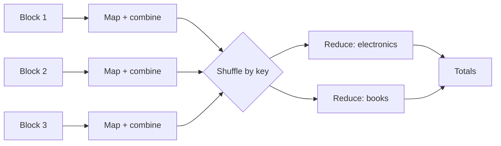
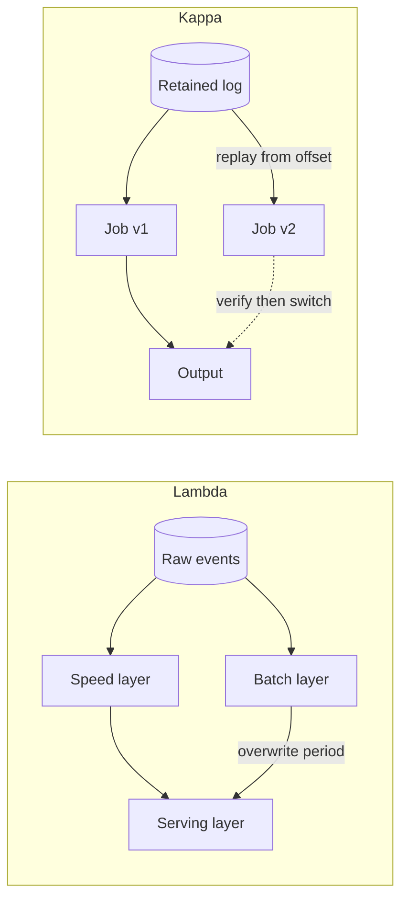
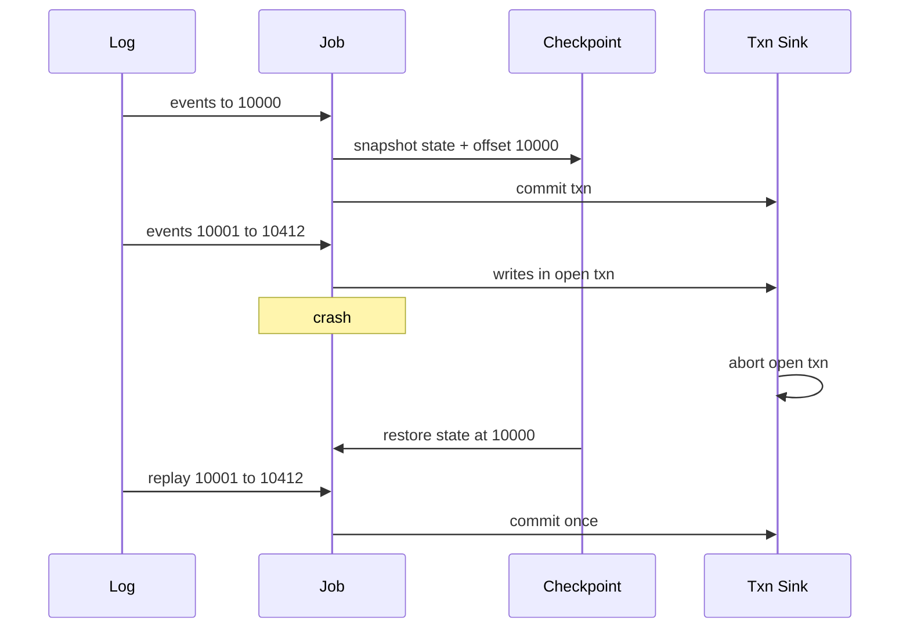
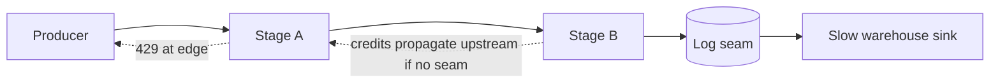
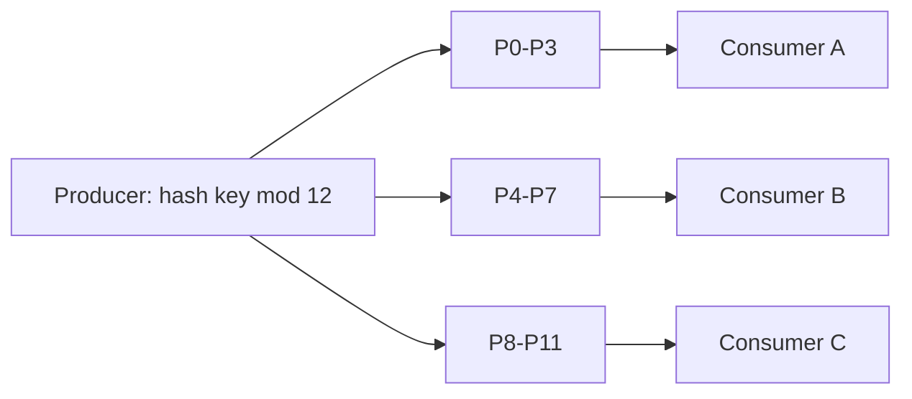
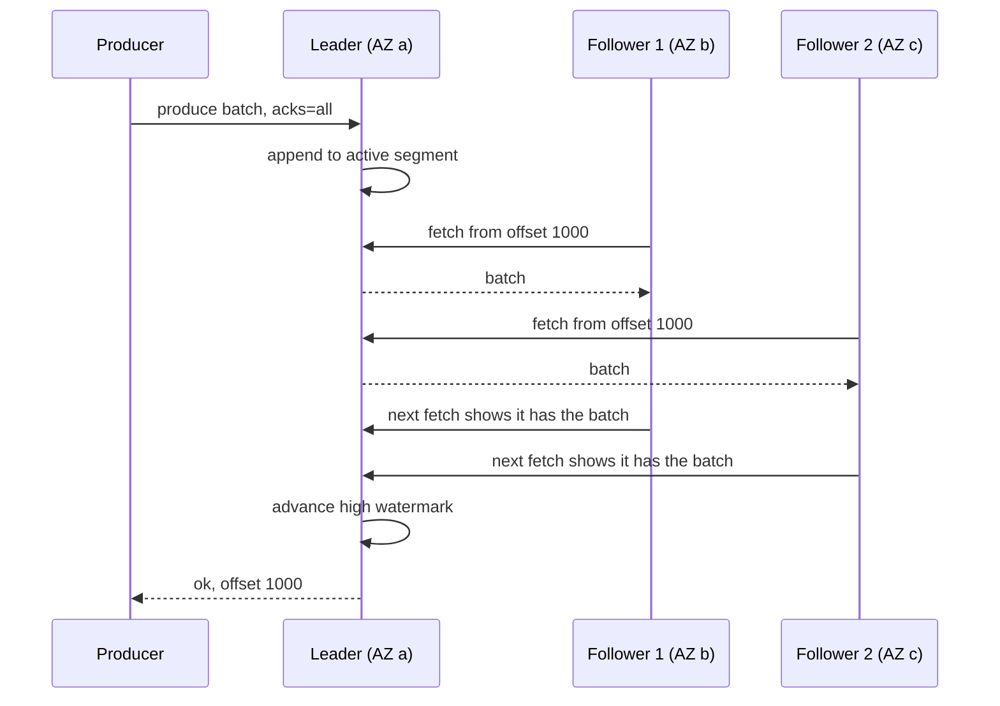

# Module 10 — Data-Intensive Systems (Batch and Streaming)

## Module Introduction
*Original lesson: [Module introduction on DesignGurus ↗](https://www.designgurus.io/course-play/system-design-patterns/doc/6a537ca3ae00005bd5541477)*


**What this module is about.** Earlier modules mostly handled one request at a time in milliseconds. This one asks questions about *lots* of data at once — revenue per hour, fraud patterns, features built from long history — over input that never stops: a **continuous flow** of clicks, order events and table changes. Data engineers usually build these systems, but every engineer should know how a dashboard's numbers are produced.

**Analogy.** Counting votes: wait until polls close and count every ballot (batch — complete but late), or keep a running tally as boxes arrive (streaming — fresh but provisional, since some boxes are late). Same question, different balance of completeness and freshness.

**New constraints:** input may exceed one machine; records arrive late or more than once; consumers read at different speeds. So every data design answers four things: how is work **partitioned** across machines? Where does **intermediate state** live? How does processing **resume after a failure**? Which delays are tolerable, and which data losses are not?

**Two facts that organize the module**

1. **Batch and streaming are the same computation with different staleness budgets** (how old an answer may be). "Revenue per product" can be computed nightly from yesterday's full data (batch: simpler, thorough, hours stale) or updated with each order (streaming: seconds fresh, costlier to run). As in the caching module, the allowed age picks the mechanism. Batch works on **bounded** data (a finished dataset with a known end); streaming on **unbounded** data, so it can't wait for "all the input" and must decide when a partial answer is complete enough to publish.
2. **The log is the foundation.** Module 3's **write-ahead log (WAL)** — every change written to a sequential log before being applied — grows here into a data platform: Kafka-style logs (**Kafka**: an open-source system storing event streams as a durable, replayable log) carry event flows; **CDC** (Change Data Capture) turns a database's WAL into a public stream; **replay** (rereading from an earlier position) enables reprocessing; exactly-once combines log positions with **idempotency** (doing an operation twice has the effect of doing it once). Basics: [Module 0 — Batch vs stream processing](../00-system-design-fundamentals/README.md#batch-vs-stream-processing), [Event streaming](../00-system-design-fundamentals/README.md#event-streaming-topics-partitions-consumer-groups-and-offsets), [Delivery guarantees](../00-system-design-fundamentals/README.md#delivery-guarantees-idempotency-and-retries).

**The seven patterns (plus one added lesson)**

| The situation | The pattern |
|---|---|
| One big question asked over a huge dataset | MapReduce |
| Getting answers while data is still coming in | Stream Processing |
| Bringing a slow-but-thorough result and a fast-but-rough result into agreement | Lambda & Kappa |
| Broadcasting every change the database makes | Change Data Capture |
| Counting each thing once, even with retries and replays | Exactly-Once Semantics |
| A producer that sends faster than its consumer can keep up | Backpressure |
| Running consumers in parallel while keeping the order for each key | Partitioned Consumption |
| Knowing what the log underneath really guarantees, and which settings decide it | Inside Kafka *(added lesson)* |

**How to read it.** MapReduce shows batch's shape (split, compute locally, merge) with deliberately hours-old answers — the reason Stream Processing (windows, event vs. processing time, answering over unfinished input) exists. Lambda & Kappa weighs separate batch and stream pipelines against one replayable stream pipeline. The rest is supporting infrastructure: CDC makes streams from database changes, Exactly-Once builds on idempotency, Backpressure handles traffic beyond a consumer's capacity, Partitioned Consumption keeps per-key order under parallelism. **Inside Kafka** (added lesson) opens the log: segments and retention, why it's fast, replication with the ISR and high watermark (the fully caught-up copies, and how far all of them have got), every message-loss path and the setting preventing it, consumer-group internals (a **consumer group** is a set of readers sharing one stream's work), and how idempotent producers and transactions implement exactly-once. The capstone assembles a clickstream dashboard. Pick batch when completeness beats freshness; streaming only for short deadlines.

> Short on time? Data engineers: Stream Processing and CDC (most tested in data-platform interviews). Everyone else: CDC, which fixes many everyday integration problems.

**Four terms used throughout**
- **Bounded vs. unbounded** — a known end (yesterday's orders; batch) vs. a never-ending flow (streaming, answering without all the input).
- **Event time vs. processing time** — when something happened vs. when the system received it; a mobile order placed in a tunnel at 9:02 may arrive at 9:14.
- **Watermark** — the processor's claim "I've probably seen every event up to time T," letting computation over endless data publish time-based answers.
- **Throughput vs. latency** — batch maximizes rows per hour; streaming minimizes per-result delay. Say which matters; it shapes design and cost.

**Before you start**
- How stale is a number on your main dashboard — and does anyone *know*, or assume it's live?
- How does analytics get database data: a nightly dump, API scraping, a read replica? What does that route miss?
- If event volume doubled for a day, would your pipeline slow, fall behind or break — and did anyone decide which?

---

## MapReduce
*Original lesson: [MapReduce on DesignGurus ↗](https://www.designgurus.io/course-play/system-design-patterns/doc/6a537d447bbf9d62838ba2b1)*


**What it is.** One big question over a huge dataset, spread across hundreds of machines, written as two small functions: **map** turns each record into key/value pairs; **reduce** combines all values sharing a key. The framework splits the data, runs your code near where the data sits, groups results by key, and re-runs failed tasks.

**Analogy.** A national election count: each polling station tallies its ballots per candidate (map + local tally), sends subtotals sorted by candidate to regional centres (shuffle), where each centre sums its candidate (reduce). If one counter falls ill, only that station is recounted.

### The problem

Finance wants **"total revenue by product category, all time, by region"** over **5 billion order rows, ~2 TB**, in **object storage** (cheap cloud storage such as S3 holding whole files).

An analyst's single-machine script reads about **100 MB/s**: 2 TB ÷ 100 MB/s = **20,000 seconds ≈ 5.5 hours just to read**. Started Monday 9 AM, it dies at 12:40 PM when the provider reclaims its **spot instance** (cheap, reclaimable capacity), losing three hours of in-memory progress. Wednesday's retry dies after four hours on a network failure. By Thursday the analyst has hand-built a checkpoint file and resume flag — and still no answer.

Two limits: **one machine is too slow**, and **at multi-hour runtimes failure is likely** (even 1% per hour makes a five-hour job risky). Long jobs need parallelism *and* automatic recovery.

### Why the obvious fixes fail

- **"A bigger machine."** Read bandwidth still has a ceiling, and it's still one **failure domain** — one crash loses everything in memory.
- **"Split it by hand"** over 20 machines and merge with a script. Works once, but a person must notice machine 14 dying at minute 50 and rerun its share; uneven chunks leave 19 machines idle while one grinds; the merge script is fragile; every new question needs a new manual procedure.
- **"Run it on the production database shards."** Scatter-gathering (sending the query to every shard and combining answers) over the **sharded** orders DB makes analytics scans fight checkout for production **I/O**. The storage module separated these workloads deliberately — why analytics has its own copy in object storage, and needs its own compute.

The hand-split had the right *algorithm* (divide, count locally, merge); missing was everything around it — scheduling, failure handling, **stragglers** (tasks running far slower than the rest), reliable merging. MapReduce is that execution framework.

### How it works

```
map(order)             -> emit (order.category, order.amount)
        ... the shuffle groups: all "electronics" amounts to one place ...
reduce(category, [amounts]) -> emit (category, sum(amounts))
```

1. **Split and map where the data lives.** Input is cut into blocks and map tasks run on or near the machines storing them — ship a small program to the data instead of 2 TB to a program. This **data locality** makes distributed batch affordable, since the network is the scarcest resource.
2. **Combine (optional but important).** A **combiner** pre-aggregates each mapper's output locally — "electronics: $4.2M" once instead of a million amounts — shrinking the next step by orders of magnitude.
3. **Shuffle — the expensive middle.** The framework regroups every mapper's output *by key* across the cluster (an all-to-all sort plus network transfer), so every "electronics" value reaches one reducer.
4. **Reduce.** Each reducer merges its keys' values (e.g., sums) and writes results.
5. **Fault tolerance from the model's constraints.** Map and reduce must be **pure functions** (no side effects; same input, same output) over **immutable** input, so any task can rerun anywhere with the same result — idempotency for free. A dead machine's tasks are rescheduled (minutes lost, not the job); a straggler gets a **speculative duplicate**, and the first to finish wins. The framework automates the checkpoint-and-resume the analyst was hand-building.

*Map-combine-shuffle-reduce for revenue by category*


### Walkthrough with numbers (200-machine cluster)

- **Read:** 2 TB ÷ 200 = 10 GB per machine, about **100 seconds** in parallel — 5.5 hours becomes under two minutes.
- **Map + combine:** one partial sum per category per machine — dozens of rows, so the shuffle moves **kilobytes** per machine.
- **Reduce:** summing 200 partials per category takes seconds.
- **End to end: ~10 minutes**, mostly startup and reading — versus a babysat week of restarts.
- **Failure drill:** machine 141 dies at minute 4; its ~30 map tasks rerun elsewhere, adding **90 seconds**, logged.
- **Straggler drill:** machine 77's failing disk slows it at minute 8; speculative copies finish first and 77 is flagged for ops. Nobody waits.

### Trade-offs

**You gain:** scale by addition (200 machines ≈ 200× read bandwidth, coordination handled); fault tolerance for free (pure functions + immutable input make reruns safe); a tiny programming model — the question *is* the program.

**You pay:**
- **A latency floor by construction** — cluster startup, a full data pass and the shuffle: minutes at best, hours at scale, and the answer reflects data as of job start. Freshness is out of reach (next lesson).
- **A rigid shape** — every job is map → shuffle → reduce; real multi-stage analyses chained jobs, and classic MapReduce wrote each stage to disk, multiplying I/O.
- **Shuffle-dominated cost**, worsened by **skew** (one key with far more records; self-check Q3).
- **A scanner, not an index** — reading 2 TB to find "revenue for order #8412" is the wrong tool.

### When not to use it

- **Interactive questions** — analysts iterating need seconds: use a **data warehouse** (an analytics database over huge tables; *columnar* — each column's values stored together, so scanning one column over billions of rows is fast). Under their SQL, warehouses still run map-shuffle-reduce shapes.
- **Small data — and "small" has grown.** 2 TB fits on a laptop SSD; one strong machine running **DuckDB** or **Polars** (an embedded SQL engine and a fast DataFrame library) scans it in minutes. Rule: **exhaust one machine before renting two hundred** (the vertical-scaling lesson's restraint). Cluster infrastructure for laptop-sized data is a common modern mistake.
- **Low-latency needs** — unbounded streams: next lesson.
- **Iterative algorithms** — ML training reads the same data hundreds of times; classic MapReduce's full disk I/O per pass is too slow, which drove in-memory successors and specialized training systems.

### MapReduce vs. Spark (the idea vs. the implementation)

**Apache Spark** is an open-source cluster engine that keeps split-locally-then-merge but runs whole pipelines in memory.

| | Classic MapReduce | Spark (and successors) |
|---|---|---|
| Between stages | Saved to disk after every stage | Held in memory through the whole pipeline |
| Program shape | Strictly map, then shuffle, then reduce | Any **DAGs** (graphs of steps) made of transforms: map, filter, join… |
| Multi-stage / iterative work | A chain of complete jobs, so the I/O multiplies | A single job with cached intermediate results: 10–100× faster |
| Fault tolerance | Run the tasks again from the input | Same idea: rebuild lost partitions from their **lineage** (the recorded chain of transforms) |
| You write | Java boilerplate, two functions at a time | SQL / DataFrames (tables you manipulate in code), and the shape is generated for you |

Interview takeaway: **the execution model outlived the original implementation.** Nobody hand-writes MapReduce, yet Spark plans, BigQuery and Snowflake (cloud data warehouses) and distributed ML data prep all split locally, shuffle by key, and merge.

### Real-world examples

- **Google's 2004 paper** — web indexing needed this shape; it started the "big data" era.
- **Hadoop** — the open-source MapReduce (plus a distributed file system), dominant for about a decade. **Spark** — began at Berkeley to skip inter-stage disk writes and speed iterative work; it displaced Hadoop for many workloads and, via **Databricks** (hosted Spark), runs much production batch.
- **BigQuery, Snowflake and peers** — SQL on top, map-shuffle-reduce underneath; **dbt** — declarative pipelines on those engines.
- **For AI engineers:** training-data preparation is today's largest MapReduce workload: deduplicating, filtering and **tokenizing** (splitting text into model-readable tokens) a web crawl — map processes each document independently, shuffle groups near-duplicates by hash key, reduce picks survivors; serious labs run it on Spark. **Embedding** a corpus (turning each document into a meaning vector) is a map with no shuffle. Distributed training's **all-reduce**, merging **gradients** (per-step weight adjustments) across **GPUs** every step, belongs to the same compute-locally-then-merge family.

### In the interview

Classic: "count word frequencies across 10 TB"; newer: "compute X over everything" or "the analytics job takes 9 hours and fails at hour 7 — fix it." Follow-ups probe the shuffle and failure handling.

> **30-second answer:** "A batch aggregation shaped map-shuffle-reduce. Map runs where the data lives — code to the terabytes — emitting key-value pairs; combiners pre-aggregate locally so the shuffle carries partial sums; reducers merge per key. Fault tolerance comes from the structure: pure functions over immutable input mean any task reruns anywhere, a dead machine costs minutes, stragglers get speculative duplicates. In practice I'd write it in Spark or SQL, but this shape runs underneath. The shuffle is always the costly part, and the answer is stale by design — which is where streaming comes in."

**Likely follow-ups (with answers):**
- *"Where does the time go?"* — The shuffle (all-to-all regrouping over the network) and the input scan. Levers: combiners shrink what's shuffled; partitioning and skew management spread it.
- *"A machine dies at minute 40 of 60?"* — Its tasks rerun elsewhere on the same immutable inputs; minutes lost, nothing corrupted or restarted — a direct consequence of banning side effects and mutation. Say that link out loud.

**Mistake that fails candidates:** batch for interactive or low-latency needs; ignoring the shuffle; hand-building distributed counting instead of naming the shape and modern tools.

**Self-check:**
- **Q1.** "Average order value per country" as map and reduce — mind the averaging trap. → No average of averages. Map emits `(country, (amount, 1))`; reduce (and combiner) sums pairwise to `(sum_amounts, sum_counts)`; divide only at the end. The pair keeps the operation **associative** (partials merge in any grouping), which combiners and parallel reducers require. Rule: build aggregations from mergeable pieces.
- **Q2.** Three hand-split failures the framework avoids, and the property behind each fix. → (1) Dead machine: tasks rerun — safe because pure over immutable input. (2) Stragglers: speculative duplicates — harmless because reruns give the same answer. (3) Uneven chunks and custom merges: fixed-size blocks, and the shuffle *is* a standard merge. All from restricting the model so reruns are free.
- **Q3.** On 200 machines, 199 reducers finish in 2 minutes and one runs 6 hours; all healthy. → **Skew**: one hot key (say Electronics = 40% of orders) sends 40% of the work to one reducer — the sharding lesson's hot key in batch form (hashing spreads keys, not weight). Fixes: combiners (200 partial sums instead of 2 billion rows); for still-heavy keys, **salting** (`electronics-1..16` over 16 reducers, merged in a second stage); or process extreme keys separately.

**Related patterns:**
- **Stream Processing** — the same computations over unbounded input, answering the latency floor.
- **Sharding** — same partitioning math and skew, one layer down.
- **Lambda & Kappa** — how batch and streaming share responsibility for truth.

**TL;DR**
- **Problem:** one machine needs hours just to read, and at multi-hour runtimes failure is routine; hand-splitting reinvents scheduling, straggler handling, merging and recovery.
- **Mechanism:** two pure functions — map (per record, where the data lives) and reduce (merge per key); the framework owns splitting, the combiner-shrunk shuffle, speculative copies and re-execution.
- **Costs:** minutes-to-hours latency, a rigid shape (classically with disk I/O between stages), shuffle-dominated cost, skew.
- **Skip it when:** interactive (warehouse), fits one machine, needs fresh answers (streaming), or iterative (ML).

---

## Stream Processing
*Original lesson: [Stream Processing on DesignGurus ↗](https://www.designgurus.io/course-play/system-design-patterns/doc/6a537de1ae00005bd5544a29)*


**What it is.** A job that **never ends**: it reads a growing event log, holds running **state** per tracked thing (counts, sums, windows) and emits answers continuously. The central hard question: when input never ends, when is an answer "final"?

**Analogy.** A teller watching live card swipes with a 10-minute tally per card, flagging a card at its sixth swipe — versus reading yesterday's statements next morning.

### The problem: correct, but eight hours too late

The nightly fraud batch spots coordinated stolen-card use with **99% precision**. Tuesday it flags **30 fraudulent orders** from one ring, all placed **3:40–3:55 PM** and shipped by 6 PM; the job ran at **2 AM**, eight hours after the goods left. **Right but useless.** "Revenue by category, all time" can be hours stale; "is this card being abused *right now*" needs seconds, which no batch tuning reaches. Likewise an ops dashboard showing yesterday's "orders per minute". Fraud detection, live metrics and fresh ML features need ongoing answers about the last few seconds of endless input.

### Why the obvious fixes fail

- **"Run the batch every five minutes"** (micro-batching). Real (it inspired Spark Streaming), but job startup sets a floor on the interval (a cluster job every 30 s may mostly be starting up), and "orders on this card in the last hour" spans many runs, so each run needs **running state from previous runs**. The true batch/stream difference is *persistent state*, not just speed.
- **"Query the database on every order"** — `SELECT COUNT(*) WHERE card=? AND time > now()-1h` is **400 expensive queries/s** on production: analytics-on-production again, with indexes not built for it. Databases store history; they aren't built to *watch* arrivals.
- **"Count in application memory."** With checkout scaled horizontally, **40 servers each see ~1/40** of a card's orders — the per-server-counter problem. Every event for a card must reach *one* place holding its state: **key-based routing**.

### How it works

1. **State is the core.** Each operator (processing step) keeps its running answer locally (memory or local disk), **keyed**: all events for card X go to the instance owning card X — the shard-key idea for compute, formalized by Partitioned Consumption. Most of a streaming framework's job is managing this state.
2. **Recovery = checkpoint + rewind.** The framework periodically saves a durable **snapshot of all state together with the matching log position**. After a crash it loads the snapshot, **rewinds the log** to that position and reprocesses — possible only because the source is replayable. Events near the crash are processed **twice**, so outputs must tolerate duplicates (→ Exactly-Once).
3. **Windows slice endless input into finite pieces**, since an infinite stream has no "final total":
   - **Tumbling** — fixed, back-to-back intervals; each event in exactly one (orders per minute).
   - **Sliding** — overlapping intervals (orders in the last 10 minutes, re-evaluated every 30 s).
   - **Session** — open until an **inactivity gap** (a browsing session ends after 30 idle minutes); length set by the data.
4. **Event time vs. processing time — the hardest, most consequential idea.** Grouping by *processing time* (arrival) counts the 9:02 tunnel order at 9:14: simple, but wrong — retries, mobile batching and network delay reorder arrivals and create fake spikes. Grouping by *event time* counts it at 9:02, but at 9:03 the system can't know it exists, so windows must stay open for late arrivals.
5. **Watermarks decide when a window may close.** An estimate like "I've probably seen everything up to 9:05"; when it passes a window's end, the window closes and emits. The watermark delay *is* the staleness budget: longer → more complete, later; shorter → faster, more "late" events. So every consumer needs a **late-data policy**: drop late events, emit corrections consumers agree to accept, or route them to a side channel for reconciliation.


*Figure — Stream Processing (course diagram)*

An orders **topic** (named event stream) feeds a stateful operator keyed by `card_id`, whose state holds per-window counts (card 123: 7, 12, 5 across three 5-minute windows); it emits to an alerts **sink** and a dashboard sink (where a pipeline writes output) and regularly checkpoints state + log position.

### Walkthrough with numbers (rule: more than 5 orders on one card within 10 minutes)

- **The path:** order event → log → the operator holding the card's state → count updated → threshold checked → alert: **~200 ms**. Tuesday's ring is caught at **order #6 at 3:44 PM**, goods still on the shelf.
- **State size by arithmetic:** ~**200,000** active cards per 10-minute window × a few bytes = **megabytes**. Compute this before reaching for heavy state storage.
- **Crash drill:** load the **30-second-old** checkpoint, rewind 30 s, reprocess — **under a minute**, no orders missed. Replayed alerts go out twice, so the alert sink **dedupes on `(card, window)`** (idempotency).
- **Tunnel drill:** fraud's watermark lags only **30 s**, so the 9:02 order arriving at 9:14 is late data. Fraud's policy: process it, update the count, alert late if the threshold is crossed. The dashboard on the same stream chose **drop** (a per-minute chart won't redraw for one straggler). **Same stream, two policies — the policy belongs to the question, not the pipeline.**

### True streaming vs. micro-batch

| | True streaming (per event) | Micro-batch (tiny frequent jobs) |
|---|---|---|
| Latency floor | Milliseconds | The length of the batch interval (seconds up to a minute) |
| State between "runs" | Built in — the whole operator is designed around it | Carried from run to run by the framework |
| Complexity | Everything described above | Clearly easier to reason about |
| Fits | Fraud, alerting, features needed in under a second | Dashboards, feeds, pipelines with a one-minute budget |

**The budget decides:** a one-minute budget → micro-batch is simpler and correct (**Spark Structured Streaming**); a one-second budget → only true streaming (**Flink**, Apache's stateful stream engine). "The budget chooses" beats tool loyalty.

### Trade-offs

**You gain:** seconds-fresh answers over endless input (making fraud checks, live metrics and fresh features possible); incremental economics (each event updates state once instead of rescanning); solid correctness machinery (checkpoints + replayable log).

**You pay:**
- **The course's steepest concept stack** — windows, two kinds of time, watermarks, late policies, state; routinely underestimated.
- **Stateful operations** — checkpointing, restoring, monitoring and **rescaling** state (re-partitioning when the job grows or shrinks — hard).
- **Provisional answers** — event-time results change when stragglers arrive, so consumers must accept corrections (**eventual consistency** in analytics).
- **Operational weight** — a forever-running stateful job is a *service* needing **on-call**, upgrades and capacity planning.

### When not to use it

- **No deadline** — nightly rollups and weekly cohorts are simpler, cheaper and easy to reprocess in batch.
- **Small scale** — a **cron job** with a SQL query counts a startup's daily actives without a Flink cluster.
- **Ad-hoc exploration** — analysts need a warehouse, not a streaming job per idea.
- **No owning team** — an unowned stateful platform becomes the main outage source between log and dashboard.
- Misuse: rebuilding stable nightly jobs as streams without a business need for freshness.

### Real-world examples

- **Apache Flink** — the full model (event time, watermarks, exactly-once state); most of this lesson's vocabulary.
- **Google's Dataflow model (2015 paper)** — unified windows, watermarks and late-data triggers; most frameworks implement it.
- **Kafka Streams** — the pattern as a library inside your service, no separate cluster.
- **Spark Structured Streaming** — micro-batch at industrial scale.
- **For AI engineers:** feature freshness affects model quality — a fraud model on hour-old velocity features misses coordinated attacks. A **feature store** (computing and serving ML input values for training and live prediction) uses such jobs on its **online path** for millisecond-fresh keyed aggregates; token metering, prediction monitoring and **evals** over sampled traffic rely on it too. Use **event time**: processing-time features teach the model *network lag*, not user behavior.

### In the interview

Direct prompts: "design real-time fraud detection", "a live orders-per-minute dashboard". Predictable follow-ups: late events, crash recovery, counting across a server fleet.

> **30-second answer:** "A never-ending job reading the order log with state keyed by card, so every event for a card reaches the instance holding its counts; it checks a sliding window per event and alerts within a couple hundred milliseconds. Windows use event time, because retries and mobile lag scramble arrival order. A watermark thirty seconds behind closes windows; late stragglers still update the count, since a late fraud alert beats none. Recovery is checkpoint plus rewind — state snapshots tied to log positions, with the replayable log reprocessing the gap — and because some events process twice, the sink dedupes on card-and-window. With a one-minute budget I'd micro-batch and keep it simple."

**Likely follow-ups (with answers):**
- *"An event arrives 12 minutes late?"* — Its window has closed, so the late policy applies — chosen *per consumer*: fraud updates and alerts late, the dashboard drops, a reconciliation stream side-channels it. Per-consumer policy is the senior detail.
- *"The operator crashes mid-afternoon — what's lost?"* — Nothing durable: last checkpoint, rewind, reprocess. Sinks see a few seconds replayed — the real cost of a crash is *duplicate emissions*, hence idempotent sinks.

**Mistake that fails candidates:** processing-time windows for money or fraud; state in application memory across a fleet; a database query per event — each a failed "obvious fix" dressed up as a design.

**Self-check:**
- **Q1.** Windows for (a) revenue per calendar minute for a chart, (b) "more than 5 orders in any 10-minute span", (c) average items per shopping session. → (a) Tumbling — clean non-overlapping buckets. (b) Sliding — must catch *any* 10-minute span. (c) Session — the boundary is the activity gap.
- **Q2.** A carrier outage holds back 20 minutes of app events, then they arrive in one burst. Processing-time pipeline vs. event-time with a 2-minute watermark? → Processing time: a fake quiet dip during the outage, then a huge fake spike "now" as 20 minutes land at once — triggering rate alerts and permanently recording traffic that never happened. Event time: delayed events keep real timestamps; outage windows close ~2 minutes after ending with provisional *undercounts*, then late events trigger corrections per policy and numbers settle on reality. Processing time measures the network; event time measures users.
- **Q3.** After a routine deploy, fraud gets duplicate alerts (same card, same window) for about a minute of traffic, with no real spike. → The deploy restarted the operator via normal recovery (restore checkpoint, rewind, reprocess ~1 minute); the computation was right both times but the sink emitted twice. Make alerts idempotent on `(card_id, window_id)` or use a transactional exactly-once sink. **Every deploy rehearses the crash.**

**Related patterns:**
- **Message Queue** — the replayable log source enabling rewind recovery.
- **Partitioned Consumption** — keyed routing of each card's events to its state.
- **Exactly-Once Semantics** — handling what replays do to sinks.
- **Write-Ahead Log** — checkpoints borrow it: durable state plus position, recovery by replay.
- **Lambda & Kappa** — when batch and streaming both claim the truth.

**TL;DR**
- **Problem:** deadline questions (fraud, metrics, features — now) concern the last seconds of endless input; batch answers arrive hours late.
- **Mechanism:** a forever-running job with keyed state over a replayable log; tumbling, sliding and session windows; event time with watermarks; per-consumer late policies; checkpoint + rewind recovery.
- **Costs:** the steepest concept stack, a stateful service to run, provisional answers that get amended, replays requiring idempotent or transactional sinks.
- **Skip it when:** the staleness budget is generous, a cron job suffices, the work is ad-hoc exploration, or nobody can own a forever-running service.

---

## Lambda and Kappa
*Original lesson: [Lambda and Kappa on DesignGurus ↗](https://www.designgurus.io/course-play/system-design-patterns/doc/6a537ebcf5fad4cc63423a84)*


**What it is.** Two architectures for needing *both* fresh streaming answers and complete, correct batch answers. **Lambda** runs batch and streaming pipelines side by side, with batch results periodically **overwriting** streaming ones. **Kappa** runs **one** streaming pipeline over a log that retains history, and corrects by fixing the code and **replaying** the log.

**Analogy.** Lambda: a newspaper's quick online updates replaced by a fact-checked overnight print edition. Kappa: one newsroom that reruns its stories from the archive with corrected facts.

### The problem: two pipelines, two truths

A nightly batch pipeline feeds official reports and a streaming pipeline feeds the live dashboard; both compute revenue. Wednesday, finance sees Tuesday at **$412,880** on the dashboard and **$413,205** in the batch report. Both are "right" by their own rules: the stream dropped late events per its watermark policy and had a **one-minute dedupe gap** during Tuesday's deploy (the stream lesson's Q3, for real); batch read everything and is correct as of 2 AM. Nobody ever decided which is *the truth*.

Three weeks later a discount-rule change ships only in the batch code. Now they differ by a **coding error** that grows daily, and a monthly "reconciliation meeting" appears where people referee their own computers.

**Named precisely:** two codebases implementing the same business logic drift apart over time — a problem anyone running separate batch and streaming must handle on purpose.

### Why the obvious fixes fail

- **"Perfect the stream and retire batch."** Exactly-once reduces processing errors, but batch's main strength is **reprocessing history with current code** (a changed fraud rule, a found bug). A stream can revisit events only if a replayable log retains them — which becomes Kappa's key idea.
- **"Run batch hourly."** Fresher, but still two independently changing codebases; the inconsistency window shrinks, its cause remains.
- **"Label the dashboard 'approximate' and declare batch the truth."** A valid policy if stakeholders agree, but it doesn't stop forgotten-change drift and keeps two codebases.

### How it works — Lambda

Proposed by **Nathan Marz** (Twitter / Storm era; **Storm** was an early open-source stream processor). Three layers:
1. **Speed layer** — streaming; fast, provisional.
2. **Batch layer** — slow, authoritative; recomputed on schedule from raw history.
3. **Serving layer** — stitches them: recent hours from speed, settled history from batch.

The central mechanism is **the overwrite**: each batch run *replaces* the speed layer's results for its period, so streaming bugs — the deploy gap, dropped stragglers, even the forgotten discount rule — are wiped at the next run. Lambda doesn't prevent speed-layer errors; it **bounds their lifetime to one batch cycle**. The permanent cost: **every metric is implemented twice**, so logic drift is built into the architecture.

### How it works — Kappa

Proposed by **Jay Kreps** in "Questioning the Lambda Architecture". If the event log retains history for weeks, months or effectively forever via **tiered storage** (old segments moved to cheap object storage), batch is just *streaming a bounded prefix of the log, fast*, and reprocessing becomes a streaming operation:

1. Deploy job **v2** with the new logic, reading from **offset** (log position) zero or, say, 90 days back.
2. v2 races through history at full read speed — hours, not weeks.
3. v2 catches up to "now" and runs beside v1; outputs are compared.
4. Point consumers at v2's output; retire v1.

The zero-downtime migration playbook (run both, check, switch, retire) applied to pipelines. One codebase makes the discount-rule drift impossible. Costs: long retention, replay compute far above the live rate (90 days in an afternoon), and a streaming engine mature enough (exactly-once, event time) to be the *only* truth.

*Lambda vs Kappa data flow*


### The pragmatic synthesis

Most organizations run a practical **dual path** — streaming for operational freshness, a warehouse for deep analysis — often without Lambda's formal overwrite, but they should keep **scheduled backfills** (recomputing a past period and replacing existing results). The engines are converging: **Flink** runs bounded inputs in batch mode, **Spark** processes streams, and **lakehouse tables (Delta, Iceberg)** (open table formats giving database-like tables over object-storage files) accept streaming writes while serving batch queries. Increasingly: **one logic, two execution tempos** — Kappa's aim.

### Walkthrough with numbers: the deploy-gap bug under each design

- **Lambda:** Tuesday's deploy silently loses ~**300 orders** from dashboard revenue; at 2 AM Wednesday batch recomputes Tuesday and overwrites the speed layer — self-healing, which is what the second codebase buys.
- **Kappa:** fix the bug in the one codebase and replay from **Monday's offset**; at ~**50× the live rate**, **two days reprocess in under an hour**. Once v2 catches up, verify against finance's **$413,205**, move consumers, retire v1. Repeatable, but a person must start it.
- **The discount-rule drift:** under Lambda only one implementation got the update, surfacing when Wednesday's overwrite changed Tuesday's dashboard numbers; Kappa rules it out entirely. Summary: Lambda auto-fixes operational errors but risks two disagreeing implementations; Kappa removes duplication but needs someone to replay.

### Comparison

| | Lambda | Kappa | Pragmatic dual path |
|---|---|---|---|
| Codebases per metric | Two, on purpose | One | Two, by accident (fix: shared definitions) |
| Streaming-bug recovery | Wiped out automatically by the next batch overwrite | Replay from an offset — a routine operation | A manual backfill (if someone notices) |
| Logic drift | Part of the design | Impossible by structure | What happens by default |
| History economics | Raw data kept in cheap storage | Log retention (tiered) | Warehouse tables |
| Demands | Stitching in the serving layer | Mature streaming plus capacity to replay | Discipline that nobody enforces |

Interview verdict: Lambda's overwrite survives as scheduled backfills; engines increasingly support Kappa's single codebase; many teams run **accidental Lambda** unknowingly and should fix it with automatic overwrites or unified logic.

### Trade-offs

- **Lambda gains:** automatic scheduled correction bounds streaming errors to one cycle; each layer is simpler alone; truth is always recomputable from raw history. **Costs:** every metric twice (constant drift risk, duplicate infrastructure); the serving layer must define where "recent" ends and "settled" begins.
- **Kappa gains:** one codebase, no implementation drift; reprocessing as a tested migration routine; the log as the only history. **Costs:** retention (reduced by tiered storage), burst replay capacity, total dependence on the streaming engine — an unreliable pipeline compromises your only truth.

### When not to use each

- **Don't Lambda with a small team** — you can't keep two pipelines agreeing. Two pipelines *without* the automatic overwrite is **accidental Lambda**: all the duplication, none of the recovery — the opening incident, and very common.
- **Don't Kappa when history is huge and reprocessing rare** — years of log for one yearly replay can cost more than rerunning a warehouse job; batch-shaped work (large multi-way joins, ML training passes) fits batch better.
- **Don't be dogmatic** — for most teams, a dual path with disciplined backfills and **one shared metric-definition library** (written once, run by both engines) beats either pure form.

### Real-world examples

- **The founding documents:** Marz's Lambda (Storm era) and Kreps' "Questioning the Lambda Architecture" (Kafka side) — read as a debate, they *are* this lesson.
- **Uber, Netflix, LinkedIn** describe journeys along this spectrum: Lambda first (growth), drifting toward Kappa where log-centred culture took hold, a dual path where warehouses dominated.
- **Tiered storage** in Kafka removed Kappa's retention objection; Flink batch mode, Spark streaming and Delta/Iceberg lakehouse tables are where tools converge.
- **For AI engineers:** this is **training/serving skew** in infrastructure: batch warehouse code computes *offline training* features, streaming code computes *online serving* features, and if they define "user's 7-day order velocity" differently the model degrades. **Feature stores** define each feature once and run it in both modes.

### In the interview

Prompt: "analytics with a live dashboard *and* accurate finance reports." The trap is building two pipelines unknowingly. Typical follow-up: "your streaming pipeline had a bug for three hours — recovery?"

> **30-second answer:** "Two needs, one truth: the dashboard needs seconds-fresh numbers, the reports complete ones, and the risk is implementing metrics twice and drifting — the accidental Lambda most companies run. I'd build around the replayable log and lean Kappa: one streaming codebase where recovery is reprocessing — fix the logic, replay from an earlier offset at ~50× real time, verify against the old output, switch. Truly batch-shaped work (huge joins, training passes) reads the same log with shared metric definitions. I'd keep Lambda's best idea as scheduled backfills, bounding any streaming error's lifetime. Either way: one definition, one owner, one logic source per metric."

**Likely follow-ups (with answers):**
- *"The streaming job was wrong for three hours — recovery?"* — Kappa: replay from before the bug with fixed code; sinks accept restated numbers (the stream lesson's amended answers at architecture scale) or the output swaps after verification. Lambda: nothing — the next overwrite wipes the period. Pragmatic path: a backfill, if the habit exists. Your answer reveals which architecture you really have.
- *"Why not always run both to be safe?"* — Without an automatic overwrite it's double cost plus drift; with one, still two implementations per metric. Recoverability comes from *replayable history*; a second pipeline is just one way to use it.

**Mistakes that fail candidates:** two pipelines without a reconciliation plan (unnoticed accidental Lambda); Kappa without retention or replay-capacity math; treating the choice as taste rather than budget and team.

**Self-check:**
- **Q1.** Lambda's three layers, and the mechanism justifying building everything twice. → Speed (fast, provisional), batch (slow, authoritative, from raw history), serving (stitches recent + settled). The justification is the **overwrite**: each batch run replaces the speed layer's period, so streaming errors (gaps, drops, even logic mistakes) last at most one cycle. Without it, Lambda is just two disagreeing pipelines.
- **Q2.** Case A: log-centred organization, metrics changing monthly, 90 days of history enough for all reprocessing. Case B: 5 years of history, reprocessed about once a year, heavy multi-way joins. → A: **Kappa** — retention covers the range, frequent changes favor one codebase, log experience supplies maturity. B: a **batch-anchored dual path** — 5 years of log for one yearly replay isn't worth it and big joins suit batch; warehouse as authority, stream only operational views, shared metric definitions.
- **Q3.** You inherit the opening incident (disagreeing numbers, drifted discount logic, no overwrite, a monthly meeting). Name it, give both exits with first steps, state the invariant. → **Accidental Lambda.** Path 1 — finish Lambda: add the overwrite; first step: write nightly batch results into the dashboard store keyed by period. Path 2 — Kappa: consolidate into the streaming codebase; first step: extend retention beyond the reprocessing horizon and rehearse one replay-verify-switch for a single metric. Invariant: **one definition, one logic source, one owner per metric**.

**Related patterns:**
- **MapReduce** and **Stream Processing** — the two layers whose disagreement this settles.
- **Message Queue** — the retained, replayable log that makes Kappa possible.
- **Exactly-Once Semantics** — the correctness bar a sole pipeline must meet.
- **Feature Store** — training/serving skew is this lesson in ML form.

**TL;DR**
- **Problem:** batch and streaming compute the same metrics in two codebases that drift (policy differences, forgotten changes) until people reconcile monthly.
- **Mechanism:** Lambda — run both, with a scheduled batch overwrite of the speed layer's period (errors last at most one cycle). Kappa — one streaming codebase over a retained log; reprocess via replay-verify-switch.
- **Costs:** Lambda — every metric twice, drift built in, stitching seams. Kappa — retention, burst replay capacity, total dependence on a mature stream engine.
- **Skip / adapt when:** the team is small (don't run two of anything), history is huge and rarely reprocessed (warehouse wins), or compute is batch-shaped — and never run accidental Lambda.

---
## Change Data Capture
*Original lesson: [Change Data Capture on DesignGurus ↗](https://www.designgurus.io/course-play/system-design-patterns/doc/6a537f6b7bbf9d62838bbc2f)*


**What it is.** CDC turns the change log a database keeps for itself into a public event stream. A **connector** reads the database's **write-ahead log (WAL)** — the ordered record of every committed change — as a **replica** would, but *publishes* changes instead of applying them. Every committed insert, update and delete, from any code path, becomes an event on a topic in commit order, consumed by search, caches, warehouses and streams.

**Analogy.** Instead of asking every clerk to remember to call other departments after changing a file (they'll forget), tap the office's official logbook — where every change must be written to count — and broadcast each entry.

### The problem: four incidents, one cause

Four earlier incidents share a root cause:
- **Search (CQRS lesson):** the app wrote the DB, then separately **Elasticsearch**; during a deploy the Elasticsearch calls timed out, and orders existed in the DB but never in search.
- **Cache (cache-aside lesson):** a bulk import wrote directly to the DB and never **invalidated** the cache; products stayed stale for an hour.
- **Analytics (pub/sub lesson):** analytics may not read the orders tables directly, yet needs the data.
- **Warehouse:** a full nightly dump — a 2 AM window, day-old data, reading *everything* to find the 1% that changed.

Derived systems need a *complete* change record, but ad hoc announcements always leak: app code forgets, bulk imports and hand-written SQL bypass the app. Meanwhile the database *already* records every committed change from every path, in order, in its WAL (Module 3's durability mechanism). **What if that log stopped being internal?**

### Why the obvious fixes fail

- **Dual-write** — update the DB, then notify others. No single **transaction** covers both, so a crash between them leaves systems **permanently and silently inconsistent** — *loss*, not *lag* (lag is visible and recoverable; a missed write leaves no error).
- **Polling** — `SELECT * WHERE updated_at > :last_check` on a timer has three built-in gaps: (1) **deletes are invisible** (a deleted row matches no query, leaving a **ghost row** in the index); (2) **intermediate states collapse** (three updates between polls look like one snapshot — fine for a cache, not for audit or event processing); (3) it relies on **every writer** maintaining `updated_at`.
- **Database triggers writing to a change table.** A **trigger** (code the database runs on every insert, update or delete) does see every write, including bypasses — the right idea — but adds synchronous work to every transaction and per-table upkeep, while the database already keeps an ordered change record *below* the trigger layer.

### How it works

A CDC connector **tails** the replication log (keeps reading as it grows). Each property fixes one problem above:

1. **It cannot miss.** Every committed change passes through the WAL — that's what "committed" means — so admin tools, bulk imports and manual `UPDATE`s are captured with no application discipline.
2. **Deletes arrive as events** — published as a **tombstone** ("this key no longer exists"). Deletion is a recorded fact (the vector-clocks rule); no ghost rows.
3. **Ordered per key, for free** — commit order.
4. **Zero application changes** — a full change history without rewriting the app or adopting **event sourcing** (storing every change as an event and deriving current state from them).
5. **At-least-once delivery** — never lost, occasionally duplicated, because after a crash the connector resumes from its saved log position. Consumers must be **idempotent**; row-image events ("set name to X") naturally are.
6. **Snapshot bootstrap.** On first connect the connector takes a consistent table snapshot, then switches to tailing with no gap, so new consumers get history plus live stream in order.

**What CDC events are, and aren't.** They say *what* changed ("row 8412: status active → cancelled"), not *why* ("customer cancelled due to delay") — **row diffs, not business intent**. Perfect for data infrastructure (indexes, caches, warehouses); for **domain events** (business facts like "OrderCancelled"), use the outbox.

**The outbox pattern — the standard replacement for dual-writes.** The app writes its business event ("OrderCancelled, reason: delay") into an **outbox table in the same transaction** as the data change — both or neither. CDC reads the outbox and publishes the event with its meaning. **The transaction provides atomicity, the log provides delivery, the app provides intent** — the "reliable publisher" the pub/sub lesson promised.


*Figure — Change Data Capture (course diagram)*

All write paths — app code, bulk imports, manual fixes — land in the database's WAL/binlog (*binlog* is MySQL's change log). The **Debezium** connector (popular open-source CDC) reads it and publishes ordered insert/update/delete events to a `products.changes` topic, consumed independently by a search indexer, cache invalidator, warehouse ingest and streaming jobs.

### Walkthrough with numbers: the four problems, fixed

- **Search:** Debezium reads the products table; the indexer applies changes idempotently. Deploy timeouts can no longer cause permanent mismatch — an interrupted connector means measurable, recoverable **lag**. Freshness **under a second**; bulk imports update the index with no import code.
- **Cache:** a consumer deletes cache keys on each change event; forgotten invalidations disappear, since every committing path produces an event.
- **Warehouse:** the nightly dump read **2 TB to find 20 GB** of changes; streaming changes is **400 writes/s × ~500-byte events ≈ 200 KB/s**. "Yesterday" becomes "seconds ago".
- **Failure drill:** the connector stops Friday at **6 PM**, unnoticed until **8 PM**. The database retains unread WAL segments because the connector's **replication slot** (a bookmark of one log reader's position) hasn't confirmed them; restarted, it catches up in minutes — lag, not loss. A connector that *never* returns, though, makes retained log grow without limit (self-check Q3).

### Three ways to publish a change

| | Naked dual-write | Raw CDC (table streams) | Outbox + CDC |
|---|---|---|---|
| Atomicity | None — this is the torn-write bug | Perfect (the log *is* the commit) | Perfect (a single transaction) |
| Carries intent | It could, but writes can tear | No — only row diffs | Yes — whatever event you choose |
| App changes | Yes, and every path needs discipline | None | One outbox write for each event |
| Consumer coupling | Tied to your API | Tied to your table schemas (column names and types) | Tied to a contract you designed |
| Fits | Nothing — retire it | Your own infrastructure: caches, indexes, warehouse | Domain events that other teams consume |

**Rule to memorize:** raw CDC for derived infrastructure you own; outbox for events other teams consume; never dual-writes. Together they solve Module 2's reliable-publishing problem.

### Trade-offs

**You gain:** cannot-miss completeness (every path, bypass writes and deletes included); one integration, N consumers (pub/sub economics); seconds of freshness instead of nightly, with failures causing **lag, not loss**.

**You pay:**
- **Schema coupling — the big one.** Raw events copy table schemas, so a column rename hits every consumer and your internal schema becomes public API. Soften it with an outbox for domain events, a **schema registry** (stores and checks event schemas, rejecting incompatible changes), or a transformation layer between table and event schemas.
- **WAL retention pressure.** A slow or dead connector blocks log trimming (the WAL lesson's failure mode); replication-slot lag must be a top-priority alert, or it becomes a full disk on the **primary**.
- **Diffs, not intent** — "why" needs the outbox.
- **Another critical component** — connector **high availability** (usually a standby), snapshot management, topic hygiene; small, but on every derived system's path.

### When not to use it

- **Other teams want meaning** — don't ship them your table structure; use the outbox (CDC underneath, publishing a designed contract).
- **Tiny scale** — a nightly dump may suffice; CDC's operating cost needs a real freshness or completeness payoff.
- **As a transaction mechanism** — CDC is **asynchronous**, consumers lag by design; it spreads facts *eventually*, never making two systems atomically consistent (Module 7).
- **No log access** on a managed database — increasingly rare (Postgres logical replication, MySQL binlog and cloud equivalents are nearly universal), but check.
- **Common misuse:** raw CDC topics as the company-wide domain-event bus — every consumer depends on table schemas and every migration becomes a multi-team negotiation (the EDA lesson's governance problem).

### Real-world examples

- **Debezium** — open-source connectors reading Postgres, MySQL, MongoDB and others into Kafka; interviewers often expect it.
- **Postgres logical replication and replication slots** — the mechanism underneath (and Q3's disk failure); **MySQL's binlog** is the equivalent.
- **Managed ingest:** **Fivetran, AWS DMS, Snowpipe Streaming**.
- **Netflix's DBLog** and similar in-house systems — snapshot plus tail at streaming-giant scale.
- **For AI engineers:** CDC keeps feature stores and retrieval indexes fresh: "user's current plan" or "orders this week" update within seconds without app teams publishing anything. For **RAG**, content-table changes trigger **re-embedding only changed rows** (the CQRS lesson's vector-index read model; a **vector index** finds items whose embeddings are near a query's), so stale embeddings don't hurt relevance.

### In the interview

Prompt: "keep the search index / cache / warehouse in sync with the database." Dual-writes aren't atomic; polling misses deletes and intermediate states; the complete answer is log-based CDC plus an outbox for domain events.

> **30-second answer:** "A Debezium-style connector tails the database's WAL and publishes every committed insert, update and delete as ordered events. It can't miss anything — bulk imports and manual fixes go through the same log — and deletes arrive as tombstones, which polling can never see. Consumers (search indexer, cache invalidator, warehouse) apply events idempotently because delivery is at-least-once; a down connector means lag, not loss. Two rules: raw table streams only for my own infrastructure, since their schema is my table's schema; domain events for other teams go through an outbox written in the same transaction, eliminating dual-writes. And I alert on replication-slot lag, because a dead connector silently stops WAL trimming until the primary's disk fills."

**Likely follow-ups (with answers):**
- *"Why not have the app write to both places?"* — The torn write: no transaction spans DB and index, so a crash between writes splits them silently and forever — loss, not lag. CDC reads *after* commit from the commit's own record, so a split is structurally impossible; only visible lag remains.
- *"A row is updated then deleted between two polls — polling vs. CDC?"* — Polling sees nothing (the deleted row matches no query, its intermediate state was never sampled) and leaves a ghost row; CDC emits the update then the delete tombstone, in order.

**Mistakes that fail candidates:** confident dual-writes; polling presented as complete with no answer for deletes; raw CDC as the company event bus; at-least-once without idempotency.

**Self-check:**
- **Q1.** Why can log-tailing never miss a change, and what two things does timestamp polling miss by design? → Every committed change passes through the WAL, so a WAL reader sees every change from every path in commit order. Polling misses (1) deletes and (2) intermediate states, and depends on every writer maintaining `updated_at`.
- **Q2.** Raw CDC or outbox for (a) your team's search index, (b) an "order shipped" notification to partners, (c) the warehouse? → (a) Raw CDC — your index wants row diffs, no app changes. (b) Outbox — partners need a versioned, intent-carrying "OrderShipped" contract written in the same transaction as the status change; never expose internal tables in hard-to-retract contracts. (c) Raw CDC — internal copying, with a downstream transformation layer for analytics models and a schema registry catching breaking migrations.
- **Q3.** Saturday 4 AM: the primary's disk is at **94%** and rising, writes normal, WAL segments not trimmed; a replication slot shows a consumer **30 hours** behind — a connector that crashed Thursday. → The slot stops the database deleting unconfirmed WAL, so a dead connector for a *derived* system threatens the *authoritative* database. Triage: restart the connector if it can catch up before the disk fills (30 hours may take tens of minutes); otherwise drop the slot to free space, then re-snapshot and rebuild consumers. Guards: **alert on replication-slot lag** in bytes or time (after hours, not at 94% disk), a highly available connector, and a written maximum-retention policy saying when operators may drop a slot to protect the primary.

**Related patterns:**
- **Write-Ahead Log** — CDC publishes Module 3's internal log.
- **Publish-Subscribe** — one feed, N consumers, schema-contract rules in force.
- **CQRS** — read models fed correctly after dual-writes failed.
- **Event Sourcing** — contrast: CDC for change history (diffs), event sourcing when events *are* the product (intent), the outbox between.
- **Cache-Aside** and **Idempotency** — complete invalidation events; consumers must dedupe.

**TL;DR**
- **Problem:** derived systems drift because app-level change announcements leak: dual-writes tear, polling misses deletes, bypass writes tell no one.
- **Mechanism:** tail the WAL like a replica and publish every committed change (inserts, updates, delete tombstones) in commit order; snapshot bootstrap; at-least-once to idempotent consumers; an outbox for intent-carrying domain events.
- **Costs:** table schemas become contracts, replication-slot retention can fill the primary's disk, diffs carry no intent, one more critical connector.
- **Skip it when:** consumers deserve a designed contract (outbox), the scale fits a nightly dump, or someone expects atomicity.

---

## Exactly-Once Semantics
*Original lesson: [Exactly-Once Semantics on DesignGurus ↗](https://www.designgurus.io/course-play/system-design-patterns/doc/6a538054f5fad4cc63424183)*


**What it is.** Techniques that make a streaming pipeline's *results* count each event exactly once, even though messages underneath are delivered and processed more than once. The key insight: **exactly-once *delivery* is impossible** over a failing network, but an **exactly-once *effect*** can be built — keep at-least-once delivery and make duplicates harmless.

**Analogy.** Counting stadium entrants with a clicker when a fire alarm makes you lose track: from an earlier crowd photo you must reset the clicker to the photo's number *and* count only people who entered after it. Reset only one and the total is wrong — count and bookmark are restored together.

### The problem: wrong in both directions

A streaming job counts every partner's API calls per day for invoicing — the company's most money-sensitive pipeline.

- **Month one — overbilling.** A routine **crash-and-rewind** reprocessed **40 minutes** of events, and the running counts added them twice. Partner A was billed **1,041 calls**; their logs said **987**. The refund was cheap; "your metering can't be trusted" was not.
- **Month two — underbilling.** To stop duplicates, operations committed the **offset** (reading position) *before* processing; now a crash discards in-flight events — an undercount that can go unnoticed for months.

The two classic failure modes:
- **At-least-once:** never lost, sometimes counted twice.
- **At-most-once:** never twice, sometimes lost.

The idempotency lesson said exactly-once delivery is impossible, yet Kafka advertises "exactly-once semantics." Both are true: exactly-once here describes an **effect**, not delivery.

### Why the obvious fixes fail

- **"Commit the offset after processing."** At-least-once: a crash between processing and commit replays the batch — month one. The right default, but not enough.
- **"Commit before processing."** At-most-once: a crash between commit and processing loses the batch — month two. Strictly worse for money: loss is silent, while duplication at least triggers audits.
- **"Dedupe in the sink with idempotency keys."** (The **sink** receives results; an **idempotency key** names a write so repeats are ignored.) Module 5's technique covers ~80% of cases — keyed, whole-value writes — but breaks for **aggregates**: on replay the sink can drop the repeated *output*, but the operator's *internal* running count has already incremented again. Correctness needs state, position and outputs tied together; output dedupe doesn't stop state double-counting, and state snapshots don't stop duplicate outputs.

### How it works

**Exactly-once effect = at-least-once delivery + atomic coupling at two points** — the idempotency-key idea stretched across a pipeline.

1. **Coupling point 1 — state with position.** The stream lesson's **checkpoint** saves running counts *atomically with* their log offset, so restore-and-rewind returns both to the same logical moment, and replayed events update a state that doesn't yet include them. **Flink** snapshots a whole multi-operator pipeline consistently using **checkpoint barriers** — markers flowing with the data; each operator snapshots when the barrier arrives, so all snapshots describe the same point.
2. **Coupling point 2 — outputs with position.** Replays reach the sink; two ways to make them harmless:
   - **Transactional sink** (e.g., Kafka). A **transaction** makes writes visible all together or not at all: the job writes outputs *and* commits consumed offsets in one transaction, and downstream readers with **`read_committed`** see both or neither. A crash mid-window **aborts** the open transaction — partial outputs hidden, offsets unmoved — and the replay commits once. Underneath it's **two-phase commit** inside the log system, with replicated participants and recoverable coordinators.
   - **Idempotent sink.** Deterministic keyed writes: `UPSERT (partner, day) = count` (an **upsert** inserts or overwrites). A replay writes identical values — no transactions, no read-committed delay. Enough for most production pipelines; try it first.
3. **Kafka's two enablers:** the **idempotent producer** tags each append with a per-producer, per-**partition** sequence number so the **broker** drops duplicate appends (an idempotency key by another name); **transactions** make multi-partition writes plus the offset commit atomic.
4. **The boundary.** The guarantee holds **only inside the transactional log ecosystem**. External side effects — an email, a partner API call, a **webhook** — can't be rolled back by a Kafka transaction; Module 5's idempotency keys and receiver-side dedupe still apply.

*Crash recovery with checkpoint and transactional sink*


### Walkthrough with numbers: billing rebuilt with a transactional sink

- **Normal flow:** counts accumulate in checkpointed state; every **2 seconds** a checkpoint completes and the open transaction (outputs + offsets) commits. Invoice tables read only committed data, advancing in 2-second steps.
- **Crash drill:** the job dies at event **10,412**; the last checkpoint covers **10,000**. The open transaction with outputs for 10,001–10,412 aborts, unseen by committed readers; state is restored, the log rewinds to 10,000, the same 412 events replay from the immutable log and commit once. Partner A's count is exactly **987**: at-least-once prevents loss; paired state/offset recovery plus transactional outputs prevent double-counting.
- **The bill:** about **3–5% throughput**, plus commit-interval latency — outputs are as fresh as the checkpoint cadence (2 s). Worth it for invoices. The live dashboard on the *same* stream uses plain at-least-once with idempotent upserts, avoiding the lag. **Two consumers, two guarantees, one stream** — the guarantee belongs to the question (like the late-data policy).

### Idempotent sink vs. transactional sink

| | Idempotent sink (keyed upserts) | Transactional sink (Kafka txns / 2PC) |
|---|---|---|
| Mechanism | A deterministic key; a replay overwrites with identical values | Outputs + offsets commit together atomically; readers only see committed data |
| Running aggregates | Yes, when the output is "current total per key" | Yes, including outputs that aren't keyed or that span several topics |
| Freshness | Right away | Moves in steps set by the checkpoint/commit cadence |
| External systems | Any store that can upsert | Only inside the transactional ecosystem |
| Complexity | Picking a good key | All of the machinery and its fine points |
| Reach for it | First — the ~80% default | When being atomic with offsets is a must: money, ledgers |

Senior summary: idempotent upserts where outputs are keyed; transactions where outputs must move atomically with offsets; neither reaches external side effects.

### Trade-offs

**You gain:** money-grade correctness through routine crashes, rewinds and deploys — billing, ledgers and audited numbers can run on a stream — and an end to oscillating between at-least-once and at-most-once.

**You pay:**
- **Throughput and freshness tax** — transaction overhead; read-committed outputs only as fresh as the checkpoint cadence.
- **A bounded guarantee** — it ends at the log system's edge; assuming external calls are covered is a common misuse.
- **Operational subtlety** — debugging aborted transactions, tuning checkpoints, and **barrier alignment stalls under backpressure** (a slow stage slows the barriers too).
- **No protection from wrong logic** — exactly-once runs *incorrect* code exactly once; fixing logic still needs Lambda/Kappa-style fix-and-replay.

### When not to use it

- **Approximately-once is honestly fine** — dashboards, trends and ops metrics tolerating ±0.1%: at-least-once with idempotent upserts (or nothing). Save the machinery for auditor-checked numbers.
- **Side-effect-heavy pipelines** — if the main output is emails or partner API calls, transactions can't cover what matters; make external effects idempotent with receiver-side dedupe.
- **A deterministic keyed upsert suffices** — most of the time; transactions are for unkeyed, multi-destination, or offset-atomic outputs.
- **Common misuse:** flipping on "exactly-once" for a pipeline whose sink calls several external APIs — duplicates still reach them.

### Real-world examples

- **Kafka EOS** — idempotent producer + transactions + read-committed consumers; made "exactly-once semantics" a product phrase and permanent interview topic.
- **Flink checkpoint barriers + two-phase-commit sinks** — prepare at checkpoint, commit at checkpoint completion (the 2PC lesson's promised example).
- **Spark Structured Streaming** — checkpoints plus idempotent sinks stamped with transaction IDs, at micro-batch cadence.
- **Google Dataflow** — exactly-once processing by default on a managed platform.
- **For AI engineers:** token-usage metering (billing per million tokens) is this incident's pipeline — counter-shaped, high-volume, money — so it runs on this machinery: usage events on the log, checkpointed aggregation, transactional or keyed-upsert sinks feeding billing, while a live dashboard reads the same stream loosely. Eval pass-rate counts and per-**tenant** cost attribution deserve the same care. This closes the write-behind lesson's caveat: anything an invoice or leaderboard depends on needs state, position and output tied together.

### In the interview

Trap version: "Can you guarantee exactly-once delivery?" Explain the distinction first (delivery: no; effect: yes, if built), then the machinery. Applied version: "design usage-based billing on a stream."

> **30-second answer:** "Exactly-once delivery is impossible — acknowledgments can be lost, so a sender must choose between resending and risking loss. What you can build is an exactly-once *effect*: at-least-once delivery with duplicates made harmless by two couplings. Operator state is snapshotted with its log offset, so a rewind restores counts and bookmark to the same moment. Outputs move with offsets — one Kafka-style transaction with read-committed consumers, or deterministic keyed upserts a replay overwrites identically; I try upserts first. The boundary: it lives inside the log ecosystem, so an email sent from the pipeline needs its own idempotency key and receiver dedupe. And for a dashboard I'd skip all this — the machinery is for audited numbers."

**Likely follow-ups (with answers):**
- *"Crash mid-window — recovery?"* — The open transaction aborts unseen; state restores from the checkpoint with its offset; the log replays the gap and outputs commit once. Exact, because restored state and replay offset describe the same moment.
- *"The pipeline also emails a usage alert at 80% of quota — covered?"* — No; an external effect no transaction can undo. Give it an idempotency key like `(partner, quota-threshold, period)` so replays can retry and the sender drops duplicates.

**Mistakes that fail candidates:** claiming exactly-once delivery exists; sink dedupe for a running aggregate (state still double-counts); transactions on a dashboard; no answer for external side effects.

**Self-check:**
- **Q1.** The two coupling points, and what breaks with only one? → State ↔ position: without it, a rewind replays events into state already containing them — internal double-counting no sink can repair. Outputs ↔ position (transactional commit or deterministic upserts): without it, replays re-emit results downstream already consumed. You need both.
- **Q2.** Machinery for (a) partner billing, (b) an orders-per-minute ops dashboard, (c) a job whose output is webhook calls to partners. → (a) Full treatment: checkpointed state, transactional sink (or keyed upserts if the output shape allows), read-committed consumers — money justifies it. (b) At-least-once with idempotent upserts on `(metric, minute)`, or accepted approximation — no auditor, no tax. (c) The machinery can't cover external calls: at-least-once processing with idempotent webhooks (event IDs the receiver dedupes, Module 5 retries). The guarantee depends on where output lands.
- **Q3.** Full exactly-once is in place, yet partner B's count is **~2% high** monthly; their mobile SDK re-sends usage events on timeout with a **freshly generated event ID** each time. → The duplicate is created *upstream* of the log: the pipeline correctly counted two differently-identified events describing one API call, indistinguishable downstream. Fix at the source (the idempotency lesson's first rule): the client creates the event ID *before* the first attempt and reuses it on retries; ingestion (or the first keyed stage) dedupes on it. **End-to-end exactly-once is a chain** — every hop from SDK to invoice must avoid creating duplicates or carry the key exposing them.

**Related patterns:**
- **Idempotency** — the foundation; its client-generated-key rule covers everything upstream of the log.
- **Stream Processing** — checkpoints provide state-position coupling; this lesson seals the sinks.
- **Two-Phase Commit** — the protocol behind transactional sinks, in a controlled setting.
- **Message Queue** — the immutable, replayable log enabling recounts.
- **Write-Behind** — Module 4's billing caveat resolved: dashboards approximate, invoices use this.

**TL;DR**
- **Problem:** money-touching streaming aggregates swing between failure modes: at-least-once double-counts on every rewind, at-most-once silently loses events, sink dedupe can't fix re-incremented state.
- **Mechanism:** at-least-once underneath plus two atomic couplings — state snapshotted with log position; outputs committed with offsets (Kafka transactions + read-committed) or written as deterministic keyed upserts (try first).
- **Costs:** a few percent of throughput, freshness tied to checkpoint cadence, subtle operations, a firm boundary at external side effects.
- **Skip it when:** no auditor (dashboards), outputs are external calls (make them idempotent), or a keyed upsert already suffices.

---
## Backpressure
*Original lesson: [Backpressure on DesignGurus ↗](https://www.designgurus.io/course-play/system-design-patterns/doc/6a5380b0a3d6c4c011ebad46)*


**What it is.** When a producer sends faster than its consumer handles, something gives: a buffer fills, data is dropped, or the producer slows. **Backpressure** is *choosing deliberately* which — and, when slowing is the choice, carrying the consumer's "slow down" signal upstream. With no deliberate choice, the default is an unbounded buffer that eventually dies out-of-memory.

**Analogy.** A chef plating faster than waiters can carry: a heated shelf of limited size (bounded buffer), discarding dishes gone cold (drop), or telling the chef to wait for a free waiter (slow the producer) — never plates piling on the floor forever.

### The problem: rate mismatch is normal

You've met it three times: a slow phone filling a gateway's memory (bidirectional streaming), growing queue depth revealing a mismatch (queues), and the rate limiter's **429** at the edge. The rule: **producers outrunning consumers is a normal operating condition, not an exception.** Consumers redeploy, pause for **garbage collection**, hit slow **sinks**, and change speed, so every fast-to-slow link must decide where excess goes.

The default's math: a producer at **5,000 events/s** feeding a consumer at **3,000/s** accumulates **2,000 buffered events every second**; an unbounded buffer *will* run out of memory unless the mismatch stops — a crash on a timetable set by the mismatch.

### How it works: exactly three responses

Every system picks at least one per stream:

1. **Buffer it (bounded)** — for a *temporary* mismatch: a burst in front of a consumer that can catch up, in a buffer with a fixed maximum. An unbounded buffer isn't a strategy; it's a predictable failure.
2. **Drop it (by explicit policy)** — when old data is worthless: a video call doesn't need 3-second-old frames, metrics can sample, a "current location" replaces the last (**drop-oldest, keep-latest** = a one-slot buffer). Dropping fails only when *accidental*.
3. **Slow the producer** — send the consumer's capacity upstream so the source produces sustainably:
   - **TCP flow control** — the receiver's *window* tells the sender how much it may send.
   - **Kafka's pull model** — consumers fetch each batch when ready, so the consumer's pace *is* the flow rate: backpressure for free, no return signal.
   - **Reactive streams** (a standard async-stream API with built-in backpressure) `request(n)` — the consumer permits *n* more items.
   - **Flink credit-based channels** — a slowing operator's reduced credits propagate stage by stage to the source.

**A log between stages.** A common design answer: a Kafka topic between producer and consumer — a huge disk-bounded buffer with **retention** — decouples the sides and turns mismatch into **consumer lag**, measurable, alertable and usable to **autoscale** consumers on backlog age. The limit remains (lag beyond retention loses data), but a sudden full-buffer crash becomes a visible, recoverable backlog.

**Inside a streaming topology** (a stream's chain of stages), backpressure makes the *whole pipeline* run at its slowest stage's speed, and since checkpoint barriers share the data channels, they slow too — so **checkpoint timeouts are often the first visible symptom, even when the cause is stages away** (self-check Q3).

*Backpressure propagation and the log seam*

Without the log seam, the slow sink's pressure would travel upstream as shrinking credits until it hit the producer as a 429; with it, the sink falls behind alone.

### The three responses side by side

| | Bounded buffer | Drop (by policy) | Slow the producer |
|---|---|---|---|
| Where the excess goes | Into memory or disk, for a while | Thrown away, on purpose | It is never created |
| Fits | Bursts in front of a consumer that can keep up | Data where only freshness matters | A mismatch that lasts |
| Failure mode | A full buffer still needs a backup plan | Dropping the wrong data | Pressure reaches the edge (users notice) |
| The log's version | The retention window | Lag beyond retention | Pull-based consumption |

Real pipelines mix all three — bounded channels inside, logs between stages, drop policies for freshness-only streams, 429s at the boundary — each an explicit policy.

### Trade-offs

**You gain:** predictable memory (every buffer bounded); visible mismatches (lag and buffer fill as operational signals); controlled bursts (buffers absorb short ones, propagation handles long ones).

**You pay:**
- **Someone upstream feels it.** The slowdown spreads to the system's edge — a throttled upload, a 429. There backpressure *becomes* rate limiting, so choose deliberately where clients meet the signal.
- **Latency under pressure** — with buffers full, every event waits; alive but slow.
- **Whole-pipeline coupling** — one slow sink paces everything and stalls checkpoints unless log seams isolate it.

### When dropping is right (and when it never is)

- **Freshness-only data** — live positions, video frames, sensor readings: drop-oldest beats slowing the producer; nobody needs a driver's full history.
- **Sampled observability** — metrics and **traces** are built to shed; **tail sampling** is principled dropping.
- **Never for money or facts** — billing events, orders, anything under exactly-once must stay in a log or slow the source; dropping them is data loss.
- **Common misuse: hidden unbounded buffers** — in-memory queues, unbounded **thread-pool** queues, default async channels: out-of-memory crashes at unknown times. Audit every "unbounded" setting — each is an unmade capacity decision.

### In the interview

Direct prompt: "your producer emits 5,000/s but the consumer handles 3,000 — what happens?" (the three responses and the unbounded-buffer failure). Debugging version: "why have our checkpoints started timing out?"

> **30-second answer:** "Something gives: buffer, drop or slow down. The one wrong answer is an unbounded buffer, turning a visible mismatch into a timed out-of-memory crash. Bounded buffers for bursts; deliberate keep-latest drops for freshness-only data; for lasting mismatch, push pressure upstream — pull-based consumers do it for free. That's why a log between stages is the go-to: mismatch becomes lag you can see, alert on and autoscale from. Inside a topology a slow sink paces the whole pipeline and stalls checkpoints. At the edge, backpressure becomes a 429 with Retry-After. The signal must end somewhere; the design choice is where."

**Likely follow-ups (with answers):**
- *"Why do pull systems get backpressure free?"* — The consumer initiates each exchange, asking only when ready, so its speed is the flow rate and silence is the signal. Push systems need a return channel (credits, windows, 429s).
- *"If every stage slows, where does pressure end up?"* — At the original producer at the edge — a user, partner or device — as a throttled upload, 429 or "retry later." It never vanishes, so choose that boundary deliberately and shed by priority tier when capacity runs out.

**Mistakes that fail candidates:** "we'd buffer it" with no limit; dropping billing events; not linking checkpoint stalls to a slow sink.

**Self-check:**
- **Q1.** The three responses, where each fits, and the classic mistake. → Bounded buffering for bursts before a consumer that can keep up; deliberate dropping for freshness-only data and sampled observability; slowing the producer (credits, windows, pull, 429s) for lasting mismatch. The classic mistake: an unbounded buffer, a silent commitment to running out of memory.
- **Q2.** Responses for (a) billing-feeding order events, (b) live driver locations on a map, (c) a 10× burst for 90 s at a consumer sized for steady traffic. → (a) Buffer in the log, never drop (exactly-once territory); scale the consumer on backlog age if the mismatch lasts. (b) Drop-oldest, keep-latest — one slot per driver. (c) A bounded buffer sized for 90 seconds of 10× traffic, with log retention as the deeper version.
- **Q3.** Checkpoints start timing out at **2 PM**; by **2:20** end-to-end lag rises and alerts fire; no deploys; at **1:55** the warehouse sink slowed sharply due to a table lock. → The slowed sink's bounded input channels filled; credit-based flow control throttled operators one by one upstream; by 2:00 the topology ran at sink speed; barriers sharing those channels slowed and timed out — the first alarm, stages from the cause, with lag alerts ~25 minutes after the cause. Backpressure protected memory as designed; symptoms just surfaced far away. Diagnose with Flink's per-operator backpressure metrics (find the busy stage whose downstream is idle). Contain with a **log between pipeline and warehouse sink**: the sink lags on its own topic (retention-bounded, age-monitored) while the main pipeline and checkpoints run at full speed.

**Related patterns:**
- **Message Queue** — a log separates stages, turning mismatch into measurable lag.
- **Stream Processing** — propagation inside topologies and the telltale checkpoint stalls.
- **Rate Limiting** — backpressure at the boundary: 429 + Retry-After is "slow the producer" for outside callers.
- **Bidirectional Streaming** — the single-connection version: bounded send buffers, drop-and-resync per socket.

**TL;DR**
- **Problem:** producers outrunning consumers is normal, and the default (an unbounded buffer) schedules an out-of-memory crash instead of making the mismatch visible.
- **Mechanism:** choose per stream — bounded buffers for bursts, deliberate drops for freshness-only data, slow-down signals upstream (credits, windows, pull, 429s) for lasting mismatch; log seams turn crises into visible lag.
- **Costs:** someone upstream always feels it (design where), latency rises under pressure, the slowest stage paces the pipeline unless seams isolate it.
- **Drop when:** the newest value supersedes older ones (positions, frames) or the stream is designed to be sampled — never for audited facts.

---

## Partitioned Consumption
*Original lesson: [Partitioned Consumption on DesignGurus ↗](https://www.designgurus.io/course-play/system-design-patterns/doc/6a538123a3d6c4c011ebb4c1)*


**What it is.** Processing a stream in parallel *without* losing per-entity order. The stream is split into **partitions** by key (e.g., customer ID): every event with a given key goes to the same partition, and each partition is read by exactly one consumer at a time. The contract: **order per key, parallelism across keys.**

**Analogy.** Checkout lanes where each family always goes to the same lane: items scan in order within a lane, lanes run in parallel, more cashiers than lanes doesn't help, and a family with twenty trolleys holds up its lane however many cashiers are idle.

### The problem

- **Parallel consumers break ordering** — the queue lesson's Q3 refund processed before its charge, because two workers picked up the same customer's events independently.
- **Global order kills parallelism** — one in-order consumer can't scale.
- **Keyed streaming state** (the stream lesson's per-card counts) *needs* every event for a key at one operator.
Kafka-style **consumer groups** are the one mechanism behind all three.

### How it works

```
  topic: orders (12 partitions, keyed by customer_id)

  producer:  partition = hash(customer_id) % 12
             → customer 8412's events ALWAYS land in partition 7, in order

  consumer group (3 consumers):
     consumer A ← partitions 0-3      each partition has exactly ONE
     consumer B ← partitions 4-7      consumer; each consumer owns its
     consumer C ← partitions 8-11     partitions' offsets (bookmarks)
```

1. **The producer routes by key hash.** A **hash** maps a key to the same number every time, and `% N` keeps the remainder, so `partition = hash(key) % N` puts every event for a key in one ordered partition, in production order. Choose the key like a shard key: keep related events together *and* spread load evenly.
2. **The exclusive lease.** Within a group, exactly one consumer owns each partition at a time — only one reader processes it and advances its position, which preserves order. *Different* groups each receive all partitions independently (pub/sub fan-out).
3. **Offsets per partition.** An **offset** records how far a consumer has read in one partition; committing *after* processing gives at-least-once, so handlers must be **idempotent**.
4. **Rebalancing.** When a consumer joins or dies, partitions are reassigned; processing pauses while ownership, offsets and any local state move (stateful consumers must move state too). Frequent **rebalance storms** usually mean unstable consumers or processing longer than the session timeout (the group declares the consumer dead).
5. **Partition count = maximum parallelism.** 12 partitions support at most 12 active consumers; a 13th idles. Raising the count later (`% 12` → `% 24`) reroutes keys mid-stream, breaking per-key order and splitting keyed state — the streaming **modulo trap**. Choose plenty up front; unused partitions are cheap.

Two familiar problems, in new form:
- **The hot partition.** A **hot key** sends all its volume to one partition — maybe 40% of all work on one consumer. Hashing spreads *keys*, not *weight* (the skew of shards, cache keys and reducers). Remedies: cache reads, split or **salt** the heavy key (a composite key, only if its ordering needs allow), pre-aggregate, or isolate extreme keys (e.g., their own topic).
- **Per-lane head-of-line blocking.** A **poison message** (fails every time) blocks only its partition, not the topic. But in strictly ordered lanes, moving it to a **dead-letter queue** (DLQ) changes the order, so those consumers must **pause and fix** instead.

*Key-hashed partitions with exclusive consumer ownership*


### Partitioned log vs. competing-consumer queue

| | Partitioned log (Kafka-style) | Competing consumers (SQS-style; Amazon's simple cloud queue) |
|---|---|---|
| Ordering | Strict for each key (each lane) | None — any worker can take any message |
| Scaling granularity | By partition; the count is fixed at the start | By worker; add one whenever you like |
| Replay / history | Built in — rewind the offsets | Gone as soon as it's acknowledged |
| Poison message | Blocks its lane (pause or DLQ, by policy) | Blocks nothing (DLQ it freely) |
| Fits | Keyed facts: orders, events, state feeds | Independent jobs: renders, emails, resizes |

Ruling: **independent jobs → competing consumers; ordered facts → partitioned logs.** Within one key you can't have strict order and unlimited parallelism; the partition count sets available parallelism.

### Trade-offs

**You gain:** strict per-key order *and* horizontal parallelism (impossible with plain competing consumers); free locality (each key's events at one consumer, enabling keyed state); a limited blast radius (a poison message blocks one lane).

**You pay:** a parallelism ceiling chosen in advance (repartitioning is disruptive); rebalance pauses and storms (liveness tuning, state movement, deploy hiccups); skew exposure (a hot-key lane runs hot while others idle); order only per key — none across keys (rarely needed, often wrongly assumed).

### When not to use it

- **Order doesn't matter** — independent jobs (image resizes) fit competing consumers: easier scaling, no lanes, no rebalances.
- **You need global order** — one partition, one consumer, capped throughput. First ask what *really* needs ordering; usually it's per entity.
- **Tiny throughput** — one consumer, one lane.
- **Common misuse:** random or **round-robin** keys while assuming per-entity order — refund-before-charge returns. The key *defines* the ordering scope.

### In the interview

Prompt: "process events in parallel but keep per-user order." Follow-ups: partition count, rebalancing, hot keys.

> **30-second answer:** "Partition the topic by the entity key, like customer ID, so each key's events form one ordered lane, and give each partition exactly one consumer in the group — exclusivity guarantees order, lane count gives parallelism. I'd size the partition count up front with headroom, since it's the parallelism ceiling and resizing reroutes keys mid-stream. Two classic pains: rebalance pauses as consumers come and go, and hot partitions when one key dominates — hashing spreads keys, not weight. A poison message blocks only its lane; strictly ordered lanes need pause-and-fix, not dead-lettering. Order-agnostic jobs skip all this and use competing consumers."

**Likely follow-ups (with answers):**
- *"How many partitions?"* — Work back from consumer throughput: 50,000 events/s ÷ 2,000 per consumer = **25 minimum**, then a generous margin (e.g., 48–96, more if growth is fast) covering 3–5 years of parallelism growth — partitions are cheap, resizing isn't.
- *"You added consumers and throughput stopped improving?"* — (1) Consumers already equal partitions, so extras idle (more partitions means disruptive repartitioning). (2) A hot key in one partition — consumers can't split a partition; manage the skew.

**Mistakes that fail candidates:** assuming cross-partition order; random keys when order matters; casually planning to "add partitions later" without addressing key rerouting.

**Self-check:**
- **Q1.** State the contract and which component enforces each half. → "Order per key, parallelism across keys." Deterministic key-hash routing puts each key in one lane; the group's exclusive one-consumer-per-partition lease prevents interleaved reads. Lanes × one consumer each gives the parallelism.
- **Q2.** 50,000 events/s, 2,000/s per consumer, per-customer order, volume doubling every 18 months. Partition count? → Minimum 25; with growth ~50 consumers in 2 years, ~100 in 4. Choose **96–128**: partitions are cheap, resizing is surgery that reroutes keys and breaks per-key order during the switch, and the count caps *future* parallelism. Run 25 consumers with 4–5 partitions each and scale by adding consumers for years.
- **Q3.** Payments keyed by `customer_id`; throughput plateaued going from 12 to 20 consumers, and partition 7's lag is **40×** every other partition's. → A hot partition: one huge enterprise customer's whole volume lands on partition 7 while other consumers idle — **extra consumers could never fix it**, since each partition has one reader. Isolate that tenant (own topic), use a composite key like `customer_id + region` *if* its ordering allows, or pre-aggregate/batch upstream. (Consumers beyond 12 also had nothing to read.) Check lag per partition before total lag.

**Related patterns:**
- **Message Queue** — per-key ordering on top of the queue's delivery guarantees.
- **Stream Processing** — keyed state works because each key arrives in one place.
- **Sharding** — the same key discipline and skew, applied to stream compute.
- **Dead Letter Queue** — per-lane poison policy: DLQ where order is loose, pause-and-fix where strict.

**TL;DR**
- **Problem:** parallel consumers wreck ordering, global ordering wrecks parallelism, and keyed state needs each key's events in one place.
- **Mechanism:** hash keys to partitions (one ordered lane per key), one exclusive consumer per partition within a group, offsets per lane; the partition count is a ceiling chosen ahead of time.
- **Costs:** repartitioning surgery (choose with years of headroom), rebalance pauses, hot-partition skew, order only within a key.
- **Skip it when:** order doesn't matter (competing consumers) or throughput is tiny — and never assume an order your keys don't promise.

---
## Inside Kafka
*Added lesson (not part of the DesignGurus course). Written from primary sources listed under "Sources" at the end of the lesson.*


**What it is.** A look inside the log that Stream Processing, CDC, Exactly-Once, Backpressure and Partitioned Consumption all assume: how a broker stores a partition, why that's fast, how replicas agree on what's committed, how consumer groups share work, and which settings each guarantee depends on. (Designing such a system from scratch with capacity numbers is [Case 4 in Module 13](../13-case-studies-building-blocks/README.md#case-4--design-a-distributed-message-queue); Spring client code is in the Spring book's [Kafka in five minutes](../../../spring/chapters/14-messaging-async-and-scheduling/README.md#149-kafka-in-five-minutes) and [Producer guarantees](../../../spring/chapters/14-messaging-async-and-scheduling/README.md#1416-producer-guarantees-idempotence-and-transactions).)

**Analogy.** A paper ledger copied by clerks: the head clerk only writes at the end, two assistants copy new lines, an entry is "on the record" once every keeping-up clerk has it, readers keep their own bookmarks, and old pages are archived after a set time.

### The problem: three beliefs, three incidents

The team's Kafka knowledge was three slogans, each costing an incident:
- **"Kafka never loses messages."** Producers used `acks=1` (the leader confirms once *it* has the write). A broker's disk controller failed before followers copied the last ~40 ms: **~800 confirmed orders vanished** (≈20,000 orders/s × 0.04 s).
- **"Replication factor 3 means three copies."** (The **replication factor** is how many copies of each partition exist: a **leader** taking writes and **followers** copying it.) Both followers fell out of sync; the topic kept accepting writes with one in-sync copy; that broker died, an out-of-sync follower became leader, and offsets **went backwards** with a gap of missing events.
- **"Just add consumers."** A consumer taking 6 minutes per batch (limit 5) was declared dead, its partitions moved, it returned, the group rebalanced again — a **rebalance storm** stalling processing for an hour.

None was a Kafka bug; each was a setting nobody had checked.

### Why the obvious fixes fail

- **"Set replication factor 3 and relax."** RF is how many copies *can* exist; what protects a write is how many exist *before the producer hears "ok"* — `acks` together with `min.insync.replicas`.
- **"Force every write to disk (fsync)."** Kafka deliberately relies on copies on *other machines* (ideally other **zones** — separate data centres in one region); per-message **fsync** would cut throughput heavily. Durability comes from replication, not one disk.
- **"Turn on exactly-once."** Kafka's exactly-once covers *read from Kafka, process, write back to Kafka*; it won't stop your consumer sending an email twice. External effects need the [Idempotency](../05-reliability/README.md#idempotency) and [Exactly-Once Semantics](#exactly-once-semantics) machinery.

### How it works

**1. Storage: a partition is a folder of segment files.** A **topic** splits into **partitions**, each an ordered append-only log with its own offsets (0, 1, 2, …), stored on a broker as **segments**:
- `00000000000000500000.log` — records in **record batches** (base offset, timestamps, a **checksum** for corruption detection, producer ID and sequence numbers for idempotence); the filename is the segment's first offset.
- `.index` — a **sparse offset index**, an entry roughly every 4 KB mapping offset → byte position. To find offset 500,123 Kafka **binary-searches** the index, jumps near it and scans a few KB.
- `.timeindex` — timestamp → offset, so a consumer can "rewind to 09:00".
- Only the newest (**active**) segment is written; at its size limit (1 GiB default) or age it closes and a new one starts.

**Retention works on whole segments.** `cleanup.policy=delete` deletes closed segments past the retention time (7 days default) or a size cap — a cheap file delete, no per-message work. `cleanup.policy=compact` has a background cleaner keep only the **latest record per key**, with an empty-value **tombstone** eventually removing the key — how Kafka stores consumer offsets and keeps CDC reference tables small ([Log compaction in DDIA](../../../ddia/chapters/11-stream-processing/README.md#log-compaction)). **Tiered storage** (production-ready since Kafka 3.9) moves closed segments to object storage, so long retention no longer needs big broker disks.

**2. Why it is fast.** Five ways of avoiding work:
- **Sequential I/O** — appends and forward reads are a disk's fastest operations (hundreds of MB/s even on spinning disks).
- **The OS page cache** — no big in-process cache; up-to-date consumers read recent data from kernel memory.
- **Zero-copy** — bytes are never modified, so `sendfile` moves them from page cache to **socket** without passing through the application (**TLS** needs them in user space, so encrypted clusters lose this and need more CPU).
- **Batching and compression end to end** — producers fill per-partition batches (waiting `linger.ms`) and compress; brokers store as-is; consumers decompress. Fewer requests, 3–5× fewer bytes for text-like data.
- **Pull with long polling** (the server holds a request until data arrives or a timeout) — "everything after offset X, up to 1 MB, wait up to 500 ms"; progress is one number per partition.

**3. Replication: leader, followers, ISR and the high watermark.** Each partition has one **leader** (serving all writes and, by default, reads) and followers on other brokers — in different **availability zones** (AZs) when brokers are rack/zone-labelled. Followers *fetch* from the leader like consumers.
- **LEO (log end offset)** — the next offset a replica will write; per replica.
- **ISR (in-sync replica set)** — the leader plus followers caught up within `replica.lag.time.max.ms` (30 s default). A slow follower leaves the ISR, so it can't hold back commits, and rejoins after catching up.
- **High watermark (HW)** — the highest offset every ISR member has; records below it are **committed**. Consumers read only up to the HW, so they never see a record a leader **failover** could erase.
- **Leader epochs** — each new leader increments an epoch; a returning old leader uses it to find where its log diverged and **truncates** its uncommitted tail.
- **The controller** — a small **quorum** of controller nodes (KRaft mode, using the **Raft consensus algorithm**; **ZooKeeper**, the coordination service Kafka once depended on, was removed in Kafka 4.0) stores metadata, detects dead brokers and elects partition leaders from the ISR.

*A produce with acks=all: the producer is answered only after every in-sync replica has the batch*

Each follower's *next* fetch tells the leader how far it got; once every in-sync replica has the batch, the HW moves past it — committed, visible, acknowledged.

**4. "Can Kafka lose messages?" — every path, and its setting.**

| Where | How data is lost | The setting that prevents it |
|---|---|---|
| Producer | `acks=0` or `acks=1`: "ok" before followers have it; leader dies | `acks=all` (the default since Kafka 3.0) |
| Producer | Send failed after retries, but the app ignored the error callback | Handle send failures: retry, alert, or stop |
| Producer | Retries create duplicates or reorder batches | `enable.idempotence=true` (default since 3.0) |
| Broker | ISR shrinks to 1; that one copy is lost | `min.insync.replicas=2` with replication factor 3 — writes are *refused* instead of accepted with one copy |
| Broker | An out-of-sync follower becomes leader, discarding committed records | `unclean.leader.election.enable=false` (the default) |
| Broker | All replicas in one zone; a power loss hits before the page cache is flushed | Spread replicas across zones (rack awareness) |
| Consumer | Offset committed (automatically or by hand) *before* processing; crash in between | Commit *after* processing; idempotent handlers |
| Retention | A consumer falls behind by more than the retention time; old segments are deleted unread | Alert on **lag age** well before retention (e.g. at 50%) |

The safe default set: **replication factor 3 across 3 zones, `min.insync.replicas=2`, `acks=all`, idempotence on, unclean election off, commit after processing, alert on lag age** — losing one broker means no loss *and* no downtime; losing two makes writes fail loudly rather than silently.

**5. Consumer groups, inside.** Each group has a **group coordinator** — the broker leading the partition of the internal `__consumer_offsets` topic its name hashes to. Members send **heartbeats** to it; committed offsets go to that compacted topic.
- **Two timers decide "dead".** `session.timeout.ms` (45 s default): no heartbeat → the process is gone. `max.poll.interval.ms` (5 minutes default): no `poll()` call → the consumer is stuck and removed even though its heartbeat thread lives. That timer caused the rebalance storm: smaller batches (`max.poll.records`) or slow work on a thread pool.
- **Rebalancing styles.** The original *eager* protocol made every member surrender every partition on each change — stop-the-world. **Cooperative (incremental) rebalancing** moves only partitions that must move. **Static membership** (`group.instance.id`) lets a restarting **pod** keep its partitions if it returns within the session timeout, so **rolling deploys** don't rebalance. The **new consumer group protocol** (KIP-848 — a **KIP** is a Kafka Improvement Proposal; GA in Kafka 4.0; opt in with `group.protocol=consumer`) moves assignment to the broker and makes every rebalance incremental.
- Per-key ordering, partitions as the parallelism ceiling and hot partitions are the [Partitioned Consumption](#partitioned-consumption) lesson.

**6. Exactly-once, inside.** Two layered mechanisms:
- **Idempotent producer.** Each producer gets a **producer ID** and numbers its batches per partition (**sequence numbers**); the leader remembers recent sequence numbers per producer, dropping retried batches already written and rejecting out-of-order ones — why idempotence allows at most 5 in-flight requests per connection.
- **Transactions.** A producer with a `transactional.id` (a stable name surviving restarts) can write to several partitions *and* commit a consumer group's offsets atomically. A **transaction coordinator** tracks progress in the internal `__transaction_state` topic and on commit writes **commit markers** into every touched partition. `isolation.level=read_committed` consumers read only up to the **last stable offset**, never seeing aborted or open transactions' records. When a restarted instance registers the same `transactional.id`, its **epoch** is bumped and the old "zombie" instance is **fenced** — its writes rejected.

Together: **read-process-write exactly-once within Kafka** — what Kafka Streams enables with `processing.guarantee=exactly_once_v2`. The [Exactly-Once Semantics](#exactly-once-semantics) boundary applies: database writes and emails are outside the transaction and must be idempotent or transactional themselves.

**7. How message brokers evolved (why Kafka looks the way it does).**

| Generation | Examples | Model | Strength | Weak spot |
|---|---|---|---|---|
| Enterprise queues (1990s) | IBM MQ (MQSeries, 1993), JMS (Java Message Service) brokers | Queue manager; per-message acknowledgment; transactions | Reliable delivery of individual business messages | Vertical scaling; messages gone once consumed |
| Smart brokers (2007 →) | RabbitMQ (AMQP, an open messaging protocol) | Exchanges route messages to queues; per-message acks; priorities, delays | Flexible routing, task queues | Throughput per queue; no replay (streams added later) |
| The distributed log (2011 →) | Apache Kafka (from LinkedIn) | Partitioned, replicated append-only log; consumer offsets | Huge throughput, replay, many independent readers | Per-message routing, priorities and delays need extra topics |
| Separated storage (2016 →) | Apache Pulsar (from Yahoo) | Stateless brokers over a separate storage layer (BookKeeper) | Independent scaling of serving and storage; multi-tenancy; built-in geo-replication | More components to run |

Newer designs keep Kafka's protocol but change engine or storage (Redpanda in C++; systems writing segments straight to object storage for cheap retention at some latency cost). Underneath all: **the log is the foundation.**

### Walkthrough with numbers: the order topic, hardened

- **Setup.** `orders`: 48 partitions, RF 3, one replica per zone, `min.insync.replicas=2`, `acks=all`, idempotence on, 7-day retention. Peak 20,000 orders/s × 1 KB = **20 MB/s** in, **60 MB/s** written cluster-wide with replication.
- **Latency cost of `acks=all`.** Followers ~1–2 ms away across zones, producers lingering 5 ms: **p99** produce latency ≈ **10–15 ms** vs. ~5 ms with `acks=1` — the price of not losing the 800 orders.
- **A broker dies.** The controller elects new leaders from the ISR within **seconds**; producers retry (idempotence drops duplicates); nothing committed is lost; affected ISRs are now 2 — at `min.insync.replicas`, so writes continue.
- **A second broker dies.** ISR-1 partitions **reject writes** (`NotEnoughReplicas`) — a visible outage instead of silent single-copy data.
- **The rebalance storm, replayed.** `max.poll.records` 500 → 50 makes a poll loop ~40 s instead of 6 minutes; static membership keeps partitions through deploys. Rebalances per deploy: **~20 → 0**.
- **The retention trap.** Alert when the oldest unconsumed record exceeds **3.5 days** (half of retention), long before unread data is deleted.

### Trade-offs

**You gain:** very high throughput (sequential I/O, batching, zero-copy); durability without single-disk dependence; replay and many independent consumer groups; precise, documented guarantees — once set.

**You pay:** guarantees are **opt-in combinations** (`acks`, min ISR, zone placement *and* consumer commits — one wrong setting silently weakens them); **latency for safety** (`acks=all` across zones adds ms, transactions more); **operational weight** (partitions, rebalances, retention, upgrades — or a managed bill); **a log, not a smart queue** (per-message routing, priorities, delays and acks are awkward).

### When not to use it

- **A modest task queue** needing priorities, delays or per-message retries — RabbitMQ or SQS is simpler.
- **Request-reply** between services — a direct call; a log adds latency and bookkeeping for nothing.
- **Tiny volume, no replay need** — a table plus polling, or a managed queue.
- **Common misuse:** querying a topic like a database ("find order 123") — logs are read sequentially; build a keyed store from the log.

### Real-world examples

- **LinkedIn** built Kafka for activity data and metrics; by 2019 it reported about **7 trillion messages a day**.
- **Managed services:** Confluent Cloud, Amazon MSK, Azure Event Hubs (Kafka-compatible endpoint), Aiven; **Kafka-compatible engines:** Redpanda.
- **Kafka Streams and Apache Flink** build keyed state and exactly-once pipelines on these internals.
- **For AI engineers:** Kafka carries feature-update streams into online feature stores and logs every model request and response for evaluation; compacted topics hold "latest embedding version per document", so a vector index can be rebuilt by replaying one topic.

### In the interview

Prompts: "can Kafka lose messages?", "why is Kafka fast?", "what is the ISR?", "how does Kafka do exactly-once?" — answer with mechanisms and settings, not slogans.

> **30-second answer:** "A partition is an append-only log in segment files with a sparse offset index; retention deletes whole segments or compacts to the latest value per key. It's fast thanks to sequential I/O, the page cache, zero-copy sends and compressed batches end to end. Each partition has a leader and fetching followers; the ISR is the caught-up set, and the high watermark — what every ISR member has — bounds what consumers see. Kafka loses data if you let it: `acks=1`, `min.insync.replicas=1`, unclean leader election, single-zone replicas, or committing before processing. Safe set: RF 3 across zones, min ISR 2, `acks=all`, idempotence on, commit after processing. Exactly-once is idempotent producers plus transactions with read-committed consumers — inside Kafka only."

**Likely follow-ups (with answers):**
- *"Why no fsync per message?"* — Durability comes from cross-zone copies before the "ok"; a zone power loss loses only that zone's unflushed data. Per-message fsync costs throughput for little extra safety (forceable per topic).
- *"Consumers keep rebalancing — debug it."* — Find which timer fires: session timeout (crashes, long GC) or `max.poll.interval.ms` (slow processing per poll). Smaller batches or off-thread work, cooperative rebalancing, static membership.

**Mistakes that fail candidates:** "RF 3 means no data loss" without `acks` and min ISR; claiming Kafka exactly-once covers database writes; assuming cross-partition order; not knowing consumers read only up to the high watermark.

**Self-check:**
- **Q1.** Define LEO, ISR and high watermark; why only read up to the HW? → LEO: a replica's next write offset. ISR: leader plus followers within the lag limit. HW: the highest offset every ISR member has (committed). Anything above it could be truncated after a leader change, so reading it could show events that later vanish.
- **Q2.** RF 3, `min.insync.replicas=2`, `acks=all`: one broker down, then a second. → One down: ISR 2, writes continue, nothing lost. Two down: ISR 1 < 2, writes rejected — nothing is acknowledged with one copy, and all acknowledged data is on the survivor. Availability traded for durability deliberately.
- **Q3.** A billing consumer auto-commits every 5 s and writes to a database; after a crash some invoices are missing and some duplicated. → Offsets committed before the DB write → skipped (missing); rows written whose offsets weren't committed → re-read (duplicates). Commit after the write and make it idempotent (upsert by event ID), or store offsets in the same DB transaction.

**Related patterns:**
- **Partitioned Consumption** — the consumer-side contract these internals implement.
- **Exactly-Once Semantics** — the end-to-end boundary around Kafka's idempotence and transactions.
- **Write-Ahead Log** — the same append-first idea as a distributed product.
- **Change Data Capture** — compacted topics carry table snapshots; CDC streams are Kafka topics.
- **Case 4 in Module 13** — the same system designed from scratch, with capacity numbers.

**TL;DR**
- **Problem:** teams run Kafka on slogans — "never loses messages", "RF 3 is safe", "exactly-once" — each hiding a setting that decides the real guarantee.
- **Mechanism:** segmented append-only partitions with sparse indexes; speed from sequential I/O, page cache, zero-copy and compressed batches; leader/follower replication with ISR, high watermark and leader epochs; consumer groups with a coordinator and two liveness timers; idempotent producers and transactions for exactly-once inside Kafka.
- **Costs:** safety is a settings combination (RF 3 across zones, min ISR 2, `acks=all`, idempotence, commit after processing, lag-age alerts), extra latency for durability, real operational work.
- **Skip it when:** a small task queue with priorities and delays, request-reply, or tiny volume with no replay need.

**Sources:** J. Kreps, N. Narkhede, J. Rao, "Kafka: a Distributed Messaging System for Log Processing", NetDB 2011; J. Kreps, "The Log: What every software engineer should know about real-time data's unifying abstraction" (2013); Apache Kafka documentation — Design (persistence, efficiency, replication), Configuration, and KIP-98 (exactly-once delivery and transactions), KIP-101 (leader epochs), KIP-345 (static membership), KIP-405 (tiered storage), KIP-429 (cooperative rebalancing), KIP-500 (KRaft), KIP-848 (new consumer group protocol); Apache Pulsar documentation (architecture overview); RabbitMQ documentation (AMQP 0-9-1 model); LinkedIn Engineering, "How LinkedIn customizes Apache Kafka for 7 trillion messages per day" (2019); Kleppmann, *DDIA* ch. 11 ([Partitioned Logs](../../../ddia/chapters/11-stream-processing/README.md#partitioned-logs)).

---

## Capstone - Clickstream to Dashboard
*Original lesson: [Capstone - Clickstream to Dashboard on DesignGurus ↗](https://www.designgurus.io/course-play/system-design-patterns/doc/6a538191ae00005bd5545577)*


**What this capstone is.** A step-by-step build of the store's analytics platform — from ingesting clickstream and order events to a live dashboard, fresh fraud features and audited finance reports — using all seven patterns, including failure recovery and peak behavior.

**Analogy.** One water source for three customers: a fire hydrant (now, a little dirt is fine), a hospital (certified pure, can wait for treatment), a garden sprinkler (quick, roughly clean). You don't pay hospital-grade treatment for the sprinkler.

**The design rule for every stage:** match each implementation to a named consumer's **staleness budget**, each correctness guarantee to its question, and each partition key to the ordering scope actually needed.

### The brief

- **In:** the **clickstream** (page views, searches, cart events) at about **30,000 events/s at peak** from web and mobile, plus order events (since Module 2).
- **Out — three customers, three budgets:**
  - **Live ops dashboard** — orders per minute, conversion, top products. Staleness: *seconds*. Accuracy: honest but forgiving.
  - **Daily business reports** — revenue by category for finance. Staleness: *daily*. Accuracy: *audited*.
  - **Fresh fraud features** — card velocity (the stream lesson's example). Staleness: *sub-second*.
- **Incidents to prevent** (all from earlier lessons): dashboard disagreeing with finance; double-billing after a rewind; refund before charge; one slow warehouse sink stalling everything.

### Stage 1 — Ingestion: keys and event IDs

*Decision: two topics, each keyed by its ordering scope.*
- **Clickstream keyed by session ID** — funnel and journey analysis needs a session's events in order, in one partition.
- **Orders keyed by customer ID** — a customer's charge is always handled before their refund.
- **Overprovision partitions** (e.g., **96** for clickstream), since resizing reroutes keys; the count caps future parallelism (Stage 6 depends on it).

*Decision: client-generated event IDs, created before the first send and reused on every retry.* Mobile **SDKs** resend on flaky networks; a fresh ID per retry makes duplicates indistinguishable from real events downstream (Exactly-Once Q3). Duplicate prevention starts in the SDK.

### Stage 2 — Enrichment: getting reference data to the stream

Clicks carry `product_id`; the dashboard wants names and categories from the catalog database, so the job joins the stream with **reference data** (slowly changing lookup data). *How does the catalog reach the stream and stay fresh?*

*Decision: CDC into local keyed state.* **Debezium** publishes catalog changes to a **compacted topic** (latest event per key only); the job loads it into a per-partition lookup keyed by product ID, so enrichment is a local-state lookup.
- *Why not query the catalog per event?* The stream lesson's rejected per-event query (hundreds of expensive queries/s on production).
- *Why not a nightly dump?* A day stale, and another drifting copy. With CDC, renaming "Gadgets" to "Electronics" reaches the stream **within seconds**, and the same feed serves cache invalidation and the search index — one integration, many readers.

### Stage 3 — Processing: time, windows, and three late policies

Mobile events can arrive minutes late; the dashboard counts per minute, fraud per card per 10 minutes.

*Decision: event time with watermarks.* Arrival-time counting measures the network: after a carrier outage, delayed events land at once as a fake spike triggering rate alerts. Analytics jobs use event time with a watermark about **60 seconds** behind.

*Decision: a late-data policy per consumer* (one stream, three policies):
- **Dashboard: drop** late events — its per-minute chart doesn't revise past minutes, and a seconds budget tolerates small inaccuracy.
- **Reports: accept amendments** — finance's numbers become complete eventually, with same-day restatements accepted.
- **Fraud: process late events** — a late alert is still worth having.

### Stage 4 — Correctness tiers: the guarantee belongs to the question

Dashboard counts and finance revenue come from the same events. *Which sink machinery does each get?*
- **Dashboard → idempotent keyed upserts** `(metric, minute) = value`. Replays (every deploy's restore-and-rewind — "every deploy rehearses the crash") overwrite identical values harmlessly; no transactions or read-committed delay, matching its forgiving budget.
- **Finance revenue → full exactly-once:** checkpointed state paired with offsets, a transactional sink, read-committed readers.
- **Fraud features → idempotent upserts**, with the fraud decision still double-checking the authoritative source.
- *Why not transactions everywhere?* Cost and latency without improving the two consumers that don't need it.

### Stage 5 — The reports: refusing accidental Lambda

The usual move — a separate nightly warehouse batch for finance — means two implementations of the same metrics: the Lambda & Kappa lesson's accidental Lambda, sure to drift.

*Decision: one logic source.* Metric definitions (revenue calculation, return adjustments) live in **one shared library**; the streaming job computes them continuously, and the "daily report" is a view of those aggregates **finalized at day close**.

*Where does the warehouse fit?* Fed by CDC and the same topics, it serves ad-hoc analysis, **ML training** and batch-shaped work (multi-year joins, **cohort studies** comparing groups such as same-month signups). It stores the stream's outputs and raw history but **never re-implements** the dashboard metrics.

*When a definition changes:* the Kappa move — replay from an earlier offset with new logic, verify, switch (the migration playbook). **Scheduled backfills**, borrowed from Lambda, bound any streaming error's lifetime. Dashboard and finance agree because each metric has one implementation.

### Stage 6 — Black Friday: backpressure by design

Peak triples input to **90,000 events/s**; mid-morning the warehouse sink (the table-lock incident's) slows again. *Follow the pressure.*

1. **The log absorbs the burst.** Producers keep writing at 90k/s, consumers process sustainably, and the difference becomes monitored **lag** by age.
2. **Autoscaling on backlog age** adds consumers within minutes, up to Stage 1's partition count — why those partitions were bought.
3. **The warehouse sink reads its own topic** — a **log seam**. When its table lock hits at **10:40**, only the warehouse consumer falls behind; dashboard, fraud and finance run at full speed and checkpoints aren't held up.
4. **Who feels what:** one consumer's backlog grows on a dashboard; nothing else changes. No facts dropped, bounded buffers prevent memory exhaustion, and on-call investigates one lagging sink, not a dead pipeline.

### The final architecture


*Figure — Clickstream: final architecture (course diagram)*

Web and mobile SDKs (stamping client event IDs) write to a 96-lane session-keyed clickstream topic; orders go to a customer-keyed topic; the catalog DB feeds reference topics via CDC. Streaming jobs (keyed state, event time + watermarks, the shared metric library, checkpoints, exactly-once) write idempotent upserts to the dashboard and fraud features and transactional (EOS) writes to finance aggregates; a separate warehouse topic — the seam — feeds the warehouse for history, ad-hoc queries and training.

### Debrief: the module, applied

| Decision | Lesson used | Incident it prevents |
|---|---|---|
| A key for each topic, and extra partitions | Partitioned Consumption | Refund-before-charge; resize surgery |
| RF 3 across zones, min ISR 2, `acks=all`, commit after processing, lag-age alerts | Inside Kafka *(added lesson)* | Confirmed events lost on a broker failure; unread data deleted by retention |
| Client event IDs created before the first send | Exactly-Once (Q3) | Duplicates created upstream of every guarantee |
| Reference data brought in via CDC into keyed state | CDC | Dumps, drift, a DB query per event |
| Event time; three late policies | Stream Processing | Counting the network instead of the users |
| Upserts for forgiving consumers, transactions for audited ones | Exactly-Once | Over-billing and over-engineering |
| One logic source; the warehouse stores but never recomputes | Lambda & Kappa | The same question answered by two authors |
| Log seams; lag instead of loss; scaling on backlog age | Backpressure | One slow sink stalling everything |

What the design deliberately **didn't buy** matters as much: no dashboard transactions, no streaming for cohort studies, no global ordering — MapReduce's restraint rule, generalized. **Every guarantee, freshness tier and ordering promise was purchased for a named customer.**

### Interview one-liner

Key each topic by its ordering scope with plenty of partitions, stamp event IDs on the client, enrich from CDC-fed local state, count in event time with per-consumer late policies, spend exactly-once only on audited outputs, share one metric definition between stream and warehouse, and put log seams before slow sinks so bursts become lag, not outages.

### Extend it yourself (practice questions)
- **Sessionization:** product wants funnel analysis (browse → cart → checkout). Design session windows: what defines the inactivity gap, what per-session state grows, and what happens to a session spanning a deploy?
- **Multi-region:** clickstream from two continents, regional logs, one global dashboard. Where do you merge, and what happens to event-time watermarks when one region's stream falls far behind?
- **For AI engineers:** Stage 4's fraud features now also feed training (the feature store's offline path). Using Lambda & Kappa's skew diagnosis: what guarantees "card velocity" at training time matches serving time? (Hint: Stage 5's single shared metric library — one definition run in both modes prevents training/serving skew.)
