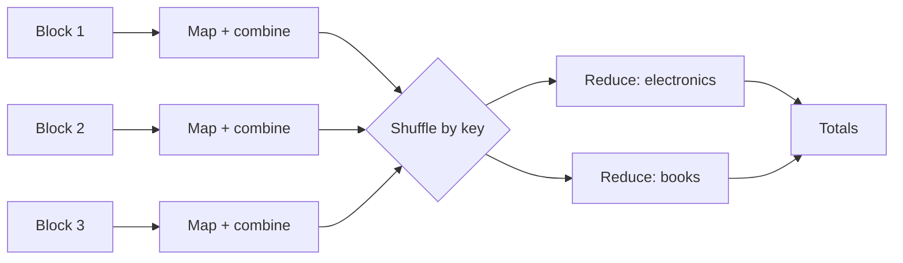
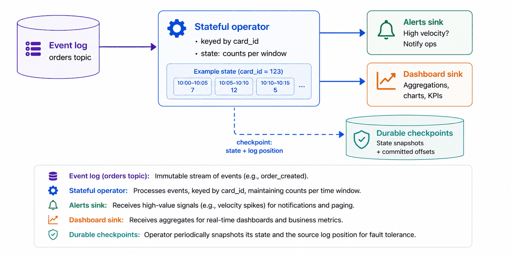
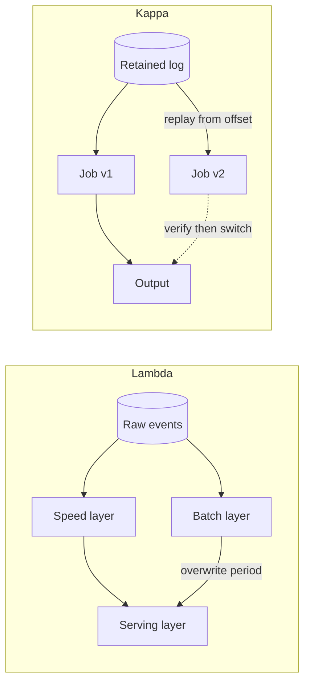
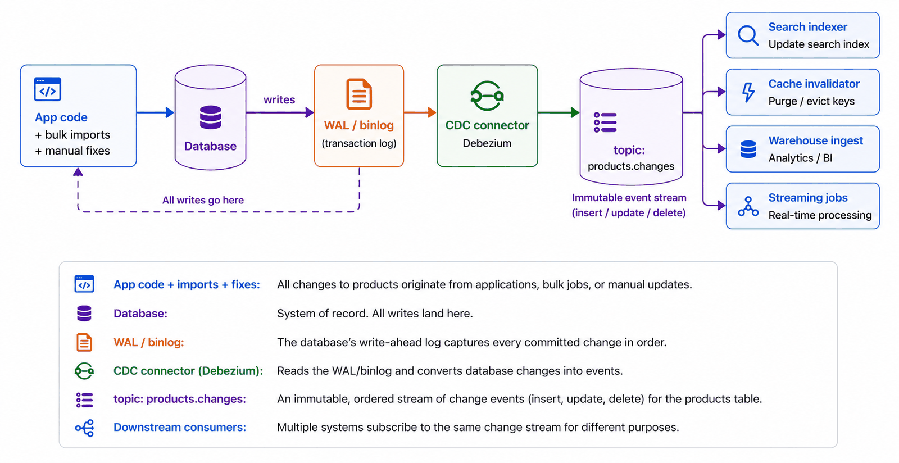
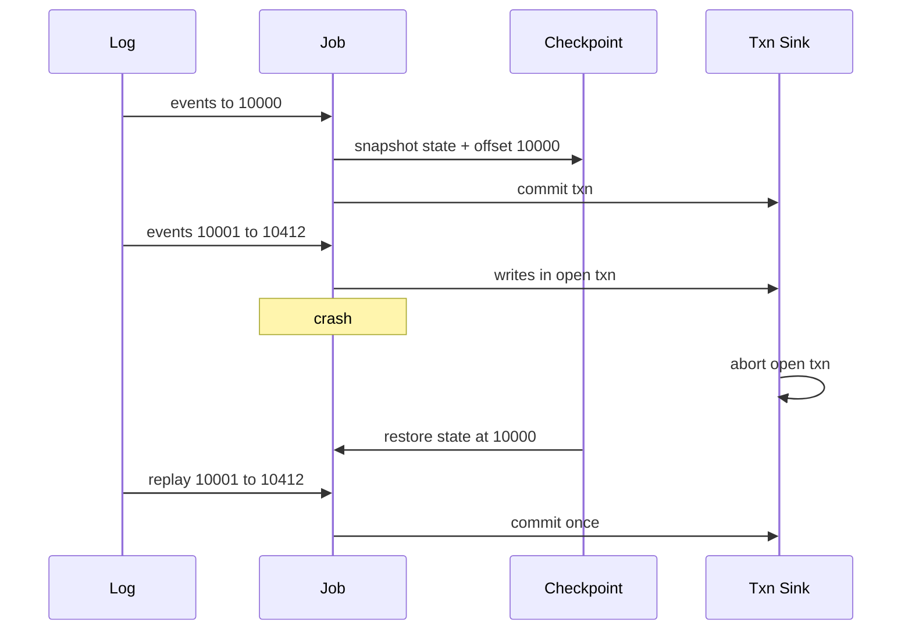
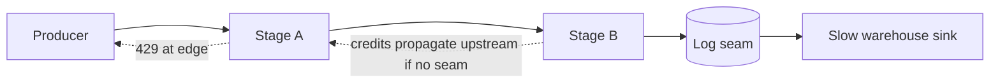
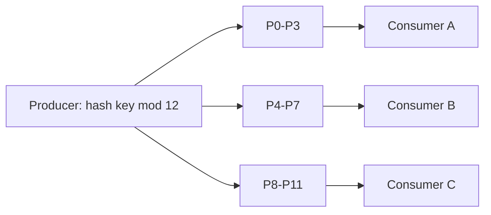
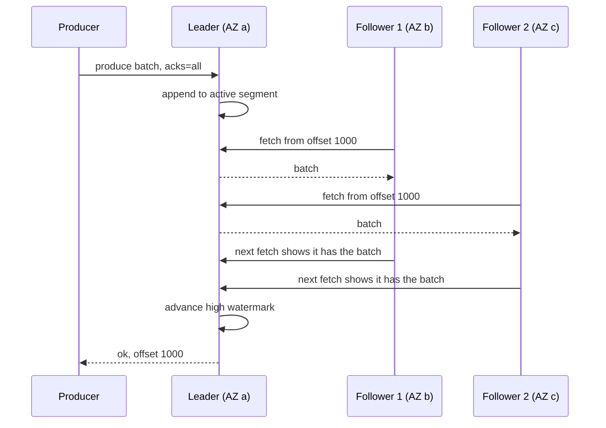
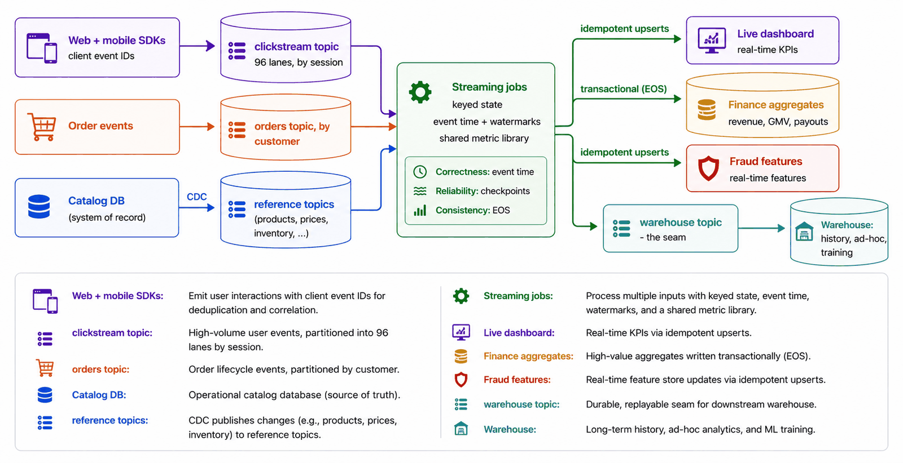

# Module 10 — Data-Intensive Systems (Batch and Streaming)

## Module Introduction
*Original lesson: [Module introduction on DesignGurus ↗](https://www.designgurus.io/course-play/system-design-patterns/doc/6a537ca3ae00005bd5541477)*


**What this module is about.** So far, most modules looked at one request at a time, answered within milliseconds. This module changes the question. Now we ask things about *lots* of data at once: revenue per hour, patterns that point to fraud, or features built from a long history. The input never stops coming. It is a **continuous flow** of clicks, order events and changes to database tables. Data engineers are usually the people who build these systems. Still, every engineer should know how the numbers on a dashboard are actually produced.

**Analogy.** Think about counting votes in an election. One option is to wait until the polls close and then count every ballot carefully. That is batch: the result is complete, but it comes late. The other option is to keep a running tally as each ballot box arrives. That is streaming: the result is fresh, but only provisional, because some boxes turn up late. The question is the same. What changes is the balance between completeness and freshness.

**New constraints this kind of work brings:** the input may be too big for one machine. Records may show up late, or show up more than once. Different consumers may read at different speeds. Because of this, every data design has to answer four things. How is the work **partitioned** (divided up across machines)? Where does the **intermediate state** (the half-finished results) live? How does processing **resume after a failure**? And which delays can we live with, versus which data losses we cannot accept?

**Two facts that organize the module**

1. **Batch and streaming are the same computation with different staleness budgets.** A *staleness budget* is how old an answer is allowed to be. Take "revenue per product". You could compute it every night from yesterday's full data. That is batch: simpler and thorough, but the answer is hours stale. Or you could update it continuously as each order comes in. That is streaming: the answer is seconds fresh, but it costs more to operate. Just like in the caching module, the allowed age decides which mechanism you pick. Batch works on **bounded** data, meaning a finished dataset that has a known end. Streaming works on **unbounded** data, which never ends. So streaming cannot wait for "all the input". Instead, it must decide when a partial answer is complete enough to publish.
2. **The log is the foundation.** In Module 3 we met the append-only log that lives inside databases. That was the **write-ahead log, WAL**: every change is first written to a sequential log, and only then applied. In this module, the log grows into a whole data platform. Kafka-style logs carry the flows of events (**Kafka** is a widely used open-source system that stores streams of events as a durable, replayable log). **CDC** (Change Data Capture) takes a database's WAL and turns it into a public stream. **Replay**, meaning reading the log again from an earlier position, makes reprocessing possible. And exactly-once processing works by combining log positions with **idempotency** (the property that doing the same operation twice has the same effect as doing it once). For a refresher on logs, queues, replication and other basics used here, see [System Design Fundamentals](../00-system-design-fundamentals/README.md).

**The seven patterns (plus one added lesson)**

| The situation | The pattern |
|---|---|
| One big question asked over a huge dataset | MapReduce |
| Getting answers while data is still coming in | Stream Processing |
| Bringing a slow-but-thorough result and a fast-but-rough result into agreement | Lambda & Kappa |
| Broadcasting every change the database makes | Change Data Capture |
| Counting each thing once, even with retries and replays | Exactly-Once Semantics |
| A producer that sends faster than its consumer can keep up | Backpressure |
| Running consumers in parallel while keeping the order for each key | Partitioned Consumption |
| Knowing what the log underneath really guarantees, and which settings decide it | Inside Kafka *(added lesson)* |

**How to read it.** MapReduce shows the basic shape of batch work: split the input, compute on each piece locally, then merge the results. Its answers are hours old on purpose, and that gap is the reason Stream Processing exists. Stream Processing covers windows, event time versus processing time, and answering questions over input that isn't finished. Lambda & Kappa weighs two options: running a separate batch pipeline and stream pipeline, or running one stream pipeline you can replay. The remaining patterns are supporting infrastructure. CDC creates streams out of database changes. Exactly-Once builds on the idempotency lesson. Backpressure deals with traffic that exceeds what a consumer can handle. Partitioned Consumption keeps per-key order while several consumers work in parallel. **Inside Kafka** is an added lesson (not in the original course) that opens the log itself: segments and retention, why it is fast, replication with the ISR and high watermark (the set of copies that are fully caught up, and the marker for how far all of them have got), every way messages can be lost and the setting that prevents it, consumer-group internals (a **consumer group** is a set of readers that share the work of reading one stream), and how idempotent producers and transactions implement exactly-once. The capstone puts everything together in a clickstream dashboard. Treat each pattern as the answer to a requirement someone has stated. Pick batch when completeness matters more than freshness. Pick streaming only when answers have short deadlines.

> Short on time? If you are a data engineer, begin with Stream Processing and CDC, because data-platform interviews test those the most. Everyone else should begin with CDC, since it fixes many everyday integration problems.

**Four terms used throughout**
- **Bounded vs. unbounded** — bounded data has a known end, like yesterday's orders, and suits batch. Unbounded data is a flow that never ends, and suits streaming, which has to answer without seeing all the input.
- **Event time vs. processing time** — *event time* is the moment something really happened. *Processing time* is the moment the system got it. For example, a mobile order placed inside a tunnel at 9:02 might only arrive at 9:14.
- **Watermark** — the processor's claim that "I think I have now seen every event up to time T". This claim lets a computation over endless data publish answers tied to time.
- **Throughput vs. latency** — batch tries to maximize rows processed per hour. Streaming tries to minimize the delay for each result. Always say which one matters, because it shapes both the design and the cost.

**Before you start**
- Pick a number on your main dashboard. How stale is it? And does anyone actually *know* that, or do people just assume it is live?
- When the analytics team needs data from the database, how do they get it: a nightly dump, scraping an API, or a read replica? What does that route fail to capture?
- Suppose event volume doubled for one day. Would your pipeline slow down, fall behind, or break? And did anyone ever decide which of those should happen?

---

## MapReduce
*Original lesson: [MapReduce on DesignGurus ↗](https://www.designgurus.io/course-play/system-design-patterns/doc/6a537d447bbf9d62838ba2b1)*


**What it is.** MapReduce answers one big question over a huge dataset by spreading the work over hundreds of machines. You only write two small functions. **Map** turns each record into key/value pairs. **Reduce** combines all the values that share one key. A framework does the rest for you: it splits the data, runs your code close to where the data sits, groups results by key, and re-runs any task that fails.

**Analogy.** Picture counting the votes in a national election. Every polling station counts its own ballots per candidate (that's map plus a local tally). The stations then send these subtotals to regional centres, sorted by candidate (that's the shuffle). Each centre adds up the subtotals for its candidate (that's reduce). If the counter at one station gets sick, someone else recounts just that station. Nobody restarts the count for the entire country.

### The problem

Ten years in, finance wants **"total revenue by product category, all time, by region"**. The data is **5 billion order rows, ~2 TB**, stored in **object storage** (cheap cloud storage, such as Amazon S3, that keeps data as whole files called objects).

An analyst writes a script. It reads every row and keeps running totals. Do the math: one machine reads roughly **100 MB/s**. So 2 TB ÷ 100 MB/s = **20,000 seconds ≈ 5.5 hours just to read**. The script is started Monday 9 AM. At 12:40 PM the cloud provider takes back the **spot instance** (cheap cloud capacity that the provider can reclaim whenever it wants). Three hours of progress held in memory are gone, and the script starts again at row one. On Wednesday, the retry fails after four hours because of a network failure. By Thursday the analyst has built a checkpoint file and a resume flag by hand, and there is still no answer.

There are two different limits here. First, **one machine is too slow**. Second, **at multi-hour runtimes, failure is likely**: even a 1% chance of hardware failure per hour makes a five-hour job risky. Long jobs therefore need two things: parallelism *and* automatic recovery.

### Why the obvious fixes fail

- **"A bigger machine."** Its read bandwidth still has a ceiling. And it is still a single **failure domain** (one unit whose failure takes everything inside it down), so one crash wipes out everything held in memory.
- **"Split it by hand"** over 20 machines, then merge the pieces with a script. This works once. But problems pile up. If machine 14 dies at minute 50, a person has to spot it and rerun that share. If the chunks are uneven, 19 machines sit idle while one grinds away for hours. The merge script breaks easily. And the next question needs a whole new manual procedure. This is not a system you can reuse.
- **"Run it on the production database shards."** Why not **scatter-gather** the query (send it to every shard at once and combine the answers) over the orders DB, which is already **sharded** (split across several database servers, each holding part of the rows)? Because then the analytics scans fight checkout for production **I/O** (disk and network reads and writes). The storage module split those two workloads on purpose. That is exactly why analytics keeps its own copy in object storage, and it is why analytics needs its own compute too.

The hand-split approach actually had the right *algorithm*: divide, count locally, merge. What was missing was everything around it: scheduling, handling failures, handling **stragglers** (a straggler is a task that runs far slower than the others), and merging reliably. MapReduce provides that execution framework.

### How it works

```
map(order)             -> emit (order.category, order.amount)
        ... the shuffle groups: all "electronics" amounts to one place ...
reduce(category, [amounts]) -> emit (category, sum(amounts))
```

1. **Split and map, where the data lives.** The framework cuts the input into blocks. It runs the map tasks on the machines that store those blocks, or close to them. So rather than shipping 2 TB to one program, it ships a small program to the data. This is called **data locality**. It is what makes distributed batch affordable, because the network is the resource in shortest supply.
2. **Combine (optional but important).** A **combiner** does a first round of aggregation on each mapper's output, right there on the machine. For example, each mapper sends "electronics: $4.2M" one time, instead of a million separate amounts. For aggregations, this makes the next step smaller by orders of magnitude.
3. **Shuffle — the expensive middle.** The framework regroups the output of every mapper *by key* across the whole cluster. This is an all-to-all sort plus network transfer. The result is that every value for "electronics" lands at one reducer.
4. **Reduce.** Each reducer merges the values for the keys it owns (for example, by summing them) and writes out the results.
5. **Fault tolerance falls out of the model's constraints.** Map and reduce have to be **pure functions**: they have no side effects, and the same input always gives the same output. They also run over **immutable** input, meaning files that never change. Because of that, any task can be run again on any machine and produce the same result. You get idempotency for free. If a machine dies, its tasks are rescheduled on other machines, and you lose minutes rather than the whole job. If a task straggles, the framework starts a **speculative duplicate** and keeps whichever copy finishes first. In short, the framework automates the very checkpoint-and-resume logic the analyst was building by hand.

*Map-combine-shuffle-reduce for revenue by category*

The diagram above shows each input block being mapped and combined on its own machine. The shuffle then sends each category's partial sums to a single reducer. Finally, the reducers produce the finished totals.

### Walkthrough with numbers (200-machine cluster)

- **Read:** 2 TB ÷ 200 = 10 GB per machine, which takes about **100 seconds** when all machines read in parallel. The 5.5-hour read shrinks to less than two minutes.
- **Map + combine:** every machine sends out one partial sum per category. That is dozens of rows, not millions, so the shuffle only moves **kilobytes** per machine.
- **Reduce:** adding up 200 partial sums for each category takes a few seconds.
- **End to end: ~10 minutes**, spent mostly on startup and reading. Compare that with a week of restarts someone had to babysit.
- **Failure drill:** machine 141 dies at minute 4. Its ~30 map tasks run again on other machines. This adds **90 seconds**, and the failure goes into the log.
- **Straggler drill:** machine 77 has a disk that is failing, and it slows down at minute 8. Speculative copies of its tasks run on other machines and finish first. Machine 77 is flagged for the ops team. Nobody had to wait.

### Trade-offs

**You gain:**
- **Scale by addition** — 200 machines give roughly 200× the read bandwidth, and the framework takes care of the coordination.
- **Fault tolerance at no extra cost** — because the functions are pure and the input is immutable, re-running is safe. Long jobs survive failures by design.
- **A tiny programming model** — just two functions. The question you are asking *is* the program.

**You pay:**
- **A latency floor by construction** — you always pay for cluster startup, a full pass over the data, and the shuffle. That means minutes at best and hours at scale. The answer also reflects the data as it was when the job began. Fresh answers are out of reach (that is the next lesson's problem).
- **A rigid shape** — every job must fit map → shuffle → reduce. Real analyses often need many stages, and classic MapReduce wrote each stage's output to disk, which multiplied the I/O.
- **Shuffle-dominated cost**, and **skew** makes it worse. Skew means one key has many more records than the others (see self-check Q3).
- **It's a scanner, not an index** — reading all 2 TB to find "revenue for order #8412" is the wrong tool for the job.

### When not to use it

- **Interactive questions** — analysts trying idea after idea need answers in seconds. That calls for a **data warehouse** (indexed and columnar). A data warehouse is a database built for analytics queries over huge tables; *columnar* means it stores each column's values together, so reading one column across billions of rows is fast. Under their SQL, warehouses still run map-shuffle-reduce shapes. The idea lives on; only the way you use it changed.
- **Small data — and "small" has grown.** 2 TB fits on a laptop SSD. One powerful machine running **DuckDB** or **Polars** (single-machine analytics tools: an embedded SQL engine and a fast DataFrame library) can scan it in minutes, with no cluster at all. The modern rule: **exhaust one machine before renting two hundred** (the same restraint as the vertical-scaling lesson, where *vertical scaling* means buying a bigger machine instead of more machines). Setting up cluster infrastructure for data that fits on a laptop is a common mistake today.
- **Low-latency needs** — for unbounded streams, see the next lesson.
- **Iterative algorithms** — ML (machine learning) training reads the same data hundreds of times. Classic MapReduce does full disk I/O on every pass, which is too slow. That pushed people to build in-memory successors, and modern ML now uses specialized training systems.

### MapReduce vs. Spark (the idea vs. the implementation)

**Apache Spark** is an open-source engine for processing large datasets across a cluster (a group of machines working together). It keeps the split-locally-then-merge idea but runs whole pipelines in memory.

| | Classic MapReduce | Spark (and successors) |
|---|---|---|
| Between stages | Saved to disk after every stage | Held in memory through the whole pipeline |
| Program shape | Strictly map, then shuffle, then reduce | Any **DAGs** (graphs of steps) made of transforms: map, filter, join… |
| Multi-stage / iterative work | A chain of complete jobs, so the I/O multiplies | A single job with cached intermediate results: 10–100× faster |
| Fault tolerance | Run the tasks again from the input | Same idea: rebuild lost partitions from their **lineage** (the recorded chain of transforms) |
| You write | Java boilerplate, two functions at a time | SQL / DataFrames (tables you manipulate in code), and the shape is generated for you |

The takeaway for interviews: **the execution model outlived the original implementation.** No one hand-writes MapReduce anymore. Yet Spark plans, the BigQuery and Snowflake engines (two popular cloud data warehouses), and distributed ML data prep all do the same three things: split the work locally, shuffle by key, and merge.

### Real-world examples

- **Google's 2004 paper** — where it all started. Indexing the web needed exactly this shape, and the paper kicked off the "big data" era.
- **Hadoop** — the open-source implementation of MapReduce (plus a distributed file system); it made the model available to everyone for about a decade. **Spark** — began at Berkeley to skip the disk writes between stages and speed up iterative work. It took over from Hadoop for many workloads and, through **Databricks** (the company that sells a hosted Spark platform), runs a large share of production batch.
- **BigQuery, Snowflake and peers** — SQL on the surface, map-shuffle-reduce underneath.
- **dbt** — declarative data pipelines that run on those same engines.
- **For AI engineers:** preparing training data is the largest MapReduce workload today. Take deduplicating, filtering and **tokenizing** (splitting text into the small pieces, called tokens, that a language model reads) a crawl of the whole web. Map handles each document on its own, fully in parallel. Shuffle groups near-duplicates together using a hash key. Reduce chooses which copies survive. Every serious lab runs this on Spark. **Embedding** a corpus (turning each document into a list of numbers that captures its meaning) is just a map with no shuffle. And the **all-reduce** step in distributed training merges **gradients** (the per-step numbers that say how to adjust a model's weights) across **GPUs** (graphics chips used for the heavy maths of ML) on every step, which belongs to the same compute-locally-then-merge family.

### In the interview

The classic prompt is "count word frequencies across 10 TB". Newer versions sound like "compute X over everything" or "the analytics job takes 9 hours and fails at hour 7 — fix it". Follow-up questions dig into the shuffle and into what happens on failure.

> **30-second answer:** "This is a batch aggregation with a map-shuffle-reduce shape. The map step runs on the machines that hold the data, so the code goes to the terabytes instead of the other way round, and it outputs key-value pairs. Combiners do a first aggregation on each machine, so the shuffle carries partial sums rather than raw records. Reducers then merge everything for each key. Fault tolerance comes from the structure itself: the functions are pure and the input never changes, so any task can be rerun on any machine. A dead machine costs a few minutes, and slow tasks get speculative duplicates. In practice I'd write it in Spark or SQL, since nobody hand-writes MapReduce anymore, but this is the shape running underneath. The shuffle is always the costly part. And the answer is stale by design, which is exactly where streaming comes in."

**Likely follow-ups (with answers):**
- *"Where does the job actually spend its time?"* — Mostly in the shuffle (regrouping everything by key, all-to-all, over the network) and in scanning the input. So two levers really matter. Combiners shrink how much gets shuffled. Partitioning and skew management spread out what gets shuffled.
- *"A machine dies at minute 40 of 60 — what happens?"* — Its tasks run again on other machines, reading the same immutable inputs. You lose a few minutes, but nothing is corrupted and nothing starts from zero. This is a direct benefit of the model banning side effects and mutation, so state that cause-and-effect link out loud.

**Mistake that fails candidates:** suggesting batch jobs for needs that are interactive or low-latency; ignoring the shuffle; or building distributed counting from scratch instead of naming the shape and the modern tools that implement it.

**Self-check:**
- **Q1.** Write "average order value per country" as map and reduce, and watch out for the averaging trap. → You cannot take an average of averages. Map emits `(country, (amount, 1))`. Reduce (and the combiner too) adds both parts pair by pair to get `(sum_amounts, sum_counts)`. Divide only at the very end. Carrying the pair keeps the operation **associative**, meaning partial results can be merged in any grouping. That property is what lets combiners and parallel reducers work. The general rule: build aggregations out of pieces that can be merged.
- **Q2.** Name three failures of the hand-split version that the framework avoids, plus the property that makes each fix work. → (1) A machine dies: the framework reruns its tasks. This is safe because tasks are pure and read immutable input. (2) Stragglers: speculative duplicates. These are harmless because running a task twice gives the same answer. (3) Uneven chunks and custom merge scripts: the framework uses fixed-size blocks, and the shuffle *is* a standard merge. All three come from limiting the programming model so that running things again costs nothing.
- **Q3.** On 200 machines, 199 reducers finish in 2 minutes, but one runs for 6 hours. All machines are healthy. → This is **skew**. One hot key (say Electronics = 40% of orders) sends 40% of the work to a single reducer. It is the sharding lesson's hot-key problem, in batch form: hashing spreads keys, not how heavy each key is. Fixes: combiners, so mappers send 200 partial sums instead of 2 billion rows. For keys that are still too heavy, use **salting**: split the key into `electronics-1..16` across 16 reducers, then merge those in a second stage. You can also process extreme keys separately.

**Related patterns:**
- **Stream Processing** — the answer to the latency floor: the same computations, but over unbounded input.
- **Sharding** — the same partitioning math and the same skew problem, one layer lower down.
- **Lambda & Kappa** — how batch and streaming split responsibility for the truth.

**TL;DR**
- **Problem:** one machine needs hours just to read the data, and at multi-hour runtimes failure is routine. Splitting by hand means reinventing scheduling, straggler handling, merging and recovery.
- **Mechanism:** two pure functions — map (per record, run where the data lives) and reduce (merge per key). The framework owns splitting, the shuffle (made smaller by combiners), speculative copies for stragglers, and re-execution.
- **Costs:** latency of minutes to hours, a rigid shape (classically with disk I/O between stages), cost dominated by the shuffle, and skew.
- **Skip it when:** the work is interactive (use a warehouse), fits on one machine, needs fresh answers (use streaming), or is iterative (ML).

---

## Stream Processing
*Original lesson: [Stream Processing on DesignGurus ↗](https://www.designgurus.io/course-play/system-design-patterns/doc/6a537de1ae00005bd5544a29)*


**What it is.** A stream processor is a job that **never ends**. It reads an event log while the log keeps growing. For each thing it tracks, it holds running **state** such as counts, sums or windows. And it sends out answers all the time. The hard question at its centre is this: when the input never ends, at what point is an answer "final"?

**Analogy.** Imagine a bank teller watching a live feed of card swipes. The teller keeps a tally sheet for each card covering the last 10 minutes. The moment a card reaches six swipes, the teller flags it. Compare that with reading yesterday's statements the following morning.

### The problem: correct, but eight hours too late

The fraud team runs a nightly batch job that spots coordinated use of stolen cards with **99% precision**. On Tuesday, the run flags **30 fraudulent orders** from one ring. All of them were placed between **3:40–3:55 PM**, and all had shipped by 6 PM. The job runs at **2 AM**, which is eight hours after the goods left the warehouse. **The answer is right but useless.** For "revenue by category, all time", being hours stale is fine. But "is this card being abused *right now*" needs an answer within seconds, and no amount of tuning a batch job will get you there. The same goes for an ops dashboard that shows yesterday's "orders per minute". Fraud detection, live metrics and fresh ML features all need ongoing answers about the last few seconds of an input that never ends.

### Why the obvious fixes fail

- **"Run the batch every five minutes"** (this is called micro-batching). It is a real approach (it inspired Spark Streaming), but it has two limits. First, the overhead of starting each job puts a floor under the interval: a cluster job launched every 30 s might spend most of its time just starting up. Second, a question like "orders on this card in the last hour" covers many runs, so every run needs **running state from previous runs**. The true difference between batch and streaming is *persistent state*, not only speed.
- **"Query the database on every order"** — running `SELECT COUNT(*) WHERE card=? AND time > now()-1h` means **400 expensive queries/s** against production. That is the analytics-on-production problem once more, and the indexes were not designed for it. A database is good at storing history; it is not designed to *watch* events as they arrive.
- **"Count in application memory."** The checkout service is scaled out horizontally (run as many identical copies behind a load balancer). **40 servers each see ~1/40** of a given card's orders, so no single server's counter is complete. This is the per-server-counter problem. Every event for a card has to reach *one* place that holds that card's state, which means you need **key-based routing**.

### How it works

1. **State is the core.** The operator (one processing step) keeps its running answer locally, either in memory or on local disk, for example per-card counts or per-minute sums. The state is **keyed**. All events for card X go to the operator instance that owns card X. This is the shard-key idea applied to compute, and Partitioned Consumption formalizes it. Most of what a streaming framework does is manage this state.
2. **Recovery = checkpoint + rewind.** Every so often, the framework saves a durable (stored so it survives a crash) **snapshot of all state together with the log position** that the state matches. After a crash, the operator loads the snapshot, **rewinds the log** to that position, and processes again from there. This only works because the source is a log that can be *replayed*. One side effect: events close to the crash get processed **twice**, so the outputs must be able to handle duplicates (→ Exactly-Once lesson).
3. **Windows slice the endless input into finite pieces**, because an infinite stream has no "final total":
   - **Tumbling** — fixed intervals placed back to back. Each event falls into exactly one of them (e.g. orders per minute).
   - **Sliding** — intervals that overlap (e.g. orders in the last 10 minutes, checked again every 30 s).
   - **Session** — a window that stays open until an **inactivity gap** appears (e.g. a browsing session is over after 30 idle minutes). The data decides how long it lasts.
4. **Event time vs. processing time — the hardest, most consequential idea.** Suppose you group by *processing time*, meaning arrival time. Then the 9:02 tunnel order gets counted at 9:14. That is simple, but wrong: retries, mobile batching and network delays shuffle the arrival order and can produce fake spikes. Suppose instead you group by *event time*. Now the order is counted at 9:02 as it should be. But at 9:03 the system has no way of knowing the event exists yet, so it has to keep windows open for late arrivals.
5. **Watermarks decide when a window may close.** The framework keeps an estimate such as "I've probably seen everything up to 9:05". That estimate is the watermark. Once it moves past the end of a window, the window closes and emits its result. The delay of the watermark *is* the staleness budget. A longer delay gives more complete but later answers. A shorter one gives faster answers, but more events count as "late". That is why every consumer needs a **late-data policy**. The choices are: drop late events, emit corrected results that consumers agree to accept, or send late events to a side channel for reconciliation.


*Figure — Stream Processing (course diagram)*

The figure above shows an orders **topic** (a named stream of events in the log) feeding a stateful operator keyed by `card_id`. Its state stores counts for each time window (e.g. card 123: 7, 12, 5 across three 5-minute windows). The operator sends results to an alerts **sink** and a dashboard sink (a sink is wherever a pipeline writes its output). It also regularly writes durable checkpoints of its state + log position so it can recover.

### Walkthrough with numbers (rule: more than 5 orders on one card within 10 minutes)

- **The path:** order event → log → the operator that holds this card's state → the count is updated → the threshold is checked → alert. The whole trip takes **~200 ms**. Tuesday's ring gets caught at **order #6 at 3:44 PM**, while the goods are still on the shelf.
- **State size by arithmetic:** about **200,000** cards are active in any 10-minute window, and each needs a few bytes, so the total is **megabytes**. Work this out before reaching for heavy state storage.
- **Crash drill:** load the **30-second-old** checkpoint, rewind the log by 30 s, and reprocess. Recovery takes **under a minute** and no orders are missed. Alerts from those replayed 30 s go out twice, so the alert sink **dedupes on `(card, window)`** (that's idempotency).
- **Tunnel drill:** fraud cares about speed, so its watermark lags by only **30 s**. The 9:02 order that arrives at 9:14 misses its window, which makes it late data. Fraud's policy: process it anyway, update the count, and send a late alert if the threshold is crossed (a late alert is better than none). The dashboard reading the same stream picked **drop**, because a per-minute chart won't redraw itself for a single straggler. **Same stream, two policies — the policy belongs to the question, not the pipeline.**

### True streaming vs. micro-batch

| | True streaming (per event) | Micro-batch (tiny frequent jobs) |
|---|---|---|
| Latency floor | Milliseconds | The length of the batch interval (seconds up to a minute) |
| State between "runs" | Built in — the whole operator is designed around it | Carried from run to run by the framework |
| Complexity | Everything described above | Clearly easier to reason about |
| Fits | Fraud, alerting, features needed in under a second | Dashboards, feeds, pipelines with a one-minute budget |

**The budget decides:** with a one-minute budget, micro-batch is the simpler and correct choice (**Spark Structured Streaming**). With a one-second budget, only true streaming will do (**Flink**, i.e. Apache Flink, an open-source engine for stateful stream processing). Both run enormous production workloads. Saying "the budget chooses" is a better answer than being loyal to either tool.

### Trade-offs

**You gain:** answers that are seconds fresh over input that never ends, so fraud checks, live metrics and fresh features become possible in the first place; incremental economics, since each event updates state once rather than rescanning everything; and solid machinery for correctness (checkpoints plus a replayable log).

**You pay:**
- **The steepest concept stack in the course** — windows, two kinds of time, watermarks, late policies and state. Teams tend to underestimate it.
- **Stateful operations** — state has to be checkpointed, restored, monitored and **rescaled**. Rescaling means re-partitioning the state when the job grows or shrinks, and it is hard.
- **Provisional answers** — results based on event time can be changed when stragglers show up. So downstream consumers must accept corrections (**eventual consistency** in analytics: the numbers agree with the truth eventually, not instantly).
- **Operational weight** — a stateful distributed job that runs forever is really a *service*. It needs **on-call** (an engineer ready to respond to alerts at any hour), upgrades and capacity planning.

### When not to use it

- **No deadline** — nightly revenue rollups and weekly cohorts are simpler and cheaper in batch, and easy to reprocess.
- **Small scale** — a **cron job** (a task the operating system runs on a fixed schedule) with a SQL query can count a startup's daily active users without any Flink cluster.
- **Ad-hoc exploration** — analysts need a warehouse, not a new streaming job for every idea they want to test.
- **No team to run it** — a stateful platform with no owner turns into the main cause of outages between the log and the dashboard.
- Misuse: rebuilding stable nightly jobs as streams when the business has no need for fresher data.

### Real-world examples

- **Apache Flink** — implements the full model (event time, watermarks, exactly-once state). Most of this lesson's vocabulary comes from Flink.
- **Google's Dataflow model (2015 paper)** — brought windows, watermarks and late-data triggers together into one model. Most frameworks implement its ideas.
- **Kafka Streams** — the pattern packaged as a library inside your own service, with no separate cluster.
- **Spark Structured Streaming** — micro-batch at industrial scale.
- **For AI engineers:** how fresh your features are affects how good your model is. A fraud model using hour-old velocity features misses coordinated attacks that fresh streaming features would catch. A **feature store** is a system that computes and serves the input values (*features*) that ML models use, both for training and for live predictions. Its **online path** uses jobs like these to produce keyed aggregates that are fresh to the millisecond. Token-usage metering, prediction monitoring and **evals** (automated checks of model quality) over sampled traffic rely on it too. Use **event time**: if you train on processing-time features, the model learns *network lag* instead of user behavior.

### In the interview

Typical direct prompts are "design real-time fraud detection" or "a live orders-per-minute dashboard". The follow-ups are predictable: late events, recovering from a crash, and counting across a fleet of servers.

> **30-second answer:** "I'd run a job that never stops, reading the order log with its state keyed by card. That way every event for a card goes to the one instance holding that card's counts. For each event it checks a sliding window and can alert within a couple hundred milliseconds. The windows use event time rather than processing time, because retries and mobile lag scramble the arrival order, and I want to count when things actually happened. A watermark running thirty seconds behind tells each window when to close. Late stragglers still update the count, since a late fraud alert is better than none. Recovery is checkpoint plus rewind: snapshots of state tied to log positions, and the replayable log reprocesses the gap. Because some events get processed twice, the sink dedupes on card-and-window. If the budget were a minute instead of a second, I'd use micro-batching and keep things simple."

**Likely follow-ups (with answers):**
- *"An event arrives 12 minutes late — walk me through it."* — The watermark has already passed, so its event-time window is closed. Now the late policy kicks in, and it is chosen *per consumer*. Fraud updates the count and alerts late. The dashboard drops the event. A reconciliation stream might send it to a side channel. Pointing out that the policy is set per consumer, not globally, is the senior-level detail.
- *"The operator crashes mid-afternoon — what's lost?"* — Nothing durable. Load the last checkpoint, rewind the log to the matching position, and reprocess the gap. The sinks see a few seconds get replayed, which is why you need idempotent sinks and the exactly-once lesson. What a crash really costs you is *duplicate emissions*.

**Mistake that fails candidates:** using processing-time windows for money or fraud; keeping state in application memory spread over a fleet; or running a database query for every event. Each of these is one of the failed "obvious fixes" dressed up as a design.

**Self-check:**
- **Q1.** Choose windows for: (a) revenue per calendar minute for a chart; (b) "more than 5 orders in any 10-minute span"; (c) average items per shopping session. → (a) Tumbling, which gives clean buckets that don't overlap. (b) Sliding, because it has to catch *any* 10-minute span, not only ones lined up with the clock. (c) Session, since the boundary is the gap in user activity; fixed sizes would cut real sessions apart or glue them together.
- **Q2.** A carrier outage holds back 20 minutes of app events, and then they all arrive in one burst. Compare a processing-time pipeline with an event-time pipeline that uses a 2-minute watermark. → With processing time, you first see a fake quiet dip during the outage. Then you see a huge fake spike "now", because 20 minutes get squeezed into one. That sets off rate alerts and permanently records traffic that never happened. With event time, the delayed events keep their real timestamps. The windows covering the outage close ~2 minutes after they end, with provisional *undercounts*. Then the late events trigger corrections according to the late policy, and the numbers settle on what really happened. Processing time measures the network; event time measures users.
- **Q3.** After a routine deploy, fraud receives duplicate alerts (same card, same window) for roughly a minute of traffic, with no real spike in fraud. → The deploy restarted the operator through the normal recovery path: restore the checkpoint, rewind, and reprocess ~1 minute. The computation was correct both times, but the alert sink sent its output twice. Fix it at the sink: make alerts idempotent, keyed on `(card_id, window_id)` (or use a transactional exactly-once sink). **Every deploy rehearses the crash**, so sinks have to cope with replays.

**Related patterns:**
- **Message Queue** — the replayable log is the source, and it is what makes rewind-based recovery possible.
- **Partitioned Consumption** — the keyed routing that gets each card's events to that card's state.
- **Exactly-Once Semantics** — dealing with what replays do to sinks.
- **Write-Ahead Log** — checkpoints borrow its idea: durable state plus a position, and recovery by replay.
- **Lambda & Kappa** — what to do when batch and streaming both claim to be the truth.

**TL;DR**
- **Problem:** deadline questions (fraud now, metrics now, features now) are about the last few seconds of an endless input, and batch answers show up hours too late.
- **Mechanism:** a job that runs forever, with keyed state over a replayable log; windows (tumbling, sliding, session); event-time processing with watermarks; late policies chosen per consumer; and recovery through checkpoint + rewind.
- **Costs:** the steepest concept stack, running a stateful service, provisional answers that get amended, and replays that require idempotent or transactional sinks.
- **Skip it when:** the staleness budget is generous, the scale fits a cron job, the work is ad-hoc exploration, or nobody is available to own a service that runs forever.

---

## Lambda and Kappa
*Original lesson: [Lambda and Kappa on DesignGurus ↗](https://www.designgurus.io/course-play/system-design-patterns/doc/6a537ebcf5fad4cc63423a84)*


**What it is.** These are two architectures for when you need *both* fresh streaming answers and complete, correct batch answers. **Lambda** runs a batch pipeline and a streaming pipeline next to each other. Every so often, the batch results **overwrite** the streaming results. **Kappa** runs just **one** streaming pipeline over a log that keeps its history. When something needs correcting, it fixes the code and **replays** the log through it.

**Analogy.** Lambda is like a newspaper that posts quick online updates all day, then prints a carefully fact-checked edition overnight that replaces them. Kappa is like a single newsroom that, on finding a mistake, reruns its stories from the archive using the corrected facts.

### The problem: two pipelines, two truths

The store runs a nightly batch pipeline for its official reports, and a streaming pipeline for the live dashboard. Both calculate revenue. On Wednesday morning, finance spots a mismatch. The dashboard says Tuesday was **$412,880**, while the batch report says **$413,205**.

By their own rules, both numbers are "right". The streaming job dropped some late events because of its watermark policy (the point after which it stops waiting for stragglers). It also had a **one-minute dedupe gap** during Tuesday's deploy. (*Dedupe* means removing duplicate events; this is the stream lesson's Q3 happening for real.) The batch job read everything and is correct as of 2 AM. The trouble is that nobody ever decided which one is *the truth*.

Three weeks go by. A change to a discount rule gets shipped, but only in the batch code; no one updates the streaming copy. Now the two differ because of a **coding error**, and the gap widens every day. A monthly "reconciliation meeting" shows up on the calendar, where people referee between their own computers.

**Named precisely:** two codebases implement the same business logic, and over time they drift apart. Anyone running batch and streaming separately has to handle this on purpose.

### Why the obvious fixes fail

- **"Perfect the streaming pipeline and retire batch."** Exactly-once cuts down processing errors. But the main strength of batch is **reprocessing history with current code**: when a fraud rule changes or a bug is found, you recompute past periods. A stream handles events as they arrive. It can only go back to them if a replayable log keeps the history, and that becomes Kappa's key idea.
- **"Run batch hourly."** It is fresher, but you still have two codebases changing independently. The window of inconsistency gets shorter, but its cause is still there.
- **"Label the dashboard 'approximate' and declare batch the truth."** This is a valid policy if stakeholders agree to it. But it does nothing to stop forgotten code changes from drifting, and you are still maintaining two codebases.

### How it works — Lambda

**Nathan Marz** proposed it (during the Twitter / Storm era; **Storm** was an early open-source stream processor). It has three layers:
1. **Speed layer** — streaming; quick but provisional.
2. **Batch layer** — slow but authoritative; recomputed on a schedule from the raw history.
3. **Serving layer** — joins the two: recent hours come from the speed layer, settled history comes from the batch layer.

The central mechanism is **the overwrite**. Each batch run *replaces* the speed layer's results for the period that run covers. So any bug in streaming gets wiped out automatically at the next batch run. That includes the deploy gap, dropped stragglers, and even the discount rule someone forgot to add to the speed copy. Lambda doesn't stop speed-layer errors from happening; it **bounds their lifetime to one batch cycle**. The cost never goes away, though: **every metric is implemented twice**, so logic drift is baked into the architecture.

### How it works — Kappa

**Jay Kreps** proposed it in his essay "Questioning the Lambda Architecture". His insight: suppose the event log keeps its history for weeks, months, or practically forever using **tiered storage** (older log segments are moved to cheap object storage). Then batch is simply *streaming a bounded prefix of the log, quickly*. Reprocessing turns into a streaming operation:

1. Deploy job **v2**, containing the new logic, reading from log offset zero (or, for example, 90 days back). An **offset** is a position in the log.
2. v2 races through the history at full read speed. This takes hours, not weeks.
3. v2 catches up to "now" and runs alongside v1, and the two outputs are compared.
4. Point consumers at v2's output and retire v1.

This is the same playbook as the zero-downtime migration capstone (run both, check, switch, retire), applied to pipelines. With only one codebase, the discount-rule drift cannot happen, because there is no second copy to forget about. The costs: keeping the log for a long time costs money; replay needs far more compute than the live rate (to reprocess 90 days in one afternoon); and the streaming engine has to be mature enough (exactly-once, event time) to serve as the *only* source of truth.

*Lambda vs Kappa data flow*

In the diagram above, Lambda sends the same raw events into two layers, and the batch layer overwrites its period in the serving layer. Kappa has only one kind of job. A new version replays the retained log, and it takes over the output only once it has been verified.

### The pragmatic synthesis

Most organizations run a practical **dual path**: streaming for operational freshness, and a warehouse for deep analysis. They often leave out Lambda's formal overwrite. They should still keep **scheduled backfills**, though. (A backfill recomputes a past period and replaces the results that already exist.) The engines have also grown closer together. **Flink** can run bounded inputs in batch mode. **Spark** can process streams. And **lakehouse tables (Delta, Iceberg)** (open table formats that put database-like tables on top of plain files in object storage) take streaming writes while also serving batch queries. More and more, you end up with **one logic, two execution tempos**, which is exactly what Kappa aims for.

### Walkthrough with numbers: the deploy-gap bug under each design

- **Lambda:** Tuesday's streaming deploy quietly loses ~**300 orders** from the dashboard's revenue. At 2 AM on Wednesday, the batch job recomputes Tuesday from the raw data and overwrites the speed layer. The dashboard fixes itself. This is what the second codebase buys you.
- **Kappa:** developers fix the bug in the one codebase and replay from **Monday's offset**. The log delivers history at ~**50× the live rate**, so **two days reprocess in under an hour**. When v2 has caught up, operators check it against finance's **$413,205**, move consumers over, and retire v1. Recovery is a repeatable operation, but a person has to kick it off.
- **The discount-rule drift:** under Lambda, only one of the two implementations received the update. It came to light when Wednesday's overwrite changed Tuesday's dashboard numbers. Kappa rules this failure out completely, since there is only one implementation. In summary: Lambda fixes operational errors automatically but creates the risk of two implementations disagreeing. Kappa gets rid of the duplication but needs someone to run a replay.

### Comparison

| | Lambda | Kappa | Pragmatic dual path |
|---|---|---|---|
| Codebases per metric | Two, on purpose | One | Two, by accident (fix: shared definitions) |
| Streaming-bug recovery | Wiped out automatically by the next batch overwrite | Replay from an offset — a routine operation | A manual backfill (if someone notices) |
| Logic drift | Part of the design | Impossible by structure | What happens by default |
| History economics | Raw data kept in cheap storage | Log retention (tiered) | Warehouse tables |
| Demands | Stitching in the serving layer | Mature streaming plus capacity to replay | Discipline that nobody enforces |

A verdict ready for interviews: Lambda's overwrite lives on as the habit of scheduled backfills. Engines increasingly support Kappa's single codebase. And many teams are running **accidental Lambda** without realizing it; they should fix it with automatic overwrites or unified logic.

### Trade-offs

- **Lambda gains:** scheduled, automatic correction limits streaming errors to one batch cycle; each layer is simpler by itself; and you can always recompute the truth from the raw history. **Lambda costs:** every metric exists twice (a constant risk of drift, plus duplicate infrastructure); and the serving layer has to define where "recent" stops and "settled" starts.
- **Kappa gains:** one codebase, so no drift between implementations; reprocessing becomes a tested migration routine; and the log is the only history. **Kappa costs:** the cost of retention (lowered by tiered storage), capacity for bursts of replay, and complete dependence on the streaming engine. If the pipeline is unreliable, your only source of truth is compromised.

### When not to use each

- **Don't Lambda with a small team** — you won't be able to keep two pipelines in agreement. Running two pipelines *without* the automatic overwrite is **accidental Lambda**: you get all of the duplication and none of the recovery. That's the opening incident, and it is very common.
- **Don't Kappa when history is enormous and reprocessing rare** — keeping years of log around for a replay once a year can cost more than rerunning a warehouse job. Also, work that is batch-shaped (large multi-way joins, ML training passes) fits batch better.
- **Don't be dogmatic** — for most teams, a dual path with disciplined backfills and **one shared metric-definition library** (definitions written one time and run by both engines) works better than either pure form.

### Real-world examples

- **The founding documents:** Marz's Lambda (from the Storm era) and Kreps' "Questioning the Lambda Architecture" (from the Kafka side). Read together as a debate, they *are* this lesson.
- **Uber, Netflix, LinkedIn** have written about their journeys along this spectrum. The usual story: Lambda first (because of growth), then a move toward Kappa where a log-centred culture developed, and a dual path where warehouses were dominant.
- **Tiered storage** in Kafka took away Kappa's objection about retention. Flink's batch mode, Spark's streaming, and Delta/Iceberg lakehouse tables are where the tools are converging.
- **For AI engineers:** this is **training/serving skew** showing up in infrastructure. Batch code over the warehouse computes the features for *offline training*. Streaming code computes the features for *online serving*. If the two define "user's 7-day order velocity" differently, the model gets worse. **Feature stores** solve this by defining each feature once and running that shared logic in both modes.

### In the interview

The prompt: "design analytics with a live dashboard *and* accurate finance reports". The trap is building two pipelines without realizing it. A typical follow-up: "your streaming pipeline had a bug for three hours — walk me through recovery."

> **30-second answer:** "There are two needs, and I want one truth. The dashboard needs numbers that are seconds fresh, and the reports need complete ones. The risk is building the metrics twice and watching them drift apart, which is the accidental Lambda most companies end up running. I'd build around the replayable log and lean toward Kappa: one streaming codebase, where recovery means reprocessing. Fix the logic, replay from an earlier offset at about 50× real time, check the result against the old output, and switch over. That's the migration playbook, applied to pipelines. Work that is truly batch-shaped, like huge joins or training passes, reads from the same log and uses the same shared metric definitions. I'd also take Lambda's best idea in the form of scheduled backfills, so any streaming error has a limited lifetime. Whichever way, each metric gets exactly one definition, one owner and one source of logic."

**Likely follow-ups (with answers):**
- *"The streaming job computed wrong numbers for three hours — recovery?"* — Under Kappa: replay from before the bug using the fixed code. Either the sinks accept the restated numbers (the stream lesson's amended answers, at the scale of the whole architecture), or you swap the output over in one go after verifying it. Under Lambda: there's nothing to do, since the next batch overwrite wipes out that period. Under the pragmatic path: run a backfill job, if the team has that habit. Your answer shows which architecture you really have.
- *"Why not always run both to be safe?"* — If there is no automatic overwrite, running both costs twice as much and produces drift. Even with the overwrite, every metric needs two implementations. The ability to recover comes from *replayable history*. A second pipeline is only one way of using that history.

**Mistakes that fail candidates:** two pipelines with no plan for reconciling them (accidental Lambda that nobody noticed); suggesting Kappa without doing the math on retention or replay capacity; and treating the choice as a matter of taste instead of budget and team.

**Self-check:**
- **Q1.** What are Lambda's three layers, and what mechanism justifies building everything twice? → Speed (streaming, fast, provisional), batch (slow, authoritative, recomputed from raw history), and serving (stitches recent + settled together). The justification is the **overwrite**. Each batch run replaces the speed layer's results for its period, so any streaming error (gaps, drops, even logic mistakes) lasts no longer than one batch cycle. Take the overwrite away and Lambda is just two pipelines that disagree.
- **Q2.** Case A: an organization built around logs, metrics that change monthly, and 90 days of history is enough for all reprocessing. Case B: 5 years of history, reprocessed roughly once a year, with heavy multi-way joins. → A: **Kappa**. Retention covers the needed time range. Frequent changes make a single codebase cheaper than keeping two in agreement. And experience with logs supplies the maturity. B: a **batch-anchored dual path**. Keeping 5 years of log for one replay a year isn't worth it, and big joins suit batch. Keep the warehouse as the authority, stream only the operational views, and share the metric definitions.
- **Q3.** You take over the opening incident (numbers that disagree, discount logic that drifted, no overwrite, a monthly meeting). Name the problem, give both ways out with their first steps, and state the invariant. → It is **Accidental Lambda.** Path 1 — finish the Lambda: add the overwrite. First step: write the nightly batch results into the dashboard store, keyed by period. Path 2 — Kappa: merge into the streaming codebase. First step: extend retention beyond the reprocessing horizon and rehearse one replay-verify-switch for a single metric. The invariant for either path: **one definition, one logic source, one owner per metric**.

**Related patterns:**
- **MapReduce** and **Stream Processing** — the two layers whose disagreement this pattern settles.
- **Message Queue** — the replayable, retained log; the condition that makes Kappa possible.
- **Exactly-Once Semantics** — the correctness bar a single pipeline has to meet before it can be the only truth.
- **Feature Store** — training/serving skew is this same lesson in ML form.

**TL;DR**
- **Problem:** batch and streaming compute the same metrics in two codebases. These drift apart (through policy differences and forgotten changes) until people have to reconcile them every month.
- **Mechanism:** Lambda — run both, and let a scheduled batch overwrite the speed layer's period (so errors last at most one cycle). Kappa — one streaming codebase over a retained log, reprocessing through replay-verify-switch.
- **Costs:** Lambda — every metric twice, drift built in, seams where results are stitched. Kappa — retention cost, capacity for burst replays, and total dependence on a mature streaming engine.
- **Skip / adapt when:** the team is small (don't run two of anything), history is huge and rarely reprocessed (the warehouse wins), or the compute is batch-shaped — and never run accidental Lambda.

---
## Change Data Capture
*Original lesson: [Change Data Capture on DesignGurus ↗](https://www.designgurus.io/course-play/system-design-patterns/doc/6a537f6b7bbf9d62838bbc2f)*


**What it is.** Change Data Capture (CDC) takes the change log a database keeps for itself and turns it into a public stream of events. A **connector** reads the database's **write-ahead log (WAL)**. The WAL is the ordered record of every committed change, which the database keeps so it doesn't lose data. The connector reads it just like a **replica** (a copy of the database kept in sync from that log) would. The difference is that, instead of applying the changes, it *publishes* them. Every committed insert, update and delete becomes an event on a topic, no matter which code path made it, and in commit order. Other systems (search, caches, warehouses, streams) then consume those events.

**Analogy.** Picture an office. You could ask every clerk to remember to call the other departments whenever they change a file, but they will forget. Instead, you tap into the office's official logbook, where *every* change has to be written down before it counts, and you broadcast each entry.

### The problem: four incidents, one cause

Four incidents from earlier in the course have the same root cause:
- **Search (CQRS lesson):** the app wrote to the database, and then wrote separately to **Elasticsearch** (a popular search engine). During a deploy, the Elasticsearch calls timed out. Orders existed in the DB but never showed up in search.
- **Cache (cache-aside lesson):** a bulk import wrote directly to the DB and never **invalidated** the cache (deleted the stale cached copy so the next read fetches fresh data). Products stayed stale for an hour.
- **Analytics (pub/sub lesson):** analytics was not allowed to read the orders tables directly, yet it still needs that data.
- **Warehouse:** loading the warehouse means a full dump every night. That means a 2 AM window, data that is a day stale, and reading *everything* just to find the 1% that changed.

Derived systems need a *complete* record of what changed in the database. But announcing changes ad hoc always leaks. App code can forget to send a notice, and bulk imports or hand-written SQL skip the app altogether. Meanwhile, the database *already* writes down every committed change from every path, in order, in its WAL (this is Module 3's durability mechanism). **What if that log stopped being internal?**

### Why the obvious fixes fail

- **Dual-write** — the app updates the DB and then notifies the other systems. No single **transaction** (a group of writes that all succeed or all fail together) covers both writes. So if the app crashes between them, the systems end up **permanently and silently inconsistent**. This is *loss*, not *lag*. (You can see lag and recover from it; a missed write leaves no error behind.)
- **Polling** — running `SELECT * WHERE updated_at > :last_check` on a timer. It has three built-in gaps. (1) **Deletes are invisible**: a row that was deleted can't show up in any query result, so the search index keeps a **ghost row** (an entry whose source row is gone). (2) **Intermediate states collapse**: three updates between two polls look like one final snapshot. That may be fine for a cache, but not for auditing or event processing. (3) It relies on **every writer** keeping `updated_at` correct.
- **Database triggers writing to a change table.** (A **trigger** is code the database runs automatically on every insert, update or delete.) Triggers really do see every write, including the ones that bypass the app. That is the right idea (let the database capture the changes). But triggers add synchronous work to every transaction and need upkeep for each table. And the database already keeps an ordered record of changes *below* the trigger layer.

### How it works

A CDC connector **tails** the replication log, meaning it keeps reading the log as it grows. Each of its properties fixes one of the problems above:

1. **It cannot miss.** Every committed change has to pass through the WAL; that is what "committed" means. So edits from admin tools, bulk imports and manual `UPDATE`s are all captured, and the application doesn't need any discipline for this to work.
2. **Deletes arrive as events.** The log records a delete like any other change. CDC publishes it as a **tombstone**, an event that says "this key no longer exists". Deletion becomes a recorded fact (the rule from the vector-clocks lesson), so there are no ghost rows.
3. **Ordered per key, for free** — events come out in the order they were committed.
4. **Zero application changes** — you get a full history of changes without rewriting the app or switching to **event sourcing** (storing every change as an event and deriving the current state from those events).
5. **Delivery is at-least-once** — an event may show up more than once, but it is never lost. That's because after a crash, the connector picks up again from the log position it saved. This means consumers must be **idempotent**: applying an event twice must give the same result as applying it once. Row-image events such as "set name to X" are idempotent by nature.
6. **Snapshot bootstrap.** The first time it connects, the connector takes a consistent snapshot of the table. It then switches to tailing the log with no gap in between. New consumers therefore get the history plus the live stream, in order.

**What CDC events are, and aren't.** CDC tells you *what* changed ("row 8412: status active → cancelled"). It does not tell you *why* ("customer cancelled due to delay"). These are **row diffs, not business intent**. For data infrastructure such as indexes, caches and warehouses, diffs are exactly what you want. For **domain events** (business-level facts like "OrderCancelled"), use the outbox.

**The outbox pattern — the standard replacement for dual-writes.** The app writes its business event ("OrderCancelled, reason: delay") into an **outbox table in the same transaction** as the data change. So either both happen, or neither does. CDC then reads the outbox table and publishes the event, business meaning included. **The transaction provides atomicity (all-or-nothing), the log provides delivery, the app provides intent.** This is the "reliable publisher" that the pub/sub lesson promised.


*Figure — Change Data Capture (course diagram)*

In the figure above, every kind of write — app code, bulk imports and manual fixes — lands in the database, and so ends up in its WAL/binlog (*binlog* is MySQL's name for its change log). The **Debezium** CDC connector (a popular open-source CDC tool) reads that log. It publishes an ordered stream of insert/update/delete events to a `products.changes` topic. Several consumers read that topic independently: a search indexer, a cache invalidator, warehouse ingest, and streaming jobs.

### Walkthrough with numbers: the four problems, fixed

- **Search:** Debezium reads the products table, and the indexer applies the changes idempotently. Timeouts during a deploy can no longer cause a permanent mismatch. If the connector is interrupted, the result is **lag** that you can measure and recover from. Freshness stays **under a second**, and bulk imports update the index without any extra import code.
- **Cache:** a consumer deletes cache keys whenever a change event arrives. Forgotten invalidations go away, because every write path that commits produces an event.
- **Warehouse:** the nightly dump read **2 TB to find 20 GB** of changes. Streaming just the changes instead works out to **400 writes/s × ~500-byte events ≈ 200 KB/s**. "Yesterday's data" becomes "seconds ago".
- **Failure drill:** the connector stops on Friday at **6 PM**, and nobody notices until **8 PM**. The database holds on to the unread WAL segments, because the connector's **replication slot** (a bookmark that stores where one log reader has got to) hasn't confirmed them yet. The connector restarts and catches up within minutes — lag, not loss. But if a connector *never* comes back, the retained log grows without limit (self-check Q3).

### Three ways to publish a change

| | Naked dual-write | Raw CDC (table streams) | Outbox + CDC |
|---|---|---|---|
| Atomicity | None — this is the torn-write bug | Perfect (the log *is* the commit) | Perfect (a single transaction) |
| Carries intent | It could, but writes can tear | No — only row diffs | Yes — whatever event you choose |
| App changes | Yes, and every path needs discipline | None | One outbox write for each event |
| Consumer coupling | Tied to your API | Tied to your table schemas (column names and types) | Tied to a contract you designed |
| Fits | Nothing — retire it | Your own infrastructure: caches, indexes, warehouse | Domain events that other teams consume |

**Rule to memorize:** use raw CDC for derived infrastructure that you own; use the outbox for events other teams consume; never use dual-writes. Together, these solve the reliable-publishing problem from Module 2.

### Trade-offs

**You gain:**
- **Cannot-miss completeness** — every code path is covered, including bypass writes and deletes. No discipline at the app level ever managed that.
- **One integration, N consumers** — search, cache, warehouse and streams all read the same feed (the economics of pub/sub).
- **Seconds of freshness** rather than nightly updates, and failures that lead to **lag, not loss**.

**You pay:**
- **Schema coupling — the big one.** Raw CDC events copy the table schemas. So renaming a column affects every consumer, and your internal schema effectively turns into a public API. You can soften this with an outbox for domain events, a **schema registry** (a service that stores event schemas, checks them, and rejects changes that would break compatibility), or a transformation layer between the table schema and the event schema.
- **WAL retention pressure.** A slow or dead connector stops the log from being trimmed (the failure mode named in the WAL lesson). Lag on the replication slot must be a top-priority alert, or it turns into a full disk on the **primary** (the main database server, the one that accepts writes).
- **Diffs, not intent** — consumers that need to know "why" need the outbox.
- **Another critical component** — connector **high availability** (keeping it running through failures, usually with a standby), managing snapshots, keeping topics tidy. It's small, but it sits on the path of everything derived.

### When not to use it

- **When other teams want meaning** — don't send them the internal structure of your tables. Use the outbox instead (it's still CDC underneath, but it publishes a contract you designed). Raw table streams are for infrastructure you own.
- **Tiny scale** — a nightly dump may be good enough. CDC's operating cost needs a real payoff in freshness or completeness.
- **As a transaction mechanism** — CDC is **asynchronous** (it happens after the original write, not as part of it), and consumers lag by design. It spreads facts around *eventually*. It does not make two systems atomically consistent (that belongs to Module 7).
- **No log access** on a managed database (one a cloud provider runs for you) — this is getting rare (Postgres logical replication, MySQL binlog and the cloud equivalents are almost everywhere), but check before you commit.
- **Common misuse:** treating raw CDC topics as the company-wide bus for domain events. Then every consumer depends on table schemas, and every migration turns into a negotiation across many teams (the governance problem from the EDA, or event-driven architecture, lesson).

### Real-world examples

- **Debezium** — popular open-source connectors that read Postgres, MySQL, MongoDB and others into Kafka. Interviewers often expect you to know it.
- **Postgres logical replication and replication slots** — the mechanism underneath (and the cause of the Q3 disk failure). **MySQL's binlog** is the matching change log.
- **Managed ingest:** **Fivetran, AWS DMS, Snowpipe Streaming** — CDC and ingestion offered as services someone else runs.
- **Netflix's DBLog** and similar in-house systems — the pattern at the scale of a streaming giant, with snapshot and tail combined.
- **For AI engineers:** CDC keeps feature stores and retrieval indexes fresh. Feature stores read changes from operational tables, so values like "user's current plan" or "orders this week" update within seconds, without app teams having to publish anything. For **RAG** (retrieval-augmented generation), changes to content tables trigger **re-embedding only the changed rows** (the vector-index read model from the CQRS lesson; a **vector index** finds items whose embeddings are close to a query's embedding). That way, stale embeddings don't hurt relevance.

### In the interview

The direct prompt: "keep the search index / cache / warehouse in sync with the database". Dual-writes fail because they aren't atomic. Polling is incomplete because it misses deletes and intermediate states. The complete answer is log-based CDC, plus an outbox for domain events.

> **30-second answer:** "I'd attach a CDC connector, Debezium-style, that tails the database's own write-ahead log, and publish every committed insert, update and delete as ordered events on a topic. It can't miss anything. Bulk imports and manual fixes go through the same log as app writes do. Deletes show up as tombstones, which polling can never see by design. The consumers — the search indexer, the cache invalidator, the warehouse — apply events idempotently, because delivery is at-least-once. If the connector goes down, we get lag, not loss. I'd follow two rules. Raw table streams are only for my own infrastructure, since their schema is just my table's schema. Domain events meant for other teams go through an outbox table, written in the same transaction as the change, which gets rid of the dual-write problem. Finally, I'd alert on replication-slot lag, because a dead connector silently stops WAL trimming until the primary's disk is full."

**Likely follow-ups (with answers):**
- *"Why not just have the app write to both places?"* — Because of the torn write. No transaction covers both the database and the search index, so a crash between the two writes splits them apart silently and forever. That is loss, not lag, and no error is left behind. CDC reads *after* the commit, from the commit's own record. So a split is impossible by structure, and the only thing left is lag you can see.
- *"A row is updated then deleted between two polls — what does polling see vs. CDC?"* — Polling sees nothing. The deleted row can't match the next query, its in-between state was never sampled, and the index is left with a ghost row. CDC sends two events in order: first the update, then the delete tombstone, because the log recorded both when they were committed.

**Mistakes that fail candidates:** proposing dual-writes with confidence; presenting polling as complete with no answer for deletes; using raw CDC topics as the company's event bus; or not mentioning idempotency alongside an at-least-once stream.

**Self-check:**
- **Q1.** Why can log-tailing never miss a change, and what two things does timestamp polling miss by design? → Every committed change has to pass through the WAL (that is the meaning of commit). So a WAL reader sees every change from every path, in commit order. Polling misses (1) deletes, because a deleted row appears in no result set, and (2) intermediate states, because N updates between polls collapse into one. On top of that, it depends on every writer keeping `updated_at` up to date.
- **Q2.** Three consumers use order data: (a) your team's search index, (b) an "order shipped" notification sent to partners, (c) the warehouse. Raw CDC or outbox for each? → (a) Raw CDC: your own index wants row diffs, and no app changes are needed. (b) Outbox: partners need a versioned "OrderShipped" contract that carries intent. Published contracts are hard to take back, so never expose internal tables. Write the event in the same transaction as the status change. (c) Raw CDC: you are copying your own data internally. Add a transformation layer downstream for analytics models, plus a schema registry to catch migrations that break compatibility.
- **Q3.** Saturday, 4 AM: the primary's disk is at **94%** and rising, write traffic is normal, and WAL segments are not being trimmed. A replication slot shows a consumer **30 hours** behind — a connector that crashed on Thursday. → The slot prevents the database from deleting WAL segments the connector hasn't confirmed. So a dead connector for a derived system causes endless disk growth, which endangers the *authoritative* database. Triage: if the connector can catch up before the disk fills, restart it (30 hours of log might take tens of minutes). If not, drop the slot to free space, then take a new snapshot and rebuild the consumers. Guards: **alert on replication-slot lag** measured in bytes or time (after a few hours, not when the disk hits 94%); make the connector highly available; and write a maximum-retention policy that says when operators are allowed to drop a slot to protect the primary.

**Related patterns:**
- **Write-Ahead Log** — CDC publishes the internal log from Module 3.
- **Publish-Subscribe** — one feed, N consumers, with the schema-contract rules fully in force.
- **CQRS** — read models fed correctly, now that dual-writes have failed.
- **Event Sourcing** — the contrast: use CDC when you need a history of changes (diffs), event sourcing when the events *are* the product (intent), and the outbox in between.
- **Cache-Aside** and **Idempotency** — CDC provides complete invalidation events, and consumers have to dedupe.

**TL;DR**
- **Problem:** derived systems drift away from the database, because every app-level way of announcing changes leaks: dual-writes tear, polling can't see deletes, and bypass writes tell no one.
- **Mechanism:** tail the WAL like a replica and publish every committed change (inserts, updates, delete tombstones) in commit order. Bootstrap with a snapshot, and deliver at-least-once to idempotent consumers. Use an outbox for domain events that carry intent.
- **Costs:** table schemas turn into contracts; replication-slot retention can fill the primary's disk; diffs carry no intent; and there is one more critical connector.
- **Skip it when:** consumers deserve a designed contract (use the outbox), the scale fits a nightly dump, or someone expects it to make systems atomic.

---

## Exactly-Once Semantics
*Original lesson: [Exactly-Once Semantics on DesignGurus ↗](https://www.designgurus.io/course-play/system-design-patterns/doc/6a538054f5fad4cc63424183)*


**What it is.** This is a group of techniques that make a streaming pipeline's *results* count each event exactly once, even if the messages underneath get delivered and processed more than once. The key insight: **exactly-once *delivery* is impossible** over a network that can fail. But an **exactly-once *effect*** can be built. You keep at-least-once delivery underneath, and you design things so duplicates can't do any harm.

**Analogy.** Say you are counting people entering a stadium with a hand clicker. A fire alarm goes off and you lose track. You have a photo of the crowd from earlier, so you must recount from that point. You set the clicker back to the number in the photo *and* you count only the people who came in after that moment. If you reset only the clicker, or only redo the counting, the total comes out wrong. The count and your "where I was" bookmark have to be restored together.

### The problem: wrong in both directions

A streaming job (a job that reads events from a log as they come in and keeps running results) counts every partner's API calls per day so the company can send invoices. It is the most money-sensitive pipeline in the company.

- **Month one — overbilling.** A routine **crash-and-rewind** happened: the job restarted and read the log again from its last saved point. It reprocessed **40 minutes** of events, and the running counts added those 40 minutes twice. Partner A got a bill for **1,041 calls**, but their own logs said **987**. They ran an audit. The refund cost little; the message "your metering can't be trusted" cost a lot.
- **Month two — underbilling.** To stop the duplicates, operations began committing the **offset** (the job's reading position in the log) *before* processing. Now a crash throws away events that were in flight. That is an undercount, and it can go unnoticed for months.

The two classic failure modes:
- **At-least-once:** an event is never lost, but sometimes one is counted twice.
- **At-most-once:** nothing is ever counted twice, but sometimes an event is lost.

The team wants "exactly once". The idempotency lesson said exactly-once delivery is impossible, and yet Kafka's docs advertise "exactly-once semantics". Both statements are true. Here, exactly-once describes an **effect**, not a promise about delivery.

### Why the obvious fixes fail

- **"Commit the offset after processing."** That gives at-least-once. If the job crashes after processing but before committing, the batch gets replayed — month one's overbilling. It's the right default, but it isn't enough on its own.
- **"Commit before processing."** That gives at-most-once. If the job crashes after committing but before processing, the batch disappears — month two's silent leak. For money this is strictly worse, because loss happens silently, while duplication at least sets off audits.
- **"Dedupe in the sink with idempotency keys."** (The **sink** is where the pipeline writes its results. An **idempotency key** uniquely names a write, so a repeated write can be ignored.) This technique from Module 5 handles ~80% of cases, where writes are keyed and replace the whole value. But it breaks for **aggregates** (counts and sums built from many events). On a replay, the sink can drop the repeated *output*, but the operator's *internal* running count has already gone up a second time. To be correct, you need state, reading position and outputs all tied together. Deduping outputs doesn't stop state from double-counting, and snapshotting state doesn't stop duplicate outputs.

### How it works

**Exactly-once effect = at-least-once delivery + atomic coupling at two points.** It is the idempotency-key idea stretched over an entire pipeline: set up the bookkeeping so that counting again can't change the total.

1. **Coupling point 1 — state with position.** The stream lesson's **checkpoint** saves the running counts *atomically with* the log offset they belong to. So restore-and-rewind puts the count and the offset back at the same logical moment. The replayed events then update a state that doesn't include them yet, and the total comes out right. **Flink** takes a consistent snapshot of a whole pipeline with many operators using **checkpoint barriers**. These are markers that travel through the stream along with the data. Each operator takes its snapshot when the barrier reaches it, so every snapshot describes the same logical point.
2. **Coupling point 2 — outputs with position.** Replays show up at the sink, and there are two ways to make them harmless:
   - **Transactional sink** (e.g. Kafka). A **transaction** bundles writes so that they all become visible together, or none do. The job writes its outputs *and* commits the offsets it consumed, all in one transaction. Downstream readers configured with **`read_committed`** see both or neither. If the job crashes partway through a window, the open transaction **aborts**. The partial outputs stay hidden and the offsets stay put. The replay then reprocesses the events and commits once. Under the hood this is a **two-phase commit** (a protocol where a coordinator first asks every participant to *prepare*, and only when all agree tells them to *commit*) inside the log system, where the participants are replicated and the coordinators can recover.
   - **Idempotent sink.** Writes that are deterministic and keyed: `UPSERT (partner, day) = count` (an **upsert** inserts the row if it's missing, or overwrites it if it exists). A replay writes the very same values, so you don't need transactions or the read-committed delay. For most production pipelines this is enough, so try it first.
3. **Kafka's two enablers underneath:** the **idempotent producer** tags every append with a sequence number per producer and per **partition** (one ordered slice of a topic), so the **broker** (a Kafka server) throws away duplicate appends (it's an idempotency key by another name). And **transactions** make writes across many partitions, together with the offset commit, atomic.
4. **The boundary.** The guarantee applies **only inside the transactional log ecosystem**. Outside side effects — sending an email, calling a partner's API, firing a **webhook** (an HTTP call one system makes to notify another) — can't be rolled back or overwritten by a Kafka transaction. For those, Module 5's rules still apply: idempotency keys and deduplication on the receiving side.

*Crash recovery with checkpoint and transactional sink*

The sequence above is the same as the crash drill below. State and offset are saved together at 10,000. When the crash happens, the outputs for 10,001–10,412 are sitting in an open transaction. That transaction aborts, state goes back to 10,000, and the 412 events are replayed and committed exactly once.

### Walkthrough with numbers: billing rebuilt with a transactional sink

- **Normal flow:** counts build up in checkpointed state. Every **2 seconds**, a checkpoint finishes and the open transaction (outputs + offsets) commits. The invoice tables only read committed data, so they move forward in 2-second steps.
- **Crash drill:** the job dies at event **10,412**, and the most recent checkpoint covers up to **10,000**. The open transaction that holds the outputs for 10,001–10,412 aborts, so readers of committed data never see them. State is restored, the log rewinds to 10,000, the same 412 events are processed again from the immutable log, and they commit once. Partner A's count comes out at exactly **987**. At-least-once delivery prevents loss. Recovering state and offset as a pair, plus transactional outputs, prevents double-counting.
- **The bill:** transactions cost about **3–5% throughput** (events handled per second), plus latency from the commit interval. Outputs can only be as fresh as the checkpoint cadence (2 s here). For invoices, that is worth paying. The live dashboard reading the *same* stream picked plain at-least-once with idempotent upserts, and avoids the lag. **Two consumers, two guarantees, one stream** — the guarantee belongs to the question (just like the stream lesson's late-data policy).

### Idempotent sink vs. transactional sink

| | Idempotent sink (keyed upserts) | Transactional sink (Kafka txns / 2PC) |
|---|---|---|
| Mechanism | A deterministic key; a replay overwrites with identical values | Outputs + offsets commit together atomically; readers only see committed data |
| Running aggregates | Yes, when the output is "current total per key" | Yes, including outputs that aren't keyed or that span several topics |
| Freshness | Right away | Moves in steps set by the checkpoint/commit cadence |
| External systems | Any store that can upsert | Only inside the transactional ecosystem |
| Complexity | Picking a good key | All of the machinery and its fine points |
| Reach for it | First — the ~80% default | When being atomic with offsets is a must: money, ledgers |

Senior summary: you get an exactly-once effect from idempotent upserts where outputs are keyed, and from transactions where outputs have to move atomically with offsets. Neither one reaches into external side effects.

### Trade-offs

**You gain:** correctness good enough for money, even through routine crashes, rewinds and deploys, so billing, ledgers and audited numbers can run on a stream; and no more flipping between at-least-once and at-most-once.

**You pay:**
- **Throughput and freshness tax** — the overhead of transactions, and read-committed outputs that are only as fresh as the checkpoint cadence.
- **A bounded guarantee** — it ends at the edge of the log system. Assuming external calls are covered is a common misuse.
- **Operational subtlety** — debugging aborted transactions, tuning checkpoints, and **barrier alignment stalls under backpressure** (when one slow stage forces the stages before it to slow down, the barriers slow down too).
- **No protection from wrong logic** — exactly-once runs *incorrect* code exactly once. Fixing the logic still needs the Lambda/Kappa kind of recovery: fix the code, then replay.

### When not to use it

- **When approximately-once is honestly fine** — dashboards, trend lines and ops metrics that can live with ±0.1%. Use at-least-once with idempotent upserts (or nothing at all). Keep the heavy machinery for numbers that auditors check.
- **Side-effect-heavy pipelines** — if the main output is emails or calls to partner APIs, transactions can't cover the part that matters. Design the external effects to be idempotent and dedupe on the receiver side instead.
- **When a deterministic keyed upsert is enough** — which is most of the time. Transactions are for outputs that aren't keyed, go to several destinations, or have to move atomically with offsets.
- **Common misuse:** flipping on "exactly-once" as a config setting for a pipeline whose sink calls several external APIs. Duplicates still reach those systems.

### Real-world examples

- **Kafka EOS** — idempotent producer + transactions + read-committed consumers. It turned "exactly-once semantics" into a product phrase and a permanent interview topic.
- **Flink checkpoint barriers + two-phase-commit sinks** — prepare when the checkpoint happens, commit when the checkpoint completes (the real-world example the 2PC lesson promised).
- **Spark Structured Streaming** — checkpoints plus idempotent sinks stamped with transaction IDs, running at micro-batch cadence (small batches every few seconds).
- **Google Dataflow** — exactly-once processing as the default on a managed platform.
- **For AI engineers:** token-usage metering (billing per million tokens) is exactly the pipeline from this incident. It is counter-shaped, high-volume and about money, so it runs on this machinery. Usage events go on the log, aggregation is checkpointed, and transactional or keyed-upsert sinks feed billing, while a live dashboard reads the same stream more loosely. Counting eval pass rates and attributing cost per **tenant** (one customer account in a shared system) deserve the same care. This also closes out the caveat from the write-behind lesson: anything an invoice or leaderboard depends on needs state, position and output tied together.

### In the interview

The trap version: "Can you guarantee exactly-once delivery?" Start by explaining the distinction (delivery: no; effect: yes, if you build for it), and only then describe the machinery. The applied version: "design usage-based billing on a stream".

> **30-second answer:** "Exactly-once delivery can't be done. Acknowledgments (the receiver's "got it" replies) can get lost, so a sender always has to pick between resending and risking loss. What you can get is an exactly-once *effect*: at-least-once delivery, with duplicates made harmless by tying three things together. First, operator state is snapshotted along with the log offset, so a rewind puts the counts and the bookmark back to the same moment. Second, outputs move together with offsets. That's either one transaction, Kafka-style, with read-committed consumers, or deterministic keyed upserts that a replay overwrites with identical values. I try the upsert first. The boundary I always call out: the guarantee lives inside the log ecosystem. An email sent from the pipeline escapes every transaction, so external effects need idempotency keys and deduplication at the receiver. And for a dashboard I'd skip all of this, because the machinery is for numbers that auditors check."

**Likely follow-ups (with answers):**
- *"Crash mid-window — walk me through recovery."* — The open transaction aborts, so readers of committed data never see what was in it. State is restored from the checkpoint along with its offset. The log replays the gap, and the reprocessed outputs are committed once. The count stays exact because the restored state and the replay offset describe the same logical moment.
- *"The pipeline also emails a usage alert at 80% of quota — covered?"* — No. The email is an external effect that a Kafka transaction can't undo. Give it its own idempotency key, e.g. `(partner, quota-threshold, period)`. Then replays can retry, and the sending layer throws away duplicates.

**Mistakes that fail candidates:** saying exactly-once delivery exists; proposing sink dedupe for a running aggregate (the state still double-counts); putting transactions on a dashboard; and having no answer for external side effects.

**Self-check:**
- **Q1.** What are the two coupling points, and what breaks if you have only one? → State ↔ position: without this, a rewind replays events into a state that already contains them. That is internal double-counting, and no sink can repair it. Outputs ↔ position (transactional commit or deterministic upserts): without this, a replay sends out again results that downstream has already consumed. You need both.
- **Q2.** Choose the correctness machinery for (a) partner billing, (b) an ops dashboard of orders per minute, (c) a job whose output is webhook calls to partners. → (a) The full treatment: checkpointed state, a transactional sink (or keyed upserts if the shape of the output allows it), and read-committed consumers. Money justifies the cost. (b) At-least-once with idempotent upserts keyed on `(metric, minute)`, or simply accepting approximation. No auditor, so no tax. (c) The machinery can't cover external calls. Use at-least-once processing and make each webhook idempotent (event IDs that the receiver dedupes, and retries following Module 5). The guarantee depends on where the output ends up.
- **Q3.** The full exactly-once machinery is in place, yet partner B's count comes out **~2% high** every month. Their mobile SDK re-sends usage events on timeout, each time with a **freshly generated event ID**. → The duplicate was created *upstream* of the log. The pipeline counted correctly, once each, two events with different IDs that happen to describe one API call. Nothing downstream can tell them apart. Fix it where it starts (the first rule of the idempotency lesson): the client creates the event ID *before* the first attempt and reuses it on every retry. Then ingestion (or the first keyed stage) dedupes on that ID. **End-to-end exactly-once is a chain.** Every hop from the SDK to the invoice must either avoid creating duplicates or carry the key that exposes them.

**Related patterns:**
- **Idempotency** — the foundation. Its rule about client-generated keys covers everything upstream of the log.
- **Stream Processing** — checkpoints provide the state-position coupling; this lesson seals up the sinks.
- **Two-Phase Commit** — the protocol behind the transactional sink, run in a controlled setting.
- **Message Queue** — the immutable, replayable log that makes recounting possible.
- **Write-Behind** — the billing caveat from Module 4, now resolved: dashboards may approximate, invoices use this.

**TL;DR**
- **Problem:** streaming aggregates that touch money swing between failure modes. At-least-once double-counts on every rewind, at-most-once silently loses events, and sink dedupe can't repair state that gets incremented again.
- **Mechanism:** at-least-once underneath, plus two atomic couplings. State is snapshotted together with the log position. Outputs are committed together with offsets (Kafka transactions + read-committed) or written as deterministic keyed upserts. Try upserts first.
- **Costs:** a few percent of throughput, freshness tied to the checkpoint cadence, subtle operations, and a firm boundary at external side effects.
- **Skip it when:** there is no auditor (dashboards), the outputs are external calls (make those effects idempotent instead), or a keyed upsert already does the job.

---
## Backpressure
*Original lesson: [Backpressure on DesignGurus ↗](https://www.designgurus.io/course-play/system-design-patterns/doc/6a5380b0a3d6c4c011ebad46)*


**What it is.** Sometimes a producer sends data faster than its consumer can handle it. When that happens, something has to give. A buffer fills up, data gets thrown away, or the producer slows down. **Backpressure** means *choosing on purpose* which of these happens. When slowing down is the choice, it also means carrying the consumer's "slow down" signal back upstream. If nobody makes a deliberate choice, the default is a buffer with no limit, and that eventually crashes with out-of-memory (the process has used up its RAM and is killed).

**Analogy.** Picture a kitchen where the chef plates food faster than the waiters can carry it out. You could use a heated shelf that only holds so many plates (a bounded buffer). You could throw away dishes that go cold, because only fresh ones count (drop). Or you could tell the chef to wait until a waiter is free (slow the producer). What you can't do is let plates pile up on the floor forever.

### The problem: rate mismatch is normal

You have already seen this three times. In the bidirectional-streaming lesson, a slow phone filled up a gateway's memory. In the queue lesson, a growing queue depth revealed a mismatch. And the rate limiter's **429** ("Too Many Requests") put a limit at the edge of the system. The rule behind all three: **producers outrunning consumers is a normal operating condition, not an exception.** Consumers get redeployed, pause for **garbage collection** (the language runtime briefly stopping to reclaim unused memory), run into slow **sinks** (the place where a stage writes its results), and change speed over time. So every link between a faster producer and a slower consumer has to decide where the extra data goes.

Here's the math of the default. A producer at **5,000 events/s** feeding a consumer at **3,000/s** piles up **2,000 buffered events every second**. With a buffer that has no limit, the process *will* run out of memory unless the mismatch stops. It's a crash with a timetable, and the size of the mismatch sets the timetable.

### How it works: exactly three responses

Every system chooses at least one of these for each stream:

1. **Buffer it (bounded).** Hold on to the extra data when you expect the mismatch to be *temporary*. This is only correct if the buffer has a fixed maximum size, and the mismatch is a burst in front of a consumer that can catch up. A buffer with no limit isn't a strategy; it's a failure you can predict.
2. **Drop it (by explicit policy).** Throw the extra data away when old data is worthless. A video call has no use for frames from three seconds ago. A metrics stream can sample. A "current location" update replaces the last one, so **drop-oldest, keep-latest** acts like a buffer with just one slot. Dropping is only a failure when it happens *by accident*.
3. **Slow the producer.** Send the consumer's available capacity back upstream, so the source produces at a rate that can be sustained. Examples:
   - **TCP flow control** — **TCP** is the internet protocol that delivers bytes reliably and in order; the receiver's *window* tells the sender how much it is allowed to send.
   - **Kafka's pull model** — consumers ask for each batch only when they are ready, so the consumer's pace *is* the flow rate. You get backpressure for free, with no return signal needed.
   - **Reactive streams** (a standard API for asynchronous streams with built-in backpressure) `request(n)` — the consumer gives permission for *n* more items.
   - **Flink credit-based channels** — when an operator slows down, its reduced capacity (its credits) passes back stage by stage until it reaches the source.

**A log between stages.** A common design answer is to put a Kafka topic between the producer and the consumer. It works as a huge buffer bounded by *disk*, with **retention** (how long each event is kept available). The two sides then run independently, and any mismatch shows up as **consumer lag** (how far behind the consumer has fallen). Lag can be measured, alerted on, and used to **autoscale** (automatically add or remove consumer instances) based on how old the backlog is. It doesn't remove the limit: retention is finite, and lag that goes past retention means lost data. What it does is turn a sudden full-buffer crash into a backlog you can see and recover from.

**Inside a streaming topology** (the chain of processing stages that a stream passes through), backpressure makes the *whole pipeline* run at the speed of its slowest stage. And since checkpoint barriers travel along the same channels as the data, they slow down too. So **checkpoint timeouts are often the first visible symptom, even when the cause is several stages away** (see self-check Q3).

*Backpressure propagation and the log seam*

In the diagram above, imagine there were no log between stage B and the slow warehouse sink. The slowdown would then travel upstream as shrinking credits (the dotted arrows), until it hit the edge as a 429 sent to the producer. With the log seam in place, the sink can fall behind by itself without dragging the rest of the pipeline down with it.

### The three responses side by side

| | Bounded buffer | Drop (by policy) | Slow the producer |
|---|---|---|---|
| Where the excess goes | Into memory or disk, for a while | Thrown away, on purpose | It is never created |
| Fits | Bursts in front of a consumer that can keep up | Data where only freshness matters | A mismatch that lasts |
| Failure mode | A full buffer still needs a backup plan | Dropping the wrong data | Pressure reaches the edge (users notice) |
| The log's version | The retention window | Lag beyond retention | Pull-based consumption |

Real pipelines mix all three: bounded channels inside, logs between stages, drop policies for streams where only freshness matters, and 429s at the boundary. Each one is an explicit policy.

### Trade-offs

**You gain:** predictable memory, since every buffer has a limit; mismatches you can see, since lag and buffer fill become signals you can operate on; and controlled bursts, since buffers soak up short ones and propagation deals with long ones.

**You pay:**
- **Someone upstream feels it.** The slowdown spreads until it hits the edge of the system — an upload gets throttled, or an API returns 429. At that boundary, backpressure *turns into* rate limiting, so decide on purpose where clients will run into the signal.
- **Latency under pressure** — when bounded buffers are full, every event waits. The pipeline is alive, but slow.
- **Whole-pipeline coupling** — one slow sink sets the pace for everything and holds up checkpoints, unless logs between stages isolate it.

### When dropping is right (and when it never is)

- **Freshness-only data** — live positions, video frames, sensor readings where the newest value replaces the rest. Here drop-oldest is better than slowing the producer. Nobody needs the full history of where a driver has been.
- **Sampled observability** — metrics and **traces** (records of one request's path through many services) are built to shed data. **Tail sampling** (deciding which traces to keep only after seeing how each request ended) is dropping done on principle.
- **Never for money or facts** — billing events, orders, anything covered by exactly-once guarantees has to stay in a log or slow the source. Dropping them is data loss.
- **Common misuse: hidden unbounded buffers** — in-memory queues, **thread-pool** queues with no limit (a thread pool is a fixed set of worker threads that take tasks from a queue), default async channels. Each is an out-of-memory crash waiting to happen at some unknown time. Check every "unbounded" setting, because each one is a capacity decision that nobody actually made.

### In the interview

The direct prompt: "your producer emits 5,000/s but the consumer handles 3,000 — what happens?" This tests whether you know the three responses and the unbounded-buffer failure. A debugging version: "why have our checkpoints started timing out?"

> **30-second answer:** "Something has to give: you buffer, drop, or slow down. The one wrong answer is a buffer with no limit, because it turns a mismatch you could see into an out-of-memory crash on a timer. For bursts, I'd use bounded buffers. For data where only freshness matters, I'd drop on purpose and keep the latest. For a mismatch that lasts, I'd push the pressure upstream, and pull-based consumers give you that for free. That's one reason a log between stages is the go-to design: the mismatch turns into lag that you can see, alert on, and use to drive autoscaling. Inside a topology, a slow sink sets the pace for the whole pipeline and stalls checkpoints. At the very edge, backpressure becomes a 429 with Retry-After (an HTTP header telling the client how long to wait before trying again). The signal has to end up somewhere; the design choice is where."

**Likely follow-ups (with answers):**
- *"Why do pull-based systems get backpressure for free?"* — Because the consumer starts each exchange. It asks for the next batch only when it's ready, so its speed is the flow rate. When no request comes, that *is* the signal. Push systems have to build a separate return channel (credits, windows, 429s).
- *"If every stage slows, where does the pressure finally go?"* — Back to the original producer at the edge of the system — a user, partner or device. It shows up as a throttled upload, a 429, or "retry later". Backpressure never just vanishes. So good designs pick that boundary on purpose, and when capacity runs out they shed load according to priority tier.

**Mistakes that fail candidates:** saying "we'd buffer it" without a limit; dropping billing events; and not linking checkpoint stalls to a slow sink.

**Self-check:**
- **Q1.** Name the three responses, where each one fits, and the classic mistake. → Bounded buffering for bursts in front of a consumer that can keep up. Deliberate dropping for data where only freshness matters, and for sampled observability. Slowing the producer for a mismatch that lasts (through credits, windows, pull, or 429s). The classic mistake is an unbounded buffer, which quietly commits you to running out of memory.
- **Q2.** Pick responses for: (a) order events that feed billing; (b) live driver locations shown on a map; (c) a 10× burst lasting 90 s, hitting a consumer sized for normal steady traffic. → (a) Buffer in the log and never drop (this is exactly-once territory). If the mismatch lasts, scale the consumer using backlog age as the signal. (b) Drop-oldest, keep-latest — a buffer with one slot per driver. (c) A bounded buffer big enough to hold 90 seconds of 10× traffic, with the log's retention as the deeper version of the same idea.
- **Q3.** Checkpoints begin timing out at **2 PM**. By **2:20**, end-to-end lag is rising and alerts are going off. There were no deploys. At **1:55** the warehouse sink slowed down sharply because of a lock on its target table. Work out what happened and how to contain it. → At 1:55 the sink slowed, and its bounded input channels filled up. Credit-based flow control then cut capacity one operator at a time, moving upstream. By 2:00 the entire topology was running at the sink's speed. The checkpoint barriers, which travel in the same channels, slowed down and timed out. That was the first alarm, several stages away from the cause; the lag alerts followed ~25 minutes after the cause. Backpressure protected memory exactly as designed; the symptoms just showed up far from the source. To diagnose it, use Flink's per-operator backpressure metrics and look for the busy stage whose downstream is idle. To contain it, put a **log between the pipeline and the warehouse sink**. The sink then falls behind on its own topic (bounded by retention and monitored by age), while the main pipeline and its checkpoints run at full speed.

**Related patterns:**
- **Message Queue** — a log separates the stages and turns a mismatch into lag you can measure.
- **Stream Processing** — propagation inside a topology, and the checkpoint stalls that give it away.
- **Rate Limiting** — backpressure at the boundary: 429 + Retry-After is "slow the producer" said to callers outside the system.
- **Bidirectional Streaming** — the version for a single connection: bounded send buffers, and drop-and-resync for each socket.

**TL;DR**
- **Problem:** producers outrunning consumers is the normal state of things. The default response (a buffer with no limit) schedules an out-of-memory crash instead of making the mismatch visible.
- **Mechanism:** choose for each stream. Bounded buffers for bursts, deliberate drops for data where only freshness matters, and slow-down signals passed upstream (credits, windows, pull, 429s) for mismatches that last. Logs between stages turn crises into lag you can see.
- **Costs:** someone upstream always feels it (so design where), latency goes up under pressure, and the slowest stage sets the whole pipeline's pace unless seams isolate it.
- **Drop when:** the newest value replaces older ones (positions, frames) or the stream is designed to be sampled — never for facts that auditors check.

---

## Partitioned Consumption
*Original lesson: [Partitioned Consumption on DesignGurus ↗](https://www.designgurus.io/course-play/system-design-patterns/doc/6a538123a3d6c4c011ebb4c1)*


**What it is.** This is how you process a stream in parallel *without* losing the order of events for each entity. The stream is divided into **partitions** using a key (e.g. customer ID). Every event with a given key goes to the same partition, and each partition is read by exactly one consumer at a time. The contract: **order per key, parallelism across keys.**

**Analogy.** Think of a supermarket with many checkout lanes, where each family is always sent to the same lane. Inside a lane, items are scanned strictly in order. Different families are served at the same time in different lanes. Hiring more cashiers than there are lanes doesn't help. And one family with twenty trolleys holds up its lane, no matter how many other cashiers are standing around.

### The problem

- **Parallel consumers break ordering.** In the queue lesson's Q3, a refund got processed before its charge. Two workers had picked up events for the same customer independently.
- **Global order kills parallelism** — a single consumer handling everything in order can't scale.
- **Keyed streaming state** (like the per-card counts from the stream lesson) *depends on* every event for a key reaching the same operator.
Kafka-style **consumer groups** are the one mechanism behind all three.

### How it works

```
  topic: orders (12 partitions, keyed by customer_id)

  producer:  partition = hash(customer_id) % 12
             → customer 8412's events ALWAYS land in partition 7, in order

  consumer group (3 consumers):
     consumer A ← partitions 0-3      each partition has exactly ONE
     consumer B ← partitions 4-7      consumer; each consumer owns its
     consumer C ← partitions 8-11     partitions' offsets (bookmarks)
```

1. **The producer routes by key hash.** A **hash** function turns a key into a number, always the same number for the same key, and `% N` (modulo) keeps the remainder after dividing by N. So `partition = hash(key) % N` always gives the same answer for the same key. So every event for one key ends up in one ordered partition, in the order it was produced. Pick the key the way you'd pick a shard key: it has to keep related events together *and* spread the load evenly.
2. **The exclusive lease.** Inside one consumer group, exactly one consumer owns each partition at any moment. That exclusivity is what keeps things in order: only one reader processes that partition and moves its position forward. *Different* groups each receive all the partitions on their own (pub/sub fan-out).
3. **Offsets per partition.** An **offset** records how far a consumer has read in a single partition. If you commit the offset *after* processing, you get at-least-once delivery (a message may be seen twice). So handlers need to be **idempotent**.
4. **Rebalancing.** When a consumer joins or dies, the group hands out the partitions again. Processing pauses briefly while ownership, offsets and any local state move over. For stateful consumers, the state has to move too. Frequent **rebalance storms** usually come from unstable consumers, or from processing that takes longer than the session timeout (so the group decides the consumer is dead).
5. **Partition count = maximum parallelism.** 12 partitions can support at most 12 active consumers; a 13th has nothing to do. Raising the count later is disruptive. Changing `% 12` to `% 24` sends keys to new partitions in the middle of the stream. That can break per-key order and split existing keyed state. This is the streaming version of the **modulo trap**. So pick plenty of partitions from the start; partitions you don't use yet are cheap.

Two problems you've seen before, in a new form:
- **The hot partition.** A **hot key** (one with much more traffic than the rest) sends all its volume to a single partition. That could be 40% of all the work landing on one consumer. Hashing spreads *keys*, not *weight* (the same skew you saw with shards, cache keys and reducers). Remedies: cache reads, split or **salt** the heavy key (a composite key, but only if its ordering needs allow it), pre-aggregate, or handle the extreme keys separately (e.g. give them their own topic).
- **Per-lane head-of-line blocking** (one stuck item holding up everything queued behind it). A **poison message** (one that fails every time it's processed) only blocks its own partition, not the whole topic. But in lanes that must stay strictly in order, moving it to a **dead-letter queue** (DLQ: a side queue where messages that keep failing are parked for later) changes the order. So those consumers must **pause and fix** instead of using a DLQ.

*Key-hashed partitions with exclusive consumer ownership*

The diagram above matches the code block. The producer hashes each key into one of 12 partitions, and each group of partitions belongs to exactly one consumer.

### Partitioned log vs. competing-consumer queue

| | Partitioned log (Kafka-style) | Competing consumers (SQS-style; Amazon's simple cloud queue) |
|---|---|---|
| Ordering | Strict for each key (each lane) | None — any worker can take any message |
| Scaling granularity | By partition; the count is fixed at the start | By worker; add one whenever you like |
| Replay / history | Built in — rewind the offsets | Gone as soon as it's acknowledged |
| Poison message | Blocks its lane (pause or DLQ, by policy) | Blocks nothing (DLQ it freely) |
| Fits | Keyed facts: orders, events, state feeds | Independent jobs: renders, emails, resizes |

The ruling: **independent jobs → competing consumers; ordered facts → partitioned logs.** Within one key, you can't have strict order and unlimited parallelism at once. The partition count sets how much parallelism is available.

### Trade-offs

**You gain:** strict order per key *and* horizontal parallelism, which plain competing consumers can't give you together; locality for free, since every event for a key reaches one consumer (this is what makes keyed streaming state possible); and a limited blast radius, since a poison message blocks only one lane.

**You pay:**
- **A parallelism ceiling chosen in advance** — repartitioning is disruptive.
- **Rebalance pauses** and storms — tuning liveness settings, moving state, and hiccups at deploy time.
- **Skew exposure** — the lane with a hot key runs hot while other lanes sit idle.
- **Order only per key** — there is no order across keys. It's rarely needed, but people often assume it wrongly.

### When not to use it

- **Order doesn't matter** — independent jobs (like image resizes) fit a plain competing-consumer queue: easier scaling, no lanes, no rebalances.
- **You need global order** — that means a single partition and a single consumer, which puts a cap on throughput. First ask what *really* needs to be in order. Usually it's per entity, which this pattern already handles.
- **Tiny throughput** — one consumer and one lane are enough.
- **Common misuse:** using random or **round-robin** keys (assigned in turn, in a fixed rotation) while assuming each entity's events stay in order. That brings back refund-before-charge. The key *defines* the scope of the ordering.

### In the interview

The prompt: "process events in parallel but keep per-user order". Follow-ups: partition count, rebalancing and hot keys.

> **30-second answer:** "I'd partition the topic by the entity key, such as customer ID, so each key's events form one ordered lane. Then each partition goes to exactly one consumer in the group. That exclusivity is what guarantees the order, and the parallelism comes from the number of lanes. I'd choose the partition count up front with room to grow, because it's the ceiling on parallelism, and resizing moves keys around mid-stream. I'd expect two classic pains. One is rebalance pauses when consumers join or leave. The other is hot partitions when one key dominates; hashing can't fix that, because it spreads keys, not weight. A poison message blocks only its own lane. If the lane has to stay strictly ordered, the answer is pause-and-fix rather than dead-lettering. Jobs that don't care about order skip all of this and use plain competing consumers."

**Likely follow-ups (with answers):**
- *"How many partitions?"* — Work backward from consumer throughput: 50,000 events/s ÷ 2,000 per consumer = **25 minimum**. Then add a generous margin (e.g. 48–96, or more if growth is fast), because partitions are cheap and resizing is not. The count should cover 3–5 years of growth in parallelism.
- *"You added consumers and throughput stopped improving — why?"* — There are two possible limits. (1) There are already as many consumers as partitions, so the extra ones have no work. More partitions would help, but that means disruptive repartitioning. (2) One partition holds a hot key. Extra consumers can't split a partition, so use techniques for managing skew.

**Mistakes that fail candidates:** assuming order across partitions; using random keys when order is required; or casually suggesting you'll add partitions later without dealing with keys being rerouted.

**Self-check:**
- **Q1.** State the contract, and say which component enforces each half. → "Order per key, parallelism across keys." Routing by a deterministic key hash puts each key's events in one lane (the first half of ordering). The group's exclusive lease of one consumer per partition prevents reads from being interleaved (the second half). The number of lanes × one consumer each gives you the parallelism.
- **Q2.** 50,000 events/s, 2,000/s per consumer, per-customer order required, and volume doubling every 18 months. Choose the partition count. → The minimum is 25. With growth: ~50 consumers within 2 years, ~100 within 4. Choose **96–128** partitions. Partitions are cheap. Resizing, on the other hand, is surgery that reroutes keys and breaks per-key order during the switch, and the count limits *future* parallelism. Run 25 consumers today, each holding 4–5 partitions, and for years scale by adding consumers, not partitions.
- **Q3.** Payments are keyed by `customer_id`. Throughput stopped rising after going from 12 to 20 consumers, and partition 7's lag is **40×** that of every other partition. → Partition 7 is a hot partition. One very large enterprise customer's entire volume lands there, which holds up completion while other consumers sit idle. **Extra consumers could never fix this**, since each partition has only one reader. Handle that tenant separately (its own topic), or use a composite key like `customer_id + region` *if* its ordering needs allow it. Or pre-aggregate / batch reads upstream. (The plateau also happened because consumers beyond 12 had no partitions to read.) The lesson: look at lag per partition before looking at total lag.

**Related patterns:**
- **Message Queue** — this adds per-key ordering on top of the queue's delivery guarantees.
- **Stream Processing** — keyed state is possible because each key is delivered to one place.
- **Sharding** — the same discipline around keys and the same skew problem, applied to computing over streams.
- **Dead Letter Queue** — the poison-message policy per lane: DLQ where order is loose, pause-and-fix where it is strict.

**TL;DR**
- **Problem:** parallel consumers wreck ordering, global ordering wrecks parallelism, and keyed state needs each key's events in a single place.
- **Mechanism:** hash keys to partitions (one ordered lane per key), give each partition an exclusive single consumer inside a group, and keep offsets per lane. The partition count is a ceiling you choose ahead of time.
- **Costs:** repartitioning is surgery (so choose with years of room to grow), rebalance pauses, skew from hot partitions, and order only within a key.
- **Skip it when:** order doesn't matter (use competing consumers) or throughput is tiny — and never assume an order that your keys don't promise.

---
## Inside Kafka
*Added lesson (not part of the DesignGurus course). Written from primary sources listed under "Sources" at the end of the lesson.*


**What it is.** A look inside the log that Stream Processing, CDC, Exactly-Once, Backpressure and Partitioned Consumption all assume: how a broker stores a partition, why that is fast, how replicas agree on what is committed, how consumer groups share work, and which settings each guarantee depends on. (Designing such a system from scratch, with capacity numbers, is [Case 4 in Module 13](../13-case-studies-building-blocks/README.md#case-4--design-a-distributed-message-queue). Client code in Spring is in the Spring book's [Kafka in five minutes](../../../spring/chapters/14-messaging-async-and-scheduling/README.md#149-kafka-in-five-minutes) and [Producer guarantees](../../../spring/chapters/14-messaging-async-and-scheduling/README.md#1416-producer-guarantees-idempotence-and-transactions).)

**Analogy.** A paper ledger copied by clerks: the head clerk only ever writes at the end, two assistants copy new lines, and an entry is "on the record" once every clerk who is keeping up has copied it. Readers keep their own bookmarks; old pages are archived after a set time.

### The problem: three beliefs, three incidents

The team's Kafka knowledge was three slogans. Each one cost an incident:
- **"Kafka never loses messages."** Producers used `acks=1` (the leader confirms as soon as *it* has the write). A broker's disk controller failed before followers copied the last ~40 ms: **~800 confirmed orders vanished** (≈20,000 orders/s × 0.04 s).
- **"Replication factor 3 means three copies."** (The **replication factor** is how many copies of each partition Kafka keeps: one **leader** that takes writes and **followers** that copy from it.) Both followers of a partition fell out of sync; the topic accepted writes with one in-sync copy, then that broker died — and an out-of-sync follower was allowed to become leader, so offsets **went backwards** with a gap of missing events.
- **"Just add consumers."** A consumer taking 6 minutes per batch was declared dead (limit 5 minutes), its partitions moved, it came back, the group rebalanced again — a **rebalance storm** that stalled processing for an hour.

None of these was a Kafka bug. Each was a setting whose meaning nobody had checked.

### Why the obvious fixes fail

- **"Set replication factor 3 and relax."** Replication factor is how many copies *can* exist. What protects a write is how many copies exist *before the producer is told "ok"* — that's `acks` together with `min.insync.replicas`.
- **"Force every write to disk (fsync)."** (**fsync** forces the operating system to push data from memory onto the physical disk.) Kafka deliberately relies on copies on *other machines* (ideally other **zones**, meaning separate data centres within one cloud region) instead; per-message fsync would cut throughput heavily. Durability comes from replication, not one disk.
- **"Turn on exactly-once."** Kafka's exactly-once covers *reading from Kafka, processing and writing back to Kafka*. It does not stop your consumer from sending the same email twice. External effects still need the [Idempotency](../05-reliability/README.md#idempotency) and [Exactly-Once Semantics](#exactly-once-semantics) lessons' machinery.

### How it works

**1. Storage: a partition is a folder of segment files.** A **topic** is split into **partitions**; each partition is an ordered, append-only log with its own offsets (0, 1, 2, …). On a broker's disk a partition is a directory of **segments**:
- `00000000000000500000.log` — the records themselves, grouped into **record batches** (a batch carries its base offset, timestamps, a **checksum** (a small value computed from the bytes to detect corruption), and producer ID and sequence numbers used by idempotence). The file name is the first offset in the segment.
- `.index` — a **sparse offset index**: an entry roughly every 4 KB of log, mapping offset → byte position. To find offset 500,123, Kafka **binary-searches** the index (repeatedly halves the range it is looking in), jumps near it and scans a few KB.
- `.timeindex` — timestamp → offset, so a consumer can "rewind to 09:00".
- Only the newest (**active**) segment is written to. When it reaches its size limit (1 GiB by default) or age, it is closed and a new one starts.

**Retention works on whole segments.** With `cleanup.policy=delete`, closed segments older than the retention time (7 days by default) or beyond a size cap are deleted — deleting a file is cheap, no per-message work. With `cleanup.policy=compact`, a background cleaner keeps only the **latest record per key**, and a record with an empty value (a **tombstone**) eventually removes the key — this is how Kafka stores consumer offsets and how CDC reference tables stay small ([Log compaction in DDIA](../../../ddia/chapters/11-stream-processing/README.md#log-compaction)). **Tiered storage** (production-ready since Kafka 3.9) moves closed segments to object storage, so long retention no longer needs large broker disks.

**2. Why it is fast.** Five choices, all about avoiding work:
- **Sequential I/O** — appends and forward reads are the fastest thing a disk does (hundreds of MB/s even on spinning disks).
- **The OS page cache** (memory the operating system uses to hold recently read or written file data) — no big in-process cache; consumers that keep up read recent data from kernel memory.
- **Zero-copy** — bytes are never modified, so `sendfile` moves them from page cache to **socket** (the operating system's endpoint for a network connection) without passing through the application (**TLS**, the encryption behind HTTPS, needs them in user space, so encrypted clusters lose this and need more CPU).
- **Batching and compression end to end** — producers fill per-partition batches (waiting `linger.ms`), compress them; brokers store them as is; consumers decompress. Fewer requests, 3–5× fewer bytes for text-like data.
- **Pull with long polling** (the server holds a request open until data arrives or a time limit passes) — "everything after offset X, up to 1 MB, wait up to 500 ms"; a consumer's progress is one number per partition.

**3. Replication: leader, followers, ISR and the high watermark.** Each partition has one **leader** replica (it serves all writes and, by default, reads) and followers on other brokers — placed in different **availability zones** (AZs) when brokers are labelled with their rack/zone. Followers *fetch* from the leader just like consumers.
- **LEO (log end offset)** — the next offset a replica will write; each replica has its own.
- **ISR (in-sync replica set)** — the leader plus followers that have caught up within `replica.lag.time.max.ms` (30 s by default). A slow follower drops out of the ISR, so it can't hold back commits, and rejoins after catching up.
- **High watermark (HW)** — the highest offset that every ISR member has. Records below it are **committed**. Consumers can read only up to the HW, so they never see a record that a leader **failover** (switching to a new leader after the old one fails) could erase.
- **Leader epochs** — each new leader increments an epoch number. A returning old leader uses it to find where its log diverged and **truncates** its uncommitted tail, rather than keeping records nobody else has.
- **The controller** — a small **quorum** (a group that decides by majority) of controller nodes (KRaft mode, using the **Raft consensus algorithm**, a protocol that lets several nodes agree on the same data even if some fail; **ZooKeeper**, the separate coordination service Kafka used to depend on, was removed in Kafka 4.0) stores metadata, detects dead brokers and elects new partition leaders from the ISR.

*A produce with acks=all: the producer is answered only after every in-sync replica has the batch*

Each follower's *next* fetch tells the leader how far it got; once every in-sync replica has the batch, the high watermark moves past it — committed, visible to consumers, and acknowledged.

**4. "Can Kafka lose messages?" — every path, and its setting.**

| Where | How data is lost | The setting that prevents it |
|---|---|---|
| Producer | `acks=0` or `acks=1`: "ok" before followers have it; leader dies | `acks=all` (the default since Kafka 3.0) |
| Producer | Send failed after retries, but the app ignored the error callback | Handle send failures: retry, alert, or stop |
| Producer | Retries create duplicates or reorder batches | `enable.idempotence=true` (default since 3.0) |
| Broker | ISR shrinks to 1; that one copy is lost | `min.insync.replicas=2` with replication factor 3 — writes are *refused* instead of accepted with one copy |
| Broker | An out-of-sync follower becomes leader, discarding committed records | `unclean.leader.election.enable=false` (the default) |
| Broker | All replicas in one zone; a power loss hits before the page cache is flushed | Spread replicas across zones (rack awareness) |
| Consumer | Offset committed (automatically or by hand) *before* processing; crash in between | Commit *after* processing; idempotent handlers |
| Retention | A consumer falls behind by more than the retention time; old segments are deleted unread | Alert on **lag age** well before retention (e.g. at 50%) |

The safe default set: **replication factor 3 across 3 zones, `min.insync.replicas=2`, `acks=all`, idempotence on, unclean election off, commit after processing, alert on lag age.** It tolerates losing one broker with no loss *and* no downtime; losing two makes writes fail loudly rather than silently.

**5. Consumer groups, inside.** Each group has a **group coordinator** — the broker leading the partition of the internal `__consumer_offsets` topic that the group's name hashes to. Members send **heartbeats** (small regular "I'm alive" messages) to it; committed offsets are written to that compacted topic.
- **Two timers decide "dead".** `session.timeout.ms` (45 s by default) — no heartbeat for this long means the process is gone. `max.poll.interval.ms` (5 minutes by default) — no call to `poll()` for this long means the consumer is stuck, so it is removed even though its heartbeat thread is alive. That second timer caused the rebalance storm above: process in smaller batches (`max.poll.records`) or hand slow work to a thread pool.
- **Rebalancing styles.** The original *eager* protocol made every member give up every partition on each change — a stop-the-world pause. **Cooperative (incremental) rebalancing** moves only the partitions that must move. **Static membership** (`group.instance.id`) lets a restarting **pod** (one running container instance in Kubernetes) keep its partitions if it returns within the session timeout, so **rolling deploys** (updating instances a few at a time) don't trigger rebalances. The **new consumer group protocol** (KIP-848; a **KIP** is a Kafka Improvement Proposal, generally available in Kafka 4.0; opt in with `group.protocol=consumer`) moves assignment to the broker and makes every rebalance incremental.
- Everything else — ordering per key, partitions as the parallelism ceiling, hot partitions — is the [Partitioned Consumption](#partitioned-consumption) lesson.

**6. Exactly-once, inside.** Two mechanisms, layered:
- **Idempotent producer.** Each producer gets a **producer ID**, and numbers its batches per partition (**sequence numbers**). The leader remembers the last sequence numbers per producer and drops a retried batch it has already written, or rejects one that arrives out of order. That's why idempotence allows at most 5 in-flight requests per connection — the broker tracks that many recent batches.
- **Transactions.** A producer with a `transactional.id` (a stable name that survives restarts) can write to several partitions *and* commit a consumer group's offsets as one atomic unit. A **transaction coordinator** records the transaction's progress in the internal `__transaction_state` topic; on commit it writes **commit markers** into every partition touched. Consumers with `isolation.level=read_committed` read only up to the **last stable offset** — they never see records from aborted or still-open transactions. When a restarted instance registers the same `transactional.id`, its **epoch** is bumped and the old, possibly still-running "zombie" instance is **fenced**: its writes are rejected.

Together these give **read-process-write exactly-once within Kafka** — what Kafka Streams enables with `processing.guarantee=exactly_once_v2`. The boundary is the one the [Exactly-Once Semantics](#exactly-once-semantics) lesson draws: writing to a database or sending an email is outside the transaction, so those sinks must be idempotent or transactional themselves.

**7. How message brokers evolved (why Kafka looks the way it does).**

| Generation | Examples | Model | Strength | Weak spot |
|---|---|---|---|---|
| Enterprise queues (1990s) | IBM MQ (MQSeries, 1993), JMS (Java Message Service) brokers | Queue manager; per-message acknowledgment; transactions | Reliable delivery of individual business messages | Vertical scaling; messages gone once consumed |
| Smart brokers (2007 →) | RabbitMQ (AMQP, an open messaging protocol) | Exchanges route messages to queues; per-message acks; priorities, delays | Flexible routing, task queues | Throughput per queue; no replay (streams added later) |
| The distributed log (2011 →) | Apache Kafka (from LinkedIn) | Partitioned, replicated append-only log; consumer offsets | Huge throughput, replay, many independent readers | Per-message routing, priorities and delays need extra topics |
| Separated storage (2016 →) | Apache Pulsar (from Yahoo) | Stateless brokers over a separate storage layer (BookKeeper) | Independent scaling of serving and storage; multi-tenancy; built-in geo-replication | More components to run |

Newer designs keep Kafka's protocol but change the engine or storage (Redpanda in C++; systems writing segments straight to object storage for cheap retention at some latency cost). Underneath all of them: **the log is the foundation.**

### Walkthrough with numbers: the order topic, hardened

- **Setup.** `orders`: 48 partitions, replication factor 3, one replica per zone, `min.insync.replicas=2`, `acks=all`, idempotence on, 7-day retention. Peak 20,000 orders/s × 1 KB = **20 MB/s** in, **60 MB/s** written cluster-wide with replication.
- **Latency cost of `acks=all`.** Followers are ~1–2 ms away across zones, and producers linger 5 ms to batch. **p99** produce latency (the time that 99% of requests beat) ≈ **10–15 ms** instead of ~5 ms with `acks=1` — the price of not losing the 800 orders.
- **A broker dies.** The controller elects new leaders from the ISR within **seconds**; producers retry (idempotence drops the duplicates); nothing committed is lost. The ISR of affected partitions is now 2 — still at `min.insync.replicas`, so writes continue.
- **A second broker dies.** Partitions with ISR 1 **reject writes** (`NotEnoughReplicas`) — a visible outage instead of silent single-copy data.
- **The rebalance storm, replayed.** `max.poll.records` 500 → 50 makes a poll loop ~40 s instead of 6 minutes; static membership keeps partitions in place during deploys. Rebalances per deploy: **~20 → 0**.
- **The retention trap.** Alert when the oldest unconsumed record is older than **3.5 days** (half of retention), long before unread data is deleted.

### Trade-offs

**You gain:** very high throughput from sequential I/O, batching and zero-copy; durability with no single-disk dependence; replay and many independent consumer groups; and precise, documented guarantees — once you set them.

**You pay:** guarantees are **opt-in combinations** (`acks`, min ISR, zone placement *and* consumer commits — one wrong setting silently weakens them); **latency for safety** (`acks=all` across zones adds ms, transactions more); **operational weight** (partitions, rebalances, retention, upgrades — or a managed bill); and it is **a log, not a smart queue** (per-message routing, priorities, delays and acks are awkward).

### When not to use it

- **A modest task queue** that needs priorities, delays or per-message retries — RabbitMQ or a cloud queue (SQS) is simpler.
- **Request-reply** between services — use a direct call (Request-Response); a log adds latency and bookkeeping for no gain.
- **Tiny volume and no replay need** — a table plus polling, or a managed queue, avoids running a cluster.
- **Common misuse:** treating a topic as a database to query by field ("find the order with ID 123") — logs are read sequentially; build a keyed store from the log instead.

### Real-world examples

- **LinkedIn** built Kafka for activity data and metrics; by 2019 it reported handling about **7 trillion messages a day**.
- **Managed services:** Confluent Cloud, Amazon MSK, Azure Event Hubs (Kafka-compatible endpoint), Aiven; **Kafka-compatible engines:** Redpanda.
- **Kafka Streams and Apache Flink** build keyed state and exactly-once pipelines on top of these internals.
- **For AI engineers:** Kafka carries feature-update streams into online feature stores and logs every model request and response for evaluation. Compacted topics hold "latest embedding version per document", so a vector index can be rebuilt by replaying one topic.

### In the interview

Prompts: "can Kafka lose messages?", "why is Kafka fast?", "what is the ISR?", "how does Kafka do exactly-once?" Answer with mechanisms and settings, not slogans.

> **30-second answer:** "A partition is an append-only log split into segment files with a sparse offset index; retention deletes whole segments or compacts to the latest value per key. It's fast because of sequential I/O, the page cache, zero-copy sends, and compressed batches end to end. Each partition has a leader and followers that fetch from it; the ISR is the set that's caught up, and the high watermark — what every ISR member has — is what consumers can see. Kafka can lose data if you let it: `acks=1`, `min.insync.replicas=1`, unclean leader election, replicas in one zone, or committing offsets before processing. The safe set is RF 3 across zones, min ISR 2, `acks=all`, idempotence on, commit after processing. Exactly-once is idempotent producers plus transactions with read-committed consumers — inside Kafka only; external side effects still need idempotency."

**Likely follow-ups (with answers):**
- *"Why doesn't Kafka fsync every message?"* — Durability comes from copies in different zones before the "ok"; a zone power loss loses only unflushed data on that zone's replicas. Per-message fsync would cost throughput for little extra safety (it can be forced per topic).
- *"Consumers keep rebalancing — how do you debug it?"* — Find which timer fires: session timeout (crashes, long GC) or `max.poll.interval.ms` (slow processing per poll). Smaller batches or off-thread work, cooperative rebalancing, static membership.

**Mistakes that fail candidates:** "RF 3 means no data loss" without `acks` and min ISR; claiming Kafka exactly-once covers database writes; assuming order across partitions; not knowing that consumers only read up to the high watermark.

**Self-check:**
- **Q1.** Define LEO, ISR and high watermark; why may consumers read only up to the HW? → LEO: a replica's next offset to write. ISR: leader plus followers caught up within the lag limit. HW: the highest offset every ISR member has (committed). Anything above it could be truncated after a leader change, so reading it could show events that later disappear.
- **Q2.** RF 3, `min.insync.replicas=2`, `acks=all`: one broker down, then a second. → One down: ISR 2, writes continue, nothing lost. Two down: ISR 1 < 2, writes are rejected — nothing is ever acknowledged with one copy, and all acknowledged data is on the survivor. Availability traded for durability, on purpose.
- **Q3.** A billing consumer auto-commits every 5 s and writes to a database; after a crash some invoices are missing and some duplicated. → Offsets committed before the DB write → skipped (missing); rows written whose offsets weren't committed → re-read (duplicates). Fix: commit after the write and make it idempotent (upsert by event ID), or store offsets in the same DB transaction.

**Related patterns:**
- **Partitioned Consumption** — the consumer-side contract that these internals implement.
- **Exactly-Once Semantics** — the end-to-end boundary around Kafka's idempotence and transactions.
- **Write-Ahead Log** — the same append-first idea, turned into a distributed product.
- **Change Data Capture** — compacted topics carry table snapshots; CDC streams are Kafka topics.
- **Case 4 in Module 13** — the same system designed from scratch, with capacity numbers.

**TL;DR**
- **Problem:** teams run Kafka on slogans — "never loses messages", "RF 3 is safe", "exactly-once" — and each hides a setting that decides the real guarantee.
- **Mechanism:** partitions as segmented append-only logs with sparse indexes; speed from sequential I/O, page cache, zero-copy and compressed batches; leader/follower replication with ISR, high watermark and leader epochs; consumer groups with a coordinator and two liveness timers; idempotent producers and transactions for exactly-once inside Kafka.
- **Costs:** safety is a combination of settings (RF 3 across zones, min ISR 2, `acks=all`, idempotence, commit after processing, lag-age alerts), extra latency for durability, and real operational work.
- **Skip it when:** you need a small task queue with priorities and delays, request-reply, or you have tiny volume and no replay need.

**Sources:** J. Kreps, N. Narkhede, J. Rao, "Kafka: a Distributed Messaging System for Log Processing", NetDB 2011; J. Kreps, "The Log: What every software engineer should know about real-time data's unifying abstraction" (2013); Apache Kafka documentation — Design (persistence, efficiency, replication), Configuration, and KIP-98 (exactly-once delivery and transactions), KIP-101 (leader epochs), KIP-345 (static membership), KIP-405 (tiered storage), KIP-429 (cooperative rebalancing), KIP-500 (KRaft), KIP-848 (new consumer group protocol); Apache Pulsar documentation (architecture overview); RabbitMQ documentation (AMQP 0-9-1 model); LinkedIn Engineering, "How LinkedIn customizes Apache Kafka for 7 trillion messages per day" (2019); Kleppmann, *DDIA* ch. 11 ([Partitioned Logs](../../../ddia/chapters/11-stream-processing/README.md#partitioned-logs)).

---

## Capstone - Clickstream to Dashboard
*Original lesson: [Capstone - Clickstream to Dashboard on DesignGurus ↗](https://www.designgurus.io/course-play/system-design-patterns/doc/6a538191ae00005bd5545577)*


**What this capstone is.** A step-by-step build of the store's analytics platform. It starts with taking in clickstream and order events, and ends with a live dashboard, fresh fraud features and audited finance reports. It uses all seven patterns from the module, and covers recovering from failures and behaving well at peak load.

**Analogy.** Imagine designing a city's water system for three very different customers. A fire hydrant needs water *now*, and a bit of dirt is fine. A hospital needs water certified as pure, and can wait for it to be treated. A garden sprinkler needs water quickly and roughly clean. There is one source but three delivery standards, and you don't pay for hospital-grade treatment for the sprinkler.

**The design rule for every stage:** match each implementation to the **staleness budget** (the maximum acceptable age of the data) of a named consumer. Match each correctness guarantee to its question. And match each partition key to the ordering scope that is really needed.

### The brief

- **In:** the **clickstream** (the running record of what users view and click) — page views, searches and cart events — at about **30,000 events/s at peak** from web and mobile, plus order events (which we've had since Module 2).
- **Out — three customers, three budgets:**
  - **Live ops dashboard** — orders per minute, conversion, top products. Staleness: *seconds*. Accuracy: honest, but forgiving.
  - **Daily business reports** — revenue by category, good enough for finance. Staleness: *daily*. Accuracy: *audited*.
  - **Fresh fraud features** — card velocity (the example from the stream lesson). Staleness: *sub-second*.
- **Incidents it must prevent** (all from earlier lessons): the dashboard disagreeing with finance; double-billing after a rewind; a refund processed before its charge; and one slow warehouse sink stalling the entire pipeline.

### Stage 1 — Ingestion: keys and event IDs

*Decision: two topics, each keyed by its own ordering scope.*
- **Clickstream keyed by session ID** — funnel and journey analysis needs the events of one session in order, so all events from a session stay in one partition.
- **Orders keyed by customer ID** — so a customer's charge is always handled before their refund.
- **Overprovision partitions** (e.g. **96** for clickstream), because resizing later reroutes keys and causes disruption. *Why not fewer?* The partition count is the ceiling on future parallelism (and Stage 6 depends on it).

*Decision: event IDs generated by the client, created before the first send and reused on every retry.* Mobile **SDKs** (client libraries built into the apps) resend when the network is flaky. If every retry got a new ID, duplicates would look exactly like genuine separate events, and nothing downstream could catch them (Exactly-Once Q3). So preventing duplicates starts in the SDK.

### Stage 2 — Enrichment: getting reference data to the stream

Every click carries a `product_id`, but the dashboard wants product names and categories. Those live in the catalog database. So the job has to join the stream with **reference data** (lookup data that changes slowly). *How does the catalog get to the stream, and how does it stay fresh?*

*Decision: CDC into local keyed state.* **Debezium** reads the catalog tables and publishes changes to a **compacted topic** (a topic that only keeps the latest event for each key). The streaming job loads this into a lookup map keyed by product ID, held locally in each partition. Enrichment becomes a lookup in local state.
- *Why not query the catalog DB per event?* That is the per-event database query the stream lesson already rejected (hundreds of expensive queries/s against production).
- *Why not a nightly dump?* It would be a day stale, and it's another copy that can drift. With CDC, when merchandising renames "Gadgets" to "Electronics", the change reaches the stream **within seconds**. The same feed also serves cache invalidation and the search index — one integration, many readers.

### Stage 3 — Processing: time, windows, and three late policies

Mobile events can arrive minutes late (tunnels exist). The dashboard counts per minute, and fraud counts per card per 10 minutes.

*Decision: event time with watermarks.* Counting by arrival time (processing time) measures the network, not the users. After a carrier outage, the delayed events all land at once and create a fake spike that sets off the dashboard's rate alerts. So the analytics jobs use event time, with a watermark running about **60 seconds** behind.

*Decision: a late-data policy per consumer* (one stream, three policies):
- **Dashboard: drop** late events — its per-minute chart doesn't go back and change past minutes, and its budget of seconds can live with small inaccuracies.
- **Reports: accept amendments** — finance's numbers become complete in the end, and readers accept restatements on the same day.
- **Fraud: process late events** — a late alert is still worth having.

### Stage 4 — Correctness tiers: the guarantee belongs to the question

Dashboard counts and finance revenue are built from the same events. *Which sink machinery does each one get?*
- **Dashboard → idempotent keyed upserts** `(metric, minute) = value`. A replay (for example, the restore-and-rewind that happens on every deploy — "every deploy rehearses the crash") sends out identical values, which overwrite harmlessly. There are no transactions and no read-committed delay, which suits its forgiving accuracy budget.
- **Finance revenue → full exactly-once:** checkpointed state paired with offsets, a transactional sink, and readers set to read-committed. Audited numbers get the strongest guarantee.
- **Fraud features → idempotent upserts**, and the fraud decision still double-checks against the authoritative source.
- *Why not transactions everywhere?* That would add cost and latency without making the two consumers that don't need it any better.

### Stage 5 — The reports: refusing accidental Lambda

The usual move would be a separate nightly batch job over the warehouse, just for finance. *Why not?* Because that means two implementations of the same metrics. It's the accidental Lambda from the Lambda & Kappa lesson, and it is sure to drift.

*Decision: one logic source.* Metric definitions (how revenue is calculated, how returns are adjusted) live in **one shared library**. The streaming job computes them continuously. The "daily report" is then just a view of those aggregates **finalized at day close**.

*Where does the warehouse fit?* It is still there, fed by CDC and the same event topics. It serves ad-hoc analysis, **ML training**, and batch-shaped work such as joins over many years and **cohort studies** (comparing groups of users who, for example, signed up in the same month). It stores the stream's outputs and the raw history, but it **never re-implements** the dashboard metrics.

*When a metric definition changes:* use the Kappa move. Replay from an earlier offset with the new logic, verify, and switch consumers over (the migration playbook). **Scheduled backfills**, borrowed from Lambda, put a limit on how long any streaming error can last. Dashboard and finance agree because each metric has a single implementation.

### Stage 6 — Black Friday: backpressure by design

Peak traffic triples the input to **90,000 events/s**. Mid-morning, the warehouse sink (the one from the table-lock incident) slows down again. *Follow the path of the pressure.*

1. **The log absorbs the burst.** Producers keep writing at 90k/s, and consumers process at rates they can sustain. The difference shows up as **lag**, and the age of that lag is monitored.
2. **Autoscaling on backlog age** adds more consumer instances within minutes, up to the partition count picked in Stage 1. This is exactly why those extra partitions were bought.
3. **The warehouse sink reads from its own topic** — a **log seam**. When its table lock strikes at **10:40**, only the warehouse consumer falls behind. The dashboard, fraud and finance pipeline keeps going at full speed, and checkpoints aren't held up.
4. **Who feels what:** one consumer's backlog grows on a dashboard, and nobody else notices anything. No facts are dropped, and bounded buffers stop memory from running out. On-call looks into one lagging sink, not a dead pipeline.

### The final architecture


*Figure — Clickstream: final architecture (course diagram)*

In the figure above, web and mobile SDKs (which stamp client event IDs) write to a clickstream topic that has 96 lanes keyed by session. Order events go to an orders topic keyed by customer. The catalog DB feeds reference topics through CDC. The streaming jobs (keyed state, event time + watermarks, the shared metric library, checkpoints, exactly-once) write idempotent upserts to the live dashboard and the fraud features, and transactional (EOS) writes to the finance aggregates. A separate warehouse topic — the seam — feeds the warehouse, which handles history, ad-hoc queries and training.

### Debrief: the module, applied

| Decision | Lesson used | Incident it prevents |
|---|---|---|
| A key for each topic, and extra partitions | Partitioned Consumption | Refund-before-charge; resize surgery |
| RF 3 across zones, min ISR 2, `acks=all`, commit after processing, lag-age alerts | Inside Kafka *(added lesson)* | Confirmed events lost on a broker failure; unread data deleted by retention |
| Client event IDs created before the first send | Exactly-Once (Q3) | Duplicates created upstream of every guarantee |
| Reference data brought in via CDC into keyed state | CDC | Dumps, drift, a DB query per event |
| Event time; three late policies | Stream Processing | Counting the network instead of the users |
| Upserts for forgiving consumers, transactions for audited ones | Exactly-Once | Over-billing and over-engineering |
| One logic source; the warehouse stores but never recomputes | Lambda & Kappa | The same question answered by two authors |
| Log seams; lag instead of loss; scaling on backlog age | Backpressure | One slow sink stalling everything |

What the design deliberately **did not buy** matters just as much: no transactions on the dashboard, no streaming for cohort studies, and no global ordering anywhere. That is MapReduce's "restraint" rule, applied more broadly. **Every guarantee, freshness tier and ordering promise was purchased for a named customer** — the economics of the whole module in one sentence.

### Interview one-liner

Give each topic a key that matches its ordering scope and plenty of partitions, stamp event IDs on the client, and enrich from local state fed by CDC. Count in event time with late policies per consumer, and spend exactly-once only on outputs that get audited. Keep one metric definition that the stream and the warehouse share, and put log seams in front of slow sinks so a burst turns into lag rather than an outage.

### Extend it yourself (practice questions)
- **Sessionization:** product wants funnel analysis (browse → cart → checkout). Design the session windows. What defines the inactivity gap? What state grows for each session? And what happens to a session that lasts across a deploy?
- **Multi-region:** clickstream comes from two continents, with regional logs and one global dashboard. Where do you merge the data, and what happens to event-time watermarks when one region's stream falls far behind the other?
- **For AI engineers:** the Stage 4 fraud features now also feed training (the feature store's offline path). Using the skew diagnosis from Lambda & Kappa: what guarantees that "card velocity" at training time matches "card velocity" at serving time? (Answer hint: Stage 5's single shared library of metric definitions already built it. One definition, run in both modes, prevents training/serving skew.)
