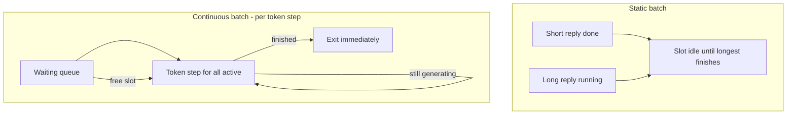
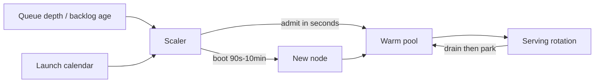
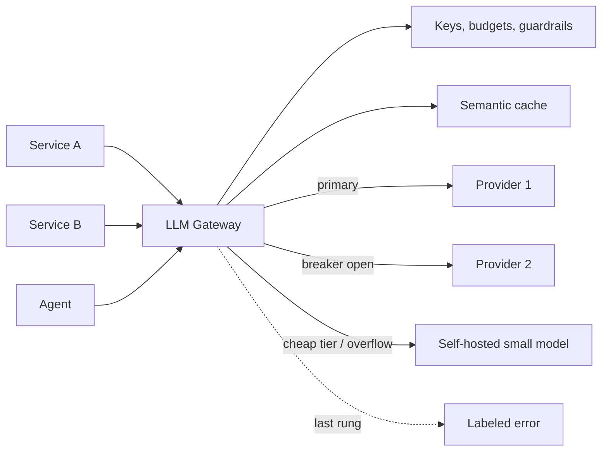
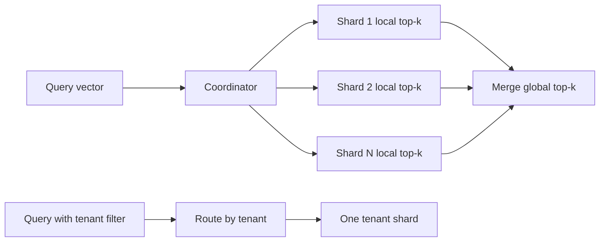

# Module 11 — AI-Era Systems (LLM and ML Infrastructure)

## Module Introduction
*Original lesson: [Module introduction on DesignGurus ↗](https://www.designgurus.io/course-play/system-design-patterns/doc/6a5382697bbf9d62838bfb2f)*

**What this module is about.** The plumbing under AI products: feature stores for classic ML, fleets of **GPUs** (graphics processors that do the heavy maths of running models) serving large language models (LLMs), gateways in front of model vendors, caches that match on meaning, vector indexes, and retrieval-augmented generation (RAG). The message: **nothing here is architecturally new**. Every pattern appeared in earlier modules; what changed is the "physics" they run under.

- **LLM gateway** = Module 8's **API gateway** (the single front door for auth, routing and rate limits) turned outward, toward model vendors.
- **Semantic caching** = Module 4's caching, with "keys are equal" replaced by "meanings are similar."
- **Vector database sharding** = Module 3's sharding, applied to a different kind of index.
- **GPU auto-scaling** = Module 6's auto-scaling, under far tougher limits.
- **Feature store** = CQRS (separate write and read models) plus the data module's "one question, two implementations" lesson, applied to ML.

The course claims roughly **60 recurring shapes** underlie all of system design; this module tests that claim on the newest stack.

**The three constants that changed.** Every lesson is driven by at least one:

1. **Work is counted in tokens, and requests differ hugely in size.** A *token* is a piece of text (~3/4 of an English word). One LLM request may hold 10 tokens and the next 2,000, so one request can cost **100x** its neighbour. A **load balancer**, **rate limiter**, or capacity plan that counts *requests* is silently wrong (building blocks: [System Design Fundamentals](../00-system-design-fundamentals/README.md)). The true unit of work is the token.
2. **Workers are costly and slow to boot.** A GPU machine costs ~**100x** a web server. A new **replica** must load tens of gigabytes of **weights** (the numbers holding what the model learned) before serving, so cold starts last *minutes*. Reactive scaling stops working, and "idle vs. cold" becomes a money decision. The **KV cache** (below) lives in GPU memory, so later turns of a conversation prefer the *same* replica: **session affinity**, which the **stateless** web spent a decade removing, is back.
3. **Equality turned into similarity.** Classic caches and indexes answer only on exact key match; AI systems ask "what is *near* this?" Fuzzy lookups change what a cache hit means, how indexes behave, and what a "correct" answer is. This is the one truly new area, yet once the key is redefined, the old rules still apply.

**Four terms used throughout** (defined once, here):
- **Token:** the unit of text a model works in (~3/4 of a word). Cost, compute and rate limits are measured in tokens.
- **KV cache:** the per-conversation working memory a model builds as it reads and writes. It sits in GPU memory, can be as large as the weights, is costly to rebuild, and lives only for the request or conversation.
- **Embedding:** a vector of numbers capturing the *meaning* of text as a position in space; nearby points mean similar things. Semantic caching, vector search and RAG all rest on embeddings, which turn "how similar?" into maths.
- **TTFT (time to first token):** the wait before the first word of the reply appears; in a streaming UI it is the delay users notice, so it is the main SLO (service level objective, the committed latency target) of the **inference** tier (running a trained model to produce an answer).

**The seven patterns**

| The situation | The pattern |
|---|---|
| Training and live predictions must get exactly the same inputs | Feature Store |
| Workers are expensive, but each request is small | Model Serving & Batching |
| A new worker needs minutes before it can serve | GPU Auto-Scaling |
| A single entry point for many model vendors | LLM Gateway |
| The same question asked in many different wordings | Semantic Caching |
| An index built on meaning grows too big for one server | Vector DB Sharding |
| Answers should come from documents, not from memory | RAG Pipeline |

**How to read the module.** Feature Store continues from the data module's capstone (training/serving skew). Model Serving lays out the inference economics the later lessons assume. GPU Auto-Scaling handles the hard case Module 6 deferred. LLM Gateway is where provider calls are routed, metered and failed over (the most-requested lesson after CDC). Semantic Caching and Vector DB Sharding are the similarity versions of Modules 4 and 3. RAG Pipeline ties everything together, and the capstone builds a production RAG chatbot drawing on every module.

**Short on time?** LLM Gateway and RAG Pipeline first (probed hardest in AI-infra interviews), then Semantic Caching.

**Before you start**, pick an AI product you know and ask:
1. What does one request cost? Do rate limits, capacity plans and prices allow for the next request being 100x more expensive?
2. When traffic surges, how many minutes until new capacity truly serves users, and who pays during that window?
3. If two people ask the same question in different words, does the second pay full cost again?

## Feature Store
*Original lesson: [Feature Store on DesignGurus ↗](https://www.designgurus.io/course-play/system-design-patterns/doc/6a540afca1d43032e06e2e58)*

**What it is.** Each model input (a "feature", e.g. "orders this card made in the past hour") is **written once, as code**. The platform runs that one definition over historical data to build training sets and over live data to feed production. One definition means production values equal training values.

**Analogy.** A restaurant chain where the test kitchen and every branch cook from one master recipe card, instead of each writing its own version.

**The problem (the incident).** A fraud model catches **40% more fraud** than the old rules offline, yet three weeks into production it does *worse* than those rules, with no change to model or weights. The cause is one feature, `card_velocity_1h`:
- **Training side:** warehouse SQL with *event-time* windows (grouped by when orders happened), full history, late events counted, NULLs (SQL's missing value) converted to 0.
- **Serving side:** a hand-coded Java service on **Redis** (a fast in-memory key-value store) with near *processing-time* windows (grouped by arrival), late events dropped, NULLs passed through.

The model trained on one version and was served the other: **training/serving skew**. It fails *silently*: nothing errors, decisions just get worse. It is the Lambda architecture's "one question, two implementations" problem, now hurting model quality. Side effects: each new feature took **3 weeks** (scientist writes SQL, engineers rewrite it), and the growth team was coding a *third* copy because nobody could find the second.

**Why the obvious fixes fail**
- *"One team owns both implementations and reviews closely."* Two codebases, two languages, two release schedules drift by construction; review slows it, but discipline never beats structure.
- *"Serve features straight from the warehouse."* One implementation, wrong speed: warehouse queries take hundreds of ms to seconds; inference has ~**10 ms** for features.
- *"Log what serving computed and train on that" (log-and-wait).* Removes skew for any logged period, but a new feature has no logs (months of waiting), and logs faithfully record serving bugs. Keep it as *verification*, not the core fix.

**How it works**

*Figure — Feature Store (course diagram)*

One feature definition feeds an offline (training) path and an online (serving) path, with a registry between them.

1. **Write every feature once.** `card_velocity_1h` is ~a dozen lines of the platform's DSL (domain-specific language), compiled into both batch SQL and a streaming job. *Why:* one author means the paths can't disagree — the Kappa-style fix of removing duplicates rather than syncing them.
2. **Online path.** Event topics plus change data capture (CDC, streaming the database's change log) feed a keyed sliding-window aggregation that writes to a Redis-class store via idempotent upserts (insert-or-update, safe to retry). Values trail reality by ~**200 ms**; reads take ~**3 ms**, well inside the ~10 ms budget. This is Module 10's streaming machinery as a product.
3. **Offline path with point-in-time correctness.** A training example **labeled** (tagged with the known answer) "fraud on Tuesday 3 PM" must be joined with feature values *as of* that moment, not today's. Joining today's values onto old labels teaches the model facts that didn't exist at decision time — **leakage**, the classic "amazing offline, useless live." A point-in-time join is **event sourcing**'s "as-of" query applied to training data.
4. **Registry.** Every feature is discoverable, owned and **versioned**. Discoverability lets the growth team reuse velocity (one producer, many consumers); versions matter because a model was trained on v1's meaning, so a definition is a contract like a public API.
5. **Log and verify.** Serving logs what it computed; a background job recomputes the same moments offline and asserts **zero difference**. This catches drift between the two compiled paths (e.g. a compiler bug).

**Walkthrough with numbers (the fraud feature, rebuilt)**
- *Time to ship:* **3 weeks → ~2 days**, mostly validation.
- *Serving:* **3 ms** reads, values ~**200 ms** old.
- *Training:* the same definition over **6 months** of history with point-in-time joins; after retraining, live results land *within noise* of offline scores — the real product the platform delivers.
- *Reuse:* the growth team's ranking model pulls the same feature; one definition, three consumers.
- *The bill:* **10M cards × 40 features** ≈ a few GB of RAM. Each new feature needs a **backfill** (replaying history so it exists for training) — an ordinary Kappa replay.

**Trade-offs**
- *You gain:* skew removed by design, so offline evaluation predicts production; leakage prevention guaranteed by the platform; features shared across models; shipping in days.
- *You pay:*
  - **A platform to run** (streaming jobs, online store, registry, backfill tooling) — run it as a product with ML teams as customers.
  - **DSL limits:** every escape hatch is a spot where skew can return.
  - **Freshness tiers:** streamed features (velocity, seconds) vs. nightly batch (90-day aggregates, ~**1/10 the cost**); a model is only as fresh as its stalest feature.
  - **Backfill compute** per new feature.

**When not to use it**
- *One team, one model, ~a dozen features:* a shared code module called by both paths, plus log-and-verify.
- *Features computed purely from the request* (text length, time of day): stateless transforms inside the model server.
- *Batch-only inference* (nightly scoring): careful point-in-time joins in the warehouse suffice.
- *Classic misuse:* adopting the store but letting teams hand-code "just this one" serving path — the third implementation again, hidden from the registry.

**Comparison: three consistency strategies**

| | Two implementations + review | Log-and-wait | Feature store (define once) |
|---|---|---|---|
| Skew | Built in; review only slows it | Removed for logged periods | Removed by design |
| Adding a feature | Written twice; weeks | Months waiting for logs | Definition + backfill; days |
| Leakage protection | Each scientist's care | Good (logs are as-of by nature) | Point-in-time joins enforced by platform |
| Cost | Seems cheap; grows every quarter | Cheap | A whole platform |
| Verdict | Avoid | Keep, as verification only | Use, with log-and-verify |

**Real-world examples**
- **Uber's Michelangelo** named the category; **Airbnb's Zipline** appeared around the same time.
- **Feast** (open source), **Tecton**, and cloud offerings (**SageMaker, Vertex, Databricks**) package definitions, dual materialization (computing values into both offline and online stores) and registries.
- Large ranking, fraud, pricing and recommendation systems use this design whether or not they call it a feature store.
- *For LLM engineers:* the "user context" injected into **prompts** (plan, recent activity, preferences) is online feature serving. A template pulling from three ad-hoc services is three chances to drift from what you evaluated.

**In the interview.** "Design a fraud detector / recommender" eventually becomes: how do serving features stay identical to training features? "Same logic, careful testing" states the goal without a structural fix.

> **30-second answer:** "Each feature is defined once, as code, in a registry, and the platform runs that definition on two paths. Offline runs over event history with point-in-time joins, so each training row sees only what was known at its timestamp; today's values on old labels would leak the future. Online, a streaming aggregation keeps the same feature current in a Redis-class store answering in milliseconds. One author means no skew; log-and-verify catches compiler drift; offline evaluation finally predicts production."

*Likely follow-ups:*
- **"Why do point-in-time joins matter so much?"** Leakage: current values on training rows contain facts from after the labeled event. Offline scores jump, live performance collapses because production never sees the future. The costliest silent bug in ML, often misdiagnosed as "drift."
- **"Which features stream and which batch?"** Per feature, by tolerable staleness: velocity and session activity stream (seconds); 90-day aggregates batch nightly at ~a tenth of the cost. Each feature declares its tier.

*Mistakes that fail candidates:* accepting two implementations; building training sets from current-state tables (silent leakage); querying the warehouse on the inference path.

**Self-check:**
- **Q1:** Define training/serving skew, the engineering problem behind it, and the structural fix. → Serving features differ from training features (definition, windowing, nulls, freshness), so live inputs come from a different distribution and quality quietly drops. Underneath: one question, two implementations. Fix: one definition compiled into both paths, plus log-and-verify.
- **Q2:** A teammate joins March fraud labels onto the *current* features table and gets offline AUC 0.97 (AUC scores ranking quality; 1.0 is perfect). Production? → Much worse. The 0.97 is leakage: today's velocity may be high *because of* the March fraud. Rebuild with point-in-time joins.
- **Q3:** After six months a model slowly degrades; no deploys, log-and-verify clean. Upstream changed `order_total` to exclude shipping. Why didn't the store notice? → It guarantees the paths agree, not that *meaning* stays fixed; both computed the new meaning identically (temporal skew). Add upstream schema/semantic contracts (outbox, schema registry), monitor feature distributions against the training profile (mean, **percentiles** — the value below which a given share of observations fall — null rate), and version features (`order_value_v2`) that models pin.

**Related patterns:** CQRS (offline writes, online reads; features are read models); Lambda & Kappa (skew is their duplicate-implementation problem); Stream Processing and CDC (the online path); Event Sourcing (point-in-time joins are as-of queries).

**TL;DR**
- *Problem:* a feature coded twice (SQL for training, a service for serving) drifts; the model looks great offline and quietly fails live. Weeks per feature; third copies appear.
- *Mechanism:* define once in a registry; compile to an offline path (history + point-in-time joins) and an online path (streaming into a millisecond store); log-and-verify as the drift alarm; backfill by replay.
- *Costs:* a platform, DSL limits, per-feature freshness tiers, replay compute per feature.
- *Skip it when:* one team with ~a dozen features, request-only transforms, or batch-only inference.

## Model Serving (and Batching)
*Original lesson: [Model Serving on DesignGurus ↗](https://www.designgurus.io/course-play/system-design-patterns/doc/6a540b90a1d43032e06e3282)*

**What it is.** The layer that runs a model to answer live requests. Its key trick is **batching**: hold requests a few milliseconds and run a group through the GPU together. The LLM version is **continuous batching**, where requests join and leave the batch at every generated token.

**Analogy.** A bus costs nearly the same to run with 1 rider or 32; batching fills the bus. Continuous batching lets riders get off at their own stop and new riders board at every stop.

**The problem (the incident).** The store self-hosts a 7-billion-parameter ("7B"; parameters are learned weights) support model for privacy and serves it one request at a time. Latency is fine; capacity maths is not:
- An A100-class GPU (popular NVIDIA data-centre GPU) costs ~**$35K/year** and produces ~**50 tokens/s** for a single request.
- A typical reply is **400 tokens** → **8 s** of GPU time → **0.125 req/s** per GPU.
- Peak needs **20 req/s** → **160 GPUs ≈ $5.6M/year**, ~10x the budget.

**Profiling** shows each GPU at ~**8%** compute. With a batch of one, every token step streams tens of GB of weights from GPU memory through the chip for a tiny amount of maths: the work is **memory-bandwidth-bound**, limited by data movement, not calculation.

**Why the obvious fixes fail**
- *"Buy more GPUs."* 160 GPUs each still 8% busy; the bottleneck is work per pass over the weights.
- *"Use a smaller model."* Distillation (training a small model to copy a big one) and quantization (fewer bits per weight) cut data per step, but one-at-a-time serving still idles. Consider it *after* batching, if quality allows.
- *"Queue everything into hourly batch jobs."* Fine offline (providers offer batch at ~**50% off**), but a chat customer is waiting; batches must form in *milliseconds*.

**How it works**
1. **Dynamic batching.** Wait ~**5–10 ms** or until a max batch size, then run the group. Each step streams the weights once regardless of batch size, so **32** requests take barely longer than one and deliver ~**20–30x** **throughput**, for a few ms of wait. For same-shaped jobs (embeddings, image classification) this is the whole solution.
2. **The LLM twist: variance (Constant 1).** In a *static* batch nobody leaves until the slowest generation ends; a 10-token reply waits for a 2,000-token essay and finished slots sit empty — the **convoy effect**.
3. **Continuous (in-flight) batching.** The scheduler works in *token steps*: each step emits one token per active request; finished requests leave immediately, waiting ones join mid-flight. Capacity is recovered every token, so utilization holds under 100x length variance.
4. **Paged KV-cache memory (PagedAttention).** Naive allocation fragments GPU memory (free space in unusable scraps), capping concurrency. Borrowing OS **virtual memory** paging (small fixed-size, non-contiguous pages) removes **fragmentation** and fits **2–4x more concurrent requests**.
5. **The surrounding stack.** Load-balance on **queue depth and pending tokens**, not connection counts (misleading under 100x variance). Keep conversations **sticky** to the replica holding their KV cache. At scale, **disaggregate prefill from decode**: *prefill* (reading the prompt) is **compute-bound**, *decode* (writing the reply) is bandwidth-bound, so separate pools are tuned separately.

In the static batch below, a finished short reply idles until the longest finishes; in the continuous batch, finished requests exit each token step and queued ones fill the freed slots.

*Static batching vs continuous batching*

**Walkthrough with numbers (same assistant on a vLLM-class engine)** — **vLLM** is a popular open-source LLM serving engine.
- *Per GPU:* batch ~32 → **2,500–3,000 tokens/s** vs. 50; one 400-token reply still takes a few seconds, but the GPU serves **6–7 req/s**.
- *Fleet:* 20 ÷ ~6 ≈ 3.3 → **4 GPUs + 1 headroom = 5 instead of 160**; **$5.6M → ~$175K/year**, a **30x** cut from scheduling alone, same model and quality.
- *Latency cost:* TTFT +~**20–30 ms**, invisible when streaming; per-token pace barely changes.
- *Utilization:* **8% → ~70%**.
- *Bulk work:* the nightly **10M product descriptions** job goes to the half-price batch API, **bulkheaded** from the interactive fleet.
- Batching stays nearly free until combined compute outlasts weight streaming or KV memory fills; then you need another GPU.

**Trade-offs**
- *You gain:* **10–30x throughput per dollar** (what makes self-hosting affordable), variance under control, fewer and fuller GPUs to autoscale.
- *You pay:*
  - **A small latency floor** (batch window + scheduler) on TTFT — matters for hard real-time.
  - **Shared fate:** one huge prompt squeezes the rest; an engine crash kills the whole batch.
  - **A complex engine** (token schedulers, paged memory, **preemption** — pausing/evicting a running request). **Buy it** (vLLM, TGI, Triton); a home-built scheduler is a mistake, not an accomplishment.
  - **Per-workload tuning** of batch caps, windows, memory budgets.
- *Giant-prompt spikes:* a pasted contract can push everyone's **p99** TTFT (the value 99% of requests come in under) from **200 ms to 4+ s** — a huge compute-heavy **prefill** hogs the token steps. Fixes: **chunked prefill** (spread the prompt read over many steps); **input tiering** (huge inputs to a long-context pool or async flow — a bulkhead); **product caps with honest UX** ("large document: may take longer"); **prefill/decode disaggregation** at scale.

**When not to use it**
- *Inference that must finish in a few ms* (voice frames, some ranking): no room for a window; use small-batch or specialized runtimes.
- *Trivial traffic* (dev, 0.1 req/s): a batch of one is correct.
- *Offline bulk jobs:* batch APIs at half price, off the interactive fleet.
- *Classic misuse:* interactive and bulk on one fleet, so the nightly 10M-item job starves chats — a bulkhead failure, GPU edition.

**Comparison: dynamic vs. continuous batching**

| | Dynamic (request-level) | Continuous (token-level) |
|---|---|---|
| Batch membership | Fixed at start; all wait for the last | Changes every step; leave when done, join midway |
| 100x output variance | Convoy effect | Handled; capacity recovered each token |
| Good for | Same-sized jobs: embeddings, vision, rankers | LLM text generation |
| Implementation | Window + max size (Triton) | Full scheduler (buy vLLM/TGI/TensorRT-LLM/SGLang) |

Rule of thumb: **same-sized jobs → batch by request; varying sizes → batch by token.** The embedding endpoint (used by the semantic cache) runs dynamic batching beside the continuous-batching LLM fleet.

**Real-world examples**
- **vLLM:** open-source continuous batching + paged KV; made self-hosted LLM serving practical.
- **NVIDIA Triton:** dynamic batching as general infrastructure for any model type.
- **TGI, TensorRT-LLM, SGLang:** variants of the same ideas.
- **Provider batch APIs (Anthropic, OpenAI):** ~50% off for work that can wait, slotted into spare fleet capacity.

**In the interview.** LLM inference-serving questions are increasingly common; "why does batching help GPUs so much?" separates people who have run inference from those who only called an API.

> **30-second answer:** "One-at-a-time LLM inference is memory-bandwidth-bound: every token step streams all the weights for barely any maths, so GPUs idle near 8% and the fleet costs millions. Batching shares that stream across ~32 requests for 20–30x throughput at a few ms of TTFT, hidden by streaming. LLMs need continuous, token-level batching because output lengths vary 100x; request-level batching would trap short answers behind long ones. Paged KV fits 2–4x more requests. Balance on queue length and pending tokens, keep conversations sticky, buy a vLLM-class engine, and send bulk work to half-price batch APIs."

*Likely follow-ups:*
- **"How can 32 requests take barely longer than one?"** Each step's cost is dominated by streaming weights, which is the same at any batch size; per-request compute rides along nearly free until the batch saturates the compute units.
- **"Someone pastes a 50-page file and everyone's latency spikes."** The huge prefill is a compute burst hogging token steps (shared fate). Chunked prefill, input caps and size tiers, and at scale separate prefill/decode pools.

*Mistakes that fail candidates:* pricing one-request-per-pass serving without spotting the waste; request-level batching for chat (convoy effect); hand-writing the token scheduler.

**Self-check:**
- **Q1:** Why does a batch of 32 take about as long per step as one request, and when does that stop? → The fixed cost of streaming weights dominates; per-request maths is small. It stops when total compute outlasts streaming time or KV memory runs out — the GPU is now compute-bound and you need another one (the autoscaling signal).
- **Q2:** Match strategies: (a) embeddings (~50 ms each), (b) customer chat (100x output variance), (c) nightly summaries of 10M pages. → (a) dynamic batching (Triton-style); (b) continuous batching + paged KV (vLLM-class); (c) neither fleet: provider batch API or off-peak offline run, bulkheaded from the interactive pool.
- **Q3:** p99 TTFT, usually 200 ms, jumps to 4+ s for everyone when users paste contracts. → Giant compute-bound prefills compete with every decode (Constant 1 applies to inputs too). Chunked prefill, input tiering, product caps with honest UX, prefill/decode disaggregation.

**Related patterns:** Load Balancing (by queue depth / outstanding tokens); GPU Auto-Scaling (adding GPUs once full); Message Queue (bulk work via half-price batch queues); Semantic Caching (the cheapest request never reaches the GPU).

**TL;DR**
- *Problem:* one-at-a-time LLM serving leaves GPUs ~8% busy (bandwidth-bound); 20 req/s costs $5.6M/year.
- *Mechanism:* batch — continuous, token-level for 100x variance, plus paged KV (2–4x). Buy a vLLM-class engine.
- *Costs:* small TTFT floor, shared fate (giant prompts), a complex engine, per-workload tuning.
- *Skip it when:* hard real-time ms budgets, trivial traffic, or offline bulk (batch APIs, bulkheaded).

## GPU Auto-Scaling
*Original lesson: [GPU Auto-Scaling on DesignGurus ↗](https://www.designgurus.io/course-play/system-design-patterns/doc/6a540bb4a1d43032e06e34a4)*

**What it is.** Adding and removing GPU serving replicas with demand — web auto-scaling, except idle GPUs cost ~100x more and new ones take minutes to start. So instead of one reactive loop you **layer** defenses: the right signal, warm spares, scheduled pre-warming, faster boots, a degradation plan for the gap, and careful scale-down.

**Analogy.** A restaurant can't hire and train a chef in ten minutes after a tour bus arrives. It keeps chefs on call (warm pool), staffs up from the bookings calendar (scheduled scaling), trains hires faster (boot engineering), simplifies the menu when swamped (smaller model), and never sends a chef home mid-dish (drain before scale-down).

**The problem (the incident).** The five-GPU support fleet runs at 70%. A morning-show mention quadruples traffic within **15 minutes**, and the web-style autoscaler fails three ways:
1. **Wrong signal.** It watches host CPU, which shows **12%** while requests pile up on the GPU. GPU utilization misleads too: under continuous batching the chip always looks busy while the queue grows. Only **queue depth** (requests waiting for a GPU) showed reality, and nobody watched it.
2. **Minutes to boot.** Getting a GPU node takes **3–8 minutes** (if the **region** has one), then pulling a **15 GB** **container**, loading **14 GB** of weights and warming the runtime: **8–12 minutes** from decision to first token. The spike is over first.
3. **The maximum isn't yours.** At minute 20, four more A100s return "insufficient capacity in this region": the real maximum was the provider's **quota**.

At night, five GPUs sit **10%** busy at ~**$20/hour**, yet scale-to-zero means the next customer waits ~10 minutes. Versus web servers: idle costs **100x** more, cold starts last **60x** longer.

**Why the obvious fixes fail**
- *"Tune the reactive loop harder."* ~1 min to notice + ~10 min to boot vs. a 15-minute spike: no setting wins. Reactive-only is a well-tuned way to arrive late.
- *"Provision for peak."* At ~**$35K/GPU-year**, 4x spare capacity wastes the 30x batching savings.
- *"Serverless GPUs (Modal, Baseten, RunPod)."* (*Serverless*: pay per use, platform manages machines.) Often the right choice — they hide cold starts behind warm pools shared across customers, so you pay someone to solve this lesson. At large scale or under strict privacy, the problem returns to you, so know the mechanics.

**How it works: layered defenses**
1. **Right metrics: queue depth and backlog age per replica.** *Backlog age* (how long the oldest request has waited) triggers alarms. Replicas needed ≈ token demand ÷ token throughput per GPU. CPU and connection counts don't reflect token work.
2. **Warm pool.** Keep *k* instances fully booted (weights loaded) *outside* rotation; scale-up moves one in within **seconds** while slow boots refill the pool in the background. Size: **pool ≥ spike arrival rate × boot time**. The idle pool is the explicit price of instant capacity (Module 6's headroom at GPU prices).
3. **Scheduled, ahead-of-time scaling.** Pre-warm before the daily curve (e.g. the 9 AM ramp); make marketing file pre-warm requests for launches. Predictable demand sees zero delay; reactive scaling handles only surprises.
4. **Faster boots.** Stream container images (start while downloading); keep weights on local NVMe (fast directly attached SSDs) or pre-attached snapshot volumes; restore from memory snapshots where supported; co-locate models on nodes that keep weights loaded. Boot drops from **8–12 min to 60–90 s**, making every other layer cheaper.
5. **Degrade gracefully during the gap.** Queue with an honest wait time → shed free tier before paid (rate-limit tiers) → **switch to a smaller model and say so** (e.g. quantized 7B when the 70B pool is full). Users prefer a labeled weaker answer to a spinner; quality becomes one more thing you can shed.
6. **Scale down without cutting anyone off.** Stop new admissions, let in-flight generations finish, park the replica in the warm pool, then release. Keep an overnight floor; allow scale-to-zero only if breakeven works (idle hours × ~**$4/GPU-hour** vs. a multi-minute wait for the next user — dev usually passes, production rarely). Immediate termination cuts a paying user off mid-sentence.
7. **Quota is procured capacity.** Reservations and committed-use contracts (discounts for promising spend over a year or more), plus an overflow target (another region, cloud, or hosted API), routed by the LLM gateway (next lesson).

Queue depth drives the scaler, which admits pooled instances in seconds while new nodes refill the pool; the launch calendar feeds the scaler, and scale-down drains replicas back into the pool.

*Warm pool: fast admission, slow refill off the critical path*

**Walkthrough with numbers (the morning show, replayed)**
- *T−1 day:* the launch calendar grows the pool **2 → 5** — the cheapest fix in the lesson is a meeting.
- *T+0–60 s:* traffic 4x; queue-depth alarms fire; 5 pooled instances join in seconds, roughly doubling capacity in the first minute.
- *T+90 s onward:* fast boots add capacity every **90 s** and refill the pool.
- *Worst minute:* p95 TTFT (95% of requests under it) **3.8 s**; free tier waits briefly behind paid; **12%** of traffic served by the labeled smaller model; no error page.
- *T+25 min:* demand falls; scale-down drains, parks, holds the new baseline.
- *3 AM:* floor of **2**, with **preemptible** nightly summarization (evicted instantly if real traffic arrives) filling quiet hours: **70% utilization by day, 60% at night**.

**Trade-offs**
- *You gain:* spikes survived despite 10-minute boots; a bill that tracks demand; conversations that complete through scale-down.
- *You pay:* warm-pool cost (insurance that looks like waste, defended every quarter); layered ops (calendars, pools, boots, ladders, preemption); preemption machinery (priorities, instant eviction, checkpointing batch jobs); ongoing quota work (reservations, cross-region overflow, provider relationships).

**When not to use it**
- *Steady traffic:* fixed fleet, spare time filled with preemptible bulk jobs.
- *Tiny scale:* with one or two GPUs, plain queueing with honest wait times beats warm-pool machinery.
- *Pure batch:* schedule the fleet like batch work.
- *You shouldn't own GPUs yet:* start with a hosted API and let the provider own cold starts and quota until traffic, latency or privacy forces self-hosting.
- *Classic misuse:* web-style GPU scaling — CPU signal, reactive only, scale-to-zero in prod, terminate on scale-down.

**Comparison: own the fleet vs. rent the problem**

| | Provider APIs | Serverless GPU | Own fleet + this lesson |
|---|---|---|---|
| Cold starts | Provider's problem | Eased by platform warm pools | Yours: everything in this lesson |
| Cost at high volume | Highest per token | Middle | Lowest, if GPUs stay busy |
| Privacy / control / custom models | Least | Middle | Full |
| Ops burden | Almost none | Low | A whole team |
| Fits | Starting point for most | Bursty, specialized workloads, experiments | Large steady volume, strict privacy, custom models |

Move one column right only when traffic or constraints force it; this lesson is the cost of each move.

**Real-world examples**
- **KEDA** (Kubernetes event-driven autoscaling; **Kubernetes** runs containers across a cluster) scales on queue depth (the signal layer); **Ray Serve** and vLLM's autoscaling handle model-aware parts.
- **Cloud warm pools** (e.g. AWS Auto Scaling Group warm pools), GPU and **capacity reservations**: readiness and quota as products.
- **Modal, Baseten, RunPod:** rented warm pools.
- **SkyPilot-class multi-cloud spillover:** finds capacity across regions/providers when quota runs out.

**In the interview.** "Traffic to your LLM service goes up 5x — handle capacity." Each follow-up maps to a layer (signal, cold start, scale-to-zero, quota), each with a tempting one-line wrong answer.

> **30-second answer:** "GPU scaling is web scaling with idle cost and cold starts ~100x worse, so reactive-only is late by design. I scale on queue length and oldest-request age, never CPU. A warm pool sized at spike rate × boot time admits capacity in seconds while new nodes refill it; a calendar pre-warms known events; local weights and streamed images cut boots to ~90 s. In the gap, a ladder queues, sheds lower tiers, and falls back to a labeled smaller model. Scale-down drains in-flight generations and keeps an overnight floor. Quota is negotiated, with spillover via the gateway. And I'd start API-first until volume or privacy justifies owning GPUs."

*Likely follow-ups:*
- **"Why is CPU a poor signal?"** The model runs on the GPU, so host CPU looks idle while users wait; GPU utilization looks busy under continuous batching while the queue grows. Queue length and backlog age show directly whether arrivals outpace completions.
- **"Should production scale to zero?"** Breakeven: overnight idle at ~$4/GPU-hour vs. the first morning users eating a multi-minute cold start. Dev: zero. Production: a small floor nearly always wins. Show the maths.

*Mistakes that fail candidates:* CPU-triggered GPU scaling; reaction alone with minute-long boots; prod scale-to-zero without breakeven maths; scale-down that kills generations mid-stream.

**Self-check:**
- **Q1:** Which three delays make reactive GPU scaling late, and which layer handles each? → Detection lag (~1 min) → queue-depth/backlog-age signals. Boot lag (minutes) → warm pools + boot engineering. Spike duration (often 10–20 min, about the first two combined) → scheduled/predictive pre-warming. The degradation ladder covers the remainder.
- **Q2:** Spikes add up to 2 GPUs of demand per minute; boots take 90 s. Pool size? → ≥ 2 × 1.5 = **3 GPUs** (+1 for overlapping spikes): ~3 × $35K ≈ **$105K/year** of deliberate idleness turning a 10-minute outage into 10-second admission. Recompute when boot time or spike shape changes.
- **Q3:** Around 2 AM answers are cut mid-sentence, and first morning users wait "forever." Config: min=0, scale down after 15 min low utilization, immediate termination. → Termination kills live generations: drain (stop admission, finish up to max output length, park, release). min=0 means full cold starts: keep a breakeven floor of 1–2 and pre-warm before the morning ramp. **With GPUs, scaling down hits users directly.**

**Related patterns:** Auto-Scaling (the parent, with idle cost and boot time ~100x worse); Model Serving (fuller batches = fewer GPUs); Graceful Degradation (the gap ladder, including the smaller model); LLM Gateway (spillover routing); Message Queue (preemptible bulk work in quiet hours).

**TL;DR**
- *Problem:* minute-long cold starts make reactive scaling late; $4/h idle makes overprovisioning costly; the real ceiling is provider quota.
- *Mechanism:* queue-depth signals; warm pool = spike rate × boot time; calendar pre-warming; 90-second boots; a ladder ending in a labeled smaller model; drain-then-park; negotiated quota with gateway spillover.
- *Costs:* paid idleness, layered ops, preemption machinery, capacity procurement.
- *Skip it when:* flat traffic, tiny scale, pure batch, or you shouldn't own GPUs (go API-first).

## LLM Gateway
*Original lesson: [LLM Gateway on DesignGurus ↗](https://www.designgurus.io/course-play/system-design-patterns/doc/6a540bdc15006768b52d2c29)*

**What it is.** One internal service that *every* model-provider call passes through. Services authenticate with their internal identity; the gateway holds provider **API keys**, counts every token, maps "logical" model names to real providers, applies per-provider timeouts, retries and **circuit breakers**, and follows a pre-planned fallback sequence on failure. It is Module 8's API gateway applied to **outbound** (egress) traffic.

**Analogy.** A single purchasing office that holds the company cards, logs who bought what, enforces budgets, and knows which backup supplier to call — instead of every department carrying its own card.

**The problem (the incident).** After 18 months of AI enthusiasm, **14 services** call providers directly (the assistant, search, summarization, three agent experiments, a fraud explainer, and eight uncatalogued). Three bills arrive together:
- **A key leaks.** A team shipped a provider key in a client bundle (code sent to browsers/apps); it appears on a public paste site. To **rotate** it you must find every copy across 14 services, 3 languages and unknown configs, then redeploy them all.
- **Nobody can attribute spend.** "Who spent the **$80K** last month?" Invoices group by informally shared keys. An experimental agent retried in a loop for two days and burned **$40K** unnoticed; there was no place to enforce a cap.
- **A provider brownout** (partial outage: slow or failing replies) at peak gets fourteen reactions: **6 fail with no fallback, 5 hang with no timeout, 3 run untested custom degradation.**

The root cause is Module 8's: a **cross-cutting** policy (auth, logging, budgets) implemented per service drifts. The difference is that every request has a direct dollar cost, so drift becomes large unplanned charges within days.

**Why the obvious fixes fail**
- *"A shared SDK"* (client library). Rollout rides 14 deploy schedules, 3 languages mean 3 SDKs, and keys still live in 14 configs. A library centralizes *code*; custody, accounting and live policy need one *runtime* enforcement point.
- *"A key registry and a spending policy document."* The runaway agent didn't read the document, and a document can't cap spend at 2 AM Saturday.
- *"Each team hardens its own integration."* 14 half-gateways that drift — the incident made official.

**How it works: each job is a Module 8 job, pointed outward**

Services and agents call one gateway, which applies keys, budgets and guardrails, checks the semantic cache, and routes to the primary provider; an open breaker shifts traffic to a second provider; cheap tiers and overflow go to a self-hosted small model; the last rung is a labeled error.

*One egress gateway in front of all model providers*

1. **Key custody (was: authentication).** Services authenticate with **service mesh** workload identity (the mesh carries inter-service traffic and gives each workload a verifiable identity); only the gateway holds provider keys. A leak means rotating **one** key with **zero** redeploys, and every call is attributed automatically.
2. **Token accounting and budgets (was: rate limiting).** Count tokens per team, feature and user, with soft alerts and **hard caps** — rate limiting in tokens per minute. Outward, handle provider `429 Too Many Requests` by retrying per the `Retry-After` header. Metering feeds billing, which needs exactly-once processing when invoices depend on it. One component manages both your budgets and the provider's limits, and a runaway **agent** (an LLM program acting in a loop) hits a cap instead of causing a **postmortem**.
3. **Logical model routing (was: path routing).** Services request a capability (`summarize-fast`, `chat-premium`); the gateway maps it to provider, model and version. Upgrades, price changes and provider switches become one routing change, not 14 deploys. Roll out as a **canary behind a feature flag** (e.g. 5% of `chat-premium` to the new model — a canary is a small first share of traffic; a flag changes behaviour without a deploy), judged by eval scores and negative-feedback rates. Model choice becomes an operational setting.
4. **Per-provider reliability kit.** Timeouts tuned to each provider's p99; retries honouring `Retry-After` within a per-provider retry budget; a **circuit breaker per provider-model pair**. In a brownout the breaker opens within seconds and traffic steps down the **fallback ladder**: primary → secondary provider → smaller self-hosted model → semantic cache → honest error. Module 5's graceful degradation, built and tested once.
5. **Streaming passthrough.** LLM replies stream over SSE (server-sent events); the gateway must forward them *unbuffered* or TTFT is wrecked. Test it in **CI** (automated tests on every change) like a feature.
6. **Safety point.** PII (personally identifiable information) scrubbing, **prompt-injection** screening (hidden instructions in input trying to hijack the model), and audit logging with **trace IDs** happen once, here.
7. **Capacity federation.** When the self-hosted GPU pool is full, overflow goes to provider APIs via the same chains (where the GPU lesson's spillover lands).
8. **Keep it thin.** The gateway routes, meters and protects; it does **not** own prompts, templates or business logic, which are product code in the services. Otherwise every prompt tweak becomes a platform ticket (the "monolith in disguise"). Placement: the API gateway handles inbound **north-south** traffic (outside clients ↔ your system); the LLM gateway handles outbound calls and usually sits behind the API gateway, beside the services.

**Walkthrough with numbers (the three bills, replayed)**
- *The leak:* rotate one key in one **vault** (secret store): minutes, zero deploys, every caller already on the dashboard.
- *The brownout:* the primary's error rate crosses the breaker threshold in ~**20 s**. **80%** of traffic shifts to the secondary (**+300 ms**, quality within tolerance); `classify-fast` moves to the self-hosted **7B**; **15%** of chat is served from the semantic cache; the UI shows a "responses may be slower" banner. **Zero services down** (vs. six), because the response was prepared configuration.
- *The weekend agent:* stopped at **$500**, not $40K.
- *Gateway cost:* **+3–8 ms** proxy overhead per call (noise against multi-second generations); one more component needing high availability — run it redundant and thin.

**Trade-offs**
- *You gain:* custody, budgets and safety enforced once at the only point that sees every call; failover built and tested once; model swaps, canaries and price-based provider choice become routing; per-feature cost visibility; runaway spend capped at machine speed.
- *You pay:* **a critical-path dependency** for every AI feature (run it redundant; the least-changing component is the most stable); **streaming passthrough as a standing obligation** (one buffering regression silently triples TTFT); **adapter churn** as provider APIs change (a reason to buy the core); **constant pressure toward scope creep** (prompts, "just one transformation").

**When not to use it**
- *One service, one provider:* a well-configured client with timeout, retry and breaker suffices.
- *Fully self-hosted single model:* the serving load balancer already routes; an extra hop adds latency without new policy.
- *Tiny latency-critical local models* (in-process rankers): no door needed.
- *Build vs. buy:* start from **LiteLLM** (open source), **OpenRouter** (gateway as a service), **Portkey**, or cloud AI gateways. Build only where custody, safety or routing policy is truly yours, on an open-source core; hand-writing every adapter repeats the "hand-built scheduler" mistake.
- *Classic misuse:* the gateway as a **prompt CMS** — templates, **few-shot examples** (sample Q/A pairs in the prompt) and product logic pile up in config until every feature change needs a platform ticket (the ESB, enterprise service bus, centralization problem).

**Comparison: API gateway vs. LLM gateway, job by job**

| Job | API Gateway (inbound) | LLM Gateway (egress) |
|---|---|---|
| Identity | AuthN (authentication): who sent this? | Key custody: our identity toward providers; each caller attributed |
| Fairness | Per-client rate limits | Per-team/feature token budgets with hard caps |
| Routing | Paths → services | Logical models → providers/versions |
| Change safety | API versioning | Model flags + canaries judged by evals |
| Reliability | Timeout/retry per upstream | Full kit per provider + fallback ladder |
| Observability | Request IDs, trace root | Token/cost accounting, trace propagation |
| Discipline | Thin: no domain logic | Thin: no prompts |

Same pattern, opposite direction; mature stacks run both, one behind the other.

**Real-world examples**
- **LiteLLM:** the open-source standard (one interface to all providers, budgets, fallbacks); the default core to build on.
- **OpenRouter:** the pattern as a business — a public gateway over dozens of providers, billed per token.
- **Portkey, Kong AI Gateway, Cloudflare AI Gateway:** enterprise and edge variants with guardrails and caching at the same chokepoint.
- Every serious AI platform team builds this within a year of its "14 services" incident, usually right after.

**In the interview.** "A dozen teams call providers directly. What breaks, and what do you build?" Follow-ups probe the outage chain, safe model swaps, and streaming.

> **30-second answer:** "One internal egress gateway for all model traffic — Module 8's gateway turned outward. Services authenticate with internal identity and the gateway holds provider keys, so a leak is one rotation, not 14 deploys. It meters tokens per team and feature with hard caps. Logical model names map to providers, so upgrades are canaried routing changes judged by evals. Each provider gets tuned timeouts, Retry-After-aware retries, and a breaker per provider-model feeding a fallback ladder: secondary provider, smaller self-hosted model, semantic cache, labeled error. Streams pass through unbuffered, and the gateway stays thin with no prompts. Start from a LiteLLM-class core."

*Likely follow-ups:*
- **"Walk through the provider outage."** The provider-model breaker trips on error rate within seconds; traffic falls down the configured chain (secondary provider for quality tiers, self-hosted small model for cheap tiers, semantic cache where hits exist, honest error last). Budgets stop failover from doubling spend. "The response was configuration, not a war room."
- **"How do you move chat to a new model safely?"** Logical names decouple callers from models: flag 5% to the new model, compare against the concurrent baseline on live evals, negative feedback, cost and per-token latency, then ramp or roll back via config.

*Mistakes that fail candidates:* prompts in the gateway; no hard budget caps (the $40K weekend remains possible); buffered streams; hand-written provider adapters.

**Self-check:**
- **Q1:** Map five API-gateway jobs to LLM-gateway counterparts and name the two disciplines. → AuthN → key custody + caller attribution; rate limits → token budgets with hard caps; path routing → logical-model routing; API versioning → model flags + eval-judged canaries; request-ID observability → token/cost accounting + trace propagation. Disciplines: **unbuffered streaming passthrough** and **thinness** (no prompts or product logic).
- **Q2:** Fallback chains for (a) customer chat and (b) internal ticket classification. → (a) premium model → comparable model at the secondary provider → semantic cache for high-similarity hits → **honest labeled error with retry guidance**; it stops short of a much smaller model because poor open-ended answers are worse than waiting (**fail closed** on quality). (b) cheap model → self-hosted 7B → keyword rules → almost never an error, since availability matters more than quality. Chain length is a per-tier product decision priced by the cost of a wrong answer.
- **Q3:** The gateway team is a bottleneck: 400 prompt templates in config, a ticket per prompt change. → A monolith in disguise (prompt CMS, the ESB mistake). Move prompts, templates and output formats to owning services or a product-owned prompt registry (like the **BFF**, backend-for-frontend, split). The gateway keeps custody, metering/caps, routing, reliability kit, fallback ladder, safety and passthrough. Rule: product vocabulary doesn't belong in the gateway.

**Related patterns:** API Gateway (inbound parent; run both); Circuit Breaker and Retry (per-provider kit); Graceful Degradation (the fallback ladder); Semantic Caching (shared response cache at the gateway); Canary Deployment + Feature Flags (shipping model swaps).

**TL;DR**
- *Problem:* 14 services call providers directly: scattered keys (one leak = 14 deploys), unattributable spend ($40K runaway), 14 homemade outage responses.
- *Mechanism:* one thin egress door — key custody, token metering with hard caps, logical-model routing (canaried config), per-provider reliability kit feeding a fallback ladder, guardrails once, unbuffered streaming, no prompts.
- *Costs:* a highly available critical-path component, adapter churn (buy the core), passthrough testing, a permanent fight against prompt creep.
- *Skip it when:* one service + one provider, single-model self-hosting, or in-process models; never write adapters from scratch.

## Semantic Caching
*Original lesson: [Semantic Caching on DesignGurus ↗](https://www.designgurus.io/course-play/system-design-patterns/doc/6a540c2a309e9694c9c0af6d)*

**What it is.** A cache keyed on the *meaning* of a question rather than its wording. Each query is embedded; if a stored question's embedding is close enough (above a similarity **threshold**), the saved answer returns in milliseconds. Otherwise a fresh answer is generated and saved for the next person asking in other words.

**Analogy.** A good librarian sends "WWII tanks" and "armored vehicles in the Second World War" to the same shelf — but double-checks before handing over something that merely *sounds* similar.

**The problem (the incident).** The support assistant costs ~**$2,000/day**. A week of logs shows **40% of questions are rephrasings of ~200 questions** ("order status pls", "when will my package arrive"), each paying full price (~**$0.002**, **2.5 s**). Module 4's cache-aside keyed on the query string gets a **hit ratio** of **4%**: exact keys only catch copy-pastes. That captures a tenth of the opportunity and wastes ~**$800/day** re-answering answered questions. The answers are cacheable; the *keys* can't recognize them. Module 4's laws still hold — what broke is the equality operator (Constant 3).

**Why the obvious fixes fail**
- *"Normalize the text"* (lowercase, strip punctuation, **stem** — cut words to roots, "shipped" → "ship"). Hit ratio rises only to **7%**; "where is my package" and "order status?" share no stems.
- *"Keyword-match a canonical FAQ."* The brittle pre-LLM chatbot again: endless upkeep, misses unforeseen paraphrases.
- *"Per-user session caches."* The 40% is repetition *across* users, which per-user caches never see.

Two sentences that mean the same thing need a shared key — a geometry problem, not string manipulation.

**How it works**

*Figure — Semantic Caching (course diagram)*

The query is embedded and compared with cached entries, then answered from cache (above threshold and passing guards) or sent to generation with the answer written back.

1. **Embed the query** with a small model: ~**10 ms**, a tiny fraction of a generation's cost. The embedding is the new key.
2. **Nearest-neighbor search** (finding stored vectors closest to the query vector) over cached questions' embeddings.
3. **Threshold check.** Above threshold and guards pass → return cached answer; otherwise generate and store `(embedding, query, answer, tags)`.
4. **Set the threshold cautiously.** Besides hit and miss there is now a **false hit**: serving an answer to a question that seems similar but means something else ("cancel my order" vs. "cancel my subscription"). Costs are lopsided: a false miss costs $0.002; a false hit gives wrong instructions and costs trust.
5. **Guard every hit.** (a) **Entity check:** a query about order #8412 never gets an answer naming #7311. (b) **No personalized content** in a shared cache (the CDN lesson's `private, no-store` rule in embedding space). (c) **TTLs** (time-to-live), e.g. a return-policy answer expires because policy changes. (d) **Sampled grading** of real hits — the false-hit rate must be *measured*, not assumed from config.
6. **Invalidate by tag.** Fuzzy keys can't be deleted by name, so tag entries with topics at write time and "purge tag: shipping-policy"; TTL is the safety net.
7. **Place it at the LLM gateway** so all teams share one cache. Read path: **exact cache → semantic cache → generation**.
8. **Decide what is cacheable.** Informational, impersonal, stable answers: yes. Account state: no (depends on asker). Creative requests: no (the same poem twice is a bug). Time-sensitive: short TTLs only.

**Walkthrough with numbers**
- *Threshold tuning:* on an offline set of same/different-meaning pairs, **0.92** gives **31%** hits (vs. 4% exact) with **0.3%** false hits in audits. Moving to **0.94** plus the entity guard gives **27% hits, 0.05% false hits**: 4 points of hit ratio for **6x fewer wrong answers**, documented as a product decision.
- *Money:* 27% of $2,000/day ≈ **$540/day, ~$200K/year**, for an embedder, an index and a threshold.
- *Latency:* hits in ~**40 ms** vs. 2.5 s generation.
- *Viral questions:* during an incident, variants of "is the site down?" are served from one generation **10,000 times an hour** — **stampede** protection (**single-flight**: one request does the work, concurrent identical ones share its result), matched by meaning.

**Trade-offs**
- *You gain:* **25–40%** lower inference cost on repetitive workloads (often the single most valuable change in an LLM stack); hits in a faster latency class; free stampede protection.
- *You pay:*
  - **"Confidently wrong":** exact caches serve stale data; semantic caches can serve *incorrect* data. Thresholds and entity guards limit it, sampling monitors it, it's never zero, and someone must own it.
  - **Hot-path infrastructure** (embedder + vector index). If they fail, **fail open**: bypass and generate — the miss path is always correct.
  - **Fuzzy invalidation:** tags and TTLs replace precise deletes, so correctness leans on expiry.
  - **Geometry upkeep:** keys live in one embedder's coordinate space; upgrading the embedder needs the dual-run migration (Q3).

**When not to use it**
- *Personal or stateful queries* ("where's my order?", balances): never in the shared cache; entity checks are a backstop, not the gate.
- *When variety is the product* (creative writing, brainstorming).
- *Long-tail workloads:* at ~**5%** repetition the infrastructure costs more than it saves. **Measure the repetition rate first** — it is the whole business case.
- *Zero-false-hit domains* (medical, legal, financial advice): the threshold creeps to exact match, so use exact matching.
- *Classic misuse:* reporting savings without sampled correctness audits, so false hits surface via customer complaints.

**Comparison: the caching stack**

| | Exact cache | Semantic cache | Provider prompt caching |
|---|---|---|---|
| Key | Byte-identical string | Meaning (embedding proximity) | Identical prefix (system prompt, i.e. fixed instructions; docs) |
| What is reused | Whole answer | Whole answer, across wordings | Model's internal KV state for the prefix |
| Layer | In front of the gateway | At the gateway | Inside the provider/model |
| False hits | Impossible | The managed risk | Impossible (exact prefix) |
| Wins | Free, safe; copy-pastes | The 40% repetition | 50–90% off input tokens for shared long prompts |

Use a three-tier read path (exact → guarded semantic → generation). **Provider prompt caching is a separate mechanism** — reusing model state for identical prefixes with no false-hit risk — and runs alongside response caching, not instead of it.

**Real-world examples**
- **GPTCache** (open source): the reference design (embed, index, threshold, serve).
- **Portkey, Cloudflare AI Gateway:** semantic caching as a gateway tier.
- **Anthropic / OpenAI prompt caching:** the *other* kind — prefix/KV reuse for 50–90% input discounts.
- **Support-deflection platforms:** FAQ recognition was semantic caching before it had a name.

**In the interview.** "Your LLM bill is huge; cut it" leads here; follow-ups probe threshold, false hits and invalidation.

> **30-second answer:** "40% of queries repeat a meaning but only 4% repeat the string, so I key the cache by meaning: embed, nearest-neighbor search over cached entries, serve above a similarity threshold. Costs are lopsided — a false miss is a fifth of a cent, a false hit costs trust — so I tune conservatively on labeled pairs, check entities on hits, never cache personal answers, and audit sampled hits. Invalidation is topic tags plus TTL. It sits at the gateway behind an exact-match tier, and it's distinct from provider prompt caching, which reuses KV state for identical prefixes; I'd use both."

*Likely follow-ups:*
- **"How do you pick the threshold?"** Offline: sweep thresholds over labeled same/different pairs and plot hit ratio vs. false-hit rate. Online: keep grading sampled hits. Choose tight (wrong answers cost trust, misses cost fractions of a cent) and document it.
- **"What about 'where's my order?', your top question?"** Most common *and* uncacheable: it's per-user state and the entity guard blocks it. Use a tool/API call for real status, with the LLM formatting the result; cache the template, never the content.

*Mistakes that fail candidates:* caching personalized answers ("a privacy incident with a savings dashboard"); no false-hit monitoring; confusing semantic with prompt/prefix caching; not measuring repetition rate.

**Self-check:**
- **Q1:** Why does exact-match fail on natural language, what does the key become, and what new outcome appears? → People phrase differently, so byte keys only match copy-pastes. The key becomes the query embedding, matched by nearest-neighbor similarity. New outcome: the **false hit** (confidently wrong) — hence cautious thresholds and guards on every hit.
- **Q2:** Classify: (a) "what's your return policy?" (b) "where's my order?" (c) "write a haiku about autumn" (d) "how do I reset my password?" → (a) cache with a `returns-policy` tag and TTL; (b) never — personal state, use a tool call; (c) no — variety is the product; (d) cache the shared instructions, with the entity guard ensuring no one else's reset link or account data leaks. Instructions are cacheable; artifacts aren't.
- **Q3:** After an embedder upgrade, hits fall 27% → 2% and odd false hits appear (shipping question gets a password-reset answer). → Different models produce **different coordinate systems**, so cosine similarity (how closely two vectors point the same way) across them is meaningless: new queries land far from old keys (misses), and occasional nonsense scores clear the threshold (false hits). Tag embeddings with model version and **never compare across versions**; re-embed stored queries in batch or run two indexes (old serves, new fills), then cut over: expand → dual-run → verify → contract. **An embedding model is a schema**; upgrading it is a migration.

**Related patterns:** Cache-Aside (all laws carry over; only equality changes); Cache Stampede Prevention (single-flight by meaning); LLM Gateway (where it plugs in); Vector Database Sharding (the index past one node); CDN (private/no-store in embedding space).

**TL;DR**
- *Problem:* 40% of questions reword known ones, but exact keys catch 4%, so you pay to regenerate answers you have.
- *Mechanism:* embed, nearest-neighbor search, serve above a cautious threshold; entity guards, topic tags, TTLs, sampled audits; at the gateway behind an exact tier.
- *Costs:* false hits (measured, not configured), embedder + index on the hot path (fail open), fuzzy invalidation, keys tied to one embedder.
- *Skip it when:* answers are personal, variety is the product, repetition is low, or no false hits are tolerable.

## Vector Database Sharding
*Original lesson: [Vector Database Sharding on DesignGurus ↗](https://www.designgurus.io/course-play/system-design-patterns/doc/6a540cc315006768b52d3368)*

**What it is.** A vector database stores embeddings and answers "which vectors are closest to this one?" Past one machine's RAM, the index must be sharded. The difference from ordinary sharding: a nearest-neighbor query carries **no shard key**, so by default it asks *every* shard and merges (scatter-gather) — unless the domain supplies a filter, such as tenant ID (the customer account owning the data), that can act as a key.

**Analogy.** Books spread over 12 buildings by author: "books by Tolkien" goes to one building, but "books *similar to* The Hobbit" means asking all 12 librarians and merging — unless you only search your own company's private library, which sits in one building.

**The problem.** Each number in an embedding is a *dimension*. **500M embeddings × 1,536 dimensions × 4 bytes ≈ 3 TB** of raw vectors, plus ANN index overhead in RAM (*ANN*, approximate nearest neighbor: an index such as **HNSW** that finds nearby vectors without checking each one). No single machine holds it. In Module 3 every query carried a key (`customer_id`) routing it to one shard; "find the 10 nearest vectors" names none. **Proximity is a result, not an address**, so neighbors may live on any shard.

**How it works: three ways to split**

Top: a coordinator fans the query to all N shards, each returns a local top-k, and a merge picks the global top-k. Bottom: a tenant-filtered query routes straight to one shard.

*Default scatter-gather vs tenant-keyed routing*

1. **Even shards + full scatter-gather (default).** Spread vectors randomly over N shards; each query hits all N; each returns its local *top-k* (k nearest it holds); a coordinator merges N×k candidates into the global top-k. Correct and predictable, but every query costs N shard queries and the slowest shard sets latency — mitigate with **hedged requests** (also query a slow shard's replica, take the first reply).
2. **Partition by metadata / tenant.** In a multi-tenant product (one system, many customer *tenants*), "search your documents" is always scoped to one tenant. **A filter present in every query can be the shard key**, restoring single-shard routing and all of Module 3, including **dedicated shards for giant tenants**. The most common production design.
3. **Partition by vector geometry (centroid routing, IVF-style).** Cluster the space around *centroids* and send each query only to the nearest clusters, probing **2–3 shards instead of 12**. Costs: **recall** (fraction of true nearest neighbors returned) becomes probabilistic, since a true neighbor may sit in an unprobed cluster; popular topics form **hot clusters** (hot shards).

Three more Module 3 ideas carry over:
- **Replication:** each shard runs **primary-replica**, since RAG retrieval is overwhelmingly reads.
- **The index is a read model** (a rebuildable copy shaped for reading); the source of truth is the documents plus the embedding-model version. An embedder upgrade is a **dual-index rebuild and cutover**, never an in-place edit (an embedding model is a schema).
- **Filtered search** ("similar AND in stock AND under $50") is awkward for ANN. *Pre-filtering* narrows candidates before the geometric search; *post-filtering* removes results after and may return fewer than k. Engines mix both.

**Trade-offs**
- *You gain:* indexes beyond one machine's RAM (the only route to 500M+ vectors); tenant isolation with single-shard routing where the domain allows; read-model freedom (rebuilds, re-embeddings and experiments on a disposable copy).
- *You pay:* scatter-gather as the default cost model (query cost × shards; p99 set by the slowest shard; hedging and replicas as permanent mitigations); a recall trade-off that must become a *measured* SLO; merge machinery (normalizing scores across shards) and rebalancing as shards fill (**consistent hashing**: adding a server moves only a small share of keys); skew from hot clusters or giant tenants.

**When not to use it**
- *Under one machine's RAM:* tens of millions of vectors fit on one big node with replicas — scale up before out.
- *When quantization fixes it:* fewer bytes per vector (int8, i.e. 1-byte integers; binary; product quantization/PQ, compact codes for groups of dimensions) cuts memory **4–32x** for a small recall loss and can delay sharding for years. **Compress before adding machines.**
- *When the real problem is one giant tenant:* give it its own shard.
- *Classic misuse:* hash-sharding by document ID like an orders table — every similarity query still hits all 12 shards.

**Comparison: the three splits**

| | Even + scatter-gather | Tenant/metadata-keyed | Centroid-routed (IVF) |
|---|---|---|---|
| Query fan-out | All N shards | One shard | 2–3 nearest clusters |
| Recall | Exact (setting aside per-shard ANN) | Exact within tenant | Probabilistic: a tunable dial |
| Skew risk | None (random spread) | Giant tenants | Hot clusters |
| Fits | Global search, no natural filter | Multi-tenant products (usual case) | One enormous latency-critical corpus |

Routing rule: if every query carries a filter, shard on it; otherwise scatter-gather with hedging; route by geometry only for one enormous corpus, with the recall trade-off explicit.

**In the interview.** "Your RAG index outgrew one machine" follows every RAG design. The test: do you see that similarity queries have no shard key?

> **30-second answer:** "Half a billion embeddings is terabytes of RAM, so the index must split. A nearest-neighbor query has no key, so the default is scatter-gather: even shards return local top-k, a coordinator merges, hedging handles slow shards, replicas carry the read load. But first I check whether every query is tenant-scoped; if so, I shard by tenant to get single-shard routing back, with dedicated shards for the biggest tenants. For one enormous corpus, centroid routing probes the nearest clusters, trading exact recall for less fan-out. The index is a read model, so re-embedding means building a second index and cutting over."

*Likely follow-ups:*
- **"Why not route like the orders table?"** `customer_id = 8412` is a key; "nearest to this point" is a property only computable by comparing candidates, which are everywhere. No key, no routing — unless the domain supplies a filter.
- **"How do you upgrade the embedder on a 12-shard index?"** Build v2 beside v1 by re-embedding from source documents, run both and compare retrieval quality on live queries, cut over per tenant or all at once, retire v1. Version tags prevent cross-coordinate-system comparisons.

*Mistakes that fail candidates:* hash-sharding while assuming keyed routing; omitting the merge; ignoring the RAM maths; re-embedding in place.

**Self-check:**
- **Q1:** Why does similarity search break keyed routing; what are the three strategies and fan-outs? → The query names no key; proximity is a result, so neighbors may be on any shard. Even + scatter-gather: fan-out N, exact, default. Tenant/metadata-keyed: fan-out 1 when every query has the filter. Centroid-routed: fan-out 2–3, probabilistic recall.
- **Q2:** A B2B SaaS (software sold online to businesses) runs RAG over each customer's private documents: 4,000 tenants, 3 enormous. → Shard by tenant; pack small tenants many per shard by volume; give the 3 giants **dedicated shards**; replicas per shard. Per-tenant indexes also make deletion/**compliance** (legal and contractual data rules) one clean purge.
- **Q3:** A centroid-routed index (probing 2 of 16 clusters) has poor recall on niche technical topics and two shards at 6x load. → One cause: clusters follow *semantic density*, not load. Niche topics form small sparse clusters whose true neighbors fall just outside the probed set; mainstream topics form huge hot ones. Dials: raise probe count (per query, for low-confidence matches); split hot centroids and merge sparse ones (routine re-clustering); more replicas for hot shards.

**Related patterns:** Sharding (keyless queries invert it; tenant filters restore it); Primary-Replica (per-shard read scaling); CQRS (index as disposable read model); Consistent Hashing (placement and rebalancing).

**TL;DR**
- *Problem:* 500M embeddings need terabytes of RAM, and nearest-neighbor queries have no shard key.
- *Mechanism:* even shards with scatter-gather, global top-k merge, hedging, per-shard replicas; escape via tenant/metadata keys (common) or centroid routing (a recall dial). The index is a rebuildable read model.
- *Costs:* query cost × shards, slowest-shard p99, probabilistic recall, merge machinery, hot clusters and giant tenants.
- *Skip it when:* it fits one machine (quantize first) or the real issue is one giant tenant.

## RAG Pipeline
*Original lesson: [RAG Pipeline on DesignGurus ↗](https://www.designgurus.io/course-play/system-design-patterns/doc/6a540d50a1d43032e06e4268)*

**What it is.** RAG (retrieval-augmented generation) answers from *your current documents* instead of what the model memorized in training. Per question, it fetches relevant document pieces the user may see, hands them to the model, and asks for a cited answer grounded in them. It is **two pipelines**: continuous *ingestion* keeping an index of chunks current, and a per-request *query* pipeline.

**Analogy.** An open-book exam: instead of trusting year-old memory (weights), give the student today's relevant textbook pages — only ones they're cleared to read — and require citations.

**The problem (the incident).** The assistant tells a customer they have **60 days** to return an item; last quarter the policy became **30 days**. The customer returns on day **45**, the dispute escalates, and the company pays. The model worked; its knowledge was stale. Knowledge in **weights** has three built-in limits no prompt fixes:
- **No updates:** the policy changed; the weights didn't.
- **No citations:** it can claim but not point to a source.
- **No access control:** what it knows, it knows for everyone.

The fix: **look up current documents at question time instead of relying on weights.**

**Why the obvious fixes fail**
- *"Fine-tune on our documents."* Fine-tuning (further training on your data) runs on a training schedule, so the new policy waits weeks; it gives no citations, weights can't check permissions, and training doesn't store facts reliably. Use **fine-tuning for behavior** (tone, format, domain reasoning style), retrieval for knowledge.
- *"Paste every document into the context"* (everything sent in one request). A **500K-token** knowledge base costs dollars per question even with discounts, adds latency, and models miss facts buried mid-context. A small, stable corpus (a 50-page handbook) *can* use long context with prompt caching.
- *"Let the model search the wiki/web itself"* (agentic retrieval: the model decides what and when to search). Flexible but harder to control: each search adds latency, quality depends on the model's queries, and governance must decide what it may read, cite or reveal. Agents should call the controlled pipeline below.

**How it works: two pipelines**

*Figure — RAG: two pipelines (course diagram)*

Ingestion: sources → chunking → embedding → ACL-tagged vector index, kept current by CDC. Query: cache → embed → permitted-chunk retrieval → rerank → generation.

*Ingestion (always running):*
1. **Chunk the documents** into retrievable pieces. Too big drags unrelated text into prompts; too small loses context; splitting mid-table makes nonsense. Use **structure-aware splitting** (headers, sections, semantic boundaries, with overlap). Chunking **sets the quality ceiling**: no reranker rescues bad chunks.
2. **Embed every chunk.**
3. **Index** vectors in the sharded vector database with metadata and **ACL tags** (an access control list records who may read each document).
4. **Stay fresh with CDC.** A connector watches the CMS and catalog tables; on edit, *only changed pieces* are re-chunked and re-embedded within seconds. No nightly recrawl, no accumulating staleness, bulk imports flow through too — another 60-day incident is prevented by design.

*Query (per request):*
1. **Check the semantic cache.**
2. **Embed the question** with the *same* model that embedded the chunks (different models, different coordinate systems).
3. **Retrieve with access control.** Search the sharded index (tenant-routed where applicable) for top-k candidates (e.g. top-50), **filtered by the requester's ACL tags at retrieval time**. Telling the model "don't reveal confidential info" is **not** access control; authorization must happen before content enters the context.
4. **Rerank.** Vector search is a fast, broad recall stage; a **cross-encoder reranker** reads query and chunk *side by side* — slower, more accurate — and picks the best **5** in ~**40 ms**. Cheap filter then costly judge beats one stage.
5. **Build the prompt** from chunks, sources and question; instruct the model to answer only from context, cite sources, and say "I don't know" when uncovered. Citations are the **audit trail** for disputes.
6. **Generate** via the LLM gateway (fallbacks, budgets) and stream over SSE.

*Eval discipline:* measure stages separately. **Retrieval quality** — did we fetch the right chunk? — via **recall@k** (fraction of correct chunks in the top k). **Generation faithfulness** — did the answer really come from those chunks? Separate failures, separate fixes. Most "the bot was wrong" tickets are **retrieval failures dressed up as generation failures**.

Every part is an earlier pattern: ingestion = CDC + stream processing + index as read model; query = semantic cache, sharded retrieval, gateway, batched serving on autoscaled GPUs, SSE.

**Walkthrough with numbers**
- *Incident replayed:* edit hits the CMS at **14:02:11**, CDC emits at **14:02:15**, three chunks re-indexed by **14:02:19**: ~**8 seconds** edit-to-truth vs. weeks for fine-tuning.
- *Latency budget:* cache check **10 ms** (answers **27%**). On a miss: embed **10 ms** + sharded retrieval **25 ms** + rerank **40 ms** + generation ~**2 s** — retrieval adds ~**75 ms to a 2,000 ms answer (<4%)**.
- *Economics:* retrieval costs ~**1/10** of generation, and external knowledge can let a *smaller* model match a bigger one, spending capacity on reasoning rather than memorized facts.
- *Eval dashboard:* **recall@5 = 91%**, **faithfulness = 96%**, alarmed separately, so a drop answers "which stage?"

**Trade-offs**
- *You gain:* updatable knowledge (edit the doc, the assistant knows in seconds); citations for trust, audits and disputes ("section 3, updated March 4th"); real per-asker access control at retrieval; the option of smaller models.
- *You pay:* **retrieval caps quality** (garbage in, faithful garbage out; chunking, embedding and reranking are permanent skills); **two pipelines to run** (CDC health, re-embedding lag, replication-slot disk on ingestion; a four-stage latency budget on query); **hallucination reduced, not removed** (a *hallucination* is a claim unsupported by context; the model can still ignore it); **permanent two-stage evals**.

**When not to use it**
- *Behavior problems* (tone, format, style, reasoning): fine-tuning.
- *Small, stable corpora:* a 50-page handbook fits in context; prompt caching makes the repeated prefix cheap.
- *General knowledge* ("capital of France?"): parametric memory (knowledge in the weights) handles stable public facts.
- *Latency budgets under ~100 ms:* no time to embed, retrieve, rerank and generate.
- *Classic misuse:* reflexive RAG when 12 PDFs fit in one prompt. Rule: **RAG for knowledge, fine-tuning for behavior, long context for small stable corpora**, combined when needs overlap (a fine-tuned model fed RAG context is a common enterprise design).

**Comparison: RAG vs. fine-tuning vs. long context**

| | RAG | Fine-tuning | Long context (paste it all) |
|---|---|---|---|
| Knowledge freshness | Seconds (CDC-fed) | Training schedule: weeks | Fresh (re-paste on change) |
| Citations | Built in: chunks carry sources | None | Possible, unstructured |
| Access control | Real: ACLs at retrieval | Impossible inside weights | All or nothing per prompt |
| Cost profile | Index + ~10% per query | Training runs + hosting | Tokens × corpus × every query |
| What it's for | Knowledge: large, changing, access-controlled | Behavior: tone, format, reasoning style | Small stable corpora (with prompt caching) |

Layers, not competitors: fine-tuning shapes the voice, RAG supplies current facts, prompt caching makes a stable preamble cheap.

**Real-world examples**
- **Every enterprise assistant** (support bots, internal knowledge tools, **Glean**-class products): RAG is the standard shape of "LLM + your data."
- **Code assistants** use the repository as the **corpus** (body of documents searched), chunked along function and file structure.
- **Agentic retrieval** adds query rewriting, multi-hop retrieval (find a policy, then its exceptions), and model-decided retrieval, calling the controlled pipeline via a **planner** (the agent component choosing the next step).

**In the interview.** "Design a chatbot over company documents" is *the* signature AI design question; follow-ups are freshness, permissions, and debugging bad answers.

> **30-second answer:** "RAG is two pipelines. Ingestion watches sources via CDC, so an edit re-chunks and re-embeds only changed pieces within seconds; structure-aware chunking, because bad chunks cap everything downstream; output to a sharded vector index with metadata and ACL tags. The query path checks the semantic cache, embeds the question, retrieves top-k filtered by the requester's permissions so the model never sees what the user can't, reranks with a cross-encoder, and generates a cited answer through the gateway. I evaluate recall@k and faithfulness separately and debug retrieval first. RAG for knowledge, fine-tuning for behavior, long context for small stable corpora."

*Likely follow-ups:*
- **"A user asks about a document they can't access."** The retrieval filter excludes it; its chunks never reach the candidate set or the model, and the answer is an honest "I don't have information on that." Enforcing this by prompt instruction fails: instructions to a text generator aren't access control.
- **"Answers got worse last week. Debug it."** Separate stages and check **retrieval first**: recall@k on a fixed eval set with known correct chunks. If fine, check faithfulness (ignoring context?). Then chunking changes, embedder version drift, and ACL config emptying candidate sets.

*Mistakes that fail candidates:* fine-tuning for freshness; ACLs by prompt; no citation plan; dismissing chunking as detail; one quality metric for both stages.

**Self-check:**
- **Q1:** Name the two pipelines and stages; what keeps ingestion fresh without recrawling? → Ingestion: sources → structure-aware chunking → embedding → sharded index with metadata + ACL tags, kept fresh by CDC reprocessing only changed chunks within seconds. Query: semantic cache → embed → ACL-filtered top-k → cross-encoder rerank → prompt with citation rules → generation via gateway, streamed.
- **Q2:** Choose: (a) a 50-page handbook updated yearly; (b) a changing 500K-document knowledge base with per-team permissions; (c) "answer in our brand voice." → (a) long context + prompt caching; (b) full RAG (CDC freshness, retrieval-time ACLs, citations); (c) fine-tuning (voice is behavior). Combinable: a fine-tuned model fed by RAG.
- **Q3:** Confidently wrong warranty answers, yet faithfulness is 96%. → The model faithfully uses the *wrong* chunks: a retrieval failure looking like a generation failure. Run recall@k on a warranty eval set; check chunking shredding warranty tables, an embedder upgrade without re-indexing (cross-coordinate retrieval), CDC lag or stall (stale index), misconfigured ACL tags filtering out the right chunks. **Generation is downstream of retrieval, so grade retrieval first.**

**Related patterns:** Change Data Capture (fresh ingestion); Vector Database Sharding (the index at scale, tenant-keyed); Semantic Caching (front tier; 27% never reach retrieval); LLM Gateway (generation's door).

**TL;DR**
- *Problem:* knowledge in weights can't be updated, cited or access-controlled, and fine-tuning fixes none quickly.
- *Mechanism:* CDC-fed ingestion (structure-aware chunking → embedding → sharded ACL-tagged index) plus a query funnel (cache → ACL-filtered retrieval → rerank → cited generation via gateway), evaluated per stage (recall@k, then faithfulness).
- *Costs:* retrieval sets the ceiling, two pipelines, hallucination reduced not removed, two-stage evals.
- *Skip it when:* the problem is behavior, the corpus is small and stable, or the knowledge is public and general.

## Capstone — A Production RAG Chatbot at Scale
*Original lesson: [Capstone - A Production RAG Chatbot at Scale on DesignGurus ↗](https://www.designgurus.io/course-play/system-design-patterns/doc/6a540e2440660f2689437e59)*

**What this capstone is.** Design the store's production assistant for ~**5 million users** plus B2B partners, where every request costs money — and test the module's thesis by naming **which earlier module supplies each mechanism**. (The course asks you to pause at each "diagnose" prompt and decide before reading on.)

**The brief (requirements)**
- **Scale:** **2,000** concurrent conversations at peak, **30 requests/second** to models; multi-tenant: the store's customers plus **200 B2B partners** embedding the assistant under their brands.
- **Knowledge:** catalog + policies (RAG), plus live order status (personal state — a different problem).
- **Experience:** streamed, cited answers; conversations survive reconnects.
- **Money:** partners billed by usage, internal budgets, and the **$40K** runaway loop must never recur.
- **Compound requirement:** stay useful through a provider brownout *during* a traffic spike.

**Stage 1 — Knowledge plane.** *Challenge:* content changes constantly; each partner's knowledge base is private.
- **Decision:** CDC on the CMS and catalog tables; edits re-chunked (structure-aware) and re-embedded in seconds — no recrawls (Module 10).
- **Decision:** index **sharded by tenant**; every partner query carries a tenant filter, so retrieval hits one shard, and the **2 largest partners get dedicated shards**. Not uniform scatter-gather, because the filter is a natural shard key (Module 3 sharding).
- **Decision:** **ACL tags** on every chunk; retrieval-time filtering is the security boundary — prompts aren't access control.
- **Decision:** the index is a rebuildable read model (CQRS, Module 3); the embedder is versioned like a schema with **dual-index migrations** (zero-downtime playbook, Module 9). Four modules before the first question.

**Stage 2 — Conversation plane.** *Challenge:* token-by-token streaming, reconnects after network drops, follow-ups needing history.
- **Decision:** **SSE** (one-way server→client over plain HTTP, auto-reconnect with `Last-Event-ID`). Not WebSocket (a persistent two-way connection): the client sends nothing mid-answer (Module 2).
- **Decision:** **sticky routing by conversation ID on the consistent-hash ring**, so later turns reach the warm KV cache — Constant 2's stickiness via Module 3's ring (only ~1/N of conversations move when replicas change).
- **Decision:** **the stream is transport; the history store is truth.** Finished messages are persisted; after a disconnect the server replays from history, not leftover stream state (Module 2's resume design). No new patterns.

**Stage 3 — Serving plane.** *Challenge:* 30 req/s, 100x output variance, the $40K incident, a marketing calendar. One request, front to back:
1. **Semantic cache** answers **>25%** in **40 ms** (cautious threshold, entity guards, sampled audits — Module 4 with fuzzy keys).
2. Misses go to the **LLM gateway**: provider keys, **per-tenant token budgets with hard caps**, logical model routing, fallback ladder (Module 8 gateway + rate limiting; Module 5 degradation).
3. The **self-hosted fleet** runs continuous batching (the measured **30x** saving), overflowing to provider APIs via the gateway.
4. The fleet scales on **queue depth** with **warm pools sized at spike rate × boot time**, pre-warmed from marketing's calendar (Module 6 at 100x prices). Six modules in one request path.

**Stage 4 — Money plane.** *Challenge:* partners pay per token — where does metering live, and what guarantee does each consumer need?
- **Decision:** the gateway (the one point every call crosses) meters each call (tokens in/out, model, tenant, feature) and publishes usage events to a **log partitioned by tenant** (Module 2).
- **Decision:** live spend **dashboards** aggregate with **idempotent upserts** — forgiving and fresh.
- **Decision:** **invoices** use **exactly-once** machinery (checkpointed aggregation, transactional sinks) because partners audit bills (Module 10: pick the guarantee per consumer).
- **Decision:** event IDs are minted **on the client before first send**, an unbroken idempotency chain from SDK to invoice (Module 5).

**Stage 5 — Personal-state boundary.** *Challenge:* "Where's MY order?" is the top question, uncacheable, and must never enter the RAG index; and what about "cancel that order"?
- **Decision:** personal state goes through a **tool call** (`get_order_status(order_id)`): an ordinary request-response API reads authoritative state from the orders system; the model only formats it. The index holds shared knowledge; source systems hold personal state (Module 2).
- **Decision:** "cancel it" is a consequential write, so the tool call carries an **idempotency key derived from the tool-call ID** (frameworks retry; agents change their minds) and enters the orders domain's own **saga** (multi-step flow with compensations): the assistant starts it, the domain orchestrates. Rule (the BFF rule for agents): **presentation composes reads; domains own writes** (Modules 5, 7).

**Stage 6 — The bad day (failure walk).** Tuesday 11 AM: marketing's segment airs, traffic triples (**3x**); at 11:04 the primary provider browns out.
1. **11:00:** the calendar already pre-warmed the pool; the surge lands on ready GPUs while queue-depth scaling boots replacements.
2. **11:04:** per-provider-model breakers open after ~**20 s** of errors; overflow goes to the **secondary provider**, `classify`-tier work to the **self-hosted small model**.
3. **The semantic cache carries the most:** already ~25%, it absorbs the trending questions every spike brings ("is the sale still on?") — one generation serves **10,000** askers.
4. **Per-tenant budgets** stop failover from doubling anyone's spend.
5. **Users see** slightly slower answers and one labeled banner.
6. **No human decisions:** every branch was configuration written on a quiet afternoon (degradation tiers, gateway chains, autoscaler calendar); on-call watches dashboards confirm the plan.

**Final architecture**

*Figure — RAG chatbot at scale: final architecture (course diagram)*

The planes together: CDC-fed, tenant-sharded knowledge index; SSE conversation layer with ring stickiness and a history store; serving path semantic cache → gateway → batched GPU fleet with API overflow; metering log feeding dashboards and invoices; tool calls into the orders domain.

**Debrief: the tally**

| Plane | Decisions | Modules doing the work |
|---|---|---|
| Knowledge | CDC freshness, tenant shards, ACL-filtered retrieval, dual-index migrations | 10, 3, 9 |
| Conversation | SSE + resume, ring stickiness, history as truth | 2, 3 |
| Serving | Cache → gateway → ladder → batching → warm pools | 4, 8, 5, 6, 11 |
| Money | Metering on a partitioned log; upserts or exactly-once per audience | 2, 10, 5 |
| Personal state | Tool calls, idempotency keys, saga boundaries | 2, 5, 7 |
| The bad day | Breakers, tiers, calendars: configuration instead of war rooms | 5, 6, 8, 9 |

The right column covers **every module except the capstones**. The truly AI-specific pieces are few — embeddings, similarity thresholds, token meters — supporting the thesis: AI systems reuse known patterns under three changed constants.

**Extend it yourself (follow-up questions)**
- **Agents:** multi-step tasks ("find a cheaper alternative and set a price alert"). Which boundaries do tool calls strain most (saga pivots? budget caps?), and what would **durable execution** look like (a workflow engine persisting each step so long tasks resume after a crash)?
- **Voice:** what transport replaces SSE (bidirectional streaming)? What happens to the latency budget when TTFT becomes time-to-first-*syllable*? Which plane is unchanged?
- **Multi-region:** partners demand EU **data residency** (EU data stored and processed in the EU). Which planes replicate without coordination? Where does the tenant-sharded index's compliance design help most? Which component (the billing log) needs the strongest guarantees from the consistency module?

**Interview one-liner:** "Knowledge enters via CDC into a tenant-sharded, ACL-tagged index. Conversations stream over SSE with history as truth and ring stickiness for KV caches. Requests flow semantic cache → gateway with hard budgets and a fallback ladder → a batched, warm-pooled GPU fleet overflowing to APIs. Metering rides a log, exactly-once for invoices. Personal state and actions go through idempotent tool calls into domain sagas. Every bad-day response is configuration written in advance."
