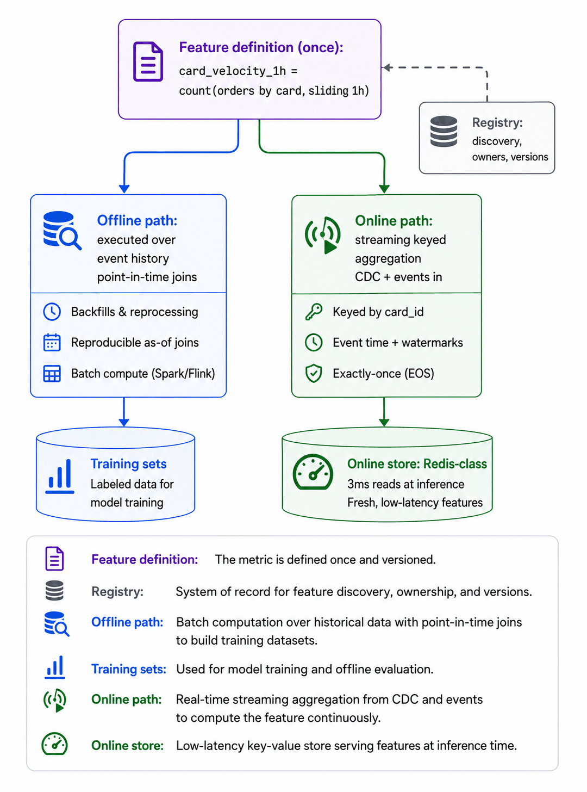
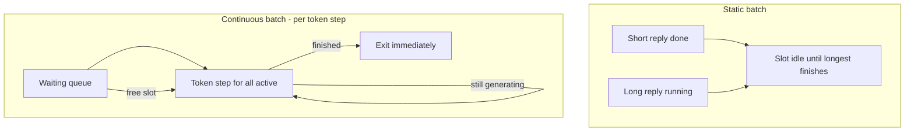
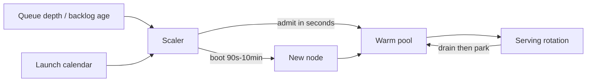
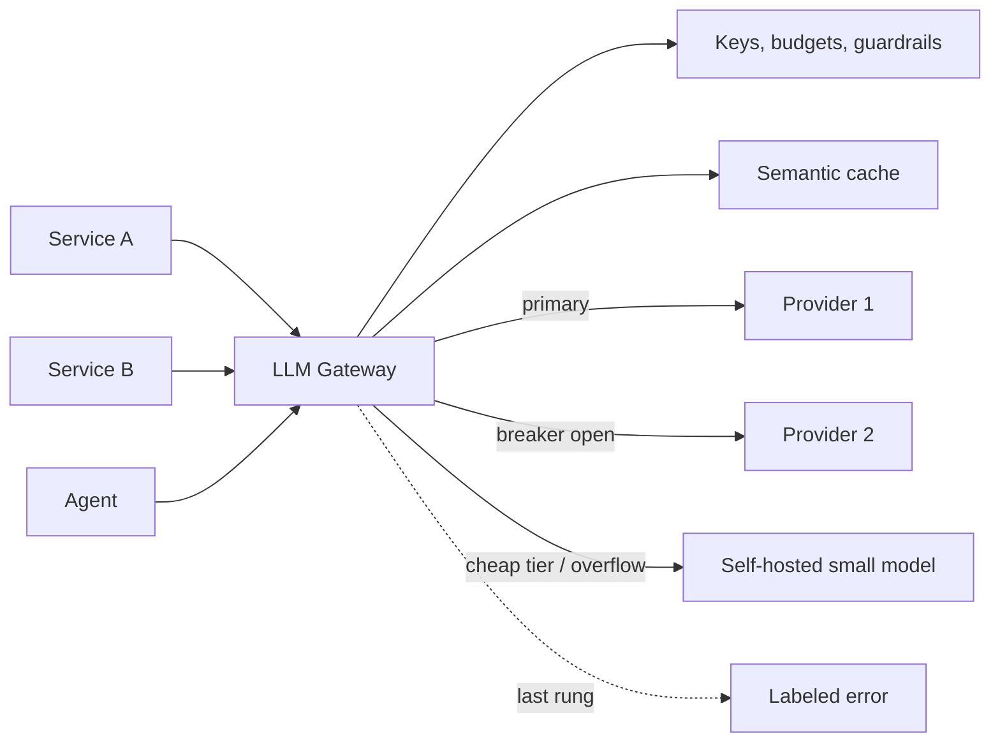
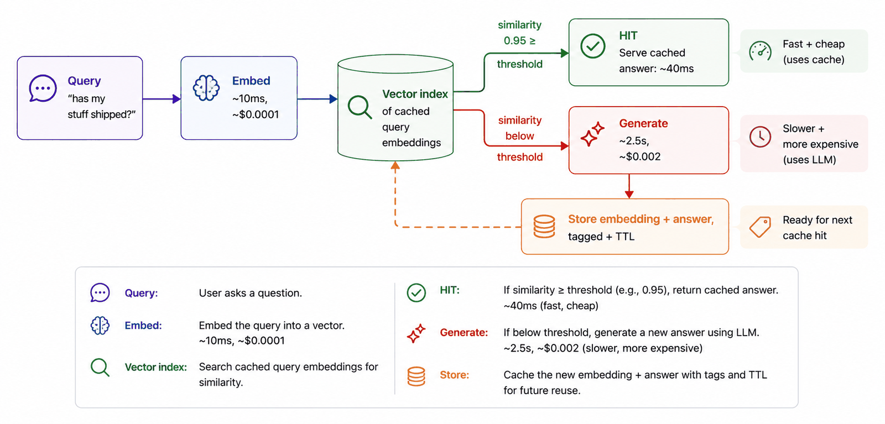
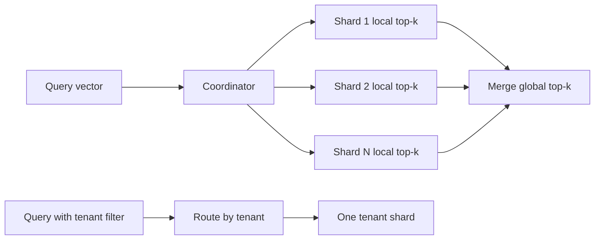
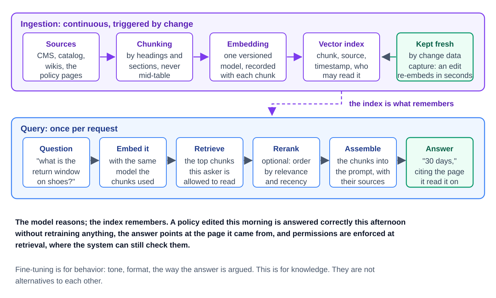
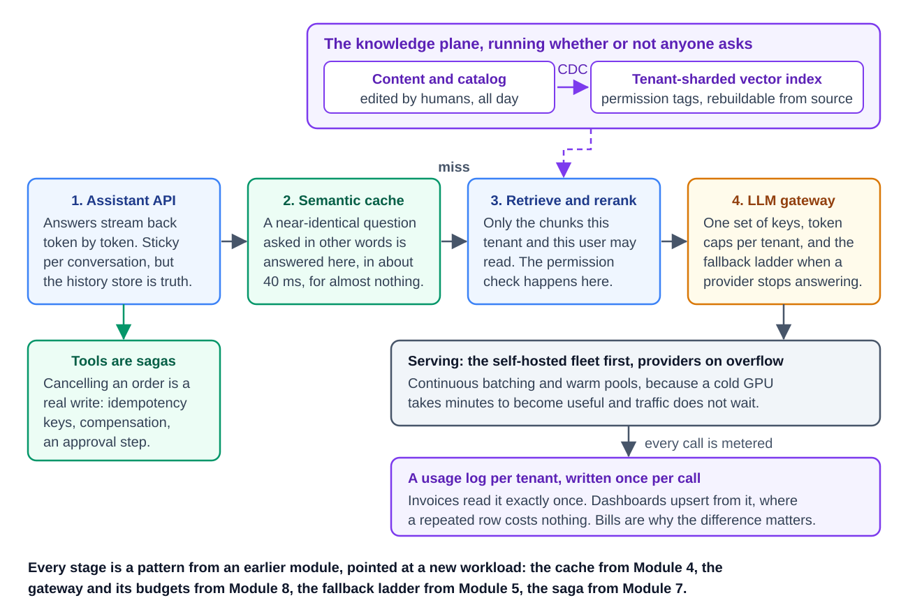

# Module 11 — AI-Era Systems (LLM and ML Infrastructure)

## Module Introduction
*Original lesson: [Module introduction on DesignGurus ↗](https://www.designgurus.io/course-play/system-design-patterns/doc/6a5382697bbf9d62838bfb2f)*

**What this module is about.** Here we study the plumbing that sits under AI products. That includes feature stores for classic machine-learning models, fleets of **GPUs** (graphics processors, the chips that do the heavy maths of running models) that serve large language models (LLMs), gateways placed in front of model vendors, caches that match on meaning, vector indexes, and retrieval-augmented generation (RAG). The big message is a comforting one: **nothing here is architecturally new**. You have already seen every one of these patterns in earlier modules. What changed is the "physics" they operate under.

- Take Module 8's **API gateway** (the single front door that handles login checks, routing and rate limits for your services) and face it outward, toward model vendors rather than your own services. That is the **LLM gateway**.
- **Semantic caching** is the caching from Module 4. The only twist is that "the keys are equal" turns into "the meanings are similar."
- **Vector database sharding** reuses Module 3's sharding, now applied to a different kind of index.
- **GPU auto-scaling** is Module 6's auto-scaling (automatically adding or removing servers as load changes), just under far tougher limits.
- The **feature store** combines CQRS (one model for writes, a separate one for reads) with a lesson from the data module, "one question, two implementations," and applies both to ML.

According to the course, roughly **60 recurring shapes** sit underneath all of system design. If that is true, even the newest, most advanced stack should break down into those same shapes. This module tries to prove it.

**The three constants that changed.** Every lesson below is driven by at least one of these:

1. **Work is counted in tokens, and requests differ hugely in size.** A *token* is a piece of text the model reads or writes; it is roughly 3/4 of an English word. On the web, requests cost about the same as each other. With an LLM, one request might hold 10 tokens and the next might hold 2,000. So a single request can cost **100x** as much as the one beside it. If your **load balancer** (the component that spreads requests across servers), **rate limiter** (the component that caps how much each caller may send), or capacity plan counts *requests*, it is silently wrong. (These building blocks are introduced in [System Design Fundamentals](../00-system-design-fundamentals/README.md).) The true unit of work is the token.
2. **Workers are costly and slow to boot.** A GPU machine costs roughly **100x** what a web server costs. Before a new **replica** (one more running copy of the model server) can serve anything, it must load tens of gigabytes of model weights into memory. (Weights are the numbers that hold what the model learned.) That makes a cold start last *minutes*, not seconds. Reactive scaling stops working, and choosing between "leave it idle" and "let it go cold" becomes a genuine money decision. In-progress work is heavy as well. The **KV cache** holds what the model has already worked out about the conversation, and it sits in GPU memory. Because of it, later turns of a conversation prefer to land on the *same* replica. The **stateless** web (where any server can handle any request, because no server keeps per-user memory) spent ten years getting rid of "session affinity" (sticky routing), and now it is back.
3. **Equality turned into similarity.** Classic web caches and indexes only answer when the key matches exactly. AI systems instead ask "what is *near* this?" When lookups become fuzzy, a cache hit means something different, indexes act differently, and even what counts as a "correct" answer shifts. This is the one truly new area in the module. Even so, once you redefine the key, the old rules still apply.

**Four terms used throughout** (we define them just once, here):
- **Token:** the unit of text a model works in (~3/4 of a word). Cost, compute, and rate limits are all measured in tokens. A request is simply a bag of tokens.
- **KV cache:** the working memory a model builds for each conversation as it reads and writes. It sits in GPU memory and is costly to rebuild. It can use as much memory as the weights do. However, it only survives for the length of the request or conversation.
- **Embedding:** a list of numbers (a vector) that captures the *meaning* of some text as a position in space. Points near each other have similar meanings. Semantic caching, vector search, and RAG all rest on embeddings, since embeddings turn "how similar are these?" into a math problem.
- **TTFT (time to first token):** the wait before the first word of the reply shows up. In a streaming interface, this is the delay users really notice. So it is the main SLO for the **inference** tier (inference means running a trained model to produce an answer or prediction). (An SLO, or service level objective, is the latency target the service commits to.)

**The seven patterns**

| The situation | The pattern |
|---|---|
| Training and live predictions must get exactly the same inputs | Feature Store |
| Workers are expensive, but each request is small | Model Serving & Batching |
| A new worker needs minutes before it can serve | GPU Auto-Scaling |
| A single entry point for many model vendors | LLM Gateway |
| The same question asked in many different wordings | Semantic Caching |
| An index built on meaning grows too big for one server | Vector DB Sharding |
| Answers should come from documents, not from memory | RAG Pipeline |

**How to read the module.** We begin with Feature Store, which continues from where the data module's capstone stopped (training/serving skew). Next, Model Serving & Batching lays out the money side of the inference tier, which the later lessons take for granted. GPU Auto-Scaling then tackles the difficult GPU case that Module 6 put off. LLM Gateway is the place where calls to providers are routed, metered, and failed over; apart from CDC, readers requested this lesson more than any other. Then come two "fuzzy" lessons: Semantic Caching (the similarity version of Module 4) and Vector DB Sharding (the similarity version of Module 3). RAG Pipeline ties everything together. Finally, the capstone builds a production RAG chatbot that draws on every module in the course.

**Short on time?** Focus on LLM Gateway and RAG Pipeline first, because AI-infrastructure interviews probe those two hardest. After those, Semantic Caching gives the best return.

**Before you start**, choose an AI product you have built or used, and work through three questions:
1. What does one request cost? Do your rate limits, capacity plans, and prices allow for the next request being 100x more expensive?
2. When traffic surges, how many minutes go by before newly added capacity is truly serving users, and who pays the price during that window?
3. If two people ask the same question in different words, does your system notice they overlap, or does the second person pay full cost all over again?

## Feature Store
*Original lesson: [Feature Store on DesignGurus ↗](https://www.designgurus.io/course-play/system-design-patterns/doc/6a540afca1d43032e06e2e58)*

**What it is.** In a feature store, each input to a model is **written once, as code**. Such an input is called a "feature," for example "the number of orders this card made in the past hour." The platform then runs that one definition in two places. It runs it over historical data to produce training sets. It also runs it over live data to feed the model in production. Since only one definition exists, the values the model gets in production equal the values it learned from.

**Analogy.** Picture a restaurant chain whose test kitchen and whose branch cooks each write their own version of a recipe. What gets tasted in testing is never exactly what customers are served. A feature store is one master recipe card, and the test kitchen and every branch all cook from it.

**The problem (the incident).** A fraud team ships a new model. When tested offline against several months of historical data, it catches **40% more fraud** than the rules it replaces. Three weeks into production, it is performing *worse* than those rules. Yet nobody touched the model or its weights. The cause is a single feature, `card_velocity_1h`, which counts a card's orders over the last hour:
- On the **training** side, it was written in warehouse SQL. It used *event-time* windows, meaning orders were grouped by when they actually happened. It ran over the full history, counted late-arriving events, and converted NULLs (SQL's marker for a missing value) to 0.
- On the **serving** side, it was a hand-coded Java service running on **Redis** (a very fast in-memory key-value store). It used something near *processing-time* windows, meaning events were grouped by when they reached the service. It dropped late events and let NULLs pass through unchanged.

Two languages and two teams produced two slightly different takes on what should have been a single number. The model trained on one take and then received the other in production. We call this gap **training/serving skew**. It is dangerous because it fails *silently*: nothing errors out, the decisions just get worse. It is the "one question, two implementations" problem from the Lambda architecture lesson, and here it hurts model quality. Two more problems surfaced along the way. First, each new feature took **3 weeks** to ship, because a data scientist wrote SQL and engineers then rewrote it for the serving stack. Second, the growth team was coding a *third* copy of the velocity feature, since no one could locate the second one.

**Why the obvious fixes fail**
- *"Have one team own both implementations and review them closely."* Two codebases in two languages, shipped on two release schedules, will drift apart simply because of how they are set up. Reviews can slow that drift. Over many quarters, though, discipline never beats structure.
- *"Serve features directly from the warehouse, so only one implementation exists."* That gives you one implementation, but at the wrong speed. A warehouse query takes from hundreds of milliseconds up to seconds. The inference path has only about **10 ms** to spend fetching features.
- *"Record what serving computed and train on those records" (log-and-wait).* This truly stops skew for any period you have logs for. The catch: a new feature has no logs yet, so you spend months gathering training data. Also, the logs faithfully capture any bugs in the serving code. Hold on to this idea, but use it to *verify*, not as the core fix.

**How it works**

*Figure — Feature Store (course diagram)*

In the figure above, a single feature definition feeds two execution paths: offline for training and online for serving. A registry sits between them. Here are the steps:

1. **Write every feature once, as a definition.** The data scientist writes `card_velocity_1h` in about a dozen lines of the platform's feature language. (That language is a DSL, a domain-specific language.) The platform turns it into both batch SQL and a streaming job. *Why:* with a single author, the two paths can't disagree on what the feature means. This is the Kappa-style fix: get rid of the duplicate definitions rather than trying to keep them in sync.
2. **Run the online path (for live predictions).** Event topics, together with change data capture (CDC, which streams the database's change log), feed a keyed sliding-window aggregation. That aggregation writes into a Redis-class key-value store using idempotent upserts. (An upsert inserts or updates; idempotent means retrying it is safe.) The stored values trail reality by only about **200 ms**, and a read takes about **3 ms**. *Why:* that sits comfortably within the ~10 ms inference budget. It is precisely the Module 10 streaming machinery, wrapped up as a product.
3. **Run the offline path with point-in-time correctness (for training).** Suppose a training example is **labeled** (tagged with the known correct answer the model should learn) "fraud on Tuesday at 3 PM." It must be paired with the feature values *as they stood* at 3 PM that Tuesday, not with today's values. *Why:* if you attach today's velocity to last month's fraud labels, the model learns from facts that didn't yet exist when the decision was made. That is called **leakage**. It causes the well-known pattern of "amazing offline, useless live." A point-in-time join is simply the "as-of" query from **event sourcing** (storing every change as an event so you can rebuild the state at any past moment), applied to training data.
4. **Maintain a registry.** Each feature can be found, has an owner, and is **versioned**. *Why:* because features are discoverable, the growth team can reuse the existing velocity feature instead of writing another copy (one producer, many consumers). Versions matter because a model was trained on the meaning of v1. A definition is therefore a contract, just like a public API.
5. **Log and verify.** The serving side keeps logging the values it really computed. A background job recomputes the same moments using the offline path and confirms they match. The rule to hold is **zero difference**. *Why:* even with one definition, the two compiled paths might still drift apart (for example, from a compiler bug). This check catches that.

**Walkthrough with numbers (the fraud feature, rebuilt)**
- *Time to ship:* the definition is a dozen lines, and both paths get built automatically. **3 weeks becomes about 2 days**, and most of those 2 days go to validation.
- *Serving:* CDC events flow through the keyed window. The online store answers in **3 ms** with values roughly **200 ms** old, well within budget.
- *Training:* the same definition runs across **6 months** of history with point-in-time joins. So each training row sees only the values that existed at its own timestamp. After retraining, the model's live results land *within noise* of its offline scores. That agreement between offline and online is the real product the platform delivers.
- *Reuse:* the growth team's ranking model takes the very same feature from the registry. One definition now feeds three consumers, and nobody wrote another implementation.
- *The bill:* **10M cards × 40 features** comes to a few gigabytes of RAM, which is fine. Each new feature needs a **backfill**, meaning history is replayed so the feature exists for training. That is an ordinary Kappa replay.

**Trade-offs**
- *You gain:* skew is removed by design, so offline evaluation now predicts production (which is the entire reason to evaluate offline). Preventing leakage becomes something the platform guarantees, not something each scientist must watch for. Features are written once and shared by every model, and shipping drops from weeks to days.
- *You pay:*
  - **A platform to run:** streaming jobs, an online store, a registry, and backfill tooling, all operated by a team. Run it like a product, with the ML teams as its customers.
  - **The DSL's limits:** whatever the definition language can't express needs an escape hatch. Each escape hatch is a spot where skew can sneak back in.
  - **Freshness tiers:** some features are streamed (velocity, refreshed in seconds). Others are computed in a nightly batch (90-day aggregates, at roughly **1/10 the cost**). Consumers need to know each feature's tier, because a model is only as fresh as the stalest feature it uses.
  - **Backfill compute** each time you add a feature.

**When not to use it**
- *One team, one model, and around a dozen features:* a single shared code module that both paths call, plus log-and-verify, gets you the principle without building a platform.
- *Features computed only from the incoming request* (like text length or time of day): these are stateless transforms. Compute them inside the model server with one function; no store is needed.
- *Inference that only runs in batch* (such as nightly scoring): there's no online path, so careful point-in-time joins in the warehouse are enough.
- *Classic misuse:* rolling out the store but allowing teams to hand-code "just this one" serving path. That is the third implementation all over again, now hidden outside the registry.

**Comparison: three consistency strategies**

| | Two implementations + review | Log-and-wait | Feature store (define once) |
|---|---|---|---|
| Skew | Built into the setup; review only slows it down | Removed for the time range you have logs for | Removed by design |
| Adding a feature | Written twice; takes weeks | Months spent waiting for logs to build up | Write the definition + backfill; a few days |
| Leakage protection | Depends on each scientist being careful | Good (logs are as-of by nature) | Point-in-time joins that the platform enforces |
| Cost | Seems cheap; grows more costly each quarter | Cheap | A whole platform |
| Verdict | Avoid | Keep, but only as a verification tool | Use this, with log-and-verify included |

**Real-world examples**
- **Uber's Michelangelo** is where it started: its machinery for keeping features consistent gave the category its name. **Airbnb's Zipline** appeared around the same time.
- **Feast** (open source), **Tecton**, and the cloud offerings (**SageMaker, Vertex, Databricks**) package the pattern as a product, with definitions, dual materialization (computing and storing each feature's values in both the offline and online stores), and registries.
- Big ranking, fraud, pricing, and recommendation systems follow this design, even when they don't use the name "feature store."
- *For LLM engineers:* the "user context" you inject into **prompts** (the text sent to an LLM), such as subscription plan, recent activity and preferences, is online feature serving by another name. If a prompt template pulls from three ad-hoc services, that's three chances to drift from what you evaluated: the same incident, just with tokens.

**In the interview.** Questions such as "design a fraud detector" or "design a recommender" eventually boil down to one thing: how do you keep features at serving time identical to features at training time? Answering "same logic, careful testing" states the goal but offers no structural fix.

> **30-second answer:** "Each feature is defined once, as code, in a registry, and the platform executes that one definition along two paths. The offline path runs over event history using point-in-time joins, so every training row only sees what was known at its timestamp; joining today's values onto old labels would leak the future. The live path uses a streaming aggregation to keep the same feature current in a Redis-class store that responds in milliseconds. There's one author, so skew can't happen; log-and-verify catches any compiler drift; and offline evaluation finally predicts production."

*Likely follow-ups:*
- **"Why are point-in-time joins so important?"** Leakage. When training rows get *current* feature values, they include facts that only appeared after the labeled event. The model learns to rely on those facts, so offline scores jump. Then live performance collapses, since production never gets to see the future. This is the priciest silent bug in ML, and teams frequently mistake it for "drift."
- **"Which features should stream, and which should batch?"** Decide feature by feature, based on how stale each one may be. Things like velocity or session activity need refreshing within seconds, so they stream. 90-day aggregates can handle a nightly batch at roughly a tenth of the cost. In a tiered store, every feature declares its own freshness level, instead of pushing everything through the priciest pipeline.

*Mistakes that fail candidates:* waving off two implementations as acceptable; building training sets from current-state tables (leakage that goes unnoticed); hitting the warehouse from the inference path.

**Self-check:**
- **Q1:** Define training/serving skew, the wider engineering problem behind it, and the structural fix. → Skew means the features at serving time differ from those at training time, whether in definition, windowing, null handling, or freshness. So live inputs come from a different distribution, and quality quietly falls. Underneath, it's one question answered by two separate implementations. The fix: a single definition compiled into both paths, plus log-and-verify.
- **Q2:** A teammate joins March fraud labels onto the *current* features table and gets an offline AUC of 0.97 (AUC scores ranking quality; 1.0 is perfect). What will production look like? → Much worse. The 0.97 comes from leakage: a card's velocity today may be high *precisely because* of the March fraud the label records. The fix is to rebuild using point-in-time joins.
- **Q3:** After six months, a model slowly gets worse. There were no deploys, and log-and-verify is clean. An upstream service changed `order_total` so it no longer includes shipping. Why didn't the store notice? → The store promises that the two paths agree. It doesn't promise that the *meaning* stays the same. Both paths computed the new meaning identically (a temporal skew). Add upstream schema/semantic contracts (outbox, schema registry). Add monitoring of feature distributions against the training profile (mean, **percentiles** (the value below which a given share of observations fall, e.g. the 95th percentile), null rate). And use versioned features (`order_value_v2`) that models pin to.

**Related patterns:** CQRS (the offline path writes, the online path reads; features are the read models); Lambda & Kappa (skew is their duplicate-implementation problem, and define-once is the ML fix); Stream Processing and CDC (the machinery behind the online path); Event Sourcing (point-in-time joins are as-of queries).

**TL;DR**
- *Problem:* code a feature twice (SQL for training, a service for serving) and the copies drift. The model learns from one version and runs on the other, so it looks great offline and quietly fails live. Each feature takes weeks, and third copies appear.
- *Mechanism:* define it once in a registry. Compile it into an offline path (history plus point-in-time joins) and an online path (streaming into a millisecond store). Use log-and-verify as the drift alarm, and backfill by replay.
- *Costs:* a platform to run, DSL limits, freshness tiers per feature, and replay compute for each new feature.
- *Skip it when:* one team owns only about a dozen features, the transforms can be computed from the request, or inference is batch-only.

## Model Serving (and Batching)
*Original lesson: [Model Serving on DesignGurus ↗](https://www.designgurus.io/course-play/system-design-patterns/doc/6a540b90a1d43032e06e3282)*

**What it is.** Model serving is the layer that executes a model to answer live requests. Its most important trick is **batching**. Rather than pushing requests through the GPU one by one, you hold them for a few milliseconds and run a group together. The LLM version of this is **continuous batching**: requests can enter and exit the batch at every token the model generates.

**Analogy.** A bus that runs its whole route for a single rider costs nearly as much as one carrying 32. The fuel goes into moving the bus, not the people inside. Batching means filling the bus. Continuous batching means riders hop off at their own stop and new riders hop on at every stop, instead of everyone staying aboard until the last stop.

**The problem (the incident).** The store runs its own 7-billion-parameter ("7B"; parameters are the model's learned weights) support model (so data stays private). Like a normal web service, it processes requests one at a time. Latency looks fine. The capacity math does not:
- An A100-class GPU (a popular NVIDIA data-centre GPU) costs roughly **$35K/year**. It produces about **50 tokens/second** when handling one request.
- A typical reply is **400 tokens**. So each request uses **8 seconds** of GPU time, and a single GPU can handle **0.125 requests/second**.
- At peak the service needs **20 req/s**. That works out to **160 GPUs ≈ $5.6M/year**, while the feature's business plan had set aside only about a tenth of that.

**Profiling** (measuring where time and resources actually go) reveals each GPU uses just about **8%** of its compute. Here's why. With a batch of one, every token step has to stream tens of gigabytes of weights out of GPU memory and through the chip, while the real math for that single request is tiny. The work is **memory-bandwidth-bound**. In other words, the limit is how quickly data moves out of memory, not how quickly the chip can calculate.

**Why the obvious fixes fail**
- *"Buy more GPUs."* Now you have 160 GPUs, each still only 8% busy. The bottleneck is how much work happens per pass over the weights, not how many chips you own.
- *"Switch to a smaller model."* Distillation (teaching a small model to copy a big one) and quantization (storing each weight in fewer bits) reduce how much data moves per step. But a small model served one request at a time still sits mostly idle. You change the quality/cost balance without fixing utilization. So think about it *after* batching, and only if quality permits.
- *"Put everything in a queue and run batch jobs every hour."* Great for offline jobs (providers offer batch processing at about **50% off**). But in chat, a customer is sitting there waiting. You need batches assembled in *milliseconds*, not hours.

**How it works**
1. **Dynamic batching (the general version).** The server waits a very brief moment (about **5–10 ms**) or until a maximum batch size is hit, whichever happens first. Then it runs the collected requests together. *Why it works:* each step streams the weights through the chip just once, however many requests share that step. So **32** requests together take barely longer than one alone, yet deliver about **20–30x** the **throughput** (work completed per second). The price is the few-millisecond wait. When every job is the same shape and cost (embeddings, image classification), this alone is the full solution.
2. **The LLM twist: variance (Constant 1).** In a *static* batch, no one leaves until the slowest generation finishes. A 10-token reply stuck alongside a 2,000-token essay has to wait for the essay, and finished requests leave empty slots behind. This is the **convoy effect**: short jobs trapped behind long ones.
3. **Continuous (in-flight) batching.** The scheduler thinks in *token steps*, not whole requests. On each step it produces one token for every active request. Requests that are done leave right away, and waiting ones join in the middle. *Why:* capacity is recovered on every token, so utilization stays high even when output lengths vary by 100x.
4. **Paged KV-cache memory (PagedAttention).** Every active request keeps its KV cache in GPU memory. Simple allocation breaks that memory into fragments, which caps how many requests can fit. Paging is an idea taken from operating-system **virtual memory**, where memory is handed out in small fixed-size pages that need not sit next to each other. It eliminates the **fragmentation** (free memory scattered in pieces too small to use) and lets **2–4x more concurrent requests** share the same GPU.
5. **The stack around it.** Place replicas behind a load balancer that chooses a replica based on **queue depth and tokens still pending**, not connection counts. (Connection counts mislead when work varies 100x.) Keep each conversation **sticky** to the replica that already holds its KV cache. At big scale, **disaggregate prefill from decode**. *Prefill* (reading the prompt) is **compute-bound** (limited by how fast the chip can calculate), while *decode* (writing the reply) is bandwidth-bound, so separate pools can each be tuned for their own job.

The diagram below compares the two batching styles. In the static batch, a short reply that has finished sits idle until the longest reply is done. In the continuous batch, each token step cycles through the active requests; finished ones leave immediately, and queued ones fill the freed slots.

*Static batching vs continuous batching*

**Walkthrough with numbers (same assistant, vLLM-class engine with continuous batching)** — **vLLM** is a popular open-source engine for serving LLMs.
- *Per GPU:* with a batch of about 32, total generation climbs to **2,500–3,000 tokens/s**, compared with 50 for a single stream. Any one 400-token reply still needs a few seconds, but the GPU is now serving **6–7 requests/s** in parallel.
- *Fleet:* 20 req/s ÷ ~6 per GPU ≈ 3.3 → **4 GPUs + 1 for headroom = 5 GPUs instead of 160**. Yearly cost falls from **$5.6M to about $175K**. That's a **30x** cut from scheduling alone, with the same model and the same quality. Batching is what makes the product financially possible.
- *Latency cost:* TTFT rises by about **20–30 ms**, which nobody notices when the reply streams. The pace per token barely changes.
- *Utilization:* **8% → about 70%**.
- *Bulk work moved elsewhere:* the nightly job that writes **10M product descriptions** goes to the provider's discounted (half-price) batch API. It is **bulkheaded** (kept separate) from the interactive fleet.
- Batching stays almost free until the batch's combined compute takes longer than streaming the weights, or until KV memory fills up. Past that point, you need another GPU.

**Trade-offs**
- *You gain:* **10–30x throughput per dollar**, which is what makes hosting your own models affordable at all. Variance is under control. Autoscaling has fewer, fuller GPUs to manage.
- *You pay:*
  - **A small latency floor:** the batch window plus scheduler overhead add a few milliseconds to TTFT. That matters for strict real-time uses.
  - **Shared fate:** requests in one batch fight over the same memory and compute. One enormous prompt can squeeze out the rest, and if the engine crashes, every request in the batch dies.
  - **A truly complicated engine** (token schedulers, paged memory, **preemption**, i.e. pausing or evicting a running request to make room). Don't write it yourself; **buy it** (vLLM, TGI, Triton). These days, building your own scheduler is a mistake, not an accomplishment.
  - **Tuning for each workload:** batch caps, windows, and memory budgets.
- *Giant-prompt spikes:* when someone pastes an entire contract, **p99** TTFT (the value 99% of requests come in under) for everyone can leap from **200 ms to 4+ s**. The culprit is an enormous, compute-heavy **prefill** that grabs the token steps. Fixes: **chunked prefill** (break the reading of the huge prompt into parts spread across many steps); **input tiering** (send huge inputs to a long-context pool or an async flow, which is a bulkhead); **product caps with honest UX** (user experience) ("large document: may take longer"); and **prefill/decode disaggregation** at scale.

**When not to use it**
- *Inference that has to complete in a few milliseconds* (voice frames or some ranking calls, for example): you may not have room for any batching window, so use small-batch or specialized runtimes.
- *Very little traffic* (dev environments, an internal tool at 0.1 req/s): if only one request ever arrives, a batch of one is correct.
- *Offline bulk jobs:* keep them off the interactive fleet. Batch APIs cost half as much and don't mind waiting.
- *Classic misuse:* interactive and bulk traffic on the same fleet, so the 10M-item nightly job starves customer chats. That's a bulkhead failure, GPU edition.

**Comparison: dynamic vs. continuous batching**

| | Dynamic (request-level) | Continuous (token-level) |
|---|---|---|
| Batch membership | Set when the batch starts; all wait for the last one | Changes constantly; leave when done, join midway |
| 100x output variance | Convoy effect | Handled; capacity recovered on every token |
| Good for | Same-sized jobs like embeddings, vision models, rankers | Generating LLM text |
| Implementation | A simple window + max size (Triton) | A complete scheduler (buy vLLM/TGI/TensorRT-LLM/SGLang) |

Rule of thumb: **when jobs are all the same size, batch by request; when sizes differ, batch by token.** The embedding endpoint (which the semantic cache will soon call) uses dynamic batching, running next to the continuous-batching LLM fleet.

**Real-world examples**
- **vLLM:** open-source continuous batching plus paged KV memory. It made running your own LLM serving practical for many workloads.
- **NVIDIA Triton:** dynamic batching offered as general infrastructure for any model type.
- **TGI, TensorRT-LLM, SGLang:** other serving engines, each a variant of the ideas above.
- **Provider batch APIs (Anthropic, OpenAI):** about 50% off for work that can wait. The providers slot it into spare fleet capacity, following the same economics.

**In the interview.** Questions on designing LLM inference serving are becoming more common. Asking a candidate to explain *why batching helps GPUs so much* quickly separates people who have run inference from people who have only called a hosted API.

> **30-second answer:** "Served one request at a time, LLM inference is capped by memory bandwidth. Every token step pushes all the weights through the chip for barely any math, so GPUs idle around 8% and the fleet costs millions. Batching shares that weight stream across ~32 requests, giving 20–30x throughput for a few ms of TTFT, which streaming hides. LLMs need continuous, token-level batching because output lengths vary 100x; request-level batching would make short answers wait behind long ones. Paging the KV cache fits 2–4x more requests at once. Balance load by queue length and pending tokens, keep conversations sticky, buy a vLLM-class engine, and route bulk work to half-price batch APIs."

*Likely follow-ups:*
- **"How can 32 requests take barely longer than one?"** Most of each step's cost is streaming the weights out of GPU memory, and that's the same at any batch size. The compute for each request comes along almost for free, until the batch grows big enough to max out the compute units.
- **"Someone pastes a 50-page file and everyone's latency spikes. What's going on, and how do you fix it?"** The huge prefill is a burst of compute that hogs the token steps (shared fate). Use chunked prefill, cap inputs and tier them by size, and at large scale move prefill and decode onto separate pools so the biggest requests get a pool to themselves.

*Mistakes that fail candidates:* pricing one-request-per-pass serving without spotting the waste; suggesting request-level batching for chat (missing the convoy effect); writing the token scheduler by hand.

**Self-check:**
- **Q1:** Why does a batch of 32 take roughly as long per token step as one request, and when does that stop being true? → Every step has to stream all the weights through the chip, a fixed cost that dominates; each request's math is small. It stops when total compute outlasts the streaming time, or when KV memory runs out. At that point the GPU is compute-bound and you need another GPU (the signal for autoscaling).
- **Q2:** Match strategies to: (a) embeddings (each job ~50 ms), (b) customer chat (outputs vary up to 100x), (c) nightly summaries of 10M pages. → (a) dynamic batching (Triton-style); (b) continuous batching + paged KV (vLLM-class); (c) neither fleet: a provider batch API or an off-peak offline run, with a bulkhead rule so bulk work never touches the interactive pool.
- **Q3:** p99 TTFT, usually 200 ms, jumps to 4+ s for everyone when users paste contracts. → A giant, compute-bound prefill is competing with every decode (Constant 1 applies to inputs as well). Stack up chunked prefill, input tiering, product caps with honest UX, and prefill/decode disaggregation.

**Related patterns:** Load Balancing (routing by queue depth / outstanding tokens); GPU Auto-Scaling (adding GPUs once they're full); Message Queue (sending bulk work through batch queues at half price); Semantic Caching (the cheapest request is the one the GPU never sees).

**TL;DR**
- *Problem:* serving LLM requests one by one leaves each GPU ~8% busy (bandwidth-bound), so 20 req/s costs $5.6M/year.
- *Mechanism:* batch. Use continuous, token-level batching to handle 100x variance, plus paged KV (2–4x). Buy a vLLM-class engine.
- *Costs:* a small TTFT floor, shared fate (giant prompts), a complex engine, and tuning per workload.
- *Skip it when:* you need hard real-time milliseconds, traffic is trivial, or the work is offline bulk (batch APIs, bulkheaded).

## GPU Auto-Scaling
*Original lesson: [GPU Auto-Scaling on DesignGurus ↗](https://www.designgurus.io/course-play/system-design-patterns/doc/6a540bb4a1d43032e06e34a4)*

**What it is.** GPU auto-scaling adds GPU model-serving replicas when demand rises and removes them when it falls. The idea matches web auto-scaling. The difference: an idle GPU costs ~100x more, and a new one takes minutes (not seconds) to start. So you don't rely on a single reactive loop. Instead you **layer** defenses: the correct signal, a pool of spares that are already warm, pre-warming on a schedule, quicker boots, a plan for degrading during the gap, and careful scale-down.

**Analogy.** A restaurant can't hire and train a chef in the ten minutes after a tour bus pulls up. So it keeps a couple of chefs on call (warm pool). It reads the bookings calendar and adds staff before known rushes (scheduled scaling). It trains new hires faster (boot engineering). It switches to a simpler menu when overwhelmed (smaller model). And it never sends a chef home in the middle of cooking a dish (drain before scale-down).

**The problem (the incident).** The five-GPU support fleet is running at 70% utilization. A mention on a morning show then quadruples traffic within **15 minutes**. The web-style autoscaler fails in three ways, one after another:
1. **The signal is wrong, in two ways.** The scaler watches CPU (the server's general-purpose processor), but the real work runs on the GPU. So host CPU shows only **12%** while requests pile up. GPU utilization misleads too: under continuous batching the chip always looks busy, even while the waiting line keeps growing. Only **queue depth** (the number of requests waiting for a GPU) showed reality, and nothing was monitoring it.
2. **Booting takes minutes.** Getting a GPU node takes **3–8 minutes**, and that's if the **region** (a cloud provider's group of data centres in one geographic area) even has one free. Then the node pulls a **15 GB** **container** (a packaged app plus everything it needs to run), copies **14 GB** of weights onto the GPU, and warms up the runtime. All together, **8–12 minutes** pass between the decision and the first token. The spike ends before the new capacity shows up.
3. **The maximum isn't under your control.** At minute 20, asking for four more A100s returns "insufficient capacity in this region." The maximum you configured was really the cloud provider's **quota** (the most resources the provider will let your account use).

At night the reverse happens. The five GPUs are only **10%** busy but still cost around **$20/hour** while serving almost nobody. Yet scaling to zero means the next customer waits ~10 minutes. Next to web servers, idle capacity costs **100x** more, and a cold start lasts **60x** longer.

**Why the obvious fixes fail**
- *"Tune the reactive loop more aggressively."* Roughly 1 minute to notice plus ~10 minutes to boot, against a 15-minute spike, is math no setting can beat. Reactive-only GPU scaling is a carefully tuned way to show up late.
- *"Just buy enough for the peak."* A GPU costs roughly **$35K a year**, so holding 4x extra capacity wastes the 30x savings that batching just earned.
- *"Use serverless GPUs (Modal, Baseten, RunPod)."* (*Serverless* means you pay per use and the platform manages the machines for you.) This is a genuine option and is often the right one. These services hide cold starts behind warm pools shared by many customers. Essentially, you pay another company to solve this lesson on your behalf. Once you get big or face strict privacy rules, the problem lands back with you, so it's worth knowing how their approach works.

**How it works: layered defenses**
1. **Track the right metrics: queue depth and backlog age for each replica.** *Backlog age* is how long the oldest queued request has been waiting, and it's what should trigger the alarm. Replicas needed ≈ token demand ÷ token throughput per GPU. *Why:* CPU usage and connection counts don't reflect GPU work, which is measured in tokens.
2. **Hold a warm pool.** Keep *k* instances fully started, with weights loaded and runtime ready, but *outside* the serving rotation. Scaling up moves one of them into rotation within **seconds**. Meanwhile, the slow boot happens in the background to top the pool back up. Size it with math: **pool ≥ spike arrival rate × boot time**. *Why:* this removes the 10-minute boot from the critical path. The idle pool is the stated cost of instant capacity (Module 6's headroom, at GPU prices).
3. **Scale on a schedule and ahead of time.** Pre-warm before the predictable daily curve (for example, before the 9 AM ramp). Require marketing to submit pre-warm requests for launches. *Why:* the predictable share of demand then sees zero delay, and reactive scaling only has to handle the surprises that remain.
4. **Speed up the boot.** Stream the container image so it can start while it's still downloading. Keep weights on fast local NVMe disks (very fast solid-state drives attached directly to the machine), or on snapshot volumes attached ahead of time, instead of pulling them from remote storage. Restore from memory snapshots where that's supported. Co-locate models on nodes that keep their weights loaded. *Why:* boot time drops from **8–12 minutes to 60–90 seconds**. A shorter boot makes every other layer cheaper and simpler to size.
5. **Degrade gracefully during the gap.** While extra capacity is on the way: queue requests and give users an honest wait time → reject free-tier traffic before paying users (rate-limit tiers) → **switch to a smaller model, and say so** (for instance, a quantized 7B when the 70B pool is full). *Why:* users would rather get a somewhat weaker answer, clearly labeled, than stare at a spinner. Answer quality becomes one more thing you can shed.
6. **Scale down without cutting anyone off.** Stop sending new requests to a replica, let generations already underway finish, put the replica back in the warm pool, and only then release it. Keep a minimum floor overnight. Allow scale-to-zero only if the breakeven math works: idle hours × ~**$4/GPU-hour** against a multi-minute wait for the next user. (Dev environments usually pass this test; production rarely does.) *Why:* killing a replica immediately cuts off a paying user's answer mid-sentence.
7. **Treat quota as capacity you procure.** Secure capacity through reservations and committed-use contracts (discounts in exchange for promising to pay for capacity over a year or more). Also set up a place for extra traffic to overflow to (another region, another cloud, or a hosted model API), with the LLM gateway doing the routing (next lesson).

The diagram below shows the warm-pool cycle. Queue depth drives the scaler. The scaler moves pooled instances into service in seconds, while new nodes boot in the background to refill the pool. The launch calendar also feeds the scaler, and scale-down drains replicas back into the pool.

*Warm pool: fast admission, slow refill off the critical path*

**Walkthrough with numbers (the morning show, replayed with layers)**
- *T−1 day:* the launch calendar kicks off pre-warming, and the pool grows from **2 to 5**. The cheapest fix in this whole lesson is a meeting.
- *T+0 to 60 s:* traffic goes 4x. Queue-depth alarms go off right away. The pool's 5 instances join the rotation within seconds, about doubling capacity in the first minute.
- *T+90 s onward:* the faster boots bring new capacity every **90 s** and refill the pool.
- *Worst minute:* p95 TTFT (the value 95% of requests come in under) stretches to **3.8 s**. Free-tier requests wait briefly behind paid ones. **12%** of traffic is served by the smaller model, with a label. No error page appears.
- *T+25 min:* demand peaks and starts dropping. Scale-down stops new admissions, lets generations finish, parks replicas in the pool, and holds the new baseline.
- *3 AM:* the fleet drops to its floor of **2**. **Preemptible** nightly summarization jobs, which get kicked off instantly if real traffic shows up, fill the quiet hours. Result: **70% utilization by day, 60% at night**. Since GPUs cost about 100x more than web servers, making use of that idle time saves real money.

**Trade-offs**
- *You gain:* you survive spikes despite 10-minute boot physics; the bill tracks demand; conversations complete even during scale-down.
- *You pay:* the ongoing cost of the warm pool (insurance that looks like waste to anyone who wasn't around for a spike, so it has to be priced and defended every quarter); layered operational complexity (calendars, pools, boots, ladders, preemption); preemption machinery (priorities, instant eviction, batch jobs that checkpoint so they can resume); and continuing quota work (booking reservations, planning overflow to other regions, managing provider relationships).

**When not to use it**
- *Steady traffic:* if demand hardly moves, run a fixed set of GPUs and fill spare time with preemptible bulk jobs. You don't need a scaler.
- *Tiny scale:* with just one or two GPUs, plain queueing (with honest wait times) beats building warm-pool machinery.
- *Pure batch workloads:* there's no interactive deadline, so schedule the fleet the way you schedule batch work.
- *When you shouldn't own GPUs in the first place:* begin with a hosted model API. Let the provider own the GPUs, and their cold-start and quota problems too, until your traffic, latency needs, or privacy rules push you to host your own. Plenty of companies that are proud of their GPU autoscaler would be better off owning no GPUs.
- *Classic misuse:* scaling GPUs the web way: CPU as the signal, reactive only, scale-to-zero in production, and termination on scale-down. Each choice is right for the web and wrong for GPUs.

**Comparison: own the fleet vs. rent the problem**

| | Provider APIs | Serverless GPU | Own fleet + this lesson |
|---|---|---|---|
| Cold starts | The provider's problem; you never notice them | Eased by the platform's warm pools | Yours to solve: everything in this lesson |
| Cost at high volume | Highest per token | Middle | Lowest, provided the GPUs stay busy |
| Privacy / control / custom models | Least | Middle | Full |
| Ops burden | Almost none | Low | A whole team |
| Fits | The starting point for most companies | Bursty, specialized workloads and fast experiments | Big steady volume, strict privacy rules, or custom models |

Shift one column to the right only when your traffic or your constraints force it. The cost of each shift is everything this lesson covers.

**Real-world examples**
- **KEDA** (Kubernetes event-driven autoscaling; **Kubernetes** is the standard system for running containers across a cluster of machines) is an open-source tool that can scale based on queue depth, which handles the signal layer. **Ray Serve** and vLLM's built-in autoscaling handle the parts that have to understand model serving.
- **Cloud providers' warm-pool features** (like ASG (AWS Auto Scaling Group) warm pools and GPU reservations) and **capacity reservations**: the readiness layer and quota negotiation, sold as products.
- **Modal, Baseten, RunPod:** serverless GPU, which is to say warm pools you rent.
- **SkyPilot-class multi-cloud spillover:** hunts for capacity across regions and providers once quota runs out.

**In the interview.** A common prompt: "Traffic to your LLM service goes up 5x. How do you handle capacity?" Every follow-up question lines up with one of the layers (signal, cold start, scale-to-zero, quota). Each one has an appealing one-line wrong answer that the interviewer is hoping to hear.

> **30-second answer:** "GPU scaling is web scaling where idle cost and cold starts are each ~100x worse, so purely reactive scaling is late by design. I scale on queue length plus the age of the oldest waiting request, never on CPU. A warm pool sized at spike rate × boot time lets admission happen in seconds while new nodes refill it; a calendar pre-warms for known events; local weights and streamed images bring boots down to ~90 s. During the gap, a degradation ladder queues, drops lower tiers, and falls back to a labeled smaller model. Scale-down drains generations in flight and keeps an overnight floor. Quota gets negotiated, with spillover routed through the gateway. And I'd begin API-first until volume or privacy makes owning GPUs worth it."

*Likely follow-ups:*
- **"Why is CPU a poor scaling signal?"** The model runs on the GPU, so the host CPU can look idle while users sit waiting. GPU utilization is misleading too under continuous batching: the chip looks busy while the queue gets longer. Queue length and backlog age tell you directly whether requests are coming in faster than they're being completed.
- **"Should production ever scale to zero?"** Do the breakeven math: overnight idle at ~$4/GPU-hour versus the first morning user (and everyone after them) sitting through a multi-minute cold start. For dev and internal tools: zero. For production: a small floor nearly always wins, since paying for a couple of idle GPU-hours costs less than losing even one customer. Show the math, not a rule of faith.

*Mistakes that fail candidates:* triggering GPU scaling off CPU; relying on reaction alone when boots take minutes; scale-to-zero in prod without doing the breakeven math; scale-down that kills generations mid-stream.

**Self-check:**
- **Q1:** Which three delays make purely reactive GPU scaling show up too late, and which layer handles each? → Detection lag (~1 min while metrics aggregate) → queue-depth/backlog-age signals. Boot lag (minutes) → warm pools + boot engineering. Spike duration (often 10–20 min, about the same as the first two added together) → scheduled/predictive pre-warming. The degradation ladder covers any gap left over.
- **Q2:** Spikes bring up to 2 GPUs' worth of demand per minute, and boots take 90 s. How big should the pool be? → ≥ 2 × 1.5 = **3 GPUs** (+1 if spikes overlap). That's about 3 × $35K ≈ **$105K/year** of intentional idleness, which turns a 10-minute outage into 10-second admission. Redo the math whenever boot time or spike shape changes.
- **Q3:** Around 2 AM, answers get cut off mid-sentence, and the first users every morning wait "forever." The config is: min=0, scale down after 15 min of low utilization, immediate termination. → The cutoffs happen because termination kills live generations. Fix it by draining: stop admission, finish up to the max output length, park in the pool, then release. The morning waits happen because min=0 means full cold starts. Keep a floor of 1–2 based on breakeven, and pre-warm ahead of the morning ramp. The principle: **with GPUs, scaling down hits users directly**, so treat it as carefully as anything user-facing.

**Related patterns:** Auto-Scaling (the parent pattern, with idle cost and boot time both ~100x worse); Model Serving (what's being scaled; fuller batches mean fewer GPUs); Graceful Degradation (the gap ladder, including the smaller-model step); LLM Gateway (where spillover and capacity federation get routed); Message Queue (preemptible bulk work during quiet hours).

**TL;DR**
- *Problem:* cold starts lasting minutes make reactive scaling late; $4/h of idleness makes overprovisioning expensive; and the real ceiling is the cloud provider's quota.
- *Mechanism:* queue-depth signals; a warm pool = spike rate × boot time; calendar pre-warming; 90-second boots; a ladder ending in a labeled smaller model; drain-then-park scale-down; negotiated quota with spillover through the gateway.
- *Costs:* paid-for idleness, a layered ops stack, preemption machinery, and capacity procurement.
- *Skip it when:* traffic is flat, scale is tiny, work is pure batch, or you shouldn't own GPUs at all (go API-first).

## LLM Gateway
*Original lesson: [LLM Gateway on DesignGurus ↗](https://www.designgurus.io/course-play/system-design-patterns/doc/6a540bdc15006768b52d2c29)*

**What it is.** An LLM gateway is a single internal service that *every* call to a model provider passes through. Services reach the gateway using their internal identity. The gateway then does several jobs. It keeps the provider **API keys** (secret strings that prove you are allowed to call a paid API). It counts every token. It translates "logical" model names into real providers. It applies timeouts, retries, and **circuit breakers** (switches that stop calling a dependency that keeps failing) for each provider. And when a provider fails, it follows a fallback sequence planned in advance. Think of it as Module 8's API gateway, applied to **outbound** (egress) traffic.

**Analogy.** Imagine a company where, instead of each department carrying its own corporate credit card and haggling with suppliers, there is a single purchasing office. That office holds the cards, logs who bought what, enforces budgets, and knows which backup supplier to phone when the regular one has run out.

**The problem (the incident).** After 18 months of excitement about AI, **14 services** call model providers directly. They include the assistant, search, summarization, three agent experiments, a fraud explainer, and eight that nobody has catalogued. Three bills show up at once:
- **A key leaks.** One team put a provider API key inside a client bundle (the code shipped to users' browsers or apps), and it shows up on a public paste site. To **rotate** it (issue a new key and revoke the old one), you must track down every copy across 14 services, 3 languages, and unknown config files, then redeploy every one.
- **Finance can't tell who spent what.** "Which team spent the **$80K** last month?" The invoices group spending by keys that teams pass around informally. Meanwhile, an experimental agent kept retrying in a loop for two days and burned **$40K** before anybody spotted it. There was no one place where a budget cap could be enforced.
- **A provider brownout** hits at peak. (A brownout is a partial outage: replies are slow or failing.) The fourteen services react in fourteen different ways: **6 fail with no fallback, 5 hang with no timeout, 3 run untested custom degradation logic.**

The underlying cause is a familiar one from Module 8: when every service implements a **cross-cutting** policy (a rule every service must apply, like auth, logging or budgets) on its own, the copies drift. What's different here is that each request carries a direct dollar cost, so that drift can rack up large unplanned charges within two days.

**Why the obvious fixes fail**
- *"Build a shared SDK"* (software development kit: a client library teams import). Rollout depends on 14 separate deploy schedules, 3 languages mean 3 SDKs, and the keys still sit in 14 configs. A library centralizes *code*. But key custody, accounting, and live policy need one *runtime* enforcement point that every call goes through.
- *"Keep a key registry and write a spending policy document."* Structure beats discipline. The runaway agent never read the document, and a document can't cap spending at 2 AM on a Saturday.
- *"Let each team harden its own integration."* That gives you 14 half-finished gateways that drift apart, which is just the incident made official.

**How it works: each job is a Module 8 job, pointed outward**

The diagram below shows services and agents all calling a single gateway. The gateway applies keys, budgets, and guardrails, checks the semantic cache, and sends traffic to the main provider. If that provider's breaker is open, traffic goes to a second provider. Cheap tiers and overflow go to a self-hosted small model. The final rung is a labeled error.

*One egress gateway in front of all model providers*

1. **Key custody (formerly: authentication).** Services prove who they are to the gateway with the **service mesh**'s workload identity. (A service mesh is infrastructure that carries traffic between services and gives each one a verifiable identity.) Only the gateway keeps provider keys. *Why:* a leak means rotating **one** key with **zero** redeploys, and each call is automatically tied to whoever made it.
2. **Token accounting and budgets (formerly: rate limiting).** Count tokens per team, per feature, and per user. Apply soft alerts and **hard caps**. On the inside, this is rate limiting by tokens per minute. On the outside, the gateway handles the provider's `429 Too Many Requests` replies, retrying in a way that respects the `Retry-After` header. The metering also feeds billing, which needs exactly-once processing when invoices rely on it. *Why:* a single component manages both your own budgets and the provider's limits, and the runaway **agent** (an LLM program that takes actions in a loop on its own) runs into a cap rather than a **postmortem** (a written review after an incident).
3. **Logical model routing (formerly: path routing).** Services ask for a capability, such as `summarize-fast` or `chat-premium`. The gateway maps it to a provider, a model, and a version. *Why:* upgrading a model, reacting to a price change, or switching providers becomes one routing change, not 14 deploys. Roll it out as a **canary behind a feature flag** (say, 5% of `chat-premium` traffic to the new model), and judge it by evaluation scores and negative-feedback rates. (A **canary** sends a small share of traffic to the new version first; a **feature flag** is a switch that changes behavior without a deploy.) Picking a model becomes an operational setting.
4. **Reliability kit for each provider.** Timeouts are tuned to each provider's p99 (the latency that 99% of requests finish under). Retries respect `Retry-After` and have a retry budget per provider. There's a **circuit breaker for each provider-model pair**. (A circuit breaker stops sending calls to a dependency that keeps failing.) In a brownout, the breaker opens within seconds and traffic steps down the **fallback ladder**: primary provider → secondary provider → smaller self-hosted model → semantic cache → honest error. *Why:* this is Module 5's graceful degradation, set up and tested a single time.
5. **Streaming passthrough.** LLM replies stream over SSE (server-sent events). The gateway has to pass them along *without buffering*. *Why:* a gateway that waits for the whole reply before forwarding it wrecks TTFT. This is an engineering obligation, so test it in **CI** (continuous integration: automated tests run on every code change) as you would a feature.
6. **Safety point.** PII (personally identifiable information) scrubbing (stripping out personal information), **prompt-injection** screening (catching hidden instructions in input that try to hijack the model), and audit logging with **trace IDs** (one ID carried by a request across every service it touches) each happen once, right here.
7. **Capacity federation.** When the self-hosted GPU pool is full, the overflow goes to provider APIs via the same chains. (This is where the GPU lesson's spillover ends up.)
8. **Keep it thin.** The gateway routes, meters, and protects. It does **not** own prompts, templates, or business logic. Building prompts is product code and belongs in the services. *Why:* if it doesn't, every prompt tweak requires a ticket to the platform team (the "monolith in disguise"). Where it sits: the API gateway handles inbound **north-south** traffic (traffic between outside clients and your system), while the LLM gateway handles outbound calls. It usually lives behind the API gateway, alongside the services.

**Walkthrough with numbers (the incident's three bills, replayed)**
- *The leak:* rotate one key in one **vault** (a secure store for secrets). It takes minutes and zero deploys, and the dashboards already list every caller.
- *The brownout:* the primary's error rate passes the breaker threshold in about **20 s**. **80%** of traffic shifts to the secondary provider (**+300 ms**, quality within tolerance). The `classify-fast` tier shifts to the cheaper self-hosted **7B** model. **15%** of chat gets answered from the semantic cache. The UI shows a labeled "responses may be slower" banner. **Zero services down**, compared with six before, because the response was configuration prepared ahead of time.
- *The weekend agent:* stopped at **$500** rather than $40K.
- *What the gateway itself costs:* **+3–8 ms** of proxy overhead per call, which is noise beside generations that take several seconds. It is one more component that has to be highly available, so run it redundant and thin.

**Trade-offs**
- *You gain:* policy (custody, budgets, safety) runs once, at the only spot that sees every call. Failover is built and tested once, and model swaps, canaries, and choosing providers by price all become routing changes. You can see costs down to each feature, and runaway spending is capped at machine speed.
- *You pay:* **a dependency on the critical path** of every AI feature (run it redundant; the component that changes least is the most stable); **streaming passthrough as an ongoing obligation** (a single buffering regression and TTFT silently triples); **adapter churn** as provider APIs evolve (one reason to buy the core); and **a constant pull toward scope creep** as prompts and "just one transformation" try to sneak in.

**When not to use it**
- *One service, one provider:* a well-set-up client library with timeout, retry, and breaker is plenty. There's nothing to coordinate.
- *Fully self-hosted with a single model:* the serving load balancer already does the routing. An extra hop adds latency without adding any new policy.
- *Tiny local models where latency is critical* (in-process rankers): no door needed at all.
- *Build vs. buy:* start with an existing product: **LiteLLM** (open source), **OpenRouter** (gateway as a service), **Portkey**, or cloud AI gateways. Build your own only where key custody, safety, or routing policy are truly specific to you, and keep an open-source core even then. Writing every provider adapter yourself repeats the "hand-built scheduler" mistake.
- *Classic misuse:* using the gateway as a **prompt CMS** (content management system). Templates, **few-shot examples** (sample question-and-answer pairs placed in the prompt), and product logic accumulate in the gateway's config until every feature change requires a platform ticket (the ESB, or enterprise service bus, centralization problem).

**Comparison: API gateway vs. LLM gateway, job by job**

| Job | API Gateway (inbound) | LLM Gateway (egress) |
|---|---|---|
| Identity | AuthN (authentication): who sent this request? | Key custody: our identity toward providers; each caller attributed |
| Fairness | Rate limits for each client | Token budgets for each team/feature, with hard caps |
| Routing | Paths → services | Logical models → providers/versions |
| Change safety | API versioning | Model flags + canaries judged by evals |
| Reliability | Timeout/retry for each upstream | The full kit for each provider + a fallback ladder |
| Observability | Request IDs, trace root | Token/cost accounting, trace propagation (passing the trace ID along) |
| Discipline | Thin: no domain logic | Thin: no prompts |

It's the same pattern facing the opposite way. Mature stacks run both, one behind the other.

**Real-world examples**
- **LiteLLM:** the open-source standard (a single interface to every provider, with budgets and fallbacks). It's the default core to build on.
- **OpenRouter:** the pattern turned into a business: a public gateway over dozens of providers, charged per token.
- **Portkey, Kong AI Gateway, Cloudflare AI Gateway:** enterprise and edge variants. Guardrails and caching plug into the same chokepoint.
- Every serious AI platform team ends up building this within a year of the "14 services" incident, usually right after it happens.

**In the interview.** "A dozen teams call providers directly. What breaks, and what do you build?" The follow-ups dig into the outage chain, safe model swaps, and streaming.

> **30-second answer:** "A single internal egress gateway for all model traffic, which is Module 8's gateway turned outward. Services authenticate with their internal identity, and the gateway holds the provider keys, so a leak means one rotation instead of 14 deploys. It meters tokens per team and per feature, with hard caps. Logical model names map to providers, so upgrades become canaried routing changes judged by evals. Every provider gets tuned timeouts, retries that respect Retry-After, and a breaker per provider-model, all feeding a fallback ladder: secondary provider, smaller self-hosted model, semantic cache, labeled error. Streams pass through unbuffered to protect TTFT, and the gateway stays thin, holding no prompts. Start from a LiteLLM-class core."

*Likely follow-ups:*
- **"Walk through the provider outage."** The breaker for that provider-model trips on its error rate within seconds. Traffic falls down the configured chain: the secondary provider for tiers where quality matters, the self-hosted small model for cheap tiers, the semantic cache where hits exist, and an honest error at the end. Budgets stop failover from doubling spend. Key line: "the response was configuration, not a war room."
- **"How do you move chat to a new model safely?"** Logical names separate callers from models. So send 5% through a flag and compare it with the current model's concurrent baseline on live evals, negative-feedback rate, cost, and per-token latency. Ramp up or roll back through config, using the same release controls you use for code.

*Mistakes that fail candidates:* keeping prompts in the gateway; having no hard budget caps (so the $40K weekend can still happen); buffering streams; hand-writing provider adapters.

**Self-check:**
- **Q1:** Match five API-gateway jobs to their LLM-gateway counterparts, and name the two disciplines. → AuthN → key custody + caller attribution; rate limits → token budgets with hard caps; path routing → logical-model routing; API versioning → model flags + canaries judged by evals; request-ID observability → token/cost accounting + trace propagation. The disciplines: **unbuffered streaming passthrough** and **thinness** (no prompts or product logic).
- **Q2:** Design fallback chains for (a) customer chat and (b) internal ticket classification. → (a) premium model → a comparable model from the secondary provider → semantic cache for high-similarity hits → **an honest, labeled error with retry guidance**. It stops short of a much smaller model, because badly shaped answers in open conversation are worse than waiting (**fail closed** on quality: when in doubt, refuse rather than risk a bad result). (b) cheap model → self-hosted 7B → keyword rules → an error almost never, because the quality bar is low and availability matters most. How long a chain should be is a product decision for each tier, priced by what a wrong answer costs.
- **Q3:** The gateway team has become a bottleneck. The config holds 400 prompt templates, and every prompt change needs a ticket. → It's turned into a monolith in disguise (a prompt CMS, the ESB mistake). Move prompts, templates, and output formats into the services that own them, or into a product-owned prompt registry (similar to the BFF split; a **BFF**, backend-for-frontend, is an API layer built for one client app). The gateway keeps custody, metering/caps, routing, the reliability kit, the fallback ladder, safety, and passthrough. Rule: if something uses product vocabulary, it doesn't belong in the gateway.

**Related patterns:** API Gateway (the parent, inbound; mature stacks run both); Circuit Breaker and Retry (the per-provider kit); Graceful Degradation (the fallback ladder, with quality as one step); Semantic Caching (a shared response cache at the gateway); Canary Deployment + Feature Flags (how model swaps get shipped).

**TL;DR**
- *Problem:* 14 services call providers directly: keys scattered everywhere (one leak = 14 deploys), spending nobody can attribute ($40K runaway), and 14 homemade responses to an outage.
- *Mechanism:* one thin egress door: key custody, token metering with hard caps, logical-model routing (canaried config), a per-provider reliability kit feeding a fallback ladder, guardrails applied once, unbuffered streaming, and no prompts.
- *Costs:* a highly available component on the critical path, adapter churn (buy the core), passthrough testing, and a permanent fight against prompt creep.
- *Skip it when:* there's one service + one provider, single-model self-hosting, or in-process models; and never write adapters from scratch.

## Semantic Caching
*Original lesson: [Semantic Caching on DesignGurus ↗](https://www.designgurus.io/course-play/system-design-patterns/doc/6a540c2a309e9694c9c0af6d)*

**What it is.** A semantic cache saves LLM answers under the *meaning* of the question instead of its exact wording. Every incoming question gets converted into an embedding. The cache then searches for a stored question whose embedding is close enough, meaning above a similarity **threshold**. If it finds one, it returns the saved answer in milliseconds. If not, it generates a fresh answer and saves it for the next person who asks the same thing in other words.

**Analogy.** A good librarian doesn't make you repeat your question word for word. "Books on WWII tanks" and "armored vehicles in the Second World War" lead to the same shelf. A careful librarian, though, also double-checks before handing you something that merely *sounds* similar.

**The problem (the incident).** The support assistant's inference bill runs about **$2,000/day**. Looking at a week of queries reveals that **40% of all questions are rephrasings of about 200 questions** ("order status pls," "when will my package arrive," "has my stuff shipped"). Every one pays full price, roughly **$0.002** and **2.5 seconds**. The team uses Module 4's cache-aside pattern (look in the cache first; on a miss, compute and save), keyed on the query string. The **hit ratio** (the share of lookups the cache can answer) comes out at **4%**. Nobody words things exactly the same way, so exact keys only catch copy-pastes. A 4% hit ratio on a workload that is 40% repetitive captures just a tenth of the opportunity, and about **$800/day** is spent re-answering questions already answered. The answers could be cached; the *keys* just can't recognize the questions. Module 4's laws still apply. What broke is the equality operator (Constant 3).

**Why the obvious fixes fail**
- *"Normalize the text"* (lowercase it, strip punctuation, **stem** the words, i.e. cut them down to their root, such as "shipped" → "ship"). The hit ratio only rises to **7%**. Rephrasings aren't typos: "where is my package" and "order status?" have no stems in common.
- *"Match keywords against a canonical FAQ."* That recreates the fragile chatbot from before LLMs, an endless maintenance chore that misses any paraphrase nobody predicted.
- *"Cache each user's session."* Useful for users who repeat themselves. But the 40% is repetition *across* different users, and per-user caches never see that.

The cache needs a key that two different sentences share whenever they mean the same thing. That's a job for geometry, not string manipulation.

**How it works**

*Figure — Semantic Caching (course diagram)*

The figure above shows the read path. The query gets embedded and compared with cached entries. Then it's either answered from the cache (if it's above the threshold and passes the guards) or sent on to generation, with the new answer written back. Step by step:

1. **Embed the query.** A small embedding model turns the question into a vector in roughly **10 ms**, for a tiny fraction of what a generation costs. *Why:* the embedding is the new key, and similar meanings end up close to each other.
2. **Nearest-neighbor search** (finding the stored vectors closest to the query's vector) across the embeddings of the cached questions.
3. **Check against the threshold.** If similarity beats the threshold and the guards pass, return the cached answer. If not, generate and save `(embedding, query, answer, tags)`.
4. **Set the threshold on the cautious side.** Exact caches have two possible results: hit or miss. Semantic caches add a third, the **false hit**. That's when a cached answer gets served for a question that *seems* similar but actually means something else ("cancel my order" vs. "cancel my subscription"). *Why cautious:* the costs are lopsided. A false miss costs $0.002. A false hit hands the user wrong instructions and hurts trust.
5. **Guard every hit.** (a) **Entity check:** when the query names order #8412, never return an answer that names #7311. (b) **Never put personalized content** in a shared cache (the CDN (content delivery network) lesson's `private, no-store` rule, now in embedding space). (c) **TTLs** (time-to-live, how long an entry remains valid): for example, a return-policy answer expires because policy can change. (d) **Sampled grading** of real hits, since you have to *measure* the false-hit rate rather than assume it from the config.
6. **Invalidate by tag.** You can't delete fuzzy keys by name ("which entries are about shipping?"). So when writing each entry, tag it with topic metadata, and invalidate with "purge tag: shipping-policy." TTL is the safety net.
7. **Put it at the LLM gateway,** so all teams share one cache. The read path goes **exact cache → semantic cache → generation**.
8. **Decide what can be cached.** Answers that are informational, impersonal, and stable: yes. Account state: no (it depends on who's asking). Creative requests: no (getting the same poem twice is a bug). Time-sensitive answers: only with short TTLs.

**Walkthrough with numbers**
- *Tuning the threshold:* an offline evaluation set marks pairs of queries as same-meaning or different-meaning, and several thresholds get tested. At **0.92** similarity, the hit ratio is **31%** (versus 4% for exact) with a **0.3%** false-hit rate in audits. The team bumps it to **0.94** and adds the entity guard, getting **27% hits, 0.05% false hits**. They trade 4 points of hit ratio for **6x fewer wrong answers**, and they document the threshold as a product decision.
- *Money:* 27% of $2,000/day ≈ **$540/day saved, about $200K/year**, all for an embedding model, an index, and a threshold.
- *Latency:* hits come back in about **40 ms** versus 2.5 s for generation, so cached answers feel instant.
- *Viral questions:* during an incident, many versions of "is the site down?" can be served from a single generation **10,000 times an hour**. That's **stampede** protection (**single-flight**: when many identical requests arrive together, only one does the work and the rest share its result), matched by meaning.

**Trade-offs**
- *You gain:* **25–40%** lower inference cost on workloads full of repetition (often the most valuable single change in an LLM stack); hits that land in a whole faster latency class; and stampede protection for viral questions at no extra cost.
- *You pay:*
  - **A new kind of failure, "confidently wrong":** exact caches serve stale data, but semantic caches can serve *incorrect* data. Cautious thresholds and entity guards limit it, and sampling monitors it, but it's never zero, and someone has to own it.
  - **Infrastructure on the hot path** (the code that every request runs): an embedding model and a vector index. If they break, **fail open**: bypass the cache and generate, because the miss path is always correct.
  - **Fuzzy invalidation:** tags and TTLs stand in for precise deletes, so correctness depends more heavily on expiry.
  - **Geometry upkeep:** the keys live in one embedding model's coordinate space. Upgrade the embedder and every saved key is suddenly in a foreign coordinate system, so migrating needs the dual-run playbook (see Q3).

**When not to use it**
- *Personal or stateful queries* ("where's my order?", balances): these never go in the shared cache. Entity checks are a fallback, not the main way of keeping them out.
- *When variety is the product* (creative writing, brainstorming).
- *Long-tail workloads:* if analysis shows only ~**5%** repetition, the infrastructure costs more than it saves. **Measure the repetition rate first**; that one number is the pattern's whole business case.
- *Domains that allow zero false hits* (medical, legal, financial advice): the threshold creeps toward exact match, so just use exact matching.
- *Classic misuse:* announcing cost savings without sampled correctness audits, so false hits stay hidden until a customer complains.

**Comparison: the caching stack**

| | Exact cache | Semantic cache | Provider prompt caching |
|---|---|---|---|
| Key | A byte-for-byte identical string | Meaning (how close the embeddings are) | An identical prefix (system prompt, i.e. fixed instructions; docs) |
| What is reused | The entire answer | The entire answer, across different wordings | The model's internal KV state for the shared prefix |
| Layer | In front of the gateway | At the gateway | Inside the provider/model |
| False hits | Impossible | The risk you manage | Impossible (the prefix is exact) |
| Wins | Free and safe; catches copy-pastes | The 40% repetition | 50–90% off input tokens when long prompts are shared |

Two takeaways. First, use a three-tier read path: exact first, guarded semantic second, generation last. Second, **provider prompt caching is a separate mechanism**: it reuses model state for identical prompt prefixes and carries no false-hit risk. It runs next to response caching, not in place of it.

**Real-world examples**
- **GPTCache** (open source): the reference design (embed, index, threshold, serve).
- **Portkey, Cloudflare AI Gateway:** semantic caching built in as a tier of the gateway.
- **Anthropic / OpenAI prompt caching:** the *other* kind of caching, reusing prefixes/KV state for 50–90% input discounts.
- **Support-deflection platforms:** recognizing FAQs was semantic caching before anyone had the words for it.

**In the interview.** "Your LLM bill is huge; bring it down" leads straight here. The key follow-ups are about the threshold, false hits, and invalidation.

> **30-second answer:** "40% of queries repeat a meaning, but only 4% repeat the exact string, so I key the cache by meaning: embed the query, run a nearest-neighbor search over cached entries, and serve anything above a similarity threshold. The costs are lopsided (a false miss costs a fifth of a cent; a false hit costs trust), so I tune conservatively on labeled pairs, check entities on hits, never cache personal answers, and audit a sample of hits. I invalidate with topic tags plus TTL. It sits at the gateway behind an exact-match tier. And it's different from provider prompt caching, which reuses KV state for identical prefixes; I'd use both."

*Likely follow-ups:*
- **"How do you pick the threshold?"** Offline, test a range of thresholds on a labeled set of same/different pairs and plot hit ratio against false-hit rate. Online, keep grading a sample of real hits. Pick a tight value, since wrong answers cost trust while misses cost fractions of a cent, and write the decision down.
- **"What about 'where's my order?', your most common question?"** It's the most common *and* can't be cached: the answer is per-user state, and the entity guard blocks it. The right design is a tool/API call that looks up the real status, with the LLM formatting what comes back. Cache the answer's template, never its content.

*Mistakes that fail candidates:* caching personalized answers ("a privacy incident with a savings dashboard"); not monitoring false hits; mixing up semantic caching with prompt/prefix caching; skipping the measurement of the repetition rate.

**Self-check:**
- **Q1:** Why does exact-match caching fall apart on natural language, what does the key turn into, and what new outcome joins hit and miss? → People word things differently, so byte keys only match copy-pastes. The key turns into the query's embedding, matched by nearest-neighbor similarity. The new outcome is the **false hit** (confidently wrong), and that's why the threshold is cautious and every hit has guards.
- **Q2:** Classify these: (a) "what's your return policy?" (b) "where's my order?" (c) "write a haiku about autumn" (d) "how do I reset my password?" → (a) cache it, with a `returns-policy` tag and a TTL; (b) never: it's personal state, so use a tool call; (c) no: variety is the product; (d) cache the shared instructions, with the entity guard making sure nobody else's reset link or account data leaks. Instructions can be cached; artifacts can't.
- **Q3:** After upgrading the embedding model, the hit ratio falls from 27% to 2%, and a few strange false hits show up (a shipping question gets a password-reset answer). → Different models create **different coordinate systems**, so comparing them with cosine similarity is meaningless. (Cosine similarity scores how closely two vectors point in the same direction.) New queries land far from old keys, which causes misses. Now and then a nonsense score clears the threshold, which causes false hits. Fix: tag every embedding with its version and **never compare across versions**. Re-embed stored queries in a batch job, or run two indexes (the old one serves, the new one fills). Then switch over and retire the old one: expand → dual-run → verify → contract. **An embedding model is a schema**, so upgrading it is a migration.

**Related patterns:** Cache-Aside (every law carries over; only equality is swapped out); Cache Stampede Prevention (single-flight by meaning); LLM Gateway (where it plugs in); Vector Database Sharding (the index once it outgrows one node); CDN (the private/no-store rule in embedding space).

**TL;DR**
- *Problem:* 40% of questions are rewordings of known ones, but exact keys catch only 4%, so money is wasted generating answers you already have.
- *Mechanism:* embed, search nearest neighbors, and serve above a cautious threshold. Add entity guards, topic tags, TTLs, and sampled audits. Place it at the gateway, behind an exact-match tier.
- *Costs:* false hits (measured, not set by config), embedding + index on the hot path (fail open), fuzzy invalidation, and keys tied to one embedder.
- *Skip it when:* answers are personal, variety is the product, there's little repetition, or no false hits can be tolerated.

## Vector Database Sharding
*Original lesson: [Vector Database Sharding on DesignGurus ↗](https://www.designgurus.io/course-play/system-design-patterns/doc/6a540cc315006768b52d3368)*

**What it is.** A vector database holds embeddings and answers one kind of question: "which vectors are closest to this one?" Once the index grows past the RAM of a single machine, it has to be split (sharded) across several machines. Here's how it differs from ordinary sharding: a nearest-neighbor query comes with **no shard key**. So by default it has to ask *every* shard and combine what they return (scatter-gather). The exception is when the domain provides a filter, such as tenant ID (the customer account the data belongs to), that can act as a key.

**Analogy.** Suppose a library spreads its books across 12 buildings, sorted by author name. A request for "books by Tolkien" goes to one building. But "books *similar to* The Hobbit" might be in any building. So you have to ask all 12 librarians for their best picks and merge the lists. The exception: if you only search *your own company's* private library, it all sits in one building.

**The problem.** An embedding is a list of numbers, and each number is one *dimension*. **500M embeddings × 1,536 dimensions × 4 bytes ≈ 3 TB** of raw vectors. On top of that, ANN indexes need RAM and bring extra overhead. (*ANN* stands for approximate nearest neighbor. It's an index, like **HNSW**, that finds nearby vectors fast without checking each one.) No one machine can hold all of that. In Module 3, every query came with a key (such as `customer_id`) that sent it to one shard. "Find the 10 nearest vectors" doesn't name any key. **Proximity is a result, not an address**, so the neighbors might be on any shard.

**How it works: three ways to split**

The diagram below shows the default and the main way out. On top, a coordinator sends the query vector to all N shards. Each shard returns its own local top-k, and a merge step chooses the global top-k. On the bottom, a query that carries a tenant filter goes straight to that tenant's one shard.

*Default scatter-gather vs tenant-keyed routing*

1. **Even shards + full scatter-gather (the default).** Distribute vectors randomly and evenly over N shards. Each query goes to all N. Every shard returns its local *top-k*, meaning the k nearest vectors it holds. A coordinator merges those N×k candidates into the global top-k. *Why:* it's correct and predictable. *Cost:* each query costs N shard queries, and the slowest shard sets the latency. So use **hedged requests**: send the same query to a slow shard's replica too, and keep whichever reply comes back first.
2. **Partition by metadata / tenant.** In a multi-tenant product, one system serves many customers, and each customer is a *tenant*. There, "search your documents" is always limited to one tenant. *Why:* **a filter that appears in every query can serve as the shard key**. So each query hits a single shard, and all of Module 3 applies again, including **dedicated shards for giant tenants**. This is the most common design in production.
3. **Partition by vector geometry (centroid routing, IVF-style).** Group the embedding space into clusters around center points (*centroids*). Send each query only to the clusters closest to it, probing **2–3 shards instead of 12**. *Costs:* **recall** (the fraction of the true nearest neighbors you actually get back) becomes a matter of probability, because a true neighbor might sit in a cluster you didn't probe. Also, popular topics form **hot clusters** (hot shards).

Three more Module 3 ideas carry straight over:
- **Replication:** every shard runs as **primary-replica** (one main copy takes writes; read-only copies serve reads), because RAG retrieval is overwhelmingly reads. Replicas give each shard more read capacity.
- **The index is a read model:** a copy of the data shaped for reading, which you can rebuild from its source. The source of truth is the documents plus the embedding-model version. So upgrading the embedder means a **dual-index rebuild and cutover**, never an edit in place (an embedding model is a schema).
- **Filtered search** ("similar to this, AND in stock, AND under $50") is clumsy for ANN structures. *Pre-filtering* narrows the candidate set before the geometric search. *Post-filtering* removes results afterward and may give back fewer than k. Engines mix the two.

**Trade-offs**
- *You gain:* indexes bigger than one machine's RAM (the only route to 500M+ vectors); tenant isolation with single-shard routing wherever the domain permits; and the freedom of a read model (rebuilds, re-embeddings, and experiments all run on a copy you can throw away).
- *You pay:* scatter-gather as the default cost model (query cost × number of shards; p99, the latency 99% of requests come in under, is set by the slowest shard; hedging and replicas as permanent mitigations); a recall trade-off that has to become a *measured* SLO; merge machinery (scores from different shards need normalizing so they can be compared fairly) and rebalancing as shards fill up (**consistent hashing**: a way of placing keys on servers so that adding a server moves only a small share of keys); and skew in the form of hot clusters or giant tenants.

**When not to use it**
- *Under one machine's RAM:* tens of millions of vectors fit on one big node with replicas. Scale up (a bigger machine) before you scale out (more machines).
- *When quantization fixes it:* storing vectors in fewer bytes (int8, meaning 1-byte integers; binary; or product quantization/PQ, which stores compact codes for groups of dimensions) reduces memory **4–32x** for a small recall loss, and can delay sharding for years. **Compress before you add machines.**
- *When the real issue is a single giant tenant:* give that tenant its own shard instead of redesigning everything.
- *Classic misuse:* hash-sharding by document ID the way you would an orders table. Every similarity query still touches all 12 shards.

**Comparison: the three splits**

| | Even + scatter-gather | Tenant/metadata-keyed | Centroid-routed (IVF) |
|---|---|---|---|
| Query fan-out | All N shards | A single shard | The 2–3 closest clusters |
| Recall | Exact (setting aside per-shard ANN) | Exact within the tenant | Probabilistic: an adjustable dial |
| Skew risk | None (random spread) | Giant tenants | Hot clusters |
| Fits | Global search with no natural filter | Multi-tenant products (the usual case) | One enormous corpus where latency is critical |

Routing rule: if every query includes a filter, shard on it. If not, scatter-gather with hedging. Route by geometry only when you have one enormous corpus, and make the recall trade-off explicit.

**In the interview.** "Your RAG index has outgrown one machine" comes up after every RAG design. What they're checking: do you realize similarity queries have no shard key?

> **30-second answer:** "Half a billion embeddings means terabytes of RAM, so the index has to be split. But a nearest-neighbor query has no key, so the default is scatter-gather: even shards each return a local top-k, a coordinator merges them, hedged requests handle slow shards, and replicas carry the read-heavy load. First, though, I check whether every query is scoped to a tenant. If it is, I shard by tenant, which brings back single-shard routing, and give the biggest tenants dedicated shards. For one enormous corpus, centroid routing probes only the nearest clusters, giving up exact recall to cut fan-out. The index is a read model, so re-embedding means building a second index and switching over."

*Likely follow-ups:*
- **"Why can't you route it like the orders table?"** An orders query says `customer_id = 8412`, which is a key. A vector query says "nearest to this point." That's a property you can only work out by comparing candidates, and the candidates are spread everywhere. With no key in the query, there's no routing, unless the domain supplies a filter.
- **"How do you upgrade the embedding model on a 12-shard index?"** Build the v2 index next to the old one by re-embedding from the source documents. Run both, and compare retrieval quality on live queries. Switch over tenant by tenant or all at once, then retire v1. Version tags make sure no query ever compares across coordinate systems.

*Mistakes that fail candidates:* hash-sharding while assuming keyed routing; leaving out the merge step; ignoring the RAM math; re-embedding in place.

**Self-check:**
- **Q1:** Why does similarity search break keyed routing, and what are the three strategies and their fan-outs? → A nearest-neighbor query doesn't name a key. Proximity is a result, so neighbors could be on any shard. Even + scatter-gather: fan-out N, exact, the default. Tenant/metadata-keyed: fan-out 1 when every query includes the filter. Centroid-routed: fan-out 2–3, with probabilistic recall.
- **Q2:** A B2B SaaS (software sold as an online service to other businesses) runs RAG over each customer's private documents: 4,000 tenants, 3 of them enormous. → Shard by tenant (every query is scoped to one tenant). Pack small tenants many to a shard, sized by volume, and give the 3 giants **dedicated shards**, heading off the giant-tenant hot shard. Add replicas per shard. Indexes per tenant also turn deletion/**compliance** (meeting legal and contractual data rules) into one clean purge.
- **Q3:** A centroid-routed index (probing 2 of 16 clusters) has poor recall on niche technical topics, and two of its shards carry 6x the load. → Both problems come from one property: clusters follow *semantic density*, not load. Niche topics make small, sparse clusters whose true neighbors lie just outside the probed set. Mainstream topics make huge, hot clusters. The dials: raise the probe count (per query, for low-confidence matches); split hot centroids and merge sparse ones (re-clustering as routine maintenance); and give hot shards more replicas than cold ones.

**Related patterns:** Sharding (the parent; keyless queries turn it upside down, tenant filters set it right again); Primary-Replica (read scaling per shard); CQRS (the index as a disposable read model); Consistent Hashing (placement and rebalancing as shards fill).

**TL;DR**
- *Problem:* 500M embeddings take terabytes of RAM, and nearest-neighbor queries have no shard key.
- *Mechanism:* even shards with scatter-gather, a global top-k merge, hedging, and replicas per shard. The way out is tenant/metadata keys (the common case) or centroid routing (a recall dial). The index is a read model you can rebuild.
- *Costs:* query cost × shards, a slowest-shard p99, probabilistic recall, merge machinery, and hot clusters and giant tenants.
- *Skip it when:* it fits on one machine (quantize first), or the real issue is one giant tenant.

## RAG Pipeline
*Original lesson: [RAG Pipeline on DesignGurus ↗](https://www.designgurus.io/course-play/system-design-patterns/doc/6a540d50a1d43032e06e4268)*

**What it is.** RAG (retrieval-augmented generation) answers questions using *your current documents*, rather than whatever the model memorized when it was trained. When a question comes in, the system fetches the relevant pieces of documents that the user is allowed to see. It hands those pieces to the model and asks for an answer based on them, with citations. Under the hood it's **two pipelines**. One is *ingestion*, which runs all the time and keeps an index of document chunks current. The other is the *query* pipeline, which runs once per request.

**Analogy.** Think of an open-book exam. Rather than trusting what a student memorized a year ago (the model's weights), you give them the current textbook pages that relate to the question. You ask them to answer from those pages and cite them. And you only give them pages they're cleared to read.

**The problem (the incident).** The assistant tells a customer they have **60 days** to return an item. But last quarter the policy changed to **30 days**. The customer returns the item on day **45**, the dispute escalates, and the company ends up paying. The model did its job correctly; its knowledge was just out of date. The 60-day fact is stored in the model's **weights**. Knowledge stored in weights has three built-in limits that no prompt can fix:
- **No way to update:** the policy changed, but the weights stayed the same.
- **No citations:** the model can make a claim, but it can't point to where it came from.
- **No access control:** anything it knows, it knows for everyone who asks.

The fix: **look up current documents when the question is asked, rather than depending on the weights.**

**Why the obvious fixes fail**
- *"Fine-tune the model on our documents."* Fine-tuning means training the model further on your own data, and it happens on a training schedule. So the new policy would wait weeks. Fine-tuning also gives no citations, weights can't check each user's permissions, and training doesn't store facts reliably. Use **fine-tuning for behavior** (tone, format, domain reasoning style), and use retrieval for knowledge.
- *"Paste every document into the context."* The context is everything you send the model in one request. A **500K-token** knowledge base costs dollars per question, even with discounts. It also adds latency, and models overlook facts buried in the middle of very long contexts. That said, a small, stable corpus (like a 50-page handbook) *can* use long context together with prompt caching.
- *"Let the model search the wiki or the web on its own"* (agentic retrieval, where the model chooses what to search and when). It's more flexible but harder to control. Each extra search adds latency, quality hinges on the search queries the model writes, and governance has to decide what it may read, cite, or reveal. Agents should call the controlled pipeline described below.

**How it works: two pipelines**

*Figure — RAG: two pipelines (course diagram)*

The figure above shows both halves. On the ingestion side, sources pass through chunking and embedding into the ACL-tagged vector index, which CDC keeps up to date. On the query side, a question goes through the cache, gets embedded, pulls back the chunks it's permitted to see, is reranked, and reaches generation.

*Ingestion (always running):*
1. **Chunk the documents.** Break them into pieces that can be retrieved (*chunks*). If chunks are too big, retrieval drags unrelated text into the prompt. If they're too small, answers lose their context. If you split in the middle of a table, no chunk makes sense. Use **structure-aware splitting**: split along headers, sections, and semantic boundaries, with some overlap. *Why it matters:* chunking **sets the quality ceiling** for everything that follows. No reranker can turn bad chunks into good answers.
2. **Embed every chunk** with an embedding model.
3. **Index** the vectors in the sharded vector database, together with metadata and **ACL tags**. (An ACL, or access control list, records who may read each document.)
4. **Stay fresh with CDC.** A change-data-capture connector watches the CMS and the catalog tables. When something is edited, *only the pieces that changed* get re-chunked and re-embedded, within seconds. *Why:* there's no nightly recrawl, staleness doesn't pile up, and bulk imports update the index as well. By design, this stops another 60-day incident from happening.

*Query (for each request):*
1. **Look in the semantic cache** first.
2. **Embed the question** using the *same* embedding model that embedded the chunks (different models live in different coordinate systems).
3. **Retrieve with access control.** Search the sharded index (routed by tenant where that applies) for the top-k candidates (say, top-50), **filtered by the requester's ACL tags at the moment of retrieval**. *Why:* the model must never be given content the user isn't allowed to read. Telling the model "don't reveal confidential info" is **not** access control. Authorization has to happen before any content goes into the context.
4. **Rerank.** Vector search is a quick, broad stage for recall. A **cross-encoder reranker** reads the query and each chunk *side by side*. It's slower but more accurate, and it chooses the best **5**, for about **40 ms**. *Why:* a cheap filter followed by a costly judge beats a single stage of search.
5. **Build the prompt** out of the chunks, their sources, and the question. Instruct the model to answer only from that context, cite its sources, and say "I don't know" when the context doesn't cover it. The citations are the **audit trail** that lets people review answers when there's a dispute.
6. **Generate** via the LLM gateway (fallbacks, budgets) and stream the reply back over SSE.

*The eval discipline that makes RAG manageable:* measure each stage on its own. **Retrieval quality** asks, "did we fetch the right chunk?" It's measured with **recall@k**, the fraction of the correct chunks that show up in the top k results. **Generation faithfulness** asks, "did the answer really come from those chunks?" These are separate failures with separate fixes. Most tickets saying "the bot gave a wrong answer" are really **retrieval failures dressed up as generation failures**.

The whole design is built from earlier patterns. Ingestion uses CDC + stream processing + the index as a read model. The query path uses the semantic cache, sharded retrieval, the gateway, batched serving on autoscaled GPUs, and SSE.

**Walkthrough with numbers**
- *The incident, replayed:* the policy edit hits the CMS at **14:02:11**. CDC emits the change at **14:02:15**. Three chunks are re-embedded and re-indexed by **14:02:19**. Freshness: **about 8 seconds** from the edit to a servable truth, versus weeks for fine-tuning.
- *Query latency budget:* the cache check takes **10 ms** (and answers **27%** of questions). On a miss: embed **10 ms** + sharded retrieval **25 ms** + rerank **40 ms** + generation about **2 s**. Retrieval adds roughly **75 ms to a 2,000 ms answer (<4%)**.
- *Economics:* retrieval costs about **1/10** of what generation costs. Also, supplying outside knowledge can let a *smaller* model match the quality of a bigger one, because it uses its capacity for reasoning instead of for memorized facts.
- *Eval dashboard:* **recall@5 = 91%** (retrieval) and **faithfulness = 96%** (generation), each measured and alarmed on its own. So when quality drops, you can ask "which stage?"

**Trade-offs**
- *You gain:* knowledge you can update (edit the doc and the assistant knows within seconds, no retraining); citations (for trust, audits, and settling disputes: "section 3, updated March 4th"); access control that really works (ACLs applied at retrieval, per asker); and the option of smaller models.
- *You pay:* **retrieval caps quality** (if you fetch garbage, the model faithfully generates garbage; chunking, embedding, and reranking are skills you'll practice forever); **two pipelines to run** (CDC health, re-embedding lag, and replication-slot disk on ingestion; a four-stage latency budget on query); **hallucination reduced, not removed** (a *hallucination* is a claim the context doesn't support; the model can still ignore its context); and **a permanent two-stage eval workload**.

**When not to use it**
- *Behavior problems* (tone, format, style, reasoning patterns): that's what fine-tuning is for.
- *Small, stable corpora:* a 50-page handbook fits in the context, and prompt caching lowers the cost of repeating the prefix.
- *General knowledge* ("capital of France?"): parametric memory (knowledge stored in the weights) handles stable public facts fine.
- *Latency budgets below ~100 ms:* there isn't enough time to embed, retrieve, rerank, and generate.
- *Classic misuse:* reaching for RAG by habit when 12 PDFs would fit in one prompt. Rule: **RAG for knowledge, fine-tuning for behavior, long context for small stable corpora**, combined when the needs overlap. (A fine-tuned model that receives RAG context is a common enterprise design.)

**Comparison: RAG vs. fine-tuning vs. long context**

| | RAG | Fine-tuning | Long context (paste it all) |
|---|---|---|---|
| Knowledge freshness | Seconds (fed by CDC) | Tied to the training schedule: weeks | Fresh (paste again on each change) |
| Citations | Built in: chunks carry their sources | None | Possible, but unstructured |
| Access control | ACLs at retrieval time: real | Impossible inside weights | All or nothing for each prompt |
| Cost profile | The index + ~10% per query | Training runs + hosting | Tokens × corpus size × every query |
| What it's for | Knowledge: large, changing, access-controlled | Behavior: tone, format, reasoning style | Small, stable corpora (with prompt caching) |

These are layers, not competitors. Fine-tuning shapes the voice, RAG provides current facts, and prompt caching makes a stable preamble cheap.

**Real-world examples**
- **Every enterprise assistant** (support bots, internal knowledge tools, **Glean**-class products) uses this architecture. RAG is the standard shape of "LLM + your data."
- **Code assistants** run it with the repository (the project's version-controlled code) as the **corpus** (the body of documents being searched), chunking along function and file structure.
- **Agentic retrieval** layers on query rewriting, multi-hop retrieval (find a policy, then fetch its exceptions), and letting the model decide when to retrieve, calling the controlled pipeline through a **planner** (the agent component that decides the next step).

**In the interview.** "Design a chatbot over your company's documents" is *the* signature AI system-design question. Its follow-ups are predictable: freshness, permissions, and debugging bad answers.

> **30-second answer:** "RAG is two pipelines. Ingestion watches the content sources with CDC, so an edit re-chunks and re-embeds just the changed pieces within seconds. It uses structure-aware chunking, because bad chunks cap everything downstream, and writes into a sharded vector index with metadata and ACL tags. The query path checks the semantic cache, embeds the question, retrieves the top-k filtered by the requester's permissions (so the model never sees what the user can't), reranks with a cross-encoder, and generates a cited answer through the gateway. I evaluate recall@k and faithfulness separately and debug retrieval first. RAG for knowledge, fine-tuning for behavior, long context for small stable corpora."

*Likely follow-ups:*
- **"A user asks about a document they can't access. What happens?"** The retrieval filter leaves it out. Its chunks never make it into the candidate set, the model never sees them, and the answer is an honest "I don't have information on that." Candidates who enforce this with a prompt instruction fail: instructions to a text generator aren't access control.
- **"Answers got worse last week. Debug it."** Split the stages apart and check **retrieval first**: recall@k on a fixed evaluation set where the correct chunks are known. If retrieval looks fine, check faithfulness (is the model ignoring its context?). Then look at chunking changes, embedder version drift, and ACL configuration that might be leaving candidate sets empty.

*Mistakes that fail candidates:* fine-tuning for freshness; ACLs enforced by prompt; no plan for citations; brushing off chunking as a detail; a single quality metric covering both stages.

**Self-check:**
- **Q1:** Name the two pipelines and their stages, and explain what keeps ingestion fresh without recrawling. → Ingestion: sources → structure-aware chunking → embedding → sharded vector index with metadata + ACL tags, kept fresh by CDC, which reprocesses only changed chunks within seconds. Query: semantic cache → embed the question → ACL-filtered top-k retrieval → cross-encoder rerank → prompt with citation rules → generation through the gateway, streamed.
- **Q2:** Choose the tool: (a) a 50-page handbook updated once a year; (b) a changing knowledge base of 500K documents with permissions per team; (c) "answer in our brand voice." → (a) long context + prompt caching; (b) full RAG (CDC freshness, ACLs at retrieval time, citations); (c) fine-tuning (voice is a behavior). They can be combined: a fine-tuned model that gets its facts from RAG.
- **Q3:** Users report confidently wrong answers about warranties, yet faithfulness shows 96%. → The model is faithfully using the *wrong* chunks. It's a retrieval failure that looks like a generation failure. Run recall@k on a warranty eval set. Then check: chunking that's shredding warranty tables; an embedder upgrade without re-indexing (retrieval across coordinate systems); CDC connector lag or a stall (a stale index); and misconfigured ACL tags filtering out the right chunks. Principle: **generation sits downstream of retrieval, so grade retrieval first.**

**Related patterns:** Change Data Capture (keeping ingestion fresh); Vector Database Sharding (the index at scale, keyed by tenant); Semantic Caching (the front tier; 27% of questions never get to retrieval); LLM Gateway (generation's door: budgets, fallbacks, streaming).

**TL;DR**
- *Problem:* knowledge in the weights can't be updated, can't be cited, and can't be access-controlled, and fine-tuning fixes none of the three quickly.
- *Mechanism:* CDC-fed ingestion (structure-aware chunking → embedding → a sharded, ACL-tagged index) plus a query funnel (cache → ACL-filtered retrieval → rerank → cited generation through the gateway), evaluated stage by stage (recall@k, then faithfulness).
- *Costs:* retrieval sets the ceiling, two pipelines to run, hallucination reduced but not removed, and two-stage evals.
- *Skip it when:* the problem is behavior, the corpus is small and stable, or the knowledge is public and general.

## Capstone — A Production RAG Chatbot at Scale
*Original lesson: [Capstone - A Production RAG Chatbot at Scale on DesignGurus ↗](https://www.designgurus.io/course-play/system-design-patterns/doc/6a540e2440660f2689437e59)*

**What this capstone is.** You'll design the store's production assistant for roughly **5 million users** plus B2B partners, where every request costs actual money. The capstone also puts the module's thesis to the test. At each stage, identify **which earlier module provides each mechanism**. The finished design should consist almost entirely of patterns you already know. (The course asks you to stop at each "diagnose" prompt and make the decisions yourself before you keep reading.)

**The brief (requirements)**
- **Scale:** **2,000** concurrent conversations at peak and **30 requests/second** to the models. It's multi-tenant: the store's own customers plus **200 B2B partners** who embed the assistant under their own brands.
- **Knowledge:** the catalog + policies (RAG), plus live order status (personal state, which is a different problem).
- **Experience:** answers that stream and include citations, and conversations that survive reconnects.
- **Money:** partners are billed by usage, internal features get budgets, and the **$40K** runaway loop must never recur.
- **Compound requirement:** remain useful during a provider brownout *at the same time* as a traffic spike.

**Stage 1 — Knowledge plane.** *Challenge:* catalog and policy content changes all the time, and each partner's knowledge base is private.
- **Decision:** CDC watches the CMS and catalog tables. Edits are re-chunked (structure-aware) and re-embedded within seconds. *Why:* freshness in seconds, with no recrawls (Module 10).
- **Decision:** the index is **sharded and keyed by tenant**. Every partner query includes a tenant filter, so retrieval touches a single shard, and the **2 largest partners get dedicated shards**. *Why not uniform scatter-gather:* the filter is a natural shard key. It brings back single-shard routing and isolates giant tenants (Module 3 sharding).
- **Decision:** every chunk has **ACL tags**, which makes filtering at retrieval time the security boundary. *Why:* prompts aren't access control.
- **Decision:** the index is a read model you can rebuild (CQRS, Module 3). The embedder is versioned like a schema, with **dual-index migrations** (the zero-downtime playbook, Module 9). That's four modules in use before a single question gets answered.

**Stage 2 — Conversation plane.** *Challenge:* streaming token by token, users who reconnect after their network drops, and follow-up turns that need the history.
- **Decision:** stream using **SSE**. (Server-sent events flow one way, from server to client, over plain HTTP, and reconnect automatically using `Last-Event-ID`.) *Why not WebSocket* (a two-way connection that stays open): the client never sends anything mid-answer, so a two-way transport gains nothing (Module 2).
- **Decision:** **sticky routing by conversation ID on the consistent-hash ring**, so later turns reach the replica that holds the warm KV cache. *Why:* this is Constant 2's stickiness, built with Module 3's ring (and only ~1/N of conversations move when replicas change).
- **Decision:** **the stream is only transport; the history store is the source of truth.** Finished messages are saved in a database. After a disconnect, the server replays from saved history, not from whatever stream state was left over (Module 2's resume design). This plane adds no new patterns.

**Stage 3 — Serving plane.** *Challenge:* 30 req/s, 100x variation in output length, the $40K incident, and a marketing calendar. Following one request from front to back:
1. The **semantic cache** answers **more than 25%** of questions in **40 ms**, using a cautious threshold, entity guards, and sampled audits (Module 4, with fuzzy keys).
2. Misses go to the **LLM gateway**: provider keys, **token budgets per tenant with hard caps** (so there's no second $40K), logical model routing, and the fallback ladder (Module 8 gateway + rate limiting; Module 5 degradation).
3. The **self-hosted fleet** uses continuous batching (the measured **30x** cost saving). When it's full, overflow goes to provider APIs through the gateway.
4. The fleet scales on **queue depth**, with **warm pools sized at spike rate × boot time**, pre-warmed using marketing's calendar (Module 6, at 100x prices; scheduled scaling works as before). That's six modules in a single request path.

**Stage 4 — Money plane.** *Challenge:* partners pay per token. Where should metering live, and what guarantee does each consumer need?
- **Decision:** the gateway meters every call (tokens in/out, model, tenant, feature) and publishes usage events to a **log partitioned by tenant** (Module 2). *Why the gateway:* it's the one spot every call passes through.
- **Decision:** live spend **dashboards** aggregate using **idempotent upserts** (insert-or-update writes where repeating one changes nothing). They're forgiving and fresh.
- **Decision:** **invoices** use **exactly-once** machinery (checkpointed aggregation, transactional sinks), because partners audit their bills (Module 10: choose the guarantee for each consumer).
- **Decision:** event IDs are created **on the client before the first send**, which gives an unbroken idempotency chain from the SDK all the way to the invoice (Module 5).

**Stage 5 — Personal-state boundary.** *Challenge:* "Where's MY order?" is the question asked most often. It can't be cached, and it must never be in the RAG index. And what should happen when someone says "cancel that order"?
- **Decision:** personal state is handled by a **tool call**, such as `get_order_status(order_id)`. An ordinary request-response API pulls the authoritative state from the orders system, and the model just formats it. *Why:* the index holds shared knowledge, while the source systems hold current personal state (Module 2).
- **Decision:** "cancel it" is a write with consequences. So the tool call carries an **idempotency key derived from the tool-call ID** (frameworks retry, and agents change their minds). The cancel then serves as the entry point into the orders domain's own **saga** (a multi-step flow with compensations). The assistant starts it; the domain orchestrates it. Rule (the BFF rule, restated for agents): **presentation composes reads; domains own writes** (Modules 5, 7).

**Stage 6 — The bad day (failure walk).** It's Tuesday, 11 AM. Marketing's segment airs and traffic triples (**3x**). At 11:04 the primary provider browns out.
1. **11:00:** the calendar had already pre-warmed the pool, so the surge hits GPUs that are ready, while queue-depth scaling boots replacements in the background.
2. **11:04:** the breaker for each provider-model pair opens after about **20 s** of errors. The configured chain sends overflow to the **secondary provider** and `classify`-tier work to the **self-hosted small model**.
3. **The semantic cache carries the heaviest load:** it's already serving ~25%, and it soaks up the trending questions that every spike brings ("is the sale still on?"). One generation serves **10,000** askers.
4. **Budgets per tenant** keep failover from doubling anyone's spending.
5. **What users see:** slightly slower answers and a single labeled banner.
6. **No human decisions needed:** every branch was configuration written on a quiet afternoon (degradation tiers, gateway chains, the autoscaler calendar). The on-call engineer watches dashboards confirm the plan.

**Final architecture**

*Figure — RAG chatbot at scale: final architecture (course diagram)*

The figure above brings the planes together. On one side is the knowledge index, fed by CDC and sharded by tenant. Then there's the SSE conversation layer, with ring stickiness and a history store. The serving path runs semantic cache → gateway → batched GPU fleet, with overflow to APIs. The metering log feeds dashboards and invoices. And tool calls reach into the orders domain.

**Debrief: the tally**

| Plane | Decisions | Modules doing the work |
|---|---|---|
| Knowledge | CDC for freshness, tenant shards, ACL-filtered retrieval, dual-index migrations | 10, 3, 9 |
| Conversation | SSE + resume, stickiness on the ring, history as the truth | 2, 3 |
| Serving | Cache → gateway → ladder → batching → warm pools | 4, 8, 5, 6, 11 |
| Money | Metering on a partitioned log; upserts or exactly-once depending on the audience | 2, 10, 5 |
| Personal state | Tool calls, idempotency keys, saga boundaries | 2, 5, 7 |
| The bad day | Breakers, tiers, calendars: configuration instead of war rooms | 5, 6, 8, 9 |

The right-hand column covers **every module in the course apart from the capstones**. The truly AI-specific pieces are few: embeddings, similarity thresholds, and token meters. That backs up the module's thesis: AI systems reuse well-known patterns under three changed constants.

**Extend it yourself (follow-up questions)**
- **Agents:** the assistant takes on multi-step tasks ("find me a cheaper alternative and set a price alert"). Which boundaries do the agent's tool calls strain the most (saga pivots? budget caps?), and what would a **durable-execution** answer look like (a workflow engine that saves each step so a long task can resume after a crash)?
- **Voice:** add speech. What transport takes over from SSE (bidirectional streaming)? What happens to the latency budget when TTFT turns into time-to-first-*syllable*? Which plane stays exactly the same?
- **Multi-region:** partners demand EU **data residency** (EU users' data must be stored and processed inside the EU). Which planes can replicate without coordination? Where does the compliance design of the tenant-sharded index help most? Which component (the billing log) needs the strongest guarantees from the consistency module?

**Interview one-liner:** "Knowledge comes in through CDC into a tenant-sharded, ACL-tagged index. Conversations stream over SSE, with history as the truth and ring stickiness for KV caches. Requests flow semantic cache → gateway with hard budgets and a fallback ladder → a batched, warm-pooled GPU fleet that overflows to APIs. Metering travels on a log, exactly-once for invoices. Personal state and actions go through idempotent tool calls into domain sagas. Every bad-day response is configuration written ahead of time."
