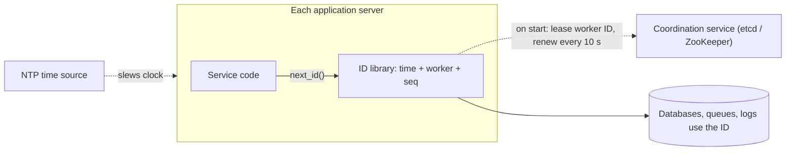
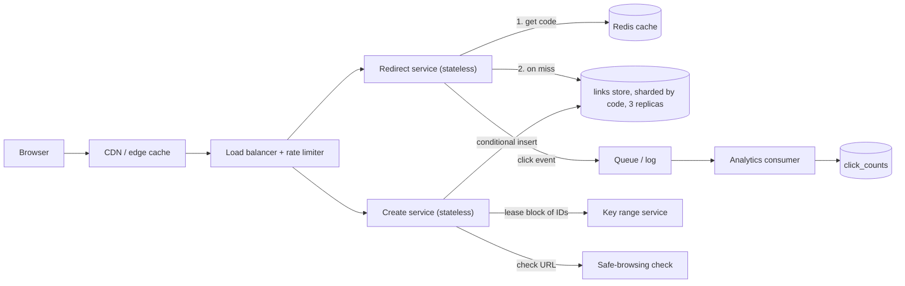
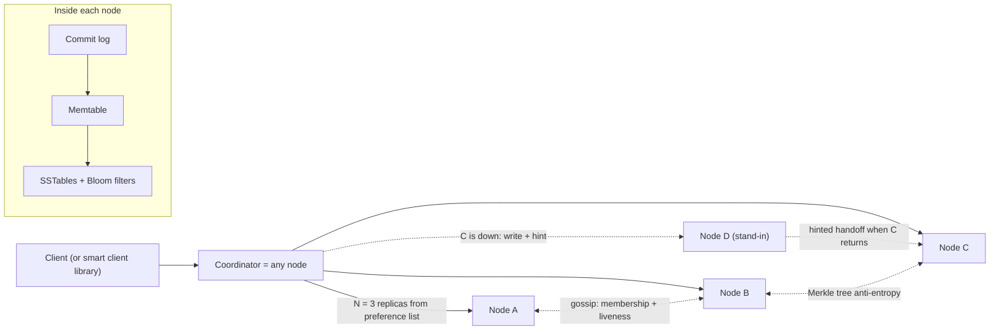
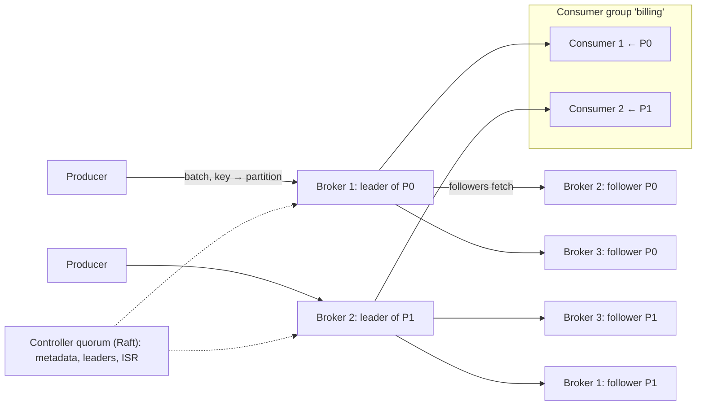
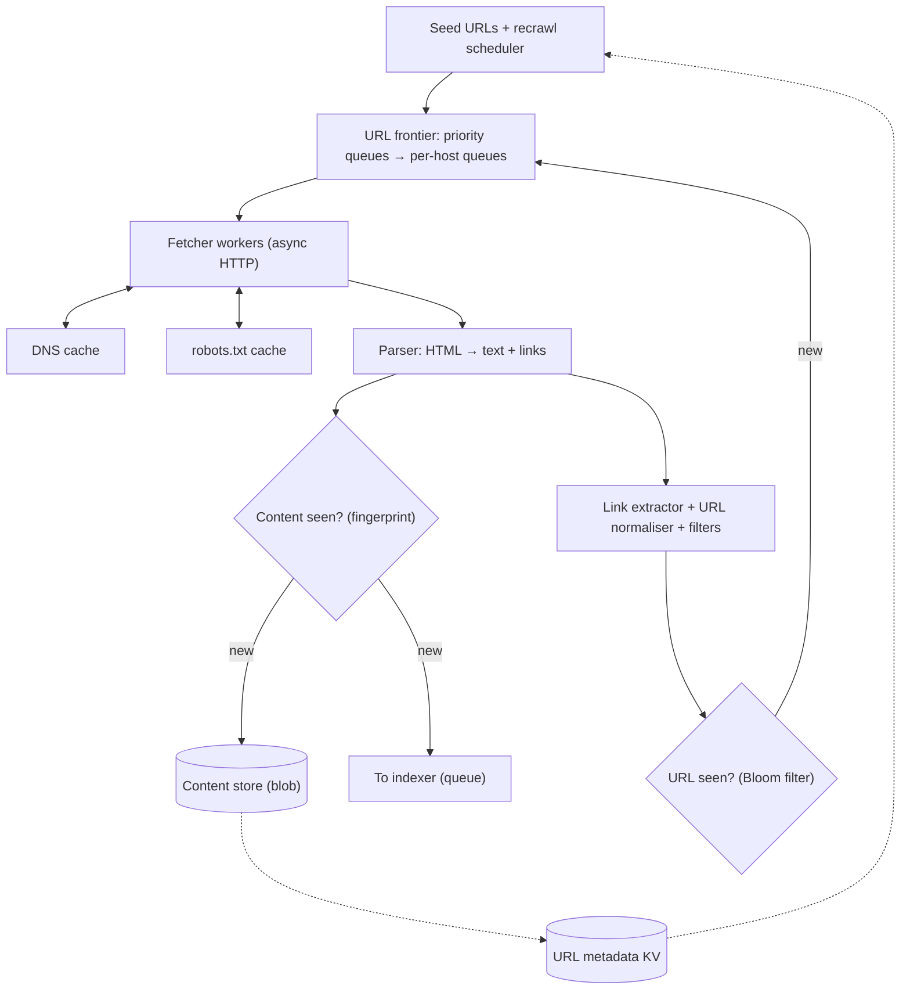
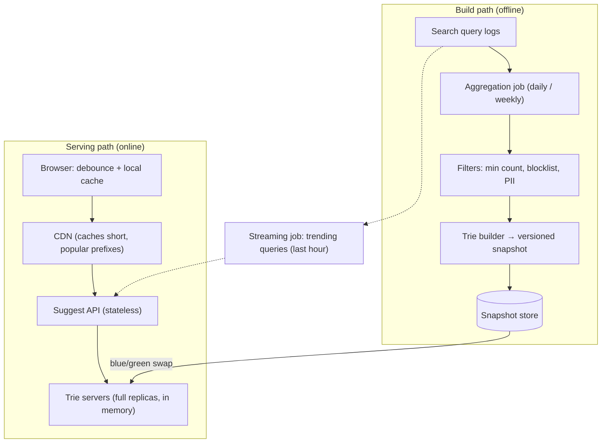

# Module 13 — Case Studies: Building Blocks

## Module Introduction

**What this module is.** Module 12 composed patterns into four large products. This module goes one level down. It designs six systems that *other* systems are built on: an ID generator, a URL shortener, a key-value store, a message queue, a web crawler and a search-autocomplete service. They are the classic "design X" interview prompts, and each one is really a test of two or three patterns you have already met. No new patterns are introduced. Every design names the lesson it borrows from and links back to it (and to the matching chapter of the DDIA notes, i.e. notes on Martin Kleppmann's book *Designing Data-Intensive Applications*) instead of teaching the theory again.

**Analogy.** Module 12 was about cooking complete meals. This module is about making the stock, the sauce and the bread from scratch. They look humble, but every meal depends on them, and a cook who can make them understands *why* the meals work.

**The six designs**

| Case | Center of gravity (the main problem) | Patterns it leans on |
|---|---|---|
| 1. Unique ID Generator | Uniqueness across machines with no coordinator on the hot path | Clocks, bit budgets, leases (time-limited claims) |
| 2. URL Shortener | A tiny write path and a huge, cacheable read path | Cache-aside, sharding, key generation, message queue |
| 3. Distributed Key-Value Store | Staying writable while nodes fail, without losing writes | Consistent hashing, quorum, vector clocks, write-ahead log |
| 4. Distributed Message Queue | A durable, replayable, ordered log at millions of messages per second | Partitioned consumption, replication, exactly-once |
| 5. Web Crawler | Politeness, dedup and traps across billions of URLs | Queues per host, Bloom filters, backpressure |
| 6. Search Autocomplete | Top-k answers per keystroke in a few milliseconds | Precomputed read models, batch pipelines, CDN caching |

**The case format.** Each case follows Module 12's stages, with an explicit API and data model added because these prompts are usually judged on them:
1. **Requirements and numbers:** functional and non-functional requirements, then the back-of-envelope estimate ([Back-of-Envelope Math](../01-thinking-in-patterns/README.md#back-of-envelope-math)).
2. **The five-questions pass:** flow, storage, speed, failure, growth ([The Five Questions](../01-thinking-in-patterns/README.md#the-five-questions)).
3. **API and data model:** the contract and what is stored.
4. **The architecture, annotated:** a diagram, with each pattern named where it is used.
5. **Deep dives:** the two to four sub-problems that are truly hard.
6. **The failure walk:** scaling limits and what breaks, one dependency at a time.
7. **Trade-offs:** the main choices side by side.
8. **Follow-up questions:** what interviewers ask next, with answers.
9. **Pattern manifest**, a one-line interview answer and a **TL;DR**.

**Runnable simulations.** Five small Python scripts in [`code/`](code/) make the key mechanisms concrete: Snowflake-style IDs, base-62 short codes, a consistent-hash ring, a Bloom filter for "URL already seen?" and a trie with cached top-k. Run any of them with the books' **virtual environment** (an isolated folder holding Python and the packages these scripts need), for example `.venv-books/bin/python system-design-patterns/modules/13-case-studies-building-blocks/code/trie_topk.py` from the notes root. Their real output is pasted into the cases.

**How to rehearse.** Same rule as Module 12: at each stage, stop and do it yourself on paper before reading on. Cases 1 and 2 are short warm-ups; cases 3 and 4 are the deepest (they reuse most of Modules 3 and 7 and 10); cases 5 and 6 are pipelines, where the hard part is the offline flow of data rather than the request path.

**Sources.** The designs here are worked from first principles, the pattern lessons in this book, the DDIA notes, and the primary papers and official documentation named at the end of each case. The scale figures are typical interview assumptions, stated so you can change them.

---

## Case 1 — Design a Unique ID Generator

**The prompt (in short).** Many services need identifiers for new rows, messages and events. Design a way to hand out IDs that are unique across hundreds of machines, fit in 64 bits, and sort roughly by creation time.

**What makes it hard.** A single database counter gives perfect IDs but becomes one machine that every write in the company waits on. Random IDs need no coordination but are 128 bits and don't sort. The goal is to get most of both: no coordinator on the **hot path** (the code that runs on every single request), and IDs that still sort by time.

**1. Requirements and numbers**
- *Functional:* `next_id()` returns an ID that has never been issued before, anywhere. IDs are **64-bit integers** (they fit a `BIGINT` column, the database's 64-bit integer type; send them to browsers as strings, because JavaScript numbers lose precision above 2^53). IDs created later compare *roughly* greater than IDs created earlier. This property is called **k-sorted** or **roughly time-ordered**: IDs from the same millisecond may interleave across machines, but a newer millisecond always sorts after an older one.
- *Non-functional:* no **single point of failure** (one component whose failure stops everything); generation in **microseconds** (it sits inside every write); **10,000+ IDs/s per node** sustained; should keep working for decades.
- *Numbers:* assume **500 application servers** that create IDs, a company-wide peak of **2M IDs/s**, and the busiest single server at **20,000 IDs/s**. Storage matters too: a 64-bit key is **8 bytes** against **16** for a **UUID** (a standard 128-bit "universally unique identifier"). A table with **10B rows** and three **indexes** (sorted lookup structures the database keeps to find rows quickly) that contain the key saves roughly 10B × 8 B × 4 ≈ **320 GB** by choosing the smaller key, and smaller keys mean more of each index fits in memory.

**2. The five-questions pass**
- **Flow:** the caller waits for the ID, so generation must be local (a library call), not a network hop on every write.
- **Storage:** nothing needs to be stored per ID. The only durable state is *which worker number each process owns*.
- **Speed:** a counter increment in memory costs nanoseconds; any design with a network **round trip** (a request sent and its reply received) per ID costs about 1 ms and becomes a bottleneck.
- **Failure:** the scary failures are *duplicates*, not outages. Two processes sharing a worker number, or a clock that jumps backwards, can silently create the same ID twice.
- **Growth:** the bit layout decides the ceilings (how many workers, how many IDs per millisecond, how many years). Choose it once, carefully.

**3. API and data model**
- *API (library):* `long next_id()`. Optionally a batch call `next_ids(n)`.
- *API (if run as a service):* `POST /v1/ids?count=100` → `{"ids": [...]}`. Batching **amortises** the network hop across 100 IDs (spreads its fixed cost over all of them).
- *Data model — the ID itself is the data model.* The layout used here (the one Twitter published for Snowflake in 2010, and still the common default; Twitter itself split the 10 worker bits into 5 datacenter bits and 5 machine bits):

| Bits | Field | Meaning | Ceiling it sets |
|---|---|---|---|
| 1 | sign | always 0, so the ID is a positive signed integer | — |
| 41 | timestamp | milliseconds since a **custom epoch** (a start date you pick, e.g. 2024-01-01) | 2^41 ms ≈ **69.7 years** |
| 10 | worker ID | which generator process issued it | **1,024** workers |
| 12 | sequence | counter within one millisecond on one worker | **4,096** IDs per ms per worker (≈ 4M/s) |

- *Durable state:* a small table or coordination-service entry `worker_id → (owner host, lease expiry)`.

**4. The architecture, annotated — first compare the options**

| Option | How it works | Good | Bad |
|---|---|---|---|
| **UUID v4** | 122 random bits | Zero coordination; any machine, any time | 128 bits; random order scatters inserts across a B-tree index (the usual sorted, tree-shaped index; poor locality, page splits) |
| **UUID v7** (RFC 9562, an internet standard) | 48-bit ms timestamp + random bits | No coordination; time-ordered | Still 128 bits |
| **Auto-increment with step** | N databases; DB *i* issues *i, i+N, i+2N…* | Simple; compact | Adding a database changes N; IDs from different DBs aren't time-ordered; each DB is still on the write path |
| **Central ticket server** | One DB row incremented per request (Flickr, 2010) | Perfectly ordered, compact | Network hop per ID; a single point of failure unless you run two with odd/even steps |
| **Range leasing** | A service hands each server a *block* of 1,000 numbers; the server spends them locally | One network hop per 1,000 IDs; compact | Blocks from different servers interleave, so order is only rough; a crash wastes the rest of a block |
| **Timestamp + worker + sequence** | The layout in section 3, computed in-process | No hop, compact, time-ordered | Depends on clocks and on unique worker IDs |

The last option wins for the stated requirements. The only coordination left is handing out worker IDs, which happens once per process start, not once per ID.



Reading the diagram: the ID library lives inside every service process, so `next_id()` is a function call. At start-up it leases one of the 1,024 worker numbers from a coordination service (a small, strongly consistent store such as etcd or ZooKeeper; see [Membership and Coordination Services](../../../ddia/chapters/09-consistency-and-consensus/README.md#membership-and-coordination-services) in the DDIA notes) and renews the lease in the background. Clocks are kept close to real time by NTP (the Network Time Protocol).

**5. Deep dives**
- **Deep dive 1 — spending the 63 bits.** Every field trades against the others. More timestamp bits buy more years; more worker bits buy more machines; more sequence bits buy more IDs per millisecond. With 500 servers today, 10 worker bits (1,024) leave room to double. The busiest server needs 20,000/s = **20 per ms**, far below the 4,096 per ms the sequence allows, so you could move 2 bits from sequence to worker (4,096 workers, 1,024 per ms) if the fleet is expected to grow a lot. Variants exist in the wild: Instagram (2012) put the *database shard number* in the middle field and generated IDs inside PostgreSQL, so an ID also tells you which shard holds the row. Pick the custom epoch close to launch day, because every year before it is wasted range.
- **Deep dive 2 — clocks going backwards.** The wall clock (time-of-day clock) can jump backwards when NTP corrects it or a **VM** (virtual machine) migrates to another physical host, and a generator that trusts it will re-issue timestamps it already used ([Unreliable Clocks](../../../ddia/chapters/08-trouble-with-distributed-systems/README.md#unreliable-clocks) explains why clocks drift and jump). The rules: (1) remember the last timestamp used; (2) if the clock is behind by a few milliseconds, **wait** until it catches up; (3) if it is behind by more (say 100 ms), **refuse** and alert rather than risk duplicates; (4) configure NTP to *slew* (speed up or slow down gradually) rather than *step*. The simulation's guard does exactly this:

```text
clock skew guard: clock moved back 3 ms; refusing to issue IDs
```
- **Deep dive 3 — worker IDs must be unique, even during failures.** If two live processes hold worker 17, they generate identical IDs in the same millisecond. Hard-coding IDs in config works for a small fixed fleet but breaks with **autoscaling** (machines being added and removed automatically as load changes). The robust way is a **lease**: a process claims a free number in the coordination service with a time-to-live (say 30 s) and renews it every 10 s. If a process pauses (a long **garbage-collection** pause, when the language runtime stops the program to reclaim memory) past its lease, another process may take the number. So the generator checks the lease expiry before issuing and stops if the lease might have lapsed. This is the same "a lease holder must not act after expiry" problem that [fencing tokens](../../../ddia/chapters/08-trouble-with-distributed-systems/README.md#fencing-tokens) address. In **Kubernetes** (the standard system for running containers across many machines), a StatefulSet's stable pod ordinal (each copy gets a fixed number: 0, 1, 2, …) is a simple alternative source of unique numbers.
- **Deep dive 4 — sequence exhaustion.** If one worker asks for more than 4,096 IDs within one millisecond, the sequence wraps. The generator must then **wait for the next millisecond**, never wrap silently. Running [`code/snowflake_ids.py`](code/snowflake_ids.py), three workers issue 5,000 IDs each in a burst on a shared simulated clock:

```text
issued: 15000 unique: 15000
first ID: 97844723712004096 {'ms_since_epoch': 23328000000, 'worker': 1, 'seq': 0}
last ID : 97844723716207495 {'ms_since_epoch': 23328000001, 'worker': 3, 'seq': 903}
sequence exhaustion waits per worker: [1, 0, 0]
later ID sorts after every earlier ID: True
41-bit timestamp lasts 69.7 years; per-worker max 4,096 IDs/ms = 4,096,000/s; workers: 1024
```
Worker 1 used up its 4,096 numbers first and waited one millisecond (the shared fake clock then moved on for all three). All 15,000 IDs are unique, and an ID from a later millisecond sorts after every earlier one.

**6. The failure walk**
1. **The coordination service is down:** running processes keep their leases for a while and keep generating; only *new* processes can't start. Give leases a generous TTL and alert well before expiry.
2. **A clock jumps back 2 seconds:** that generator refuses to issue for up to 2 s and the service returns errors or retries on another instance. Better a short, visible failure than invisible duplicates.
3. **Two processes get the same worker ID** (lease bug, cloned VM): duplicates appear. The final safety net is the database's **unique constraint** (a rule that rejects a second row with the same value) on the **primary key** (the column that identifies each row), which turns a silent duplicate into a loud insert error.
4. **The 69.7 years run out:** plan a new epoch or a wider ID long before. (It's a real date: write it down.)
5. **Very low traffic:** most IDs have sequence 0, so `id % 16` (the remainder after dividing by 16) for sharding is skewed. Start each millisecond's sequence at a random value, or shard on a hash of the ID.

**7. Trade-offs**

| Choice | Gain | Cost |
|---|---|---|
| 64-bit layout over UUID | Half the index size, time-sortable | Needs worker-ID management and sane clocks |
| UUID v7 over 64-bit layout | Zero coordination, still time-ordered | 16 bytes per key, everywhere |
| Ticket server / range leasing | Strict or near-strict order, no clock dependence | A network dependency on the write path (softened by batching) |
| More worker bits | Bigger fleets | Fewer IDs per ms per worker |
| Time-ordered IDs in public URLs | Easy pagination and debugging | Leaks creation time and volume to outsiders |

**8. Follow-up questions**
- **"Are these IDs strictly ordered?"** No: they are ordered by millisecond, and within a millisecond by worker, not by real arrival. Strict global order needs a single sequencer or **consensus** (a protocol that makes several machines agree on one value or order) ([Total Order Broadcast](../../../ddia/chapters/09-consistency-and-consensus/README.md#total-order-broadcast)), which is exactly the coordination we avoided. For "sort by newest", roughly ordered is enough.
- **"Can outsiders guess IDs?"** Yes, roughly, which is why public-facing IDs are often a separate random token or an encrypted form of the internal ID. *Trap:* using sequential IDs for anything that should be unguessable, like password-reset links.
- **"Why not just UUIDs?"** A fine answer if 16 bytes is acceptable. UUID v7 fixes the ordering problem. The 64-bit design wins when keys appear in many large indexes or in systems limited to 64-bit integers.
- **"How do you test it?"** **Property tests** (tests that check a rule holds across many generated inputs): millions of IDs across simulated workers are unique and **monotonic** (only ever increasing) per worker; clock rollback is refused; sequence overflow waits.

**9. Pattern manifest**

| Pattern / idea | Where it served |
|---|---|
| [Back-of-Envelope Math](../01-thinking-in-patterns/README.md#back-of-envelope-math) | Bit budget: years, workers, IDs per ms |
| Leases + [fencing](../../../ddia/chapters/08-trouble-with-distributed-systems/README.md#fencing-tokens) | Unique worker-ID ownership |
| [Noncausal sequence number generators](../../../ddia/chapters/09-consistency-and-consensus/README.md#noncausal-sequence-number-generators) | Why these IDs aren't causally consistent |
| [Sharding](../03-storing-data/README.md#sharding) | Shard number embedded in the ID (Instagram variant); ID-hash shard keys |
| [Graceful Degradation](../05-reliability/README.md#graceful-degradation) | Refuse-and-retry on clock rollback instead of duplicates |

**Interview one-liner:** "Generate IDs in-process as timestamp plus worker plus sequence: 41 bits give 70 years, 10 bits give 1,024 workers, 12 bits give 4,096 per millisecond. The only coordination is leasing worker numbers, and the two real dangers, backwards clocks and duplicate workers, are handled by waiting, refusing and a unique constraint as the last net."

**TL;DR**
- **Problem:** unique, compact, time-sortable IDs from hundreds of machines, without a central counter on every write.
- **Mechanism:** 1 | 41-bit ms timestamp | 10-bit worker | 12-bit sequence, computed locally; worker numbers leased from etcd/ZooKeeper.
- **Dangers:** clock rollback (wait or refuse), shared worker IDs (leases + DB unique constraint), sequence overflow (wait for the next ms).
- **Alternatives:** UUID v7 when 128 bits is fine; range leasing or a ticket server when you need tighter order and can afford a hop per batch.
- **Sources:** Twitter Engineering, "Announcing Snowflake" (2010); Instagram Engineering, "Sharding & IDs at Instagram" (2012); Flickr, "Ticket Servers" (2010); IETF RFC 9562 (UUID v7, 2024).

---

## Case 2 — Design a URL Shortener

**The prompt (in short).** Users submit a long URL and get back a short one like `sho.rt/aZ3k9Qx`. Anyone opening the short link is redirected to the long URL. Module 1 used this prompt to demonstrate the five questions at a small scale; this is the full design at a larger one.

**What makes it hard.** Very little, which is why interviewers use it to see how you think. The hard parts are small but real: generating short codes that never collide, choosing the right redirect status, serving 10× more redirects than creations from cache, and keeping it from becoming a malware-distribution service.

**1. Requirements and numbers**
- *Functional:* create a short link (optionally with a custom alias and an expiry date); redirect; delete/disable; basic click statistics.
- *Non-functional:* redirects are the product, so they need **very high availability** (the share of time the service works) and low **latency** (the time one request takes) (**p99 < 50 ms** at the server, meaning 99% of requests finish within 50 ms); see [System Design Fundamentals](../00-system-design-fundamentals/README.md) for these basics; links live for **10 years** by default; codes must not be trivially enumerable.
- *Writes:* **100M new links/day** ÷ 100,000 s ≈ **1,000/s average**, plan for **~5,000/s peak**.
- *Reads:* read:write ≈ **10:1**, so **1B redirects/day ≈ 10,000/s average, ~50,000/s peak**.
- *Code length:* 10 years × 100M/day = **365B links**. Base 62 (0–9, a–z, A–Z) with 7 characters gives 62^7 ≈ **3.5 trillion** codes, about 10× headroom. The simulation confirms the arithmetic:

```text
links in 10 years: 365,000,000,000 -> need length 7
```
- *Storage:* a row (code, long URL averaging ~100 bytes, owner, timestamps, plus index and replication overhead) is roughly **500 bytes** on disk per copy. 100M/day × 500 B = **50 GB/day ≈ 18 TB/year ≈ 180 TB over 10 years**. That no longer fits one machine, so the store is **sharded**.
- *Cache:* redirects are heavily skewed; assume 20% of the links read each day take 80% of clicks. If ~100M distinct links are read per day, the hot 20% is 20M × 500 B ≈ **10 GB**, a few cache nodes.
- *Bandwidth:* a redirect response is ~500 bytes; 50,000/s × 500 B = **25 MB/s**. Negligible.

**2. The five-questions pass**
- **Flow:** create and redirect are request-response. Click events are recorded **asynchronously on a queue**, never in the redirect's critical path ([Message Queue](../02-moving-data/README.md#message-queue)).
- **Storage:** the source of truth is `code → long URL`, written once, read forever, looked up only by code. That is a key-value access pattern, sharded by code ([Sharding](../03-storing-data/README.md#sharding)).
- **Speed:** mappings never change (until deleted), so they cache extremely well: [Cache-Aside](../04-caching/README.md#cache-aside) with a long **TTL** (time to live: how long a cached copy stays valid), plus a CDN at the edge for the hottest links.
- **Failure:** redirects must survive a database shard outage (serve from cache and replicas); link creation can degrade to "try again".
- **Growth:** reads grow with virality (a single link can get millions of clicks in minutes, a **hot key**); storage grows linearly and predictably.

**3. API and data model**
- `POST /v1/links` with `{"long_url": "...", "custom_alias": "optional", "expires_at": "optional"}` → `201 {"code": "aZ3k9Qx", "short_url": "https://sho.rt/aZ3k9Qx"}`. Requires an **API key** (a secret string that identifies the caller) or login, which enables per-user [Rate Limiting](../08-api-and-edge/README.md#rate-limiting).
- `GET /{code}` → `302 Found` (or `301`, see deep dive 2) with `Location: <long_url>`; `404` if unknown; `410 Gone` if expired or disabled.
- `DELETE /v1/links/{code}` → `204`. `GET /v1/links/{code}/stats` → click counts by day and country.
- *Data model:*

| Table | Key | Columns | Notes |
|---|---|---|---|
| `links` | `code` (partition key) | `long_url`, `owner_id`, `created_at`, `expires_at`, `status` | Sharded by `code`; every redirect has it |
| `links_by_owner` | `owner_id`, `created_at` | `code` | A second, derived table for "my links" pages |
| `click_counts` | `code`, `day` | `count`, per-country counts | Written by the analytics consumer, not the redirect path |

A **wide-column** (rows with many flexible, optional columns) or key-value database (Cassandra, DynamoDB) or sharded MySQL/PostgreSQL both work, because every hot query is a single-key lookup.

**4. The architecture, annotated**



Reading the diagram:
1. A redirect first hits the **CDN** (content delivery network: caches near users; see [CDN](../08-api-and-edge/README.md#cdn)). Popular links can be cached there for a short time, which also absorbs viral spikes.
2. On a CDN miss, a stateless **redirect service** looks the code up in **Redis** (a fast in-memory key-value store used here as the cache; cache-aside), then in the **links store** on a miss, and fills the cache.
3. It sends a small click event (code, time, country, referrer) to a **queue** and returns immediately. An analytics consumer aggregates counts in batches.
4. The **create service** validates the URL (format, length, safe-browsing check), obtains a code (deep dive 1), and writes the row with a **conditional insert** (insert only if the code doesn't exist), which makes collisions detectable instead of silent overwrites.

**5. Deep dives**
- **Deep dive 1 — generating the code. Three options.**
  1. **Hash and truncate:** take a hash of the long URL (e.g. SHA-256, a standard cryptographic hash function), keep 7 base-62 characters, and insert-if-absent; on collision, add a **salt** (a little extra data mixed in so the hash comes out different) and hash again. No coordination, and the same URL can map to the same code (free deduplication). But collisions grow with the table (the **birthday effect**: collisions become likely far sooner than intuition suggests, as with two people in a room sharing a birthday). With 7 characters the odds stay small but not zero:

```text
after   100,000,000 links: next 7-char hash collides with p = 2.8e-05 (about 1 in 35,216)
after 1,000,000,000 links: next 7-char hash collides with p = 2.8e-04 (about 1 in 3,522)
3-char demo: 50,000 links stored, 6,252 collision retries (space 238,328, 21% full)
```
  So every insert must be conditional, and retries grow as the space fills (the tiny 3-character demo shows it clearly).
  2. **Base-62 of a unique number:** take a number that is guaranteed unique and write it in base 62 (`125,000,000 → '8sud2'`). No collisions ever. The number can come from **range leasing**: each create server leases a block of, say, 10,000 numbers from a small key-range service (backed by a strongly consistent store) and spends them locally, so the service is contacted about once every 10,000 links. Problem: sequential numbers make codes guessable (`8sud2`, `8sud3`…), which lets anyone crawl every link. Fix: pass the number through a fixed **reversible scramble** (a bijection, such as multiplying by a large constant that shares no factor with 62^7, i.e. odd and not a multiple of 31, modulo 62^7) before encoding. Unique stays unique, but neighbours look unrelated. A 64-bit Snowflake ID from Case 1 would also be unique, but it needs 11 base-62 characters, which defeats the purpose.
  3. **Pre-generated key pool:** a background job creates random unused 7-character codes and stores them; create servers take batches. Collision-free at use time, at the cost of a pool to manage.

  **Choice:** option 2 (range-leased counter + scramble + base 62). It is collision-free, needs one coordination hop per 10,000 creations, and a crashed server just wastes the rest of its block (3.5 trillion codes can afford it). Custom aliases use the same conditional insert and simply fail with `409 Conflict` if taken.
- **Deep dive 2 — 301 or 302?** HTTP defines `301 Moved Permanently` and `308` as permanent (browsers and **proxies**, the intermediate servers between client and site, may cache them indefinitely), and `302 Found` and `307` as temporary (clients ask again each time) — see RFC 9110. With **301**, repeat clicks from the same browser never reach you: less load, but you lose click analytics and **cannot change, expire or disable** the link for those users, which matters when a link turns out to be malicious. With **302**, every click reaches your edge: accurate analytics and full control, at the cost of more traffic. Most commercial shorteners use 302 (or 301 with short cache headers). A middle ground: 302 plus `Cache-Control: max-age=300` at the CDN, so the edge absorbs spikes while you can still disable a link within 5 minutes.
- **Deep dive 3 — the hot link and the cold miss.** A link shared by a celebrity gets 50,000 clicks in its first minute: the CDN and Redis absorb it, and [Cache Stampede Prevention](../04-caching/README.md#cache-stampede-prevention) (single-flight on a miss) stops thousands of simultaneous misses from hitting one database shard. The opposite problem is scanners hammering *random* codes, which all miss the cache: cache **negative results** ("code not found") for a short time and rate-limit by client IP (the caller's network address).
- **Deep dive 4 — abuse and expiry.** Check new URLs against a malicious-URL list (for example Google's Safe Browsing API) at creation and re-check periodically, because a harmless page can turn bad later; disabling a link sets `status = disabled`, invalidates the cache and returns `410`. Expiry is enforced **lazily** at read time (`expires_at < now` → 410) plus a slow background sweeper that deletes old rows. Don't reuse expired codes for a long time; old copies of the short link are still out in emails and documents.

**6. The failure walk**
1. **A Redis node dies:** its share of keys misses and falls through to the store; consistent hashing in the cache client limits the damage to that node's slice ([Consistent Hashing](../03-storing-data/README.md#consistent-hashing)).
2. **A store shard's primary dies:** replicas keep serving reads, so redirects continue; creates targeting that shard retry after **failover** (a replica being promoted to replace the dead primary). Redirect availability is protected by cache + replicas; create availability is allowed to dip.
3. **The key-range service is down:** create servers keep spending the blocks they already hold (hours of headroom at 10,000 per block); only when blocks run out do creates fail.
4. **The analytics queue backs up:** clicks queue up as lag; redirects are unaffected. If the queue itself is down, the redirect service drops click events after a small local buffer (stats are best-effort, redirects are not).
5. **A region is lost:** the mapping data is replicated across regions; **DNS** (the internet's name-to-address lookup) or **anycast** (one IP address announced from many places, so traffic reaches the nearest) moves traffic. Since mappings are immutable, cross-region replication lag only delays very new links.

**7. Trade-offs**

| Choice | Gain | Cost |
|---|---|---|
| Counter + base 62 vs hash-and-truncate | No collisions, no retries | A small coordination service; needs scrambling to stop enumeration |
| 302 vs 301 | Analytics, can disable/expire links | Every click hits your edge |
| CDN caching of redirects | Absorbs viral spikes cheaply | Disabling a link takes up to the CDN TTL |
| Key-value store vs relational | Easy horizontal scaling for single-key lookups | "My links" and analytics need separate derived tables |
| Async click analytics | Redirects never wait on analytics | Counts are seconds-to-minutes behind; can drop under failure |

**8. Follow-up questions**
- **"The same long URL is submitted twice. Same code?"** Only if you want it. With the counter approach, look up `hash(long_url)` per owner in a small index before creating; across different owners, separate codes are usually better (separate stats and separate delete rights).
- **"How would you support 1 million custom aliases a day?"** Same table, conditional insert, `409` on conflict; reserve words like `admin` and `api`; rate-limit alias creation more strictly because it's the usual abuse vector.
- **"How do you get exact click counts?"** Don't promise exactness on the redirect path. Make events idempotent (event ID) and aggregate them in a stream job ([Exactly-Once Semantics](../10-batch-and-streaming/README.md#exactly-once-semantics)); for billing-grade counts, reconcile against raw logs in batch.
- **"How do you make it globally fast?"** Put redirect servers and read replicas in several regions, serve from the nearest one, and send creates to the region that owns the key range. *Trap:* multi-region writes to the same key space without a partitioning rule, which invites conflicts.

**9. Pattern manifest**

| Pattern | Where it served |
|---|---|
| [Cache-Aside](../04-caching/README.md#cache-aside) + [CDN](../08-api-and-edge/README.md#cdn) | The redirect path: 10:1 reads, immutable values |
| [Cache Stampede Prevention](../04-caching/README.md#cache-stampede-prevention) | Viral links; negative caching for scanners |
| [Sharding](../03-storing-data/README.md#sharding) + [Primary-Replica](../03-storing-data/README.md#primary-replica) | 180 TB of mappings keyed by code; reads survive primary loss |
| [Message Queue](../02-moving-data/README.md#message-queue) | Click analytics off the critical path |
| [Rate Limiting](../08-api-and-edge/README.md#rate-limiting) | Creation abuse; code scanning |
| [Idempotency](../05-reliability/README.md#idempotency) | Conditional insert on code; event IDs on clicks |
| Case 1 (ID generation) | Range-leased counter feeding base 62 |

**Interview one-liner:** "Sizing gives 1,000 creates and 10,000 redirects a second and 7-character base-62 codes; codes come from a range-leased counter, scrambled and base-62 encoded so they never collide; redirects are 302s served from CDN and cache-aside over a code-sharded store; clicks go to a queue so analytics never slows a redirect."

### Variant: Pastebin

A common follow-up is "now store the text itself": the user pastes a block of text (code, logs, a config file) and gets back a short link that shows it. The code generation, the cache-aside read path and the async analytics carry over unchanged. What changes is that the value is no longer a 100-byte URL but a **blob** (a "binary large object": an opaque chunk of bytes the system stores without interpreting it) of up to several megabytes. Pastebin.com, for example, has capped pastes at 512 KB for free accounts and 10 MB for paid ones.

**Numbers, redone.** Assume 10M new pastes a day averaging 10 KB: 10M × 10 KB = **100 GB/day ≈ 36 TB/year** of raw text, against roughly 5 GB/day for the metadata rows. Reads are fewer than for a shortener (say 5:1, ≈ 600 reads/s average), but each read now moves 10 KB instead of 500 bytes. So bytes, not requests, set the bill.

**Split metadata from content.** Keep the small row (`code`, `owner_id`, `size_bytes`, `content_hash`, `syntax`, `visibility`, `expires_at`, `object_key`) in the same code-sharded key-value store. Put the text in **object storage** (a service such as Amazon S3 that stores blobs by key, cheaply and durably, and serves them over HTTP). Large values in the database would bloat replication, backups and caches for data that is only ever fetched whole. Write the object **first**, then the row, so a row never points at a missing object. A crash in between leaves an orphan object (one nothing points to), which a periodic cleanup job deletes.

**Reads.** `GET /{code}` renders a page from the metadata plus the text. A `/raw/{code}` URL can be served by the CDN straight from object storage. Cache only small, hot pastes in Redis (say under 64 KB). A 10 MB value would push hundreds of small entries out of the cache. Compress text on write: plain text usually shrinks several times, which cuts storage and transfer alike.

**Size limits.** Enforce the cap at the edge before reading the body: reject an oversized `Content-Length` with `413 Content Too Large`, and stop reading a streamed upload at the cap. Rate-limit **bytes per user per day**, not just requests, because one client can fill a disk with a few thousand maximum-size pastes. For very large uploads, hand the client a **pre-signed URL** (a time-limited link that allows one upload straight to object storage), so the bytes never pass through your servers.

**Expiry.** Pastes commonly offer "10 minutes / 1 day / 1 month / never" and **burn after reading**. Enforce expiry at read time (`expires_at < now` → `410 Gone`), as the shortener does. Physical deletion can use an object-storage lifecycle rule. But S3 documents that lifecycle expirations run asynchronously and may lag by days (billing stops when an object becomes eligible), so the read-time check is the only real guarantee. Burn-after-reading needs an atomic state change (`UPDATE ... SET status='burned' WHERE code=? AND status='active'`), so only one reader wins, and `Cache-Control: no-store`, so no CDN keeps a copy.

**Privacy.** Unlisted pastes are often secrets someone shouldn't have pasted (keys, passwords). Give them longer random codes (10 or more base-62 characters) rather than scrambled counter values, keep them out of search engines, and scan public pastes for leaked credentials.

*Sources for the variant:* Pastebin.com FAQ (paste size limits); Amazon S3 User Guide, "Expiring objects" and "Troubleshooting Amazon S3 Lifecycle issues" (asynchronous expiration, billing at eligibility); IETF RFC 9110, §15.5.14 (413 Content Too Large).

**TL;DR**
- **Numbers:** 100M links/day (1K/s), 10:1 reads (10K/s, 50K peak), 365B links in 10 years → 7 base-62 characters, ~180 TB.
- **Codes:** counter from leased ranges → reversible scramble → base 62 (no collisions); hash-and-truncate needs conditional inserts and retries.
- **Redirect:** 302 (control + analytics) with short CDN caching; cache-aside with negative caching; store sharded by code.
- **Around it:** analytics via a queue; safe-browsing checks, rate limits, lazy expiry, no quick code reuse.
- **Sources:** IETF RFC 9110 (HTTP semantics, redirect status codes); Google Safe Browsing API documentation; Module 1's five-questions walkthrough.

---
## Case 3 — Design a Distributed Key-Value Store

**The prompt (in short).** Build a store with `put(key, value)` and `get(key)` for small values, spread over dozens to hundreds of machines, that stays available for writes even while machines and network links fail. Think of Amazon's Dynamo, Cassandra or Riak.

**What makes it hard.** Each piece has its own lesson: consistent hashing, quorums, vector clocks, the write-ahead log. The hard part is fitting them together into one coherent design and explaining what each one does when a node fails in the middle of a write.

**1. Requirements and numbers**
- *Functional:* `get(key)`, `put(key, value)`, `delete(key)`; values up to **10 KB** (typically ~1 KB); no multi-key transactions and no range scans (those are out of scope and should be said out loud).
- *Non-functional:* **always writable** (a shopping cart that rejects "add to cart" loses money); **tunable consistency** per request (the caller chooses how up to date a read must be, trading against speed); p99 latency **< 10 ms** inside a datacenter; scale by adding nodes with no downtime; survive the loss of any node, and of a whole **rack** (a cabinet of servers that share power and network switches).
- *Data:* **10B keys × 1 KB = 10 TB** of data; with **3 replicas**, **30 TB** stored.
- *Traffic:* peak **1M operations/s**, 70% reads and 30% writes. With 3 replicas, each write touches 3 nodes (300K × 3 = 900K replica writes/s) and each quorum read asks 2 nodes (700K × 2 = 1.4M replica reads/s): about **2.3M replica operations/s**.
- *Nodes:* one node on NVMe SSDs comfortably does ~40K operations/s → 2.3M ÷ 40K ≈ **58 nodes**; call it **60**. Each then holds 30 TB ÷ 60 = **500 GB**, which leaves room on a 2 TB disk for **compaction** (background merging of data files, which temporarily needs extra space) and growth. Here throughput, not disk, sets the node count.

**2. The five-questions pass**
- **Flow:** clients send request-response calls to any node; that node acts as **coordinator** for the request and forwards it to the replicas.
- **Storage:** the data is spread across nodes by hashing the key onto a ring ([Consistent Hashing](../03-storing-data/README.md#consistent-hashing)), and each key is stored on N = 3 nodes. Each node stores data in an **LSM tree** (log-structured merge tree: log → memory → sorted files).
- **Speed:** reads and writes each wait only for a **quorum** (a minimum number of replica replies, typically a majority) of replicas, not all of them, so one slow node doesn't slow the request ([Quorum](../07-consistency/README.md#quorum)).
- **Failure:** temporary failures are handled by writing to a stand-in node (hinted handoff); permanent divergence is repaired in the background (Merkle-tree **anti-entropy**: replicas comparing trees of hashes to find keys that differ); conflicts from concurrent writes are *detected* (with per-replica version counters), not silently lost ([Vector Clocks](../07-consistency/README.md#vector-clocks)).
- **Growth:** adding a node moves only about 1/N of the data; virtual nodes spread that load.

**3. API and data model**
- `get(key)` → `[(value, context)]`. Usually one value; **more than one** if concurrent writes conflicted (the values are called **siblings**). The `context` is an **opaque** blob (data the client stores and sends back without looking inside) holding the version vector.
- `put(key, context, value)` → `ok`. The client passes back the context it read, which tells the store which versions this write replaces.
- `delete(key, context)` writes a **tombstone** (a marker saying "deleted") rather than removing data at once, so the deletion itself can replicate.
- Per-request consistency knobs: `W` (replica acks needed for a write) and `R` (replica replies needed for a read), with N fixed per table.
- *On-disk data model per node:* a **commit log** (append-only, for crash safety), a **memtable** (sorted in-memory map), and immutable **SSTables** (sorted string tables: files of key-sorted records) with a **Bloom filter** (a compact bit array that can say "definitely not here" or "probably here") and a sparse index per file ([SSTables and LSM-Trees](../../../ddia/chapters/03-storage-and-retrieval/README.md#sstables-and-lsm-trees)).
- *Per-record metadata:* `key, value | tombstone, version vector, write timestamp`.

**4. The architecture, annotated**



Reading the diagram, following one write:
1. The client sends `put` to any node (or a client library computes the right node itself and saves a hop). That node becomes the **coordinator**.
2. The coordinator hashes the key onto the ring and walks clockwise to find the key's **preference list**: the first N = 3 *distinct physical* nodes (skipping extra virtual nodes of a machine already chosen, and preferring machines in different racks).
3. It sends the write to all three and replies to the client as soon as **W = 2** have acknowledged. Each replica appends to its commit log, then updates its memtable ([Write-Ahead Log](../03-storing-data/README.md#write-ahead-log)).
4. If node C is unreachable, the coordinator writes C's copy to the next healthy node D with a **hint** ("this belongs to C"). D hands it back when C recovers.
5. In the background, nodes **gossip** membership and liveness (each node regularly swaps what it knows with a random peer, so news spreads like a rumour), and neighbouring replicas compare **Merkle trees** to find and repair keys that differ.

**5. Deep dives**
- **Deep dive 1 — partitioning and replication on the ring.** With one position per node, a 10-node ring is badly uneven; with a few hundred virtual nodes per machine it evens out, and adding a node moves only its fair share. Running [`code/consistent_hash_ring.py`](code/consistent_hash_ring.py) with 100,000 keys:

```text
vnodes=  1: keys per node min     66 max 33,828 (stdev 103% of mean)
vnodes= 16: keys per node min  7,798 max 12,559 (stdev 17% of mean)
vnodes=256: keys per node min  9,422 max 10,859 (stdev 5% of mean)
add node10: 9,438 of 100,000 keys moved (9.4%; ideal 1/11 = 9.1%); all moved keys went to node10: True
same change with hash % N: 90.7% of keys move
preference list for 'user:42': ['node0', 'node5', 'node6']
```
  Each key's three replicas are the first three distinct machines clockwise, as the last line shows. DDIA's [Rebalancing Partitions](../../../ddia/chapters/06-partitioning/README.md#rebalancing-partitions) compares this with the alternative of a fixed number of partitions that move as a whole (the approach Riak and Elasticsearch use).
- **Deep dive 2 — quorums and staying writable.** With N = 3, choosing **W + R > N** (e.g. W = 2, R = 2) means every read quorum overlaps every write quorum in at least one node, so a read sees the latest acknowledged write in the normal case. W = 1, R = 1 is faster but can return stale data; W = 3 is safest but a single slow node blocks writes. Now the always-writable requirement: if two of a key's three home nodes are unreachable, a strict quorum fails. A **sloppy quorum** accepts writes on *any* N healthy nodes further round the ring, with hints, and **hinted handoff** delivers them home later ([Sloppy Quorums and Hinted Handoff](../../../ddia/chapters/05-replication/README.md#sloppy-quorums-and-hinted-handoff)). The price: during that window, W + R > N no longer guarantees a fresh read, because the write may sit on nodes the reader doesn't ask. Say it plainly: this store chooses availability over **linearizability** (every read sees the latest write, as if there were only one copy) ([The CAP theorem](../../../ddia/chapters/09-consistency-and-consensus/README.md#the-cap-theorem)).
- **Deep dive 3 — concurrent writes and conflicts.** Two clients update the same cart through different coordinators during a partition. Which wins? **Last write wins (LWW)** keeps the one with the higher timestamp and silently drops the other; it is simple and Cassandra's default, but **clock skew** (different machines' clocks disagreeing) means "later" can be wrong and a write is *lost*. **Version vectors** (one counter per replica, carried in the `context`) let the store tell "B replaced A" from "A and B happened concurrently" ([Version vectors](../../../ddia/chapters/05-replication/README.md#version-vectors)). Concurrent values are both kept as siblings and returned to the client, which merges them (for a cart: union of items, with deletes as tombstones) and writes back the merge with the combined context. Choose per data type: LWW for values where losing a concurrent overwrite is acceptable (a profile photo), siblings or CRDTs (data types that merge automatically) for values where it is not (a cart, a counter).
- **Deep dive 4 — failure detection and repair.** There's no master to say who is alive. Each node **gossips** every second with a random peer, exchanging a table of `(node, heartbeat counter)`; a node whose counter stops rising for, say, 10 s is *suspected* down ([Detecting Faults](../../../ddia/chapters/08-trouble-with-distributed-systems/README.md#detecting-faults)). Short failures are covered by hinted handoff. Longer ones leave replicas out of sync, and hints can themselves be lost. **Read repair** fixes a key when a read notices a stale replica; **anti-entropy** fixes everything else: each replica builds a **Merkle tree** (a tree of hashes where each parent hashes its children) over its key ranges; two replicas compare roots and descend only into subtrees whose hashes differ, so they exchange a few kilobytes of hashes to locate a handful of stale keys among millions ([Read repair and anti-entropy](../../../ddia/chapters/05-replication/README.md#read-repair-and-anti-entropy)).
- **Deep dive 5 — the write and read path on one node.** Write: append to the commit log (sequential disk write), insert into the memtable, acknowledge. When the memtable reaches ~64 MB, flush it as a new SSTable. Read: check the memtable, then SSTables newest to oldest; each SSTable's **Bloom filter** answers "definitely not here" for most files, so a read usually touches one or two files. **Compaction** merges SSTables in the background, dropping overwritten values and, after a grace period, tombstones. That grace period (Cassandra's default is 10 days) must be longer than the time a dead replica can be away; otherwise a replica that missed the delete brings the old value back to life.

**6. The failure walk**
1. **One node crashes for 5 minutes:** writes continue with W = 2 (or sloppy quorum); hints queue on neighbours; reads with R = 2 still succeed. On return, hints replay and read repair tidies up.
2. **A node's disk dies permanently:** mark it removed; its ranges re-replicate from the other two copies to new owners (streaming, not by hints). Virtual nodes mean the copy load spreads across many peers.
3. **A network partition splits the cluster:** both sides accept writes (sloppy quorum). Afterwards, version vectors surface the conflicts as siblings; nothing is silently lost unless the table uses LWW.
4. **A hot key** (a viral item's counter): hashing places it on 3 nodes whatever you do. Cache it in front, or split it into sub-keys (`item#0..item#9`) and sum on read ([Skewed Workloads and Relieving Hot Spots](../../../ddia/chapters/06-partitioning/README.md#skewed-workloads-and-relieving-hot-spots)).
5. **A slow (not dead) node:** quorums hide it, because the coordinator waits only for the fastest W or R replies. Add per-request timeouts and let the snitch (latency-aware routing) steer reads away from it.

**7. Trade-offs**

| Choice | Gain | Cost |
|---|---|---|
| Leaderless + sloppy quorum vs single leader per partition | Always writable; no failover pause | Conflicts to resolve; no linearizability |
| W = 2, R = 2 vs W = 1, R = 1 | Reads usually see the latest write | Higher latency; needs 2 healthy replicas |
| Version vectors vs LWW | No silently lost writes | Clients must merge siblings; bigger metadata |
| LSM storage vs B-tree | Fast sequential writes; good compression | Read amplification (one read touching many files), compaction I/O spikes |
| Virtual nodes vs one token per node | Even load; spread-out recovery | More ring metadata; repair touches many peers |

**8. Follow-up questions**
- **"Make it strongly consistent."** Switch to one leader per partition, replicated with a consensus protocol (Raft or Paxos, the two best-known ones), as etcd, TiKV and Spanner do. Writes then go through the leader and a majority; you lose writes during leader elections and in the minority side of a partition. *Trap:* claiming W + R > N alone gives linearizability; with sloppy quorums, clock-based LWW and partial failures it does not ([Limitations of Quorum Consistency](../../../ddia/chapters/05-replication/README.md#limitations-of-quorum-consistency)).
- **"How do you add range scans?"** Partition by key range instead of hash (sorted keys stay together) and accept hot-spot risk for sequential keys like timestamps ([Partitioning by Key Range](../../../ddia/chapters/06-partitioning/README.md#partitioning-by-key-range)). Cassandra's compromise: hash the partition key, sort by a clustering key within it.
- **"How does a client find the right node?"** Three options: any node forwards (simplest), a routing tier, or a partition-aware client library that learns the ring by gossip ([Request Routing](../../../ddia/chapters/06-partitioning/README.md#request-routing)).
- **"What happens to deleted data?"** Tombstones replicate like writes; compaction removes them after the grace period; running repair more often than that period prevents deleted data coming back.

**9. Pattern manifest**

| Pattern | Where it served |
|---|---|
| [Consistent Hashing](../03-storing-data/README.md#consistent-hashing) | Ring with virtual nodes; preference lists |
| [Quorum](../07-consistency/README.md#quorum) | N/W/R per request; sloppy quorum for availability |
| [Vector Clocks](../07-consistency/README.md#vector-clocks) | Conflict detection; siblings |
| [Write-Ahead Log](../03-storing-data/README.md#write-ahead-log) | Commit log before memtable |
| [Sharding](../03-storing-data/README.md#sharding) | Hash partitioning; hot-key splitting |
| [Health Check Endpoint](../09-operating-in-production/README.md#health-check-endpoint) (gossip form) | Decentralised failure detection |
| [Timeout](../05-reliability/README.md#timeout) | Coordinators never wait on slow replicas |
| [Leaderless Replication](../../../ddia/chapters/05-replication/README.md#leaderless-replication) (DDIA) | The whole replication model |

**Interview one-liner:** "Hash keys onto a ring with virtual nodes and store each on the next three machines; reads and writes wait for a quorum (W = 2, R = 2); sloppy quorum plus hinted handoff keeps writes flowing through failures, version vectors turn concurrent writes into visible siblings instead of lost data, gossip detects failures, Merkle trees repair drift, and each node is an LSM tree with a commit log and Bloom filters."

**TL;DR**
- **Numbers:** 10 TB × 3 replicas, 1M ops/s → ~2.3M replica ops/s → ~60 nodes of 500 GB each; throughput sets the size.
- **Placement:** consistent hashing + virtual nodes; preference list = next 3 distinct machines.
- **Consistency:** tunable N/W/R; sloppy quorum + hinted handoff = always writable, not linearizable.
- **Conflicts & repair:** version vectors + siblings (or LWW where loss is fine); gossip for liveness; read repair + Merkle-tree anti-entropy.
- **Node engine:** commit log → memtable → SSTables with Bloom filters; compaction; tombstones with a grace period.
- **Sources:** DeCandia et al., "Dynamo: Amazon's Highly Available Key-value Store" (SOSP 2007); Lakshman & Malik, "Cassandra: A Decentralized Structured Storage System" (2009); Apache Cassandra documentation (tombstones, repair); R. Merkle (1987) hash trees; B. Bloom (1970); O'Neil et al., "The Log-Structured Merge-Tree" (1996).

---

## Case 4 — Design a Distributed Message Queue

**The prompt (in short).** Build a Kafka-like system (Kafka is the widely used open-source distributed log): producers publish messages to named topics; many independent consumer groups read them, in order, at their own pace, and can re-read old messages. It must handle millions of messages per second and not lose acknowledged messages.

**What makes it hard.** Three goals pull against each other: **throughput** (millions of messages a second), **durability** (an acknowledged message survives machine loss) and **ordering** (messages about the same thing are processed in the order they were sent). The design that reconciles them is the partitioned, replicated, append-only log.

**1. Requirements and numbers**
- *Functional:* create topics; produce messages (key, value, headers); consume from a position (**offset**, the message's sequence number within its partition) and commit progress; consumer groups share a topic's work; replay from any retained offset; **retention** by time (7 days) or size.
- *Non-functional:* ordering **per key** (not global); configurable durability; **at-least-once** delivery by default with an option for effectively exactly-once; producer latency **p99 < 20 ms**; no data loss when one broker (server) fails.
- *Ingress:* peak **1M messages/s × 1 KB = 1 GB/s**; average about **500 MB/s**.
- *Storage:* 500 MB/s × 604,800 s (7 days) ≈ **300 TB**; with **replication factor** 3 (three copies of everything), **~900 TB**. A broker with 12 × 4 TB disks, kept under 70% full, holds ~33 TB → **~28 brokers** for storage; round up to **30**.
- *Network:* at peak each message is written once by the producer and copied twice to followers (3 GB/s of disk writes cluster-wide) and read by, say, 3 consumer groups (3 GB/s **egress**, i.e. data sent out). Spread over 30 brokers that's ~200–300 MB/s each, well inside a 25 Gbit/s (~3 GB/s) network card. Disk space, not bandwidth, sets the broker count.
- *Partitions:* if one consumer instance processes ~10 MB/s, a 600 MB/s topic needs **≥ 60 partitions** for its consumers to keep up; choose **128** to leave room (partitions are the unit of parallelism and can't easily be reduced later).

**2. The five-questions pass**
- **Flow:** producers push, consumers **pull** (fetch) at their own pace, which gives natural [Backpressure](../10-batch-and-streaming/README.md#backpressure): a slow consumer just falls behind (lag) instead of being overwhelmed.
- **Storage:** each partition is an **append-only log** on disk, split into segment files; messages are not deleted on consumption, only when retention expires ([Partitioned Logs](../../../ddia/chapters/11-stream-processing/README.md#partitioned-logs)).
- **Speed:** sequential disk writes and reads, the OS page cache, batching and compression make a log on disk faster than most people expect.
- **Failure:** each partition has one **leader** (the copy that takes the writes) and **followers** (copies that replicate from it); acknowledged messages exist on several brokers before the producer hears "ok".
- **Growth:** add partitions and brokers; ordering is only promised per partition, which is what allows scaling ([Partitioned Consumption](../10-batch-and-streaming/README.md#partitioned-consumption)).

**3. API and data model**
- `produce(topic, key, value, headers, acks)` → `(partition, offset)`. The partition is `hash(key) % partitions`, so every message with the same key lands in the same partition and stays in order. Producers batch messages per partition (e.g. up to 64 KB or 5 ms) and compress each batch.
- `fetch(topic, partition, offset, max_bytes)` → a batch of messages starting at `offset`.
- `commit(group, topic, partition, offset)` stores a group's progress (in an internal, compacted topic).
- Admin: `create_topic(name, partitions, replication_factor, retention)`.
- *Data model on disk:* per partition, a directory of **segments** (e.g. 1 GB each). Each segment has a `.log` file (batches of records: offset, timestamp, key, value, headers, CRC checksum, a short code that reveals corrupted bytes), an **offset index** (sparse map: offset → byte position) and a **time index** (timestamp → offset, for "replay from 9 am"). Retention deletes whole old segments, which is cheap.
- *Metadata:* topics, partitions, which broker leads each partition, the in-sync replica set, consumer-group membership. It lives in a small strongly consistent controller quorum (Kafka's KRaft mode uses Raft; older versions used ZooKeeper, whose support was removed in Kafka 4.0).

**4. The architecture, annotated**



Reading the diagram: a topic with two partitions, replication factor 3. Each partition has one **leader** broker that takes all writes and reads for it, and **followers** that copy its log by fetching from it, like consumers. The controller quorum decides leaders and tracks which followers are caught up. Within consumer group *billing*, each partition is assigned to exactly one consumer, so per-partition order is preserved; another group (say *search-indexer*) reads the same partitions independently with its own offsets.

**5. Deep dives**
- **Deep dive 1 — why an append-only log is fast.** Writes are sequential appends, which disks (even HDDs, spinning hard disks) do at hundreds of MB/s. Recent data sits in the operating system's **page cache** (memory the kernel uses to cache files), so consumers that are keeping up read from memory. Brokers don't transform messages, so they can send file bytes straight to the network socket with **zero-copy** (`sendfile`), skipping **user-space** copies (copies into the application's own memory). **Batching** amortises per-request overhead, and **compression** per batch cuts disk and network 3–5× for text-like payloads. The log is also its own index: a consumer's position is one integer per partition, not a per-message acknowledgment record ([Logs compared to traditional messaging](../../../ddia/chapters/11-stream-processing/README.md#logs-compared-to-traditional-messaging)).
- **Deep dive 2 — replication, ISR and acks.** Followers fetch from the leader. The **in-sync replica set (ISR)** is the leader plus the followers that have caught up recently (within, say, 30 s). A message is **committed** once every ISR member has it; the leader tracks this as the **high watermark**, and consumers only see messages below it, so they never read a message that could later vanish. The producer chooses its durability with `acks`:

| `acks` | Producer is told "ok" when… | Can lose acknowledged data? | Latency |
|---|---|---|---|
| 0 | the message is sent | Yes, freely | Lowest |
| 1 | the leader has written it | Yes, if the leader dies before followers copy it | Low |
| all | every ISR member has it | No, as long as one ISR member survives | Highest |

  Pair `acks=all` with **min.insync.replicas = 2** (with replication factor 3): if the ISR shrinks to just the leader, writes are *rejected* rather than accepted with a single copy. And forbid **unclean leader election** (promoting an out-of-sync follower), which trades lost data for availability. This is [Leaders and Followers](../../../ddia/chapters/05-replication/README.md#leaders-and-followers) with a durability dial.
- **Deep dive 3 — consumer groups, offsets and delivery semantics.** Group members **heartbeat** (send regular "I'm alive" messages) to a **group coordinator** broker; when members join or leave, partitions are reassigned (**rebalancing**). Modern "cooperative" rebalancing moves only the partitions that must move instead of pausing everyone. Delivery semantics come from *when* the consumer commits its offset ([Consumer offsets](../../../ddia/chapters/11-stream-processing/README.md#consumer-offsets)):
  - commit **before** processing → a crash skips messages → **at-most-once**;
  - commit **after** processing → a crash re-processes some → **at-least-once** (the default; make handlers [idempotent](../05-reliability/README.md#idempotency));
  - **effectively exactly-once** within the log system: an **idempotent producer** (the broker de-duplicates retries using a producer ID and per-partition sequence numbers) plus **transactions** that atomically write output messages *and* the consumer's offset commit, so a read-process-write step either fully happens or doesn't. Side effects outside the log (sending an email) still need idempotency keys ([Exactly-Once Semantics](../10-batch-and-streaming/README.md#exactly-once-semantics)).
- **Deep dive 4 — retention and compaction.** Time/size retention drops whole segments. **Log compaction** instead keeps the latest message per key forever (older values with the same key are removed in the background), turning a topic into a durable changelog of current state, which is how consumer offsets themselves are stored ([Log compaction](../../../ddia/chapters/11-stream-processing/README.md#log-compaction)).

**6. The failure walk**
1. **A partition leader's broker dies:** the controller notices (missed heartbeats), picks a new leader from the ISR, and bumps the partition's **leader epoch** so the old leader, if it comes back, can't accept writes (a fencing mechanism). Producers and consumers refresh metadata and retry; with `acks=all` no committed message is lost. Pause: typically seconds.
2. **A follower falls behind** (slow disk): it drops out of the ISR, so it no longer delays commits; it rejoins after catching up. If too many drop out, `min.insync.replicas` makes writes fail loudly instead of silently weakening durability.
3. **A consumer is slow or stuck:** its lag grows; nothing else is affected, because other groups have their own offsets. Alert on lag, scale the group up to the partition count, and route poison messages to a [Dead Letter Queue](../05-reliability/README.md#dead-letter-queue) topic.
4. **Producers retry after a timeout:** without idempotence this duplicates messages; with the idempotent producer the broker drops the duplicate by sequence number.
5. **A hot key:** all its messages go to one partition and one consumer. Either accept it (order per key requires it), or salt the key if per-key order isn't needed ([Partitioned Consumption](../10-batch-and-streaming/README.md#partitioned-consumption)).
6. **Disk full:** retention by size as a safety net, alerting at 70%; adding brokers requires moving partitions (a reassignment that copies data, so it is throttled).

**7. Trade-offs**

| Choice | Gain | Cost |
|---|---|---|
| Log (Kafka style) vs classic queue (RabbitMQ/SQS style: messages deleted once acknowledged) | Replay, many independent consumers, huge throughput | Per-message routing, priorities and per-message acks are harder |
| Pull vs push to consumers | Backpressure for free; batching | Consumers poll; slightly higher idle latency |
| Order per partition vs global order | Horizontal scale | Only same-key messages are ordered |
| `acks=all` + min ISR 2 vs `acks=1` | No loss of acknowledged data | Higher produce latency; writes fail when replicas are down |
| Many partitions vs few | More consumer parallelism | More files, slower failover, more metadata |

**8. Follow-up questions**
- **"Why can't I just use a database table as a queue?"** You can at low volume. At 1M messages/s the per-row locking, deletes and index churn dominate; a log is append-only and consumers keep a single offset. *Trap:* saying queues "deliver exactly once" without describing the idempotent producer, transactions and idempotent side effects.
- **"How do you add delayed or scheduled messages?"** Not natively in a log. Use per-delay topics (retry-5s, retry-1m) consumed by a service that waits, or a separate scheduler that produces at the due time.
- **"How do you support priorities?"** Separate topics per priority, with consumers reading the high-priority topic first. A log has no in-place reordering.
- **"Can consumers be more than partitions?"** No, extra consumers in a group sit idle; partition count is the ceiling on a group's parallelism, which is why you over-provision partitions up front.
- **"Multi-region?"** Keep each cluster regional and **mirror** topics (continuously copy them) asynchronously between regions (offsets differ across clusters, so consumers failing over need offset translation).

**9. Pattern manifest**

| Pattern | Where it served |
|---|---|
| [Message Queue](../02-moving-data/README.md#message-queue) + [Publish-Subscribe](../02-moving-data/README.md#publish-subscribe) | One topic, many independent consumer groups |
| [Partitioned Consumption](../10-batch-and-streaming/README.md#partitioned-consumption) | Key → partition → one consumer; order per key |
| [Write-Ahead Log](../03-storing-data/README.md#write-ahead-log) | The partition log *is* the product |
| [Primary-Replica](../03-storing-data/README.md#primary-replica) | Leader/follower per partition, ISR, high watermark |
| [Exactly-Once Semantics](../10-batch-and-streaming/README.md#exactly-once-semantics) | Idempotent producer, transactions, offset commits |
| [Backpressure](../10-batch-and-streaming/README.md#backpressure) | Pull-based consumers; lag instead of overload |
| [Dead Letter Queue](../05-reliability/README.md#dead-letter-queue) | Poison messages |
| [Fault-Tolerant Consensus](../../../ddia/chapters/09-consistency-and-consensus/README.md#fault-tolerant-consensus) (DDIA) | Controller quorum and leader epochs |

**Interview one-liner:** "Topics split into partitions; each partition is an append-only, segmented log on disk with one leader and in-sync followers; producers batch by key so per-key order holds, and `acks=all` with min-ISR 2 means acknowledged data survives a broker loss; consumers pull and commit offsets, which gives backpressure, replay and at-least-once by default, and idempotent producers plus transactions give effectively exactly-once."

**TL;DR**
- **Numbers:** 1 GB/s peak in, 7-day retention → ~900 TB replicated → ~30 brokers; 128 partitions for the big topic.
- **Storage:** partition = append-only segmented log + offset/time indexes; sequential I/O, page cache, zero-copy, batching, compression.
- **Durability:** leader + followers, ISR, high watermark; `acks=all`, min ISR 2, no unclean elections.
- **Consumption:** pull, consumer groups, offsets committed after processing (at-least-once); idempotent producer + transactions for exactly-once inside the log.
- **Limits:** order only per partition; partition count caps parallelism; priorities and delays need extra topics.
- **Sources:** Kreps, Narkhede & Rao, "Kafka: a Distributed Messaging System for Log Processing" (NetDB 2011); J. Kreps, "The Log: What every software engineer should know about real-time data's unifying abstraction" (2013); Apache Kafka documentation (design, replication, KIP-98 idempotence and transactions, KIP-500 KRaft).

---
## Case 5 — Design a Web Crawler

**The prompt (in short).** Build a crawler that downloads about a billion web pages a month for a search engine's index: it starts from seed URLs, fetches pages, extracts links, and keeps going, while revisiting pages that change.

**What makes it hard.** Fetching one page is trivial. The difficulty is scale combined with manners and hostility: never overload any single website (**politeness**), don't download the same URL or the same content twice (**dedup**), don't get stuck in infinite URL spaces (**traps**), and decide which of billions of known URLs deserve the next fetch (**prioritisation** and **freshness**).

**1. Requirements and numbers**
- *Functional:* given **seeds** (the starting URLs), fetch HTML pages over HTTP(S); obey `robots.txt` (a file in which a site tells crawlers which paths they may fetch); extract and normalise links; store page content for the indexer; re-crawl pages based on how often they change.
- *Non-functional:* **polite** (at most one request at a time to a host, with a delay between requests); **robust** (malformed HTML, slow servers, traps, redirects loops); **extensible** (new content types later); **scalable** by adding fetch machines.
- *Throughput:* **1B pages/month** ÷ ~2.6M seconds ≈ **385 pages/s average**; design for **1,000 pages/s** to allow for re-crawls and catch-up.
- *Bandwidth:* average HTML page ~**100 KB** → 385 × 100 KB ≈ **38 MB/s ≈ 310 Mbit/s** on average, ~1 Gbit/s at the design peak.
- *Storage:* 1B × 100 KB = **100 TB/month** raw; compressed about 4–5× → **~25 TB/month**, ~300 TB a year if every version is kept.
- *Concurrency:* a fetch takes ~1 s on average (DNS lookup of the host's address, connect, download). 1,000 pages/s × 1 s = **~1,000 fetches in flight** ([Back-of-Envelope Math](../01-thinking-in-patterns/README.md#back-of-envelope-math)). If each host is visited at most once every 2 s, 1,000 pages/s requires at least **2,000 different hosts** being crawled at any moment, so the design must keep many hosts busy at once rather than a few hosts fast.
- *URL set:* each page has ~50 links, so the crawler *discovers* ~50B link occurrences a month, mostly repeats. Suppose ~**10B distinct URLs** are known. The "seen already?" check runs ~20,000 times a second (1,000 pages × ~20 new-looking links).

**2. The five-questions pass**
- **Flow:** a pipeline of asynchronous stages connected by queues: frontier → fetch → parse → dedup → store, with extracted links flowing back to the frontier ([Message Queue](../02-moving-data/README.md#message-queue)). Nobody waits on the crawler synchronously.
- **Storage:** page content goes to cheap **blob storage** (storage for large, unstructured files; append-mostly); URL metadata (last fetch time, content hash, change rate, priority) goes to a key-value store keyed by URL.
- **Speed:** the hot lookups are "have I seen this URL?" and "what is this host's IP address and robots rule?", so both are held in memory: a **Bloom filter** for URLs and caches for DNS and robots.txt.
- **Failure:** websites time out, return garbage and set traps; workers crash. Every stage must tolerate bad input and be restartable from durable queues.
- **Growth:** partition work **by host** (hash of the hostname), so each host's politeness state lives on exactly one worker ([Sharding](../03-storing-data/README.md#sharding)).

**3. API and data model**
- The crawler has no public request API; its interfaces are internal:
  - `frontier.add(urls, priority)` and `frontier.next(worker_id)` → the next URL whose host is allowed to be fetched now.
  - `fetch(url)` → `{status, headers, body, final_url_after_redirects}`.
  - Output: a stream of `{url, fetch_time, content_hash, content_location}` records for the indexer.
- *Data model:*

| Store | Key | Holds |
|---|---|---|
| URL metadata (KV store) | normalised URL | last fetched, HTTP status, content fingerprint, estimated change interval, next due time, priority |
| Host table | hostname | IP (cached DNS answer + expiry), robots.txt rules + fetch time, crawl delay, next allowed fetch time, error count |
| Content store (blob) | content hash / URL + time | compressed page bytes, packed into large files |
| URL-seen filter (memory) | hash of URL | Bloom filter bits |
| Content fingerprints | 64-bit fingerprint | exact hash set + SimHash tables for near-duplicates |

**4. The architecture, annotated**



Reading the diagram, following one URL:
1. The **frontier** decides which URL goes next (deep dive 1).
2. A **fetcher** resolves the host through a local **DNS cache** (a real lookup can take 10–200 ms and DNS servers rate-limit crawlers), checks the cached **robots.txt** rules (RFC 9309: a site's instructions to crawlers about which paths they may fetch), and downloads the page with timeouts and a size limit.
3. The **parser** extracts text and links. The page's **content fingerprint** is checked: if the same content was seen under another URL (mirrors, `?sessionid=` variants), it is not stored or indexed again.
4. Links are **normalised** (lower-case host, remove default port and `#fragment`, resolve relative paths, sort or drop tracking parameters), **filtered** (blocked domains, file types, URL length) and checked against the **URL-seen filter**; genuinely new URLs go back into the frontier.
5. Metadata about each fetch feeds the **recrawl scheduler** (deep dive 4).

**5. Deep dives**
- **Deep dive 1 — the URL frontier: priority and politeness together.** The frontier has two layers (the design published for the Mercator crawler, 1999):
  - **Front queues (priority):** F queues, one per priority level. A URL's priority comes from signals such as the site's importance (e.g. link-based rank), how often the page changes, and whether it is new. A selector takes URLs from higher-priority queues more often, but not exclusively, so low priority still gets some share.
  - **Back queues (politeness):** B queues, each holding URLs of **exactly one host**. A small table maps host → back queue. A **min-heap** (a structure that always hands back its smallest item first) holds each back queue's *next allowed fetch time* (last fetch + delay, where the delay is the robots.txt `crawl-delay` or a multiple of the last response time). A fetcher pops the host whose time has come, takes one URL from its queue, and after fetching pushes the host back with a new time. When a back queue empties, it is refilled from the front queues with a URL for a host not currently assigned.
  - Keep B around **3× the number of fetcher threads** so there is always a host ready. The frontier is too big for memory (billions of URLs): keep the queue heads in memory and the tails on disk, appended and read sequentially.
- **Deep dive 2 — "seen before?" for URLs and for content.** *URLs:* an exact set of 10B URLs (at ~100 bytes each, ~1 TB) is too big to check 20,000 times a second in memory. A **Bloom filter** answers "definitely new" or "probably seen" in a few memory reads ([Bloom filters in DDIA](../../../ddia/chapters/03-storage-and-retrieval/README.md#performance-optimizations)). Running [`code/bloom_url_seen.py`](code/bloom_url_seen.py):

```text
10,000,000,000 URLs at 1.0% false positives -> 12.0 GB, k = 7 hashes
10,000,000,000 URLs at 0.1% false positives -> 18.0 GB, k = 10 hashes
demo: m=1,917,012 bits (234 KiB), k=7; measured false-positive rate 1.06% (target 1%); false negatives: 0
```
  12 GB fits in memory, split by host hash across the crawl machines. The cost of a false positive is that 1% of genuinely new URLs are skipped; for a crawler that is acceptable (important pages have many inbound links and will be offered again). A Bloom filter never says "new" for a URL it has seen, so it never causes a re-fetch. *Content:* identical pages under different URLs are caught by an **exact hash** of the normalised content (e.g. 64-bit or 128-bit). **Near-duplicates** (same article, different ads and timestamps) are caught by **SimHash**: a 64-bit fingerprint where similar documents differ in only a few bits; pages whose fingerprints differ in ≤ 3 bits are treated as duplicates (Manku, Jain & Das Sarma, WWW 2007, used this at a scale of 8B pages).
- **Deep dive 3 — traps and robustness.** A **crawler trap** is a URL space that never ends: a calendar with a "next month" link forever, session IDs added to every link, or `a/b/a/b/a/b/…` path loops from relative links. Defences, all cheap: maximum URL length (e.g. 2,000 characters) and path depth; a **per-host page budget** tied to the host's importance (an unknown site gets, say, 10,000 pages until it earns more); detect repeating path segments; drop known session parameters in normalisation; stop following a host whose pages are all near-duplicates. Robustness at the fetch level: connect and total timeouts (e.g. 5 s and 30 s), a maximum body size (e.g. 10 MB), a cap on redirects (5), and per-host error counts that back the host off exponentially ([Retry with Exponential Backoff](../05-reliability/README.md#retry-with-exponential-backoff), [Circuit Breaker](../05-reliability/README.md#circuit-breaker) per host).
- **Deep dive 4 — freshness: when to re-crawl.** Pages change at very different rates: a news home page every few minutes, an archived article never. Track each page's history (did the content fingerprint change since the last visit?) and estimate its **change rate**; schedule the next visit so that frequently changing and important pages are revisited more often. Research on crawl freshness (Cho & Garcia-Molina, 2003) shows a counter-intuitive result: to maximise average freshness under a fixed budget, *don't* chase pages that change faster than you can possibly keep up with; spend the budget where a revisit actually makes the copy fresh. Use HTTP conditional requests (`If-Modified-Since`, `ETag` — a version tag the server attaches to a page) so unchanged pages cost a `304 Not Modified` instead of a full download. Sitemaps (a site's own list of its pages) and RSS feeds (machine-readable lists of new posts) give cheap hints about new URLs.
- **Deep dive 5 — distributing the crawl.** Assign hosts to crawl machines by **consistent hashing of the hostname**. All of a host's URLs, its back queue, its robots rules and its politeness timer then live on one machine, so politeness needs no cross-machine coordination. A link discovered on machine A for a host owned by machine B is sent to B in batches. Adding machines moves only 1/N of hosts ([Consistent Hashing](../03-storing-data/README.md#consistent-hashing)). At 1,000 pages/s, about **10–20 machines** with **async I/O** (one thread juggling many network requests instead of waiting on each) (each handling ~100 concurrent fetches) are enough; the bottleneck is usually politeness and DNS, not CPU.

**6. The failure walk**
1. **A crawl machine dies:** its hosts move to their ring neighbours; its frontier is rebuilt from the durable on-disk queues and the URL metadata store (URLs "leased" to a fetcher but not completed are handed out again). Some pages get fetched twice, which is harmless ([Idempotency](../05-reliability/README.md#idempotency) by content fingerprint).
2. **A website is slow or erroring:** its back-queue timer stretches (backoff); the rest of the crawl is unaffected because each host has its own queue, a built-in [Bulkhead](../05-reliability/README.md#bulkhead).
3. **The DNS resolver is slow:** fetchers stall. Run local caching resolvers, prefetch DNS for URLs about to be crawled, and respect record expiry (TTL).
4. **Content store or indexer backs up:** the queue in between absorbs it; if it keeps growing, the frontier slows the fetch rate ([Backpressure](../10-batch-and-streaming/README.md#backpressure)) rather than dropping fetched pages.
5. **A site complains about load:** obey robots.txt, identify the crawler in the User-Agent (the request header that names the client) with a contact URL, and keep a manual per-host rate override.

**7. Trade-offs**

| Choice | Gain | Cost |
|---|---|---|
| Bloom filter vs exact URL set | 12 GB instead of ~1 TB; memory-speed checks | ~1% of new URLs skipped |
| Partition by host vs by URL hash | Politeness is local; DNS and robots cached once per host | Uneven load (a few huge sites); needs per-host budgets |
| Breadth-first vs priority-driven frontier | Simple | Important pages found later; trap exposure |
| SimHash near-dup detection | Avoids indexing thousands of near-copies | Extra CPU; tuning the bit threshold (false merges) |
| Frequent recrawl vs broad coverage | Fresher index | Fewer new pages discovered with the same budget |

**8. Follow-up questions**
- **"How would you crawl pages that need JavaScript to render?"** Add a separate, much smaller rendering tier (**headless browsers**: real browsers run without a screen and driven by code) for pages whose raw HTML lacks the content; it is 10–100× more expensive per page, so route only pages that need it.
- **"How do you avoid crawling the same site twice from two machines?"** Host-based partitioning makes each host owned by exactly one machine; the rule is enforced by the hash, not by locks.
- **"How do you handle a site with 100 million pages?"** Give it a larger budget and allow a small number of parallel connections if its robots rules and response times allow; split its back queue by path prefix across a few workers with a shared rate limiter ([Rate Limiting](../08-api-and-edge/README.md#rate-limiting)).
- **"What about spam and low-quality pages?"** Score pages after parsing (link farms, i.e. networks of pages that link to each other to fake importance; keyword stuffing) and feed the score into priority, so bad neighbourhoods get less budget over time. *Trap:* treating all discovered URLs as equally worth fetching.

**9. Pattern manifest**

| Pattern | Where it served |
|---|---|
| [Message Queue](../02-moving-data/README.md#message-queue) | Stage-to-stage pipeline; indexer hand-off |
| [Sharding](../03-storing-data/README.md#sharding) + [Consistent Hashing](../03-storing-data/README.md#consistent-hashing) | Hosts assigned to crawl machines |
| [Rate Limiting](../08-api-and-edge/README.md#rate-limiting) | Politeness per host (next-allowed-time heap) |
| [Retry with Exponential Backoff](../05-reliability/README.md#retry-with-exponential-backoff) + [Circuit Breaker](../05-reliability/README.md#circuit-breaker) | Failing or slow hosts |
| [Bulkhead](../05-reliability/README.md#bulkhead) | One queue per host isolates slow sites |
| [Backpressure](../10-batch-and-streaming/README.md#backpressure) | Fetch rate follows downstream capacity |
| [Idempotency](../05-reliability/README.md#idempotency) | Re-fetching is harmless; content-hash dedup |
| [Building search indexes](../../../ddia/chapters/10-batch-processing/README.md#building-search-indexes) (DDIA) | Where the crawl output goes next |

**Interview one-liner:** "A pipeline of frontier, fetch, parse and dedup: the frontier combines priority queues with one politeness queue per host and a heap of next-allowed times; hosts are partitioned across machines by consistent hashing so politeness is local; a 12 GB Bloom filter answers 'URL seen?', exact hashes plus SimHash catch duplicate content, per-host budgets and URL rules defeat traps, and recrawl frequency follows each page's measured change rate."

**TL;DR**
- **Numbers:** 1B pages/month ≈ 400/s (design 1,000/s), ~310 Mbit/s, ~25 TB/month compressed, ~1,000 fetches in flight across ≥ 2,000 hosts.
- **Frontier:** front queues for priority, back queues (one host each) + min-heap of next-allowed times for politeness.
- **Dedup:** Bloom filter for URLs (12 GB for 10B at 1%); exact hash + SimHash for content.
- **Robustness:** timeouts, size and redirect caps, URL length/depth limits, per-host budgets, backoff per host; robots.txt and DNS cached.
- **Freshness:** revisit by estimated change rate and importance; conditional GETs.
- **Sources:** Heydon & Najork, "Mercator: A Scalable, Extensible Web Crawler" (1999); Najork & Heydon, "High-Performance Web Crawling" (2001); Lee, Leonard, Wang & Loguinov, "IRLbot: Scaling to 6 Billion Pages and Beyond" (WWW 2008); Manku, Jain & Das Sarma, "Detecting Near-Duplicates for Web Crawling" (WWW 2007); Charikar (2002) on SimHash; Manning, Raghavan & Schütze, *Introduction to Information Retrieval* (2008), ch. 20 (frontier design); Cho & Garcia-Molina, "Effective Page Refresh Policies for Web Crawlers" (2003); IETF RFC 9309 (Robots Exclusion Protocol).

---

## Case 6 — Design Search Autocomplete

**The prompt (in short).** As a user types in a search box, show the top 5–10 suggested completions for what they have typed so far, ranked by popularity. Think of the suggestion list under a search engine's query box.

**What makes it hard.** The answer must arrive faster than the next keystroke (roughly **100 ms** end to end, so a few milliseconds on the server), for every prefix, at tens of thousands of requests a second. Computing "the most popular queries starting with *tra*" at request time is far too slow, so the answers have to be **precomputed**, and then the real problem becomes the offline pipeline that keeps them fresh and clean.

**1. Requirements and numbers**
- *Functional:* given a prefix, return the top **k = 10** completions by popularity; lower-case matching; English only at first; results update from recent query logs (daily is fine; trending topics within an hour is a stretch goal); filter offensive, dangerous or private suggestions.
- *Non-functional:* server latency **p99 < 20 ms** (leaving the rest of the 100 ms budget for the network and rendering); high availability (if autocomplete fails, search still works, so degrade silently); relevance can be eventually consistent.
- *Traffic:* **10M DAU (daily active users) × 10 searches/day × ~6 suggestion requests per search** (the client waits for a short typing pause, called **debouncing**, instead of sending every keystroke) = **600M requests/day ≈ 6,000/s average, ~20,000/s peak**.
- *Data in:* 100M searches/day × ~50 bytes of log (query, time, locale) = **5 GB/day** of logs.
- *Data served:* say 200M distinct queries a week, of which ~**20M** pass the minimum-count and safety filters. With an average length of ~20 characters and shared prefixes, the **trie** (a prefix tree, explained in section 3) has on the order of **100–200M nodes**; storing ~100 bytes per node (children + a top-10 list of query IDs) gives **10–20 GB**, which fits in the memory of one large server. That means the whole index can be **replicated** instead of sharded, at least for one language.

**2. The five-questions pass**
- **Flow:** the request path is request-response (the user is waiting); the data path is a **batch pipeline**: logs → aggregation → build → publish ([MapReduce](../10-batch-and-streaming/README.md#mapreduce)).
- **Storage:** the source of truth is the query log. The trie (or prefix table) is a **derived read model**, rebuilt from logs and swapped in whole ([CQRS](../03-storing-data/README.md#cqrs)).
- **Speed:** precompute the top-k for every prefix so a lookup is one walk down the trie or one key-value get; cache popular prefixes in the browser and at the CDN.
- **Failure:** a stale suggestion list is fine; an empty one is acceptable; a slow one is harmful (it blocks typing feedback), so use tight timeouts.
- **Growth:** more languages and regions multiply the data (one index per **locale**, a language-plus-region setting such as `en-US`); traffic grows with users and is absorbed by replicas and caches.

**3. API and data model**
- `GET /v1/suggest?q=tra&locale=en-US&k=10` → `200 {"prefix": "tra", "suggestions": ["translate", "train times", ...]}` with `Cache-Control: public, max-age=3600` for anonymous users.
- *Log record:* `(query_text, timestamp, locale, anonymised user or session id)`.
- *Aggregated table (per build):* `query → weighted count` over a time window, with recent days weighted more (e.g. weights halve every 7 days, called **time decay**).
- *Serving structure* (two equivalent forms):
  - **Trie** (a prefix tree: each node is one character; the path from the root spells a prefix), where **every node stores its top-k completions** so a lookup never searches the subtree.
  - **Prefix table**: a key-value map `prefix → [top-k queries]` for all prefixes up to ~20 characters, stored in a KV store. Simpler to shard and to serve from standard infrastructure; bigger on disk because each prefix stores its own list.

**4. The architecture, annotated**



Reading the diagram:
1. **Serving path:** the browser waits ~100 ms after the last keystroke, checks its own cache, then asks the CDN; short prefixes like `a`, `th`, `wea` are identical for all anonymous users and are served mostly from cache. Misses reach a stateless API that queries an in-memory **trie server** (a few replicas behind a [load balancer](../06-scaling/README.md#load-balancing)).
2. **Build path (offline):** a batch job aggregates the logs into weighted counts, the filter stage removes unsafe or rare queries, and the builder produces a new trie **snapshot** with a version number.
3. **Publish:** trie servers load the new snapshot next to the old one and switch atomically (a blue/green swap; see [Blue-Green Deployment](../09-operating-in-production/README.md#blue-green-deployment)), so there's never a half-built index in service and rollback is instant.
4. **Trending (optional):** a small streaming job counts the last hour's queries and the API merges a few fast-rising queries into the answer ([Stream Processing](../10-batch-and-streaming/README.md#stream-processing), the [Lambda](../10-batch-and-streaming/README.md#lambda-and-kappa) shape: a batch layer plus a speed layer).

**5. Deep dives**
- **Deep dive 1 — the trie with cached top-k.** A plain trie answers "what completes *tra*?" by walking to the *tra* node and then searching its entire subtree, which can be millions of nodes for a short prefix. Storing the top-k at every node makes the lookup **O(prefix length)** (its cost grows only with how many characters were typed): walk three steps, read the list. The cost is memory (k entries per node) and build time, and it's why updates are done offline in bulk rather than per query. Running [`code/trie_topk.py`](code/trie_topk.py) on a small week of counts, with k = 3 and one blocked query:

```text
   't' -> ['translate', 'tree', 'trip advisor']
  'tr' -> ['translate', 'tree', 'trip advisor']
 'tri' -> ['trip advisor', 'trivia', 'trie']
 'tra' -> ['translate', 'train times', 'transformer model']
  'we' -> ['weather', 'weather tomorrow', 'web crawler']
   'x' -> []
trie nodes: 88 | top-k stored per node: 3
after rebuild, 'tr' -> ['trip advisor', 'translate', 'tree']
```
  "true crime" never appears because it was filtered before the build, and the rebuild shows how a surge in one query's count changes the answers only when the next snapshot is published. Memory savers at scale: store query IDs instead of strings in the top-k lists; compress chains of single-child nodes into one node (a **radix tree**); cap depth at ~20 characters (beyond that, few people are still waiting for suggestions).
- **Deep dive 2 — the data pipeline and freshness.** Daily: aggregate the last N days of logs with time decay (a MapReduce or Spark job; [MapReduce and Distributed Filesystems](../../../ddia/chapters/10-batch-processing/README.md#mapreduce-and-distributed-filesystems)), apply filters, build, validate (does the new snapshot's top suggestion for the 1,000 most common prefixes differ wildly from yesterday's? if so, stop and alert), publish. The output of a batch job loaded wholesale into read-only servers is a standard pattern ([Key-value stores as batch process output](../../../ddia/chapters/10-batch-processing/README.md#key-value-stores-as-batch-process-output)). Updating the trie on every query in real time is a trap: it turns a read-only, lock-free structure into a write-heavy one, and it lets a burst of automated queries poison suggestions instantly. For news-driven freshness, use the small trending layer from the architecture instead of making the main index real time.
- **Deep dive 3 — scaling and skew.** At 20,000 requests/s peak and ~50,000 lookups/s per in-memory trie server, **three or four full replicas** (plus spares across zones) are enough, and browser plus CDN caching remove a large share of requests before they reach the servers. Sharding becomes necessary only when one locale's index outgrows memory. Then shard **by prefix range**, not evenly by first letter: far more English queries start with `s` or `c` than with `x` or `q`, so split by measured volume (e.g. `a–ap`, `aq–bz`, …, with `s` split into several ranges), keeping a small routing map that the API consults ([Partitioning by Key Range](../../../ddia/chapters/06-partitioning/README.md#partitioning-by-key-range), [Skewed Workloads](../../../ddia/chapters/06-partitioning/README.md#skewed-workloads-and-relieving-hot-spots)). Most interview-scale answers should say "replicate first, shard by prefix range only if memory forces it".
- **Deep dive 4 — filtering and safety.** Suggestions are *said by the product*, so they carry more responsibility than search results. The filter stage removes: queries below a minimum count or from too few distinct users (stops one person promoting a phrase, and stops private strings such as someone's address from ever becoming a suggestion); blocklisted terms (hate, sexual content, violence, known defamation cases), maintained by a policy team; and personal data patterns (phone numbers, emails). A **runtime blocklist** check in the API lets the team remove a bad suggestion within minutes, without waiting for the next build.

**6. The failure walk**
1. **A trie server dies:** the load balancer's health checks remove it; the remaining replicas take the load ([Health Check Endpoint](../09-operating-in-production/README.md#health-check-endpoint)).
2. **The daily build fails or produces garbage:** the validation step blocks the publish and the servers keep yesterday's snapshot. Stale by a day is invisible to users; a bad snapshot is not.
3. **The suggest API is slow:** the client uses a short timeout (e.g. 150 ms) and shows nothing; search still works ([Graceful Degradation](../05-reliability/README.md#graceful-degradation), [Timeout](../05-reliability/README.md#timeout)).
4. **Suggestion poisoning** (bots searching a phrase to push it into suggestions): distinct-user thresholds, bot filtering in the aggregation, and the runtime blocklist.
5. **A news spike** makes a new query hugely popular: the trending layer surfaces it within the hour; the main index catches up at the next build.

**7. Trade-offs**

| Choice | Gain | Cost |
|---|---|---|
| Top-k cached at every trie node vs search the subtree | O(prefix length) lookups | Much more memory; offline-only updates |
| Trie in memory vs prefix table in a KV store | Compact, very fast | Custom servers; the KV table is easier to operate and shard |
| Offline daily builds vs real-time updates | Simple, lock-free reads, safe validation | Hours of staleness (patched by a trending layer) |
| Replicate whole index vs shard by prefix | No routing, no skew | Limited by one machine's memory |
| Aggressive browser/CDN caching | Most requests never reach servers | Personalised or trending answers can't be cached as long |

**8. Follow-up questions**
- **"Personalise it."** Merge two lists at request time: the global top-k from the trie and the user's own recent searches (a small per-user store), re-ranked by a simple score. Personal answers must not be cached publicly (`Cache-Control: private`).
- **"Support typos."** Allow completions within a small **edit distance** (the number of single-character insertions, deletions or swaps between two strings) of the prefix (fuzzy matching on the trie, bounded to distance 1–2), or add common misspellings as extra keys pointing to the right query during the build.
- **"Support many languages."** One index per locale, built by the same pipeline; languages without spaces or with complex input methods need their own **tokenisation** (rules for splitting text into words).
- **"Rank by more than popularity?"** Freshness, location, and the probability the suggestion leads to a click can be combined into a score in the build; a **learned ranker** (a machine-learning model that orders candidates) on the top ~50 candidates is the next step. *Trap:* running an expensive model per keystroke without a candidate-generation step first.

**9. Pattern manifest**

| Pattern | Where it served |
|---|---|
| [CQRS](../03-storing-data/README.md#cqrs) | Logs are the write model; the trie is a precomputed read model |
| [MapReduce](../10-batch-and-streaming/README.md#mapreduce) | Daily aggregation of query counts |
| [Lambda and Kappa](../10-batch-and-streaming/README.md#lambda-and-kappa) + [Stream Processing](../10-batch-and-streaming/README.md#stream-processing) | Batch index plus a trending speed layer |
| [CDN](../08-api-and-edge/README.md#cdn) + browser caching | Short prefixes served at the edge |
| [Blue-Green Deployment](../09-operating-in-production/README.md#blue-green-deployment) | Atomic snapshot swaps with instant rollback |
| [Load Balancing](../06-scaling/README.md#load-balancing) + [Horizontal Scaling](../06-scaling/README.md#horizontal-scaling) | Full in-memory replicas |
| [Graceful Degradation](../05-reliability/README.md#graceful-degradation) | No suggestions rather than slow suggestions |
| [Sharding](../03-storing-data/README.md#sharding) (key range) | Only if one locale outgrows memory; split by measured volume |

**Interview one-liner:** "Precompute everything: a daily batch job turns query logs into decayed counts, filters them, and builds a trie that stores the top-k completions at every node, published as a versioned snapshot to in-memory replicas; a lookup is a walk of the prefix length, browsers and the CDN cache popular prefixes, a small streaming layer adds trending queries, and sharding by prefix range waits until memory forces it."

**TL;DR**
- **Numbers:** 600M requests/day (~20K/s peak), p99 < 20 ms on the server; ~20M queries → a 10–20 GB trie that fits in memory.
- **Structure:** trie (or prefix table) with top-k cached per node; O(prefix length) lookups.
- **Pipeline:** logs → decayed counts → filters → build → validate → blue/green swap; trending via a small stream job.
- **Scale:** replicate first; shard by volume-balanced prefix ranges only when needed; debounce + browser + CDN caching.
- **Safety:** minimum counts and distinct users, blocklists at build time and at runtime, PII filters.
- **Sources:** E. Fredkin, "Trie Memory" (1960); Hsu & Ottaviano, "Space-Efficient Data Structures for Top-k Completion" (WWW 2013); Bar-Yossef & Kraus, "Context-Sensitive Query Auto-Completion" (WWW 2011).

---

## Pattern Review (building blocks)

**The six cases on one page** (cover a column and rebuild it from memory)

| Case | The number that shapes it | Core mechanism | Main trade-off | Patterns reused |
|---|---|---|---|---|
| Unique ID Generator | 4,096 IDs/ms/worker, 1,024 workers, 69.7 years | 41-bit time + 10-bit worker + 12-bit sequence, in-process | Clock and worker-ID risk vs a central counter's bottleneck | Leases, fencing, sharding |
| URL Shortener | 10K redirects/s vs 1K creates/s; 365B links → 7 chars | Leased counter → scramble → base 62; 302 via CDN + cache-aside | 302 control and analytics vs 301 cacheability | Cache-aside, CDN, stampede prevention, sharding, queue, rate limiting |
| Distributed KV Store | 1M ops/s → ~2.3M replica ops/s → ~60 nodes | Ring + vnodes, N/W/R quorums, sloppy quorum + hints, version vectors, LSM | Availability vs linearizability | Consistent hashing, quorum, vector clocks, WAL |
| Distributed Message Queue | 1 GB/s in, 7 days → ~900 TB | Partitioned, replicated append-only log; ISR; pull + offsets | Durability (`acks=all`) vs latency; order only per partition | Partitioned consumption, exactly-once, backpressure, DLQ |
| Web Crawler | 1,000 pages/s across ≥ 2,000 hosts; 10B URLs → 12 GB Bloom | Two-layer frontier (priority + per-host politeness), Bloom + SimHash dedup | Freshness vs coverage; Bloom false positives vs memory | Queues, consistent hashing, backoff, bulkhead, backpressure |
| Search Autocomplete | 20K req/s, < 20 ms; 20M queries → 10–20 GB trie | Trie with top-k per node, rebuilt offline and swapped | Freshness vs simplicity and safety | CQRS, MapReduce, Lambda, CDN, blue-green |

**Recurring moves across the six**
- **Precompute the read.** The shortener caches immutable mappings, autocomplete precomputes top-k per prefix, the KV store and queue keep reads to one lookup or one sequential scan. Heavy reads push work to write or build time ([CQRS](../03-storing-data/README.md#cqrs)).
- **Hash to place, range to scan.** Hashing (IDs by worker, KV keys on a ring, crawl hosts) spreads load and makes membership changes cheap; key ranges (autocomplete shards, queue offsets) keep order but need skew handling ([Consistent Hashing](../03-storing-data/README.md#consistent-hashing), [Sharding](../03-storing-data/README.md#sharding)).
- **Coordinate rarely, not per request.** Worker-ID leases, key-range leases, partition leadership and controller quorums all move coordination off the hot path.
- **Append, then compact.** The KV node's commit log and SSTables, the queue's segments, the crawler's on-disk frontier: sequential appends plus background cleanup ([Write-Ahead Log](../03-storing-data/README.md#write-ahead-log)).
- **Probabilistic structures pay their way.** Bloom filters in the KV store and crawler, SimHash in the crawler: a small, stated error rate buys orders of magnitude in memory.
- **Duplicates are normal; make them harmless.** Retries in the queue, re-fetches in the crawler, concurrent writes in the KV store: idempotency, fingerprints and version vectors, never "it won't happen" ([Idempotency](../05-reliability/README.md#idempotency)).

**Where to go deeper (DDIA notes)**

| Topic | DDIA notes |
|---|---|
| LSM trees, SSTables, Bloom filters | [Chapter 3 — SSTables and LSM-Trees](../../../ddia/chapters/03-storage-and-retrieval/README.md#sstables-and-lsm-trees) |
| Leaderless replication, quorums, hinted handoff, version vectors | [Chapter 5 — Leaderless Replication](../../../ddia/chapters/05-replication/README.md#leaderless-replication) |
| Hash vs range partitioning, rebalancing, routing | [Chapter 6 — Partitioning](../../../ddia/chapters/06-partitioning/README.md) |
| Clocks, failure detection, fencing | [Chapter 8 — Unreliable Clocks](../../../ddia/chapters/08-trouble-with-distributed-systems/README.md#unreliable-clocks) |
| Ordering, sequence numbers, consensus | [Chapter 9 — Ordering Guarantees](../../../ddia/chapters/09-consistency-and-consensus/README.md#ordering-guarantees) |
| Batch jobs that build serving indexes | [Chapter 10 — The Output of Batch Workflows](../../../ddia/chapters/10-batch-processing/README.md#the-output-of-batch-workflows) |
| Log-based message brokers, offsets, compaction | [Chapter 11 — Partitioned Logs](../../../ddia/chapters/11-stream-processing/README.md#partitioned-logs) |

## Module TL;DR

- **What this module is:** six classic "design X" building blocks, each worked end to end (requirements → numbers → API → data model → architecture → deep dives → failure walk → trade-offs → follow-ups), reusing the patterns of Modules 1–11 rather than introducing new ones.
- **ID generator:** time + worker + sequence in 64 bits, generated locally; guard clocks and worker leases.
- **URL shortener:** leased counter → base 62, 302 redirects through CDN and cache-aside, analytics off the critical path.
- **KV store:** consistent hashing, N/W/R quorums, sloppy quorum + hinted handoff, version vectors, gossip, Merkle repair, LSM nodes.
- **Message queue:** partitioned, replicated append-only log with ISR and `acks=all`; pull consumers with committed offsets; idempotent producers + transactions.
- **Web crawler:** priority + per-host politeness frontier, host-partitioned workers, Bloom and SimHash dedup, trap defences, change-rate recrawls.
- **Autocomplete:** trie with top-k per node built offline and swapped atomically; replicate before sharding; cache at browser and CDN; filter what the product "says".
- **Habit to keep:** numbers first, name each pattern's cost, and walk every dependency's failure, exactly as in Module 12.
