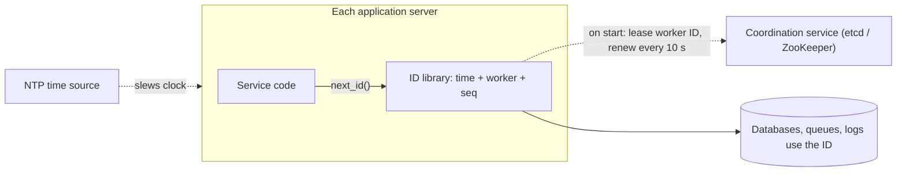
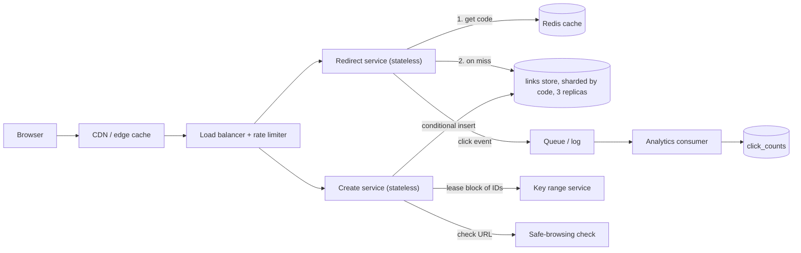
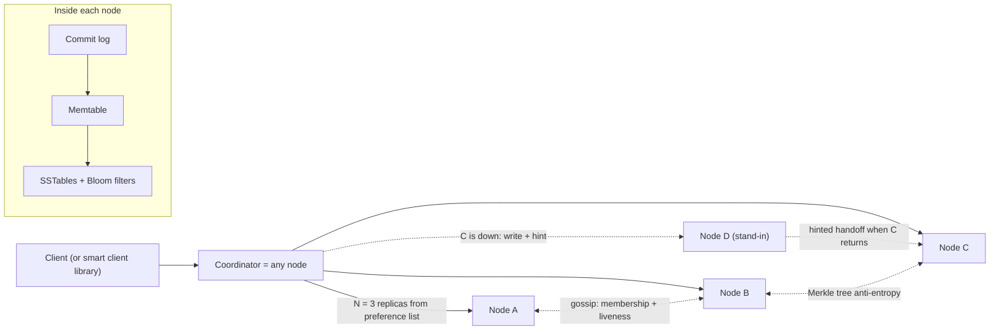
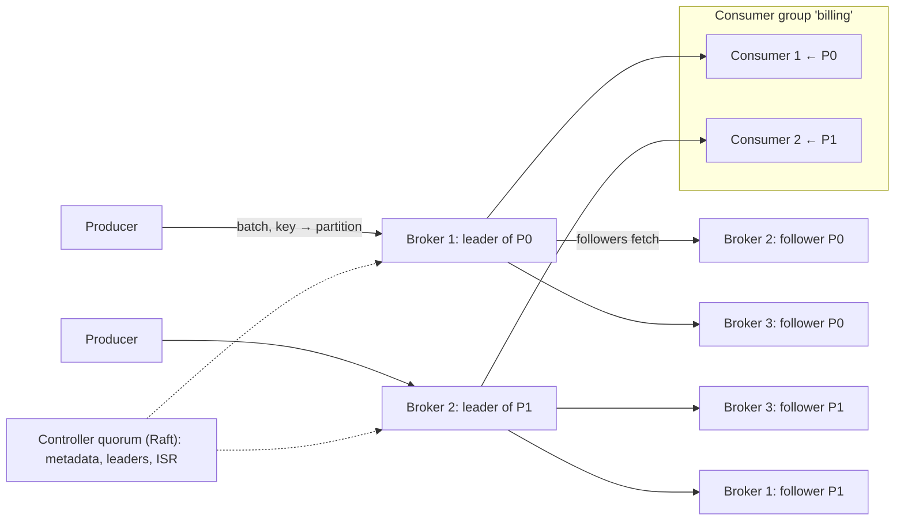
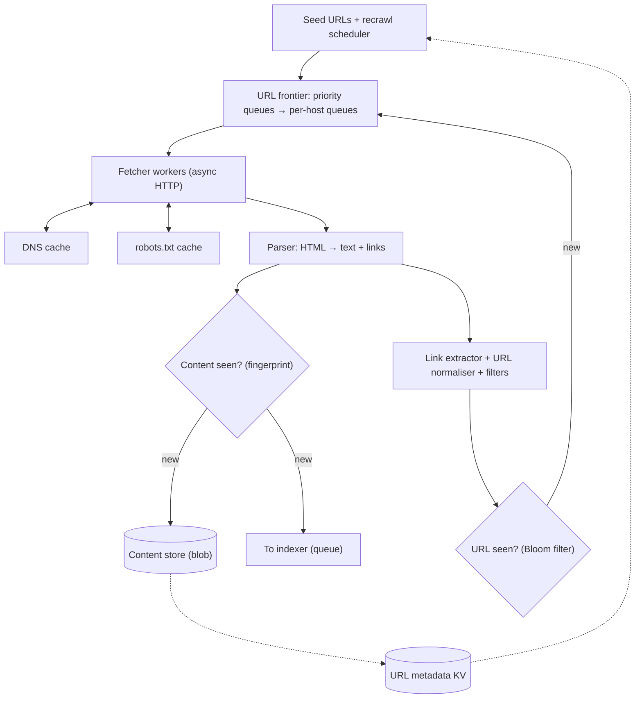
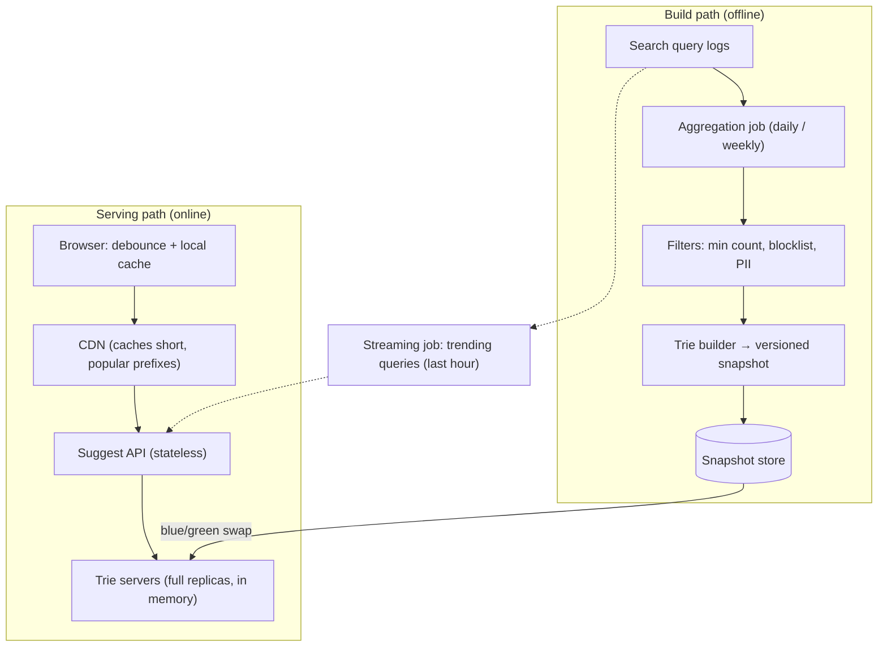

# Module 13 — Case Studies: Building Blocks

## Module Introduction

**What this module is.** Module 12 composed patterns into four large products; this module goes one level down to six systems *other* systems are built on: an ID generator, a URL shortener, a key-value store, a message queue, a web crawler and search autocomplete. They are classic "design X" prompts, each really a test of two or three patterns you already know. No new patterns: every design links back to the lesson it borrows from (and to the matching chapter of the DDIA notes, on Martin Kleppmann's *Designing Data-Intensive Applications*) instead of re-teaching the theory.

**Analogy.** Module 12 cooked complete meals; this module makes the stock, sauce and bread from scratch — humble, but every meal depends on them.

**The six designs**

| Case | Center of gravity (the main problem) | Patterns it leans on |
|---|---|---|
| 1. Unique ID Generator | Uniqueness across machines with no coordinator on the hot path | Clocks, bit budgets, leases (time-limited claims) |
| 2. URL Shortener | A tiny write path and a huge, cacheable read path | Cache-aside, sharding, key generation, message queue |
| 3. Distributed Key-Value Store | Staying writable while nodes fail, without losing writes | Consistent hashing, quorum, vector clocks, write-ahead log |
| 4. Distributed Message Queue | A durable, replayable, ordered log at millions of messages per second | Partitioned consumption, replication, exactly-once |
| 5. Web Crawler | Politeness, dedup and traps across billions of URLs | Queues per host, Bloom filters, backpressure |
| 6. Search Autocomplete | Top-k answers per keystroke in a few milliseconds | Precomputed read models, batch pipelines, CDN caching |

**The case format.** Module 12's stages plus an explicit API and data model, since these prompts are usually judged on them:
1. **Requirements and numbers:** functional and non-functional requirements, then the estimate ([Back-of-Envelope Math](../01-thinking-in-patterns/README.md#back-of-envelope-math)).
2. **The five-questions pass:** flow, storage, speed, failure, growth ([The Five Questions](../01-thinking-in-patterns/README.md#the-five-questions)).
3. **API and data model.**
4. **The architecture, annotated:** a diagram with each pattern named.
5. **Deep dives:** the two to four truly hard sub-problems.
6. **The failure walk:** what breaks, one dependency at a time.
7. **Trade-offs.**
8. **Follow-up questions.**
9. **Pattern manifest**, a one-line interview answer and a **TL;DR**.

**Runnable simulations.** Five small Python scripts in [`code/`](code/) — Snowflake-style IDs, base-62 short codes, a consistent-hash ring, a Bloom filter for "URL already seen?", a trie with cached top-k. Run them with the books' **virtual environment** (an isolated folder with Python and the needed packages), e.g. `.venv-books/bin/python system-design-patterns/modules/13-case-studies-building-blocks/code/trie_topk.py` from the notes root. Their real output is pasted into the cases.

**How to rehearse.** As in Module 12: do each stage on paper before reading on. Cases 1–2 are warm-ups; 3–4 are the deepest (most of Modules 3, 7 and 10); 5–6 are pipelines, where the hard part is the offline data flow, not the request path.

**Sources.** First principles, this book's pattern lessons, the DDIA notes, and the primary papers and docs named at the end of each case. Scale figures are typical interview assumptions, stated so you can change them.

---

## Case 1 — Design a Unique ID Generator

**The prompt (in short).** Services need IDs for new rows, messages and events. Hand out IDs unique across hundreds of machines, fitting in 64 bits, sorting roughly by creation time.

**What makes it hard.** A single database counter gives perfect IDs but is one machine every write waits on. Random IDs need no coordination but are 128 bits and don't sort. Goal: no coordinator on the **hot path** (code run on every request), yet time-sortable IDs.

**1. Requirements and numbers**
- *Functional:* `next_id()` returns a never-before-issued ID. IDs are **64-bit integers** (fit a `BIGINT` column; send to browsers as strings, since JavaScript numbers lose precision above 2^53). Later IDs compare *roughly* greater: **k-sorted** / **roughly time-ordered** — IDs from the same millisecond may interleave across machines, but a newer millisecond always sorts after an older one.
- *Non-functional:* no **single point of failure**; generation in **microseconds** (it sits inside every write); **10,000+ IDs/s per node** sustained; working for decades.
- *Numbers:* **500 application servers**, company-wide peak **2M IDs/s**, busiest server **20,000 IDs/s**. A 64-bit key is **8 bytes** vs. **16** for a **UUID** (standard 128-bit "universally unique identifier"). A **10B-row** table with three **indexes** containing the key saves ~10B × 8 B × 4 ≈ **320 GB** with the smaller key, and more of each index fits in memory.

**2. The five-questions pass**
- **Flow:** the caller waits, so generation must be local (a library call), not a network hop per write.
- **Storage:** nothing per ID; the only durable state is *which worker number each process owns*.
- **Speed:** an in-memory increment costs nanoseconds; a network **round trip** per ID (~1 ms) becomes a bottleneck.
- **Failure:** the scary failures are *duplicates*, not outages: two processes sharing a worker number, or a clock jumping backwards, silently create the same ID twice.
- **Growth:** the bit layout sets the ceilings (workers, IDs per ms, years). Choose once, carefully.

**3. API and data model**
- *API (library):* `long next_id()`, optionally batch `next_ids(n)`.
- *API (as a service):* `POST /v1/ids?count=100` → `{"ids": [...]}`; batching **amortises** the hop over 100 IDs.
- *Data model — the ID itself.* The layout Twitter published for Snowflake in 2010, still the common default (Twitter split the 10 worker bits into 5 datacenter + 5 machine bits):

| Bits | Field | Meaning | Ceiling it sets |
|---|---|---|---|
| 1 | sign | always 0, so the ID is a positive signed integer | — |
| 41 | timestamp | milliseconds since a **custom epoch** (a start date you pick, e.g. 2024-01-01) | 2^41 ms ≈ **69.7 years** |
| 10 | worker ID | which generator process issued it | **1,024** workers |
| 12 | sequence | counter within one millisecond on one worker | **4,096** IDs per ms per worker (≈ 4M/s) |

- *Durable state:* a small table or coordination-service entry `worker_id → (owner host, lease expiry)`.

**4. The architecture, annotated — first compare the options**

| Option | How it works | Good | Bad |
|---|---|---|---|
| **UUID v4** | 122 random bits | Zero coordination; any machine, any time | 128 bits; random order scatters inserts across a B-tree index (poor locality, page splits) |
| **UUID v7** (RFC 9562) | 48-bit ms timestamp + random bits | No coordination; time-ordered | Still 128 bits |
| **Auto-increment with step** | N databases; DB *i* issues *i, i+N, i+2N…* | Simple; compact | Adding a database changes N; IDs across DBs not time-ordered; each DB on the write path |
| **Central ticket server** | One DB row incremented per request (Flickr, 2010) | Perfectly ordered, compact | Network hop per ID; single point of failure unless two run with odd/even steps |
| **Range leasing** | A service hands each server a *block* of 1,000 numbers spent locally | One hop per 1,000 IDs; compact | Blocks interleave, so order is rough; a crash wastes the rest of a block |
| **Timestamp + worker + sequence** | Section 3's layout, computed in-process | No hop, compact, time-ordered | Depends on clocks and unique worker IDs |

The last option wins: the only coordination left is assigning worker IDs, once per process start.



The ID library lives in every service process, so `next_id()` is a function call. At start-up it leases one of 1,024 worker numbers from a coordination service (a small strongly consistent store such as etcd or ZooKeeper; see [Membership and Coordination Services](../../../ddia/chapters/09-consistency-and-consensus/README.md#membership-and-coordination-services)) and renews in the background; NTP (Network Time Protocol) keeps clocks near real time.

**5. Deep dives**
- **Deep dive 1 — spending the 63 bits.** More timestamp bits buy years, more worker bits buy machines, more sequence bits buy IDs per ms. With 500 servers, 10 worker bits (1,024) leave room to double. The busiest server needs 20,000/s = **20 per ms**, far below 4,096, so 2 bits could move from sequence to worker (4,096 workers, 1,024 per ms) if large growth is expected. Instagram (2012) put the *database shard number* in the middle field and generated IDs inside PostgreSQL, so an ID also names its shard. Pick the epoch near launch day; every year before it is wasted range.
- **Deep dive 2 — clocks going backwards.** The wall clock can jump back when NTP corrects it or a **VM** migrates hosts, and a trusting generator re-issues used timestamps ([Unreliable Clocks](../../../ddia/chapters/08-trouble-with-distributed-systems/README.md#unreliable-clocks)). Rules: (1) remember the last timestamp; (2) if behind by a few ms, **wait**; (3) if behind by more (say 100 ms), **refuse** and alert rather than risk duplicates; (4) configure NTP to *slew* (adjust gradually) rather than *step*. The simulation's guard:

```text
clock skew guard: clock moved back 3 ms; refusing to issue IDs
```
- **Deep dive 3 — worker IDs must be unique, even during failures.** Two live processes holding worker 17 produce identical IDs in the same millisecond. Hard-coded IDs work for a fixed fleet but break with **autoscaling**. The robust way is a **lease**: claim a free number with a TTL (say 30 s), renew every 10 s. A process paused past its lease (e.g. a long **garbage-collection** pause) may lose the number to another, so the generator checks lease expiry before issuing and stops if it may have lapsed — the "a lease holder must not act after expiry" problem that [fencing tokens](../../../ddia/chapters/08-trouble-with-distributed-systems/README.md#fencing-tokens) address. In **Kubernetes**, a StatefulSet's stable pod ordinal (0, 1, 2, …) is a simple alternative source of unique numbers.
- **Deep dive 4 — sequence exhaustion.** More than 4,096 IDs in one millisecond on one worker means the generator must **wait for the next millisecond**, never wrap silently. Running [`code/snowflake_ids.py`](code/snowflake_ids.py), three workers issue 5,000 IDs each in a burst on a shared simulated clock:

```text
issued: 15000 unique: 15000
first ID: 97844723712004096 {'ms_since_epoch': 23328000000, 'worker': 1, 'seq': 0}
last ID : 97844723716207495 {'ms_since_epoch': 23328000001, 'worker': 3, 'seq': 903}
sequence exhaustion waits per worker: [1, 0, 0]
later ID sorts after every earlier ID: True
41-bit timestamp lasts 69.7 years; per-worker max 4,096 IDs/ms = 4,096,000/s; workers: 1024
```
Worker 1 exhausted its 4,096 numbers first and waited one millisecond (the shared fake clock then advanced for all). All 15,000 IDs are unique, and later-millisecond IDs sort after all earlier ones.

**6. The failure walk**
1. **Coordination service down:** running processes keep their leases and keep generating; only *new* processes can't start. Use a generous TTL and alert well before expiry.
2. **Clock jumps back 2 seconds:** that generator refuses for up to 2 s; callers error or retry on another instance. A short visible failure beats invisible duplicates.
3. **Two processes get the same worker ID** (lease bug, cloned VM): duplicates appear. The last safety net is the database **unique constraint** on the **primary key**, turning a silent duplicate into a loud insert error.
4. **The 69.7 years run out:** plan a new epoch or wider ID long before — it's a real date; write it down.
5. **Very low traffic:** most IDs have sequence 0, so sharding on `id % 16` is skewed. Start each millisecond's sequence at a random value, or shard on a hash of the ID.

**7. Trade-offs**

| Choice | Gain | Cost |
|---|---|---|
| 64-bit layout over UUID | Half the index size, time-sortable | Needs worker-ID management and sane clocks |
| UUID v7 over 64-bit layout | Zero coordination, still time-ordered | 16 bytes per key, everywhere |
| Ticket server / range leasing | Strict or near-strict order, no clock dependence | A network dependency on the write path (softened by batching) |
| More worker bits | Bigger fleets | Fewer IDs per ms per worker |
| Time-ordered IDs in public URLs | Easy pagination and debugging | Leaks creation time and volume to outsiders |

**8. Follow-up questions**
- **"Strictly ordered?"** No: ordered by millisecond, then by worker, not by real arrival. Strict global order needs a single sequencer or **consensus** ([Total Order Broadcast](../../../ddia/chapters/09-consistency-and-consensus/README.md#total-order-broadcast)) — the coordination we avoided. "Sort by newest" only needs rough order.
- **"Can outsiders guess IDs?"** Roughly, yes — so public IDs are often a separate random token or an encrypted internal ID. *Trap:* sequential IDs for anything that must be unguessable, like password-reset links.
- **"Why not just UUIDs?"** Fine if 16 bytes is acceptable; v7 fixes ordering. 64-bit wins when keys sit in many large indexes or systems limited to 64-bit integers.
- **"How do you test it?"** **Property tests** (a rule checked across many generated inputs): millions of IDs across simulated workers are unique and **monotonic** per worker; clock rollback is refused; sequence overflow waits.

**9. Pattern manifest**

| Pattern / idea | Where it served |
|---|---|
| [Back-of-Envelope Math](../01-thinking-in-patterns/README.md#back-of-envelope-math) | Bit budget: years, workers, IDs per ms |
| Leases + [fencing](../../../ddia/chapters/08-trouble-with-distributed-systems/README.md#fencing-tokens) | Unique worker-ID ownership |
| [Noncausal sequence number generators](../../../ddia/chapters/09-consistency-and-consensus/README.md#noncausal-sequence-number-generators) | Why these IDs aren't causally consistent |
| [Sharding](../03-storing-data/README.md#sharding) | Shard number embedded in the ID (Instagram variant); ID-hash shard keys |
| [Graceful Degradation](../05-reliability/README.md#graceful-degradation) | Refuse-and-retry on clock rollback instead of duplicates |

**Interview one-liner:** "Generate IDs in-process as timestamp plus worker plus sequence: 41 bits give 70 years, 10 bits give 1,024 workers, 12 bits give 4,096 per millisecond. The only coordination is leasing worker numbers, and the two real dangers, backwards clocks and duplicate workers, are handled by waiting, refusing and a unique constraint as the last net."

**TL;DR**
- **Problem:** unique, compact, time-sortable IDs from hundreds of machines, without a central counter on every write.
- **Mechanism:** 1 | 41-bit ms timestamp | 10-bit worker | 12-bit sequence, computed locally; worker numbers leased from etcd/ZooKeeper.
- **Dangers:** clock rollback (wait or refuse), shared worker IDs (leases + DB unique constraint), sequence overflow (wait for the next ms).
- **Alternatives:** UUID v7 when 128 bits is fine; range leasing or a ticket server for tighter order at a hop per batch.
- **Sources:** Twitter Engineering, "Announcing Snowflake" (2010); Instagram Engineering, "Sharding & IDs at Instagram" (2012); Flickr, "Ticket Servers" (2010); IETF RFC 9562 (UUID v7, 2024).

---

## Case 2 — Design a URL Shortener

**The prompt (in short).** Users submit a long URL and get a short one like `sho.rt/aZ3k9Qx`; opening it redirects to the long URL. Module 1 used this prompt to demonstrate the five questions at small scale; this is the full design.

**What makes it hard.** Very little — which is why interviewers use it to watch you think. The small real problems: never-colliding codes, the right redirect status, serving 10× more redirects than creations from cache, and not becoming a malware-distribution service.

**1. Requirements and numbers**
- *Functional:* create a short link (optional custom alias and expiry); redirect; delete/disable; basic click stats.
- *Non-functional:* redirects are the product — **very high availability** and **p99 < 50 ms** at the server (basics: [System Design Fundamentals](../00-system-design-fundamentals/README.md)); links live **10 years** by default; codes must not be trivially enumerable.
- *Writes:* **100M new links/day** ÷ 100,000 s ≈ **1,000/s average**, plan **~5,000/s peak**.
- *Reads:* read:write ≈ **10:1** → **1B redirects/day ≈ 10,000/s average, ~50,000/s peak**.
- *Code length:* 10 years × 100M/day = **365B links**. Base 62 (0–9, a–z, A–Z) at 7 characters gives 62^7 ≈ **3.5 trillion**, ~10× headroom:

```text
links in 10 years: 365,000,000,000 -> need length 7
```
- *Storage:* a row (code, ~100-byte long URL, owner, timestamps, plus index and replication overhead) ≈ **500 bytes** per copy. 100M/day × 500 B = **50 GB/day ≈ 18 TB/year ≈ 180 TB over 10 years** — too big for one machine, so **sharded**.
- *Cache:* skewed reads; assume 20% of links read each day take 80% of clicks. With ~100M distinct links read per day, the hot 20% is 20M × 500 B ≈ **10 GB** — a few cache nodes.
- *Bandwidth:* 50,000/s × ~500 B = **25 MB/s**. Negligible.

**2. The five-questions pass**
- **Flow:** create and redirect are request-response; click events go **asynchronously on a queue**, never on the redirect's critical path ([Message Queue](../02-moving-data/README.md#message-queue)).
- **Storage:** source of truth is `code → long URL`, write-once, read-forever, looked up only by code: a key-value pattern sharded by code ([Sharding](../03-storing-data/README.md#sharding)).
- **Speed:** mappings never change (until deleted), so [Cache-Aside](../04-caching/README.md#cache-aside) with a long **TTL**, plus a CDN for the hottest links.
- **Failure:** redirects must survive a shard outage (cache and replicas); creation may degrade to "try again".
- **Growth:** reads grow with virality (one link can get millions of clicks in minutes — a **hot key**); storage grows linearly.

**3. API and data model**
- `POST /v1/links` with `{"long_url": "...", "custom_alias": "optional", "expires_at": "optional"}` → `201 {"code": "aZ3k9Qx", "short_url": "https://sho.rt/aZ3k9Qx"}`. Requires an **API key** or login, enabling per-user [Rate Limiting](../08-api-and-edge/README.md#rate-limiting).
- `GET /{code}` → `302 Found` (or `301`, see deep dive 2) with `Location: <long_url>`; `404` if unknown; `410 Gone` if expired or disabled.
- `DELETE /v1/links/{code}` → `204`. `GET /v1/links/{code}/stats` → click counts by day and country.
- *Data model:*

| Table | Key | Columns | Notes |
|---|---|---|---|
| `links` | `code` (partition key) | `long_url`, `owner_id`, `created_at`, `expires_at`, `status` | Sharded by `code`; every redirect has it |
| `links_by_owner` | `owner_id`, `created_at` | `code` | A second, derived table for "my links" pages |
| `click_counts` | `code`, `day` | `count`, per-country counts | Written by the analytics consumer, not the redirect path |

A **wide-column** (rows with many flexible columns) or key-value database (Cassandra, DynamoDB) or sharded MySQL/PostgreSQL all work, since every hot query is a single-key lookup.

**4. The architecture, annotated**



1. A redirect first hits the [CDN](../08-api-and-edge/README.md#cdn); popular links cache there briefly, absorbing viral spikes.
2. On a miss, a stateless **redirect service** checks **Redis** (cache-aside), then the **links store**, and fills the cache.
3. It sends a small click event (code, time, country, referrer) to a **queue** and returns; an analytics consumer aggregates in batches.
4. The **create service** validates the URL (format, length, safe-browsing check), obtains a code (deep dive 1), and writes with a **conditional insert** (only if the code doesn't exist), making collisions detectable rather than silent overwrites.

**5. Deep dives**
- **Deep dive 1 — generating the code. Three options.**
  1. **Hash and truncate:** hash the long URL (e.g. SHA-256), keep 7 base-62 characters, insert-if-absent; on collision add a **salt** (extra data so the hash differs) and rehash. No coordination, and the same URL can map to the same code (free dedup). But collisions grow with the table (the **birthday effect**: collisions become likely far sooner than intuition suggests). At 7 characters the odds are small but not zero:

```text
after   100,000,000 links: next 7-char hash collides with p = 2.8e-05 (about 1 in 35,216)
after 1,000,000,000 links: next 7-char hash collides with p = 2.8e-04 (about 1 in 3,522)
3-char demo: 50,000 links stored, 6,252 collision retries (space 238,328, 21% full)
```
  So every insert must be conditional, and retries grow as the space fills (the 3-character demo shows it clearly).
  2. **Base-62 of a unique number:** write a guaranteed-unique number in base 62 (`125,000,000 → '8sud2'`) — no collisions ever. The number comes from **range leasing**: each create server leases a block of, say, 10,000 numbers from a small key-range service (backed by a strongly consistent store), contacting it once per 10,000 links. Problem: sequential numbers make codes guessable (`8sud2`, `8sud3`…), letting anyone crawl every link. Fix: pass the number through a fixed **reversible scramble** (a bijection, e.g. multiply by a large constant sharing no factor with 62^7 — odd and not a multiple of 31 — modulo 62^7) before encoding: still unique, but neighbours look unrelated. A 64-bit Snowflake ID from Case 1 is unique too, but needs 11 base-62 characters, defeating the purpose.
  3. **Pre-generated key pool:** a background job creates random unused 7-character codes; create servers take batches. Collision-free at use time, at the cost of managing a pool.

  **Choice:** option 2 (range-leased counter + scramble + base 62): collision-free, one coordination hop per 10,000 creations, and a crashed server only wastes the rest of its block (3.5 trillion codes can afford it). Custom aliases use the same conditional insert and fail with `409 Conflict` if taken.
- **Deep dive 2 — 301 or 302?** Per RFC 9110, `301 Moved Permanently` and `308` are permanent (browsers and **proxies** may cache them indefinitely); `302 Found` and `307` are temporary (clients ask each time). **301:** repeat clicks never reach you — less load, but no click analytics and you **cannot change, expire or disable** the link for those users, which matters when a link turns malicious. **302:** every click reaches your edge — accurate analytics and full control, more traffic. Most commercial shorteners use 302 (or 301 with short cache headers). Middle ground: 302 plus `Cache-Control: max-age=300` at the CDN, so the edge absorbs spikes while a link can still be disabled within 5 minutes.
- **Deep dive 3 — the hot link and the cold miss.** A celebrity-shared link gets 50,000 clicks in its first minute: CDN and Redis absorb it, and [Cache Stampede Prevention](../04-caching/README.md#cache-stampede-prevention) (single-flight on a miss) keeps thousands of simultaneous misses off one shard. The opposite problem — scanners hitting *random* codes that all miss — is handled by caching **negative results** ("not found") briefly and rate-limiting by client IP.
- **Deep dive 4 — abuse and expiry.** Check new URLs against a malicious-URL list (e.g. Google's Safe Browsing API) at creation and periodically, since a harmless page can turn bad; disabling sets `status = disabled`, invalidates the cache and returns `410`. Expiry is **lazy** at read time (`expires_at < now` → 410) plus a slow background sweeper deleting old rows. Don't reuse expired codes for a long time: old short links live on in emails and documents.

**6. The failure walk**
1. **A Redis node dies:** its keys fall through to the store; [Consistent Hashing](../03-storing-data/README.md#consistent-hashing) in the cache client limits damage to that slice.
2. **A store shard's primary dies:** replicas keep serving redirects; creates for that shard retry after **failover** (a replica promoted to primary). Redirect availability is protected; create availability may dip.
3. **Key-range service down:** create servers spend blocks they hold (hours of headroom at 10,000 per block); creates fail only when blocks run out.
4. **Analytics queue backs up:** clicks queue as lag; redirects unaffected. If the queue is down, redirects drop click events after a small local buffer (stats best-effort, redirects not).
5. **A region is lost:** mappings are replicated across regions; **DNS** or **anycast** (one IP announced from many places, reaching the nearest) moves traffic. Mappings are immutable, so replication lag only delays very new links.

**7. Trade-offs**

| Choice | Gain | Cost |
|---|---|---|
| Counter + base 62 vs hash-and-truncate | No collisions, no retries | A small coordination service; needs scrambling to stop enumeration |
| 302 vs 301 | Analytics, can disable/expire links | Every click hits your edge |
| CDN caching of redirects | Absorbs viral spikes cheaply | Disabling a link takes up to the CDN TTL |
| Key-value store vs relational | Easy horizontal scaling for single-key lookups | "My links" and analytics need separate derived tables |
| Async click analytics | Redirects never wait on analytics | Counts are seconds-to-minutes behind; can drop under failure |

**8. Follow-up questions**
- **"Same long URL twice — same code?"** Only if you want it: with the counter approach, look up `hash(long_url)` per owner in a small index before creating; across owners, separate codes are usually better (separate stats and delete rights).
- **"1 million custom aliases a day?"** Same table, conditional insert, `409` on conflict; reserve words like `admin` and `api`; rate-limit alias creation more strictly (the usual abuse vector).
- **"Exact click counts?"** Don't promise exactness on the redirect path. Make events idempotent (event ID) and aggregate in a stream job ([Exactly-Once Semantics](../10-batch-and-streaming/README.md#exactly-once-semantics)); for billing-grade counts, reconcile against raw logs in batch.
- **"Globally fast?"** Redirect servers and read replicas in several regions, served from the nearest; creates go to the region owning the key range. *Trap:* multi-region writes to the same key space without a partitioning rule, inviting conflicts.

**9. Pattern manifest**

| Pattern | Where it served |
|---|---|
| [Cache-Aside](../04-caching/README.md#cache-aside) + [CDN](../08-api-and-edge/README.md#cdn) | The redirect path: 10:1 reads, immutable values |
| [Cache Stampede Prevention](../04-caching/README.md#cache-stampede-prevention) | Viral links; negative caching for scanners |
| [Sharding](../03-storing-data/README.md#sharding) + [Primary-Replica](../03-storing-data/README.md#primary-replica) | 180 TB of mappings keyed by code; reads survive primary loss |
| [Message Queue](../02-moving-data/README.md#message-queue) | Click analytics off the critical path |
| [Rate Limiting](../08-api-and-edge/README.md#rate-limiting) | Creation abuse; code scanning |
| [Idempotency](../05-reliability/README.md#idempotency) | Conditional insert on code; event IDs on clicks |
| Case 1 (ID generation) | Range-leased counter feeding base 62 |

**Interview one-liner:** "Sizing gives 1,000 creates and 10,000 redirects a second and 7-character base-62 codes; codes come from a range-leased counter, scrambled and base-62 encoded so they never collide; redirects are 302s served from CDN and cache-aside over a code-sharded store; clicks go to a queue so analytics never slows a redirect."

### Variant: Pastebin

A common follow-up: "now store the text itself" — the user pastes text (code, logs, config) and gets a short link showing it. Code generation, cache-aside reads and async analytics carry over. What changes: the value is now a **blob** (an opaque chunk of bytes) of up to several MB instead of a 100-byte URL. Pastebin.com, for example, has capped pastes at 512 KB for free accounts and 10 MB for paid ones.

**Numbers, redone.** 10M pastes/day × 10 KB = **100 GB/day ≈ 36 TB/year** of raw text, vs. ~5 GB/day of metadata rows. Reads are fewer than a shortener's (say 5:1, ≈ 600/s average), but each moves 10 KB instead of 500 bytes — bytes, not requests, set the bill.

**Split metadata from content.** Keep the small row (`code`, `owner_id`, `size_bytes`, `content_hash`, `syntax`, `visibility`, `expires_at`, `object_key`) in the code-sharded KV store; put the text in **object storage** (e.g. Amazon S3: cheap, durable blobs by key, served over HTTP). Large values in the database would bloat replication, backups and caches for data only ever fetched whole. Write the object **first**, then the row, so a row never points at a missing object; a crash between leaves an orphan object, removed by a periodic cleanup job.

**Reads.** `GET /{code}` renders a page from metadata plus text; `/raw/{code}` can be served by the CDN straight from object storage. Cache only small hot pastes in Redis (say under 64 KB) — a 10 MB value would evict hundreds of small entries. Compress on write: plain text shrinks several times, cutting storage and transfer.

**Size limits.** Enforce the cap at the edge before reading the body: reject an oversized `Content-Length` with `413 Content Too Large` and stop reading a streamed upload at the cap. Rate-limit **bytes per user per day**, not just requests — a few thousand max-size pastes can fill a disk. For very large uploads, hand out a **pre-signed URL** (a time-limited link allowing one upload straight to object storage) so bytes bypass your servers.

**Expiry.** Typical options are "10 minutes / 1 day / 1 month / never" and **burn after reading**. Enforce expiry at read time (`expires_at < now` → `410 Gone`). Physical deletion can use an object-storage lifecycle rule, but S3 documents that lifecycle expirations run asynchronously and may lag by days (billing stops when an object becomes eligible), so the read-time check is the only real guarantee. Burn-after-reading needs an atomic transition (`UPDATE ... SET status='burned' WHERE code=? AND status='active'`) so only one reader wins, plus `Cache-Control: no-store` so no CDN keeps a copy.

**Privacy.** Unlisted pastes often hold secrets (keys, passwords). Give them longer random codes (10+ base-62 characters) rather than scrambled counter values, keep them out of search engines, and scan public pastes for leaked credentials.

*Sources for the variant:* Pastebin.com FAQ (paste size limits); Amazon S3 User Guide, "Expiring objects" and "Troubleshooting Amazon S3 Lifecycle issues" (asynchronous expiration, billing at eligibility); IETF RFC 9110, §15.5.14 (413 Content Too Large).

**TL;DR**
- **Numbers:** 100M links/day (1K/s), 10:1 reads (10K/s, 50K peak), 365B links in 10 years → 7 base-62 characters, ~180 TB.
- **Codes:** counter from leased ranges → reversible scramble → base 62 (no collisions); hash-and-truncate needs conditional inserts and retries.
- **Redirect:** 302 (control + analytics) with short CDN caching; cache-aside with negative caching; store sharded by code.
- **Around it:** analytics via a queue; safe-browsing checks, rate limits, lazy expiry, no quick code reuse.
- **Sources:** IETF RFC 9110 (HTTP semantics, redirect status codes); Google Safe Browsing API documentation; Module 1's five-questions walkthrough.

---
## Case 3 — Design a Distributed Key-Value Store

**The prompt (in short).** A store with `put(key, value)` and `get(key)` for small values, spread over dozens to hundreds of machines, staying writable while machines and links fail — think Amazon's Dynamo, Cassandra or Riak.

**What makes it hard.** Each piece has its own lesson (consistent hashing, quorums, vector clocks, WAL). The hard part is fitting them into one coherent design and explaining what each does when a node fails mid-write.

**1. Requirements and numbers**
- *Functional:* `get(key)`, `put(key, value)`, `delete(key)`; values up to **10 KB** (typically ~1 KB); no multi-key transactions or range scans (say so out loud).
- *Non-functional:* **always writable** (a cart rejecting "add to cart" loses money); **tunable consistency** per request (caller trades freshness against speed); p99 **< 10 ms** within a datacenter; add nodes with no downtime; survive losing any node or a whole **rack** (servers sharing power and switches).
- *Data:* **10B keys × 1 KB = 10 TB**; with **3 replicas**, **30 TB**.
- *Traffic:* peak **1M operations/s**, 70% reads / 30% writes. Each write touches 3 nodes (300K × 3 = 900K replica writes/s), each quorum read asks 2 (700K × 2 = 1.4M replica reads/s): ~**2.3M replica operations/s**.
- *Nodes:* one NVMe node does ~40K ops/s → 2.3M ÷ 40K ≈ **58**, call it **60**. Each holds 30 TB ÷ 60 = **500 GB**, leaving room on a 2 TB disk for **compaction** (background merging of data files, which temporarily needs extra space) and growth. Throughput, not disk, sets the node count.

**2. The five-questions pass**
- **Flow:** clients call any node, which acts as **coordinator** and forwards to replicas.
- **Storage:** keys hashed onto a ring ([Consistent Hashing](../03-storing-data/README.md#consistent-hashing)), each stored on N = 3 nodes; each node an **LSM tree** (log-structured merge tree: log → memory → sorted files).
- **Speed:** reads and writes wait only for a [Quorum](../07-consistency/README.md#quorum) of replicas, so one slow node doesn't slow the request.
- **Failure:** temporary failures → writes to a stand-in node (hinted handoff); permanent divergence → background repair (Merkle-tree **anti-entropy**: replicas comparing hash trees to find differing keys); concurrent-write conflicts *detected* with per-replica version counters, not silently lost ([Vector Clocks](../07-consistency/README.md#vector-clocks)).
- **Growth:** adding a node moves ~1/N of data; virtual nodes spread the load.

**3. API and data model**
- `get(key)` → `[(value, context)]`: usually one value, **more than one** if concurrent writes conflicted (**siblings**). `context` is an **opaque** blob (stored and returned by the client unread) holding the version vector.
- `put(key, context, value)` → `ok`; the returned context tells the store which versions this write replaces.
- `delete(key, context)` writes a **tombstone** ("deleted" marker) so the deletion itself replicates.
- Per-request knobs: `W` (replica acks per write) and `R` (replica replies per read), with N fixed per table.
- *On-disk per node:* a **commit log** (append-only, crash safety), a **memtable** (sorted in-memory map), and immutable **SSTables** (key-sorted files), each with a **Bloom filter** (compact bits answering "definitely not here" or "probably here") and a sparse index ([SSTables and LSM-Trees](../../../ddia/chapters/03-storage-and-retrieval/README.md#sstables-and-lsm-trees)).
- *Per-record metadata:* `key, value | tombstone, version vector, write timestamp`.

**4. The architecture, annotated**



Following one write:
1. The client sends `put` to any node (or a client library computes the right node, saving a hop); that node is the **coordinator**.
2. It hashes the key onto the ring and walks clockwise to the key's **preference list**: the first N = 3 *distinct physical* nodes (skipping extra virtual nodes of chosen machines, preferring different racks).
3. It writes to all three and replies once **W = 2** acknowledge. Each replica appends to its commit log, then updates its memtable ([Write-Ahead Log](../03-storing-data/README.md#write-ahead-log)).
4. If C is unreachable, C's copy goes to the next healthy node D with a **hint** ("belongs to C"); D hands it back when C recovers.
5. In the background, nodes **gossip** membership and liveness (each regularly swaps state with a random peer, spreading news like a rumour), and replicas compare **Merkle trees** to repair differences.

**5. Deep dives**
- **Deep dive 1 — partitioning and replication on the ring.** One position per node makes a 10-node ring badly uneven; a few hundred virtual nodes per machine even it out, and adding a node moves only its fair share. Running [`code/consistent_hash_ring.py`](code/consistent_hash_ring.py) with 100,000 keys:

```text
vnodes=  1: keys per node min     66 max 33,828 (stdev 103% of mean)
vnodes= 16: keys per node min  7,798 max 12,559 (stdev 17% of mean)
vnodes=256: keys per node min  9,422 max 10,859 (stdev 5% of mean)
add node10: 9,438 of 100,000 keys moved (9.4%; ideal 1/11 = 9.1%); all moved keys went to node10: True
same change with hash % N: 90.7% of keys move
preference list for 'user:42': ['node0', 'node5', 'node6']
```
  A key's three replicas are the first three distinct machines clockwise (last line). DDIA's [Rebalancing Partitions](../../../ddia/chapters/06-partitioning/README.md#rebalancing-partitions) compares this with a fixed number of partitions moved whole (Riak, Elasticsearch).
- **Deep dive 2 — quorums and staying writable.** With N = 3, **W + R > N** (e.g. W = 2, R = 2) makes every read quorum overlap every write quorum, so normally a read sees the latest acknowledged write. W = 1, R = 1 is faster but may be stale; W = 3 is safest but one slow node blocks writes. For always-writable: if two of a key's three home nodes are unreachable, a strict quorum fails; a **sloppy quorum** accepts writes on *any* N healthy nodes further round the ring, with hints, and **hinted handoff** delivers them home later ([Sloppy Quorums and Hinted Handoff](../../../ddia/chapters/05-replication/README.md#sloppy-quorums-and-hinted-handoff)). Price: in that window W + R > N no longer guarantees a fresh read, because the write may sit on nodes the reader doesn't ask. Say it plainly: this store chooses availability over **linearizability** (every read sees the latest write, as if there were one copy) ([The CAP theorem](../../../ddia/chapters/09-consistency-and-consensus/README.md#the-cap-theorem)).
- **Deep dive 3 — concurrent writes and conflicts.** Two clients update the same cart via different coordinators during a partition. **Last write wins (LWW)** keeps the higher timestamp and silently drops the other — simple and Cassandra's default, but **clock skew** makes "later" unreliable and a write is *lost*. **Version vectors** (one counter per replica, carried in `context`) distinguish "B replaced A" from "A and B were concurrent" ([Version vectors](../../../ddia/chapters/05-replication/README.md#version-vectors)). Concurrent values are kept as siblings and returned to the client, which merges (for a cart: union of items, deletes as tombstones) and writes back with the combined context. Per data type: LWW where losing a concurrent overwrite is fine (a profile photo); siblings or CRDTs (self-merging data types) where it isn't (a cart, a counter).
- **Deep dive 4 — failure detection and repair.** No master says who's alive. Each node **gossips** every second with a random peer, exchanging `(node, heartbeat counter)`; a counter that stops rising for, say, 10 s marks the node *suspected* down ([Detecting Faults](../../../ddia/chapters/08-trouble-with-distributed-systems/README.md#detecting-faults)). Hinted handoff covers short failures; longer ones (and lost hints) leave replicas out of sync. **Read repair** fixes a key when a read sees a stale replica; **anti-entropy** fixes the rest: each replica builds a **Merkle tree** (each parent hashes its children) over its key ranges; two replicas compare roots and descend only into differing subtrees, exchanging a few KB of hashes to find a handful of stale keys among millions ([Read repair and anti-entropy](../../../ddia/chapters/05-replication/README.md#read-repair-and-anti-entropy)).
- **Deep dive 5 — the write and read path on one node.** Write: append to the commit log (sequential), insert into the memtable, acknowledge; at ~64 MB flush the memtable as a new SSTable. Read: memtable, then SSTables newest to oldest; each **Bloom filter** rules out most files, so a read usually touches one or two. **Compaction** merges SSTables in the background, dropping overwritten values and, after a grace period, tombstones. The grace period (Cassandra's default: 10 days) must exceed how long a dead replica can be away, or a replica that missed the delete resurrects the old value.

**6. The failure walk**
1. **One node down 5 minutes:** writes continue with W = 2 (or sloppy quorum); hints queue on neighbours; R = 2 reads succeed. On return, hints replay and read repair tidies up.
2. **A disk dies permanently:** mark the node removed; its ranges re-replicate from the other two copies to new owners (streaming, not hints). Virtual nodes spread the copy load across many peers.
3. **A network partition:** both sides accept writes (sloppy quorum); afterwards version vectors surface conflicts as siblings — nothing silently lost unless the table uses LWW.
4. **A hot key** (a viral item's counter): it lives on 3 nodes regardless. Cache in front, or split into sub-keys (`item#0..item#9`) and sum on read ([Skewed Workloads and Relieving Hot Spots](../../../ddia/chapters/06-partitioning/README.md#skewed-workloads-and-relieving-hot-spots)).
5. **A slow (not dead) node:** quorums hide it — the coordinator waits only for the fastest W or R. Add per-request timeouts and let the snitch (latency-aware routing) steer reads away.

**7. Trade-offs**

| Choice | Gain | Cost |
|---|---|---|
| Leaderless + sloppy quorum vs single leader per partition | Always writable; no failover pause | Conflicts to resolve; no linearizability |
| W = 2, R = 2 vs W = 1, R = 1 | Reads usually see the latest write | Higher latency; needs 2 healthy replicas |
| Version vectors vs LWW | No silently lost writes | Clients must merge siblings; bigger metadata |
| LSM storage vs B-tree | Fast sequential writes; good compression | Read amplification (one read touching many files), compaction I/O spikes |
| Virtual nodes vs one token per node | Even load; spread-out recovery | More ring metadata; repair touches many peers |

**8. Follow-up questions**
- **"Make it strongly consistent."** One leader per partition replicated by consensus (Raft or Paxos), as in etcd, TiKV and Spanner; writes go through leader and majority, and you lose writes during elections and on the minority side. *Trap:* claiming W + R > N alone gives linearizability — with sloppy quorums, clock-based LWW and partial failures it doesn't ([Limitations of Quorum Consistency](../../../ddia/chapters/05-replication/README.md#limitations-of-quorum-consistency)).
- **"Add range scans?"** Partition by key range instead of hash and accept hot-spot risk for sequential keys like timestamps ([Partitioning by Key Range](../../../ddia/chapters/06-partitioning/README.md#partitioning-by-key-range)). Cassandra's compromise: hash the partition key, sort by a clustering key within it.
- **"How does a client find the right node?"** Any node forwards (simplest), a routing tier, or a partition-aware client that learns the ring by gossip ([Request Routing](../../../ddia/chapters/06-partitioning/README.md#request-routing)).
- **"Deleted data?"** Tombstones replicate like writes; compaction removes them after the grace period; repairing more often than that period prevents resurrection.

**9. Pattern manifest**

| Pattern | Where it served |
|---|---|
| [Consistent Hashing](../03-storing-data/README.md#consistent-hashing) | Ring with virtual nodes; preference lists |
| [Quorum](../07-consistency/README.md#quorum) | N/W/R per request; sloppy quorum for availability |
| [Vector Clocks](../07-consistency/README.md#vector-clocks) | Conflict detection; siblings |
| [Write-Ahead Log](../03-storing-data/README.md#write-ahead-log) | Commit log before memtable |
| [Sharding](../03-storing-data/README.md#sharding) | Hash partitioning; hot-key splitting |
| [Health Check Endpoint](../09-operating-in-production/README.md#health-check-endpoint) (gossip form) | Decentralised failure detection |
| [Timeout](../05-reliability/README.md#timeout) | Coordinators never wait on slow replicas |
| [Leaderless Replication](../../../ddia/chapters/05-replication/README.md#leaderless-replication) (DDIA) | The whole replication model |

**Interview one-liner:** "Hash keys onto a ring with virtual nodes and store each on the next three machines; reads and writes wait for a quorum (W = 2, R = 2); sloppy quorum plus hinted handoff keeps writes flowing through failures, version vectors turn concurrent writes into visible siblings instead of lost data, gossip detects failures, Merkle trees repair drift, and each node is an LSM tree with a commit log and Bloom filters."

**TL;DR**
- **Numbers:** 10 TB × 3 replicas, 1M ops/s → ~2.3M replica ops/s → ~60 nodes of 500 GB each; throughput sets the size.
- **Placement:** consistent hashing + virtual nodes; preference list = next 3 distinct machines.
- **Consistency:** tunable N/W/R; sloppy quorum + hinted handoff = always writable, not linearizable.
- **Conflicts & repair:** version vectors + siblings (or LWW where loss is fine); gossip for liveness; read repair + Merkle-tree anti-entropy.
- **Node engine:** commit log → memtable → SSTables with Bloom filters; compaction; tombstones with a grace period.
- **Sources:** DeCandia et al., "Dynamo: Amazon's Highly Available Key-value Store" (SOSP 2007); Lakshman & Malik, "Cassandra: A Decentralized Structured Storage System" (2009); Apache Cassandra documentation (tombstones, repair); R. Merkle (1987) hash trees; B. Bloom (1970); O'Neil et al., "The Log-Structured Merge-Tree" (1996).

---

## Case 4 — Design a Distributed Message Queue

**The prompt (in short).** A Kafka-like system (the widely used open-source distributed log): producers publish to named topics; many independent consumer groups read in order, at their own pace, and can re-read old messages. Millions of messages per second, no loss of acknowledged messages.

**What makes it hard.** **Throughput** (millions/s), **durability** (acknowledged messages survive machine loss) and **ordering** (same-subject messages processed in send order) pull against each other. The reconciling design is the partitioned, replicated, append-only log.

**1. Requirements and numbers**
- *Functional:* create topics; produce (key, value, headers); consume from an **offset** (a message's sequence number in its partition) and commit progress; consumer groups share a topic's work; replay from any retained offset; **retention** by time (7 days) or size.
- *Non-functional:* ordering **per key** (not global); configurable durability; **at-least-once** by default, effectively exactly-once optional; producer p99 **< 20 ms**; no data loss when one broker (server) fails.
- *Ingress:* peak **1M messages/s × 1 KB = 1 GB/s**; average ~**500 MB/s**.
- *Storage:* 500 MB/s × 604,800 s (7 days) ≈ **300 TB**; **replication factor** 3 → **~900 TB**. A broker with 12 × 4 TB disks kept under 70% holds ~33 TB → **~28 brokers**, round to **30**.
- *Network:* at peak each message is written once and copied twice to followers (3 GB/s cluster-wide disk writes) and read by, say, 3 consumer groups (3 GB/s **egress**). Over 30 brokers that's ~200–300 MB/s each, well within a 25 Gbit/s (~3 GB/s) NIC. Disk space, not bandwidth, sets the broker count.
- *Partitions:* at ~10 MB/s per consumer instance, a 600 MB/s topic needs **≥ 60 partitions**; choose **128** for headroom (partitions are the unit of parallelism and hard to reduce later).

**2. The five-questions pass**
- **Flow:** producers push, consumers **pull** at their own pace — natural [Backpressure](../10-batch-and-streaming/README.md#backpressure): a slow consumer lags instead of being overwhelmed.
- **Storage:** each partition is an **append-only log** in segment files; messages are deleted by retention, not consumption ([Partitioned Logs](../../../ddia/chapters/11-stream-processing/README.md#partitioned-logs)).
- **Speed:** sequential I/O, the OS page cache, batching and compression make an on-disk log faster than expected.
- **Failure:** each partition has one **leader** (takes writes) and **followers** (replicate from it); acknowledged messages exist on several brokers before "ok".
- **Growth:** add partitions and brokers; order is promised only per partition, which is what allows scaling ([Partitioned Consumption](../10-batch-and-streaming/README.md#partitioned-consumption)).

**3. API and data model**
- `produce(topic, key, value, headers, acks)` → `(partition, offset)`. Partition = `hash(key) % partitions`, so same-key messages share a partition and stay ordered. Producers batch per partition (e.g. up to 64 KB or 5 ms) and compress each batch.
- `fetch(topic, partition, offset, max_bytes)` → a batch from `offset`.
- `commit(group, topic, partition, offset)` stores a group's progress (in an internal compacted topic).
- Admin: `create_topic(name, partitions, replication_factor, retention)`.
- *On disk:* per partition, a directory of **segments** (e.g. 1 GB). Each has a `.log` file (record batches: offset, timestamp, key, value, headers, CRC checksum — a short code revealing corrupted bytes), an **offset index** (sparse offset → byte position) and a **time index** (timestamp → offset, for "replay from 9 am"). Retention deletes whole old segments cheaply.
- *Metadata:* topics, partitions, partition leaders, in-sync replica sets, group membership — in a small strongly consistent controller quorum (Kafka's KRaft mode uses Raft; older versions used ZooKeeper, whose support was removed in Kafka 4.0).

**4. The architecture, annotated**



Two partitions, replication factor 3. Each partition's **leader** handles all its writes and reads; **followers** copy the log by fetching like consumers. The controller quorum picks leaders and tracks caught-up followers. In group *billing*, each partition goes to exactly one consumer, preserving per-partition order; another group (say *search-indexer*) reads the same partitions with its own offsets.

**5. Deep dives**
- **Deep dive 1 — why an append-only log is fast.** Sequential appends run at hundreds of MB/s even on HDDs. Recent data sits in the OS **page cache**, so caught-up consumers read from memory. Brokers don't transform messages, so they send file bytes straight to the socket with **zero-copy** (`sendfile`), skipping **user-space** copies. **Batching** amortises per-request overhead; per-batch **compression** cuts disk and network 3–5× for text-like payloads. The log is its own index: a consumer's position is one integer per partition, not per-message ack records ([Logs compared to traditional messaging](../../../ddia/chapters/11-stream-processing/README.md#logs-compared-to-traditional-messaging)).
- **Deep dive 2 — replication, ISR and acks.** The **in-sync replica set (ISR)** is the leader plus followers caught up recently (within, say, 30 s). A message is **committed** once every ISR member has it, tracked as the **high watermark**; consumers see only messages below it, so they never read something that could vanish. The producer picks durability with `acks`:

| `acks` | Producer is told "ok" when… | Can lose acknowledged data? | Latency |
|---|---|---|---|
| 0 | the message is sent | Yes, freely | Lowest |
| 1 | the leader has written it | Yes, if the leader dies before followers copy it | Low |
| all | every ISR member has it | No, as long as one ISR member survives | Highest |

  Pair `acks=all` with **min.insync.replicas = 2** (replication factor 3): if the ISR shrinks to the leader alone, writes are *rejected* rather than accepted with one copy. And forbid **unclean leader election** (promoting an out-of-sync follower), which trades lost data for availability. This is [Leaders and Followers](../../../ddia/chapters/05-replication/README.md#leaders-and-followers) with a durability dial.
- **Deep dive 3 — consumer groups, offsets and delivery semantics.** Members **heartbeat** to a **group coordinator** broker; joins and leaves trigger **rebalancing** (partition reassignment), and modern "cooperative" rebalancing moves only partitions that must move. Semantics depend on *when* the offset is committed ([Consumer offsets](../../../ddia/chapters/11-stream-processing/README.md#consumer-offsets)):
  - commit **before** processing → a crash skips messages → **at-most-once**;
  - commit **after** processing → a crash reprocesses some → **at-least-once** (default; make handlers [idempotent](../05-reliability/README.md#idempotency));
  - **effectively exactly-once** within the log: an **idempotent producer** (broker dedupes retries by producer ID and per-partition sequence numbers) plus **transactions** atomically writing output messages *and* the consumer's offset commit, so a read-process-write step fully happens or doesn't. Side effects outside the log (an email) still need idempotency keys ([Exactly-Once Semantics](../10-batch-and-streaming/README.md#exactly-once-semantics)).
- **Deep dive 4 — retention and compaction.** Time/size retention drops whole segments. **Log compaction** instead keeps the latest message per key forever (older same-key values removed in the background), turning a topic into a durable changelog of current state — how consumer offsets themselves are stored ([Log compaction](../../../ddia/chapters/11-stream-processing/README.md#log-compaction)).

**6. The failure walk**
1. **A partition leader's broker dies:** the controller notices missed heartbeats, picks a new leader from the ISR, and bumps the **leader epoch** so a returning old leader can't accept writes (fencing). Clients refresh metadata and retry; with `acks=all` no committed message is lost. Pause: seconds.
2. **A follower falls behind** (slow disk): it leaves the ISR so it no longer delays commits, and rejoins after catching up. If too many drop, `min.insync.replicas` makes writes fail loudly instead of silently weakening durability.
3. **A consumer is slow or stuck:** its lag grows; other groups are unaffected. Alert on lag, scale the group up to the partition count, route poison messages to a [Dead Letter Queue](../05-reliability/README.md#dead-letter-queue) topic.
4. **Producers retry after a timeout:** without idempotence, duplicates; with it, the broker drops them by sequence number.
5. **A hot key:** all its messages go to one partition and one consumer. Accept it (per-key order requires it) or salt the key if order isn't needed ([Partitioned Consumption](../10-batch-and-streaming/README.md#partitioned-consumption)).
6. **Disk full:** size retention as a safety net, alert at 70%; adding brokers means a throttled partition reassignment that copies data.

**7. Trade-offs**

| Choice | Gain | Cost |
|---|---|---|
| Log (Kafka style) vs classic queue (RabbitMQ/SQS style: messages deleted once acknowledged) | Replay, many independent consumers, huge throughput | Per-message routing, priorities and per-message acks are harder |
| Pull vs push to consumers | Backpressure for free; batching | Consumers poll; slightly higher idle latency |
| Order per partition vs global order | Horizontal scale | Only same-key messages are ordered |
| `acks=all` + min ISR 2 vs `acks=1` | No loss of acknowledged data | Higher produce latency; writes fail when replicas are down |
| Many partitions vs few | More consumer parallelism | More files, slower failover, more metadata |

**8. Follow-up questions**
- **"Why not a database table as a queue?"** Fine at low volume; at 1M/s, row locking, deletes and index churn dominate, while a log is append-only with one offset per consumer. *Trap:* claiming queues "deliver exactly once" without the idempotent producer, transactions and idempotent side effects.
- **"Delayed or scheduled messages?"** Not native to a log: per-delay topics (retry-5s, retry-1m) consumed by a waiting service, or a scheduler that produces at the due time.
- **"Priorities?"** Separate topics per priority, with consumers reading high priority first; a log can't reorder in place.
- **"More consumers than partitions?"** Extras sit idle: partition count caps a group's parallelism, hence over-provisioning partitions up front.
- **"Multi-region?"** Regional clusters with asynchronous topic **mirroring** between regions; offsets differ across clusters, so failing-over consumers need offset translation.

**9. Pattern manifest**

| Pattern | Where it served |
|---|---|
| [Message Queue](../02-moving-data/README.md#message-queue) + [Publish-Subscribe](../02-moving-data/README.md#publish-subscribe) | One topic, many independent consumer groups |
| [Partitioned Consumption](../10-batch-and-streaming/README.md#partitioned-consumption) | Key → partition → one consumer; order per key |
| [Write-Ahead Log](../03-storing-data/README.md#write-ahead-log) | The partition log *is* the product |
| [Primary-Replica](../03-storing-data/README.md#primary-replica) | Leader/follower per partition, ISR, high watermark |
| [Exactly-Once Semantics](../10-batch-and-streaming/README.md#exactly-once-semantics) | Idempotent producer, transactions, offset commits |
| [Backpressure](../10-batch-and-streaming/README.md#backpressure) | Pull-based consumers; lag instead of overload |
| [Dead Letter Queue](../05-reliability/README.md#dead-letter-queue) | Poison messages |
| [Fault-Tolerant Consensus](../../../ddia/chapters/09-consistency-and-consensus/README.md#fault-tolerant-consensus) (DDIA) | Controller quorum and leader epochs |

**Interview one-liner:** "Topics split into partitions; each partition is an append-only, segmented log on disk with one leader and in-sync followers; producers batch by key so per-key order holds, and `acks=all` with min-ISR 2 means acknowledged data survives a broker loss; consumers pull and commit offsets, which gives backpressure, replay and at-least-once by default, and idempotent producers plus transactions give effectively exactly-once."

**TL;DR**
- **Numbers:** 1 GB/s peak in, 7-day retention → ~900 TB replicated → ~30 brokers; 128 partitions for the big topic.
- **Storage:** partition = append-only segmented log + offset/time indexes; sequential I/O, page cache, zero-copy, batching, compression.
- **Durability:** leader + followers, ISR, high watermark; `acks=all`, min ISR 2, no unclean elections.
- **Consumption:** pull, consumer groups, offsets committed after processing (at-least-once); idempotent producer + transactions for exactly-once inside the log.
- **Limits:** order only per partition; partition count caps parallelism; priorities and delays need extra topics.
- **Sources:** Kreps, Narkhede & Rao, "Kafka: a Distributed Messaging System for Log Processing" (NetDB 2011); J. Kreps, "The Log: What every software engineer should know about real-time data's unifying abstraction" (2013); Apache Kafka documentation (design, replication, KIP-98 idempotence and transactions, KIP-500 KRaft).

---
## Case 5 — Design a Web Crawler

**The prompt (in short).** A crawler downloading ~a billion pages a month for a search index: start from seed URLs, fetch, extract links, continue, and revisit pages that change.

**What makes it hard.** Fetching one page is trivial; the difficulty is scale plus manners and hostility: never overload a site (**politeness**), never fetch the same URL or content twice (**dedup**), don't get stuck in infinite URL spaces (**traps**), and choose which of billions of URLs to fetch next (**prioritisation** and **freshness**).

**1. Requirements and numbers**
- *Functional:* from **seeds**, fetch HTML over HTTP(S); obey `robots.txt` (a site's file saying which paths crawlers may fetch); extract and normalise links; store content for the indexer; re-crawl by change frequency.
- *Non-functional:* **polite** (one request at a time per host, with a delay); **robust** (malformed HTML, slow servers, traps, redirect loops); **extensible** (new content types); **scalable** by adding fetchers.
- *Throughput:* **1B pages/month** ÷ ~2.6M s ≈ **385 pages/s average**; design for **1,000 pages/s** for re-crawls and catch-up.
- *Bandwidth:* ~**100 KB** per HTML page → 385 × 100 KB ≈ **38 MB/s ≈ 310 Mbit/s** average, ~1 Gbit/s at design peak.
- *Storage:* 1B × 100 KB = **100 TB/month** raw; ~4–5× compression → **~25 TB/month**, ~300 TB/year keeping every version.
- *Concurrency:* ~1 s per fetch (DNS, connect, download) → 1,000 pages/s × 1 s = **~1,000 fetches in flight** ([Back-of-Envelope Math](../01-thinking-in-patterns/README.md#back-of-envelope-math)). At most one visit per host per 2 s means **≥ 2,000 different hosts** in progress at any moment: keep many hosts busy, not a few hosts fast.
- *URL set:* ~50 links per page → ~50B link occurrences/month, mostly repeats; ~**10B distinct URLs** known. The "seen already?" check runs ~20,000 times/s (1,000 pages × ~20 new-looking links).

**2. The five-questions pass**
- **Flow:** async stages connected by queues: frontier → fetch → parse → dedup → store, with extracted links flowing back to the frontier ([Message Queue](../02-moving-data/README.md#message-queue)). Nobody waits synchronously.
- **Storage:** content in cheap, append-mostly **blob storage**; URL metadata (last fetch, content hash, change rate, priority) in a KV store keyed by URL.
- **Speed:** hot lookups ("seen this URL?", "host's IP and robots rule?") are in memory: a **Bloom filter** for URLs, caches for DNS and robots.txt.
- **Failure:** sites time out, return garbage and set traps; workers crash. Every stage tolerates bad input and restarts from durable queues.
- **Growth:** partition work **by host** (hash of hostname), so each host's politeness state lives on one worker ([Sharding](../03-storing-data/README.md#sharding)).

**3. API and data model**
- No public API; internal interfaces:
  - `frontier.add(urls, priority)` and `frontier.next(worker_id)` → the next URL whose host may be fetched now.
  - `fetch(url)` → `{status, headers, body, final_url_after_redirects}`.
  - Output: a stream of `{url, fetch_time, content_hash, content_location}` for the indexer.
- *Data model:*

| Store | Key | Holds |
|---|---|---|
| URL metadata (KV store) | normalised URL | last fetched, HTTP status, content fingerprint, estimated change interval, next due time, priority |
| Host table | hostname | IP (cached DNS answer + expiry), robots.txt rules + fetch time, crawl delay, next allowed fetch time, error count |
| Content store (blob) | content hash / URL + time | compressed page bytes, packed into large files |
| URL-seen filter (memory) | hash of URL | Bloom filter bits |
| Content fingerprints | 64-bit fingerprint | exact hash set + SimHash tables for near-duplicates |

**4. The architecture, annotated**



Following one URL:
1. The **frontier** chooses the next URL (deep dive 1).
2. A **fetcher** resolves the host via a local **DNS cache** (real lookups take 10–200 ms and DNS servers rate-limit crawlers), checks cached **robots.txt** rules (RFC 9309), and downloads with timeouts and a size limit.
3. The **parser** extracts text and links; if the page's **content fingerprint** was already seen under another URL (mirrors, `?sessionid=` variants), it isn't stored or indexed again.
4. Links are **normalised** (lower-case host, drop default port and `#fragment`, resolve relative paths, sort or drop tracking parameters), **filtered** (blocked domains, file types, URL length) and checked against the **URL-seen filter**; new URLs return to the frontier.
5. Fetch metadata feeds the **recrawl scheduler** (deep dive 4).

**5. Deep dives**
- **Deep dive 1 — the URL frontier: priority and politeness together.** Two layers (the Mercator crawler design, 1999):
  - **Front queues (priority):** F queues, one per priority level, from signals like site importance (e.g. link-based rank), change frequency, and newness. A selector favours higher-priority queues but not exclusively, so low priority still gets a share.
  - **Back queues (politeness):** B queues, each holding URLs of **exactly one host**, mapped by a host → queue table. A **min-heap** (always returns its smallest item) holds each back queue's *next allowed fetch time* (last fetch + delay, from robots.txt `crawl-delay` or a multiple of the last response time). A fetcher pops the host whose time has come, takes one URL, and pushes the host back with a new time. An emptied back queue is refilled from the front queues with a URL for an unassigned host.
  - Keep B ≈ **3× the number of fetcher threads** so a host is always ready. Billions of URLs don't fit in memory: queue heads in memory, tails on disk, appended and read sequentially.
- **Deep dive 2 — "seen before?" for URLs and for content.** *URLs:* an exact set of 10B URLs (~100 bytes each, ~1 TB) is too big to check 20,000 times/s in memory. A **Bloom filter** answers "definitely new" or "probably seen" in a few memory reads ([Bloom filters in DDIA](../../../ddia/chapters/03-storage-and-retrieval/README.md#performance-optimizations)). Running [`code/bloom_url_seen.py`](code/bloom_url_seen.py):

```text
10,000,000,000 URLs at 1.0% false positives -> 12.0 GB, k = 7 hashes
10,000,000,000 URLs at 0.1% false positives -> 18.0 GB, k = 10 hashes
demo: m=1,917,012 bits (234 KiB), k=7; measured false-positive rate 1.06% (target 1%); false negatives: 0
```
  12 GB fits in memory, split by host hash across crawl machines. A false positive skips 1% of genuinely new URLs — acceptable, since important pages have many inbound links and will be offered again. A Bloom filter never says "new" for a seen URL, so it never causes a re-fetch. *Content:* identical pages under different URLs are caught by an **exact hash** of normalised content (64- or 128-bit). **Near-duplicates** (same article, different ads and timestamps) are caught by **SimHash**: a 64-bit fingerprint where similar documents differ in few bits; ≤ 3 differing bits counts as duplicate (Manku, Jain & Das Sarma, WWW 2007, at 8B pages).
- **Deep dive 3 — traps and robustness.** A **crawler trap** is an endless URL space: a calendar's infinite "next month", session IDs on every link, `a/b/a/b/…` loops from relative links. Cheap defences: max URL length (e.g. 2,000 characters) and path depth; a **per-host page budget** tied to importance (an unknown site gets, say, 10,000 pages until it earns more); repeating-segment detection; dropping known session parameters in normalisation; stop following a host whose pages are all near-duplicates. At fetch level: connect and total timeouts (e.g. 5 s and 30 s), max body size (e.g. 10 MB), redirect cap (5), and per-host error counts driving exponential backoff ([Retry with Exponential Backoff](../05-reliability/README.md#retry-with-exponential-backoff), [Circuit Breaker](../05-reliability/README.md#circuit-breaker) per host).
- **Deep dive 4 — freshness: when to re-crawl.** Pages change at wildly different rates (a news home page every few minutes, an archived article never). Track whether the content fingerprint changed per visit, estimate each page's **change rate**, and revisit frequently-changing and important pages more often. Cho & Garcia-Molina (2003) found a counter-intuitive result: to maximise average freshness on a fixed budget, *don't* chase pages changing faster than you can keep up with; spend the budget where a revisit actually makes the copy fresh. Use HTTP conditional requests (`If-Modified-Since`, `ETag` — a server-assigned version tag) so unchanged pages cost a `304 Not Modified`. Sitemaps (a site's list of its pages) and RSS feeds (machine-readable lists of new posts) cheaply hint at new URLs.
- **Deep dive 5 — distributing the crawl.** Assign hosts to machines by **consistent hashing of the hostname**: a host's URLs, back queue, robots rules and politeness timer all live on one machine, so politeness needs no cross-machine coordination. Links found on machine A for a host owned by B are sent to B in batches; adding machines moves only 1/N of hosts ([Consistent Hashing](../03-storing-data/README.md#consistent-hashing)). At 1,000 pages/s, **10–20 machines** with **async I/O** (one thread juggling many requests; ~100 concurrent fetches each) suffice; the bottleneck is usually politeness and DNS, not CPU.

**6. The failure walk**
1. **A crawl machine dies:** its hosts move to ring neighbours; its frontier is rebuilt from durable on-disk queues and the URL metadata store (URLs leased to a fetcher but not completed are reissued). Some pages are fetched twice — harmless ([Idempotency](../05-reliability/README.md#idempotency) by content fingerprint).
2. **A website is slow or erroring:** its back-queue timer stretches (backoff); the rest of the crawl is unaffected because per-host queues are a built-in [Bulkhead](../05-reliability/README.md#bulkhead).
3. **DNS resolver slow:** fetchers stall. Run local caching resolvers, prefetch DNS for URLs about to be crawled, respect record TTLs.
4. **Content store or indexer backs up:** the queue between absorbs it; persistent growth makes the frontier slow fetching ([Backpressure](../10-batch-and-streaming/README.md#backpressure)) rather than drop fetched pages.
5. **A site complains about load:** obey robots.txt, identify the crawler in the User-Agent header with a contact URL, keep a manual per-host rate override.

**7. Trade-offs**

| Choice | Gain | Cost |
|---|---|---|
| Bloom filter vs exact URL set | 12 GB instead of ~1 TB; memory-speed checks | ~1% of new URLs skipped |
| Partition by host vs by URL hash | Politeness is local; DNS and robots cached once per host | Uneven load (a few huge sites); needs per-host budgets |
| Breadth-first vs priority-driven frontier | Simple | Important pages found later; trap exposure |
| SimHash near-dup detection | Avoids indexing thousands of near-copies | Extra CPU; tuning the bit threshold (false merges) |
| Frequent recrawl vs broad coverage | Fresher index | Fewer new pages discovered with the same budget |

**8. Follow-up questions**
- **"Pages that need JavaScript to render?"** A separate, much smaller rendering tier of **headless browsers** (real browsers driven by code, no screen) for pages whose raw HTML lacks the content — 10–100× costlier per page, so route only those.
- **"Avoid crawling a site from two machines?"** Host partitioning gives each host exactly one owner, enforced by the hash, not by locks.
- **"A site with 100 million pages?"** A larger budget and a few parallel connections if robots rules and response times allow; split its back queue by path prefix across a few workers sharing a [rate limiter](../08-api-and-edge/README.md#rate-limiting).
- **"Spam and low-quality pages?"** Score pages after parsing (link farms — networks of pages linking to each other to fake importance; keyword stuffing) and feed scores into priority so bad neighbourhoods get less budget over time. *Trap:* treating all discovered URLs as equally worth fetching.

**9. Pattern manifest**

| Pattern | Where it served |
|---|---|
| [Message Queue](../02-moving-data/README.md#message-queue) | Stage-to-stage pipeline; indexer hand-off |
| [Sharding](../03-storing-data/README.md#sharding) + [Consistent Hashing](../03-storing-data/README.md#consistent-hashing) | Hosts assigned to crawl machines |
| [Rate Limiting](../08-api-and-edge/README.md#rate-limiting) | Politeness per host (next-allowed-time heap) |
| [Retry with Exponential Backoff](../05-reliability/README.md#retry-with-exponential-backoff) + [Circuit Breaker](../05-reliability/README.md#circuit-breaker) | Failing or slow hosts |
| [Bulkhead](../05-reliability/README.md#bulkhead) | One queue per host isolates slow sites |
| [Backpressure](../10-batch-and-streaming/README.md#backpressure) | Fetch rate follows downstream capacity |
| [Idempotency](../05-reliability/README.md#idempotency) | Re-fetching is harmless; content-hash dedup |
| [Building search indexes](../../../ddia/chapters/10-batch-processing/README.md#building-search-indexes) (DDIA) | Where the crawl output goes next |

**Interview one-liner:** "A pipeline of frontier, fetch, parse and dedup: the frontier combines priority queues with one politeness queue per host and a heap of next-allowed times; hosts are partitioned across machines by consistent hashing so politeness is local; a 12 GB Bloom filter answers 'URL seen?', exact hashes plus SimHash catch duplicate content, per-host budgets and URL rules defeat traps, and recrawl frequency follows each page's measured change rate."

**TL;DR**
- **Numbers:** 1B pages/month ≈ 400/s (design 1,000/s), ~310 Mbit/s, ~25 TB/month compressed, ~1,000 fetches in flight across ≥ 2,000 hosts.
- **Frontier:** front queues for priority, back queues (one host each) + min-heap of next-allowed times for politeness.
- **Dedup:** Bloom filter for URLs (12 GB for 10B at 1%); exact hash + SimHash for content.
- **Robustness:** timeouts, size and redirect caps, URL length/depth limits, per-host budgets, backoff per host; robots.txt and DNS cached.
- **Freshness:** revisit by estimated change rate and importance; conditional GETs.
- **Sources:** Heydon & Najork, "Mercator: A Scalable, Extensible Web Crawler" (1999); Najork & Heydon, "High-Performance Web Crawling" (2001); Lee, Leonard, Wang & Loguinov, "IRLbot: Scaling to 6 Billion Pages and Beyond" (WWW 2008); Manku, Jain & Das Sarma, "Detecting Near-Duplicates for Web Crawling" (WWW 2007); Charikar (2002) on SimHash; Manning, Raghavan & Schütze, *Introduction to Information Retrieval* (2008), ch. 20 (frontier design); Cho & Garcia-Molina, "Effective Page Refresh Policies for Web Crawlers" (2003); IETF RFC 9309 (Robots Exclusion Protocol).

---

## Case 6 — Design Search Autocomplete

**The prompt (in short).** As the user types, show the top 5–10 completions of their prefix, ranked by popularity — the list under a search box.

**What makes it hard.** The answer must beat the next keystroke (~**100 ms** end to end, a few ms on the server) for every prefix at tens of thousands of requests/s. "Most popular queries starting with *tra*" at request time is far too slow, so answers are **precomputed**, and the real problem becomes the offline pipeline keeping them fresh and clean.

**1. Requirements and numbers**
- *Functional:* top **k = 10** completions by popularity for a prefix; lower-case matching; English first; updates from recent logs (daily; trending within an hour is a stretch goal); filter offensive, dangerous or private suggestions.
- *Non-functional:* server p99 **< 20 ms** (rest of the 100 ms for network and rendering); high availability, degrading silently (search still works without it); relevance can be eventually consistent.
- *Traffic:* **10M DAU × 10 searches/day × ~6 suggestion requests per search** (the client **debounces** — waits for a typing pause — instead of sending every keystroke) = **600M requests/day ≈ 6,000/s average, ~20,000/s peak**.
- *Data in:* 100M searches/day × ~50 bytes (query, time, locale) = **5 GB/day** of logs.
- *Data served:* say 200M distinct queries a week, ~**20M** passing minimum-count and safety filters. At ~20 characters average with shared prefixes, the **trie** (section 3) has ~**100–200M nodes**; at ~100 bytes per node (children + top-10 query IDs) that's **10–20 GB** — fits one large server's memory, so the index can be **replicated** rather than sharded, at least per language.

**2. The five-questions pass**
- **Flow:** the request path is request-response; the data path is a **batch pipeline**: logs → aggregation → build → publish ([MapReduce](../10-batch-and-streaming/README.md#mapreduce)).
- **Storage:** the query log is the source of truth; the trie (or prefix table) is a **derived read model**, rebuilt and swapped in whole ([CQRS](../03-storing-data/README.md#cqrs)).
- **Speed:** precompute top-k for every prefix so a lookup is one trie walk or one KV get; cache popular prefixes in the browser and at the CDN.
- **Failure:** stale is fine, empty acceptable, slow harmful (it blocks typing feedback) — tight timeouts.
- **Growth:** languages and regions multiply data (one index per **locale**, e.g. `en-US`); traffic growth is absorbed by replicas and caches.

**3. API and data model**
- `GET /v1/suggest?q=tra&locale=en-US&k=10` → `200 {"prefix": "tra", "suggestions": ["translate", "train times", ...]}` with `Cache-Control: public, max-age=3600` for anonymous users.
- *Log record:* `(query_text, timestamp, locale, anonymised user or session id)`.
- *Aggregated table (per build):* `query → weighted count` over a window, recent days weighted more (e.g. weights halve every 7 days — **time decay**).
- *Serving structure* (two equivalent forms):
  - **Trie** (prefix tree: each node one character; the root path spells a prefix), where **every node stores its top-k completions** so lookups never search the subtree.
  - **Prefix table**: a KV map `prefix → [top-k queries]` for all prefixes up to ~20 characters. Easier to shard and serve on standard infrastructure; bigger, since each prefix stores its own list.

**4. The architecture, annotated**



1. **Serving:** the browser waits ~100 ms after the last keystroke, checks its cache, then asks the CDN; short prefixes (`a`, `th`, `wea`) are identical for anonymous users and mostly cached. Misses reach a stateless API querying an in-memory **trie server** (a few replicas behind a [load balancer](../06-scaling/README.md#load-balancing)).
2. **Build (offline):** a batch job aggregates logs into weighted counts, filters remove unsafe or rare queries, and the builder emits a versioned trie **snapshot**.
3. **Publish:** trie servers load the new snapshot beside the old and switch atomically ([Blue-Green Deployment](../09-operating-in-production/README.md#blue-green-deployment)), so no half-built index serves and rollback is instant.
4. **Trending (optional):** a small streaming job counts the last hour's queries; the API merges a few fast risers into the answer ([Stream Processing](../10-batch-and-streaming/README.md#stream-processing); the [Lambda](../10-batch-and-streaming/README.md#lambda-and-kappa) shape: batch layer plus speed layer).

**5. Deep dives**
- **Deep dive 1 — the trie with cached top-k.** A plain trie answers "what completes *tra*?" by walking to *tra* and searching its whole subtree — millions of nodes for a short prefix. Storing top-k at every node makes lookup **O(prefix length)**: walk three steps, read the list. The cost is memory (k entries per node) and build time, which is why updates are offline and bulk. Running [`code/trie_topk.py`](code/trie_topk.py) on a small week of counts, k = 3, one blocked query:

```text
   't' -> ['translate', 'tree', 'trip advisor']
  'tr' -> ['translate', 'tree', 'trip advisor']
 'tri' -> ['trip advisor', 'trivia', 'trie']
 'tra' -> ['translate', 'train times', 'transformer model']
  'we' -> ['weather', 'weather tomorrow', 'web crawler']
   'x' -> []
trie nodes: 88 | top-k stored per node: 3
after rebuild, 'tr' -> ['trip advisor', 'translate', 'tree']
```
  "true crime" never appears because it was filtered before the build; the rebuild shows a surge in one query changing answers only when the next snapshot is published. Memory savers at scale: query IDs instead of strings in top-k lists; collapse single-child chains into one node (a **radix tree**); cap depth at ~20 characters (few people still wait for suggestions beyond that).
- **Deep dive 2 — the data pipeline and freshness.** Daily: aggregate the last N days with time decay (MapReduce or Spark; [MapReduce and Distributed Filesystems](../../../ddia/chapters/10-batch-processing/README.md#mapreduce-and-distributed-filesystems)), filter, build, validate (if the top suggestion for the 1,000 most common prefixes differs wildly from yesterday's, stop and alert), publish. Loading batch output wholesale into read-only servers is a standard pattern ([Key-value stores as batch process output](../../../ddia/chapters/10-batch-processing/README.md#key-value-stores-as-batch-process-output)). Updating the trie per query in real time is a trap: it turns a read-only lock-free structure write-heavy and lets a burst of automated queries poison suggestions instantly. For news-driven freshness use the small trending layer instead.
- **Deep dive 3 — scaling and skew.** At 20,000 req/s peak and ~50,000 lookups/s per in-memory server, **three or four full replicas** (plus spares across zones) suffice, with browser and CDN caching removing a large share first. Shard only when one locale's index outgrows memory — then **by prefix range** balanced by measured volume, not evenly by first letter (far more English queries start with `s` or `c` than `x` or `q`): e.g. `a–ap`, `aq–bz`, …, with `s` split into several ranges, plus a small routing map in the API ([Partitioning by Key Range](../../../ddia/chapters/06-partitioning/README.md#partitioning-by-key-range), [Skewed Workloads](../../../ddia/chapters/06-partitioning/README.md#skewed-workloads-and-relieving-hot-spots)). Interview answer: "replicate first, shard by prefix range only if memory forces it."
- **Deep dive 4 — filtering and safety.** Suggestions are *said by the product*, so they carry more responsibility than search results. The filter removes: queries below a minimum count or from too few distinct users (stops one person promoting a phrase and private strings such as an address becoming suggestions); blocklisted terms (hate, sexual content, violence, known defamation cases) maintained by a policy team; personal data patterns (phone numbers, emails). A **runtime blocklist** check in the API removes a bad suggestion within minutes without waiting for a build.

**6. The failure walk**
1. **A trie server dies:** load-balancer health checks remove it; replicas absorb the load ([Health Check Endpoint](../09-operating-in-production/README.md#health-check-endpoint)).
2. **The daily build fails or produces garbage:** validation blocks the publish; servers keep yesterday's snapshot. A day stale is invisible; a bad snapshot is not.
3. **Suggest API slow:** the client's short timeout (e.g. 150 ms) shows nothing and search still works ([Graceful Degradation](../05-reliability/README.md#graceful-degradation), [Timeout](../05-reliability/README.md#timeout)).
4. **Suggestion poisoning** (bots searching a phrase to push it up): distinct-user thresholds, bot filtering in aggregation, the runtime blocklist.
5. **A news spike** makes a new query hugely popular: the trending layer surfaces it within the hour; the main index catches up at the next build.

**7. Trade-offs**

| Choice | Gain | Cost |
|---|---|---|
| Top-k cached at every trie node vs search the subtree | O(prefix length) lookups | Much more memory; offline-only updates |
| Trie in memory vs prefix table in a KV store | Compact, very fast | Custom servers; the KV table is easier to operate and shard |
| Offline daily builds vs real-time updates | Simple, lock-free reads, safe validation | Hours of staleness (patched by a trending layer) |
| Replicate whole index vs shard by prefix | No routing, no skew | Limited by one machine's memory |
| Aggressive browser/CDN caching | Most requests never reach servers | Personalised or trending answers can't be cached as long |

**8. Follow-up questions**
- **"Personalise it."** Merge at request time the global top-k with the user's recent searches (small per-user store), re-ranked by a simple score. Personal answers must not be cached publicly (`Cache-Control: private`).
- **"Support typos."** Allow completions within a small **edit distance** (single-character insertions, deletions or swaps) of the prefix — fuzzy trie matching bounded to distance 1–2 — or add common misspellings as extra keys at build time.
- **"Many languages."** One index per locale from the same pipeline; languages without spaces or with complex input methods need their own **tokenisation** (word-splitting rules).
- **"Rank by more than popularity?"** Combine freshness, location and click probability into a build-time score; next, a **learned ranker** (an ML model ordering candidates) over the top ~50 candidates. *Trap:* an expensive model per keystroke without a candidate-generation step.

**9. Pattern manifest**

| Pattern | Where it served |
|---|---|
| [CQRS](../03-storing-data/README.md#cqrs) | Logs are the write model; the trie is a precomputed read model |
| [MapReduce](../10-batch-and-streaming/README.md#mapreduce) | Daily aggregation of query counts |
| [Lambda and Kappa](../10-batch-and-streaming/README.md#lambda-and-kappa) + [Stream Processing](../10-batch-and-streaming/README.md#stream-processing) | Batch index plus a trending speed layer |
| [CDN](../08-api-and-edge/README.md#cdn) + browser caching | Short prefixes served at the edge |
| [Blue-Green Deployment](../09-operating-in-production/README.md#blue-green-deployment) | Atomic snapshot swaps with instant rollback |
| [Load Balancing](../06-scaling/README.md#load-balancing) + [Horizontal Scaling](../06-scaling/README.md#horizontal-scaling) | Full in-memory replicas |
| [Graceful Degradation](../05-reliability/README.md#graceful-degradation) | No suggestions rather than slow suggestions |
| [Sharding](../03-storing-data/README.md#sharding) (key range) | Only if one locale outgrows memory; split by measured volume |

**Interview one-liner:** "Precompute everything: a daily batch job turns query logs into decayed counts, filters them, and builds a trie that stores the top-k completions at every node, published as a versioned snapshot to in-memory replicas; a lookup is a walk of the prefix length, browsers and the CDN cache popular prefixes, a small streaming layer adds trending queries, and sharding by prefix range waits until memory forces it."

**TL;DR**
- **Numbers:** 600M requests/day (~20K/s peak), p99 < 20 ms on the server; ~20M queries → a 10–20 GB trie that fits in memory.
- **Structure:** trie (or prefix table) with top-k cached per node; O(prefix length) lookups.
- **Pipeline:** logs → decayed counts → filters → build → validate → blue/green swap; trending via a small stream job.
- **Scale:** replicate first; shard by volume-balanced prefix ranges only when needed; debounce + browser + CDN caching.
- **Safety:** minimum counts and distinct users, blocklists at build time and at runtime, PII filters.
- **Sources:** E. Fredkin, "Trie Memory" (1960); Hsu & Ottaviano, "Space-Efficient Data Structures for Top-k Completion" (WWW 2013); Bar-Yossef & Kraus, "Context-Sensitive Query Auto-Completion" (WWW 2011).

---

## Pattern Review (building blocks)

**The six cases on one page** (cover a column and rebuild it from memory)

| Case | The number that shapes it | Core mechanism | Main trade-off | Patterns reused |
|---|---|---|---|---|
| Unique ID Generator | 4,096 IDs/ms/worker, 1,024 workers, 69.7 years | 41-bit time + 10-bit worker + 12-bit sequence, in-process | Clock and worker-ID risk vs a central counter's bottleneck | Leases, fencing, sharding |
| URL Shortener | 10K redirects/s vs 1K creates/s; 365B links → 7 chars | Leased counter → scramble → base 62; 302 via CDN + cache-aside | 302 control and analytics vs 301 cacheability | Cache-aside, CDN, stampede prevention, sharding, queue, rate limiting |
| Distributed KV Store | 1M ops/s → ~2.3M replica ops/s → ~60 nodes | Ring + vnodes, N/W/R quorums, sloppy quorum + hints, version vectors, LSM | Availability vs linearizability | Consistent hashing, quorum, vector clocks, WAL |
| Distributed Message Queue | 1 GB/s in, 7 days → ~900 TB | Partitioned, replicated append-only log; ISR; pull + offsets | Durability (`acks=all`) vs latency; order only per partition | Partitioned consumption, exactly-once, backpressure, DLQ |
| Web Crawler | 1,000 pages/s across ≥ 2,000 hosts; 10B URLs → 12 GB Bloom | Two-layer frontier (priority + per-host politeness), Bloom + SimHash dedup | Freshness vs coverage; Bloom false positives vs memory | Queues, consistent hashing, backoff, bulkhead, backpressure |
| Search Autocomplete | 20K req/s, < 20 ms; 20M queries → 10–20 GB trie | Trie with top-k per node, rebuilt offline and swapped | Freshness vs simplicity and safety | CQRS, MapReduce, Lambda, CDN, blue-green |

**Recurring moves across the six**
- **Precompute the read.** Shortener caches immutable mappings, autocomplete precomputes top-k per prefix, KV store and queue keep reads to one lookup or one sequential scan: heavy reads push work to write or build time ([CQRS](../03-storing-data/README.md#cqrs)).
- **Hash to place, range to scan.** Hashing (IDs by worker, KV keys on a ring, crawl hosts) spreads load and makes membership changes cheap; key ranges (autocomplete shards, queue offsets) keep order but need skew handling ([Consistent Hashing](../03-storing-data/README.md#consistent-hashing), [Sharding](../03-storing-data/README.md#sharding)).
- **Coordinate rarely, not per request.** Worker-ID leases, key-range leases, partition leadership and controller quorums move coordination off the hot path.
- **Append, then compact.** KV commit log and SSTables, queue segments, the crawler's on-disk frontier: sequential appends plus background cleanup ([Write-Ahead Log](../03-storing-data/README.md#write-ahead-log)).
- **Probabilistic structures pay their way.** Bloom filters (KV store, crawler) and SimHash: a small stated error rate buys orders of magnitude in memory.
- **Duplicates are normal; make them harmless.** Queue retries, crawler re-fetches, KV concurrent writes: idempotency, fingerprints and version vectors, never "it won't happen" ([Idempotency](../05-reliability/README.md#idempotency)).

**Where to go deeper (DDIA notes)**

| Topic | DDIA notes |
|---|---|
| LSM trees, SSTables, Bloom filters | [Chapter 3 — SSTables and LSM-Trees](../../../ddia/chapters/03-storage-and-retrieval/README.md#sstables-and-lsm-trees) |
| Leaderless replication, quorums, hinted handoff, version vectors | [Chapter 5 — Leaderless Replication](../../../ddia/chapters/05-replication/README.md#leaderless-replication) |
| Hash vs range partitioning, rebalancing, routing | [Chapter 6 — Partitioning](../../../ddia/chapters/06-partitioning/README.md) |
| Clocks, failure detection, fencing | [Chapter 8 — Unreliable Clocks](../../../ddia/chapters/08-trouble-with-distributed-systems/README.md#unreliable-clocks) |
| Ordering, sequence numbers, consensus | [Chapter 9 — Ordering Guarantees](../../../ddia/chapters/09-consistency-and-consensus/README.md#ordering-guarantees) |
| Batch jobs that build serving indexes | [Chapter 10 — The Output of Batch Workflows](../../../ddia/chapters/10-batch-processing/README.md#the-output-of-batch-workflows) |
| Log-based message brokers, offsets, compaction | [Chapter 11 — Partitioned Logs](../../../ddia/chapters/11-stream-processing/README.md#partitioned-logs) |

## Module TL;DR

- **What this module is:** six classic "design X" building blocks worked end to end (requirements → numbers → API → data model → architecture → deep dives → failure walk → trade-offs → follow-ups), reusing Modules 1–11 rather than introducing new patterns.
- **ID generator:** time + worker + sequence in 64 bits, generated locally; guard clocks and worker leases.
- **URL shortener:** leased counter → base 62, 302 redirects through CDN and cache-aside, analytics off the critical path.
- **KV store:** consistent hashing, N/W/R quorums, sloppy quorum + hinted handoff, version vectors, gossip, Merkle repair, LSM nodes.
- **Message queue:** partitioned, replicated append-only log with ISR and `acks=all`; pull consumers with committed offsets; idempotent producers + transactions.
- **Web crawler:** priority + per-host politeness frontier, host-partitioned workers, Bloom and SimHash dedup, trap defences, change-rate recrawls.
- **Autocomplete:** trie with top-k per node built offline and swapped atomically; replicate before sharding; cache at browser and CDN; filter what the product "says".
- **Habit to keep:** numbers first, name each pattern's cost, and walk every dependency's failure, exactly as in Module 12.
