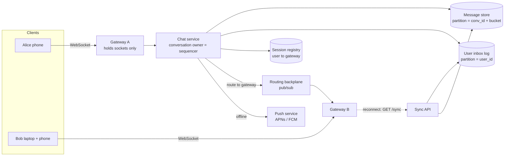
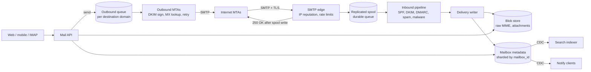
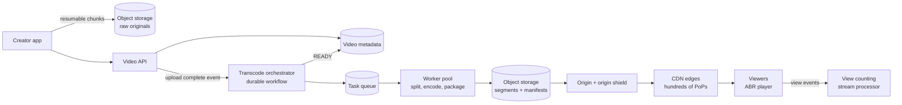
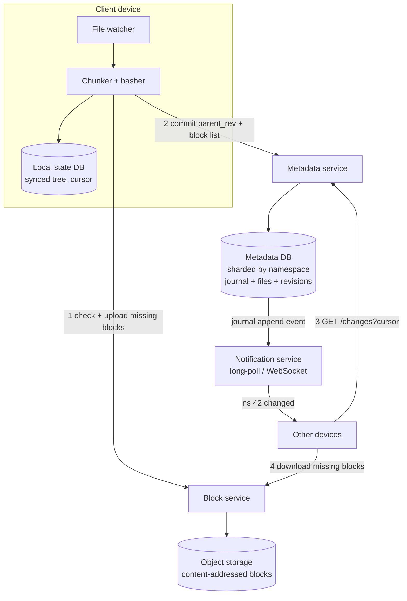
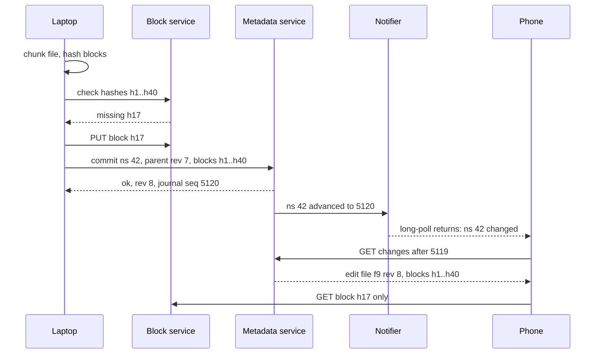
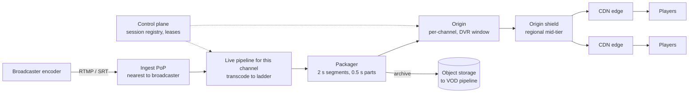

# Module 14 — Case Studies: Messaging and Media

## Module Introduction

**What this module is.** Five more complete designs, built the same way as the [Module 12 capstones](../12-capstones/README.md): numbers first, then the five questions, then boxes, deep dives, and a walk through every failure. No new patterns are introduced. Every mechanism used here already has its own lesson in Modules 01–11 or a chapter in the DDIA notes, and this module links to them instead of re-teaching them. What is new is the *shape* of the problems: all five move either **messages between people** or **large media files to many screens**.

**Analogy.** Module 12 was four complete chess games. This module is five more games that all start from the same opening (a client that must stay in step with a server), but branch into very different middle games: tiny messages that must arrive in order, letters that must never be lost, films that must be cooked once and served a billion times, folders that must look identical on five devices, and a broadcast that has to reach twenty million people within seconds.

**The five designs**

| Case | Center of gravity (the main problem) | What decides the architecture |
|---|---|---|
| 1. Chat System | Ordered, deduplicated delivery to users whose sockets live on thousands of machines | Connection count and per-conversation ordering |
| 2. Email Service | "Never lose an accepted letter" while talking to an untrusted, slow internet | The SMTP durability boundary and deliverability |
| 3. Video Platform | Pay once to transcode, then serve a power-law audience from the edge | Egress bandwidth (tens of Tbps) and encode compute |
| 4. File Sync & Storage | Many devices editing one tree, offline, with no silent data loss | Chunk-level dedupe and the change journal |
| 5. Live Streaming | Seconds of latency to millions of simultaneous viewers of one stream | The latency budget and edge fan-out of one hot object |

**Four terms used throughout** (each is taught properly in the linked lesson):
- **Fan-out:** one input producing many deliveries (one chat message to 500 group members; one video segment to 20M viewers). See the news feed in [Module 12](../12-capstones/README.md).
- **Cursor:** a saved position in an ordered log ("I have seen everything up to sequence 4,812"). Clients sync by asking for "everything after my cursor". See [Cursor-Based Pagination](../08-api-and-edge/README.md#cursor-based-pagination) and DDIA's [partitioned logs](../../../ddia/chapters/11-stream-processing/README.md#partitioned-logs).
- **Blob vs metadata:** the big immutable bytes (a video file, an attachment, a file chunk) versus the small mutable facts about them (title, owner, labels, which chunks make up version 7). Every case in this module stores the two in different systems.
- **Egress:** bytes leaving your servers towards users. For media systems it is the biggest bill and the reason CDNs exist ([CDN](../08-api-and-edge/README.md#cdn)).

**How to use this module.** Same routine as Module 12: at the start of each case, cover the page below the prompt and do stages 1–3 yourself on paper (numbers, five questions, first boxes). Then read on and compare. The cases are independent; do the one closest to your next interview first. Chat and live streaming share connection-tier ideas; video and live streaming share the CDN and adaptive-bitrate ideas; email and file sync share the blob/metadata split.

**The stages used in every case** (Module 12's seven stages, with API and data model made explicit because interviewers ask for them in these problems):
1. Requirements and numbers
2. The five-questions pass
3. API
4. Data model
5. The architecture, annotated
6. Deep dives
7. The failure walk (scaling and failure)
8. Trade-offs
9. The follow-up questions
10. Pattern manifest and TL;DR

All scale figures are **assumptions chosen for the exercise**, rounded so the arithmetic is easy. Where a real company has published how it does something, the case says so and cites the company's own engineering write-up.

---

## Case 1 — Chat System

**The prompt (in short).** Build a messaging app like WhatsApp, Messenger or Slack DMs: one-to-one chats and group chats (up to 1,000 members), messages delivered in real time when the recipient is online and on reconnect when they are not, history on every device, read receipts, and online presence.

**What makes it hard.** The message itself is tiny (a few hundred bytes). The hard parts are: (1) **hundreds of millions of open connections** spread across thousands of machines, so "send to Bob" is a routing problem; (2) every participant must see a conversation **in the same order**, without gaps or duplicates, even though phones drop off networks constantly; and (3) the same user has **several devices** that must all converge on the same history.

### 1. Requirements and numbers
**Functional:** send/receive 1:1 and group messages (text plus media links), delivery while online and catch-up after being offline, full history on all of a user's devices, delivered/read receipts, presence ("online", "last seen"), push notifications when the app is closed.

**Non-functional:** end-to-end delivery **p99 < 500 ms** when both users are online; **no lost acknowledged messages**; per-conversation **total order** (everyone sees the same order); duplicates are never shown; high availability (a chat outage is front-page news).

**Numbers (assumptions):**
- **500M daily active users (DAU)**, each sending **40 messages/day** → **20B messages/day ≈ 230K messages/s average, ~700K/s peak** (3× average).
- Average recipients per message: **~3** (most chats are 1:1, some groups) → **~2M deliveries/s at peak**.
- Message size including metadata ≈ **300 bytes** → 20B × 300 B = **6 TB/day**, **~2.2 PB/year** before replication (×3 → ~6.6 PB/year). History is kept forever, so storage grows linearly and **old data is almost never read**.
- Peak concurrent connections: ~30% of DAU online at once = **150M sockets**. Assume a conservative **50K sockets per gateway** (a tuned server can hold more, but smaller gateways mean fewer users reconnect when one restarts) → **3,000 gateway servers**. The gateway tier itself is the one described in [Bidirectional Streaming](../02-moving-data/README.md#bidirectional-streaming).
- Heartbeats: 150M sockets × one ping every 30 s = **5M pings/s**. These must be answered **at the gateway** and never touch the backend; this one number rules out designs where every keepalive hits a database.

**What the numbers say:** throughput per message is moderate; the **connection count** and the **write-mostly, append-only history** decide the architecture.

### 2. The five-questions pass
- **Flow:** the sender's app sends over its WebSocket and waits only for a server ack ("stored, sequence 812"). Delivery to recipients is **asynchronous**. Offline recipients get a push notification and fetch on reconnect ([Five Questions](../01-thinking-in-patterns/README.md#the-five-questions)).
- **Storage:** the **message log per conversation** is the source of truth. Everything else (unread counts, conversation list, search index) is derived and can be rebuilt ([CQRS](../03-storing-data/README.md#cqrs)).
- **Speed:** the hottest read is "the last 50 messages of this conversation" on app open; it must be one partition read.
- **Failure:** networks drop constantly on mobile. Design for **at-least-once delivery + dedupe**, never for a perfect connection ([Idempotency](../05-reliability/README.md#idempotency)).
- **Growth:** connections grow with users; storage grows with time; hot spots are big groups and bursts (New Year's Eve).
- *Skeleton:* stateless-ish connection gateways, a session registry, a per-conversation sequencer, an append-only message store partitioned by conversation, and a per-user sync cursor.

### 3. API
Real-time traffic uses a small protocol over one WebSocket per device; everything bulky uses plain HTTPS.

| Direction | Frame / endpoint | Purpose |
|---|---|---|
| Client → server | `send {client_msg_id, conv_id, body, media_ref?}` | `client_msg_id` is a UUID the client generates once and reuses on every retry (idempotency key) |
| Server → sender | `ack {client_msg_id, msg_id, seq, server_ts}` | "Stored durably; your message is number `seq` in this conversation" |
| Server → recipient | `msg {conv_id, seq, msg_id, sender, body, server_ts}` | Live delivery |
| Client → server | `receipt {conv_id, up_to_seq, kind: delivered/read}` | One receipt covers everything up to `seq` (cumulative, not per message) |
| HTTPS | `GET /sync?cursor=…` | Catch-up after reconnect: all changes after the device's cursor |
| HTTPS | `GET /conversations/{id}/messages?before_seq=…&limit=50` | Scroll back through history ([cursor pagination](../08-api-and-edge/README.md#cursor-based-pagination)) |
| HTTPS | `POST /media` → pre-signed upload URL | Photos/videos go to blob storage, never through the socket |

### 4. Data model
- **`messages`** — partition key `(conv_id, bucket)`, clustering key `seq` descending. A **bucket** is a time or size slice (for example 10 days, or 100K messages) so that one busy conversation never becomes one unbounded partition. Columns: `msg_id, sender_id, body, media_ref, server_ts, flags (edited/deleted)`. An LSM-tree wide-column store (Cassandra/ScyllaDB/Bigtable-style) fits: append-heavy, read-recent ([SSTables and LSM-Trees](../../../ddia/chapters/03-storage-and-retrieval/README.md#sstables-and-lsm-trees)). Discord describes exactly this key shape (channel + time bucket) in its engineering posts on storing billions and later trillions of messages.
- **`conversations`** — `conv_id → type (1:1/group), members, last_seq, created_at`. Small, relational or key-value.
- **`user_inbox`** (per-user change log) — partition `user_id`, clustering `inbox_seq`: rows like `(conv_id, seq)` meaning "conversation X has a new message". A device's sync cursor is just its last `inbox_seq`. This is the per-user read model that makes multi-device sync one range scan.
- **`read_state`** — `(user_id, conv_id) → last_delivered_seq, last_read_seq`. Unread count = `conv.last_seq − last_read_seq`, no counting needed.
- **`sessions`** (in-memory, TTL) — `user_id → [(device_id, gateway_id)]`. Written on connect, expired by missing heartbeats.

### 5. The architecture, annotated



Walking one message from Alice to Bob:
1. Alice's phone sends `send{client_msg_id=u1, conv_id=c9, body}` to **Gateway A**. Gateways are the "hold sockets, own nothing" tier from [Bidirectional Streaming](../02-moving-data/README.md#bidirectional-streaming); they answer heartbeats locally.
2. Gateway A forwards to the **chat service instance that owns `c9`**. Ownership is assigned by [consistent hashing](../03-storing-data/README.md#consistent-hashing) on `conv_id`, so exactly one instance is the **sequencer** for each conversation at a time (the "ownership over agreement" thread from Module 12).
3. The owner checks `u1` against recently seen `client_msg_id`s (dedupe), assigns `seq = last_seq + 1`, and writes the message to the **message store** and a pointer row to each member's **inbox log**. Only after these writes succeed does it send `ack{u1, seq=812}` back to Alice. The ack is the durability promise.
4. It looks up Bob's devices in the **session registry**, and publishes the message to the gateways holding them (Gateway B) via the **routing backplane** ([Publish-Subscribe](../02-moving-data/README.md#publish-subscribe)). Gateway B writes it to both of Bob's sockets.
5. If Bob has no live session, the **push service** sends a notification through Apple/Google push (the [notification capstone](../02-moving-data/README.md#capstone---designing-a-notification-system) covers that pipeline). When Bob opens the app, it calls `GET /sync?cursor=…` and receives everything after its cursor.

**Per-user vs per-conversation routing.** Module 02 routed chat through *one topic per room*. That is ideal for big channels where most members are online. For 500M users in mostly 1:1 chats, one topic per conversation would mean billions of topics; routing by **user → gateway** (session registry) is cheaper. Real systems mix both: per-user routing for DMs and small groups, per-channel topics for large, busy rooms.

### 6. Deep dives

**Deep dive 1 — ordering and "exactly-once" display without distributed locks.**
- *The problem:* two members of a group send at the same instant from different gateways. If each gateway stamped its own time, clocks that disagree by a few milliseconds would give different members different orders ([Unreliable Clocks](../../../ddia/chapters/08-trouble-with-distributed-systems/README.md#unreliable-clocks)).
- *The fix:* **one sequencer per conversation** assigns a gap-free, increasing `seq`. Order is defined by the sequencer, not by clocks. This is DDIA's [sequence number ordering](../../../ddia/chapters/09-consistency-and-consensus/README.md#sequence-number-ordering) applied per conversation, and it is cheap because a single conversation's rate is small (even a busy group sends a few messages per second).
- *Duplicates:* the phone retries `send` when it doesn't see an ack (tunnel, timeout). The sequencer keeps the last few thousand `client_msg_id → seq` mappings per conversation; a retry gets the **original ack back**, not a new message. Delivery to recipients is at-least-once (a gateway may resend after a reconnect), and recipients drop anything with a `seq` they already have. **Idempotent send + dedupe on seq = messages appear exactly once**, even though no network hop is exactly-once ([Exactly-Once Semantics](../10-batch-and-streaming/README.md#exactly-once-semantics) makes the same argument).
- *Gaps:* because `seq` is gap-free, a client that holds 810 and receives 812 knows 811 is missing and fetches it. Gap detection is free.

**Deep dive 2 — offline catch-up and multi-device sync.**
- Each device keeps **one cursor**: its last `inbox_seq`. On reconnect it calls `/sync`, receives the list of `(conv_id, seq)` pointers since the cursor (one partition range scan on `user_inbox`), and fetches the message bodies it lacks. Then it rejoins the live stream and drops overlaps by `seq`. This is the "resume" recipe from Module 02, made per-user so that one call covers every conversation.
- A phone offline for a week in 200 active groups might have 20K new messages. Return **conversation summaries first** (last message + unread count per conversation) and let the app fetch full history lazily when a chat is opened. That keeps reconnect under a second.
- **Read receipts are cumulative** ("read up to 812"), so a device reading 50 messages sends one frame, not 50. Receipts to the *sender* in large groups are aggregated ("read by 37") and throttled; per-member receipts in a 1,000-member group would multiply traffic 1,000×.
- Your *own* sent messages must appear on your other devices too, so the sender's own inbox log also gets a pointer row (read-your-writes across devices; see DDIA's [reading your own writes](../../../ddia/chapters/05-replication/README.md#reading-your-own-writes)).

**Deep dive 3 — presence without a heartbeat storm.**
- *Naive:* broadcast "Alice is online/offline" to all of Alice's contacts on every change. With 150M online users flapping on mobile networks, that is millions of fan-out events per second, mostly to people who are not looking.
- *Better:* presence lives in the in-memory **session registry** with a TTL (for example 60 s, refreshed by the gateway on heartbeats). Presence is **pulled** when you open a chat or contact list, and **pushed** only to clients that have that chat open (a subscription that the gateway drops when the screen closes).
- Debounce flapping: only publish "offline" after the TTL expires, so a 5-second tunnel doesn't produce two events. Large groups show no per-member presence at all.
- Presence is **ephemeral data**: never write it to durable storage; losing it means a few seconds of wrong dots, which is acceptable ([Graceful Degradation](../05-reliability/README.md#graceful-degradation)).

### 7. The failure walk
1. **A gateway dies** (1/3,000 of connections, ~50K users): their sockets drop; clients reconnect to another gateway with **jittered backoff** ([Retry with Exponential Backoff](../05-reliability/README.md#retry-with-exponential-backoff)), re-register sessions, and `/sync` fills any gap. Nothing durable lived on the gateway, so nothing is lost. Deploys work the same way (drain, "going away" frame, reconnect).
2. **A conversation owner (sequencer) dies:** the hash ring moves its conversations to a neighbour. The new owner reads `last_seq` from the message store before accepting writes. To prevent two owners during the handover (a paused old owner waking up), writes are **conditional on `seq` not existing** or fenced with an ownership epoch; see DDIA's [truth is defined by the majority](../../../ddia/chapters/08-trouble-with-distributed-systems/README.md#the-truth-is-defined-by-the-majority) for fencing tokens. Senders see a ~1–2 s pause and their retries are deduped.
3. **Message store slow:** the owner cannot ack, so senders see a "sending…" clock icon. That is correct behaviour: **never ack before durable**. A [circuit breaker](../05-reliability/README.md#circuit-breaker) stops piling requests onto the store; the client keeps the message in its local outbox and retries.
4. **Push provider (APNs/FCM) outage:** users with the app closed don't get notified, but nothing is lost; the messages are in their inbox logs and appear on next open. Queue pushes with a short TTL; a notification about a two-hour-old message is noise.
5. **New Year's Eve, 5× normal traffic:** the gateway tier is pre-scaled on a calendar ([Auto-Scaling](../06-scaling/README.md#auto-scaling)); low-value traffic (typing indicators, presence pushes, per-member group receipts) is shed first, messages last.
6. **A hot group** (a 1,000-member group where everyone replies at once): one sequencer handles it serially, which is fine for hundreds of messages/s. Fan-out of each message to 1,000 members is the cost; batch deliveries per gateway (one backplane message per gateway, not per member).

### 8. Trade-offs

| Decision | Chosen | Alternative | Why |
|---|---|---|---|
| Ordering | Per-conversation sequencer | Client or server timestamps | Clocks disagree; a single owner per conversation is cheap and gives gap detection |
| Delivery guarantee | At-least-once + dedupe by `client_msg_id` and `seq` | Exactly-once transport | No network is exactly-once; idempotency gives the same user-visible result |
| History storage | Wide-column LSM store, partition by `(conv, bucket)` | Relational DB | Append-heavy, range reads by recency, petabytes; joins not needed |
| Routing | Per-user session registry (+ topics for big channels) | One topic per conversation | Billions of mostly-idle 1:1 conversations |
| Server history | Stored server-side for multi-device | Store-and-forward then delete (WhatsApp's original model) | Multi-device sync needs a server copy; E2EE variants encrypt it |
| Presence | Pull + subscribe while visible, TTL in memory | Broadcast every change | Presence churn would dominate traffic |

### 9. The follow-up questions
- **"How would you add end-to-end encryption?"** The server then stores and routes **ciphertext** it cannot read. The Signal Protocol (published by Signal; used by WhatsApp per its security whitepaper) establishes per-device keys. Group messages use sender keys so one encryption serves many recipients. Consequences: no server-side search or content moderation, and each of a user's devices is a separate recipient (fan-out per device, not per user). *Trap:* claiming you can keep server-side search unchanged.
- **"How do you generate `msg_id`?"** A globally unique, roughly time-ordered 64-bit ID (Snowflake-style: timestamp + machine + counter) for storage and deduplication, *separate* from `seq`, which defines order inside a conversation. Don't use the ID's timestamp for ordering.
- **"A user is in 5,000 groups. Does the inbox log explode?"** Only active conversations write to it, and the log is trimmed after all of the user's devices have passed a point (plus a retention window). Very large broadcast channels (100K+ followers) switch to **pull**: members read the channel's log directly instead of receiving a pointer each (the push/pull hybrid from the news feed).
- **"Edit and delete?"** Append an `edit`/`delete` event with its own `seq` that refers to the original; clients apply it. History stays append-only and sync stays one cursor ([Event Sourcing](../03-storing-data/README.md#event-sourcing) thinking).
- **"Search chat history?"** A per-user search index built asynchronously from the inbox log via [CDC](../10-batch-and-streaming/README.md#change-data-capture); partition it by user so every query hits one shard (DDIA's [document-partitioned indexes](../../../ddia/chapters/06-partitioning/README.md#partitioning-secondary-indexes-by-document)).

### Pattern manifest

| Pattern | Where it served |
|---|---|
| Bidirectional Streaming | One WebSocket per device, own protocol (acks, seq, heartbeats, resume) |
| Publish-Subscribe | Routing backplane between chat service and gateways |
| Consistent Hashing + ownership | One sequencer per conversation |
| Idempotency | `client_msg_id` on send; dedupe by `seq` on delivery |
| Sharding | Messages by `(conv_id, bucket)`, inbox by `user_id` |
| CQRS | Inbox log, unread counts and search as derived read models |
| Cursor-Based Pagination | `/sync` cursor and history scroll-back |
| Retry with Backoff + jitter | Client reconnect after gateway loss |
| Graceful Degradation | Shed typing/presence/receipts before messages |
| Auto-Scaling (calendar) | Gateway tier before known peaks |

**Interview one-liner:** "Gateways hold sockets and own nothing; one sequencer per conversation assigns gap-free sequence numbers; messages are acked only after they're durable in an append-only log partitioned by conversation; delivery is at-least-once with dedupe by client ID and sequence; each device syncs with one cursor over a per-user inbox log."

### TL;DR
- **Problem:** 150M open sockets, per-conversation order, no loss, several devices per user.
- **Mechanism:** gateway tier + session registry + backplane; a per-conversation sequencer; wide-column message log keyed `(conv, bucket)`; per-user inbox log with device cursors; push notifications for offline users.
- **Hard parts:** ordering without clocks (sequencer), duplicates (idempotency keys), reconnect (cursor sync), presence (pull + TTL, never broadcast).
- **Price:** stateful connection tier, petabytes of mostly-cold history, and a protocol you own.

---

## Case 2 — Email Service

**The prompt (in short).** Build a large webmail provider like Gmail or Outlook.com: users send and receive mail with anyone on the internet, read it in web and mobile apps, organise it with folders or labels, search it, and get protection from spam and malware.

**What makes it hard.** Unlike chat, you don't control the other side. Email arrives from millions of foreign servers over **SMTP** (Simple Mail Transfer Protocol, [RFC 5321](https://www.rfc-editor.org/rfc/rfc5321)), many of them hostile, and your outgoing mail goes to servers that may be down for days or may decide you're a spammer. Inside, the problem is storage: every user keeps years of mail and expects instant search over all of it.

### 1. Requirements and numbers
**Functional:** receive mail from the internet; send mail to any address; web/mobile clients list, read, thread, label, archive and delete; full-text search; attachments; spam and malware filtering; standard protocol access (IMAP/SMTP submission) for third-party clients.

**Non-functional:** **once we accept a message, we never lose it** (this is the core promise of email); reading the inbox **p99 < 300 ms**; search **< 1 s**; sending is asynchronous but reliable (retries for days); strong consistency *within one mailbox* (if I archive a message on my phone, my laptop must not show it in the inbox a minute later).

**Numbers (assumptions):**
- **1B users**. Each receives **40 legitimate messages/day** and sends **10**.
- Inbound attempts are much higher than legitimate mail: assume **as many spam attempts as real mail**, most rejected at connection time. Accepted inbound: **40B/day ≈ 460K/s average, ~1.4M/s peak**. Outbound: **10B/day ≈ 115K/s average**.
- Average stored message (headers + body + share of attachments, after compression) ≈ **30 KB** → 40B × 30 KB = **1.2 PB/day** of new mail, **~440 PB/year** before replication. Per user that's ~1.2 MB/day, ~440 MB/year: plausible against the multi-GB free quotas big providers give.
- Metadata per message (IDs, sender, subject, snippet, labels, pointers) ≈ **1 KB** → **40 TB/day**. Metadata is ~3% of bytes but ~100% of queries.
- Search index ≈ 20–30% of text size; built per mailbox.

**What the numbers say:** storage is enormous, but **every query is scoped to a single mailbox**. That one fact makes the user the natural shard key for almost everything.

### 2. The five-questions pass
- **Flow:** receiving: the remote server waits for our `250 OK`; everything after that (spam checks, indexing, notifications) is asynchronous. Sending: the user's click returns as soon as the message is queued; delivery to the internet happens in the background with retries.
- **Storage:** the source of truth is the **raw message (MIME blob) + its per-mailbox metadata row**. Threads, label views, unread counts and the search index are derived.
- **Speed:** "first page of inbox" and "open message" dominate reads; both are single-mailbox, recency-ordered.
- **Failure:** remote servers are slow, down, or malicious; queues with retries and backoff everywhere; spam filters may be unavailable.
- **Growth:** storage per user grows forever; a few mailboxes (mailing-list archives, ticket systems) receive millions of messages.
- *Skeleton:* an SMTP edge that accepts into a replicated spool, an async processing pipeline, mailbox-sharded metadata + a blob store, per-mailbox search indexes, and an outbound queue that retries per destination.

### 3. API
Clients use a JSON-over-HTTPS API (modern designs resemble **JMAP**, [RFC 8620](https://www.rfc-editor.org/rfc/rfc8620)/[8621](https://www.rfc-editor.org/rfc/rfc8621)); third-party clients use IMAP ([RFC 9051](https://www.rfc-editor.org/rfc/rfc9051)) and SMTP submission on port 587.

| Endpoint | Purpose |
|---|---|
| `GET /threads?label=INBOX&cursor=…&limit=50` | Inbox page, newest first ([cursor pagination](../08-api-and-edge/README.md#cursor-based-pagination)) |
| `GET /messages/{id}` / `GET /messages/{id}/attachments/{n}` | Read a message; attachments stream from the blob store |
| `POST /messages/send` + `Idempotency-Key` header | Queue a message for sending; a double-click must not send twice ([Idempotency](../05-reliability/README.md#idempotency)) |
| `PATCH /messages/{id}` `{addLabels, removeLabels, read}` | Organise; label changes are the most frequent write |
| `GET /search?q=from:ana invoice after:2026/01/01` | Full-text + field search within the mailbox |
| `GET /changes?since=<state>` | Sync: "what changed since state X" (a per-mailbox cursor) |

### 4. Data model
Everything is keyed by `mailbox_id` (≈ user) so each mailbox lives on one shard ([Sharding](../03-storing-data/README.md#sharding)).
- **`messages`** — `(mailbox_id, message_id)` → `thread_id, received_at, from, to, subject, snippet, size, label_bits, blob_ref, spam_score, modseq`. `label_bits` is a small bitset (INBOX, UNREAD, STARRED, user labels 1…n), so archiving is flipping a bit, not moving data.
- **`label_index`** — `(mailbox_id, label, received_at DESC, message_id)`: the read model behind "show INBOX newest first". Updated together with `messages` in one single-shard transaction.
- **`threads`** — `(mailbox_id, thread_id)` → `last_received_at, message_ids, label_union`. Threading uses the `Message-ID`, `In-Reply-To` and `References` headers defined in [RFC 5322](https://www.rfc-editor.org/rfc/rfc5322), falling back to subject + participants.
- **`changes`** — per-mailbox append-only log of `(modseq, message_id, what changed)`. Every write increments the mailbox's **modseq** (modification sequence; IMAP's CONDSTORE extension uses the same idea). Clients sync with "give me changes after modseq 91,204".
- **Blob store** — raw RFC 5322 message bytes, immutable, in object storage. Attachments are stored **content-addressed** (key = SHA-256 of the bytes), so the same 5 MB PDF sent to 2,000 employees is stored once and referenced 2,000 times.
- **Search index** — one inverted index per mailbox, co-located with the mailbox shard.

### 5. The architecture, annotated



- **SMTP edge:** terminates TLS, checks the connecting IP against reputation lists, applies per-IP [rate limits](../08-api-and-edge/README.md#rate-limiting), and rejects obvious junk **during the SMTP conversation** (cheapest place to say no: we store nothing). It then writes the message to a **replicated spool** and only then answers `250 OK`.
- **Inbound pipeline** (consumers of the spool, a [message queue](../02-moving-data/README.md#message-queue)): verifies sender authentication, scores spam, scans attachments for malware, applies the user's filters, and hands the result to the delivery writer. Spam and phishing classifiers are ML models served like any other model ([Model Serving](../11-ai-era-systems/README.md#model-serving-and-batching)).
- **Delivery writer:** writes blob(s) first, then the metadata row and label index in one mailbox-shard transaction ("blob first, pointer last", so a crash never leaves a pointer to missing bytes). Idempotent on `(mailbox_id, message fingerprint)`.
- **Search indexer and notifications** consume the metadata change stream ([Change Data Capture](../10-batch-and-streaming/README.md#change-data-capture)); an indexing delay of a few seconds is acceptable.
- **Outbound:** the API queues sent mail; outbound MTAs sign it, look up the recipient domain's MX records in DNS, and deliver with retries.

### 6. Deep dives

**Deep dive 1 — the `250 OK` durability boundary.**
- In SMTP, answering `250 OK` to the end of the message data means **"I have taken responsibility for this message"**; the sender deletes its copy. RFC 5321 is explicit that the receiver must not lose it afterwards. So the spool is our [write-ahead log](../03-storing-data/README.md#write-ahead-log): the message must be on durable storage on **at least two machines (ideally two zones)** before we reply.
- What if we crash *after* writing but *before* the `250` reaches the sender? The sender times out and retries, and we receive the message twice. SMTP is therefore **at-least-once** by design. The delivery writer dedupes on a fingerprint (the `Message-ID` header plus a body hash, within a window of a few days). This is the same "idempotency under at-least-once" thread as everywhere else in the course.
- Why not deliver straight into the mailbox before answering? Because the pipeline (spam scoring, malware scanning) can take seconds, and SMTP senders time out. **Accept fast into a log, process asynchronously**: the [Message Queue](../02-moving-data/README.md#message-queue) lesson's core idea.

**Deep dive 2 — sending to an internet you don't control.**
- *Authentication:* receiving servers now require it. The sender's domain publishes **SPF** ([RFC 7208](https://www.rfc-editor.org/rfc/rfc7208): which IPs may send for it), signs each message with **DKIM** ([RFC 6376](https://www.rfc-editor.org/rfc/rfc6376): a signature over headers and body, public key in DNS), and publishes a **DMARC** policy (what receivers should do when the checks fail, and where to send reports; first described in RFC 7489, now standardised as [RFC 9989](https://www.rfc-editor.org/rfc/rfc9989), 2026). Google's and Yahoo's 2024 bulk-sender requirements made all three effectively mandatory for large senders. Our inbound pipeline runs the same checks on others.
- *Retries:* destination servers are often temporarily unavailable or reply with a `4xx` ("try later", often deliberate *greylisting*). RFC 5321 says the give-up time should generally be **at least 4–5 days**, and that the retry interval should generally be **at least 30 minutes** (smarter, variable schedules are allowed when the client knows why delivery failed). So outbound is a durable queue with [exponential backoff](../05-reliability/README.md#retry-with-exponential-backoff): for example a first quick retry after a few minutes for greylisting, then every 30–60 minutes, growing towards a few hours. After the give-up time, or on a permanent `5xx`, we send the user a **bounce** (a delivery status notification).
- *Per-destination backpressure:* a big receiver (say a large corporate domain) accepts only so many connections and messages per minute from one sender IP. Partition the outbound queue by **destination domain** ([Partitioned Consumption](../10-batch-and-streaming/README.md#partitioned-consumption)) and give each domain its own concurrency limit. One slow or blocking domain then builds its own backlog instead of blocking everyone ([Backpressure](../10-batch-and-streaming/README.md#backpressure), [Bulkhead](../05-reliability/README.md#bulkhead)).
- *Reputation:* receivers judge us by IP and domain reputation. Keep separate IP pools for normal user mail and for anything risky (newly created accounts, bulk senders), and rate-limit new accounts: a spammer who signs up must not damage the IPs everyone else sends from.

**Deep dive 3 — search inside one mailbox.**
- A global inverted index over all mail ("term → every message containing it, for everyone") would force every query to filter by user and would be written by everyone at once. Instead, build **one small index per mailbox**, stored on the same shard as the mailbox. This is DDIA's [document-partitioned secondary index](../../../ddia/chapters/06-partitioning/README.md#partitioning-secondary-indexes-by-document): usually a scatter-gather problem, but here **every query carries the partition key** (the user), so it hits exactly one shard.
- Index asynchronously from the change stream. Newly arrived mail is searchable within seconds; a message that is not yet indexed can still be found through a short "recent messages" scan that the query merges in (so the user never sees "I just got it but search can't find it").
- Attachments (PDFs, documents) are text-extracted in the pipeline and indexed too; this is the expensive part and can lag more.

### 7. The failure walk
1. **A spool node dies:** replicated spool, so messages survive on the other replica; consumers resume from their last committed offset. Senders whose connections were cut mid-transfer retry (SMTP retries by design).
2. **The spam classifier is down:** failing *open* (deliver everything to the inbox) invites phishing; failing *closed* (reject) loses mail. Middle path: keep accepting into the spool (it is a buffer), and hold unscored messages for a short time; if the outage lasts, deliver with a cheaper rule-based filter and label them "not fully scanned" ([Graceful Degradation](../05-reliability/README.md#graceful-degradation)). Attachments with executable content stay quarantined.
3. **A destination domain is down for two days:** its partition of the outbound queue grows; other domains are unaffected. The user gets a "still trying" notice after a few hours and a bounce after the give-up period.
4. **Our sending IPs land on a blocklist:** traffic to affected receivers moves to another IP pool while the cause (usually one compromised or spamming account) is found and suspended. Per-account outbound rate limits keep one account from doing this.
5. **A mailbox shard fails:** replicas with automatic failover ([Primary-Replica](../03-storing-data/README.md#primary-replica)); inbound delivery for those mailboxes waits in the spool (lag, not loss). Reads fail over to replicas; label writes wait for the new primary.
6. **A hot mailbox** (a support address receiving 2M messages/day): it is one shard key, so it gets a per-mailbox delivery rate limit and a dedicated shard; beyond that, the owner is moved to an archiving product. See DDIA's [hot spots](../../../ddia/chapters/06-partitioning/README.md#skewed-workloads-and-relieving-hot-spots).

### 8. Trade-offs

| Decision | Chosen | Alternative | Why |
|---|---|---|---|
| Shard key | `mailbox_id` | Message ID or time | Every query is per mailbox; no cross-shard reads |
| Accept path | Spool then `250 OK`, process async | Process fully before `250` | SMTP timeouts; decouple acceptance from slow scanning |
| Labels | Bitset on the message + label index | Copy messages between folders | Archive/label = flip a bit; one copy of the data |
| Attachments | Content-addressed blobs (dedupe) | One blob per message | Same file sent to thousands of people stored once |
| Search | Per-mailbox index, async | Global index | Queries always carry the user; smaller, isolated indexes |
| Spam outage | Buffer, then degrade with labelling | Fail open or fail closed | Neither losing mail nor delivering phishing is acceptable |

### 9. The follow-up questions
- **"How is this different from the chat system?"** Chat controls both ends and optimises for latency; email federates with untrusted strangers and optimises for **durability and deliverability**. Latency of seconds to minutes is fine; losing an accepted message is not.
- **"How do you store a 25 MB attachment sent to 5,000 people?"** Once, content-addressed, with a reference count or periodic mark-and-sweep garbage collection; each mailbox row points to it. Encrypt at rest; deletion of the last reference makes it eligible for deletion.
- **"A user deletes a message: is it gone?"** Deletion flips a bit (Trash), then after 30 days the metadata row is removed and the blob's reference dropped. Backups and replicas age out on their own schedule; for legal erasure use per-user encryption keys and destroy the key (crypto-shredding, as in the Module 12 payments design).
- **"How do you stop your own users sending spam?"** New-account send limits, per-account outbound rate limits, outbound spam scoring (the same classifier, pointed outwards), and separate IP pools so abuse can't damage everyone's reputation.
- **"Push new mail to the phone?"** The metadata change stream feeds a notification service (Module 02 notification capstone). The phone then syncs with `/changes?since=modseq`; the push is only a hint.

### Pattern manifest

| Pattern | Where it served |
|---|---|
| Write-Ahead Log | The spool: durable before `250 OK` |
| Message Queue | Inbound pipeline and outbound delivery |
| Idempotency | Dedupe of SMTP retries; send API idempotency key |
| Sharding | Everything keyed by mailbox |
| CQRS | Label index, threads, search index as read models |
| Change Data Capture | Metadata changes → search indexer, notifications |
| Retry with Backoff | Outbound delivery over days |
| Partitioned Consumption + Backpressure + Bulkhead | Outbound queue per destination domain |
| Rate Limiting | SMTP edge per IP; outbound per account |
| Graceful Degradation | Spam-filter outage handling |
| Primary-Replica | Mailbox shard failover |

**Interview one-liner:** "Accept mail into a replicated spool before saying 250, process spam and indexing asynchronously, shard everything by mailbox so every query hits one shard, store raw messages and attachments as content-addressed blobs, and send through a per-domain outbound queue that authenticates with SPF/DKIM/DMARC and retries for days."

### TL;DR
- **Problem:** never lose accepted mail, federate with an untrusted internet, and search years of mail per user.
- **Mechanism:** SMTP edge → replicated spool → async pipeline → blob store + mailbox-sharded metadata → per-mailbox search; outbound queue partitioned by destination with retries and authentication.
- **Hard parts:** the `250 OK` boundary (at-least-once + dedupe), deliverability (SPF/DKIM/DMARC, reputation, per-domain limits), per-mailbox search.
- **Price:** hundreds of petabytes per year, a spam arms race, and a reputation you can lose in an afternoon.

---

## Case 3 — Video Platform (YouTube-like)

**The prompt (in short).** Build a video-sharing platform: creators upload videos of any length; the platform processes them into formats every device can play; viewers anywhere stream them smoothly on any connection, from a phone on 3G to a 4K TV.

**What makes it hard.** Two very different pipelines share one catalogue. **Upload and processing** is a heavy batch workload: each uploaded hour of video must be decoded and re-encoded into many versions. **Playback** is a staggering bandwidth problem: the bytes leaving the system are measured in **terabits per second**, and popularity follows a power law (a few videos get most views; most videos are rarely watched).

### 1. Requirements and numbers
**Functional:** resumable upload of large files; processing into multiple resolutions and codecs; thumbnails; playback with **adaptive bitrate** (the player switches quality as bandwidth changes); seeking; video metadata, view counts; basic moderation/copyright checks before publishing.

**Non-functional:** playback start **< 2 s**, **rebuffering < 0.5%** of watch time; upload never has to restart from zero; a newly uploaded video is watchable within **minutes**; uploaded originals are never lost; cost per view as low as possible.

**Numbers (assumptions):**
- **Viewing:** 500M DAU × 5 videos × 6 min average = **15B minutes watched/day**. Average concurrency = 15B ÷ 1,440 min/day ≈ **10M streams**, peak ~2× = **20M streams**. At an average of **3 Mbps** → **~60 Tbps peak egress**, **~340 PB/day** delivered. No single data centre can do this: the design is a **CDN problem** first ([CDN](../08-api-and-edge/README.md#cdn)).
- **Uploads:** YouTube has publicly said (first in 2019, and repeated on its official blog since) that more than 500 hours of video are uploaded every minute; use that: **500 h/min = 720K hours/day**, about **4M uploads/day ≈ 50 uploads/s** (average 10 min each).
- **Storage:** originals at ~10 Mbps ≈ 4.5 GB/hour → **3.2 PB/day**. An H.264 ladder of five renditions totals ~10 Mbps → another **~3.4 PB/day**. Roughly **2.4 EB/year** before replication, which is why cold, rarely watched videos move to cheaper, erasure-coded storage tiers.
- **Encode compute (assumption):** ~**10 CPU-core-hours** to produce the H.264 ladder for one hour of video → 720K × 10 = **7.2M core-hours/day ≈ 300K cores busy around the clock**. More efficient codecs (VP9, AV1) cost several times more CPU per hour, so they can't be applied to everything.
- **Read:write** is extreme: each video is encoded once and may be viewed millions of times.

**What the numbers say:** egress dominates cost and design (edge caching); encode compute is the second bill (be selective about expensive codecs); the metadata database is small by comparison.

### 2. The five-questions pass
- **Flow:** upload is request-response for each chunk; everything after "upload complete" (transcode, thumbnails, checks, publish) is an **asynchronous workflow**; the creator polls or gets a notification when ready. Playback is plain HTTP GETs of small files from the nearest CDN edge.
- **Storage:** originals and encoded segments are immutable blobs in object storage; the metadata DB holds titles, owners, status, and the list of renditions. View counts are a separate, approximate pipeline.
- **Speed:** the hot read is "next 4-second segment of a popular video", served from an edge cache. Metadata pages are cached too ([Cache-Aside](../04-caching/README.md#cache-aside)).
- **Failure:** a transcode worker dies mid-task → retry that task only; an edge fails → the player's next request goes elsewhere; the origin must survive cache-miss storms.
- **Growth:** egress grows with watch time; encode compute grows with upload hours; storage grows forever.
- *Skeleton:* resumable chunked upload → object store → a transcoding DAG on a worker pool → packaged segments + manifests → origin → CDN → adaptive-bitrate players.

### 3. API

| Endpoint | Purpose |
|---|---|
| `POST /videos {title, description, visibility}` → `{video_id, upload_url}` | Create the record (status `UPLOADING`) and hand out a resumable upload session |
| `PUT {upload_url}` with `Content-Range` (or pre-signed multipart part URLs) | Upload in chunks of e.g. 8–16 MB; a dropped connection resumes from the last acknowledged byte. The open **tus** protocol and S3 multipart upload both work this way |
| `POST /videos/{id}/complete` | Upload finished; starts processing (idempotent) |
| `GET /videos/{id}` | Metadata, status (`PROCESSING`/`READY`/`FAILED`), and the **manifest URL** |
| `GET cdn…/{id}/master.m3u8` (HLS) or `.mpd` (DASH) | The manifest: list of renditions and their segments |
| `GET cdn…/{id}/720p/seg_00042.m4s` | One media segment; immutable, cacheable for a year |
| `POST /videos/{id}/views` (batched from the player) | Watch-time and view events for counting and recommendations |

Uploads go **directly from the client to object storage** with pre-signed URLs; the API servers never carry the video bytes.

### 4. Data model
- **`videos`** (relational or key-value, sharded by `video_id`): `video_id, owner_id, title, description, status, duration, visibility, created_at, original_blob, manifest_path`.
- **`renditions`**: `(video_id, codec, height) → bitrate, segment_count, storage_path`. Lets the platform add an AV1 ladder later without touching anything else.
- **`processing_tasks`**: `(video_id, task_id) → type, chunk_index, rendition, state, attempts, output_ref`. The workflow's durable state.
- **Object storage layout:** `raw/{video_id}` (original), `enc/{video_id}/{codec}_{height}p/seg_{n}.m4s`, `enc/{video_id}/master.m3u8`, `thumbs/{video_id}/{n}.jpg`. Segments are **write-once**, so any cache anywhere can keep them forever.
- **View counters**: not a column that every view updates (a hot row for viral videos). Views flow as events into a stream processor that dedupes and aggregates per minute, then updates a counter store ([Stream Processing](../10-batch-and-streaming/README.md#stream-processing)).

### 5. The architecture, annotated



1. The creator app creates the video and uploads the original in chunks **straight to object storage**, resuming after drops.
2. On completion, an event starts a **durable workflow** in the orchestrator (a [Saga](../07-consistency/README.md#saga)-style state machine whose every step is recorded before it runs).
3. The orchestrator breaks the job into many small tasks on a [queue](../02-moving-data/README.md#message-queue); a large, [auto-scaled](../06-scaling/README.md#auto-scaling) worker pool runs them.
4. Workers write segments and manifests; when the required renditions exist, the video flips to `READY`.
5. Players fetch the manifest and segments from the nearest **CDN edge**; misses go to a regional **origin shield** (one mid-tier cache per region that collapses edge misses) and only then to the origin.

### 6. Deep dives

**Deep dive 1 — the transcoding pipeline as a parallel DAG.**
- *Serial is too slow:* at ~10 core-hours per video-hour, one machine would take hours to process a 1-hour upload. Creators expect minutes.
- *Split by time:* cut the original into **~10-second chunks at keyframe boundaries** (a keyframe, or I-frame, is a frame that can be decoded on its own; cutting there means each chunk can be encoded independently). A 1-hour video → 360 chunks × 5 renditions = **1,800 independent tasks** of ~20 core-seconds each. With enough workers, encoding takes a couple of minutes, plus a final step that **stitches and packages** segments into HLS/DASH. Facebook describes this split-encode-stitch design in its SOSP 2017 paper on SVE (Streaming Video Engine), where processing starts while the upload is still arriving.
- *The DAG:* `validate → split → [encode chunk × rendition] → package → thumbnails → content checks → publish`. Content checks (copyright matching, safety classifiers) run in parallel with encoding, and `publish` waits for both.
- *Reliability:* each task is **idempotent**, keyed by `(video_id, chunk, rendition)`, and writes its output to a deterministic path; a retried task simply overwrites the same object ([Idempotency](../05-reliability/README.md#idempotency)). Workers take tasks with a lease; if a worker dies, the lease expires and another takes it. A task that fails repeatedly (a corrupt chunk) goes to a [dead letter queue](../05-reliability/README.md#dead-letter-queue) and the video is marked `FAILED` with a reason, instead of retrying forever.
- *Publish early, improve later:* make the video watchable as soon as the low and medium renditions exist; add 1080p/4K minutes later. Only videos that become **popular** get the expensive VP9/AV1 encodes: spending 5× the CPU is worth it only when the bandwidth saving is multiplied by millions of views. Netflix's published per-title encoding work applies the same logic to choosing bitrates per title.

**Deep dive 2 — adaptive bitrate streaming (ABR).**
- The video is not one file. Each rendition is cut into **segments of 2–6 seconds**, and a **manifest** lists them (HLS: [RFC 8216](https://www.rfc-editor.org/rfc/rfc8216); MPEG-DASH: ISO/IEC 23009-1). Segments of all renditions are aligned on the same timestamps, so the player can switch between renditions at any segment boundary.
- The player measures download throughput and watches its **buffer** (seconds of video downloaded but not yet played). Plenty of buffer and fast downloads → step up; buffer draining → step down before it runs dry. This is **client-side backpressure**: the consumer picks the rate it can sustain.
- An example ladder (assumed numbers, H.264):

| Rendition | Bitrate | Typical use |
|---|---|---|
| 240p | 0.4 Mbps | Weak mobile signal |
| 360p | 0.8 Mbps | Mobile default on cellular |
| 480p | 1.4 Mbps | Small screens |
| 720p | 2.8 Mbps | Laptops |
| 1080p | 5 Mbps | TVs, good broadband |
| 2160p (4K) | 16 Mbps | Large TVs, popular content only |

- Start-up: the player begins with a low rendition so the first frame appears within ~1–2 s, then climbs. Seeking just means fetching a different segment number: no server-side state per viewer at all, which is why plain HTTP caches can serve video.

**Deep dive 3 — the CDN and the long tail.**
- Segments are immutable, so they get long cache lifetimes; **manifests** of finished videos are immutable too. A hit at the edge costs a few milliseconds and no origin bandwidth.
- Popularity is skewed: the top few percent of videos account for most watch time. Those are almost always in edge caches. The **long tail** (millions of videos watched a few times a month) misses at the edge. Tiered caching handles it: edge → regional shield → origin. The shield turns 200 edge misses for the same segment into one origin read ([Cache Stampede Prevention](../04-caching/README.md#cache-stampede-prevention) at CDN scale: request collapsing).
- Big platforms also **push** content: Netflix's Open Connect programme places its own cache servers inside ISPs and fills them with predicted-popular titles during off-peak hours, so peak-time traffic never crosses the backbone.
- Cost lever: every 1% of edge hit rate on 340 PB/day is ~3.4 PB/day less origin traffic.

### 7. The failure walk
1. **Upload connection drops at 80%:** the client asks the upload session for the last committed offset and resumes. Incomplete sessions expire after a day and their parts are garbage-collected.
2. **A transcode worker dies:** its task lease expires; another worker re-runs just that one small task (~20 core-seconds), overwriting the same output path. The creator sees a slightly later "ready".
3. **The orchestrator crashes:** its state is in `processing_tasks` (durable), so a new instance resumes the DAG. No re-encoding of finished chunks.
4. **A viral video from an unknown creator:** cold at every edge at once. Shield-level request collapsing protects the origin; the popularity signal triggers pre-warming to more PoPs and queues the efficient-codec re-encode.
5. **A CDN PoP (point of presence) fails:** DNS or anycast steers players to the next PoP; players simply retry the segment, maybe dropping a rendition for a few seconds. Very large platforms use **several CDNs** and switch between them by measured performance.
6. **Origin storage region outage:** originals and encoded segments are replicated across regions; the shield tier fails over. Uploads queue client-side and retry ([Retry with Backoff](../05-reliability/README.md#retry-with-exponential-backoff)).
7. **View counter lag:** counts shown may be minutes stale ("approximately 1.2M views"). Anti-fraud filtering happens in the stream job before counts are published.

### 8. Trade-offs

| Decision | Chosen | Alternative | Why |
|---|---|---|---|
| Upload path | Client → object storage via pre-signed, resumable parts | Through API servers | Keeps multi-GB bodies off app servers; resumable |
| Encoding | Chunked, parallel DAG | One job per video | Minutes, not hours; retries are small |
| Codec strategy | Cheap ladder for all, efficient codecs for popular | Best codec for everything | CPU cost vs bandwidth saved scales with views |
| Delivery | HTTP segments + ABR via CDN | Custom streaming servers per viewer | Stateless, cacheable, works with any HTTP cache |
| Segment length | 4–6 s (VOD) | 1–2 s | Fewer requests and better compression; latency is not critical for VOD |
| View counts | Approximate, streamed | Exact counter update per view | Avoid a hot row; tolerate minutes of staleness |

### 9. The follow-up questions
- **"How do you stop someone downloading paid videos?"** Encrypt segments (e.g., CENC/AES) and hand keys only through a DRM licence server after authorisation; use signed, expiring CDN URLs or cookies. You raise the cost of copying; you can't make it impossible.
- **"How do you count views correctly?"** Define a view (e.g., ≥ 30 s watched), dedupe per session in a [stream processor](../10-batch-and-streaming/README.md#stream-processing) window, filter bots, and publish counts with a lag. Exact per-event counting in the metadata row would make every viral video a hot key.
- **"Why not make every segment 1 second for faster start?"** Many more requests per viewer (CDN request cost and overhead), worse compression (each segment starts with a keyframe), more manifest churn. Start-up is better solved with a low starting rendition and a well-placed edge.
- **"How do thumbnails and previews work?"** A task in the same DAG extracts frames at intervals; hover previews use a sprite sheet (many small frames in one image) so the player fetches one file.
- **"How would you add live streaming?"** The same segments, manifests and CDN, but the pipeline runs continuously in real time with tight latency budgets: that is Case 5.

### Pattern manifest

| Pattern | Where it served |
|---|---|
| CDN (tiered: edge → shield → origin) | All playback; request collapsing on misses |
| Message Queue + Auto-Scaling | Transcode task queue and worker pool |
| Saga / durable workflow | The processing DAG with recorded steps |
| Idempotency | Deterministic task outputs; `complete` call |
| Dead Letter Queue | Corrupt chunks don't block the pipeline |
| Backpressure (client-side) | ABR player picks the rendition it can sustain |
| Cache-Aside | Metadata and watch pages |
| Stream Processing | View counting and anti-fraud |
| Retry with Backoff | Resumable upload, segment retries |
| Sharding | Metadata by `video_id` |

**Interview one-liner:** "Upload resumably straight to object storage, transcode as a parallel DAG of small idempotent chunk tasks, publish immutable HLS/DASH segments at several bitrates, and let adaptive players pull them through a tiered CDN; spend expensive codecs only where views repay them."

### TL;DR
- **Problem:** encode once at high CPU cost, then deliver tens of Tbps to a power-law audience.
- **Mechanism:** resumable uploads → chunked parallel transcoding workflow → segments + manifests in object storage → origin shield → CDN edges → ABR players.
- **Hard parts:** encode latency and reliability (split, retry per task), smooth playback (ABR), egress cost and the long tail (tiered caching, push to ISPs, selective codecs).
- **Price:** exabytes of storage, hundreds of thousands of cores, and a CDN bill that dwarfs everything else.

---

## Case 4 — File Sync and Storage (Google Drive / Dropbox-like)

**The prompt (in short).** Build a cloud drive: users keep a folder that is identical on their laptop, phone and the web; they can edit offline, share folders with others, recover old versions, and store large files.

**What makes it hard.** It looks like "upload files to storage", but it is really a **replicated database of file trees** where every device is a replica that can go offline for days and then come back with its own changes. The system must upload only what changed (not a whole 2 GB file for a one-line edit), keep every device converging on the same tree, and **never silently throw away** somebody's edit.

### 1. Requirements and numbers
**Functional:** upload/download files of any size; automatic sync across a user's devices; offline edits that sync later; shared folders with other users; version history and restore; trash; a change feed for the web and mobile apps.

**Non-functional:** **durability above all** (losing a file is the unforgivable failure); changes appear on other online devices within **~10 s**; bandwidth-efficient (only changed parts move); conflicts are **visible, never silently resolved** by discarding data; scales to multi-GB files and folders with hundreds of thousands of files.

**Numbers (assumptions):**
- **500M registered users, 100M DAU, ~3 devices each** → ~300M devices, most holding an idle notification connection.
- Stored data: **5 GB average per user** → **2.5 EB logical**. Deduplication (identical blocks stored once) saves perhaps **20–30%**.
- **2,000 files per user** → **1 trillion file entries**; at ~500 bytes per entry, ~**500 TB of metadata** (plus revisions). Metadata is small next to the blobs but is where all the logic and all the queries are.
- Writes: each DAU saves **20 files/day** → **2B commits/day ≈ 23K/s average, ~70K/s peak**. With chunk-level dedupe, the average save uploads ~**100 KB** of new data → **~200 TB/day** of new blocks.
- Change fan-out: each commit must notify the owner's other devices and every device of every member of a shared folder: typically ~3, occasionally tens of thousands.

**What the numbers say:** blob storage is a solved problem (object storage); the design is about the **metadata and sync protocol**: 70K atomic commits/s against a trillion-entry namespace, and a change feed for 300M devices.

### 2. The five-questions pass
- **Flow:** the client uploads missing blocks, then makes one synchronous **commit** call; other devices learn about it asynchronously (a notification that says "something changed", followed by a pull of the changes).
- **Storage:** two stores with a strict order. **Blocks** (immutable, content-addressed bytes) and **metadata** (the tree, revisions, and a per-namespace change journal). The metadata journal is the source of truth for "what the folder looks like".
- **Speed:** the hottest operations are "anything changed since my cursor?" (answered from the journal) and "do you already have these block hashes?" (a key lookup).
- **Failure:** devices go offline mid-upload, two devices edit the same file, a client has a bug and tries to delete everything. Every write is a conditional commit against a known revision.
- **Growth:** storage grows forever; metadata grows with file count; hot spots are huge shared folders (a whole company in one namespace).
- *Skeleton:* client-side chunking and hashing → block service over object storage → metadata service with per-namespace journals → notification service → clients pull changes with a cursor.

### 3. API

| Endpoint | Purpose |
|---|---|
| `POST /blocks/check {hashes: [...]}` → `{missing: [...]}` | Which of my blocks does the server not have yet? |
| `PUT /blocks/{sha256}` (to a block server, often via pre-signed URL) | Upload one block; the server recomputes the hash and rejects mismatches |
| `POST /commit {ns_id, path, parent_rev, blocks: [...], size, mtime}` | Atomically create a new revision; `409 Conflict` if `parent_rev` is no longer current |
| `GET /changes?cursor=…` | Journal entries after the cursor, paginated ([cursor pagination](../08-api-and-edge/README.md#cursor-based-pagination)); returns a new cursor |
| `GET /changes/wait?cursor=…` (long-poll, ~60 s) | Returns early as soon as anything changes; the client then calls `/changes`. Dropbox's public API has a long-poll endpoint of this kind, and Google Drive's API offers `changes.list` with a page token plus push "watch" channels |
| `GET /files/{id}?rev=…` → block list | Download: fetch blocks (from a CDN or block servers) and reassemble |
| `POST /shares {ns_id, member, role}` | Share a folder |

### 4. Data model
- **Namespace:** a unit of sharing and of ordering. Each user has a root namespace; **each shared folder is its own namespace** that is "mounted" into every member's tree. All metadata is sharded by `ns_id`, so every commit touches exactly one shard ([Sharding](../03-storing-data/README.md#sharding)).
- **`journal`** — `(ns_id, seq) → file_id, op (add/edit/move/delete), rev, path, block_list_ref, author_device, ts`. Append-only, gap-free `seq` per namespace. A device's **cursor** is a small map `{ns_id → last seq seen}`.
- **`files`** — `(ns_id, file_id) → parent_id, name, current_rev, size, is_deleted`. The current tree, derived from the journal (a read model kept in the same transaction).
- **`revisions`** — `(file_id, rev) → block hashes[], size, mtime, author`. Version history = older rows; restore = a new commit that points at an old block list (no data copied).
- **`blocks`** — `sha256 → storage location, size, refcount` (or no refcount; see garbage collection below). The bytes live in object storage, encrypted at rest.
- The metadata store needs transactions within a shard (check `parent_rev`, append to the journal, update `files`), so a sharded relational database is a natural fit.

### 5. The architecture, annotated



The order of the numbered steps is the key rule: **blocks first, metadata last**. A commit is only accepted if every block it references already exists, so no device can ever see a file that points at missing bytes. If the client crashes after uploading blocks but before committing, the only leftovers are unreferenced blocks, which garbage collection removes later.

*One save, end to end:*



### 6. Deep dives

**Deep dive 1 — chunking, deduplication and delta sync.**
- Files are split into **blocks**, and each block is named by the SHA-256 hash of its contents (**content addressing**). Two identical blocks anywhere have the same name, so they are stored once, and a client only uploads blocks the server reports missing. Dropbox has described storing file data as blocks of up to 4 MB addressed by hash in its posts about its Magic Pocket storage system.
- **Fixed-size blocks have a weakness:** insert a few bytes near the start of a file and every later block boundary shifts, so every later block looks new. **Content-defined chunking** (CDC) instead places a boundary wherever a rolling hash of the last few dozen bytes matches a pattern. Boundaries depend on the content, so after an insertion they re-align almost immediately. The idea comes from the LBFS paper (Muthitacharoen, Chen and Mazières, SOSP 2001); rsync (Tridgell and Mackerras, 1996) solves the related problem of finding shifted matches with a rolling checksum.
- A small simulation makes the difference concrete ([`code/chunking.py`](code/chunking.py), run with `.venv-books/bin/python`): a random 1 MB file, 5 bytes inserted in the middle, chunks of ~4 KiB (scaled down from real multi-MB blocks so the effect is visible).

```text
fixed 4 KiB              chunks= 245  new chunks to upload= 123  bytes to upload=500,293
content-defined ~4 KiB   chunks= 189  new chunks to upload=   1  bytes to upload=10,626
```

  With fixed blocks, half the file (everything after the edit) must be re-uploaded; with CDC, one chunk.
- *Dedupe scope is a security decision.* If the server dedupes **across users** and tells the client "I already have this block", an attacker can test whether *anyone* has a given file (a known confidential document) by trying to upload it. Safer: dedupe within a user or organisation, or always upload and dedupe silently on the server side.
- *Garbage collection:* blocks are shared, so deleting a file cannot delete its blocks directly. Use reference counts updated transactionally, or a periodic **mark-and-sweep** (mark every block referenced by any live revision; delete unmarked blocks older than a grace period, so blocks uploaded for a commit that hasn't landed yet survive).

**Deep dive 2 — the change journal, cursors and conflicts.**
- Every namespace has a **gap-free journal**. A device syncs by asking for entries after its cursor; this is DDIA's [log-based](../../../ddia/chapters/11-stream-processing/README.md#partitioned-logs) replication idea with the device as a follower. Because each namespace has a single ordered journal, all devices apply the same operations in the same order and converge.
- **Commits are conditional** on `parent_rev`: "make rev 8 of this file, based on rev 7". This is compare-and-set, DDIA's answer to [lost updates](../../../ddia/chapters/07-transactions/README.md#preventing-lost-updates). If the laptop and the phone both edited rev 7 while offline, the first commit wins and becomes rev 8; the second gets `409 Conflict`.
- **What to do with the loser:** never discard it. The client commits its version as a sibling file ("report (Phone's conflicted copy 2026-09-28).docx"), the approach Dropbox uses. Automatic merging only makes sense for formats the system understands (a collaborative document editor uses operational transforms or CRDTs; that is a different product). Compare Module 07's [Vector Clocks](../07-consistency/README.md#vector-clocks): detect concurrency, keep both siblings, let someone merge; DDIA covers the same choice in [handling write conflicts](../../../ddia/chapters/05-replication/README.md#handling-write-conflicts).
- **Tree operations are the subtle part.** "Device A renames folder X while device B adds a file inside X" or "A deletes X while B moves a file into X" must never lose the file. Handle moves as operations on stable `file_id`s (not paths), apply them in journal order, and resolve "parent was deleted" by restoring the parent. Dropbox's engineering blog on rewriting its sync engine (Nucleus) describes modelling the client's state as three trees (remote, local, and last-synced) and deriving the operations from their differences; it is worth reading for how hard this gets.
- **Safety valves:** a client bug that deletes 50,000 files will be synced faithfully. Keep deletes recoverable (trash + version history) and flag unusually large delete batches for confirmation.

**Deep dive 3 — notifications to 300M devices.**
- The notification service does **not** send data, only a hint: "namespace 42 now at seq 5,120". The device then pulls from the journal with its cursor. Hints can be lost, duplicated or coalesced without harm, because the journal is the truth (the "transport isn't the truth" rule from [Bidirectional Streaming](../02-moving-data/README.md#bidirectional-streaming)).
- Idle devices hold a long-poll or WebSocket connection to a notification gateway. Each gateway subscribes to the namespaces its devices care about ([Publish-Subscribe](../02-moving-data/README.md#publish-subscribe)).
- **Hot namespace:** a company-wide shared folder with 20,000 members and constant edits. Coalesce hints (at most one per namespace per second per device), and have devices add **jitter** before pulling so 20,000 devices don't hit the same shard in the same millisecond ([Cache Stampede Prevention](../04-caching/README.md#cache-stampede-prevention) instinct). Very large namespaces get dedicated metadata shards.

### 7. The failure walk
1. **Upload interrupted:** blocks already uploaded stay; on retry, `/blocks/check` reports only the rest as missing. Commit happens once, at the end.
2. **Commit request times out:** did it apply? The client retries with the **same commit ID** (idempotency key); the metadata service returns the original result instead of creating rev 9 ([Idempotency](../05-reliability/README.md#idempotency)).
3. **Metadata shard primary fails:** failover to a replica ([Primary-Replica](../03-storing-data/README.md#primary-replica)); commits to that namespace pause for seconds; clients retry with backoff. Journals must use synchronous replication (or a consensus-replicated log), because an acknowledged commit that disappears would make devices diverge.
4. **Notification service down:** devices fall back to polling `/changes` every few minutes. Sync gets slower, not wrong ([Graceful Degradation](../05-reliability/README.md#graceful-degradation)).
5. **Block storage region lost:** blocks are replicated or erasure-coded across zones and regions; a commit is only acknowledged after the blocks it references are durable.
6. **A device offline for three months:** its cursor may point to journal entries that were compacted away. The server answers "cursor too old", and the client does a **full resync**: list the current tree, compare with local state by hash, and upload or download the differences (conflicted copies for anything edited on both sides).
7. **Hash collision fear:** with SHA-256, an accidental collision is not a realistic risk; the server still verifies each uploaded block's hash so a buggy or malicious client can't store bytes under someone else's name.

### 8. Trade-offs

| Decision | Chosen | Alternative | Why |
|---|---|---|---|
| Storage unit | Content-addressed blocks | Whole files | Dedupe, resumable upload, delta sync |
| Chunking | Content-defined (or fixed + rsync-style deltas) | Plain fixed blocks | Insertions don't shift every later block |
| Consistency unit | Per-namespace journal with gap-free `seq` | Global ordering | One shard per commit; total order only where needed |
| Concurrent edits | Conditional commit + conflicted copy | Last-writer-wins | Never silently discard a user's work |
| Change propagation | Hint + pull with cursor | Push full changes | Hints may be lost; the journal is the truth |
| Dedupe scope | Per user/organisation | Global | Global dedupe leaks whether others have a file |

### 9. The follow-up questions
- **"How is this different from S3?"** S3 stores objects by key; it has no tree, no devices, no sync, no conflict handling. This system *uses* object storage for blocks and adds the metadata journal and sync protocol on top.
- **"How do you support a 50 GB file?"** It is just 12,500 blocks of 4 MB; upload them in parallel and resumably, then commit a block list. The commit's metadata row stays small because it points to a block-list object.
- **"How do you make sharing permission changes take effect?"** Permissions live on the namespace; removing a member removes the mount from their tree via a journal entry in their root namespace, and the block service checks access on every block download (signed short-lived URLs).
- **"What about real-time co-editing like Google Docs?"** Different product: character-level operations over a WebSocket, merged with operational transforms or CRDTs, stored as an operation log. File sync treats files as opaque blobs.
- **"How do you save bandwidth on a LAN with ten laptops syncing the same folder?"** Peers on the same network can fetch blocks from each other, verified by hash, since the hash is the name. (Dropbox shipped a LAN sync feature on this principle.)

### Pattern manifest

| Pattern | Where it served |
|---|---|
| Sharding | Metadata by namespace |
| Write-Ahead Log / event log | Per-namespace journal as the source of truth |
| CQRS | `files` tree as a read model of the journal |
| Idempotency | Commit IDs; content-addressed blocks are naturally idempotent |
| Vector Clocks' rule (keep siblings) | Conflicted copies instead of last-writer-wins |
| Publish-Subscribe | Notification hints to device gateways |
| Cursor-Based Pagination | `/changes?cursor` |
| Cache Stampede Prevention (jitter, coalescing) | Hot shared namespaces |
| Graceful Degradation | Polling fallback when notifications are down |
| Primary-Replica | Metadata shard failover |

**Interview one-liner:** "Split files into content-addressed blocks so only new blocks move; upload blocks first and commit metadata last with a conditional, per-namespace journal append; other devices get a hint and pull changes with a cursor; concurrent edits become conflicted copies, never silent overwrites."

### TL;DR
- **Problem:** many devices, often offline, must converge on the same file tree without losing anyone's edits, and without re-uploading whole files.
- **Mechanism:** client chunking + hashing → block service → conditional commit into a per-namespace journal → hint via long-poll → pull with cursor → download missing blocks.
- **Hard parts:** content-defined chunking and dedupe (with its privacy catch), conflicts and tree operations, notification fan-out on huge shared folders.
- **Price:** a trillion-row metadata store, a sync engine on every client (the hardest code in the product), and garbage collection of shared blocks.

---

## Case 5 — Live Streaming

**The prompt (in short).** Build live video streaming: two shapes on one platform. (a) A creator platform like Twitch: ~100K channels live at once, most with a handful of viewers. (b) A sports event like a cricket final: **one** stream watched by **20M+ people at the same moment**. Viewers should see the action within a few seconds of it happening.

**What makes it hard.** Case 3 had hours to prepare each video and a CDN full of cached segments. Live has **no preparation time**: every segment is created, encoded, packaged and distributed within a few seconds, and in the big-event case every viewer requests **the same brand-new file at the same instant**. The two shapes fail differently: (a) is a cost problem (100K real-time encoders), (b) is a thundering-herd problem (one hot object, tens of Tbps).

### 1. Requirements and numbers
**Functional:** broadcaster sends a stream from software or hardware encoders; viewers watch in real time with adaptive quality; a short rewind window (DVR); the recording becomes a normal video afterwards; live chat alongside (Case 1); viewer counts.

**Non-functional:** **glass-to-glass latency** (camera to viewer's screen) of **~3–5 s** for interactive creator streams, up to ~10–20 s acceptable for mass sports if it buys smoothness; **rebuffering < 1%**; the big event must not fail (no second chance); a broadcaster's brief network drop must not end the stream.

**Numbers (assumptions):**
- **Creator shape:** 100K concurrent channels × 6 Mbps source = **600 Gbps of ingest**. Real-time transcoding to a 4-rung ladder costs (assume) **~4 CPU cores per channel** → **400K cores** if everyone got it. Most channels have fewer than 10 viewers, so full ladders only for channels above a viewer threshold; the rest get source quality plus one low rendition, or run on hardware encoders.
- **Event shape:** **25M concurrent viewers**. That is realistic, not extreme: Disney+ Hotstar reported about 25 million concurrent viewers for a 2019 World Cup match and about **59 million** for the 2023 Cricket World Cup final. At an average **3 Mbps** → **75 Tbps** for a single stream.
- **The herd:** with 2-second segments, each new segment is requested by up to 25M players within roughly the same 2 s: **~12M requests/s for a handful of URLs**, plus manifest refreshes at the same rate.
- **The "play" spike:** at the start of the match (and after rain delays or wickets), millions press play within a minute. The **API tier** (login, entitlement checks, manifest URLs) sees its peak here, not during steady viewing.

**What the numbers say:** the creator shape is priced by **transcode cost**; the event shape is decided by **edge fan-out of one hot object** and by **pre-scaling the control plane** for a known moment.

### 2. The five-questions pass
- **Flow:** broadcaster → ingest is a long-lived push stream; viewers pull segments over HTTP (so every CDN in the world can help). Control actions (start stream, get manifest URL) are request-response.
- **Storage:** live segments are **ephemeral** (kept for the DVR window, e.g., 2 hours); the archive is written to object storage for VOD. The source of truth for "who is live where" is a small session registry.
- **Speed:** latency is the product. Every stage gets a budget in milliseconds.
- **Failure:** the broadcaster's uplink is the weakest link; a transcoder crash must not end the stream; the big event needs redundancy at every layer.
- **Growth:** creator side scales with channel count (encode cost); event side with concurrent viewers (egress + herd).
- *Skeleton:* ingest PoPs → per-channel real-time pipeline (transcode + package into short segments) → origin → origin shield → CDN edges with request collapsing → low-latency ABR players.

### 3. API

| Interface | Purpose |
|---|---|
| `POST /channels/{id}/stream-key` | Create or rotate the secret key that authorises a broadcaster (store only its hash) |
| Ingest: `rtmp(s)://ingest.example.net/live/{stream_key}` or SRT / WHIP | Broadcaster pushes the stream. **RTMP** is the long-standing default in encoder software; **SRT** adds packet recovery over lossy networks; **WHIP** ([RFC 9725](https://www.rfc-editor.org/rfc/rfc9725), 2025) is the IETF standard for WebRTC-based ingest |
| `GET /live/{channel}/master.m3u8` (or `.mpd`) | The live manifest; refreshed by the player every segment |
| `GET cdn…/{channel}/{rendition}/{segment}.m4s` | Media segments (and partial segments for low latency) |
| Webhooks/events `stream.online`, `stream.offline` | Tell followers, start/stop the archive, update listings |
| `POST /live/{channel}/heartbeat` (every 30–60 s, batched) | Viewer counts and quality metrics |

### 4. Data model
- **`channels`** — `channel_id → owner, stream_key_hash, transcode_tier, latency_mode, settings`.
- **`live_sessions`** — `session_id → channel_id, started_at, ingest_pop, pipeline_id, status (starting/live/reconnecting/ended), renditions, archive_path`.
- **Pipeline assignment** — which transcoder node owns which live session, held as a **lease** in a coordination service (one owner at a time; see DDIA's [membership and coordination services](../../../ddia/chapters/09-consistency-and-consensus/README.md#membership-and-coordination-services)).
- **Segments** — on the packager/origin's local SSD or memory for the DVR window; named by **media timestamp** (e.g., `720p/t_000123456.m4s`), not by an arbitrary counter, so two redundant pipelines produce identical names for identical moments.
- **Viewer counts** — approximate, from player heartbeats aggregated in a [stream processor](../10-batch-and-streaming/README.md#stream-processing) per channel per 30 s.

### 5. The architecture, annotated



- **Ingest PoPs** close to broadcasters keep the fragile first mile short; the stream then travels on the provider's own backbone.
- The **live pipeline** for a channel is stateful (it holds the encoder state for that stream) and **pinned** to one transcoder node under a lease. It decodes once and encodes the ladder in real time (hardware encoders or GPUs make this cheaper).
- The **packager** emits short segments (e.g., 2 s) and, for low latency, **partial segments** (e.g., 0.5 s parts) (low-latency DASH sends them as chunked CMAF; LL-HLS lists them as "partial segments" in the playlist, which can be the same CMAF chunks, so one packager can serve both). It also writes the archive for Case 3's VOD pipeline.
- **Origin → shield → edges:** same tiers as Case 3, but with very different cache rules. Segments are immutable (long TTL); the **manifest changes every segment** (TTL of about half a segment, or the blocking-reload mechanism of LL-HLS where the player asks for "the next version" and the server holds the request until it exists).

### 6. Deep dives

**Deep dive 1 — the latency budget.** Where do the seconds go? An example budget for a ~4 s low-latency HTTP stream (assumed figures):

| Stage | Time | Lever |
|---|---|---|
| Camera capture + broadcaster's encoder | 0.3–1 s | Encoder settings (no long look-ahead) |
| First mile to ingest | 0.1–0.5 s | Nearby ingest PoP; SRT for lossy links |
| Transcode | 0.5–1 s | Hardware encoding; short GOPs (keyframe every 2 s) |
| Packaging | 0.5 s | Publish 0.5 s partial segments, not whole 2–6 s segments |
| Origin → shield → edge | 0.1–0.3 s | Persistent connections; shields close to edges |
| Player buffer | 1–2 s | The safety margin against network jitter |

- **Classic HLS** with 6 s segments and players buffering three segments adds up to **20–30 s**. Low-latency HLS/DASH cuts it to **2–5 s** by sending parts of a segment as soon as they exist. **WebRTC** reaches **< 1 s** but is stateful per viewer and not cacheable by ordinary CDNs, so it is used for interactive cases (auctions, co-streaming, video calls) rather than 25M-viewer sports.
- **The core trade:** a smaller player buffer means lower latency *and* more rebuffering on shaky networks. Mass sports often choose ~8–15 s for smoothness; creator streams where chat interacts with the host choose ~2–4 s. Make it a per-channel setting (`latency_mode`), not a platform-wide constant.

**Deep dive 2 — fan-out of one hot object.**
- 25M players ask for the same new segment within ~2 s. When it first appears, every edge misses at once; without protection each edge forwards thousands of identical requests to the shield, and each shield to the origin: a stampede on a file that is only milliseconds old.
- **Request collapsing** at every tier: the first request for a missing object goes upstream; every other request for the same object **waits on that one fetch** and is served from it. Facebook's 2015 engineering post on building Facebook Live describes this exact problem and fix at its edge and origin caches. It is [Cache Stampede Prevention](../04-caching/README.md#cache-stampede-prevention)'s single-flight, applied to a CDN. With collapsing, the origin serves each segment roughly **once per shield** instead of once per viewer.
- **Capacity is booked, not auto-scaled.** A 75 Tbps event exceeds what one CDN may have spare in a region, so big events use **multiple CDNs**, with players or a steering service splitting traffic between them. Everything is **pre-scaled from the event calendar** ([Auto-Scaling](../06-scaling/README.md#auto-scaling): calendar first, reaction second): origin, shields, the API tier and the entitlement service.
- **The play-button storm:** protect login and entitlement with pre-scaling, [rate limiting](../08-api-and-edge/README.md#rate-limiting) with a queue ("you're in line, starting in 20 s") rather than errors, and cache entitlement tokens so a refresh doesn't re-check the database. Shed non-essential features first (recommendations, comments, high-resolution thumbnails) ([Graceful Degradation](../05-reliability/README.md#graceful-degradation)).
- **Degrade quality, not availability:** if egress runs short, remove the top rendition (e.g., 1080p) from the manifest for some regions. Players step down smoothly; nobody's stream stops.

**Deep dive 3 — keeping the stream alive.**
- *Broadcaster drops for 5 s:* the session enters `reconnecting` instead of `ended`; the origin keeps the manifest alive (a grace window of e.g. 30–60 s), players wait on their buffer and then show "reconnecting"; when the encoder reconnects with the same key, the session resumes. Without the grace window, every blip would kick millions of viewers back to the home page.
- *Transcoder node dies:* the lease expires within a couple of seconds; the control plane starts the pipeline on another node, which re-attaches to the ingest. Viewers lose a few seconds (a stall or a skip), not the stream. Health checks watch **segment output rate**, not just process liveness ([Health Check Endpoint](../09-operating-in-production/README.md#health-check-endpoint)): a pipeline that is running but not producing segments is dead.
- *Premium events run 1+1:* two broadcaster encoders → two ingest PoPs in different regions → two independent pipelines. Because segments are named by media timestamp and encoder settings are identical, both pipelines produce **interchangeable segments**; the origin (or the player, via the redundant streams that HLS manifests can list) switches to the healthy one within a segment. Redundancy at every layer is the price of "no second chance".

### 7. The failure walk
1. **Broadcaster's network drops:** grace window, `reconnecting` state, resume on the same key (above).
2. **Transcoder crash:** lease expiry → new pipeline in seconds; for premium events, instant switch to the twin pipeline.
3. **Origin overloaded by misses:** request collapsing at edges and shields; origin sees one request per segment per shield. If a shield fails, edges fall back to another shield (more load, still collapsed).
4. **A CDN degrades during the event:** the steering service moves traffic to the other CDNs based on measured error rates and rebuffering from player telemetry. Players retry a failed segment on an alternate host.
5. **Play-button storm at kick-off:** pre-scaled API tier, waiting-room queue instead of errors, cached entitlements, non-essential features shed.
6. **Live chat on a 1M-viewer stream:** one room with a million members cannot deliver every message to everyone (a few thousand messages/s × 1M recipients). Apply slow mode (per-user send limits), show a sampled subset of messages, and aggregate reactions into counts ([Backpressure](../10-batch-and-streaming/README.md#backpressure): the chat stream drops by policy).
7. **Archive writer falls behind:** it is off the live path; live viewing is unaffected, and the VOD appears later.

### 8. Trade-offs

| Decision | Chosen | Alternative | Why |
|---|---|---|---|
| Delivery protocol | LL-HLS/LL-DASH over CDNs | WebRTC to every viewer | HTTP is cacheable and scales to tens of millions; WebRTC only for sub-second interactive use |
| Segment size | 2 s segments with 0.5 s parts | 6 s segments | Latency of seconds instead of tens of seconds; costs more requests |
| Latency target | Per channel (2–4 s interactive, 8–15 s sports) | One global target | Latency trades directly against rebuffering |
| Transcoding | Full ladder only above a viewer threshold | Everything for everyone | Real-time encoding is the creator-shape bill |
| Big-event capacity | Pre-booked, multi-CDN, calendar pre-scaling | Reactive auto-scaling | A 10-minute scale-up is useless at kick-off |
| Redundancy | 1+1 pipelines for premium events | Single pipeline + fast restart | "No second chance" events can't afford even a restart gap |

### 9. The follow-up questions
- **"How does this relate to the video platform?"** Same segments, manifests, ABR players and CDN tiers; the difference is time. VOD has hours to encode and a warm cache; live has seconds and a cache that is always cold for the newest segment. The live recording flows into the VOD pipeline afterwards.
- **"Why not just use WebRTC everywhere for sub-second latency?"** Each viewer then needs a stateful media session through selective forwarding servers, which ordinary HTTP CDNs can't cache; cost and complexity rise steeply with audience size. Use it where interaction truly needs sub-second latency.
- **"How do you show an accurate viewer count?"** You don't need exact: count distinct players sending heartbeats in the last minute, aggregated per channel in a stream job; approximate distinct counting (e.g., HyperLogLog sketches) keeps it cheap at 25M.
- **"How do you insert ads into a live stream?"** Server-side ad insertion: at ad markers, the manifest for each viewer (or viewer segment) points to pre-encoded ad segments. That makes manifests personalised, so they are generated at the edge or by a manifest service while media segments stay shared and cacheable.
- **"How do you protect a paid event from restreaming?"** Signed, short-lived URLs and tokens per session, DRM for premium content, concurrent-session limits per account, and forensic watermarking for pirate take-downs. Expect leakage; limit it.

### Pattern manifest

| Pattern | Where it served |
|---|---|
| CDN (tiered) + request collapsing | The one-hot-object fan-out |
| Cache Stampede Prevention | Single-flight on new segments at edges and shields |
| Auto-Scaling (calendar first) | Pre-scaling for known events |
| Rate Limiting + waiting room | Play-button storm on the API tier |
| Graceful Degradation | Drop top renditions, shed non-essential features |
| Health Check Endpoint (output-based) | Detect pipelines that run but don't produce |
| Leases / ownership | One pipeline owner per live session |
| Backpressure (client-side ABR, chat drop-by-policy) | Players choose sustainable bitrates; chat sampling |
| Stream Processing | Viewer counts, quality telemetry, CDN steering |
| Bulkhead / redundancy | 1+1 pipelines and multi-CDN for premium events |

**Interview one-liner:** "Ingest near the broadcaster, run a pinned real-time pipeline per channel that emits short timestamp-named segments with partial chunks, and fan out through a tiered CDN with request collapsing; latency is a per-channel budget traded against rebuffering, and big events are pre-scaled, multi-CDN and fully redundant because there is no second chance."

### TL;DR
- **Problem:** create and distribute each segment within seconds, cheaply for 100K small channels and safely for one 25M-viewer event.
- **Mechanism:** RTMP/SRT ingest PoPs → per-channel real-time transcode + packaging (LL-HLS/DASH) → origin → shields → edges → ABR players.
- **Hard parts:** the latency budget (segment/part size vs buffer), the hot-object herd (request collapsing, multi-CDN, pre-scaling), and survival (reconnect windows, leases, 1+1 pipelines).
- **Price:** real-time encode cost, booked capacity for peaks, and redundancy that sits idle most of the year.

---

## Pattern Review

**What this review is.** One table showing where each course pattern showed up across the five cases, followed by the ideas that repeat. Cover a column and rebuild it from memory as a self-test.

| Pattern (lesson) | Chat | Email | Video | File sync | Live |
|---|---|---|---|---|---|
| [Bidirectional Streaming](../02-moving-data/README.md#bidirectional-streaming) | Device WebSockets, own protocol | — | — | Notification long-poll / socket | Broadcaster ingest stream |
| [Message Queue](../02-moving-data/README.md#message-queue) | — | Spool, outbound queue | Transcode tasks | — | Archive to VOD |
| [Publish-Subscribe](../02-moving-data/README.md#publish-subscribe) | Routing backplane | Change stream consumers | Upload-complete events | Namespace change hints | Stream online/offline events |
| [Sharding](../03-storing-data/README.md#sharding) | `(conv, bucket)`, inbox by user | By mailbox | Metadata by video | By namespace | Pipeline per channel |
| [Consistent Hashing](../03-storing-data/README.md#consistent-hashing) | Conversation owners | — | — | — | — |
| [Write-Ahead Log](../03-storing-data/README.md#write-ahead-log) / logs | Message log, inbox log | Spool before `250 OK` | Durable workflow state | Per-namespace journal | — |
| [CQRS](../03-storing-data/README.md#cqrs) | Unread counts, conversation list | Label index, threads, search | — | `files` tree from journal | — |
| [Cache Stampede Prevention](../04-caching/README.md#cache-stampede-prevention) | — | — | Shield request collapsing | Jittered pulls on hot folders | Collapsing on every new segment |
| [Idempotency](../05-reliability/README.md#idempotency) | `client_msg_id`, dedupe by `seq` | SMTP retry dedupe, send key | Deterministic task outputs | Commit IDs, content hashes | — |
| [Retry with Backoff](../05-reliability/README.md#retry-with-exponential-backoff) | Reconnect with jitter | Outbound delivery for days | Resumable upload | Commit retries | Segment retries on alternate host |
| [Dead Letter Queue](../05-reliability/README.md#dead-letter-queue) | — | Bounces after give-up | Corrupt chunks | — | — |
| [Graceful Degradation](../05-reliability/README.md#graceful-degradation) | Shed typing/presence first | Spam-filter outage mode | Lower renditions | Polling fallback | Drop top rendition, waiting room |
| [Auto-Scaling](../06-scaling/README.md#auto-scaling) | Calendar peaks | — | Worker pool on queue depth | — | Event pre-scaling |
| [Saga](../07-consistency/README.md#saga) / durable workflow | — | — | Processing DAG | — | — |
| [Vector Clocks](../07-consistency/README.md#vector-clocks)' rule | — | — | — | Conflicted copies (keep siblings) | — |
| [CDN](../08-api-and-edge/README.md#cdn) | Media attachments | Attachments (optional) | All playback | Block downloads | All playback |
| [Rate Limiting](../08-api-and-edge/README.md#rate-limiting) | Per-user send limits | SMTP edge, outbound per account | Upload quotas | API quotas | Play-button storm, chat slow mode |
| [Cursor-Based Pagination](../08-api-and-edge/README.md#cursor-based-pagination) | `/sync`, scroll-back | `/changes?since=modseq` | — | `/changes?cursor` | — |
| [Change Data Capture](../10-batch-and-streaming/README.md#change-data-capture) | Search index | Indexer, notifications | — | — | — |
| [Stream Processing](../10-batch-and-streaming/README.md#stream-processing) | — | — | View counts | — | Viewer counts, CDN steering |
| [Backpressure](../10-batch-and-streaming/README.md#backpressure) | Capped socket buffers | Per-domain outbound limits | ABR player | — | ABR player, chat sampling |

**Ideas that repeat across all five**
1. **Separate the bytes from the facts.** Every case keeps large immutable blobs (attachments, segments, file blocks) in object storage behind a CDN, and small mutable metadata in a sharded database. Blobs are written first and referenced last.
2. **A per-scope ordered log plus a cursor is how clients stay in sync.** Chat's per-conversation `seq` and per-user inbox, email's `modseq`, file sync's namespace journal: all are DDIA's [partitioned log](../../../ddia/chapters/11-stream-processing/README.md#partitioned-logs) with the client as a follower. Order only within the scope that needs it.
3. **Hints are not data.** Push notifications, "namespace changed" pings, and presence dots may be lost or duplicated; correctness comes from pulling the log afterwards.
4. **At-least-once everywhere, made safe by idempotency.** SMTP retries, message resends, commit retries and re-run transcode tasks all repeat; client-generated IDs and content hashes absorb the repeats.
5. **The shard key is whatever every query carries.** Conversation, mailbox, video, namespace, channel. When a query always contains the key, even "secondary" indexes such as email search stay on one shard.
6. **Skew shows up again.** Big groups, hot mailboxes, viral videos, company-wide folders, one 25M-viewer stream: each needs its own escape (dedicated shards, request collapsing, pull instead of push, pre-booked capacity).
7. **Degrade the extras, protect the core.** Typing indicators, presence, 4K renditions and recommendations are shed long before a message, an email or the live picture.

**Decision rules from this module**

| Choice | Rule |
|---|---|
| WebSocket vs long-poll vs push notification | Socket when the app is open and interactive; long-poll for idle sync hints; OS push only to wake a closed app |
| Per-user vs per-room routing | Per-user registry for DMs and small groups; per-room topics for large busy rooms; pull for huge broadcast channels |
| Accept then process vs process then accept | Accept into a durable log fast when the sender will time out (SMTP, uploads); process asynchronously |
| Fixed vs content-defined chunks | Content-defined when files are edited in place; fixed is fine for append-only or replaced-whole files |
| VOD vs live segment length | 4–6 s for VOD (efficiency); 1–2 s with sub-second parts for live (latency) |
| HTTP streaming vs WebRTC | HTTP (HLS/DASH) for audiences; WebRTC only when sub-second interaction is the product |
| Cheap vs efficient codecs | Cheap for everything first; efficient codecs where views repay the CPU |

## Module TL;DR
- **Chat:** gateways hold sockets; one sequencer per conversation; append-only message log by `(conv, bucket)`; per-user inbox log with device cursors; at-least-once delivery with idempotent sends.
- **Email:** replicated spool before `250 OK`; async spam/malware pipeline; everything sharded by mailbox; content-addressed attachments; outbound queue per destination domain with SPF/DKIM/DMARC and days of retries.
- **Video:** resumable direct-to-storage uploads; chunked parallel transcoding DAG of idempotent tasks; immutable HLS/DASH segments at several bitrates; tiered CDN; expensive codecs only for popular videos.
- **File sync:** content-addressed (ideally content-defined) blocks; blocks first, conditional metadata commit last; per-namespace journal and cursors; hints then pull; conflicted copies instead of silent overwrites.
- **Live:** ingest PoPs → pinned real-time pipeline → short segments with partial chunks → shields and edges with request collapsing; latency is a per-channel budget; big events are pre-scaled, multi-CDN and 1+1 redundant.
- **Across all five:** separate blobs from metadata, sync through ordered logs and cursors, treat notifications as hints, make every retry idempotent, and shard by the key every query carries.

**Sources used for the designs** (primary sources; all designs, numbers and diagrams in this module are original): RFC 5321 (SMTP), RFC 5322 (message format), RFC 9051 (IMAP4rev2), RFC 8620/8621 (JMAP), RFC 7208 (SPF), RFC 6376 (DKIM), RFC 7489 and RFC 9989 (DMARC); RFC 8216 (HLS) and ISO/IEC 23009-1 (MPEG-DASH); Apple's Low-Latency HLS documentation; the Signal Protocol documentation and the WhatsApp security whitepaper; Discord engineering blog posts on storing billions and trillions of messages; Huang et al., "SVE: Distributed Video Processing at Facebook Scale" (SOSP 2017); Netflix Technology Blog on per-title encoding and Netflix Open Connect documentation; Facebook engineering, "Under the hood: Broadcasting live video to millions" (2015); Muthitacharoen, Chen and Mazières, "A Low-Bandwidth Network File System" (SOSP 2001); Tridgell and Mackerras, "The rsync algorithm" (1996); Dropbox engineering blog posts on Magic Pocket and on the Nucleus sync-engine rewrite; the Dropbox and Google Drive public API documentation (change feeds, long-poll/watch); the tus resumable upload protocol and Amazon S3 multipart upload documentation; Disney+ Hotstar's public statements on concurrent-viewer records (2019, 2023); IETF RFC 9725 (WHIP); Kleppmann, *Designing Data-Intensive Applications* (see the linked DDIA notes).
