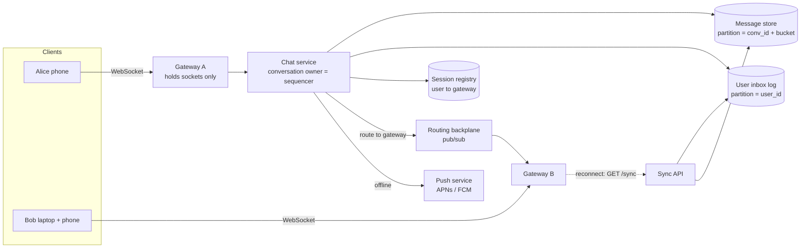
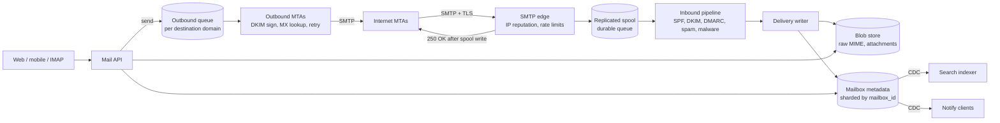
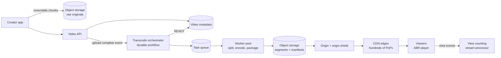
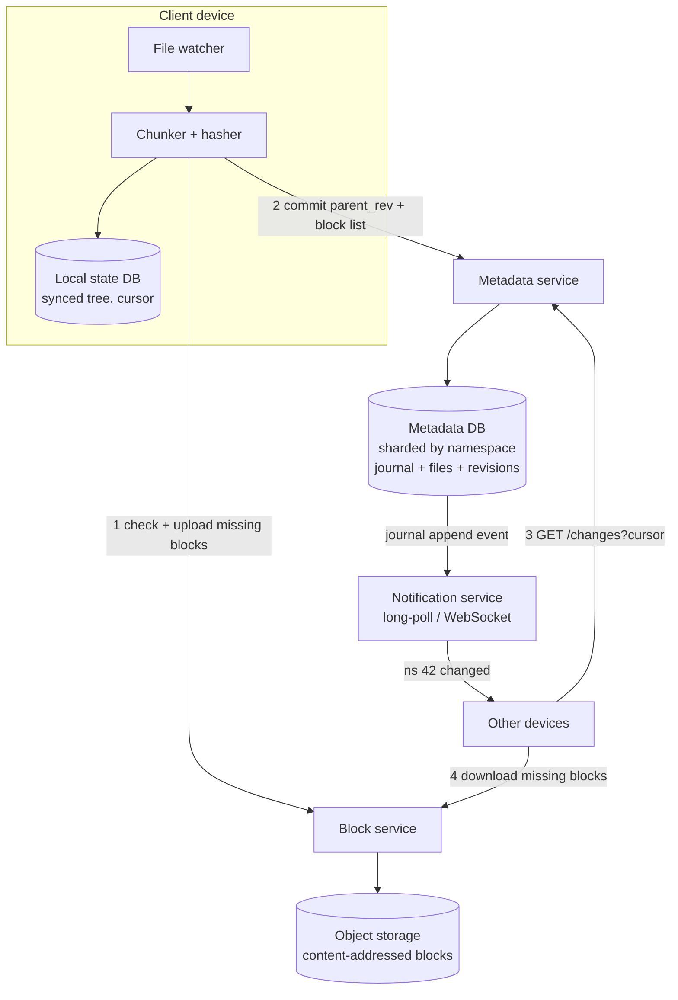
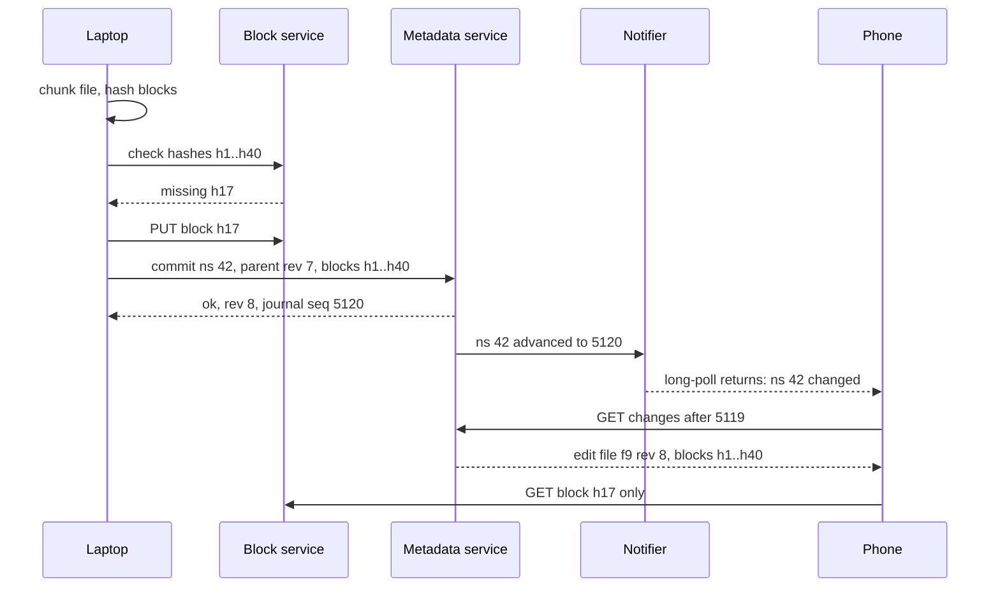
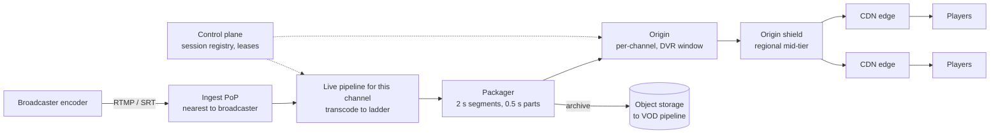

# Module 14 — Case Studies: Messaging and Media

## Module Introduction

**What this module is.** Five more complete designs built like the [Module 12 capstones](../12-capstones/README.md): numbers, the five questions, boxes, deep dives, a walk through every failure. No new patterns: every mechanism has a lesson in Modules 01–11 or a chapter in the DDIA notes (on Martin Kleppmann's *Designing Data-Intensive Applications*), linked rather than re-taught. What is new is the *shape*: all five move either **messages between people** or **large media files to many screens**.

**Analogy.** Five chess games from the same opening (a client that must stay in step with a server) branching into different middle games: tiny messages that must arrive in order, letters that must never be lost, films cooked once and served a billion times, folders identical on five devices, and a broadcast reaching twenty million people within seconds.

**The five designs**

| Case | Center of gravity (the main problem) | What decides the architecture |
|---|---|---|
| 1. Chat System | Ordered, deduplicated (no repeats) delivery to users whose sockets (open network connections) live on thousands of machines | Connection count and per-conversation ordering |
| 2. Email Service | "Never lose an accepted letter" while talking to an untrusted, slow internet | The SMTP (email protocol) durability boundary and deliverability (getting into inboxes, not spam) |
| 3. Video Platform | Pay once to transcode (convert into other formats and sizes), then serve a power-law audience (a few videos get most views) from the edge (servers near viewers) | Egress bandwidth (tens of Tbps, terabits per second) and encode compute |
| 4. File Sync & Storage | Many devices editing one tree, offline, with no silent data loss | Chunk-level dedupe (store identical pieces once) and the change journal (log of every change) |
| 5. Live Streaming | Seconds of latency (delay) to millions of simultaneous viewers of one stream | The latency budget and edge fan-out of one hot object |

**Four terms used throughout** (each taught in the linked lesson):
- **Fan-out:** one input producing many deliveries (one message to 500 group members; one segment to 20M viewers). See the news feed in [Module 12](../12-capstones/README.md).
- **Cursor:** a saved position in an ordered log ("seen everything up to sequence 4,812"); clients sync with "everything after my cursor". See [Cursor-Based Pagination](../08-api-and-edge/README.md#cursor-based-pagination) and DDIA's [partitioned logs](../../../ddia/chapters/11-stream-processing/README.md#partitioned-logs).
- **Blob vs metadata:** big immutable bytes (video, attachment, file chunk) vs small mutable facts about them (title, owner, labels, which chunks make version 7). Every case stores them in different systems.
- **Egress:** bytes leaving your servers toward users — the biggest bill for media, and why a **CDN** (a worldwide fleet of caches near users) exists ([CDN](../08-api-and-edge/README.md#cdn)).

Latency, throughput, cache, replication, sharding and load balancers are assumed; see [System Design Fundamentals](../00-system-design-fundamentals/README.md) if any are new.

**How to use this module.** As in Module 12: cover the page after each prompt and do stages 1–3 on paper first. Cases are independent; start with the one nearest your next interview. Chat and live streaming share connection-tier ideas; video and live share CDN and adaptive bitrate; email and file sync share the blob/metadata split.

**The stages used in every case** (Module 12's seven, with API and data model explicit):
1. Requirements and numbers
2. The five-questions pass
3. API
4. Data model
5. The architecture, annotated
6. Deep dives
7. The failure walk (scaling and failure)
8. Trade-offs
9. The follow-up questions
10. Pattern manifest and TL;DR

Scale figures are **assumptions chosen for the exercise**, rounded for easy arithmetic. Where a company has published its approach, the case cites its own write-up.

---

## Case 1 — Chat System

**The prompt (in short).** A messaging app like WhatsApp, Messenger or Slack DMs: 1:1 and group chats (up to 1,000 members), real-time delivery when online and on reconnect when not, history on every device, read receipts, online presence.

**What makes it hard.** Messages are tiny (a few hundred bytes). The hard parts: (1) **hundreds of millions of open connections** across thousands of machines, so "send to Bob" is a routing problem; (2) every participant sees a conversation **in the same order**, without gaps or duplicates, despite phones constantly dropping off; (3) **several devices** per user must converge on the same history.

### 1. Requirements and numbers
**Functional:** send/receive 1:1 and group messages (text plus media links); live delivery and offline catch-up; full history on all devices; delivered/read receipts; presence ("online", "last seen"); push notifications when the app is closed.

**Non-functional:** end-to-end delivery **p99 < 500 ms** when both are online; **no lost acknowledged messages**; per-conversation **total order**; duplicates never shown; high availability (a chat outage is front-page news).

**Numbers (assumptions):**
- **500M DAU × 40 messages/day** → **20B messages/day ≈ 230K/s average, ~700K/s peak** (3×).
- **~3** recipients per message on average (mostly 1:1) → **~2M deliveries/s at peak**.
- ~**300 bytes** per message with metadata → **6 TB/day**, **~2.2 PB/year** before replication (×3 → ~6.6 PB/year). History is kept forever, so storage grows linearly and **old data is almost never read**.
- ~30% of DAU online at peak = **150M sockets**. At a conservative **50K sockets per gateway** (a server that only holds client connections; smaller gateways mean fewer reconnects when one restarts) → **3,000 gateways** — the tier from [Bidirectional Streaming](../02-moving-data/README.md#bidirectional-streaming).
- Heartbeats (keepalive pings proving a connection is alive): 150M × one per 30 s = **5M pings/s**, which must be answered **at the gateway** — this alone rules out keepalives touching a database.

**What the numbers say:** per-message throughput is moderate; **connection count** and the **write-mostly, append-only history** decide the architecture.

### 2. The five-questions pass
- **Flow:** the sender's app sends over its WebSocket (a long-lived two-way connection) and waits only for a server ack ("stored, sequence 812"). Delivery is **asynchronous**; offline recipients get a push and fetch on reconnect ([Five Questions](../01-thinking-in-patterns/README.md#the-five-questions)).
- **Storage:** the **per-conversation message log** is the source of truth; unread counts, conversation list and search index are derived and rebuildable ([CQRS](../03-storing-data/README.md#cqrs)).
- **Speed:** the hottest read is "last 50 messages" on app open — one partition read.
- **Failure:** mobile networks drop constantly: design for **at-least-once delivery + dedupe**, never a perfect connection ([Idempotency](../05-reliability/README.md#idempotency)).
- **Growth:** connections grow with users, storage with time; hot spots are big groups and bursts (New Year's Eve).
- *Skeleton:* stateless-ish connection gateways (nothing that matters if they die), a session registry, a per-conversation sequencer, an append-only message store partitioned by conversation, and a per-user sync cursor.

### 3. API
Real-time traffic uses a small protocol over one WebSocket per device; bulky things use plain HTTPS.

| Direction | Frame / endpoint | Purpose |
|---|---|---|
| Client → server | `send {client_msg_id, conv_id, body, media_ref?}` | `client_msg_id` is a UUID the client generates once and reuses on every retry (an idempotency key) |
| Server → sender | `ack {client_msg_id, msg_id, seq, server_ts}` | "Stored durably; your message is number `seq` in this conversation" |
| Server → recipient | `msg {conv_id, seq, msg_id, sender, body, server_ts}` | Live delivery |
| Client → server | `receipt {conv_id, up_to_seq, kind: delivered/read}` | One receipt covers everything up to `seq` (cumulative, not per message) |
| HTTPS | `GET /sync?cursor=…` | Catch-up after reconnect: all changes after the device's cursor |
| HTTPS | `GET /conversations/{id}/messages?before_seq=…&limit=50` | Scroll back through history ([cursor pagination](../08-api-and-edge/README.md#cursor-based-pagination)) |
| HTTPS | `POST /media` → pre-signed upload URL (temporary, signed link allowing one upload) | Photos/videos go to blob storage, never through the socket |

### 4. Data model
- **`messages`** — partition key `(conv_id, bucket)`, clustering key `seq` descending. A **bucket** is a time or size slice (e.g. 10 days or 100K messages) so a busy conversation never becomes one unbounded partition. Columns: `msg_id, sender_id, body, media_ref, server_ts, flags (edited/deleted)`. An LSM-tree wide-column store (Cassandra/ScyllaDB/Bigtable-style) fits: append-heavy, read-recent ([SSTables and LSM-Trees](../../../ddia/chapters/03-storage-and-retrieval/README.md#sstables-and-lsm-trees)).

> **Key term — partition key, clustering key, wide-column, LSM-tree:** In a wide-column database such as Cassandra, the **partition key** decides which machine stores a row, and all rows with the same partition key sit together. The **clustering key** sorts rows within the partition, so "newest 50 messages" is one sequential read. An **LSM-tree** buffers writes in memory and flushes them as sorted files merged later, making writes very cheap. Discord describes exactly this key shape (channel + time bucket) in its engineering posts on storing billions and later trillions of messages.
- **`conversations`** — `conv_id → type (1:1/group), members, last_seq, created_at`. Small; relational or key-value.
- **`user_inbox`** (per-user change log) — partition `user_id`, clustering `inbox_seq`, rows `(conv_id, seq)` meaning "conversation X has a new message". A device's sync cursor is its last `inbox_seq`; this per-user read model makes multi-device sync one range scan.
- **`read_state`** — `(user_id, conv_id) → last_delivered_seq, last_read_seq`. Unread = `conv.last_seq − last_read_seq`, no counting.
- **`sessions`** (in-memory, with TTL) — `user_id → [(device_id, gateway_id)]`, written on connect, expired by missing heartbeats.

### 5. The architecture, annotated



One message from Alice to Bob:
1. Alice's phone sends `send{client_msg_id=u1, conv_id=c9, body}` to **Gateway A** — the "hold sockets, own nothing" tier, answering heartbeats locally.
2. Gateway A forwards to the **chat service instance owning `c9`**, assigned by [consistent hashing](../03-storing-data/README.md#consistent-hashing) on `conv_id`, so exactly one instance is each conversation's **sequencer** (Module 12's "ownership over agreement").
3. The owner dedupes `u1` against recent `client_msg_id`s, assigns `seq = last_seq + 1`, writes the message to the **message store** and a pointer row to each member's **inbox log**, and only then sends `ack{u1, seq=812}`. The ack is the durability promise.
4. It looks up Bob's devices in the **session registry** and publishes to their gateways via the **routing backplane** ([Publish-Subscribe](../02-moving-data/README.md#publish-subscribe)); Gateway B writes to both of Bob's sockets.
5. With no live session, the **push service** notifies via Apple/Google push (pipeline in the [notification capstone](../02-moving-data/README.md#capstone---designing-a-notification-system)); on open, Bob's app calls `GET /sync?cursor=…`.

**Per-user vs per-conversation routing.** Module 02 routed chat through *one topic per room* — ideal for big channels with most members online. For 500M users in mostly 1:1 chats that means billions of topics; **user → gateway** routing is cheaper. Real systems mix: per-user for DMs and small groups, per-channel topics for large busy rooms.

### 6. Deep dives

**Deep dive 1 — ordering and "exactly-once" display without distributed locks.**
- *Problem:* two group members send at the same instant via different gateways; per-gateway timestamps from clocks a few ms apart would give members different orders ([Unreliable Clocks](../../../ddia/chapters/08-trouble-with-distributed-systems/README.md#unreliable-clocks)).
- *Fix:* **one sequencer per conversation** assigns a gap-free increasing `seq`; order is defined by the sequencer, not clocks — DDIA's [sequence number ordering](../../../ddia/chapters/09-consistency-and-consensus/README.md#sequence-number-ordering) per conversation, cheap because one conversation's rate is small.
- *Duplicates:* the phone retries `send` without an ack (tunnel, timeout). The sequencer keeps the last few thousand `client_msg_id → seq` mappings per conversation, so a retry gets the **original ack back**. Delivery is at-least-once (a gateway may resend after reconnect), and recipients drop any `seq` they already have. **Idempotent send + dedupe on seq = messages appear exactly once**, though no hop is exactly-once ([Exactly-Once Semantics](../10-batch-and-streaming/README.md#exactly-once-semantics)).
- *Gaps:* a client holding 810 that receives 812 knows 811 is missing and fetches it — free gap detection.

**Deep dive 2 — offline catch-up and multi-device sync.**
- Each device keeps **one cursor** (its last `inbox_seq`). On reconnect `/sync` returns `(conv_id, seq)` pointers since the cursor (one range scan on `user_inbox`); the device fetches missing bodies, rejoins the live stream, and drops overlaps by `seq` — Module 02's "resume" recipe, per user so one call covers every conversation.
- A phone offline a week in 200 active groups may have 20K new messages: return **conversation summaries first** (last message + unread count) and fetch history lazily when a chat opens, keeping reconnect under a second.
- **Read receipts are cumulative** ("read up to 812"): 50 messages read, one frame. In large groups, receipts to the sender are aggregated ("read by 37") and throttled; per-member receipts in a 1,000-member group would multiply traffic 1,000×.
- Your *own* sent messages must reach your other devices, so the sender's inbox log gets a pointer too (read-your-writes across devices; DDIA's [reading your own writes](../../../ddia/chapters/05-replication/README.md#reading-your-own-writes)).

**Deep dive 3 — presence without a heartbeat storm.**
- *Naive:* broadcast every online/offline change to all contacts — with 150M users flapping on mobile, millions of fan-out events per second, mostly to people not looking.
- *Better:* presence lives in the in-memory **session registry** with a TTL (e.g. 60 s, refreshed on heartbeats); it is **pulled** when you open a chat or contact list and **pushed** only to clients with that chat open (a subscription dropped when the screen closes).
- Debounce flapping: publish "offline" only after TTL expiry, so a 5-second tunnel produces no events. Large groups show no per-member presence.
- Presence is **ephemeral**: never stored durably; losing it means seconds of wrong dots ([Graceful Degradation](../05-reliability/README.md#graceful-degradation)).

### 7. The failure walk
1. **A gateway dies** (1/3,000 of connections, ~50K users): clients reconnect elsewhere with **jittered backoff** ([Retry with Exponential Backoff](../05-reliability/README.md#retry-with-exponential-backoff)), re-register sessions, and `/sync` fills gaps. Nothing durable lived there. Deploys do the same: drain, send a "going away" frame, reconnect.
2. **A conversation owner (sequencer) dies:** the hash ring moves its conversations to a neighbour, which reads `last_seq` from the store before accepting writes. To prevent two owners during handover (a paused old owner waking up), writes are **conditional on `seq` not existing** or fenced with an ownership epoch that storage checks (DDIA's [truth is defined by the majority](../../../ddia/chapters/08-trouble-with-distributed-systems/README.md#the-truth-is-defined-by-the-majority) on fencing tokens). Senders see a ~1–2 s pause; retries are deduped.
3. **Message store slow:** the owner can't ack, so senders see "sending…" — correct: **never ack before durable**. A [circuit breaker](../05-reliability/README.md#circuit-breaker) stops piling onto the store; the client keeps the message in its local outbox and retries.
4. **Push provider outage (APNs/FCM — Apple Push Notification service, Firebase Cloud Messaging):** closed apps aren't notified, but nothing is lost; messages are in inbox logs for next open. Queue pushes with a short TTL — a notification about a two-hour-old message is noise.
5. **New Year's Eve, 5× traffic:** gateways pre-scaled on a calendar ([Auto-Scaling](../06-scaling/README.md#auto-scaling)); shed typing indicators, presence pushes and per-member group receipts first, messages last.
6. **A hot group** (1,000 members all replying): one sequencer handles hundreds of messages/s serially; the cost is fan-out to 1,000 members, so batch deliveries per gateway (one backplane message per gateway, not per member).

### 8. Trade-offs

| Decision | Chosen | Alternative | Why |
|---|---|---|---|
| Ordering | Per-conversation sequencer | Client or server timestamps | Clocks disagree; a single owner per conversation is cheap and gives gap detection |
| Delivery guarantee | At-least-once + dedupe by `client_msg_id` and `seq` | Exactly-once transport | No network is exactly-once; idempotency gives the same user-visible result |
| History storage | Wide-column LSM store, partition by `(conv, bucket)` | Relational DB | Append-heavy, range reads by recency, petabytes; joins not needed |
| Routing | Per-user session registry (+ topics for big channels) | One topic per conversation | Billions of mostly-idle 1:1 conversations |
| Server history | Stored server-side for multi-device | Store-and-forward then delete (WhatsApp's original model) | Multi-device sync needs a server copy; E2EE (end-to-end encrypted) variants encrypt it |
| Presence | Pull + subscribe while visible, TTL in memory | Broadcast every change | Presence churn would dominate traffic |

### 9. The follow-up questions
- **"Add end-to-end encryption?"** The server stores and routes **ciphertext** it can't read. The Signal Protocol (used by WhatsApp per its security whitepaper) establishes per-device keys; groups use sender keys so one encryption serves many recipients. Consequences: no server-side search or content moderation, and each device is a separate recipient (fan-out per device). *Trap:* claiming server-side search survives unchanged.
- **"How do you generate `msg_id`?"** A globally unique, roughly time-ordered 64-bit ID ([Snowflake-style](../13-case-studies-building-blocks/README.md#case-1--design-a-unique-id-generator)) for storage and dedupe, *separate* from `seq`, which defines in-conversation order. Don't order by the ID's timestamp.
- **"A user in 5,000 groups — does the inbox log explode?"** Only active conversations write to it, and it's trimmed once all the user's devices pass a point (plus a retention window). Very large broadcast channels (100K+ followers) switch to **pull**: members read the channel log directly (the news feed's push/pull hybrid).
- **"Edit and delete?"** Append an `edit`/`delete` event with its own `seq` referencing the original; history stays append-only and sync stays one cursor ([Event Sourcing](../03-storing-data/README.md#event-sourcing) thinking).
- **"Search chat history?"** A per-user index built asynchronously from the inbox log via [CDC](../10-batch-and-streaming/README.md#change-data-capture), partitioned by user so every query hits one shard (DDIA's [document-partitioned indexes](../../../ddia/chapters/06-partitioning/README.md#partitioning-secondary-indexes-by-document)).

### Pattern manifest

| Pattern | Where it served |
|---|---|
| Bidirectional Streaming | One WebSocket per device, own protocol (acks, seq, heartbeats, resume) |
| Publish-Subscribe | Routing backplane between chat service and gateways |
| Consistent Hashing + ownership | One sequencer per conversation |
| Idempotency | `client_msg_id` on send; dedupe by `seq` on delivery |
| Sharding | Messages by `(conv_id, bucket)`, inbox by `user_id` |
| CQRS | Inbox log, unread counts and search as derived read models |
| Cursor-Based Pagination | `/sync` cursor and history scroll-back |
| Retry with Backoff + jitter | Client reconnect after gateway loss |
| Graceful Degradation | Shed typing/presence/receipts before messages |
| Auto-Scaling (calendar) | Gateway tier before known peaks |

**Interview one-liner:** "Gateways hold sockets and own nothing; one sequencer per conversation assigns gap-free sequence numbers; messages are acked only after they're durable in an append-only log partitioned by conversation; delivery is at-least-once with dedupe by client ID and sequence; each device syncs with one cursor over a per-user inbox log."

### TL;DR
- **Problem:** 150M open sockets, per-conversation order, no loss, several devices per user.
- **Mechanism:** gateway tier + session registry + backplane; a per-conversation sequencer; wide-column message log keyed `(conv, bucket)`; per-user inbox log with device cursors; push notifications for offline users.
- **Hard parts:** ordering without clocks (sequencer), duplicates (idempotency keys), reconnect (cursor sync), presence (pull + TTL, never broadcast).
- **Price:** stateful connection tier, petabytes of mostly-cold history, and a protocol you own.

---

## Case 2 — Email Service

**The prompt (in short).** A large webmail provider like Gmail or Outlook.com: send and receive mail with anyone on the internet, read it in web and mobile apps, organise with folders or labels, search it, and filter spam and malware.

**What makes it hard.** You don't control the other side. Mail arrives from millions of foreign servers over **SMTP** (Simple Mail Transfer Protocol, [RFC 5321](https://www.rfc-editor.org/rfc/rfc5321); an **RFC** is a numbered internet-standards document), many hostile, and outgoing mail goes to servers that may be down for days or may decide you're a spammer. Inside, the problem is storage: years of mail per user with instant search.

### 1. Requirements and numbers
**Functional:** receive from the internet; send to any address; web/mobile clients list, read, thread, label, archive, delete; full-text search; attachments; spam and malware filtering; standard protocol access (IMAP, the protocol mail apps use to read server-held mail, and SMTP submission) for third-party clients.

**Non-functional:** **once accepted, never lost** (email's core promise); inbox **p99 < 300 ms**; search **< 1 s**; sending asynchronous but reliable (retries for days); strong consistency *within one mailbox* (archive on the phone, and the laptop must not still show it in the inbox a minute later).

**Numbers (assumptions):**
- **1B users**, each receiving **40 legitimate messages/day** and sending **10**.
- Assume **as many spam attempts as real mail**, mostly rejected at connection time. Accepted inbound: **40B/day ≈ 460K/s average, ~1.4M/s peak**. Outbound: **10B/day ≈ 115K/s average**.
- ~**30 KB** per stored message (headers + body + share of attachments, compressed) → **1.2 PB/day**, **~440 PB/year** before replication; per user ~1.2 MB/day, ~440 MB/year — plausible against multi-GB free quotas.
- ~**1 KB** metadata per message (IDs, sender, subject, snippet, labels, pointers) → **40 TB/day**: ~3% of bytes but ~100% of queries.
- Search index ≈ 20–30% of text size, built per mailbox.

**What the numbers say:** storage is enormous, but **every query is scoped to one mailbox** — the user is the natural shard key for almost everything.

### 2. The five-questions pass
- **Flow:** receiving: the remote server waits for our `250 OK` (SMTP's "accepted"); spam checks, indexing and notifications are asynchronous. Sending: the click returns once queued; delivery happens in the background with retries.
- **Storage:** source of truth is the **raw message (MIME blob: the standard email format with encoded attachments) + its per-mailbox metadata row**. Threads, label views, unread counts and the search index are derived.
- **Speed:** "first inbox page" and "open message" dominate — single-mailbox, recency-ordered.
- **Failure:** remote servers slow, down or malicious; queues with retries and backoff everywhere; spam filters may be unavailable.
- **Growth:** per-user storage grows forever; a few mailboxes (list archives, ticket systems) get millions of messages.
- *Skeleton:* an SMTP edge accepting into a replicated spool (a disk-backed holding area copied to several machines), an async processing pipeline, mailbox-sharded metadata + a blob store, per-mailbox search indexes, and an outbound queue retrying per destination.

### 3. API
Clients use JSON over HTTPS (modern designs resemble **JMAP**, the JSON Meta Application Protocol, [RFC 8620](https://www.rfc-editor.org/rfc/rfc8620)/[8621](https://www.rfc-editor.org/rfc/rfc8621)); third-party clients use IMAP ([RFC 9051](https://www.rfc-editor.org/rfc/rfc9051)) and SMTP submission on port 587.

| Endpoint | Purpose |
|---|---|
| `GET /threads?label=INBOX&cursor=…&limit=50` | Inbox page, newest first ([cursor pagination](../08-api-and-edge/README.md#cursor-based-pagination)) |
| `GET /messages/{id}` / `GET /messages/{id}/attachments/{n}` | Read a message; attachments stream from the blob store |
| `POST /messages/send` + `Idempotency-Key` header | Queue a message for sending; a double-click must not send twice ([Idempotency](../05-reliability/README.md#idempotency)) |
| `PATCH /messages/{id}` `{addLabels, removeLabels, read}` | Organise; label changes are the most frequent write |
| `GET /search?q=from:ana invoice after:2026/01/01` | Full-text + field search within the mailbox |
| `GET /changes?since=<state>` | Sync: "what changed since state X" (a per-mailbox cursor) |

### 4. Data model
Everything is keyed by `mailbox_id` (≈ user), so each mailbox lives on one shard ([Sharding](../03-storing-data/README.md#sharding)).
- **`messages`** — `(mailbox_id, message_id)` → `thread_id, received_at, from, to, subject, snippet, size, label_bits, blob_ref, spam_score, modseq`. `label_bits` is a bitset (one bit per label: INBOX, UNREAD, STARRED, user labels 1…n), so archiving flips a bit instead of moving data.
- **`label_index`** — `(mailbox_id, label, received_at DESC, message_id)`: the read model for "INBOX newest first", updated with `messages` in one single-shard transaction.
- **`threads`** — `(mailbox_id, thread_id)` → `last_received_at, message_ids, label_union`. Threading uses the `Message-ID`, `In-Reply-To` and `References` headers of [RFC 5322](https://www.rfc-editor.org/rfc/rfc5322), falling back to subject + participants.
- **`changes`** — per-mailbox append-only log of `(modseq, message_id, what changed)`. Every write increments the mailbox **modseq** (modification sequence; IMAP's CONDSTORE extension uses the same idea); clients sync with "changes after modseq 91,204".
- **Blob store** — immutable raw RFC 5322 bytes in object storage (e.g. Amazon S3). Attachments are **content-addressed** (key = SHA-256 of the bytes; identical data, identical key), so a 5 MB PDF sent to 2,000 employees is stored once, referenced 2,000 times.
- **Search index** — one inverted index (word → messages containing it) per mailbox, co-located with the mailbox shard.

### 5. The architecture, annotated



- **SMTP edge:** terminates TLS, checks the connecting IP against reputation lists (shared lists of known spam sources), applies per-IP [rate limits](../08-api-and-edge/README.md#rate-limiting), and rejects obvious junk **during the SMTP conversation** (the cheapest place to say no — nothing stored). It writes to a **replicated spool** and only then answers `250 OK`.
- **Inbound pipeline** (spool consumers, a [message queue](../02-moving-data/README.md#message-queue)): verifies sender authentication, scores spam, scans attachments for malware, applies user filters. Spam and phishing (fake mail tricking people out of passwords or money) classifiers are ML models served like any other ([Model Serving](../11-ai-era-systems/README.md#model-serving-and-batching)).
- **Delivery writer:** blob(s) first, then the metadata row and label index in one mailbox-shard transaction ("blob first, pointer last", so a crash never leaves a pointer to missing bytes). Idempotent on `(mailbox_id, message fingerprint)`.
- **Search indexer and notifications** consume the metadata change stream ([Change Data Capture](../10-batch-and-streaming/README.md#change-data-capture)); seconds of indexing delay are fine.
- **Outbound:** the API queues sent mail; outbound MTAs (mail transfer agents: servers relaying mail between domains) sign it, look up the recipient domain's MX records in DNS (the servers accepting that domain's mail), and deliver with retries.

### 6. Deep dives

**Deep dive 1 — the `250 OK` durability boundary.**
- In SMTP, `250 OK` after the message data means **"I have taken responsibility for this message"**; the sender deletes its copy, and RFC 5321 says the receiver must not lose it. So the spool is our [write-ahead log](../03-storing-data/README.md#write-ahead-log): the message must be durable on **at least two machines (ideally two zones — separate data-centre buildings with own power and network)** before we reply.
- Crash *after* writing but *before* the `250` arrives? The sender times out and retries, and we receive it twice: SMTP is **at-least-once** by design. The delivery writer dedupes on a fingerprint (`Message-ID` header plus a body hash, within a window of a few days) — the course's "idempotency under at-least-once" thread.
- Why not deliver into the mailbox before answering? Spam scoring and malware scanning can take seconds and SMTP senders time out. **Accept fast into a log, process asynchronously** — the [Message Queue](../02-moving-data/README.md#message-queue) lesson's core idea.

**Deep dive 2 — sending to an internet you don't control.**
- *Authentication:* receivers now require it. The sender's domain publishes **SPF** ([RFC 7208](https://www.rfc-editor.org/rfc/rfc7208): which IPs may send for it), signs each message with **DKIM** ([RFC 6376](https://www.rfc-editor.org/rfc/rfc6376): a private-key signature over headers and body, verifiable with the public key published in DNS), and publishes a **DMARC** policy (what receivers do when checks fail and where to send reports; first described in RFC 7489, now standardised as [RFC 9989](https://www.rfc-editor.org/rfc/rfc9989), 2026). Google's and Yahoo's 2024 bulk-sender requirements made all three effectively mandatory for large senders. Our inbound pipeline runs the same checks on others.
- *Retries:* destinations are often temporarily unavailable or reply `4xx` ("try later" — often deliberate *greylisting*: refusing the first attempt from an unknown sender, since real servers retry and many spam tools don't). RFC 5321 says the give-up time should generally be **at least 4–5 days** and the retry interval **at least 30 minutes** (smarter variable schedules allowed when the client knows why delivery failed). So outbound is a durable queue with [exponential backoff](../05-reliability/README.md#retry-with-exponential-backoff): e.g. a quick retry after a few minutes for greylisting, then every 30–60 minutes, growing toward a few hours. After give-up, or on a permanent `5xx`, the user gets a **bounce** (delivery status notification).
- *Per-destination backpressure:* a big receiver accepts only so many connections and messages per minute from one sender IP. Partition the outbound queue by **destination domain** ([Partitioned Consumption](../10-batch-and-streaming/README.md#partitioned-consumption)) with a concurrency limit per domain, so one slow or blocking domain builds its own backlog without blocking everyone ([Backpressure](../10-batch-and-streaming/README.md#backpressure), [Bulkhead](../05-reliability/README.md#bulkhead)).
- *Reputation:* receivers judge by IP and domain reputation. Separate IP pools for normal user mail vs. risky senders (new accounts, bulk), and rate-limit new accounts so one spammer can't damage the IPs everyone uses.

**Deep dive 3 — search inside one mailbox.**
- A global inverted index over all mail would force every query to filter by user and be written by everyone at once. Instead, **one small index per mailbox** on the mailbox's shard: DDIA's [document-partitioned secondary index](../../../ddia/chapters/06-partitioning/README.md#partitioning-secondary-indexes-by-document) — normally scatter-gather, but here **every query carries the partition key** (the user), so it hits one shard.
- Index asynchronously from the change stream; new mail is searchable within seconds, and a short "recent messages" scan merged into each query covers not-yet-indexed mail (so "I just got it but search can't find it" never happens).
- Attachments (PDFs, documents) are text-extracted in the pipeline and indexed too — the expensive part, allowed to lag more.

### 7. The failure walk
1. **A spool node dies:** the replica holds the messages; consumers resume from their last committed offset. Senders cut mid-transfer retry (by SMTP design).
2. **Spam classifier down:** failing *open* invites phishing; failing *closed* loses mail. Middle path: keep accepting into the spool (a buffer), hold unscored messages briefly, and if the outage persists deliver via a cheaper rule-based filter labelled "not fully scanned" ([Graceful Degradation](../05-reliability/README.md#graceful-degradation)). Executable attachments stay quarantined.
3. **A destination domain down two days:** its outbound partition grows; others are unaffected. The user gets "still trying" after a few hours and a bounce after give-up.
4. **Our sending IPs blocklisted:** move affected traffic to another IP pool while the cause (usually one compromised or spamming account) is found and suspended; per-account outbound limits prevent recurrence.
5. **A mailbox shard fails:** automatic failover ([Primary-Replica](../03-storing-data/README.md#primary-replica)); inbound for those mailboxes waits in the spool (lag, not loss); reads go to replicas, label writes wait for the new primary.
6. **A hot mailbox** (a support address receiving 2M messages/day): one shard key, so a per-mailbox delivery rate limit and a dedicated shard; beyond that, an archiving product. See DDIA's [hot spots](../../../ddia/chapters/06-partitioning/README.md#skewed-workloads-and-relieving-hot-spots).

### 8. Trade-offs

| Decision | Chosen | Alternative | Why |
|---|---|---|---|
| Shard key | `mailbox_id` | Message ID or time | Every query is per mailbox; no cross-shard reads |
| Accept path | Spool then `250 OK`, process async | Process fully before `250` | SMTP timeouts; decouple acceptance from slow scanning |
| Labels | Bitset on the message + label index | Copy messages between folders | Archive/label = flip a bit; one copy of the data |
| Attachments | Content-addressed blobs (dedupe) | One blob per message | Same file sent to thousands of people stored once |
| Search | Per-mailbox index, async | Global index | Queries always carry the user; smaller, isolated indexes |
| Spam outage | Buffer, then degrade with labelling | Fail open or fail closed | Neither losing mail nor delivering phishing is acceptable |

### 9. The follow-up questions
- **"How is this different from chat?"** Chat controls both ends and optimises latency; email federates with untrusted strangers and optimises **durability and deliverability**. Seconds to minutes of latency are fine; losing accepted mail is not.
- **"A 25 MB attachment sent to 5,000 people?"** Stored once, content-addressed, with a reference count or periodic mark-and-sweep GC (find all still-referenced blobs, delete the rest); each mailbox row points to it. Encrypt at rest; dropping the last reference makes it deletable.
- **"A user deletes a message — is it gone?"** Deletion flips a bit (Trash); after 30 days the row is removed and the blob reference dropped. Backups and replicas age out on their own schedule; for legal erasure use per-user keys and destroy the key (crypto-shredding, as in the Module 12 payments design).
- **"Stop your own users sending spam?"** New-account send limits, per-account outbound rate limits, outbound spam scoring (the same classifier pointed outward), separate IP pools.
- **"Push new mail to the phone?"** The metadata change stream feeds a notification service (Module 02 notification capstone); the phone syncs with `/changes?since=modseq` — the push is only a hint.

### Pattern manifest

| Pattern | Where it served |
|---|---|
| Write-Ahead Log | The spool: durable before `250 OK` |
| Message Queue | Inbound pipeline and outbound delivery |
| Idempotency | Dedupe of SMTP retries; send API idempotency key |
| Sharding | Everything keyed by mailbox |
| CQRS | Label index, threads, search index as read models |
| Change Data Capture | Metadata changes → search indexer, notifications |
| Retry with Backoff | Outbound delivery over days |
| Partitioned Consumption + Backpressure + Bulkhead | Outbound queue per destination domain |
| Rate Limiting | SMTP edge per IP; outbound per account |
| Graceful Degradation | Spam-filter outage handling |
| Primary-Replica | Mailbox shard failover |

**Interview one-liner:** "Accept mail into a replicated spool before saying 250, process spam and indexing asynchronously, shard everything by mailbox so every query hits one shard, store raw messages and attachments as content-addressed blobs, and send through a per-domain outbound queue that authenticates with SPF/DKIM/DMARC and retries for days."

### TL;DR
- **Problem:** never lose accepted mail, federate with an untrusted internet, and search years of mail per user.
- **Mechanism:** SMTP edge → replicated spool → async pipeline → blob store + mailbox-sharded metadata → per-mailbox search; outbound queue partitioned by destination with retries and authentication.
- **Hard parts:** the `250 OK` boundary (at-least-once + dedupe), deliverability (SPF/DKIM/DMARC, reputation, per-domain limits), per-mailbox search.
- **Price:** hundreds of petabytes per year, a spam arms race, and a reputation you can lose in an afternoon.

---

## Case 3 — Video Platform (YouTube-like)

**The prompt (in short).** A video-sharing platform: creators upload videos of any length; the platform processes them into formats every device can play; viewers anywhere stream smoothly on any connection, from a phone on 3G to a 4K TV.

**What makes it hard.** Two very different pipelines share one catalogue. **Upload and processing** is heavy background batch work: every uploaded hour is decoded and re-encoded into many versions. **Playback** is a bandwidth problem measured in **terabits per second**, with power-law popularity.

### 1. Requirements and numbers
**Functional:** resumable upload of large files; processing into multiple resolutions and codecs (a **codec** compresses and decompresses video, e.g. H.264); thumbnails; playback with **adaptive bitrate** (the player switches quality as bandwidth changes); seeking; metadata and view counts; basic moderation/copyright checks before publishing.

**Non-functional:** playback start **< 2 s**; **rebuffering** (video freezing while waiting for data) **< 0.5%** of watch time; uploads never restart from zero; new videos watchable within **minutes**; originals never lost; cost per view minimal.

**Numbers (assumptions):**
- **Viewing:** 500M DAU × 5 videos × 6 min = **15B minutes/day**. Average concurrency = 15B ÷ 1,440 ≈ **10M streams**, peak ~2× = **20M**. At **3 Mbps** → **~60 Tbps peak egress**, **~340 PB/day** delivered — no data centre can do this; it's a **CDN problem** first ([CDN](../08-api-and-edge/README.md#cdn)).
- **Uploads:** YouTube has said publicly (first in 2019, repeated on its official blog since) that more than 500 hours are uploaded every minute: **500 h/min = 720K hours/day**, ~**4M uploads/day ≈ 50/s** (10 min average).
- **Storage:** originals at ~10 Mbps ≈ 4.5 GB/hour → **3.2 PB/day**. An H.264 ladder (versions at different qualities) of five renditions (one encoded copy at a given resolution and bitrate) totals ~10 Mbps → another **~3.4 PB/day**. ~**2.4 EB/year** (1 EB = 1,000 PB) before replication — why rarely watched videos move to cheaper erasure-coded tiers (data plus parity pieces that can rebuild lost ones, far smaller than full copies).
- **Encode compute (assumption):** ~**10 CPU-core-hours** per video-hour for the H.264 ladder → 720K × 10 = **7.2M core-hours/day ≈ 300K cores around the clock**. Newer, more efficient codecs (VP9, AV1 — same quality in fewer bytes) cost several times more CPU, so not for everything.
- **Read:write** is extreme: encoded once, viewed perhaps millions of times.

**What the numbers say:** egress dominates cost and design (edge caching); encode compute is the second bill (be selective with expensive codecs); the metadata DB is small by comparison.

### 2. The five-questions pass
- **Flow:** upload is request-response per chunk; everything after "upload complete" (transcode, thumbnails, checks, publish) is an **asynchronous workflow**, with polling or notification when ready. Playback is plain HTTP GETs of small files from the nearest edge.
- **Storage:** originals and encoded segments are immutable blobs in object storage; the metadata DB holds titles, owners, status and renditions. View counts are a separate approximate pipeline.
- **Speed:** the hot read is "next 4-second segment of a popular video" from an edge cache; metadata pages use [Cache-Aside](../04-caching/README.md#cache-aside).
- **Failure:** a transcode worker dying retries only its task; a failed edge sends the player's next request elsewhere; the origin (the servers the CDN fetches from) must survive cache-miss storms.
- **Growth:** egress with watch time, encode compute with upload hours, storage forever.
- *Skeleton:* resumable chunked upload → object store → a transcoding DAG (steps with "must run before" arrows, no loops) on a worker pool → packaged segments + manifests (playlists of segments) → origin → CDN → adaptive-bitrate players.

### 3. API

| Endpoint | Purpose |
|---|---|
| `POST /videos {title, description, visibility}` → `{video_id, upload_url}` | Create the record (status `UPLOADING`) and hand out a resumable upload session |
| `PUT {upload_url}` with `Content-Range` (header saying which bytes this is) (or pre-signed multipart part URLs) | Upload in chunks of e.g. 8–16 MB; a dropped connection resumes from the last acknowledged byte. The open **tus** protocol and S3 multipart upload both work this way |
| `POST /videos/{id}/complete` | Upload finished; starts processing (idempotent) |
| `GET /videos/{id}` | Metadata, status (`PROCESSING`/`READY`/`FAILED`), and the **manifest URL** |
| `GET cdn…/{id}/master.m3u8` (HLS, Apple's streaming format) or `.mpd` (DASH, the open standard) | The manifest: list of renditions and their segments |
| `GET cdn…/{id}/720p/seg_00042.m4s` | One media segment; immutable, cacheable for a year |
| `POST /videos/{id}/views` (batched from the player) | Watch-time and view events for counting and recommendations |

Uploads go **directly from client to object storage** via pre-signed URLs; API servers never carry video bytes.

### 4. Data model
- **`videos`** (relational or key-value, sharded by `video_id`): `video_id, owner_id, title, description, status, duration, visibility, created_at, original_blob, manifest_path`.
- **`renditions`**: `(video_id, codec, height) → bitrate, segment_count, storage_path` — lets an AV1 ladder be added later without touching anything else.
- **`processing_tasks`**: `(video_id, task_id) → type, chunk_index, rendition, state, attempts, output_ref` — the workflow's durable state.
- **Object storage layout:** `raw/{video_id}`, `enc/{video_id}/{codec}_{height}p/seg_{n}.m4s`, `enc/{video_id}/master.m3u8`, `thumbs/{video_id}/{n}.jpg`. Segments are **write-once**, so any cache can keep them forever.
- **View counters**: not a column updated per view (a hot row for viral videos). View events flow into a stream processor that dedupes and aggregates per minute, then updates a counter store ([Stream Processing](../10-batch-and-streaming/README.md#stream-processing)).

### 5. The architecture, annotated



1. The creator app creates the video and uploads the original in chunks **straight to object storage**, resuming after drops.
2. Completion starts a **durable workflow** in the orchestrator (a [Saga](../07-consistency/README.md#saga)-style state machine whose every step is recorded before it runs).
3. The orchestrator splits the job into small tasks on a [queue](../02-moving-data/README.md#message-queue) for a large [auto-scaled](../06-scaling/README.md#auto-scaling) worker pool.
4. Workers write segments and manifests; once the required renditions exist, the video flips to `READY`.
5. Players fetch manifest and segments from the nearest **CDN edge**; misses go to a regional **origin shield** (a mid-tier cache collapsing edge misses), then the origin.

### 6. Deep dives

**Deep dive 1 — the transcoding pipeline as a parallel DAG.**
- *Serial is too slow:* at ~10 core-hours per video-hour, one machine takes hours on a 1-hour upload; creators expect minutes.
- *Split by time:* cut the original into **~10-second chunks at keyframe boundaries** (a keyframe/I-frame decodes on its own, so each chunk encodes independently). A 1-hour video → 360 chunks × 5 renditions = **1,800 independent tasks** of ~20 core-seconds; with enough workers encoding takes a couple of minutes, plus a final **stitch and package** into HLS/DASH. Facebook's SOSP 2017 paper on SVE (Streaming Video Engine) describes this split-encode-stitch design, starting processing while the upload is still arriving.
- *The DAG:* `validate → split → [encode chunk × rendition] → package → thumbnails → content checks → publish`. Content checks (copyright matching, safety classifiers) run in parallel with encoding; `publish` waits for both.
- *Reliability:* each task is **idempotent**, keyed by `(video_id, chunk, rendition)`, writing to a deterministic path, so a retry overwrites the same object ([Idempotency](../05-reliability/README.md#idempotency)). Workers take tasks under an expiring lease; a dead worker's lease lapses and another takes over. A repeatedly failing task (corrupt chunk) goes to a [dead letter queue](../05-reliability/README.md#dead-letter-queue) and the video is marked `FAILED` with a reason, not retried forever.
- *Publish early, improve later:* watchable once low and medium renditions exist; 1080p/4K minutes later. Only **popular** videos get expensive VP9/AV1 encodes — 5× the CPU pays off only when the bandwidth saving is multiplied by millions of views. Netflix's per-title encoding work applies the same logic to choosing bitrates per title.

**Deep dive 2 — adaptive bitrate streaming (ABR).**
- The video is not one file: each rendition is cut into **2–6 second segments** listed by a **manifest** (HLS: [RFC 8216](https://www.rfc-editor.org/rfc/rfc8216); MPEG-DASH: ISO/IEC 23009-1). Segments of all renditions align on the same timestamps, so the player can switch at any segment boundary.
- The player measures download throughput and watches its **buffer** (seconds downloaded but not yet played): plenty of buffer and fast downloads → step up; buffer draining → step down before it runs dry. This is **client-side backpressure**: the consumer picks the rate it can sustain.
- An example ladder (assumed numbers, H.264):

| Rendition | Bitrate | Typical use |
|---|---|---|
| 240p | 0.4 Mbps | Weak mobile signal |
| 360p | 0.8 Mbps | Mobile default on cellular |
| 480p | 1.4 Mbps | Small screens |
| 720p | 2.8 Mbps | Laptops |
| 1080p | 5 Mbps | TVs, good broadband |
| 2160p (4K) | 16 Mbps | Large TVs, popular content only |

- Start-up begins at a low rendition so the first frame appears in ~1–2 s, then climbs. Seeking just fetches a different segment number: no per-viewer server state, which is why plain HTTP caches can serve video.

**Deep dive 3 — the CDN and the long tail.**
- Segments, and manifests of finished videos, are immutable, so they get long cache lifetimes; an edge hit costs a few ms and no origin bandwidth.
- Popularity is skewed: the top few percent of videos take most watch time and live in edge caches; the **long tail** (millions of videos watched a few times a month) misses. Tiered caching (edge → regional shield → origin, each asked only when the one below misses) handles it: the shield turns 200 edge misses for one segment into one origin read ([Cache Stampede Prevention](../04-caching/README.md#cache-stampede-prevention) at CDN scale: request collapsing).
- Big platforms also **push** content: Netflix's Open Connect places its own caches inside ISPs (the companies connecting homes to the internet) and fills them with predicted-popular titles off-peak, so peak traffic never crosses the backbone.
- Cost lever: each 1% of edge hit rate on 340 PB/day is ~3.4 PB/day less origin traffic.

### 7. The failure walk
1. **Upload drops at 80%:** the client asks the session for the last committed offset and resumes; incomplete sessions expire after a day and their parts are garbage-collected.
2. **A transcode worker dies:** its lease expires; another re-runs just that ~20 core-second task, overwriting the same path. "Ready" comes slightly later.
3. **The orchestrator crashes:** state is durable in `processing_tasks`; a new instance resumes the DAG without re-encoding finished chunks.
4. **A viral video from an unknown creator:** cold at every edge at once. Shield-level request collapsing protects the origin; the popularity signal triggers pre-warming to more PoPs (points of presence, i.e. CDN sites) and queues the efficient-codec re-encode.
5. **A CDN PoP fails:** DNS or anycast (one IP announced from many sites) steers players to the next PoP; players retry the segment, perhaps dropping a rendition briefly. Very large platforms use **several CDNs**, switching by measured performance.
6. **Origin storage region outage:** originals and segments are replicated across regions; the shield tier fails over. Uploads queue client-side and retry ([Retry with Backoff](../05-reliability/README.md#retry-with-exponential-backoff)).
7. **View counter lag:** displayed counts may be minutes stale ("approximately 1.2M views"); anti-fraud filtering runs in the stream job before publishing.

### 8. Trade-offs

| Decision | Chosen | Alternative | Why |
|---|---|---|---|
| Upload path | Client → object storage via pre-signed, resumable parts | Through API servers | Keeps multi-GB bodies off app servers; resumable |
| Encoding | Chunked, parallel DAG | One job per video | Minutes, not hours; retries are small |
| Codec strategy | Cheap ladder for all, efficient codecs for popular | Best codec for everything | CPU cost vs bandwidth saved scales with views |
| Delivery | HTTP segments + ABR via CDN | Custom streaming servers per viewer | Stateless, cacheable, works with any HTTP cache |
| Segment length | 4–6 s (VOD) | 1–2 s | Fewer requests and better compression; latency is not critical for VOD (video on demand, i.e. pre-recorded) |
| View counts | Approximate, streamed | Exact counter update per view | Avoid a hot row; tolerate minutes of staleness |

### 9. The follow-up questions
- **"Stop people downloading paid videos?"** Encrypt segments (e.g. CENC/AES, the common video encryption scheme), release keys only via a DRM (digital rights management) licence server after authorisation, and use signed expiring CDN URLs or cookies. You raise the cost of copying; you can't prevent it.
- **"Count views correctly?"** Define a view (e.g. ≥ 30 s watched), dedupe per session in a [stream processor](../10-batch-and-streaming/README.md#stream-processing) window, filter bots, publish with a lag. Exact per-event counting in the metadata row makes every viral video a hot key.
- **"Why not 1-second segments for faster start?"** Many more requests per viewer (CDN request cost and overhead), worse compression (each segment starts with a keyframe), more manifest churn. Fix start-up with a low starting rendition and a well-placed edge.
- **"Thumbnails and previews?"** A DAG task extracts frames at intervals; hover previews use a sprite sheet (many small frames in one image) so the player fetches one file.
- **"Add live streaming?"** Same segments, manifests and CDN, but a continuous real-time pipeline with tight latency budgets: Case 5.

### What the real YouTube does differently
The design above is what a strong team builds from general-purpose parts. YouTube runs inside Google, and its published work shows where scale made it build its own. Each difference is a lesson about **which cost dominates at the extreme**:

| Area | Our design | What YouTube has published | Why it pays off at their scale |
|---|---|---|---|
| **Transcoding hardware** | Hundreds of thousands of CPU cores running encoders | A custom chip, the **VCU** (video coding unit), deployed in Google's data centres; the ASPLOS 2021 paper reports **20–33× better efficiency** than its tuned CPU baseline, measured on live production jobs | Encode compute is the second-largest bill. Once it is 20× cheaper, the "efficient codecs only for popular videos" rule in deep dive 1 can be relaxed and many more videos get the better codecs |
| **Codecs** | H.264 everywhere, VP9/AV1 selectively | Google created **VP9**, and is a founding member of the Alliance for Open Media behind **AV1**; both are royalty-free and served to devices that can decode them | Fewer bytes per minute of video cut the egress bill, which is the largest one; owning the codec avoids per-unit licence fees |
| **Delivery** | A CDN with edge, shield and origin tiers | Google's own edge network plus **Google Global Cache (GGC)**: Google-run cache servers placed *inside* ISPs' networks. Google's ISP documentation says typically **70–90%** of the cacheable traffic it sends to a GGC-hosting ISP is then served from those caches | At tens of Tbps, buying CDN capacity costs more than building it, and caching inside the ISP removes the transit link (the paid connection between networks) from the path entirely. Same idea as Netflix Open Connect in deep dive 3 |
| **Metadata database** | "Relational or key-value, sharded by `video_id`" | YouTube outgrew a single MySQL primary and created **Vitess** in 2010: a proxy layer that routes queries to the right MySQL shard so application code no longer has to. It later became an open-source CNCF project (graduated 2019) | Keeps SQL and MySQL operational knowledge while sharding becomes the database layer's job, not every developer's |
| **Recommendations** | Not covered: the API only lists and plays videos | The home page and the "up next" list are driven by a recommender. The published system (Covington et al., RecSys 2016) has two stages: **candidate generation** cuts millions of videos to hundreds per user, then a **ranking** network scores those, trained to predict **expected watch time** rather than clicks | Ranking for watch time instead of clicks discourages clickbait. The two-stage funnel is the same one used in [Case 5 of Module 20](../20-case-studies-content-search-and-platforms/README.md#case-5--microblogging-twitterx-like) |
| **Copyright** | "Basic moderation/copyright checks" in the DAG | **Content ID**: rights holders upload reference files, every upload is scanned against them, and a match applies the owner's chosen policy: block, monetize (run ads, sometimes sharing revenue with the uploader) or track viewing statistics, possibly different per country | Copyright matching is part of the business model (rights holders earn from matches), so it runs on every upload as a first-class pipeline stage, not as an afterthought |

**What this changes in an interview answer.** Don't propose custom chips or your own CDN for a new product; the generic design is right until the bills are enormous. But show the **break-even logic**: when egress or encode cost is the biggest line on the bill, vertical integration (own hardware, network or codecs) starts to pay for itself, and the two-stage recommender is the real product surface on top of the pipes.

*Sources:* P. Ranganathan et al., "Warehouse-Scale Video Acceleration: Co-design and Deployment in the Wild", ASPLOS 2021 (research.google/pubs/pub50300); Google, "Google Global Cache" overview (support.google.com/interconnect/answer/9058809); Vitess, "History" (vitess.io/docs/overview/history) and CNCF graduation announcement (2019); P. Covington, J. Adams, E. Sargin, "Deep Neural Networks for YouTube Recommendations", RecSys 2016; YouTube Help, "How Content ID works" (support.google.com/youtube/answer/2797370); Alliance for Open Media (aomedia.org).

### Pattern manifest

| Pattern | Where it served |
|---|---|
| CDN (tiered: edge → shield → origin) | All playback; request collapsing on misses |
| Message Queue + Auto-Scaling | Transcode task queue and worker pool |
| Saga / durable workflow | The processing DAG with recorded steps |
| Idempotency | Deterministic task outputs; `complete` call |
| Dead Letter Queue | Corrupt chunks don't block the pipeline |
| Backpressure (client-side) | ABR player picks the rendition it can sustain |
| Cache-Aside | Metadata and watch pages |
| Stream Processing | View counting and anti-fraud |
| Retry with Backoff | Resumable upload, segment retries |
| Sharding | Metadata by `video_id` |

**Interview one-liner:** "Upload resumably straight to object storage, transcode as a parallel DAG of small idempotent chunk tasks, publish immutable HLS/DASH segments at several bitrates, and let adaptive players pull them through a tiered CDN; spend expensive codecs only where views repay them."

### TL;DR
- **Problem:** encode once at high CPU cost, then deliver tens of Tbps to a power-law audience.
- **Mechanism:** resumable uploads → chunked parallel transcoding workflow → segments + manifests in object storage → origin shield → CDN edges → ABR players.
- **Hard parts:** encode latency and reliability (split, retry per task), smooth playback (ABR), egress cost and the long tail (tiered caching, push to ISPs, selective codecs).
- **Price:** exabytes of storage, hundreds of thousands of cores, and a CDN bill that dwarfs everything else.

---

## Case 4 — File Sync and Storage (Google Drive / Dropbox-like)

**The prompt (in short).** A cloud drive: a folder identical on laptop, phone and web; offline edits; shared folders; old versions recoverable; large files.

**What makes it hard.** It looks like "upload files", but it is a **replicated database of file trees** where every device is a replica that can be offline for days and return with its own changes. Upload only what changed (not a whole 2 GB file for a one-line edit), keep every device converging on the same tree, and **never silently discard** anyone's edit.

### 1. Requirements and numbers
**Functional:** upload/download files of any size; automatic sync across devices; offline edits synced later; shared folders; version history and restore; trash; a change feed for web and mobile apps.

**Non-functional:** **durability above all** (losing a file is unforgivable); changes visible on other online devices within **~10 s**; bandwidth-efficient (only changed parts move); conflicts **visible, never silently resolved** by discarding data; multi-GB files and folders of hundreds of thousands of files.

**Numbers (assumptions):**
- **500M registered users, 100M DAU, ~3 devices each** → ~300M devices, most holding an idle notification connection.
- **5 GB average per user** → **2.5 EB logical**; deduplication saves perhaps **20–30%**.
- **2,000 files per user** → **1 trillion file entries**; at ~500 bytes each, ~**500 TB of metadata** (plus revisions) — small next to the blobs, but where all logic and queries live.
- Each DAU saves **20 files/day** → **2B commits/day ≈ 23K/s average, ~70K/s peak**. With chunk dedupe, a save uploads ~**100 KB** new data → **~200 TB/day** of new blocks.
- Change fan-out: each commit notifies the owner's other devices and every member device of a shared folder — typically ~3, occasionally tens of thousands.

**What the numbers say:** blob storage is solved (object storage); the design is the **metadata and sync protocol**: 70K atomic commits/s against a trillion-entry namespace, and a change feed for 300M devices.

### 2. The five-questions pass
- **Flow:** the client uploads missing blocks, then makes one synchronous **commit**; other devices learn asynchronously (a "something changed" hint, then a pull).
- **Storage:** two stores in strict order: **blocks** (immutable, content-addressed bytes) and **metadata** (tree, revisions, per-namespace change journal). The journal is the source of truth for "what the folder looks like".
- **Speed:** hottest operations: "anything changed since my cursor?" (journal) and "do you have these block hashes?" (key lookup).
- **Failure:** devices go offline mid-upload, two devices edit the same file, a buggy client tries to delete everything. Every write is a conditional commit against a known revision.
- **Growth:** storage forever; metadata with file count; hot spots are huge shared folders (a whole company in one namespace).
- *Skeleton:* client-side chunking and hashing → block service over object storage → metadata service with per-namespace journals → notification service → clients pull changes with a cursor.

### 3. API

| Endpoint | Purpose |
|---|---|
| `POST /blocks/check {hashes: [...]}` → `{missing: [...]}` | Which of my blocks does the server not have yet? |
| `PUT /blocks/{sha256}` (to a block server, often via pre-signed URL) | Upload one block; the server recomputes the hash and rejects mismatches |
| `POST /commit {ns_id, path, parent_rev, blocks: [...], size, mtime}` | Atomically create a new revision; `409 Conflict` (HTTP error: your base version is out of date) if `parent_rev` is no longer current |
| `GET /changes?cursor=…` | Journal entries after the cursor, paginated ([cursor pagination](../08-api-and-edge/README.md#cursor-based-pagination)); returns a new cursor |
| `GET /changes/wait?cursor=…` (long-poll, ~60 s: the server holds the request open until there is news) | Returns early as soon as anything changes; the client then calls `/changes`. Dropbox's public API has a long-poll endpoint of this kind, and Google Drive's API offers `changes.list` with a page token plus push "watch" channels |
| `GET /files/{id}?rev=…` → block list | Download: fetch blocks (from a CDN or block servers) and reassemble |
| `POST /shares {ns_id, member, role}` | Share a folder |

### 4. Data model
- **Namespace:** the unit of sharing and ordering. Each user has a root namespace; **each shared folder is its own namespace** mounted into every member's tree. All metadata is sharded by `ns_id`, so every commit touches one shard ([Sharding](../03-storing-data/README.md#sharding)).
- **`journal`** — `(ns_id, seq) → file_id, op (add/edit/move/delete), rev, path, block_list_ref, author_device, ts`; append-only with gap-free `seq` per namespace. A device's **cursor** is a small map `{ns_id → last seq seen}`.
- **`files`** — `(ns_id, file_id) → parent_id, name, current_rev, size, is_deleted`: the current tree, a read model of the journal kept in the same transaction.
- **`revisions`** — `(file_id, rev) → block hashes[], size, mtime, author`. History = older rows; restore = a new commit pointing at an old block list (no data copied).
- **`blocks`** — `sha256 → storage location, size, refcount` (or no refcount; see GC below). Bytes live in object storage, encrypted at rest.
- Commits need single-shard transactions (check `parent_rev`, append journal, update `files`), so a sharded relational database fits.

### 5. The architecture, annotated



The key rule is the step order: **blocks first, metadata last**. A commit is accepted only if every referenced block exists, so no device ever sees a file pointing at missing bytes. A crash between upload and commit leaves only unreferenced blocks, which GC removes.

*One save, end to end:*



### 6. Deep dives

**Deep dive 1 — chunking, deduplication and delta sync.**
- Files split into **blocks** named by the SHA-256 of their contents (**content addressing**): identical blocks share a name, are stored once, and a client uploads only blocks the server reports missing. Dropbox has described storing file data as blocks of up to 4 MB addressed by hash in its posts on its Magic Pocket storage system.
- **Fixed-size blocks' weakness:** insert a few bytes near the start and every later boundary shifts, so every later block looks new. **Content-defined chunking** (CDC; not change data capture) places a boundary wherever a rolling hash (cheaply updated as a window slides over the bytes) of the last few dozen bytes matches a pattern; boundaries depend on content, so they re-align almost immediately after an insertion. The idea comes from the LBFS paper (Muthitacharoen, Chen and Mazières, SOSP 2001); rsync (Tridgell and Mackerras, 1996) solves the related shifted-match problem with a rolling checksum.
- Simulation ([`code/chunking.py`](code/chunking.py), run with `.venv-books/bin/python`): a random 1 MB file, 5 bytes inserted in the middle, ~4 KiB chunks (scaled down from multi-MB blocks so the effect shows).

```text
fixed 4 KiB              chunks= 245  new chunks to upload= 123  bytes to upload=500,293
content-defined ~4 KiB   chunks= 189  new chunks to upload=   1  bytes to upload=10,626
```

  Fixed blocks re-upload half the file (everything after the edit); CDC, one chunk.
- *Dedupe scope is a security decision.* If the server dedupes **across users** and tells the client "I already have this block", an attacker can test whether *anyone* holds a given file (a known confidential document) by trying to upload it. Safer: dedupe within a user or organisation, or always upload and dedupe silently server-side.
- *Garbage collection:* blocks are shared, so deleting a file can't delete its blocks directly. Use transactional reference counts or periodic **mark-and-sweep** (mark blocks referenced by any live revision; delete unmarked blocks older than a grace period, so blocks for a not-yet-landed commit survive).

**Deep dive 2 — the change journal, cursors and conflicts.**
- Every namespace has a **gap-free journal**; a device syncs by reading entries after its cursor — DDIA's [log-based](../../../ddia/chapters/11-stream-processing/README.md#partitioned-logs) replication with the device as follower. One ordered journal per namespace means all devices apply the same operations in the same order and converge.
- **Commits are conditional** on `parent_rev` ("make rev 8, based on rev 7"): compare-and-set, DDIA's answer to [lost updates](../../../ddia/chapters/07-transactions/README.md#preventing-lost-updates). If laptop and phone both edited rev 7 offline, the first commit becomes rev 8; the second gets `409 Conflict`.
- **The loser is never discarded.** The client commits it as a sibling ("report (Phone's conflicted copy 2026-09-28).docx"), as Dropbox does. Automatic merging only fits formats the system understands (a collaborative editor uses operational transforms or CRDTs — a different product). Compare Module 07's [Vector Clocks](../07-consistency/README.md#vector-clocks): detect concurrency, keep both siblings, let someone merge; DDIA covers the same choice in [handling write conflicts](../../../ddia/chapters/05-replication/README.md#handling-write-conflicts).
- **Tree operations are the subtle part.** "A renames folder X while B adds a file inside X" or "A deletes X while B moves a file into X" must never lose the file. Treat moves as operations on stable `file_id`s (not paths), apply in journal order, and resolve "parent was deleted" by restoring the parent. Dropbox's blog on rewriting its sync engine (Nucleus) models client state as three trees (remote, local, last-synced) and derives operations from their differences — worth reading for how hard this gets.
- **Safety valves:** a client bug deleting 50,000 files syncs faithfully, so keep deletes recoverable (trash + history) and flag unusually large delete batches for confirmation.

**Deep dive 3 — notifications to 300M devices.**
- The notification service sends only a hint ("namespace 42 now at seq 5,120"); the device pulls from the journal with its cursor. Hints can be lost, duplicated or coalesced harmlessly, because the journal is the truth (the "transport isn't the truth" rule from [Bidirectional Streaming](../02-moving-data/README.md#bidirectional-streaming)).
- Idle devices hold a long-poll or WebSocket to a notification gateway, which subscribes to its devices' namespaces ([Publish-Subscribe](../02-moving-data/README.md#publish-subscribe)).
- **Hot namespace:** a 20,000-member company folder with constant edits. Coalesce hints (at most one per namespace per second per device) and add client **jitter** before pulling so 20,000 devices don't hit one shard in the same millisecond ([Cache Stampede Prevention](../04-caching/README.md#cache-stampede-prevention) instinct). Very large namespaces get dedicated metadata shards.

### 7. The failure walk
1. **Upload interrupted:** uploaded blocks stay; on retry `/blocks/check` reports only the rest missing. Commit happens once, at the end.
2. **Commit times out — did it apply?** The client retries with the **same commit ID** (idempotency key); the service returns the original result instead of creating rev 9 ([Idempotency](../05-reliability/README.md#idempotency)).
3. **Metadata shard primary fails:** failover ([Primary-Replica](../03-storing-data/README.md#primary-replica)); that namespace's commits pause for seconds while clients back off. Journals need synchronous replication (or a consensus-replicated log), because an acknowledged commit that vanishes would make devices diverge.
4. **Notification service down:** devices poll `/changes` every few minutes — slower, not wrong ([Graceful Degradation](../05-reliability/README.md#graceful-degradation)).
5. **Block storage region lost:** blocks are replicated or erasure-coded across zones and regions; a commit is acknowledged only once its blocks are durable.
6. **A device offline three months:** its cursor may point at compacted-away journal entries. The server answers "cursor too old" and the client does a **full resync**: list the current tree, compare by hash with local state, upload or download differences (conflicted copies for anything edited on both sides).
7. **Hash collision fear:** an accidental SHA-256 collision is not a realistic risk; the server still verifies each uploaded block's hash so a buggy or malicious client can't store bytes under someone else's name.

### 8. Trade-offs

| Decision | Chosen | Alternative | Why |
|---|---|---|---|
| Storage unit | Content-addressed blocks | Whole files | Dedupe, resumable upload, delta sync |
| Chunking | Content-defined (or fixed + rsync-style deltas) | Plain fixed blocks | Insertions don't shift every later block |
| Consistency unit | Per-namespace journal with gap-free `seq` | Global ordering | One shard per commit; total order only where needed |
| Concurrent edits | Conditional commit + conflicted copy | Last-writer-wins (newest write silently replaces the others) | Never silently discard a user's work |
| Change propagation | Hint + pull with cursor | Push full changes | Hints may be lost; the journal is the truth |
| Dedupe scope | Per user/organisation | Global | Global dedupe leaks whether others have a file |

### 9. The follow-up questions
- **"How is this different from S3?"** S3 (Amazon's object storage) stores objects by key: no tree, devices, sync or conflict handling. This system *uses* object storage for blocks and adds the journal and sync protocol.
- **"A 50 GB file?"** Just 12,500 blocks of 4 MB, uploaded in parallel and resumably, then one commit; the metadata row stays small by pointing at a block-list object.
- **"Sharing permission changes?"** Permissions live on the namespace; removing a member unmounts it via a journal entry in their root namespace, and the block service checks access on every download (signed short-lived URLs).
- **"Real-time co-editing like Google Docs?"** A different product: character-level operations over a WebSocket, merged with operational transforms or CRDTs, stored as an operation log. File sync treats files as opaque blobs.
- **"Ten laptops on one office LAN syncing the same folder?"** Peers fetch blocks from each other, verified by hash (the hash is the name). Dropbox shipped LAN sync on this principle.

### Pattern manifest

| Pattern | Where it served |
|---|---|
| Sharding | Metadata by namespace |
| Write-Ahead Log / event log | Per-namespace journal as the source of truth |
| CQRS | `files` tree as a read model of the journal |
| Idempotency | Commit IDs; content-addressed blocks are naturally idempotent |
| Vector Clocks' rule (keep siblings) | Conflicted copies instead of last-writer-wins |
| Publish-Subscribe | Notification hints to device gateways |
| Cursor-Based Pagination | `/changes?cursor` |
| Cache Stampede Prevention (jitter, coalescing) | Hot shared namespaces |
| Graceful Degradation | Polling fallback when notifications are down |
| Primary-Replica | Metadata shard failover |

**Interview one-liner:** "Split files into content-addressed blocks so only new blocks move; upload blocks first and commit metadata last with a conditional, per-namespace journal append; other devices get a hint and pull changes with a cursor; concurrent edits become conflicted copies, never silent overwrites."

### TL;DR
- **Problem:** many devices, often offline, must converge on the same file tree without losing anyone's edits, and without re-uploading whole files.
- **Mechanism:** client chunking + hashing → block service → conditional commit into a per-namespace journal → hint via long-poll → pull with cursor → download missing blocks.
- **Hard parts:** content-defined chunking and dedupe (with its privacy catch), conflicts and tree operations, notification fan-out on huge shared folders.
- **Price:** a trillion-row metadata store, a sync engine on every client (the hardest code in the product), and garbage collection of shared blocks.

---

## Case 5 — Live Streaming

**The prompt (in short).** Live video in two shapes on one platform: (a) a creator platform like Twitch, ~100K channels live at once, most with a handful of viewers; (b) a sports event like a cricket final, **one** stream watched by **20M+ people at the same moment**. Viewers see the action within seconds.

**What makes it hard.** Case 3 had hours to prepare each video and a warm CDN. Live has **no preparation time**: each segment is created, encoded, packaged and distributed within seconds, and in the big event every viewer requests **the same brand-new file at the same instant**. Shape (a) is a cost problem (100K real-time encoders); (b) is a thundering-herd problem (a crowd hitting the same thing at once: one hot object, tens of Tbps).

### 1. Requirements and numbers
**Functional:** broadcasters send from software or hardware encoders; viewers watch in real time with adaptive quality; a short rewind window (DVR); the recording becomes a normal video afterwards; live chat alongside (Case 1); viewer counts.

**Non-functional:** **glass-to-glass latency** (camera to viewer screen) **~3–5 s** for interactive creator streams, up to ~10–20 s acceptable for mass sports if it buys smoothness; **rebuffering < 1%**; the big event must not fail (no second chance); a broadcaster's brief network drop must not end the stream.

**Numbers (assumptions):**
- **Creator shape:** 100K channels × 6 Mbps source = **600 Gbps ingest** (incoming broadcaster streams). A 4-rung real-time ladder costs (assume) **~4 CPU cores per channel** → **400K cores** if everyone got one. Most channels have under 10 viewers, so full ladders only above a viewer threshold; the rest get source quality plus one low rendition, or hardware encoders.
- **Event shape:** **25M concurrent viewers** — realistic: Disney+ Hotstar reported ~25 million concurrent viewers for a 2019 World Cup match and ~**59 million** for the 2023 Cricket World Cup final. At **3 Mbps** → **75 Tbps** for one stream.
- **The herd:** with 2-second segments, each new segment is requested by up to 25M players within the same ~2 s: **~12M requests/s for a handful of URLs**, plus manifest refreshes at the same rate.
- **The "play" spike:** at kick-off (and after rain delays or wickets) millions press play within a minute; the **API tier** (login, entitlement checks — "has this user paid?" — manifest URLs) peaks here, not during steady viewing.

**What the numbers say:** the creator shape is priced by **transcode cost**; the event shape is decided by **edge fan-out of one hot object** and **pre-scaling the control plane** (the coordinating services, vs. the data plane moving video bytes) for a known moment.

### 2. The five-questions pass
- **Flow:** broadcaster → ingest is a long-lived push stream; viewers pull segments over HTTP (so every CDN can help); control actions (start stream, get manifest URL) are request-response.
- **Storage:** live segments are **ephemeral** (kept for the DVR window, e.g. 2 hours); the archive goes to object storage for VOD; a small session registry is the source of truth for "who is live where".
- **Speed:** latency is the product; every stage gets a millisecond budget.
- **Failure:** the broadcaster's uplink is the weakest link; a transcoder crash must not end the stream; the big event needs redundancy at every layer.
- **Growth:** creator side with channel count (encode cost); event side with concurrent viewers (egress + herd).
- *Skeleton:* ingest PoPs → per-channel real-time pipeline (transcode + package into short segments) → origin → origin shield → CDN edges with request collapsing → low-latency ABR players.

### 3. API

| Interface | Purpose |
|---|---|
| `POST /channels/{id}/stream-key` | Create or rotate the secret key that authorises a broadcaster (store only its hash) |
| Ingest: `rtmp(s)://ingest.example.net/live/{stream_key}` or SRT / WHIP | Broadcaster pushes the stream. **RTMP** (Real-Time Messaging Protocol) is the long-standing default in encoder software; **SRT** (Secure Reliable Transport) adds packet recovery over lossy networks; **WHIP** ([RFC 9725](https://www.rfc-editor.org/rfc/rfc9725), 2025) is the IETF (internet standards body) standard for WebRTC-based ingest (WebRTC = the browser technology for real-time audio/video) |
| `GET /live/{channel}/master.m3u8` (or `.mpd`) | The live manifest; refreshed by the player every segment |
| `GET cdn…/{channel}/{rendition}/{segment}.m4s` | Media segments (and partial segments for low latency) |
| Webhooks (HTTP calls the platform makes to your server when something happens)/events `stream.online`, `stream.offline` | Tell followers, start/stop the archive, update listings |
| `POST /live/{channel}/heartbeat` (every 30–60 s, batched) | Viewer counts and quality metrics |

### 4. Data model
- **`channels`** — `channel_id → owner, stream_key_hash, transcode_tier, latency_mode, settings`.
- **`live_sessions`** — `session_id → channel_id, started_at, ingest_pop, pipeline_id, status (starting/live/reconnecting/ended), renditions, archive_path`.
- **Pipeline assignment** — which transcoder owns which session, held as a **lease** in a coordination service (ZooKeeper or etcd; one owner at a time; DDIA's [membership and coordination services](../../../ddia/chapters/09-consistency-and-consensus/README.md#membership-and-coordination-services)).
- **Segments** — on the packager/origin's local SSD or memory for the DVR window, named by **media timestamp** (e.g. `720p/t_000123456.m4s`), not an arbitrary counter, so two redundant pipelines produce identical names for identical moments.
- **Viewer counts** — approximate, from player heartbeats aggregated per channel per 30 s in a [stream processor](../10-batch-and-streaming/README.md#stream-processing).

### 5. The architecture, annotated



- **Ingest PoPs** near broadcasters keep the fragile first mile short; the stream then rides the provider's backbone.
- The **live pipeline** is stateful (holds the stream's encoder state) and **pinned** to one transcoder under a lease; it decodes once and encodes the ladder in real time (hardware encoders or GPUs make this cheaper).
- The **packager** emits short segments (e.g. 2 s) and, for low latency, **partial segments** (e.g. 0.5 s parts). Low-latency DASH sends them as chunked CMAF (a segment format shared by HLS and DASH); LL-HLS (low-latency HLS) lists them as "partial segments" in the playlist, which can be the same CMAF chunks, so one packager serves both. It also writes the archive for Case 3's VOD pipeline.
- **Origin → shield → edges:** Case 3's tiers with different cache rules: segments are immutable (long TTL), but the **manifest changes every segment** (TTL ~half a segment, or LL-HLS blocking reload, where the player asks for "the next version" and the server holds the request until it exists).

### 6. Deep dives

**Deep dive 1 — the latency budget.** Where the seconds go in a ~4 s low-latency HTTP stream (assumed figures):

| Stage | Time | Lever |
|---|---|---|
| Camera capture + broadcaster's encoder | 0.3–1 s | Encoder settings (no long look-ahead) |
| First mile to ingest | 0.1–0.5 s | Nearby ingest PoP; SRT for lossy links |
| Transcode | 0.5–1 s | Hardware encoding; short GOPs (group of pictures: the frames from one keyframe to the next; here a keyframe every 2 s) |
| Packaging | 0.5 s | Publish 0.5 s partial segments, not whole 2–6 s segments |
| Origin → shield → edge | 0.1–0.3 s | Persistent connections; shields close to edges |
| Player buffer | 1–2 s | The safety margin against network jitter (variation in packet arrival times) |

- **Classic HLS** with 6 s segments and three-segment player buffers adds up to **20–30 s**. Low-latency HLS/DASH sends segment parts as they exist, cutting to **2–5 s**. **WebRTC** reaches **< 1 s** but is stateful per viewer and uncacheable by ordinary CDNs, so it serves interactive cases (auctions, co-streaming, calls), not 25M-viewer sports.
- **The core trade:** a smaller buffer means lower latency *and* more rebuffering on shaky networks. Mass sports often pick ~8–15 s for smoothness; chat-interactive creator streams ~2–4 s. Make it per channel (`latency_mode`), not platform-wide.

**Deep dive 2 — fan-out of one hot object.**
- 25M players request the same new segment within ~2 s. When it appears, every edge misses at once; unprotected, each edge forwards thousands of identical requests to the shield and each shield to the origin — a stampede on a file milliseconds old.
- **Request collapsing** at every tier: the first request for a missing object goes upstream; all others for that object **wait on that one fetch**. Facebook's 2015 post on building Facebook Live describes this exact problem and fix at its edge and origin caches. It is [Cache Stampede Prevention](../04-caching/README.md#cache-stampede-prevention)'s single-flight applied to a CDN: the origin serves each segment roughly **once per shield** instead of once per viewer.
- **Capacity is booked, not auto-scaled.** 75 Tbps exceeds one CDN's spare regional capacity, so big events use **multiple CDNs**, with players or a steering service splitting traffic, and everything — origin, shields, API tier, entitlement service — is **pre-scaled from the event calendar** ([Auto-Scaling](../06-scaling/README.md#auto-scaling): calendar first, reaction second).
- **The play-button storm:** protect login and entitlement with pre-scaling, [rate limiting](../08-api-and-edge/README.md#rate-limiting) with a queue ("you're in line, starting in 20 s") instead of errors, and cached entitlement tokens so a refresh doesn't hit the database. Shed non-essentials first (recommendations, comments, high-resolution thumbnails) ([Graceful Degradation](../05-reliability/README.md#graceful-degradation)).
- **Degrade quality, not availability:** if egress runs short, drop the top rendition (e.g. 1080p) from some regions' manifests; players step down smoothly and nobody's stream stops.

**Deep dive 3 — keeping the stream alive.**
- *Broadcaster drops for 5 s:* the session enters `reconnecting`, not `ended`; the origin keeps the manifest alive for a grace window (e.g. 30–60 s); players drain their buffer, then show "reconnecting"; the encoder reconnects with the same key and the session resumes. Without the window, every blip kicks millions back to the home page.
- *Transcoder node dies:* its lease expires within seconds and the control plane restarts the pipeline elsewhere, re-attaching to ingest; viewers lose seconds (a stall or skip), not the stream. Health checks watch **segment output rate**, not just process liveness ([Health Check Endpoint](../09-operating-in-production/README.md#health-check-endpoint)): a running pipeline producing nothing is dead.
- *Premium events run 1+1:* two encoders → two ingest PoPs in different regions → two independent pipelines. Timestamp-named segments with identical encoder settings make the pipelines' output **interchangeable**; the origin (or the player, via redundant streams listed in HLS manifests) switches to the healthy one within a segment. Redundancy everywhere is the price of "no second chance".

### 7. The failure walk
1. **Broadcaster's network drops:** grace window, `reconnecting`, resume on the same key.
2. **Transcoder crash:** lease expiry → new pipeline in seconds; premium events switch instantly to the twin.
3. **Origin overloaded by misses:** collapsing at edges and shields means one origin request per segment per shield; a failed shield's edges fall back to another (more load, still collapsed).
4. **A CDN degrades mid-event:** the steering service shifts traffic to other CDNs using error rates and rebuffering from player telemetry; players retry failed segments on an alternate host.
5. **Play-button storm at kick-off:** pre-scaled API tier, waiting-room queue instead of errors, cached entitlements, non-essentials shed.
6. **Live chat on a 1M-viewer stream:** a few thousand messages/s × 1M recipients can't all be delivered. Slow mode (per-user send limits), a sampled subset of messages, reactions aggregated into counts ([Backpressure](../10-batch-and-streaming/README.md#backpressure): chat drops by policy).
7. **Archive writer falls behind:** it's off the live path; viewing is unaffected and the VOD appears later.

### 8. Trade-offs

| Decision | Chosen | Alternative | Why |
|---|---|---|---|
| Delivery protocol | LL-HLS/LL-DASH over CDNs | WebRTC to every viewer | HTTP is cacheable and scales to tens of millions; WebRTC only for sub-second interactive use |
| Segment size | 2 s segments with 0.5 s parts | 6 s segments | Latency of seconds instead of tens of seconds; costs more requests |
| Latency target | Per channel (2–4 s interactive, 8–15 s sports) | One global target | Latency trades directly against rebuffering |
| Transcoding | Full ladder only above a viewer threshold | Everything for everyone | Real-time encoding is the creator-shape bill |
| Big-event capacity | Pre-booked, multi-CDN, calendar pre-scaling | Reactive auto-scaling | A 10-minute scale-up is useless at kick-off |
| Redundancy | 1+1 pipelines for premium events | Single pipeline + fast restart | "No second chance" events can't afford even a restart gap |

### 9. The follow-up questions
- **"How does this relate to the video platform?"** Same segments, manifests, ABR players and CDN tiers; the difference is time — VOD has hours to encode and a warm cache, live has seconds and an always-cold newest segment. The recording flows into the VOD pipeline afterwards.
- **"Why not WebRTC everywhere?"** Each viewer needs a stateful media session through selective forwarding servers (relaying media without re-encoding), which HTTP CDNs can't cache; cost and complexity climb steeply with audience. Use it only where interaction truly needs sub-second latency.
- **"Accurate viewer count?"** Exactness isn't needed: count distinct players heartbeating in the last minute per channel in a stream job; approximate distinct counting (e.g. HyperLogLog sketches, estimating distinct items within ~1–2%) keeps it cheap at 25M.
- **"Insert ads into a live stream?"** Server-side ad insertion: at ad markers, each viewer's (or viewer group's) manifest points to pre-encoded ad segments. Manifests become personalised (generated at the edge or by a manifest service) while media segments stay shared and cacheable.
- **"Protect a paid event from restreaming?"** Signed short-lived per-session URLs and tokens, DRM for premium content, concurrent-session limits per account, and forensic watermarking (invisible per-viewer marks identifying the leaker) for take-downs. Expect leakage; limit it.

### Pattern manifest

| Pattern | Where it served |
|---|---|
| CDN (tiered) + request collapsing | The one-hot-object fan-out |
| Cache Stampede Prevention | Single-flight on new segments at edges and shields |
| Auto-Scaling (calendar first) | Pre-scaling for known events |
| Rate Limiting + waiting room | Play-button storm on the API tier |
| Graceful Degradation | Drop top renditions, shed non-essential features |
| Health Check Endpoint (output-based) | Detect pipelines that run but don't produce |
| Leases / ownership | One pipeline owner per live session |
| Backpressure (client-side ABR, chat drop-by-policy) | Players choose sustainable bitrates; chat sampling |
| Stream Processing | Viewer counts, quality telemetry, CDN steering |
| Bulkhead / redundancy | 1+1 pipelines and multi-CDN for premium events |

**Interview one-liner:** "Ingest near the broadcaster, run a pinned real-time pipeline per channel that emits short timestamp-named segments with partial chunks, and fan out through a tiered CDN with request collapsing; latency is a per-channel budget traded against rebuffering, and big events are pre-scaled, multi-CDN and fully redundant because there is no second chance."

### TL;DR
- **Problem:** create and distribute each segment within seconds, cheaply for 100K small channels and safely for one 25M-viewer event.
- **Mechanism:** RTMP/SRT ingest PoPs → per-channel real-time transcode + packaging (LL-HLS/DASH) → origin → shields → edges → ABR players.
- **Hard parts:** the latency budget (segment/part size vs buffer), the hot-object herd (request collapsing, multi-CDN, pre-scaling), and survival (reconnect windows, leases, 1+1 pipelines).
- **Price:** real-time encode cost, booked capacity for peaks, and redundancy that sits idle most of the year.

---

## Pattern Review

**What this review is.** Where each course pattern showed up across the five cases, then the repeating ideas. Cover a column and rebuild it as a self-test.

| Pattern (lesson) | Chat | Email | Video | File sync | Live |
|---|---|---|---|---|---|
| [Bidirectional Streaming](../02-moving-data/README.md#bidirectional-streaming) | Device WebSockets, own protocol | — | — | Notification long-poll / socket | Broadcaster ingest stream |
| [Message Queue](../02-moving-data/README.md#message-queue) | — | Spool, outbound queue | Transcode tasks | — | Archive to VOD |
| [Publish-Subscribe](../02-moving-data/README.md#publish-subscribe) | Routing backplane | Change stream consumers | Upload-complete events | Namespace change hints | Stream online/offline events |
| [Sharding](../03-storing-data/README.md#sharding) | `(conv, bucket)`, inbox by user | By mailbox | Metadata by video | By namespace | Pipeline per channel |
| [Consistent Hashing](../03-storing-data/README.md#consistent-hashing) | Conversation owners | — | — | — | — |
| [Write-Ahead Log](../03-storing-data/README.md#write-ahead-log) / logs | Message log, inbox log | Spool before `250 OK` | Durable workflow state | Per-namespace journal | — |
| [CQRS](../03-storing-data/README.md#cqrs) | Unread counts, conversation list | Label index, threads, search | — | `files` tree from journal | — |
| [Cache Stampede Prevention](../04-caching/README.md#cache-stampede-prevention) | — | — | Shield request collapsing | Jittered pulls on hot folders | Collapsing on every new segment |
| [Idempotency](../05-reliability/README.md#idempotency) | `client_msg_id`, dedupe by `seq` | SMTP retry dedupe, send key | Deterministic task outputs | Commit IDs, content hashes | — |
| [Retry with Backoff](../05-reliability/README.md#retry-with-exponential-backoff) | Reconnect with jitter | Outbound delivery for days | Resumable upload | Commit retries | Segment retries on alternate host |
| [Dead Letter Queue](../05-reliability/README.md#dead-letter-queue) | — | Bounces after give-up | Corrupt chunks | — | — |
| [Graceful Degradation](../05-reliability/README.md#graceful-degradation) | Shed typing/presence first | Spam-filter outage mode | Lower renditions | Polling fallback | Drop top rendition, waiting room |
| [Auto-Scaling](../06-scaling/README.md#auto-scaling) | Calendar peaks | — | Worker pool on queue depth | — | Event pre-scaling |
| [Saga](../07-consistency/README.md#saga) / durable workflow | — | — | Processing DAG | — | — |
| [Vector Clocks](../07-consistency/README.md#vector-clocks)' rule | — | — | — | Conflicted copies (keep siblings) | — |
| [CDN](../08-api-and-edge/README.md#cdn) | Media attachments | Attachments (optional) | All playback | Block downloads | All playback |
| [Rate Limiting](../08-api-and-edge/README.md#rate-limiting) | Per-user send limits | SMTP edge, outbound per account | Upload quotas | API quotas | Play-button storm, chat slow mode |
| [Cursor-Based Pagination](../08-api-and-edge/README.md#cursor-based-pagination) | `/sync`, scroll-back | `/changes?since=modseq` | — | `/changes?cursor` | — |
| [Change Data Capture](../10-batch-and-streaming/README.md#change-data-capture) | Search index | Indexer, notifications | — | — | — |
| [Stream Processing](../10-batch-and-streaming/README.md#stream-processing) | — | — | View counts | — | Viewer counts, CDN steering |
| [Backpressure](../10-batch-and-streaming/README.md#backpressure) | Capped socket buffers | Per-domain outbound limits | ABR player | — | ABR player, chat sampling |

**Ideas that repeat across all five**
1. **Separate the bytes from the facts.** Large immutable blobs (attachments, segments, file blocks) in object storage behind a CDN; small mutable metadata in a sharded database. Blobs written first, referenced last.
2. **A per-scope ordered log plus a cursor keeps clients in sync.** Chat's per-conversation `seq` and per-user inbox, email's `modseq`, file sync's namespace journal: DDIA's [partitioned log](../../../ddia/chapters/11-stream-processing/README.md#partitioned-logs) with the client as follower. Order only within the scope that needs it.
3. **Hints are not data.** Push notifications, "namespace changed" pings and presence dots may be lost or duplicated; correctness comes from pulling the log.
4. **At-least-once everywhere, made safe by idempotency.** SMTP retries, message resends, commit retries and re-run transcode tasks repeat; client-generated IDs and content hashes absorb them.
5. **The shard key is whatever every query carries.** Conversation, mailbox, video, namespace, channel — even "secondary" indexes like email search stay on one shard.
6. **Skew shows up again.** Big groups, hot mailboxes, viral videos, company-wide folders, one 25M-viewer stream — each with its escape (dedicated shards, request collapsing, pull instead of push, pre-booked capacity).
7. **Degrade the extras, protect the core.** Typing indicators, presence, 4K renditions and recommendations are shed long before a message, an email or the live picture.

**Decision rules from this module**

| Choice | Rule |
|---|---|
| WebSocket vs long-poll vs push notification | Socket when the app is open and interactive; long-poll for idle sync hints; OS push (the phone operating system's notification service) only to wake a closed app |
| Per-user vs per-room routing | Per-user registry for DMs and small groups; per-room topics for large busy rooms; pull for huge broadcast channels |
| Accept then process vs process then accept | Accept into a durable log fast when the sender will time out (SMTP, uploads); process asynchronously |
| Fixed vs content-defined chunks | Content-defined when files are edited in place; fixed is fine for append-only or replaced-whole files |
| VOD vs live segment length | 4–6 s for VOD (efficiency); 1–2 s with sub-second parts for live (latency) |
| HTTP streaming vs WebRTC | HTTP (HLS/DASH) for audiences; WebRTC only when sub-second interaction is the product |
| Cheap vs efficient codecs | Cheap for everything first; efficient codecs where views repay the CPU |

## Module TL;DR
- **Chat:** gateways hold sockets; one sequencer per conversation; append-only log by `(conv, bucket)`; per-user inbox log with device cursors; at-least-once with idempotent sends.
- **Email:** replicated spool before `250 OK`; async spam/malware pipeline; sharded by mailbox; content-addressed attachments; per-destination outbound queue with SPF/DKIM/DMARC and days of retries.
- **Video:** resumable direct-to-storage uploads; chunked parallel transcoding DAG of idempotent tasks; immutable HLS/DASH segments at several bitrates; tiered CDN; expensive codecs only for popular videos.
- **File sync:** content-addressed (ideally content-defined) blocks; blocks first, conditional metadata commit last; per-namespace journal and cursors; hints then pull; conflicted copies, never silent overwrites.
- **Live:** ingest PoPs → pinned real-time pipeline → short segments with partial chunks → shields and edges with request collapsing; per-channel latency budget; big events pre-scaled, multi-CDN, 1+1 redundant.
- **Across all five:** separate blobs from metadata, sync through ordered logs and cursors, treat notifications as hints, make every retry idempotent, shard by the key every query carries.

**Sources used for the designs** (primary sources; all designs, numbers and diagrams in this module are original): RFC 5321 (SMTP), RFC 5322 (message format), RFC 9051 (IMAP4rev2), RFC 8620/8621 (JMAP), RFC 7208 (SPF), RFC 6376 (DKIM), RFC 7489 and RFC 9989 (DMARC); RFC 8216 (HLS) and ISO/IEC 23009-1 (MPEG-DASH); Apple's Low-Latency HLS documentation; the Signal Protocol documentation and the WhatsApp security whitepaper; Discord engineering blog posts on storing billions and trillions of messages; Huang et al., "SVE: Distributed Video Processing at Facebook Scale" (SOSP 2017); Netflix Technology Blog on per-title encoding and Netflix Open Connect documentation; Facebook engineering, "Under the hood: Broadcasting live video to millions" (2015); Muthitacharoen, Chen and Mazières, "A Low-Bandwidth Network File System" (SOSP 2001); Tridgell and Mackerras, "The rsync algorithm" (1996); Dropbox engineering blog posts on Magic Pocket and on the Nucleus sync-engine rewrite; the Dropbox and Google Drive public API documentation (change feeds, long-poll/watch); the tus resumable upload protocol and Amazon S3 multipart upload documentation; Disney+ Hotstar's public statements on concurrent-viewer records (2019, 2023); IETF RFC 9725 (WHIP); Kleppmann, *Designing Data-Intensive Applications* (see the linked DDIA notes).
