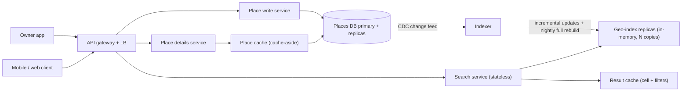
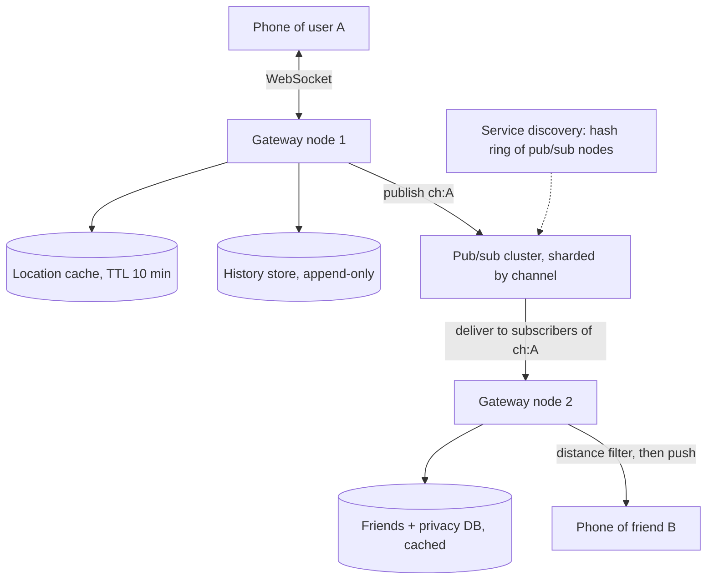
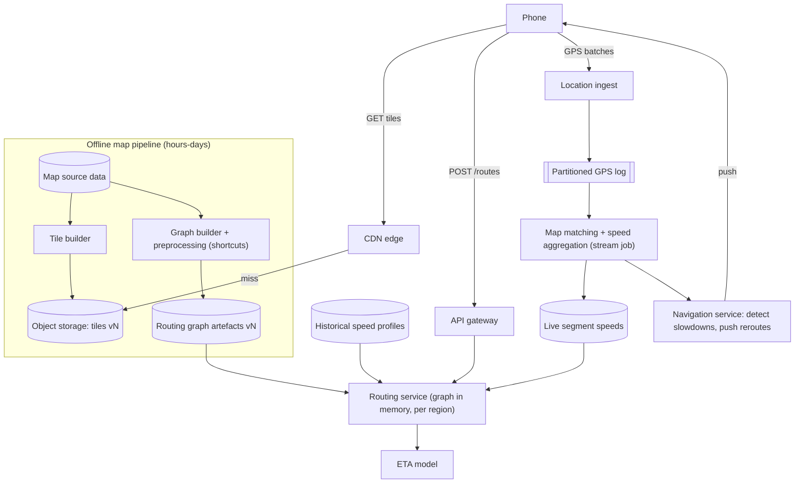
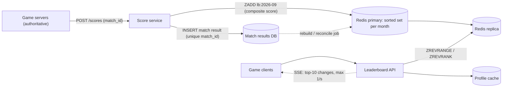

# Module 15 — Case Studies: Location and Real-Time

## Module Introduction

**What this module is.** Four complete designs in the [Module 12 capstone](../12-capstones/README.md#module-introduction) format, plus the three stops interviews almost always ask for: **API**, **data model** and a **trade-offs table**. No new patterns: the point is composing known ones on problems where the key is often **a place on Earth** and the answer must be **fresh within seconds**. Extra notes for this book (not DesignGurus course material), original and worked from primary sources (geohash spec, S2/H3 docs, Redis docs, routing papers — see [Sources](#sources)). Basic terms (latency, p99, TTL, RAM, load balancer, replication, sharding, CDN, DNS) are taught in [System Design Fundamentals](../00-system-design-fundamentals/README.md) and its [A–Z glossary](../00-system-design-fundamentals/README.md#master-az-glossary); this module does not re-define them.

**Analogy.** Module 12 was four chess games; this is a themed puzzle book ("what is near me, and what is changing right now?") that drills the same few tactics — spatial cells, in-memory state, pub/sub fan-out (one published message delivered to every subscriber) and precomputation.

**The four designs**

| Design | Center of gravity (the main problem) | Key numbers (my assumptions) |
|---|---|---|
| Proximity Service ("restaurants near me") | A **spatial index** (an index organised by location): turning "within 500 m" into something a database can look up | 100M places, \~20K searches/s peak, almost no writes |
| Nearby Friends | **Fan-out of moving locations** to the right people, continuously | 10M online users, \~330K location updates/s |
| Maps & Navigation | **Precomputation at planet scale**: tiles (square map images or data), a routable road graph, live traffic for ETAs (estimated times of arrival) | \~90B possible tiles, \~1.2M GPS points/s |
| Real-Time Gaming Leaderboard | **Rank queries** ("what place am I?") on a score that changes constantly | 25M players, \~3K score updates/s, rank in < 10 ms |

**How this module relates to Module 12.** [Design 2 — Ride-Sharing Dispatch](../12-capstones/README.md#design-2--ride-sharing-dispatch) already covered *moving* objects sharded by geo-cell, drop-oldest location streams, and single ownership of a contested driver. This module does not repeat those; it teaches the geospatial basics Design 2 took for granted (what a geohash, quadtree or S2/H3 cell is) and links back whenever ride-sharing ideas return.

**The format (each design):** requirements and numbers → five-questions pass (Flow, Storage, Speed, Failure, Growth) → API and data model → annotated architecture → 2–3 deep dives → failure walk → trade-offs → follow-ups → pattern manifest.

**Runnable demos** (in [`code/`](code/)), run from this folder with `../../../.venv-books/bin/python code/<file>.py` (the venv lives in the notes root); real output is pasted in each design:
- [`geohash_demo.py`](code/geohash_demo.py) — encodes coordinates to geohashes, shows the boundary problem, runs a 9-cell neighbour search checked against brute force.
- [`leaderboard_demo.py`](code/leaderboard_demo.py) — a Redis-sorted-set-style leaderboard (a sorted set keeps members ordered by a score): top-K, my rank, players around me, tie-breaks, sharded top-K merge, with asserts.

**Before you start:** do the Proximity Service first — its spatial index underlies the other location problems. Then the leaderboard, the odd one out (not spatial), which tests whether you recognise "rank" as its own kind of query.

---

## Design 1 — Proximity Service (Nearby Places)

**The prompt (in short).** The "search nearby" feature of a places app: given the user's position and a radius, return businesses inside it, closest or best-rated first. Owners can add or edit listings.

**What makes it hard.** A normal index sorts along **one** dimension; "near me" is **two-dimensional**. Separate indexes on `lat` and `lon` each return a huge stripe of the planet, and intersecting stripes is slow. The design is about squeezing 2-D closeness into a 1-D key a database or hash map can look up (DDIA's *multi-dimensional index*; see the [DDIA notes on multi-column indexes](../../../ddia/chapters/03-storage-and-retrieval/README.md#multi-column-indexes)).

### 1. Requirements and numbers

- **Functional:** search by `(lat, lon, radius)` with optional category filter; paged results; place details; owners add/update/delete a place.
- **Non-functional:** search p99 under **\~200 ms**; high availability (search is the product); owner edits may take **minutes** to appear (an agreed staleness budget); read-heavy.
- *Assumptions:* **100M places**, **100M DAU**, **5 searches per user per day**.
- *Reads:* 100M × 5 = **500M searches/day ≈ 5,800/s average, \~20,000/s peak** (3–4× peak factor at mealtimes).
- *Writes:* \~**1%** of places change per day → **1M edits/day ≈ 12/s**. Read:write over **1,000:1**.
- *Storage, details:* 100M × \~1 KB ≈ **100 GB** — fine in a sharded or even a single large relational DB.
- *Storage, geo-index:* `(cell_id 8 B, place_id 8 B)` → 100M × 16 B ≈ **1.6 GB**, **3–5 GB** with overhead. **The index fits in RAM on one ordinary server.**

That number decides the architecture: **replicate** the index for throughput and availability, don't **shard** it — sharding 5 GB adds scatter-gather (ask every shard, merge) for no benefit ("numbers before boxes").

### 2. The five-questions pass

- **Flow:** search is synchronous request-response. Owner edits write synchronously to the source-of-truth DB; reaching the index is **asynchronous**.
- **Storage:** the **places DB** is the authority; the geo-index and caches are **derived** and rebuildable.
- **Speed:** the hot read is "cells around a point"; city centres are searched constantly, so per-cell results are very cacheable.
- **Failure:** a new café missing for 10 minutes is harmless; returning nothing is not. Degrade to stale rather than fail.
- **Growth:** QPS grows with users → add index replicas. Place count grows slowly.

### 3. API and data model

```text
GET  /v1/search/nearby?lat=40.7484&lon=-73.9857&radius_m=500&category=cafe&limit=20&cursor=...
     -> 200 { "places": [ {"id": "p_91", "name": "...", "distance_m": 84, "rating": 4.6}, ... ],
              "next_cursor": "..." }
GET  /v1/places/{place_id}                      -> full details
POST /v1/places            (owner, authenticated) -> 201 {id}      # Idempotency-Key header
PUT  /v1/places/{place_id} (owner)                -> 200
DELETE /v1/places/{place_id} (owner)              -> 204 (soft delete)
```

[Cursor pagination](../08-api-and-edge/README.md#cursor-based-pagination): the cursor encodes the last `(distance, place_id)` returned, so pages stay stable while users scroll.

| Table / structure | Key | Columns | Notes |
|---|---|---|---|
| `places` (relational, primary-replica) | `place_id` | name, category, lat, lon, address, hours, rating, updated_at, deleted | The source of truth |
| `place_cells` (derived) | `(cell_id, place_id)` | — | One row per place at the chosen precision; rebuilt from `places` |
| Geo-index (in memory on each search node) | `cell_id` → list of `(place_id, lat, lon, category, rating)` | — | Built from `place_cells`; fits in RAM |

Storing `lat, lon, category, rating` *inside* the index entry lets the search node filter and rank without a DB round trip; the details call fetches the rest.

### 4. The architecture, annotated



- **Search service:** `(lat, lon, radius)` → cell IDs → candidates from the geo-index → exact distance, radius and category filter → rank → page. Stateless, so it [scales horizontally](../06-scaling/README.md#horizontal-scaling).
- **Geo-index replicas:** each holds the *whole* index. At \~5,000 searches/s per replica, 20K/s peak needs **4 + headroom ≈ 6** per region. More users → more replicas, never sharding.
- **Result cache:** keyed by `(cell_id, category)`. Rounding the position to a cell is what makes caching work — thousands of users in one block share an entry. TTL of a few minutes matches the staleness budget.
- **Place details:** [cache-aside](../04-caching/README.md#cache-aside) in front of the places DB.
- **Writes and freshness:** edits go to the places DB; [Change Data Capture](../10-batch-and-streaming/README.md#change-data-capture) (CDC) streams each change to an **indexer** that patches the in-memory index. A **nightly full rebuild** is the safety net so drift between index and DB cannot accumulate.

### 5. Deep dives

**Deep dive 1 — choosing the spatial index.** All four families divide the map into **cells** with IDs, so "near" becomes "same or adjacent cell".

- **Geohash** ([geohash.org](http://geohash.org), Niemeyer 2008). Repeatedly halve the world, alternating longitude and latitude, writing `1` for the upper half and `0` for the lower. Group bits five at a time as base-32 characters (5 bits each). Each extra character makes cells \~32× smaller, and **a longer geohash always starts with the geohash of the cell containing it** — so "all places in this cell" is a **prefix range scan** (`WHERE geohash LIKE 'dr5ru6%'`) on any B-tree or sorted key-value store. Redis `GEOADD` / `GEOSEARCH` store a 52-bit geohash as a sorted-set score.
- **Quadtree** (Finkel & Bentley, 1974). One square covers the map; any square holding more than a threshold (say **100** places) splits into four children, recursively. Dense Manhattan gets tiny leaves, the Sahara one huge leaf, so every leaf holds about the same number of places. 100M places at ≤100 per leaf → \~**1M leaves** (\~1.33M nodes); at \~100 bytes per node plus IDs, a few GB in memory, rebuilt at start-up (minutes — new servers must warm up before taking traffic).
- **Google S2** ([s2geometry.io](https://s2geometry.io)). Projects the sphere onto a cube's six faces and numbers each face's cells along a **Hilbert curve** (a space-filling curve through every cell of a grid), which keeps nearby cells numerically closer than geohash's Z-order (the zig-zag from interleaving lat/lon bits). 64-bit cell IDs, 31 levels (down to \~1 cm²); the library can **cover** any circle or polygon with a few mixed-size cells, so "within 500 m" is a handful of integer range scans.
- **Uber H3** ([h3geo.org](https://h3geo.org), Uber 2018). Hexagons in 16 resolutions. All six neighbours are the **same distance** away (squares have 4 edge and 4 farther corner neighbours), which suits movement, smoothing and heat-map analytics — why Module 12's dispatch design uses it.

| | Geohash | Quadtree | S2 | H3 |
|---|---|---|---|---|
| Cell shape | Rectangle (varies with latitude) | Square, adaptive size | Quadrilateral on a cube face | Hexagon |
| Adapts to density | No (fixed precision) | **Yes** | Via mixed-level coverings | No (fixed resolution) |
| Storage | A string/int column + normal index | A custom in-memory tree | A 64-bit int column | A 64-bit int column |
| Radius / polygon queries | 9-cell trick | Walk the tree | **Built-in region coverer** | k-ring (all hexagons within k steps) |
| Best for | Simple, DB-friendly; Redis GEO | In-memory, very uneven density | Precise coverings (Google Maps, many DBs) | Movement, analytics, pricing grids |

*Interview answer:* start with geohash (easiest to explain and store), mention the quadtree for very uneven density, name S2/H3 as the production libraries.

**Deep dive 2 — the boundary problem and the 9-cell search.** Two places metres apart can sit in cells sharing **no prefix at all**. So search the user's cell **and its 8 neighbours**, then compute exact distance to every candidate and keep those within the radius. Pick precision so a cell is at least as big as the radius (500 m → precision 6, \~0.9 × 0.6 km at latitude 40); if results are short, drop one character (32× larger cells) and repeat. The demo, on 5,000 random places:

```text
$ ../../../.venv-books/bin/python code/geohash_demo.py
1) Cell size per precision (at latitude 40):
   precision 4: ~   29,946 m wide x   19,546 m tall
   precision 5: ~    3,743 m wide x    4,886 m tall
   precision 6: ~      936 m wide x      611 m tall
   precision 7: ~      117 m wide x      153 m tall
   precision 8: ~       29 m wide x       19 m tall

2) encode(40.7484, -73.9857) -> dr5ru6j28   (prefixes: dr5r > dr5ru > dr5ru6)

3) Boundary problem: dr5ru6 vs dr5rud  -> 17 m apart, different cells

4) Nearby search, radius 500 m, over 5,000 places
   cells scanned     : 9 (dr5ru6, dr5ru1, dr5ru3, ...)
   candidates read   : 262  (5.2% of all)
   within 500 m      : 39  (brute force agrees: True)
   own cell only     : 12  <- misses 27 if you skip neighbours
     biz0989      84 m
     biz0934     102 m
     biz1059     103 m

all asserts passed
```

Line 4: the 9-cell scan touched **5%** of the data and matched a full scan; the user's own cell alone would have **missed 27 of 39**.

**Deep dive 3 — ranking, caching and freshness.** Distance alone ranks badly (the closest café may be terrible). Score with a blend such as `rating × w1 − distance × w2 + is_open_now × w3`, computed on the search node from index-entry fields. Cache per `(cell, category)`, not per coordinate, and invalidate a cell's entry when the indexer patches a place in it. CDC gives **seconds to minutes** freshness; the nightly rebuild is a correctness backstop. New replicas load the latest index **snapshot** from object storage (e.g. S3), then replay the change feed from the snapshot's offset — the same "snapshot + log" recovery as a [write-ahead log](../03-storing-data/README.md#write-ahead-log).

### 6. The failure walk

1. **An index replica dies:** [health checks](../09-operating-in-production/README.md#health-check-endpoint) remove it; others absorb its share (\~50% headroom kept). A replacement loads the snapshot and catches up before rejoining.
2. **The indexer or CDC stream stalls:** search serves the last good index; new edits are missing longer than budgeted. Alert on **change-feed lag**, not errors — nothing errors.
3. **Places DB primary down:** search is unaffected (never touches the primary). Details fall back to replicas and cache; owner edits fail with "try again later" or are queued.
4. **A cache node is lost:** a burst of misses hits the index replicas; protect them with [stampede prevention](../04-caching/README.md#cache-stampede-prevention) (single-flight per cell key).
5. **A whole region is lost:** route to the next region; the index is identical everywhere (it is small), so results match with extra latency.

### 7. Trade-offs

| Decision | Chosen | Alternative | Why / cost |
|---|---|---|---|
| Replicate vs shard the geo-index | Replicate the whole \~5 GB index | Shard by region | Fits in RAM; sharding adds scatter-gather at borders for no gain. Cost: every replica holds everything |
| Geohash vs quadtree | Geohash (fixed precision) + expand if few results | Quadtree with adaptive leaves | Geohash lives in a normal DB column; a quadtree handles density better but is custom code and slow to rebuild |
| In-memory index vs spatial DB (PostGIS, PostgreSQL's geographic add-on; R-tree, a tree of bounding boxes) | In-memory | PostGIS `ST_DWithin` on a GiST index (PostgreSQL's general index type used for geometry) | PostGIS is excellent up to moderate QPS and simplest to build first; the in-memory tier wins at 20K QPS with filtering |
| Freshness | CDC (seconds–minutes) + nightly rebuild | Synchronous index update on write | Owners accept minutes; decoupled writes protect search |
| Cache key | Cell + category | Exact coordinates | Cells give a high hit rate; cost: results cached per cell, then trimmed by exact distance |

### 8. Follow-up questions

- **"Why not just `WHERE lat BETWEEN ... AND lon BETWEEN ...`?"** Each condition selects a thin stripe around the planet; the DB uses one index well and filters the other stripe row by row. A cell ID makes both dimensions one sortable key. *Trap:* a composite `(lat, lon)` B-tree only narrows latitude efficiently.
- **"User at a cell edge, near the antimeridian (±180° longitude) or a pole?"** The 9-cell search fixes edges; neighbour computation must wrap longitude at ±180° and skip cells beyond the poles (the demo does both). S2 has no seams because it works on the sphere.
- **"Too few results in the countryside, too many in Manhattan?"** Expand (drop a geohash character) until enough candidates, or use a quadtree/S2 covering whose cell sizes follow density. Cap candidates in dense areas and rely on ranking.
- **"'Open now' and categories?"** Store them in the index entry and filter on the search node; for very selective filters keep a separate index per top-level category.
- **"What if places move (food trucks)?"** The index becomes write-heavy; switch to the ephemeral, in-memory, drop-oldest approach of [ride-sharing dispatch](../12-capstones/README.md#design-2--ride-sharing-dispatch), which the next design also builds on.

### 9. Pattern manifest

| Pattern | Where it served |
|---|---|
| Primary-Replica | Places DB; replicated in-memory index replicas |
| CQRS | The geo-index is a read model derived from the places table |
| Change Data Capture | Owner edits → indexer, no dual writes (the app writing to two systems itself, which can leave them disagreeing) |
| Cache-Aside + Stampede Prevention | Place details and per-cell results |
| Horizontal Scaling + Load Balancing | Stateless search tier, index replicas |
| Write-Ahead Log (snapshot + log) | Fast replica start-up |
| Graceful Degradation | Serve a stale index rather than fail |
| Cursor Pagination | Stable result pages |

**Interview one-liner:** "Turn 2-D closeness into a 1-D cell key (geohash, quadtree or S2), search the cell plus its eight neighbours and filter by exact distance, and — because the whole index is a few GB — replicate it in memory instead of sharding it."

**TL;DR**
- **Problem:** "near me" is a 2-D query that ordinary 1-D indexes answer badly.
- **Mechanism:** cell IDs + 9-cell search + exact-distance filter; replicated in-memory index fed by CDC.
- **Key numbers:** 100M places → \~5 GB index; 20K searches/s → \~6 replicas per region.
- **Watch out for:** the boundary problem, uneven density, and letting the write path slow down search.

---

## Design 2 — Nearby Friends (Real-Time Location Sharing)

**The prompt (in short).** Opted-in users see which friends are within a few kilometres, with distance and "last updated" time, live while the app is open.

**What makes it hard.** **Both** ends move. Each update must reach the few friends who care within seconds, then be thrown away. It is **fan-out** (like the news feed) crossed with **ephemeral location** (like dispatch), at a far higher message rate than either.

### 1. Requirements and numbers

- **Functional:** opt-in sharing; friends within **5 km** with distance and freshness; live updates; friends disappear after **10 minutes** of silence.
- **Non-functional:** end-to-end under **\~5 s**; losing an occasional update is fine (the next replaces it); **privacy** is hard (only confirmed, opted-in friends; never exact history to others).
- *Assumptions:* **100M DAU** use it; **10%** online at peak → **10M concurrent**; a location every **30 s**; **400 friends** average, **\~10%** online and sharing.
- *Inbound:* 10M ÷ 30 s ≈ **333,000 updates/s**.
- *Fan-out:* \~40 online friends each → **\~13M deliveries/s** inside; after the 5 km filter perhaps **1–2M pushes/s** reach phones.
- *State:* latest location 10M × \~50 B ≈ **0.5 GB**. Owner-only history: 333K/s × 40 B ≈ **1.1 TB/day** (append-only).
- *Connections:* 10M persistent; \~100K per gateway node → **\~100 gateways**.

The expensive numbers are the **13M deliveries/s** and **10M open connections**, not storage.

### 2. The five-questions pass

- **Flow:** both sides push continuously → a persistent [bidirectional stream](../02-moving-data/README.md#bidirectional-streaming) (WebSocket, [RFC 6455](https://www.rfc-editor.org/rfc/rfc6455)). Server-to-server delivery uses [publish-subscribe](../02-moving-data/README.md#publish-subscribe): one channel per user.
- **Storage:** the **latest location** is ephemeral — in memory with a TTL, rebuilt by the next update. Friendships and privacy settings are durable (relational). History, if any, is append-only.
- **Speed:** the hot path is all in memory; no DB read per update.
- **Failure:** a dropped update costs 30 s of freshness; leaking a location to a non-friend is a serious incident. Relaxed on delivery, strict on authorization.
- **Growth:** concurrent users drive connections and fan-out. Celebrities don't matter (friend lists are capped, e.g. 5,000).

### 3. API and data model

```text
WebSocket  wss://rt.example.com/v1/nearby   (auth token on connect)
  client -> server  {"type":"loc","lat":..,"lon":..,"ts":..}          every 30 s
  server -> client  {"type":"init","friends":[{"id","dist_m","ts"},...]} on connect
  server -> client  {"type":"friend_loc","id":"u42","dist_m":820,"ts":..}
  server -> client  {"type":"friend_gone","id":"u42"}                  TTL expiry / opt-out
REST  PUT /v1/nearby/settings  {"sharing": true, "audience": "close_friends"}
```

| Data | Store | Key | Notes |
|---|---|---|---|
| Latest location | Redis-style cache | `loc:{user_id}` → `(lat, lon, ts)` | TTL 10 min; expiry = "friend went offline" |
| Friendship + sharing settings | Relational DB (+ cache) | `(user_id, friend_id)` | Checked on subscribe, cached per session |
| Location history (optional, owner only) | Wide-column (Cassandra-style) / time-series store | `(user_id, day)` → rows by ts | Append-only, write-heavy, retention-limited |
| Pub/sub channels | Pub/sub cluster | `ch:{user_id}` | No storage: fire-and-forget (sent once, never retried or stored) |

### 4. The architecture, annotated



1. When B connects, B's gateway loads B's opted-in friends (cached), **subscribes** to each `ch:{friend}`, and reads their latest locations to send the initial list.
2. When A sends a location, A's gateway writes it to the location cache (resetting the TTL), optionally appends history, and **publishes** on `ch:A`.
3. Pub/sub delivers to every gateway with a subscriber on `ch:A` — here, B's.
4. B's gateway computes the distance from A's new point to **B's own latest point** (held in memory, since B's socket lives there). Within 5 km → push; if A just left the radius → `friend_gone`.

The filter sits on the **receiving** side because only it knows the receiver's position; the cost is that every update reaches every online friend's gateway even when far away (deep dive 3 trims that).

### 5. Deep dives

**Deep dive 1 — sizing and sharding the pub/sub layer.** One channel per user means **100M+ channels**, mostly idle; an idle channel costs almost nothing and a subscription is a small hash-table entry (Redis classic Pub/Sub keeps subscribers in memory only and stores no messages; see the [Redis Pub/Sub docs](https://redis.io/docs/latest/develop/interact/pubsub/)). The real limit is **delivery CPU**: \~13M/s. At a conservative **\~100K deliveries/s per node** → **\~130 nodes** plus headroom. Spread channels by [consistent hashing](../03-storing-data/README.md#consistent-hashing) on the channel name; the ring lives in a service-discovery store (etcd/ZooKeeper) every gateway watches. Redis 7 **sharded pub/sub** (`SSUBSCRIBE`/`SPUBLISH`) does this routing inside a Redis Cluster.
Resizing the ring moves channels, so gateways must **resubscribe** them and a few updates are lost meanwhile — acceptable since each is replaced in 30 s, but resize off-peak and add capacity early: this layer is stateful in the "who is listening" sense.

**Deep dive 2 — the connection tier.** 10M long-lived WebSockets make gateways stateful (who is connected, what they subscribed to). Module 12's "**sockets local, routing global**" rule applies unchanged ([ride-sharing dispatch](../12-capstones/README.md#design-2--ride-sharing-dispatch)). Deploys **drain** a node gradually (stop accepting, ask clients to reconnect with jittered backoff) so 100K phones don't reconnect in one second — a [retry storm](../05-reliability/README.md#retry-with-exponential-backoff) in disguise. On reconnect the client re-sends its location and the gateway rebuilds subscriptions from the friends list, so no gateway state must survive a crash.

**Deep dive 3 — trimming fan-out, and "nearby strangers".** Two cheap wins: (a) phones send **only when moved > \~100 m, or every 5 min when still** (most phones sit still, often halving inbound traffic or better); (b) gateways drop a friend update without pushing if the friend is far away *and* was far last time. "People near me who are *not* friends" can't use per-user channels (you don't know whom to subscribe to): use **one channel per geo-cell** — publish to your current geohash cell's channel, subscribe to it plus its 8 neighbours (the 9-cell idea from [Design 1](#design-1--proximity-service-nearby-places)), and re-subscribe on crossing into a new cell.

### 6. The failure walk

1. **A gateway dies:** its \~100K clients reconnect elsewhere with jittered backoff, re-send location, re-subscribe. Friends "freeze" for up to \~30 s.
2. **A pub/sub node dies:** its channels stop delivering until the ring drops it and gateways resubscribe on the new owner. Seconds of staleness; nothing corrupted because nothing was stored.
3. **Location cache node lost:** latest points vanish for its users and return with the next 30 s update; the initial list may briefly be short — show "updating…".
4. **Friends DB slow:** new connections can't build friend lists. Serve from the session cache; if none, **fail closed** (show nothing) rather than skip the privacy check.
5. **Out-of-order update** (mobile networks): messages carry the device timestamp; gateways keep the newest `ts` per friend and drop older ones (event time, newest wins).

### 7. Trade-offs

| Decision | Chosen | Alternative | Why / cost |
|---|---|---|---|
| Fan-out mechanism | Pub/sub, one channel per user | Look up friends and write to each friend's inbox | Pub/sub needs no storage and delivers in ms; cost: lossy, and a big stateful tier to run |
| Where to filter by distance | Receiving gateway | Publisher checks every friend's location | Receiver already holds its own point; publisher-side check would read 40 locations per update |
| Latest location | In-memory cache with TTL | Durable DB row | Ephemeral data, rebuilt every 30 s; TTL doubles as "offline" detection |
| Transport | WebSocket | Client polling every 30 s | Polling 10M clients doubles request count and adds up to 30 s delay; cost: stateful gateways |
| History | Optional, owner-only, append-only | None | Useful feature but a privacy liability; keep retention short |

### 8. Follow-up questions

- **"Why not store all locations in a geospatial DB and query friends near me?"** A query per user every 30 s over a table rewritten 333K times a second. Friendship already limits candidates to \~40; fan-out to them is cheaper than a spatial query over everyone.
- **"How do you guarantee a blocked user never sees me?"** Authorize at **subscribe time** (gateway checks friendship + settings), and a block/opt-out publishes a control message forcing subscribers to drop the channel. Never rely on the client to hide it.
- **"A user with 5,000 friends online?"** Still one publish; pub/sub handles large subscriber lists, and each receiver gets one message per friend.
- **"Reduce battery use?"** Movement-based update intervals, client batching, pausing background sharing unless the user opts in.
- **"Multi-region?"** Keep the socket in the nearest region; replicate pub/sub messages cross-region only for channels with remote subscribers (friends abroad are rarely within 5 km, so most is filtered at the source).

### 9. Pattern manifest

| Pattern | Where it served |
|---|---|
| Bidirectional Streaming | Phones ↔ gateways over WebSocket |
| Publish-Subscribe | One channel per user (or per geo-cell for strangers) |
| Consistent Hashing | Channel → pub/sub node; smooth resizing |
| Backpressure (drop-oldest: when a consumer falls behind, discard old items) | Only the newest location matters |
| Cache with TTL | Latest location; expiry = offline |
| Retry with Backoff + jitter | Mass reconnects after deploys and failures |
| Graceful Degradation vs fail closed | Stale positions are fine; privacy checks fail closed |
| Sharding (by user/time) | Optional history store |

**Interview one-liner:** "Keep only the latest location in memory with a TTL, publish each update on the user's own channel, let the gateways of online friends subscribe and filter by distance on the receiving side — lossy by design, strict on privacy."

**TL;DR**
- **Problem:** continuous fan-out of moving points to a small, known audience.
- **Mechanism:** WebSocket gateways + per-user pub/sub channels + TTL location cache + receiver-side distance filter.
- **Key numbers:** 10M online, \~333K updates/s in, \~13M deliveries/s inside, \~100 gateways, \~130 pub/sub nodes.
- **Watch out for:** stateful resizing of the pub/sub ring, reconnect storms, and privacy checks that must fail closed.

---

## Design 3 — Maps & Navigation

**The prompt (in short).** The core of a maps app: render the map as the user pans and zooms, route A to B, give a traffic-aware ETA, and guide turn by turn with rerouting.

**What makes it hard.** Three sub-systems with different shapes: **map rendering** (a huge, read-only, cacheable dataset), **routing** (a graph search over hundreds of millions of junctions, answered in milliseconds) and **live traffic/ETA** (stream processing over millions of GPS points per second). The trick is to **precompute** offline so the online paths become lookups.

### 1. Requirements and numbers

- **Functional:** map at any zoom; destination search (reuse [Design 1](#design-1--proximity-service-nearby-places)); fastest route and alternatives; ETA; turn-by-turn with rerouting; traffic colouring.
- **Non-functional:** tiles appear instantly (< \~100 ms, mostly cached); route + ETA **< 1 s**; ETA within \~10% for most trips; worldwide; tolerate poor connectivity.
- *Assumptions:* **100M DAU**; **20M** navigate \~**30 min/day**.
- *Concurrent navigators:* 20M × 30 ÷ 1,440 ≈ **420K average**, **\~1.2M peak** (\~3× at rush hour).
- *GPS ingestion:* sample once per second, **batch** upload every 15 s → 1.2M ÷ 15 ≈ **80K uploads/s** carrying **\~1.2M GPS points/s**.
- *Route requests:* 20M × \~3/day (initial + reroutes) + planners ≈ **100M/day ≈ 1,200/s average, \~5,000/s peak**.
- *Tiles:* square tiles in the Web Mercator projection (how web maps flatten the globe), addressed `(zoom z, column x, row y)` with **4^z** tiles at zoom z ([OpenStreetMap "slippy map" scheme](https://wiki.openstreetmap.org/wiki/Slippy_map_tilenames)). Zoom 0 is 1 tile; zoom 18 alone is 4^18 ≈ **69 billion**; zooms 0–18 ≈ **92 billion**. Most are ocean or empty and compress to almost nothing or dedupe, but you never render the world per request.
- *Tile traffic:* \~10–20 tiles per pan/zoom; **200 tile requests per user per day** → 20B/day ≈ **230K/s average**, mainly served by a CDN.

### 2. The five-questions pass

- **Flow:** tiles and routes are request-response; GPS uploads are fire-and-forget into a **log**; traffic updates and reroutes are **pushed** to navigating phones.
- **Storage:** **map data** (roads, places, geometry from surveyors, imagery, partners) is the authority. Tiles, the routing graph and its shortcuts are **derived, versioned build artefacts**. Live segment speeds are short-lived ephemeral state.
- **Speed:** tiles are immutable per map version → CDN with long TTLs. Routes need an in-memory precomputed graph.
- **Failure:** without live traffic, route on historical speeds (less accurate, still useful). Without signal, the client navigates from its downloaded route.
- **Growth:** tile traffic → CDN; GPS ingestion → partitioned stream; routing → replicate the graph.

### 3. API and data model

```text
GET  /tiles/v{map_version}/{z}/{x}/{y}.mvt         -> vector tile (CDN, Cache-Control: immutable)
POST /v1/routes  {"origin":{lat,lon}, "dest":{lat,lon}, "mode":"drive", "depart_at":...}
     -> {"routes":[{"route_id","polyline","distance_m","eta_s","steps":[...]}]}
POST /v1/nav/{session_id}/locations  {"points":[{lat,lon,ts,speed,heading}, ...]}   # batched, every 15 s
     -> 202 (optional reroute hint in response)
WebSocket / push: {"type":"reroute","route_id":..} | {"type":"eta","eta_s":..}
```

| Data | Store | Notes |
|---|---|---|
| Map source data (roads, geometry, attributes) | Versioned spatial DB + object storage | Edited by the map pipeline; authority |
| Tiles `(version, z, x, y)` | Object storage → CDN | Build artefacts, immutable per version |
| Road graph: nodes (junctions), edges (road segments with length, speed limit, turn restrictions) | In-memory on routing servers, loaded from build artefacts | Partitioned by region; plus precomputed shortcuts |
| Historical speed profile | Key-value: `(segment_id, time_of_week_bucket)` → speed | 7 × 24 × 4 = **672** 15-minute buckets per segment |
| Live segment speed | In-memory / cache: `segment_id` → `(speed, sample_count, updated_at)` | TTL a few minutes |
| GPS probe log | Partitioned log (Kafka-style), then cold storage | Input to traffic, ETA training and map fixes |

### 4. The architecture, annotated



- **Tiles through a [CDN](../08-api-and-edge/README.md#cdn).** Pre-rendered per map version into object storage. The **map version in the URL** makes every tile immutable, so caches never need invalidating; a new release just uses new URLs.
- **Vector tiles.** Each tile carries geometry and labels instead of pixels (raster) — the [Mapbox Vector Tile spec](https://github.com/mapbox/vector-tile-spec) is the common format — and the phone draws it. Several times smaller; the client can rotate, tilt and restyle (night mode) without downloads, and can **over-zoom**: build only to about zoom 14–16 and let the client scale further, cutting tens of billions of tiles to a few hundred million.
- **Routing service:** a region's graph and shortcuts in memory; each request is a graph search (deep dive 2). Replicated for throughput, partitioned by region for memory.
- **Traffic pipeline:** a [stream processing](../10-batch-and-streaming/README.md#stream-processing) job reads the GPS log, snaps points to roads, aggregates per-segment speeds in short windows (deep dive 3).
- **Navigation service:** tracks sessions; when a route's segments slow significantly, recomputes and pushes a better route.

### 5. Deep dives

**Deep dive 1 — tiles: why precompute and cache wins.** Rendering a tile (read every road, building and label in its square, draw) costs tens of ms of CPU; at 230K requests/s that is a massive render farm. Instead build once per map version (a batch job like [MapReduce](../10-batch-and-streaming/README.md#mapreduce), parallel by tile), store, and serve from the CDN at > 95% hit rate (usage is skewed toward cities). Updates are **incremental**: a road change marks only the tiles it touches, per zoom, dirty for the next build. Identical ocean tiles are stored once and shared. Phones cache recent tiles and can download regions for offline use.

**Deep dive 2 — routing in milliseconds.** Roads are a weighted directed graph: junctions are **nodes**, segments are **edges**, weight is travel time. [Dijkstra's algorithm](https://doi.org/10.1007/BF01386390) (1959) expands outward from the start in order of distance — correct, but on a continental graph a long trip explores a huge share of it and takes **seconds**. Improvements, in order:
1. **A\*** ([Hart, Nilsson & Raphael, 1968](https://doi.org/10.1109/TSSC.1968.300136)) adds a heuristic distance-to-goal estimate (straight-line distance ÷ max speed) so the search leans toward the destination. Helps, but not enough for 5,000 req/s of long routes.
2. **Contraction Hierarchies** ([Geisberger et al., 2008](https://doi.org/10.1007/978-3-540-68552-4_24)). Offline, rank nodes by importance (motorway junctions high, cul-de-sacs low) and contract them one by one, adding **shortcut edges** that preserve shortest distances. Online, two tiny searches — forward from A, backward from B — climb only to more important nodes and meet in the middle: about a millisecond on continent-sized graphs. Cost: minutes-to-hours preprocessing, and changing a weight (traffic) invalidates shortcuts.
3. **Multi-level partitioning / Customizable Route Planning** (Delling, Goldberg, Pajor & Werneck, 2011). Split the graph into cells (cities → regions → countries) and precompute distances between each cell's **boundary nodes**. The expensive partition rarely changes; the cheap "customization" step recomputes boundary distances with new weights in seconds, so **live traffic folds in** frequently. The partition doubles as a sharding scheme: a server holds its region in detail plus the top-level overlay for long trips.

A\* returns the shortest route only if the heuristic is **admissible** (never overestimates the remaining time) and expands each node once if it is also **consistent** (h(u) ≤ w(u, v) + h(v) on every edge); with h = 0 it *is* Dijkstra. Straight-line ÷ top speed is admissible but weak on winding or congested roads — hence items 2 and 3. The step-by-step A\* trace (g, h, f, open set) and a worked contraction example are in [Module 19 — Shortest paths for maps](../19-algorithms-deep-dive/README.md#shortest-paths-for-maps-dijkstra-a-and-contraction-hierarchies).

**Deep dive 3 — live traffic and ETA.** Raw GPS is noisy (±10–20 m, worse between tall buildings), so first **map-match** each trace to the road actually driven. The classic approach is a hidden Markov model (infers a hidden sequence — the true roads — from noisy observations) over candidate segments ([Newson & Krumm, 2009](https://doi.org/10.1145/1653771.1653818)): it prefers segments close to each point *and* transitions that make sense on the network. From matched traces compute per-vehicle segment speeds, then aggregate per segment in **1-minute tumbling windows** (fixed, non-overlapping), partitioned by `segment_id` so one worker owns each segment ([partitioned consumption](../10-batch-and-streaming/README.md#partitioned-consumption)). Segments with too few probes fall back to the **historical profile** for that time-of-week bucket; blend by sample count. **ETA** = sum of predicted segment times + turn and intersection delays, then an ML model corrects systematic error (DeepMind/Google Maps described graph neural networks for this in 2020; Uber its DeepETA model in 2022 — see [Sources](#sources)). Forecasting subtlety: on a 1-hour trip, the segment reached in 50 minutes should use the speed *predicted for then*, not now.

### 6. The failure walk

1. **CDN edge outage:** DNS/anycast (one IP served from many sites) routes users to the next edge; phones keep drawing cached tiles.
2. **Traffic pipeline stalls:** live speeds age out (TTL); routing falls back to historical profiles. ETAs worsen at unusual times, so show "traffic data delayed" rather than confident numbers — honest staleness.
3. **A routing server dies:** stateless apart from its read-only graph; the LB retries on a replica. Loading a graph takes minutes, so keep warm spares.
4. **Bad map release** (a bridge marked closed by mistake): map versions are [canaried](../09-operating-in-production/README.md#canary-deployment) by region with route-quality checks (rise in average route length or failed routes); rollback is pointing back to version N−1, since tiles and graphs are immutable artefacts.
5. **Phone loses signal mid-navigation:** the client holds the full route and turn list, guides on GPS alone, and syncs later. Late GPS batches are handled by **event time**; samples too old to matter are dropped.

### 7. Trade-offs

| Decision | Chosen | Alternative | Why / cost |
|---|---|---|---|
| Raster vs vector tiles | Vector + client over-zoom | Server-rendered raster images | Smaller, restylable, far fewer tiles; cost: client rendering work and a more complex app |
| Tile freshness | Versioned immutable tiles, incremental rebuilds | Render on demand | CDN-friendly, no invalidation; cost: map edits take hours to appear |
| Routing algorithm | Multi-level partition (CRP-style) | Contraction Hierarchies | Folds live traffic in within seconds; CH is faster per query but slow to update weights |
| Traffic windows | 1-min tumbling, per segment | Per-probe updates | Smooths noise, bounded load; cost: up to \~1 min lag |
| GPS upload | Batched every 15 s | Stream every second | 15× fewer requests and less battery; cost: up to 15 s older traffic signal |
| ETA | Segment sum + ML correction | Pure ML end-to-end | Explainable baseline that works when the model is down |

### 8. Follow-up questions

- **"Alternative routes?"** Search again with penalties on the best route's edges (or keep second-best meeting points in the bidirectional search); reject alternatives that overlap too much or are much longer.
- **"How do you know a new road exists?"** Clusters of traces that match no road; review with imagery and publish in the next map version.
- **"Why not reroute everyone onto the fastest road?"** Thousands on one detour create the next jam. Use predicted speed; spread load across near-equal alternatives.
- **"How is location data protected?"** Probes carry rotating session IDs, not user IDs; they are aggregated per segment and raw traces kept briefly; trip start/end points are trimmed so homes can't be identified.
- **"Walking, cycling, transit?"** Separate graphs (or weights and permissions) per mode, each preprocessed; transit is a **timetable** graph where edges exist only at departure times — a different algorithm family.

### 9. Pattern manifest

| Pattern | Where it served |
|---|---|
| CDN | Tiles, with versioned immutable URLs |
| MapReduce / batch | Tile and graph builds per map version |
| Stream Processing (event time, windows) | Map matching and segment speeds |
| Partitioned Consumption | GPS log partitioned by segment/region |
| Sharding (by geographic region) | Routing graph partitions |
| Graceful Degradation | Historical speeds when live traffic is missing; offline navigation |
| Canary Deployment | Map releases by region, instant rollback |
| Bidirectional Streaming / push | Reroutes and ETA updates to navigators |

**Interview one-liner:** "Precompute everything that doesn't change by the minute — versioned vector tiles on a CDN and a partitioned road graph with shortcuts — and run live traffic as a stream job (map-match, window by segment) that folds speeds into routing and ETA, falling back to historical profiles when it lags."

**TL;DR**
- **Problem:** three systems in one — rendering, routing, live traffic/ETA — each at planet scale.
- **Mechanism:** batch-built tiles + CDN; in-memory graph with Contraction Hierarchies or multi-level partitions; streaming map matching into per-segment speeds; ETA = segment sum + ML correction.
- **Key numbers:** \~92B possible raster tiles to zoom 18 (why vector + over-zoom), \~1.2M GPS points/s, \~5K routes/s.
- **Watch out for:** routing on stale traffic, rerouting everyone onto one road, and privacy of GPS traces.

---

## Design 4 — Real-Time Gaming Leaderboard

**The prompt (in short).** A mobile game awards points per match won. Show the monthly **top 10**, each player's **own rank**, and the players just above and below, in real time. Scores reset monthly.

**What makes it hard.** "Top 10" is easy. **"My rank out of 25 million?"** is not: in a score-sorted table your rank is the count of rows above you — O(N) per request. You need a structure that answers *rank* as cheaply as *lookup*.

### 1. Requirements and numbers

- **Functional:** add points per match won; top 10; my rank and score; the ±2 players around me; monthly reset; past-month history.
- **Non-functional:** updates visible within \~1 s; rank query < \~10 ms; **scores must not be forgeable** (the server awards points); no double-counting a match.
- *Assumptions:* **5M DAU**, **25M** monthly players, **10 matches won per player per day**.
- *Writes:* 5M × 10 = **50M updates/day ≈ 580/s average, \~3,000/s peak**.
- *Reads:* similar order, **\~5,000/s peak**.
- *Memory:* member ID (\~16 B) + score (8 B) + hash-table and skip-list overhead (\~70 B) ≈ **\~100 B** → 25M × 100 B ≈ **2.5 GB**.

That fits one Redis node, which handles well over 100K simple ops/s. **One primary plus a replica is the whole answer at this scale**; the interesting part is correctness, then what changes at 20× the players.

### 2. The five-questions pass

- **Flow:** game server → score service is request-response (or queued for smoothing); clients read synchronously; the top 10 can be pushed to spectators via [SSE](../02-moving-data/README.md#server-sent-events).
- **Storage:** the **match results table** is the authority. The leaderboard is a **derived** read model rebuildable by replay — [CQRS](../03-storing-data/README.md#cqrs) again.
- **Speed:** rank and range queries need an in-memory ordered structure.
- **Failure:** losing the in-memory board is recoverable (rebuild); counting a match twice is not → [idempotency](../05-reliability/README.md#idempotency) per match ID.
- **Growth:** players per month; big events create write spikes.

### 3. API and data model

```text
POST /v1/scores   (game server only, mTLS)  {"match_id":"m_77","user_id":"u01234","points":3}
     -> 200 {"score": 16}          # repeat with same match_id -> same response, no double count
GET  /v1/leaderboard/2026-09/top?n=10
GET  /v1/leaderboard/2026-09/users/{user_id}          -> {"rank":10997,"score":16}
GET  /v1/leaderboard/2026-09/users/{user_id}/around?k=2
```

| Data | Store | Key | Notes |
|---|---|---|---|
| Match results | Relational DB (sharded by user if needed) | `match_id` (unique) | Source of truth; unique key = idempotency |
| Monthly leaderboard | Redis sorted set | `lb:{yyyy-mm}` member=`user_id`, score=composite | Read model; rebuildable |
| Player profile (name, avatar) | DB + cache | `user_id` | Joined in at read time for the top 10 |
| Past months | Snapshot rows in DB / object storage | `(month, rank)` | Written at month end; the key then expires |

**How a sorted set answers rank.** Redis stores a sorted set as a **hash map** (member → score) plus a **skip list** ordered by score ([Redis sorted sets docs](https://redis.io/docs/latest/develop/data-types/sorted-sets/); skip lists: [Pugh, 1990](https://doi.org/10.1145/78973.78977), taught in [Module 19](../19-algorithms-deep-dive/README.md#skip-lists)). A skip list is a sorted linked list with "express lanes" of pointers that skip ahead; each pointer records how many elements it skips, so walking down to a member sums its rank. Hence `ZINCRBY` (add points), `ZREVRANK` (my rank), `ZREVRANGE` (top N or a window) and `ZSCORE` are all **O(log N)** (doubling players adds one step), plus K for a K-item range. Since Redis 6.2 `ZREVRANGE` is deprecated in favour of `ZRANGE key start stop REV`; it still works, and this module uses the clearer old name.

### 4. The architecture, annotated



- **Score service:** inserts the result with `match_id` as a unique key. A conflict means a retry: return the stored result and do **not** touch Redis; otherwise update Redis. Only the game servers that decided the match can call it (protected with mTLS — both sides present certificates).
- **Redis:** one sorted set per month (`lb:2026-09`). At month end, snapshot the top N to the DB and `EXPIRE` the old key; the new month writes a new key — no mass reset.
- **Reads** go to the replica (ms of lag is fine); the top 10 is also cached \~1 s.
- **Rebuild / reconcile:** a job can rebuild the set by replaying a month's results and periodically compares totals, catching any Redis write that failed after the DB insert.

### 5. Deep dives

**Deep dive 1 — correctness: idempotency, ordering, and ties.** DB insert and Redis update are two writes; a crash between them leaves Redis behind. Options: (a) let [CDC or an outbox](../10-batch-and-streaming/README.md#change-data-capture) (a pending-events table written in the same transaction) drive the Redis update at-least-once, making the Redis step idempotent by recording processed `match_id`s; or (b) accept the gap and rely on the reconcile job. Since `ZINCRBY` *adds*, a replay double-counts; the cleaner fix is for the consumer to compute the user's **total** from the DB and `ZADD` the absolute value — naturally idempotent.
**Ties:** equal points need a rule, usually "whoever reached it first ranks higher"; Redis orders equal scores by member name, which is arbitrary. Encode the rule in the score: `score = points × 2^32 + (MAX_TS − timestamp_reached)`. Higher points win; among equal points an earlier timestamp gives a larger remainder. Redis scores are 64-bit floats with 53 bits of exact integer precision, so this is exact up to \~2M points.

The demo implements this on 20,000 players and 200,000 events and checks every answer against a brute-force sort:

```text
$ ../../../.venv-books/bin/python code/leaderboard_demo.py
1) 20,000 players, 200,000 score events
   top 5 (ZREVRANGE 0 4):
     #1  u17882  52 pts
     #2  u08730  44 pts
     #3  u17688  44 pts
     #4  u19430  43 pts
     #5  u09370  43 pts

2) u01234: 16 pts, rank #10997 (ZREVRANK = 10996)
   players around me (ZREVRANGE r-2 r+2):
     #10995  u02314  16 pts
     #10996  u03353  16 pts
     #10997  u01234  16 pts  <- me
     #10998  u00625  16 pts
     #10999  u10030  16 pts

3) tie at 50 pts: bob (reached at t=900) ranks above alice (t=1000): ['bob', 'alice']

4) 8 shards: merged 80 rows (top-10 from each) -> exact global top-10: ['u17882', 'u08730', 'u17688']...
   but a global rank for one user needs a count from EVERY shard:
   u01234: sum of per-shard 'players above me' = 10996 -> rank #10997

all asserts passed
```

In part 2 all five players around rank \~11,000 have **16 points**: mid-table, thousands tie, and only the tie-break makes "my rank" stable and fair.

**Deep dive 2 — scaling past one node (500M players).** At 20× the set is \~50 GB and writes may reach 60K/s — time to [shard](../03-storing-data/README.md#sharding). Two ways with opposite costs (demo part 4 shows the first):

- **Shard by hash of user.** Even writes. **Top-K** is exact and easy: each of S shards returns its top K, merge S×K rows (80 for 8 shards). But **my global rank** needs `ZCOUNT` above my score from **every** shard, summed — S calls per request (scatter-gather). Fine at 8 shards, costly at 100.
- **Shard by score range** (shard 1 = 0–100 points, shard 2 = 101–500, …). My rank = cached sizes of all higher shards + my rank in my shard — **one** call. But players **move** between shards as scores cross boundaries, and ranges unbalance as the month progresses (everyone starts at 0), so boundaries need tuning — [key-range partitioning](../../../ddia/chapters/06-partitioning/README.md#partitioning-by-key-range) with its classic hot-range problem.
- **Or relax the requirement:** exact ranks for the top \~10,000; everyone else gets a **percentile** (share of players you beat, e.g. "top 37%") from a **score histogram** (players per score bucket, updated as a stream). Nobody can tell rank 11,204,331 from 11,204,000; a percentile is cheaper and as motivating. Interviewers like a requirement questioned with numbers.

**Deep dive 3 — real-time push and events.** A live top 10 is a push problem: the score service emits "top-10 changed" events and an SSE tier pushes a **throttled** snapshot (at most 1/s) — a conflating [backpressure](../10-batch-and-streaming/README.md#backpressure) policy (merge many updates into the latest) where only the latest snapshot matters. For tournament write spikes, queue in front of the Redis updater so bursts become short lag, not errors, and watch backlog age (age of the oldest waiting item).

### 6. The failure walk

1. **Redis primary dies:** promote the replica ([primary-replica](../03-storing-data/README.md#primary-replica) failover, seconds). Writes acknowledged but not yet replicated may be lost; the reconcile job recomputes affected users from the results DB.
2. **Redis state lost entirely:** rebuild by replay (25M totals via one `GROUP BY` → pipelined `ZADD`s, minutes). Meanwhile serve the last cached top 10 and hide personal ranks — degrade, don't error.
3. **Duplicate submission** (game-server retry): the unique `match_id` rejects it; the original response is returned.
4. **A cheater's client sends fake scores:** impossible by design — clients can't call the score API. Rate-limit and flag statistically impossible gains.
5. **Month rollover at midnight:** writes switch to the new key by timestamp; late results (a match ending 23:59:58) go to the old key until a grace window closes, then the snapshot is taken.

### 7. Trade-offs

| Decision | Chosen | Alternative | Why / cost |
|---|---|---|---|
| Rank structure | Redis sorted set (skip list) | SQL `ORDER BY score` with an index | SQL is fine for top-10 but "my rank" = `COUNT(*) WHERE score > x`, an O(N) index scan per request |
| Source of truth | Match results DB; Redis derived | Redis only (with AOF persistence: Redis's append-only file of every write) | Rebuildable, auditable; cost: two writes and a reconcile job |
| Idempotency | Unique `match_id` + absolute `ZADD` | `ZINCRBY` per event | Increments double-count on replay |
| Scaling | One node until \~tens of GB; then hash shards | Score-range shards | Hash shards: easy writes, S-way rank query; range shards: cheap rank, migrations and hot ranges |
| Rank for everyone | Exact | Exact top-N + percentile for the rest | Percentile is much cheaper at 500M players; cost: a product decision to agree on |
| Monthly reset | New key per month + EXPIRE | Delete members / reset scores | Zero-cost switch; old boards kept for history |

### 8. Follow-up questions

- **"Relational DB only?"** At 25M rows and \~5K reads/s, indexed top-10 is fine but my-rank counts rows. Precomputing ranks every minute in a batch job meets "near real time" only loosely; the sorted set gives exact live ranks cheaply.
- **"Friends leaderboard?"** Small sets: one pipelined `ZMSCORE` on the global set, sort in the service; or a per-user sorted set only for very active users.
- **"Per country / per level?"** More keys (`lb:2026-09:IN`); each update writes 2–3 sets in one pipeline. Memory grows linearly — check the math.
- **"Time complexity of rank?"** O(log N) for `ZREVRANK`; top-K and around-me O(log N + K). The skip list stores span counts, which is why rank isn't O(N).
- **"Players in many regions?"** One global board has one write location; route writes to it asynchronously (a queue per region) and read from regional replicas — a second of lag is invisible here.

### 9. Pattern manifest

| Pattern | Where it served |
|---|---|
| CQRS | Leaderboard as a rebuildable read model of match results |
| Idempotency | Unique `match_id`; absolute `ZADD` instead of increments |
| Primary-Replica | Redis failover; reads from the replica |
| Sharding (hash vs key-range) | Scaling beyond one node |
| Change Data Capture / outbox | Results DB → Redis without lost updates |
| Backpressure (conflate) | Throttled top-10 push |
| Server-Sent Events | Live top-10 to spectators |
| Graceful Degradation | Cached top 10 while rebuilding; percentiles instead of exact ranks |

**Interview one-liner:** "Keep match results as the truth and a Redis sorted set per month as the read model — O(log N) rank via the skip list — make updates idempotent by match ID, break ties inside the score, and only shard (by hash, with scatter-gather ranks) when the set outgrows one node."

**TL;DR**
- **Problem:** "my rank" among millions is an O(N) count in a normal index.
- **Mechanism:** hash map + skip list (Redis sorted set): O(log N) update, rank, and range; one key per month.
- **Key numbers:** 25M players ≈ 2.5 GB, \~3K writes/s — one node plus a replica.
- **Watch out for:** double-counting on retries, arbitrary tie order, and the cost of global rank once you shard.

---

## Pattern Review

✔ = central, · = supporting:

| Pattern | Proximity | Nearby Friends | Maps & Nav | Leaderboard |
|---|---|---|---|---|
| Spatial cells (geohash / quadtree / S2 / H3) | ✔ index | · stranger mode | ✔ tiles, graph partitions | |
| Primary-Replica | ✔ index replicas | | · | ✔ Redis failover |
| Sharding | (avoided: fits in RAM) | ✔ pub/sub by channel | ✔ graph by region | · only at 20× |
| Consistent Hashing | | ✔ pub/sub ring | | |
| CQRS / derived read model | ✔ geo-index | | ✔ tiles, graph | ✔ sorted set |
| Change Data Capture | ✔ edits → index | | · map pipeline | ✔ results → Redis |
| Cache-Aside / CDN | ✔ | · friends list | ✔ CDN tiles | · top 10 |
| Publish-Subscribe | | ✔ | · | |
| Bidirectional Streaming / SSE | | ✔ WebSocket | · reroute push | · SSE top 10 |
| Stream Processing | | | ✔ traffic | · histogram |
| Backpressure (drop-oldest / conflate) | | ✔ | ✔ | · |
| Idempotency | · owner writes | | | ✔ match ID |
| Graceful Degradation | ✔ stale index | ✔ stale positions | ✔ historical speeds | ✔ cached top 10 |

**Recurring lessons**
1. **Make the key match the query.** "Near" needs a cell ID; "rank" needs a structure that counts. Choosing the index is most of the design.
2. **Small data → replicate; big or write-heavy → shard.** The 5 GB place index and 2.5 GB leaderboard don't need sharding; the 13M deliveries/s pub/sub layer does.
3. **Precompute what changes slowly** (tiles, graph shortcuts, place index), **stream what changes fast** (traffic, friend locations).
4. **Ephemeral state is cheap state.** Latest locations and live speeds are rebuilt by the next update, so they live in memory with TTLs and no synchronous durability (as in [ride-sharing dispatch](../12-capstones/README.md#design-2--ride-sharing-dispatch)).
5. **Keep a rebuildable truth behind every fast structure** (places DB, match results, map source data) so recovery is a replay, not data loss.

## Sources

Primary sources used for these designs (none of the text or diagrams is copied from them):
- G. Niemeyer, Geohash (2008): [geohash.org](http://geohash.org); [Wikipedia: Geohash](https://en.wikipedia.org/wiki/Geohash).
- R. A. Finkel & J. L. Bentley, "Quad trees: a data structure for retrieval on composite keys", *Acta Informatica* 4 (1974).
- Google S2 Geometry library: [s2geometry.io](https://s2geometry.io/devguide/s2cell_hierarchy).
- Uber H3: [h3geo.org](https://h3geo.org) and Uber Engineering, "H3: Uber's Hexagonal Hierarchical Spatial Index" (2018).
- Redis docs: [Sorted sets](https://redis.io/docs/latest/develop/data-types/sorted-sets/), [Geospatial](https://redis.io/docs/latest/develop/data-types/geospatial/), [Pub/Sub](https://redis.io/docs/latest/develop/interact/pubsub/).
- W. Pugh, "Skip lists: a probabilistic alternative to balanced trees", *CACM* 33(6), 1990.
- I. Fette & A. Melnikov, [RFC 6455: The WebSocket Protocol](https://www.rfc-editor.org/rfc/rfc6455) (2011).
- E. W. Dijkstra, "A note on two problems in connexion with graphs" (1959); P. Hart, N. Nilsson, B. Raphael, A\* (1968).
- R. Geisberger, P. Sanders, D. Schultes, D. Delling, "Contraction Hierarchies" (WEA 2008); D. Delling, A. Goldberg, T. Pajor, R. Werneck, "Customizable Route Planning" (SEA 2011).
- P. Newson & J. Krumm, "Hidden Markov Map Matching Through Noise and Sparseness" (ACM SIGSPATIAL 2009).
- [OpenStreetMap wiki: Slippy map tilenames](https://wiki.openstreetmap.org/wiki/Slippy_map_tilenames); [Mapbox Vector Tile specification](https://github.com/mapbox/vector-tile-spec).
- DeepMind blog, "Traffic prediction with advanced Graph Neural Networks" (2020); Uber blog, "DeepETA: How Uber Predicts Arrival Times" (2022).
- M. Kleppmann, *Designing Data-Intensive Applications* — see the notes on [multi-column indexes](../../../ddia/chapters/03-storage-and-retrieval/README.md#multi-column-indexes) and [partitioning](../../../ddia/chapters/06-partitioning/README.md#partitioning-by-key-range).

## TL;DR (module)

- **Proximity:** 1-D cell key + 8 neighbours + exact distance; a few-GB index, so **replicate it in memory**, refreshed by CDC.
- **Nearby friends:** WebSocket gateways, TTL cache of latest locations, **one pub/sub channel per user**, receiver-side distance filter; lossy on purpose, strict on privacy.
- **Maps:** **precompute** versioned vector tiles (CDN) and a road graph with shortcuts (CH / multi-level partitions); **stream** GPS through map matching into per-segment speeds; historical speeds as fallback.
- **Leaderboard:** **sorted set (hash + skip list)** per month for O(log N) rank; results DB as truth, idempotent by match ID, tie-break in the score, shard only past one node.
