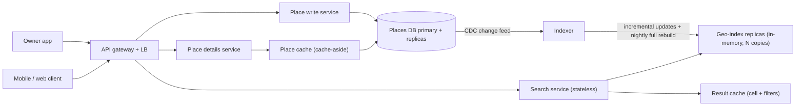
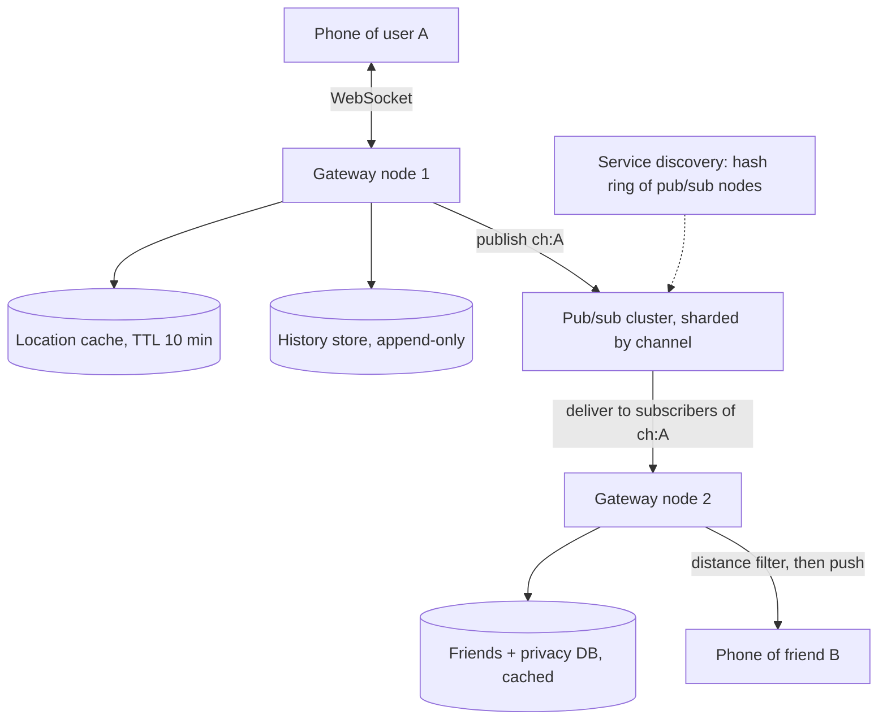
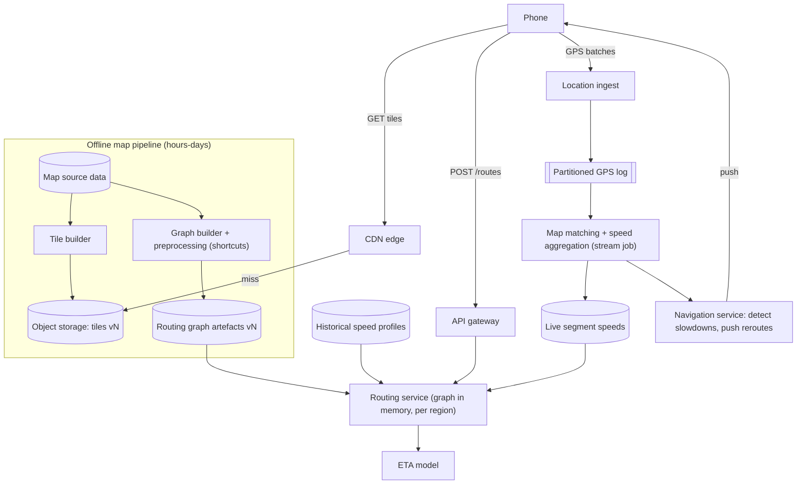
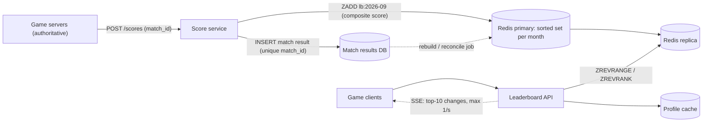

# Module 15 — Case Studies: Location and Real-Time

## Module Introduction

**What this module is.** Four more complete designs, laid out in the same seven-stage format as the [Module 12 capstones](../12-capstones/README.md#module-introduction), with three extra stops that interviews almost always ask for: the **API**, the **data model**, and a **trade-offs table**. No new patterns are introduced. The point is to practise composing the ones you already know on a family of problems that share two things: the key is often **a place on Earth**, and the answer has to be **fresh within seconds**.

These are extra notes written for this book, not part of the DesignGurus course. If basics such as latency, throughput, caching, replication, sharding or load balancers are new to you, start with [System Design Fundamentals](../00-system-design-fundamentals/README.md). The designs, numbers and wording are original, worked out from first principles and from primary sources (the geohash spec, Google S2 and Uber H3 documentation, the Redis docs, and the routing papers listed in [Sources](#sources)).

**Analogy.** Module 12 was four full chess games. This module is a themed puzzle book: every puzzle is about "what is near me, and what is changing right now?", so you learn to spot the same few tactics (spatial cells, in-memory state, pub/sub fan-out — one published message delivered to every subscriber — and precomputation) in different positions.

**The four designs**

| Design | Center of gravity (the main problem) | Key numbers (my assumptions) |
|---|---|---|
| Proximity Service ("restaurants near me") | A **spatial index** (an index organised by location): turning "within 500 m" into something a database can look up | 100M places, \~20K searches/s peak, almost no writes |
| Nearby Friends | **Fan-out of moving locations** to the right people, continuously | 10M online users, \~330K location updates/s |
| Maps & Navigation | **Precomputation at planet scale**: tiles (square map images or data), a routable road graph, live traffic for ETAs (estimated times of arrival) | \~90B possible tiles, \~1.2M GPS points/s |
| Real-Time Gaming Leaderboard | **Rank queries** ("what place am I?") on a score that changes constantly | 25M players, \~3K score updates/s, rank in < 10 ms (milliseconds) |

**How this module relates to Module 12.** [Design 2 — Ride-Sharing Dispatch](../12-capstones/README.md#design-2--ride-sharing-dispatch) already covered *moving* objects sharded (split across servers) by geo-cell, drop-oldest location streams, and single ownership of a contested driver. This module does **not** repeat those. Instead it teaches the geospatial basics that Design 2 took for granted (what a geohash, quadtree or S2/H3 cell actually is), then reuses the ride-sharing ideas by link whenever they come back.

**The format (each design).**
1. **Requirements and numbers** — functional (what it does), non-functional (how fast, how reliable), and back-of-envelope math (quick rough estimates).
2. **The five-questions pass** — Flow, Storage, Speed, Failure, Growth.
3. **API and data model.**
4. **The architecture, annotated** — a diagram plus the role of each part.
5. **Deep dives** — the 2–3 genuinely hard parts.
6. **The failure walk** — what breaks, what users see, the planned response.
7. **Trade-offs** — the main decisions and their costs, as a table.
8. **Follow-up questions** — what interviewers ask next, with strong answers.
9. **Pattern manifest** — which patterns were used, and where.

**Runnable demos** (in [`code/`](code/)):
- [`geohash_demo.py`](code/geohash_demo.py) — encodes coordinates to geohashes, shows the "boundary problem", and runs a 9-cell neighbour search checked against brute force.
- [`leaderboard_demo.py`](code/leaderboard_demo.py) — a Redis-sorted-set-style leaderboard (Redis is a popular in-memory data store; a sorted set keeps members ordered by a score) (top-K, my rank, players around me, tie-breaks, sharded top-K merge) with asserts.

Run them from this module's folder with `../../../.venv-books/bin/python code/<file>.py` (the virtual environment, a folder holding a private Python and its installed libraries, lives in the notes root, three levels up). Real output is pasted in each design.

**Before you start:** do the Proximity Service first. Its spatial index is the foundation the other three location problems stand on. Then do the leaderboard, which is the odd one out (not spatial) and tests whether you can recognise "rank" as its own kind of query.

---

## Design 1 — Proximity Service (Nearby Places)

**The prompt (in short).** Build the "search nearby" feature of a places app: given where the user is standing and a radius, return the businesses (restaurants, pharmacies, fuel stations) inside it, closest or best-rated first. Business owners can add or edit their listing.

**What makes it hard.** A normal database index sorts along **one** dimension. "Near me" is a **two-dimensional** question (latitude *and* longitude). A plain index on `lat` and a separate index on `lon` each return a huge stripe of the planet, and intersecting two stripes is slow. The whole design is about squeezing 2-D closeness into a 1-D key a database or a hash map (a structure that finds a value by its key in one step) can look up. (DDIA calls this a *multi-dimensional index*; see the [DDIA notes on multi-column indexes](../../../ddia/chapters/03-storage-and-retrieval/README.md#multi-column-indexes).)

### 1. Requirements and numbers

- **Functional:** search by `(lat, lon, radius)` with optional category filter; return a page of results; view a place's details; owners add/update/delete a place.
- **Non-functional:** search p99 under **\~200 ms** (p99 = 99 out of 100 searches are faster than this); high availability (up and answering almost all the time; search is the whole product); owner edits may take **minutes** to appear in search (an explicit, agreed staleness budget: how out-of-date data may be); read-heavy.
- *Assumptions:* **100M places** worldwide, **100M daily active users (DAU)** (M = million), **5 searches per user per day**.
- *Reads:* 100M × 5 = **500M searches/day ≈ 5,800/s average, \~20,000/s peak** (assume a 3–4× peak factor around lunch and dinner).
- *Writes:* owners change maybe **1%** of places per day → **1M edits/day ≈ 12/s**. The read:write ratio is over **1,000:1**.
- *Storage, details:* 100M places × \~1 KB (name, address, hours, category, rating) ≈ **100 GB**. Comfortable in a sharded or even a single large relational DB (a classic SQL database of tables).
- *Storage, the geo-index:* each entry is just `(cell_id 8 B, place_id 8 B)` → 100M × 16 B ≈ **1.6 GB**, maybe **3–5 GB** with data-structure overhead. **The index fits in the RAM (the server's fast working memory) of one ordinary server.**

That last number decides the architecture: we will **replicate** the index (keep full copies on several servers) for read throughput (requests handled per second) and availability, not **shard** it (split it into pieces on different servers). Sharding a 5 GB dataset would add scatter-gather complexity (ask every shard, merge the answers) for no benefit ("numbers before boxes").

### 2. The five-questions pass

- **Flow:** search is synchronous request-response (the user is waiting). Owner edits are written synchronously to the source-of-truth DB (the one copy that is always right), but reaching the search index is **asynchronous** (happens later, in the background).
- **Storage:** the **places DB** is the authority. The geo-index and any caches are **derived** and can be rebuilt from it at any time.
- **Speed:** the hot read is "cells around a point". Popular areas (city centres) are searched constantly, so results per cell are highly cacheable.
- **Failure:** a slightly stale index (a new café missing for 10 minutes) is harmless; returning nothing is not. Degrade to stale rather than fail.
- **Growth:** read QPS (queries per second) grows with users → add index replicas. Place count grows slowly.
- *Skeleton:* a stateless search tier (servers that keep no data of their own, so any one can answer any request) over replicated in-memory geo-indexes, a cache for place details, the places DB as the truth, and a change feed (a stream of every change made to the DB) that refreshes the index.

### 3. API and data model

```text
GET  /v1/search/nearby?lat=40.7484&lon=-73.9857&radius_m=500&category=cafe&limit=20&cursor=...
     -> 200 { "places": [ {"id": "p_91", "name": "...", "distance_m": 84, "rating": 4.6}, ... ],
              "next_cursor": "..." }
GET  /v1/places/{place_id}                      -> full details
POST /v1/places            (owner, authenticated) -> 201 {id}      # Idempotency-Key header
PUT  /v1/places/{place_id} (owner)                -> 200
DELETE /v1/places/{place_id} (owner)              -> 204 (soft delete)
```

Pagination (returning results a page at a time) uses a cursor, a bookmark of where the last page ended ([cursor-based pagination](../08-api-and-edge/README.md#cursor-based-pagination)), that encodes the last `(distance, place_id)` returned, so pages stay stable while users scroll.

| Table / structure | Key | Columns | Notes |
|---|---|---|---|
| `places` (relational, primary-replica: one writable copy plus read-only copies) | `place_id` | name, category, lat, lon, address, hours, rating, updated_at, deleted | The source of truth |
| `place_cells` (derived) | `(cell_id, place_id)` | — | One row per place at the chosen precision; rebuilt from `places` |
| Geo-index (in memory on each search node) | `cell_id` → list of `(place_id, lat, lon, category, rating)` | — | Built from `place_cells`; small enough to fit in RAM |

Storing `lat, lon, category, rating` *inside* the index entry lets the search node filter and rank without a DB round trip (a request to the database and back); the details call fetches the rest.

### 4. The architecture, annotated



- **Search service:** turns `(lat, lon, radius)` into a set of cell IDs, reads candidate places from the geo-index, computes the exact distance to each, filters by radius and category, ranks, and returns a page. It holds no state, so it [scales horizontally](../06-scaling/README.md#horizontal-scaling) (add more machines) behind the load balancer (the component that spreads incoming requests across servers).
- **Geo-index replicas:** each replica holds the *whole* index in memory. At \~5,000 searches/s per replica, 20K/s peak needs **4 replicas + headroom ≈ 6** per region. More users means more replicas, never sharding.
- **Result cache:** keyed by `(cell_id, category)`. Rounding the user's position to a cell before caching is what makes the cache work: thousands of users in the same block share one entry. TTL (time to live: how long an entry is kept before it expires) of a few minutes matches the staleness budget.
- **Place details:** classic [cache-aside](../04-caching/README.md#cache-aside) (look in the cache first; on a miss, read the DB and store the result in the cache) in front of the places DB; details are read far more than written.
- **Writes and freshness:** owner edits go to the places DB. [Change Data Capture](../10-batch-and-streaming/README.md#change-data-capture) (CDC: reading the database's own change log and streaming every insert/update/delete to other systems) streams each change to an **indexer**, which patches the in-memory index (and, as a safety net, a **nightly full rebuild** replaces it from scratch so drift, i.e. small differences between index and DB, cannot accumulate).

### 5. Deep dives

**Deep dive 1 — choosing the spatial index.** Four families are worth knowing. All of them divide the map into **cells** and give each cell an ID, so that "near" becomes "same or adjacent cell".

- **Geohash** ([geohash.org](http://geohash.org), Niemeyer 2008). Repeatedly split the world in half — first by longitude, then latitude, alternating — writing `1` for "upper half" and `0` for "lower half". Group the bits five at a time and write each group as one base-32 character (an alphabet of 32 symbols, digits plus letters, so 5 bits per character). Every extra character makes cells \~32× smaller, and **a longer geohash always starts with the shorter geohash of the cell that contains it**. So "all places in this cell" becomes a **prefix range scan** (read every key that starts with the same characters: `WHERE geohash LIKE 'dr5ru6%'`), which any B-tree index (the standard sorted, balanced-tree index in databases) or sorted key-value store supports. Redis's `GEOADD` / `GEOSEARCH` commands work the same way: they store a 52-bit geohash as the score of a sorted set (a collection kept in order by a number called its score).
- **Quadtree** (Finkel & Bentley, 1974). Start with one square covering the map. If it holds more than a threshold (say **100** places), split it into four children, and recurse (apply the same rule to each child). Dense Manhattan ends up with tiny leaves (the bottom squares that are not split further), the Sahara with one huge leaf, so every leaf holds about the same number of places. With 100M places and ≤100 per leaf there are \~**1M leaves** (\~1.33M nodes); at \~100 bytes per node plus the place IDs, that is still a few GB — a single-server, in-memory structure, rebuilt at start-up (which takes minutes, so new servers must warm up, i.e. load their data, before taking traffic).
- **Google S2** ([s2geometry.io](https://s2geometry.io)). Projects the sphere onto the six faces of a cube and numbers the cells of each face along a **Hilbert curve**, a space-filling curve (one line that winds through every cell of a grid) that keeps nearby cells numerically close even better than geohash's Z-order (the zig-zag ordering produced by interleaving latitude and longitude bits). Cell IDs are 64-bit integers with 31 levels (down to \~1 cm²), and the library can **cover** any circle or polygon with a small set of cells of mixed sizes. That makes "places within 500 m" a handful of integer range scans.
- **Uber H3** ([h3geo.org](https://h3geo.org), Uber Engineering 2018). Hexagonal cells in 16 resolutions. Every hexagon's six neighbours are the **same distance** away (squares have 4 edge neighbours and 4 farther corner ones), which suits movement, smoothing and heat-map analytics (colour-coded maps of activity) — the reason Module 12's dispatch design uses it.

| | Geohash | Quadtree | S2 | H3 |
|---|---|---|---|---|
| Cell shape | Rectangle (varies with latitude) | Square, adaptive size | Quadrilateral on a cube face | Hexagon |
| Adapts to density | No (fixed precision) | **Yes** | Via mixed-level coverings | No (fixed resolution) |
| Storage | A string/int column + normal index | A custom in-memory tree | A 64-bit int column | A 64-bit int column |
| Radius / polygon queries | 9-cell trick | Walk the tree | **Built-in region coverer** | k-ring (all hexagons within k steps) of hexagons |
| Best for | Simple, DB-friendly; Redis GEO | In-memory, very uneven density | Precise coverings (Google Maps, many DBs) | Movement, analytics, pricing grids |

*Interview answer:* start with geohash (easiest to explain and store), mention the quadtree when density is very uneven, and name S2/H3 as the production libraries.

**Deep dive 2 — the boundary problem and the 9-cell search.** Two places can be metres apart yet sit in different cells that share **no prefix at all**, because a cell edge runs between them. So never search only the user's own cell: search the cell **and its 8 neighbours**, then compute the exact distance to every candidate and keep those within the radius. Pick the precision so that one cell is at least as big as the radius (for 500 m: precision 6, \~0.9 km × 0.6 km at latitude 40); if the page is still short of results, drop one character (32× larger cells) and repeat. The demo shows all of this on 5,000 random places:

```text
$ ../../../.venv-books/bin/python code/geohash_demo.py
1) Cell size per precision (at latitude 40):
   precision 4: ~   29,946 m wide x   19,546 m tall
   precision 5: ~    3,743 m wide x    4,886 m tall
   precision 6: ~      936 m wide x      611 m tall
   precision 7: ~      117 m wide x      153 m tall
   precision 8: ~       29 m wide x       19 m tall

2) encode(40.7484, -73.9857) -> dr5ru6j28   (prefixes: dr5r > dr5ru > dr5ru6)

3) Boundary problem: dr5ru6 vs dr5rud  -> 17 m apart, different cells

4) Nearby search, radius 500 m, over 5,000 places
   cells scanned     : 9 (dr5ru6, dr5ru1, dr5ru3, ...)
   candidates read   : 262  (5.2% of all)
   within 500 m      : 39  (brute force agrees: True)
   own cell only     : 12  <- misses 27 if you skip neighbours
     biz0989      84 m
     biz0934     102 m
     biz1059     103 m

all asserts passed
```

Read line 4 carefully: the 9-cell scan touched **5%** of the data and found exactly what a full scan found, while searching only the user's own cell would have **missed 27 of 39** results.

**Deep dive 3 — ranking, caching and freshness.** Distance alone is a poor ranking (the closest café may be terrible). Score each candidate with a simple blend such as `rating × w1 − distance × w2 + is_open_now × w3`, computed on the search node from fields stored in the index entry. Cache per `(cell, category)` rather than per exact coordinate, and invalidate a cell's entry when the indexer patches a place inside it. For freshness, the CDC path gives **seconds to minutes**; the nightly rebuild is a correctness backstop. New replicas load the latest **snapshot** (a saved full copy at one moment) of the index from object storage (a cheap store for large files, such as Amazon S3), then replay the change feed from the snapshot's offset (its position in the feed) — the same "snapshot + log" recovery as a [write-ahead log](../03-storing-data/README.md#write-ahead-log).

### 6. The failure walk

1. **An index replica dies:** the load balancer's [health checks](../09-operating-in-production/README.md#health-check-endpoint) (regular automatic "are you OK?" probes) remove it; the other replicas absorb its share (we kept \~50% headroom, i.e. spare capacity). A replacement loads the snapshot and catches up before rejoining.
2. **The indexer or CDC stream stalls:** search keeps serving the last good index. New or edited places are missing longer than the budget; alert on **change-feed lag** (how far behind the feed is), not on errors, because nothing errors.
3. **The places DB primary is down:** search is unaffected (it never touches the primary). Details fall back to replicas and cache. Owner edits fail with a clear "try again later" or are queued.
4. **A cache node is lost:** a burst of misses hits the index replicas; protect them with [stampede prevention](../04-caching/README.md#cache-stampede-prevention) (single-flight per cell key: only one request per key goes to the backend while the others wait for its answer).
5. **A whole region is lost:** users are routed to the next region; the index is identical everywhere (it is small), so results are the same with extra latency.

### 7. Trade-offs

| Decision | Chosen | Alternative | Why / cost |
|---|---|---|---|
| Replicate vs shard the geo-index | Replicate the whole \~5 GB index | Shard by region | Fits in RAM; sharding adds scatter-gather at borders for no gain. Cost: every replica holds everything |
| Geohash vs quadtree | Geohash (fixed precision) + expand if few results | Quadtree with adaptive leaves | Geohash lives in a normal DB column; a quadtree handles density better but is custom code and slow to rebuild |
| In-memory index vs spatial DB (PostGIS, the geographic add-on for PostgreSQL; R-tree, a tree index of bounding boxes) | In-memory | PostGIS `ST_DWithin` on a GiST index (PostgreSQL's general index type used for geometry) | PostGIS is excellent up to moderate QPS and simplest to build first; the in-memory tier wins at 20K QPS with filtering |
| Freshness | CDC (seconds–minutes) + nightly rebuild | Synchronous index update on write | Owners accept minutes; keeping writes decoupled protects search |
| Cache key | Cell + category | Exact coordinates | Rounding to cells gives a high hit rate (share of lookups found in cache); cost: results cached for a cell, then trimmed by exact distance |

### 8. Follow-up questions

- **"Why not just `WHERE lat BETWEEN ... AND lon BETWEEN ...`?"** Each condition alone selects a thin stripe around the whole planet; the DB can use only one index well and must filter the other stripe row by row. A cell ID turns both dimensions into one sortable key. *Trap:* claiming a composite `(lat, lon)` B-tree (one index sorted by lat, then lon) solves it — it only narrows latitude efficiently.
- **"The user is at the edge of a cell, or near the antimeridian (the ±180° longitude line) / a pole."** The 9-cell search fixes cell edges. Neighbour computation must wrap longitude at ±180° and skip cells beyond the poles (the demo does both). S2 has no such seams because it works on the sphere.
- **"Results are too few in the countryside and too many in Manhattan."** Adapt the radius or precision: expand (drop a geohash character) until you have enough candidates, or use a quadtree/S2 covering whose cell sizes follow density. Cap the candidate count in dense areas and rely on ranking.
- **"How do you support 'open now' and categories?"** Store them in the index entry and filter on the search node. For very selective filters, keep a separate index per top-level category.
- **"What changes if places move (food trucks)?"** Moving objects turn a read-heavy index into a write-heavy one. Then you need the ephemeral (short-lived, safe to lose), in-memory, drop-oldest approach of [ride-sharing dispatch](../12-capstones/README.md#design-2--ride-sharing-dispatch) — the next design builds on that too.

### 9. Pattern manifest

| Pattern | Where it served |
|---|---|
| Primary-Replica | Places DB; replicated in-memory index replicas |
| CQRS | The geo-index is a read model derived from the places table |
| Change Data Capture | Owner edits → indexer, no dual writes (the app writing to two systems itself, which can leave them disagreeing) |
| Cache-Aside + Stampede Prevention | Place details and per-cell results |
| Horizontal Scaling + Load Balancing | Stateless search tier, index replicas |
| Write-Ahead Log (snapshot + log) | Fast replica start-up |
| Graceful Degradation | Serve a stale index rather than fail |
| Cursor Pagination | Stable result pages |

**Interview one-liner:** "Turn 2-D closeness into a 1-D cell key (geohash, quadtree or S2), search the cell plus its eight neighbours and filter by exact distance, and — because the whole index is a few GB — replicate it in memory instead of sharding it."

**TL;DR**
- **Problem:** "near me" is a 2-D query that ordinary 1-D indexes answer badly.
- **Mechanism:** cell IDs (geohash/quadtree/S2/H3) + 9-cell search + exact-distance filter; replicated in-memory index fed by CDC.
- **Key numbers:** 100M places → \~5 GB index; 20K searches/s → \~6 replicas per region.
- **Watch out for:** the boundary problem, uneven density, and letting the write path slow down search.

---

## Design 2 — Nearby Friends (Real-Time Location Sharing)

**The prompt (in short).** Users who opt in can see which of their friends are within a few kilometres, with each friend's distance and "last updated" time, updating live while the app is open.

**What makes it hard.** Unlike places, **both** ends move. Every location update has to reach the handful of friends who care, within seconds, and be thrown away soon after. It is a **fan-out** problem (one input producing many deliveries, like the news feed) crossed with an **ephemeral location** problem (like dispatch), at a much higher message rate than either.

### 1. Requirements and numbers

- **Functional:** opt-in sharing; see friends within **5 km** with distance and freshness; list updates live; friends disappear after **10 minutes** of silence.
- **Non-functional:** end-to-end delay under **\~5 s**; losing an occasional update is fine (the next one replaces it); **privacy** is a hard requirement (only confirmed friends who opted in, never exact history to others).
- *Assumptions:* **100M DAU** use the feature; **10%** online at peak → **10M concurrent** users; each phone sends its location every **30 s**; the average user has **400 friends**, of whom **\~10%** are online and sharing.
- *Inbound updates:* 10M ÷ 30 s ≈ **333,000 updates/s**.
- *Fan-out:* each update goes to \~40 online friends → **\~13M deliveries/s** into the delivery layer. After the 5 km filter most are dropped; perhaps **1–2M pushes/s** actually reach phones.
- *State:* latest location per online user ≈ 10M × \~50 B ≈ **0.5 GB** (tiny). History, if kept for the owner's own use: 333K/s × 40 B ≈ **1.1 TB/day** (write-heavy, append-only: new rows are only added at the end).
- *Connections:* 10M persistent connections; at \~100K per gateway node (a server whose job is holding client connections) → **\~100 gateway nodes**.

The expensive numbers are the **13M deliveries/s** and the **10M open connections**, not storage.

### 2. The five-questions pass

- **Flow:** phone and server both push, continuously → a persistent [bidirectional stream](../02-moving-data/README.md#bidirectional-streaming) (WebSocket, [RFC 6455](https://www.rfc-editor.org/rfc/rfc6455): a long-lived two-way connection where either side can send at any time; an RFC is a numbered internet-standard document). Deliveries between servers use [publish-subscribe](../02-moving-data/README.md#publish-subscribe) (publishers send to a named channel; everyone subscribed to it receives the message): one channel per user.
- **Storage:** the **latest location** is ephemeral, lives in memory with a TTL, and is rebuilt by the next update. The friendship graph and privacy settings are durable (relational DB). History, if any, goes to an append-only store.
- **Speed:** everything on the hot path is in memory; no DB reads per update.
- **Failure:** dropping an update costs 30 s of freshness; leaking a location to a non-friend is a serious incident. So be relaxed about delivery and strict about authorization (checking what a user is allowed to see).
- **Growth:** concurrent users drive both connections and fan-out. Celebrities are not an issue here (friend lists are capped, e.g. 5,000).
- *Skeleton:* WebSocket gateways; a location cache with TTL; a sharded pub/sub layer with one channel per user; a distance filter at the receiving side.

### 3. API and data model

```text
WebSocket  wss://rt.example.com/v1/nearby   (auth token on connect)
  client -> server  {"type":"loc","lat":..,"lon":..,"ts":..}          every 30 s
  server -> client  {"type":"init","friends":[{"id","dist_m","ts"},...]} on connect
  server -> client  {"type":"friend_loc","id":"u42","dist_m":820,"ts":..}
  server -> client  {"type":"friend_gone","id":"u42"}                  TTL expiry / opt-out
REST  PUT /v1/nearby/settings  {"sharing": true, "audience": "close_friends"}
```

| Data | Store | Key | Notes |
|---|---|---|---|
| Latest location | Redis-style cache | `loc:{user_id}` → `(lat, lon, ts)` | TTL 10 min; expiry = "friend went offline" |
| Friendship + sharing settings | Relational DB (+ cache) | `(user_id, friend_id)` | Checked on subscribe, cached per session |
| Location history (optional, owner only) | Wide-column (Cassandra-style, rows grouped by a partition key) / time-series store (a DB optimised for timestamped readings) | `(user_id, day)` → rows by ts | Append-only, write-heavy, retention-limited |
| Pub/sub channels | Pub/sub cluster | `ch:{user_id}` | No storage: fire-and-forget (sent once, never retried or stored) |

### 4. The architecture, annotated



1. When B connects, B's gateway loads B's opted-in friends (from the friends DB, via cache), **subscribes** to each friend's channel `ch:{friend}`, and reads each friend's latest location from the location cache to send an initial list.
2. When A sends a location, A's gateway writes it to the location cache (resetting the TTL), optionally appends to history, and **publishes** it on `ch:A`.
3. The pub/sub layer delivers the message to every gateway that has a subscriber on `ch:A` — here, B's gateway.
4. B's gateway computes the distance between A's new point and **B's own latest point** (it holds B's point in memory because B's socket lives there). If within 5 km, it pushes; if A just left the radius, it sends `friend_gone`.

The distance filter sits on the **receiving** side because only that side knows the receiver's position. The cost is that every update reaches every online friend's gateway even if they are far away; the next deep dive trims that.

### 5. Deep dives

**Deep dive 1 — sizing and sharding the pub/sub layer.** One channel per user means **100M+ channels**, most of them idle. A channel with no subscribers costs almost nothing, and a subscription is a small entry in a hash table (Redis's classic Pub/Sub keeps subscribers in memory only and does not store messages; see the [Redis Pub/Sub docs](https://redis.io/docs/latest/develop/interact/pubsub/)). The real limit is **CPU for delivery**: \~13M deliveries/s. Assume a conservative **\~100K deliveries/s per node** → **\~130 nodes**, plus headroom. Channels are spread over nodes with [consistent hashing](../03-storing-data/README.md#consistent-hashing) (keys and servers placed on a ring so adding a server moves only a few keys) on the channel name; the ring lives in a service-discovery store (etcd/ZooKeeper: small, highly reliable stores that tell services where other services are) that every gateway watches. Redis 7 added **sharded pub/sub** (`SSUBSCRIBE`/`SPUBLISH`), which does this routing inside a Redis Cluster.
Resizing the ring moves channels between nodes, so every gateway must **resubscribe** the moved channels; while it does, a few updates are lost. Because each update is replaced 30 s later, that is acceptable — but do it at off-peak hours and add capacity *before* it is needed, because this layer is stateful in the "who is listening" sense.

**Deep dive 2 — the connection tier.** 10M WebSockets are long-lived and stateful: a gateway node knows which users are on it and what they subscribed to. The Module 12 dispatch design's "**sockets local, routing global**" rule applies unchanged (see [ride-sharing dispatch](../12-capstones/README.md#design-2--ride-sharing-dispatch)). Deploys **drain** a node gradually (stop accepting, ask clients to reconnect with jittered backoff: wait longer after each failure, plus a random extra delay) so 100K phones do not reconnect in the same second — a [retry storm](../05-reliability/README.md#retry-with-exponential-backoff) (huge numbers of clients retrying at once and overloading the system) in disguise. On reconnect a client re-sends its location, and the gateway rebuilds its subscriptions from the friends list, so no gateway state needs to survive a crash.

**Deep dive 3 — trimming fan-out, and "nearby strangers".** Two cheap wins: (a) phones send updates **only when moved > \~100 m or every 5 min when still** (most phones sit still most of the time, often cutting inbound traffic by more than half); (b) gateways drop an incoming friend update without pushing if the friend is far away *and* was far away last time. A different product — "people near me who are *not* friends" — cannot use per-user channels, because you do not know in advance who to subscribe to. Instead, use **one channel per geo-cell**: each user publishes to the channel of their current geohash cell and subscribes to their cell plus its 8 neighbours, exactly the 9-cell idea from [Design 1](#design-1--proximity-service-nearby-places). When they cross into a new cell, they re-subscribe.

### 6. The failure walk

1. **A gateway node dies:** its \~100K clients reconnect elsewhere with jittered backoff, re-send location, re-subscribe. Users see friends "freeze" for up to \~30 s.
2. **A pub/sub node dies:** channels hashed to it stop delivering until the ring removes it and gateways resubscribe on the new owner. Friends appear stale for seconds; nothing is corrupted because nothing was stored.
3. **Location cache node lost:** latest points vanish for its share of users; they come back with the next 30 s update. The initial list on connect may be short for a moment — show "updating…".
4. **Friends DB slow:** new connections cannot build their friend lists. Serve from the session cache; if there is none, **fail closed** (when unsure, deny: show nothing) rather than skip the privacy check.
5. **An update arrives out of order** (mobile networks): each message carries the device timestamp; gateways keep the newest `ts` per friend and drop older ones — event time (when it happened on the device, not when it arrived), newest wins.

### 7. Trade-offs

| Decision | Chosen | Alternative | Why / cost |
|---|---|---|---|
| Fan-out mechanism | Pub/sub, one channel per user | Look up friends and write to each friend's inbox | Pub/sub needs no storage and delivers in ms; cost: lossy, and a big stateful tier (servers holding state that matters) to run |
| Where to filter by distance | Receiving gateway | Publisher checks every friend's location | Receiver already holds its own point; publisher-side check would read 40 locations per update |
| Latest location | In-memory cache with TTL | Durable DB row | Ephemeral data, rebuilt every 30 s; TTL doubles as "offline" detection |
| Transport | WebSocket | Client polling every 30 s | Polling 10M clients doubles request count and adds up to 30 s delay; cost: stateful gateways |
| History | Optional, owner-only, append-only | None | Useful feature but a privacy liability; keep retention short |

### 8. Follow-up questions

- **"Why not store all locations in a geospatial DB and query friends near me?"** You would run a query per user every 30 s over a table rewritten 333K times a second. Friendship already limits the candidate set to \~40 people; fan-out to them is cheaper than a spatial query over everyone.
- **"How do you guarantee a blocked user never sees me?"** Authorization happens at **subscribe time** (gateway checks friendship + settings before subscribing), and a block/opt-out publishes a control message that forces subscribers to drop the channel. Never rely on the client to hide it.
- **"What if a user has 5,000 friends online?"** Their updates fan out to 5,000 gateways' subscribers — still one publish; pub/sub handles large subscriber lists. The receiving side is fine too: each receiver gets one message per friend.
- **"How would you reduce battery use?"** Adaptive update intervals (movement-based), batching on the client, and pausing sharing in the background unless the user chooses otherwise.
- **"Multi-region?"** Keep a user's socket in their nearest region; replicate pub/sub messages across regions only for channels that have remote subscribers (friends abroad are rarely within 5 km, so most cross-region traffic can be filtered out at the source).

### 9. Pattern manifest

| Pattern | Where it served |
|---|---|
| Bidirectional Streaming | Phones ↔ gateways over WebSocket |
| Publish-Subscribe | One channel per user (or per geo-cell for strangers) |
| Consistent Hashing | Channel → pub/sub node; smooth resizing |
| Backpressure (drop-oldest: when a consumer falls behind, discard old items) | Only the newest location matters |
| Cache with TTL | Latest location; expiry = offline |
| Retry with Backoff + jitter | Mass reconnects after deploys and failures |
| Graceful Degradation vs fail closed | Stale positions are fine; privacy checks fail closed |
| Sharding (by user/time) | Optional history store |

**Interview one-liner:** "Keep only the latest location in memory with a TTL, publish each update on the user's own channel, let the gateways of online friends subscribe and filter by distance on the receiving side — lossy by design, strict on privacy."

**TL;DR**
- **Problem:** continuous fan-out of moving points to a small, known audience.
- **Mechanism:** WebSocket gateways + per-user pub/sub channels + TTL location cache + receiver-side distance filter.
- **Key numbers:** 10M online, \~333K updates/s in, \~13M deliveries/s inside, \~100 gateways, \~130 pub/sub nodes.
- **Watch out for:** stateful resizing of the pub/sub ring, reconnect storms, and privacy checks that must fail closed.

---

## Design 3 — Maps & Navigation

**The prompt (in short).** Build the core of a maps app: render the map as the user pans and zooms, find a route from A to B, give an accurate arrival time (ETA) that reflects live traffic, and guide the driver turn by turn, rerouting when needed.

**What makes it hard.** Three different sub-systems hide under one prompt, each with its own shape: **map rendering** (a huge, read-only, cacheable dataset), **routing** (a graph search over hundreds of millions of road junctions that must answer in milliseconds; a *graph* is a set of points joined by links), and **live traffic/ETA** (a stream-processing pipeline, i.e. code that processes an endless flow of events as they arrive, over millions of GPS points per second). The trick is to **precompute** as much as possible offline so the online paths become lookups.

### 1. Requirements and numbers

- **Functional:** show the map at any zoom; search a destination (reuse [Design 1](#design-1--proximity-service-nearby-places)); compute the fastest route and alternatives; show ETA; turn-by-turn navigation with rerouting; traffic colouring.
- **Non-functional:** map tiles appear instantly (< \~100 ms, mostly from cache); route + ETA in **< 1 s**; ETA within \~10% of actual for most trips; available worldwide; tolerate poor mobile connectivity.
- *Assumptions:* **100M DAU**; **20M** of them navigate for \~**30 min/day**.
- *Concurrent navigators:* 20M × 30 min ÷ 1,440 min ≈ **420K average**, **\~1.2M peak** (rush hours, \~3×).
- *GPS ingestion:* phones sample once per second but **batch** and upload every 15 s → 1.2M ÷ 15 ≈ **80K uploads/s** carrying **\~1.2M GPS points/s**.
- *Route requests:* 20M navigators × \~3 routes/day (initial + reroutes) + planners ≈ **100M/day ≈ 1,200/s average, \~5,000/s peak**.
- *Tiles:* the world is cut into square tiles in the Web Mercator projection (the standard way web maps flatten the globe onto a square), addressed by `(zoom z, column x, row y)` with **4^z** tiles at zoom z (the [OpenStreetMap "slippy map" scheme](https://wiki.openstreetmap.org/wiki/Slippy_map_tilenames)). Zoom 0 is 1 tile; zoom 18 alone is 4^18 ≈ **69 billion**; zooms 0–18 together ≈ **92 billion** possible tiles. Most are ocean or empty land and compress to almost nothing or are deduplicated, but it shows why you never render the world on the fly per request.
- *Tile traffic:* each pan/zoom loads \~10–20 tiles; say **200 tile requests per user per day** → 20B/day ≈ **230K/s average**, served mainly by a CDN (content delivery network: cache servers around the world that keep copies close to users).

### 2. The five-questions pass

- **Flow:** tiles and routes are request-response; GPS uploads are fire-and-forget into a **log** (an append-only, ordered record of events); traffic updates and reroutes are **pushed** to navigating phones.
- **Storage:** the **map data** (roads, places, geometry, from surveyors, imagery and partners) is the authority. Tiles, the routing graph and its precomputed shortcuts are **derived, versioned build artefacts** (files produced by a build job and labelled with a version). Live segment speeds are ephemeral state with a short life.
- **Speed:** tiles are immutable per map version → CDN with long TTLs. Routes need a precomputed graph index in memory.
- **Failure:** without live traffic, route on historical speeds (ETA less accurate, still useful). If the client loses signal, it keeps navigating from its downloaded route.
- **Growth:** tile traffic grows with users (CDN absorbs it); GPS ingestion grows with navigators (partitioned stream: split into independent slices processed in parallel); routing grows with requests (replicate the graph).
- *Skeleton:* an offline map pipeline that builds tiles and routing graphs; a CDN for tiles; routing servers holding a region's graph in memory; a streaming traffic pipeline feeding live speeds to routing and ETA.

### 3. API and data model

```text
GET  /tiles/v{map_version}/{z}/{x}/{y}.mvt         -> vector tile (CDN, Cache-Control: immutable)
POST /v1/routes  {"origin":{lat,lon}, "dest":{lat,lon}, "mode":"drive", "depart_at":...}
     -> {"routes":[{"route_id","polyline","distance_m","eta_s","steps":[...]}]}
POST /v1/nav/{session_id}/locations  {"points":[{lat,lon,ts,speed,heading}, ...]}   # batched, every 15 s
     -> 202 (optional reroute hint in response)
WebSocket / push: {"type":"reroute","route_id":..} | {"type":"eta","eta_s":..}
```

| Data | Store | Notes |
|---|---|---|
| Map source data (roads, geometry, attributes) | Versioned spatial DB + object storage | Edited by the map pipeline; authority |
| Tiles `(version, z, x, y)` | Object storage → CDN | Build artefacts, immutable per version |
| Road graph: nodes (junctions), edges (road segments with length, speed limit, turn restrictions) | In-memory on routing servers, loaded from build artefacts | Partitioned by region; plus precomputed shortcuts |
| Historical speed profile | Key-value: `(segment_id, time_of_week_bucket)` → speed | 7 × 24 × 4 = **672** 15-minute buckets per segment |
| Live segment speed | In-memory / cache: `segment_id` → `(speed, sample_count, updated_at)` | TTL a few minutes |
| GPS probe log | Partitioned log (Kafka-style; Kafka is a widely used durable event log), then cold storage (cheap, slow storage for rarely read data) | Input to traffic, ETA training and map fixes |

### 4. The architecture, annotated



- **Tiles through a CDN.** Tiles are pre-rendered per map version and stored in object storage; the [CDN](../08-api-and-edge/README.md#cdn) serves them. Putting the **map version in the URL** makes every tile immutable, so caches never need invalidating (marking stored copies as out of date): a new map release simply uses new URLs.
- **Vector tiles.** Instead of pictures (raster: a grid of pixels), each tile carries geometry and labels (the [Mapbox Vector Tile spec](https://github.com/mapbox/vector-tile-spec) is the common format) and the phone draws it. Tiles are several times smaller, the client can rotate, tilt and restyle (night mode) without new downloads, and it can **over-zoom**: build tiles only up to about zoom 14–16 and let the client scale them further. That cuts the tile count from tens of billions to a few hundred million.
- **Routing service:** holds a region's road graph and its precomputed shortcuts in memory; a request is a graph search (deep dive 2). Replicated for throughput; partitioned by region for memory.
- **Traffic pipeline:** a [stream processing](../10-batch-and-streaming/README.md#stream-processing) job reads the GPS log, snaps points to roads, and aggregates per-segment speeds in short windows (deep dive 3).
- **Navigation service:** tracks active sessions; when a route's segments slow down significantly, it recomputes and pushes a better route.

### 5. Deep dives

**Deep dive 1 — tiles: why precompute and cache wins.** Rendering a tile means reading every road, building and label in its square and drawing them — tens of milliseconds of CPU. At 230K requests/s that would be a massive render farm. Instead: build once per map version (a big batch job, i.e. a large offline computation, like [MapReduce](../10-batch-and-streaming/README.md#mapreduce), parallel by tile), store, and serve from the CDN with a hit rate above 95% (map usage is highly skewed toward cities). Updates are **incremental**: a road change marks only the tiles it touches, at each zoom level, as dirty for the next build. Ocean tiles are identical, so store one copy and point all of them to it. Phones also cache recent tiles and can download whole regions for offline use.

**Deep dive 2 — routing in milliseconds.** Model roads as a weighted directed graph (links have a direction and a cost): junctions are **nodes**, road segments are **edges**, the weight is travel time. [Dijkstra's algorithm](https://doi.org/10.1007/BF01386390) (1959) finds the shortest path by expanding outward from the start in order of distance — correct, but on a continental graph with hundreds of millions of nodes a long trip explores a huge share of it and takes **seconds**. Improvements, in order:
1. **A\*** ([Hart, Nilsson & Raphael, 1968](https://doi.org/10.1109/TSSC.1968.300136)) adds a "distance-to-goal" estimate (a heuristic: a cheap guess that guides the search) (straight-line distance ÷ max speed), so the search leans toward the destination. Helps, but not enough for 5,000 req/s of long routes.
2. **Contraction Hierarchies** ([Geisberger et al., 2008](https://doi.org/10.1007/978-3-540-68552-4_24)). Offline, rank nodes by importance (motorway junctions high, cul-de-sacs low) and "contract" them one by one, adding **shortcut edges** that preserve shortest distances. Online, run two tiny searches — forward from A and backward from B — that only climb to more important nodes and meet in the middle. Queries drop to around a millisecond on continent-sized graphs. Cost: preprocessing takes minutes to hours, and changing a weight (traffic) invalidates shortcuts.
3. **Multi-level partitioning / Customizable Route Planning** (Delling, Goldberg, Pajor & Werneck, 2011). Split the graph into cells (cities, then regions, then countries) and precompute distances between each cell's **boundary nodes**. The expensive part (the partition) rarely changes; the cheap "customization" step re-computes boundary distances with new weights in seconds, so **live traffic can be folded in** frequently. This is the natural fit for traffic-aware routing, and the partition doubles as a sharding scheme: a routing server holds its region in detail plus the top-level overlay for long trips.

> **A\* step by step (with a tiny example).**
>
> *Terms:* **g(n)** is the best known travel time from the start to node n so far. **h(n)** is the heuristic estimate from n to the goal (here straight-line distance ÷ top speed, in minutes). **f(n) = g(n) + h(n)** is the estimated cost of the whole trip through n. The **open set** is a priority queue (a structure that always hands back its smallest item first) of nodes waiting to be expanded.
>
> 1. Put the start in the open set with g = 0.
> 2. Pop the node with the smallest **f**. If it is the goal, stop: its g is the answer, and following parent pointers back gives the path.
> 3. Otherwise, for each outgoing edge u → v with weight w: if g(u) + w < g(v), set g(v) = g(u) + w, record u as v's parent, and push or update v with f(v) = g(v) + h(v).
> 4. Repeat from step 2.
>
> The result is guaranteed shortest if h is **admissible** (never overestimates the true remaining time) and, so that each node is expanded only once, **consistent** (h(u) ≤ w(u, v) + h(v) on every edge). With h = 0 everywhere, A\* is exactly Dijkstra.
>
> *Example.* Edges (minutes): S→A 4, S→B 2, B→A 1, A→G 3, B→G 6, and a side road S→C 1, C→G 10. Heuristic: h(S)=5, h(A)=3, h(B)=4, h(C)=9, h(G)=0 (C lies away from the goal).
>
> | Step | Pop (f) | Updates | Open set after |
> |---|---|---|---|
> | 1 | S (5) | A: g 4, f 7 · B: g 2, f 6 · C: g 1, f 10 | B 6, A 7, C 10 |
> | 2 | B (6) | A improves to g 3, f 6 · G: g 8, f 8 | A 6, G 8, C 10 |
> | 3 | A (6) | G improves to g 6, f 6 | G 6, C 10 |
> | 4 | G (6) | goal reached | — |
>
> Shortest route S→B→A→G, 6 minutes. Dijkstra, ordering by g alone, would have expanded C first (g = 1) and wandered the wrong way; A\* never expanded it, because its f of 10 never became the smallest. On a road network the same effect prunes everything "behind" the start. But a straight-line heuristic is weak on winding or congested roads, which is why production routers add the precomputation of items 2 and 3.

**Deep dive 3 — live traffic and ETA.** Raw GPS points are noisy (±10–20 m, worse between tall buildings), so first **map-match** each trace to the road the car was actually on. The classic approach is a hidden Markov model (a probability model that infers a hidden sequence, here the true roads, from noisy observations) over candidate road segments ([Newson & Krumm, 2009](https://doi.org/10.1145/1653771.1653818)): it prefers segments close to each point *and* transitions that make sense on the road network. From matched traces, compute each vehicle's speed on each segment, then aggregate per segment in **1-minute tumbling windows** (fixed, non-overlapping slices), partitioned by `segment_id` so one worker owns each segment ([partitioned consumption](../10-batch-and-streaming/README.md#partitioned-consumption)). Segments with too few probes fall back to the **historical profile** for that time-of-week bucket; blend the two by sample count. **ETA** = sum of predicted segment times along the route + turn and intersection delays — then an ML (machine learning) model corrects the systematic error (DeepMind and Google Maps described graph neural networks, neural networks that learn over graph-shaped data, for this in 2020; Uber described its DeepETA model in 2022 — see [Sources](#sources)). Note the forecasting subtlety: for a 1-hour trip, the segment you reach in 50 minutes should use the speed *predicted for then*, not the speed now.

### 6. The failure walk

1. **CDN edge outage:** DNS/anycast (DNS: the internet's name-to-address directory; anycast: one IP address served from many sites, with the network picking a nearby one) routes users to the next edge; phones keep drawing cached tiles meanwhile.
2. **Traffic pipeline stalls:** live speeds age out (TTL); routing falls back to historical profiles. ETAs get worse at unusual times (accidents, events), so show "traffic data delayed" rather than confident numbers — honest staleness.
3. **A routing server dies:** stateless apart from its read-only graph; the LB (load balancer) retries on a replica. A new server needs minutes to load the graph, so keep warm spares (standby servers already loaded).
4. **Bad map release** (a bridge marked closed by mistake): map versions are canaried (released to a small slice first and watched) by region with route-quality checks (sudden rise in average route length or failed routes), and rollback (undoing a release) is just pointing back to version N−1 — tiles and graphs are immutable artefacts ([canary deployment](../09-operating-in-production/README.md#canary-deployment)).
5. **Phone loses signal mid-navigation:** the client holds the full route and turn list, continues guidance on GPS alone, and syncs when back online. GPS batches are uploaded late; the pipeline uses **event time** and simply drops samples too old to matter.

### 7. Trade-offs

| Decision | Chosen | Alternative | Why / cost |
|---|---|---|---|
| Raster vs vector tiles | Vector + client over-zoom | Server-rendered raster images | Smaller, restylable, far fewer tiles; cost: client rendering work and a more complex app |
| Tile freshness | Versioned immutable tiles, incremental rebuilds | Render on demand | CDN-friendly, no invalidation; cost: map edits take hours to appear |
| Routing algorithm | Multi-level partition (CRP-style) | Contraction Hierarchies | Folds live traffic in within seconds; CH is faster per query but slow to update weights |
| Traffic windows | 1-min tumbling, per segment | Per-probe updates | Smooths noise, bounded load; cost: up to \~1 min lag |
| GPS upload | Batched every 15 s | Stream every second | 15× fewer requests and less battery; cost: up to 15 s older traffic signal |
| ETA | Segment sum + ML correction | Pure ML end-to-end | Explainable baseline that works when the model is down |

### 8. Follow-up questions

- **"How do you give alternative routes?"** Run the search with penalties on the best route's edges (or keep the second-best meeting points in the bidirectional search), then reject alternatives that overlap too much or are much longer.
- **"How do you know a new road exists?"** Clusters of matched-GPS failures (traces that match no road) are a signal; review them with imagery and publish in the next map version.
- **"Why not reroute everyone onto the fastest road?"** Pushing thousands of drivers onto the same detour creates the next jam. Use the predicted, not just current, speed; spread load across near-equal alternatives.
- **"How is the location data protected?"** Probes (GPS samples from phones) are sent with rotating session IDs, not user IDs, aggregated per segment, and raw traces are retained briefly. Trip start/end points are trimmed so homes cannot be identified.
- **"Walking, cycling, transit?"** Different graphs (or edge weights and permissions) per mode, each preprocessed separately; transit is a **timetable** graph where edges exist only at departure times — a different algorithm family.

### 9. Pattern manifest

| Pattern | Where it served |
|---|---|
| CDN | Tiles, with versioned immutable URLs |
| MapReduce / batch | Tile and graph builds per map version |
| Stream Processing (event time, windows) | Map matching and segment speeds |
| Partitioned Consumption | GPS log partitioned by segment/region |
| Sharding (by geographic region) | Routing graph partitions |
| Graceful Degradation | Historical speeds when live traffic is missing; offline navigation |
| Canary Deployment | Map releases by region, instant rollback |
| Bidirectional Streaming / push | Reroutes and ETA updates to navigators |

**Interview one-liner:** "Precompute everything that doesn't change by the minute — versioned vector tiles on a CDN and a partitioned road graph with shortcuts — and run live traffic as a stream job (map-match, window by segment) that folds speeds into routing and ETA, falling back to historical profiles when it lags."

**TL;DR**
- **Problem:** three systems in one — rendering, routing, live traffic/ETA — each at planet scale.
- **Mechanism:** batch-built tiles + CDN; in-memory graph with Contraction Hierarchies or multi-level partitions; streaming map matching into per-segment speeds; ETA = segment sum + ML correction.
- **Key numbers:** \~92B possible raster tiles to zoom 18 (why vector + over-zoom), \~1.2M GPS points/s, \~5K routes/s.
- **Watch out for:** routing on stale traffic, rerouting everyone onto one road, and privacy of GPS traces.

---

## Design 4 — Real-Time Gaming Leaderboard

**The prompt (in short).** A mobile game awards points for each match won. Show the monthly **top 10**, each player's **own rank**, and the players just above and below them, all updated in real time. Scores reset each month.

**What makes it hard.** "Top 10" is easy for any database. **"What is my rank out of 25 million?"** is not: in a table sorted by score, your rank is the number of rows above you, and counting them is O(N) work for every request (Big-O notation: the work grows in proportion to N, the number of players). You need a structure that answers *rank* as cheaply as it answers *lookup*.

### 1. Requirements and numbers

- **Functional:** add points when a match is won; top 10; my rank and score; the ±2 players around me; monthly reset; history of past months.
- **Non-functional:** updates visible within \~1 s; rank query < \~10 ms; **scores must not be forgeable** (the server, not the client, awards points); no double-counting a match.
- *Assumptions:* **5M DAU**, **25M** players active in a month, **10 matches won per player per day**.
- *Writes:* 5M × 10 = **50M score updates/day ≈ 580/s average, \~3,000/s peak** (evenings, events).
- *Reads:* rank/top-10 views \~ same order, **\~5,000/s peak**.
- *Memory:* one entry per monthly player ≈ member ID (\~16 B, bytes) + score (8 B) + hash-table and skip-list overhead (\~70 B) ≈ **\~100 B** → 25M × 100 B ≈ **2.5 GB**.

That fits easily in a single Redis node, and a single node handles well over 100K simple operations/s. **At this scale one primary (the copy that accepts writes) plus a replica (a read-only copy that can take over) is the whole answer**; the interesting part is doing it correctly, then explaining what changes at 20× the players.

### 2. The five-questions pass

- **Flow:** game server → score service is request-response (or via a queue for smoothing); clients read the leaderboard synchronously; the top 10 can be pushed via [SSE](../02-moving-data/README.md#server-sent-events) (Server-Sent Events: a one-way stream of updates from server to browser over HTTP) to spectators.
- **Storage:** the **match results table** is the authority (who won which match, when, how many points). The leaderboard is a **derived** read model (a copy of data shaped for one kind of query) you can rebuild by replaying results — [CQRS](../03-storing-data/README.md#cqrs) (Command Query Responsibility Segregation: separate models for writing and reading) again.
- **Speed:** rank and range queries must come from an in-memory ordered structure.
- **Failure:** losing the in-memory board is recoverable (rebuild from results); counting a match twice is not acceptable → [idempotency](../05-reliability/README.md#idempotency) (doing the same request twice has the same effect as once) per match ID.
- **Growth:** players per month; big events create write spikes.
- *Skeleton:* results DB (truth) → score service (idempotent) → Redis sorted set per month (read model) → leaderboard API.

### 3. API and data model

```text
POST /v1/scores   (game server only, mTLS)  {"match_id":"m_77","user_id":"u01234","points":3}
     -> 200 {"score": 16}          # repeat with same match_id -> same response, no double count
GET  /v1/leaderboard/2026-09/top?n=10
GET  /v1/leaderboard/2026-09/users/{user_id}          -> {"rank":10997,"score":16}
GET  /v1/leaderboard/2026-09/users/{user_id}/around?k=2
```

| Data | Store | Key | Notes |
|---|---|---|---|
| Match results | Relational DB (sharded by user if needed) | `match_id` (unique) | Source of truth; unique key = idempotency |
| Monthly leaderboard | Redis sorted set | `lb:{yyyy-mm}` member=`user_id`, score=composite | Read model; rebuildable |
| Player profile (name, avatar) | DB + cache | `user_id` | Joined in at read time for the top 10 |
| Past months | Snapshot rows in DB / object storage | `(month, rank)` | Written at month end; the key then expires |

**How a sorted set answers rank.** Redis stores a sorted set as a **hash map** (member → score) plus a **skip list** ordered by score ([Redis sorted sets docs](https://redis.io/docs/latest/develop/data-types/sorted-sets/); skip lists are from [Pugh, 1990](https://doi.org/10.1145/78973.78977)). A skip list is a sorted linked list (items chained one to the next by pointers) with extra "express lanes" of pointers that skip ahead; each pointer also records how many elements it skips, so walking down to a member adds up its rank on the way. That gives `ZINCRBY` (add points), `ZREVRANK` (my rank), `ZREVRANGE` (top N or a window) and `ZSCORE` all in **O(log N)** (work grows only with the logarithm of N: doubling the players adds one step) (plus K for a range of K items). Since Redis 6.2, `ZREVRANGE` is officially deprecated (still supported but discouraged and may be removed) in favour of `ZRANGE key start stop REV`; it still works, and this module uses the older name because it reads more clearly.

### 4. The architecture, annotated



- **Score service:** inserts the match result with `match_id` as a unique key (the DB refuses a second row with the same value). If the insert conflicts, it is a retry: return the stored result and do **not** touch Redis. Otherwise it updates Redis. Clients never call it — only game servers that decided the match outcome (the game-server-only API is protected with mTLS, mutual TLS, where both sides prove their identity with certificates).
- **Redis:** one sorted set per month (`lb:2026-09`). At month end, snapshot the top N to the DB and set an `EXPIRE` on the old key. The new month simply starts writing to a new key — no mass reset needed.
- **Reads** go to the replica (a few ms of lag is fine for display); the top 10 is also cached for \~1 s because everyone asks for it.
- **Rebuild / reconcile:** a job can rebuild the sorted set from the results table (replay a month's results) and periodically compares totals, catching any Redis write that failed after the DB insert.

### 5. Deep dives

**Deep dive 1 — correctness: idempotency, ordering, and ties.** The DB insert and the Redis update are two writes, so a crash between them leaves Redis behind. Two options: (a) write the result to the DB and let [CDC](../10-batch-and-streaming/README.md#change-data-capture) or an [outbox](../10-batch-and-streaming/README.md#change-data-capture) (a table of pending events written in the same transaction as the data) drive the Redis update (at-least-once: every update is delivered, possibly more than once), making the Redis step itself idempotent by recording processed `match_id`s; or (b) accept the gap and rely on the reconcile job. Because points are *added* (`ZINCRBY` is not idempotent), a replayed message would double-count; the cleaner fix is to have the consumer compute the user's **total** from the DB and `ZADD` the absolute value, which is naturally idempotent.
**Ties:** players with equal points need a rule — usually "whoever reached it first ranks higher". Redis orders equal scores by member name, which is arbitrary. Encode the rule into the score: `score = points × 2^32 + (MAX_TS − timestamp_reached)`. Higher points win; among equal points, an earlier timestamp gives a larger remainder. Redis scores are 64-bit floats (floating-point numbers, the standard computer format for decimals) with 53 bits of exact integer precision, so this is exact up to \~2M points.

The demo implements this on 20,000 players and 200,000 events and checks every answer against a brute-force sort:

```text
$ ../../../.venv-books/bin/python code/leaderboard_demo.py
1) 20,000 players, 200,000 score events
   top 5 (ZREVRANGE 0 4):
     #1  u17882  52 pts
     #2  u08730  44 pts
     #3  u17688  44 pts
     #4  u19430  43 pts
     #5  u09370  43 pts

2) u01234: 16 pts, rank #10997 (ZREVRANK = 10996)
   players around me (ZREVRANGE r-2 r+2):
     #10995  u02314  16 pts
     #10996  u03353  16 pts
     #10997  u01234  16 pts  <- me
     #10998  u00625  16 pts
     #10999  u10030  16 pts

3) tie at 50 pts: bob (reached at t=900) ranks above alice (t=1000): ['bob', 'alice']

4) 8 shards: merged 80 rows (top-10 from each) -> exact global top-10: ['u17882', 'u08730', 'u17688']...
   but a global rank for one user needs a count from EVERY shard:
   u01234: sum of per-shard 'players above me' = 10996 -> rank #10997

all asserts passed
```

Notice in part 2 that the five players around rank \~11,000 all have **16 points**: in the middle of the table thousands of players are tied, and only the tie-break rule makes "my rank" a stable, fair number.

**Deep dive 2 — scaling past one node (500M players).** At 20× the players the set is \~50 GB and writes may reach 60K/s — time to [shard](../03-storing-data/README.md#sharding). Two ways, with opposite costs (the demo's part 4 shows the second):

- **Shard by hash of user.** Writes spread evenly. **Top-K** is easy and exact: ask each of the S shards for its own top K and merge the S×K rows (80 rows for 8 shards). But **my global rank** needs "how many players beat me" from **every** shard (`ZCOUNT` above my score on each) and a sum — S calls per request (scatter-gather). Fine for 8 shards, costly for 100.
- **Shard by score range** (e.g. shard 1 holds 0–100 points, shard 2 holds 101–500, …). My rank = (sizes of all higher shards, cached) + my rank inside my shard — **one** call. But players must **move** between shards as their score crosses a boundary, and the ranges become unbalanced as the month progresses (everyone starts at 0), so boundaries must be tuned. This is [key-range partitioning](../../../ddia/chapters/06-partitioning/README.md#partitioning-by-key-range) with its classic hot-range problem.
- **Or relax the requirement:** exact ranks for the top \~10,000; for everyone else, "top 37%" computed from a **score histogram** (count of players per score bucket, updated as a stream). A **percentile** says what share of players you beat. Players far down the table cannot tell rank 11,204,331 from 11,204,000, and a percentile is cheaper and just as motivating. Suggest this — interviewers like seeing a requirement questioned with numbers.

**Deep dive 3 — real-time push and events.** Watching the top 10 change live is a push problem: the score service emits "top-10 changed" events; an SSE fan-out tier pushes a **throttled** snapshot (at most once per second) — a conflating (merging many updates into the latest one) [backpressure](../10-batch-and-streaming/README.md#backpressure) (protecting a slow consumer from a fast producer) policy where only the latest snapshot matters. During a big tournament, writes spike: put a queue in front of the Redis updater so bursts become short lag, not errors, and watch its backlog age (how old the oldest waiting item is).

### 6. The failure walk

1. **Redis primary dies:** promote the replica ([primary-replica](../03-storing-data/README.md#primary-replica) failover, i.e. automatic switch to the standby, seconds). Writes acknowledged by the old primary but not yet replicated may be lost; the reconcile job recomputes affected users from the results DB.
2. **Redis state lost entirely:** rebuild the month's set by replaying results (25M users' totals via one `GROUP BY` → pipelined `ZADD`s, i.e. many commands sent in one batch without waiting for each reply, minutes). Meanwhile serve the last cached top 10 and hide personal ranks — degrade, do not error.
3. **Duplicate score submission** (game-server retry): unique `match_id` rejects it; the response is the original one.
4. **A cheater's client sends fake scores:** impossible by design — clients cannot call the score API; points come from authoritative game servers. Rate-limit and flag statistically impossible gains.
5. **Month rollover at midnight:** writes switch to the new key by timestamp; late results from the previous month (a match that ended at 23:59:58) go to the old key until a grace window closes, then the snapshot is taken.

### 7. Trade-offs

| Decision | Chosen | Alternative | Why / cost |
|---|---|---|---|
| Rank structure | Redis sorted set (skip list) | SQL `ORDER BY score` with an index | SQL is fine for top-10 but "my rank" = `COUNT(*) WHERE score > x`, an O(N) index scan per request |
| Source of truth | Match results DB; Redis derived | Redis only (with AOF persistence: Redis's append-only file of every write) | Rebuildable, auditable (every change can be checked later); cost: two writes and a reconcile job |
| Idempotency | Unique `match_id` + absolute `ZADD` | `ZINCRBY` per event | Increments double-count on replay |
| Scaling | One node until \~tens of GB; then hash shards | Score-range shards | Hash shards: easy writes, S-way rank query; range shards: cheap rank, migrations and hot ranges |
| Rank for everyone | Exact | Exact top-N + percentile for the rest | Percentile is much cheaper at 500M players; cost: a product decision to agree on |
| Monthly reset | New key per month + EXPIRE | Delete members / reset scores | Zero-cost switch; old boards kept for history |

### 8. Follow-up questions

- **"Could you do this with a relational DB only?"** At 25M rows and \~5K reads/s, top-10 with an index is fine, but my-rank counts rows. You could precompute ranks every minute in a batch job; that meets "near real time" only loosely. The sorted set gives exact live ranks cheaply.
- **"Friends leaderboard?"** Small sets: fetch the friends' scores with one pipelined `ZMSCORE` on the global set and sort in the service; or keep a per-user sorted set only for very active users.
- **"Different leaderboards per country / per level?"** More keys (`lb:2026-09:IN`); each score update writes to 2–3 sets in one pipeline. Memory grows linearly — check the math.
- **"What's the time complexity of your rank query?"** O(log N) for `ZREVRANK`; top-K and around-me are O(log N + K). Mention that the skip list stores span counts, which is why rank is not O(N).
- **"Global game with players in many regions?"** A single global board has one write location; route score writes to it asynchronously (a queue per region) and serve reads from regional replicas — a second of lag is invisible on a leaderboard.

### 9. Pattern manifest

| Pattern | Where it served |
|---|---|
| CQRS | Leaderboard as a rebuildable read model of match results |
| Idempotency | Unique `match_id`; absolute `ZADD` instead of increments |
| Primary-Replica | Redis failover; reads from the replica |
| Sharding (hash vs key-range) | Scaling beyond one node |
| Change Data Capture / outbox | Results DB → Redis without lost updates |
| Backpressure (conflate) | Throttled top-10 push |
| Server-Sent Events | Live top-10 to spectators |
| Graceful Degradation | Cached top 10 while rebuilding; percentiles instead of exact ranks |

**Interview one-liner:** "Keep match results as the truth and a Redis sorted set per month as the read model — O(log N) rank via the skip list — make updates idempotent by match ID, break ties inside the score, and only shard (by hash, with scatter-gather ranks) when the set outgrows one node."

**TL;DR**
- **Problem:** "my rank" among millions is an O(N) count in a normal index.
- **Mechanism:** hash map + skip list (Redis sorted set): O(log N) update, rank, and range; one key per month.
- **Key numbers:** 25M players ≈ 2.5 GB, \~3K writes/s — one node plus a replica.
- **Watch out for:** double-counting on retries, arbitrary tie order, and the cost of global rank once you shard.

---

## Pattern Review

How the four designs used the patterns from Modules 2–10 (✔ = central to the design, · = supporting role):

| Pattern | Proximity | Nearby Friends | Maps & Nav | Leaderboard |
|---|---|---|---|---|
| Spatial cells (geohash / quadtree / S2 / H3) | ✔ index | · stranger mode | ✔ tiles, graph partitions | |
| Primary-Replica | ✔ index replicas | | · | ✔ Redis failover |
| Sharding | (avoided: fits in RAM) | ✔ pub/sub by channel | ✔ graph by region | · only at 20× |
| Consistent Hashing | | ✔ pub/sub ring | | |
| CQRS / derived read model | ✔ geo-index | | ✔ tiles, graph | ✔ sorted set |
| Change Data Capture | ✔ edits → index | | · map pipeline | ✔ results → Redis |
| Cache-Aside / CDN | ✔ | · friends list | ✔ CDN tiles | · top 10 |
| Publish-Subscribe | | ✔ | · | |
| Bidirectional Streaming / SSE | | ✔ WebSocket | · reroute push | · SSE top 10 |
| Stream Processing | | | ✔ traffic | · histogram |
| Backpressure (drop-oldest / conflate) | | ✔ | ✔ | · |
| Idempotency | · owner writes | | | ✔ match ID |
| Graceful Degradation | ✔ stale index | ✔ stale positions | ✔ historical speeds | ✔ cached top 10 |

**Recurring lessons**
1. **Make the key match the query.** A 2-D "near" query needs a cell ID; a "rank" query needs a structure that counts. Choosing the index is most of the design.
2. **Small data → replicate; big or write-heavy data → shard.** The 5 GB place index and the 2.5 GB leaderboard do not need sharding; the 13M deliveries/s pub/sub layer does.
3. **Precompute what changes slowly** (tiles, graph shortcuts, the place index), **stream what changes fast** (traffic, friend locations).
4. **Ephemeral state is cheap state.** Latest locations and live speeds are rebuilt by the next update, so they live in memory with TTLs and no synchronous durability — the same lesson as [ride-sharing dispatch](../12-capstones/README.md#design-2--ride-sharing-dispatch).
5. **Keep a rebuildable truth behind every fast structure** (places DB, match results, map source data) so failure recovery is a replay, not a data loss.

## Sources

Primary sources used for these designs (none of the text or diagrams is copied from them):
- G. Niemeyer, Geohash (2008): [geohash.org](http://geohash.org); [Wikipedia: Geohash](https://en.wikipedia.org/wiki/Geohash).
- R. A. Finkel & J. L. Bentley, "Quad trees: a data structure for retrieval on composite keys", *Acta Informatica* 4 (1974).
- Google S2 Geometry library: [s2geometry.io](https://s2geometry.io/devguide/s2cell_hierarchy).
- Uber H3: [h3geo.org](https://h3geo.org) and Uber Engineering, "H3: Uber's Hexagonal Hierarchical Spatial Index" (2018).
- Redis docs: [Sorted sets](https://redis.io/docs/latest/develop/data-types/sorted-sets/), [Geospatial](https://redis.io/docs/latest/develop/data-types/geospatial/), [Pub/Sub](https://redis.io/docs/latest/develop/interact/pubsub/).
- W. Pugh, "Skip lists: a probabilistic alternative to balanced trees", *CACM* 33(6), 1990.
- I. Fette & A. Melnikov, [RFC 6455: The WebSocket Protocol](https://www.rfc-editor.org/rfc/rfc6455) (2011).
- E. W. Dijkstra, "A note on two problems in connexion with graphs" (1959); P. Hart, N. Nilsson, B. Raphael, A\* (1968).
- R. Geisberger, P. Sanders, D. Schultes, D. Delling, "Contraction Hierarchies" (WEA 2008); D. Delling, A. Goldberg, T. Pajor, R. Werneck, "Customizable Route Planning" (SEA 2011).
- P. Newson & J. Krumm, "Hidden Markov Map Matching Through Noise and Sparseness" (ACM SIGSPATIAL 2009).
- [OpenStreetMap wiki: Slippy map tilenames](https://wiki.openstreetmap.org/wiki/Slippy_map_tilenames); [Mapbox Vector Tile specification](https://github.com/mapbox/vector-tile-spec).
- DeepMind blog, "Traffic prediction with advanced Graph Neural Networks" (2020); Uber blog, "DeepETA: How Uber Predicts Arrival Times" (2022).
- M. Kleppmann, *Designing Data-Intensive Applications* — see the notes on [multi-column indexes](../../../ddia/chapters/03-storage-and-retrieval/README.md#multi-column-indexes) and [partitioning](../../../ddia/chapters/06-partitioning/README.md#partitioning-by-key-range).

## TL;DR (module)

- **Proximity service:** squeeze 2-D closeness into a 1-D cell key (geohash, quadtree, S2, H3), search the cell + 8 neighbours, filter by exact distance; the index is only a few GB, so **replicate it in memory** and refresh it by CDC.
- **Nearby friends:** WebSocket gateways, a TTL cache of latest locations, and **one pub/sub channel per user** that online friends' gateways subscribe to; filter by distance at the receiver; lossy on purpose, strict on privacy.
- **Maps & navigation:** **precompute** versioned vector tiles (served by a CDN) and a road graph with shortcuts (Contraction Hierarchies / multi-level partitions); **stream** GPS through map matching into per-segment speeds for traffic-aware routing and ETA, with historical speeds as the fallback.
- **Leaderboard:** a **sorted set (hash + skip list)** per month gives O(log N) rank; keep match results as the truth, make updates idempotent by match ID, encode tie-breaks in the score, and shard only when the set outgrows one node.
- **Across all four:** choose the index that matches the query, replicate small data and shard big data, precompute the slow-changing and stream the fast-changing, and always keep a rebuildable source of truth behind the fast path.
