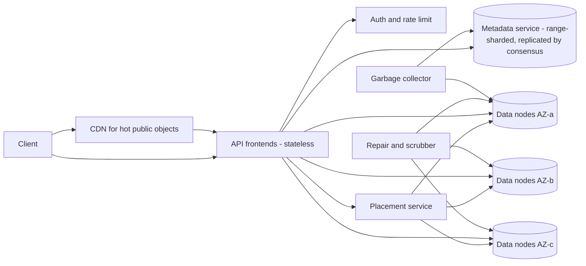
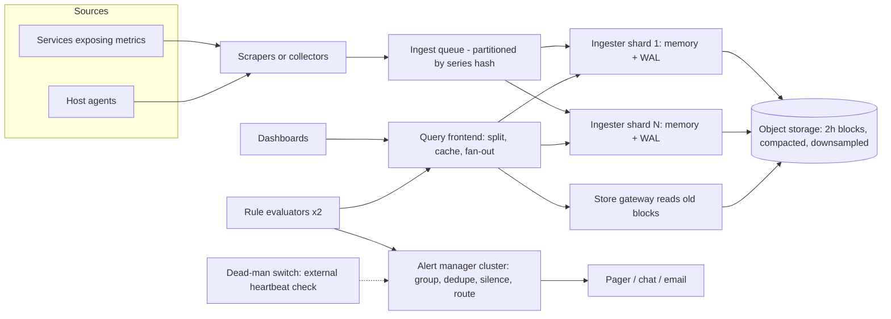
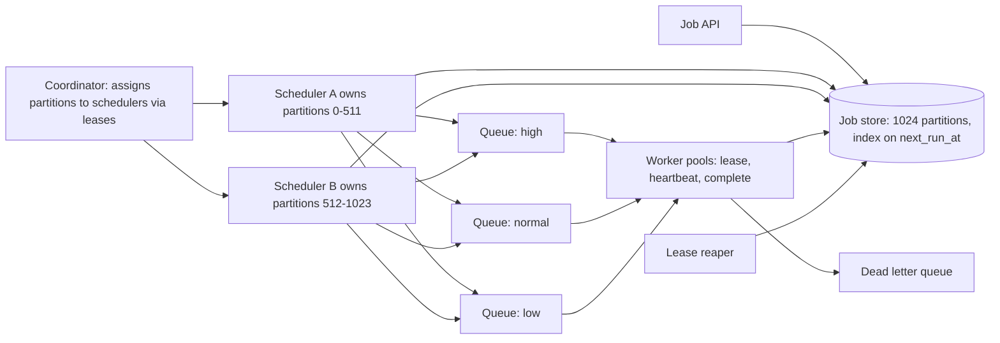
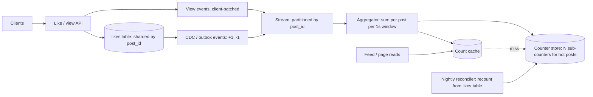
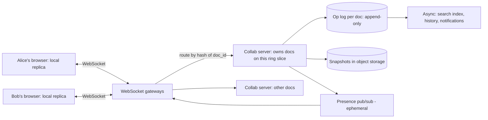

# Module 16 — Case Studies: Infrastructure

## Module Introduction

**What this module is.** Five complete designs for the systems that *other* systems stand on: a blob store (a store for large files, "binary large objects"), the monitoring that watches everything, the scheduler that runs background work, the counters behind every "like" and "view", and the engine inside a shared document editor. Nobody sees these directly, but every product depends on them. They are popular interview prompts because each one hides a single hard idea that a box diagram cannot fake: durability math, time-series compression (a *time series* is a sequence of timestamped measurements), "run exactly once" on unreliable machines, write contention (many writers fighting over the same data) on one hot row, and merging concurrent edits without losing anyone's work.

**Analogy.** Module 12 designed the shops on a high street. This module designs the water mains, the electricity meters, the alarm clocks and the shared whiteboard in the back office. Shops come and go; the utilities have to keep working through every failure.

**The five designs**

| Design | Center of gravity (the main problem) | Key numbers you should remember |
|---|---|---|
| S3-like Object Storage | Durability per dollar: replication (full copies) vs erasure coding, and metadata (facts about each file) at 50 billion keys | 3x replication = 3.0x disk; RS(8,4) = 1.5x disk and survives 4 losses |
| Metrics Monitoring & Alerting | Ingesting 10M samples/s cheaply and alerting on symptoms, not noise | ~1.4 bytes/sample after compression; cardinality is the budget |
| Distributed Job Scheduler | Firing each due job on time, once, on machines that crash | Leases (time-limited claims) + idempotency (repeats are harmless) = "effectively once"; jitter (randomly spread) the top of the hour |
| Distributed Counter | One viral post taking 50K increments/s on a single row | Shard (split) the counter, batch the writes, keep the truth in a set |
| Collaborative Document Editor | Two people typing at the same spot at the same moment | OT (operational transformation) needs a central orderer; CRDTs (conflict-free replicated data types) need unique IDs and tombstones (deletion markers) |

**The format** is Module 12's seven stages ([see Module 12](../12-capstones/README.md#module-introduction)), with two additions every interviewer now expects: the **API and data model** are written out inside stage 3, and each design ends with a **trade-offs table** and a **TL;DR**.
1. **Requirements and numbers** — functional and non-functional requirements, then the back-of-envelope math (quick rough estimates; [how to do it](../01-thinking-in-patterns/README.md#back-of-envelope-math)). New to terms like latency, replication or sharding? See [System Design Fundamentals](../00-system-design-fundamentals/README.md).
2. **The five-questions pass** — Flow, Storage, Speed, Failure, Growth ([the routine](../01-thinking-in-patterns/README.md#the-five-questions)).
3. **The architecture, annotated** — API, data model, diagram, and every pattern named where it is used.
4. **Deep dives** — the 2–3 genuinely hard parts.
5. **The failure walk** — each dependency slow, down, or duplicated.
6. **Follow-up questions** — what interviewers ask next, with answers.
7. **The pattern manifest** — which lessons the design drew on.

**Four terms used throughout**
- **Durability** — the probability that data you stored is still there later. *Availability* is whether you can reach it *right now*. A system can be unavailable for an hour and still perfectly durable.
- **Erasure coding (EC)** — splitting data into *k* pieces and computing *m* extra "parity" pieces so that *any k* of the *k+m* pieces rebuild the original. Written RS(k,m) for the common Reed–Solomon code.
- **Cardinality** — the number of distinct values something can take. In monitoring, the number of distinct time series; in counting, the number of distinct users.
- **Convergence** — after all replicas (copies of the data on different machines) have seen the same set of updates, they hold the same value, regardless of the order the updates arrived in.

**Runnable demos** (standard-library Python, run from the repo root with `.venv-books/bin/python`):
- [`code/erasure_vs_replication.py`](code/erasure_vs_replication.py) — storage overhead and loss probability for 3x replication vs three Reed–Solomon layouts, plus a toy XOR parity repair (XOR, "exclusive or", is a bit operation whose result lets you rebuild any one missing piece).
- [`code/crdt_counter.py`](code/crdt_counter.py) — a G-Counter / PN-Counter CRDT across three regions that converges no matter the merge order.

**Before you start:** each design links back to the lesson that teaches the pattern it uses. If a link surprises you, read that lesson first; these case studies do not re-teach the patterns.

## Design 1 — S3-like Object Storage

**The prompt (in short).** Build a service where customers store files ("objects") of any size under a name ("key") inside a container ("bucket"), and read them back years later, like Amazon S3, Google Cloud Storage or Azure Blob Storage (the three big cloud providers' object stores).

**What makes it hard.** Two different problems glued together. The *data* problem is keeping petabytes (1 PB = 1,000 terabytes = a million gigabytes) safe on disks that fail every day, without paying for three full copies. The *metadata* problem is a key-value index (look up a value by its key) with tens of billions of entries that must answer "does this key exist, and where are its bytes?" with strong consistency (every read sees the latest successful write), and also list keys by prefix.

**1. Requirements and numbers**
- *Functional:* create/delete buckets; `PUT`, `GET` (including byte ranges), `DELETE` and `HEAD` an object; `LIST` keys by prefix with pagination (results returned a page at a time); multipart upload (send a big file as many separately retried parts) for large objects (up to 5 TB); optional versioning (keep old versions on overwrite).
- *Non-functional:* **durability of 99.999999999%** ("eleven nines", S3's published design target) per object per year; **availability 99.99%** (reachable all but about 53 minutes a year); **strong read-after-write consistency** (after a successful `PUT`, every `GET` and `LIST` sees it; S3 has offered this since December 2020); low cost per GB, since storage is the product.
- *Assumptions:* **100 PB** of user data, **50 billion objects** → average object ≈ **2 MB**, but the distribution is skewed: most objects are small (thumbnails, logs), most *bytes* are in a few large objects (videos, backups).
- *Traffic:* **20K PUT/s** and **200K GET/s** at peak (reads dominate 10:1).
- *Metadata size:* 50B objects × ~**500 bytes** (key, size, checksum, timestamps, chunk locations) ≈ **25 TB** of metadata. That is far too big for one machine, but a small fraction of the data; it must be sharded (split into pieces, each on its own servers).
- *Raw disk:* with 3x replication, 100 PB → **300 PB** raw ≈ **15,000** 20-TB disks. With RS(8,4) erasure coding, 100 PB → **150 PB** ≈ **7,500** disks. **Erasure coding halves the hardware bill**, and that single number shapes the whole design.
- *Bandwidth:* 200K GET/s × 2 MB ≈ **400 GB/s** of egress (data sent out to users) in aggregate. Spread over thousands of data nodes it is ordinary; concentrated on one hot object it is not (a [CDN](../08-api-and-edge/README.md#cdn), content delivery network: cache servers near users, in front handles that).

**2. The five-questions pass**
- **Flow:** `PUT` and `GET` are synchronous request-response (the caller waits for the answer). Background work (repair, erasure-coding conversion, garbage collection, i.e. reclaiming space from deleted bytes) is asynchronous (done later, nobody waits) and can lag.
- **Storage:** two stores with different shapes. **Data nodes** hold immutable (never modified once written) chunks of bytes. A **metadata store** holds the authoritative mapping *key → version → chunk locations*. The metadata row is the source of truth (the one record that decides) for "does the object exist".
- **Speed:** the hottest reads are metadata lookups (every `GET` needs one). Cache metadata for immutable versions aggressively; bytes for hot public objects go to the CDN.
- **Failure:** disks, hosts, racks and whole availability zones (AZs, separate data centers in one region) fail. Every piece of an object must be placed in a *different* failure domain (a group of hardware that can fail together, such as one rack sharing a power supply), and repair must outrun the next failure.
- **Growth:** bytes grow steadily (add data nodes); key count grows fastest (split metadata shards); a single popular prefix like `logs/2026-09-28/` is the hot key (one key receiving far more traffic than the rest).
- *Skeleton:* stateless API frontends (servers that keep no data, so any one can handle any request) → sharded metadata service → placement service → data nodes storing erasure-coded chunks across AZs, with background repair and GC.

**3. The architecture, annotated**

*API (REST, the usual HTTP-verbs-on-URLs style; idempotent where possible):*
- `PUT /{bucket}/{key}` body=bytes, header `Content-MD5` (a checksum, i.e. a short fingerprint of the bytes, so the server can detect corruption) → `200 {etag, version_id}`. Re-sending the same `PUT` is safe: it just creates the same content again ([idempotency](../05-reliability/README.md#idempotency)).
- `GET /{bucket}/{key}?versionId=` with optional `Range: bytes=0-1048575` → bytes.
- `DELETE /{bucket}/{key}` → writes a **delete marker** (a tombstone: a record saying "this was deleted") rather than erasing bytes immediately.
- `GET /{bucket}?prefix=photos/&continuation-token=…&max-keys=1000` → one page of keys ([cursor pagination](../08-api-and-edge/README.md#cursor-based-pagination)).
- Multipart: `POST ?uploads` → `upload_id`; `PUT ?partNumber=N&uploadId=` (parts of 5 MB–5 GB, uploaded in parallel, retried individually); `POST ?uploadId=` with the part list → the object becomes visible atomically (all at once, never half-done).

*Data model:*

| Table | Key | Columns |
|---|---|---|
| `buckets` | `bucket_name` | owner, region, versioning on/off, policy |
| `objects` | `(bucket, key, version_id desc)` | size, etag/checksum, content-type, created_at, is_delete_marker, `chunks: [chunk_id…]` |
| `chunks` | `chunk_id` | size, EC scheme, `fragments: [(node, volume_id, offset, length)…]` |
| `multipart_uploads` | `upload_id` | bucket, key, parts [(n, etag, chunk_id)], started_at |

The `objects` table is **range-sharded** on `(bucket, key)` (each shard holds one alphabetical range of keys) so that `LIST prefix=` reads one contiguous range ([sharding](../03-storing-data/README.md#sharding)). Hash sharding (placing each key by a hash, a scrambled number computed from it) would spread load better but would make every `LIST` a scatter-gather (ask all shards, merge the answers) across all shards.



Reading the diagram, a `PUT` of a 64 MB object:
1. The **frontend** authenticates, applies [rate limiting](../08-api-and-edge/README.md#rate-limiting) (a cap on requests per second) per bucket, and streams the body in (it never buffers a whole 5 GB object in memory).
2. It splits the body into **chunks** (say 64 MB) and asks the **placement service** for 12 data nodes in distinct racks (a rack is one cabinet of servers) spread over **3 AZs** (4 per AZ).
3. For each chunk it computes **RS(8,4)**: 8 data fragments of 8 MB plus 4 parity fragments (extra computed pieces used for rebuilding), and writes all 12 in parallel. It waits for all 12 (or at least 11, then schedules repair of the last) to be durable on disk.
4. Only then does it **commit the metadata row** `(bucket, key, new version_id) → [chunk_ids]`. This single write is the *commit point*: before it, the object does not exist; after it, everyone sees it.
5. It returns `200` with the ETag (a checksum of the content).

A `GET` does one metadata lookup, then reads any 8 of the 12 fragments (preferring the 8 *data* fragments, which need no decoding), verifies checksums, and streams bytes back.

**4. Deep dives**
- **Deep dive 1 — durability per dollar: replication vs erasure coding.** Three full copies tolerate 2 losses at **3.0x** storage. RS(8,4) tolerates **4** losses at **1.5x**. The demo computes it (assumes each disk has a 0.1% chance of failing before a missing piece is repaired, failures independent):

  ```text
  $ .venv-books/bin/python .../code/erasure_vs_replication.py
  scheme                          raw bytes per 1 byte  can lose   P(loss) per window
  3x replication                                 3.00x         2             1.00e-09
  RS(6,3)  6 data + 3 parity                     1.50x         3             1.25e-10
  RS(8,4)  8 data + 4 parity                     1.50x         4             7.87e-13
  RS(10,4) 10 data + 4 parity                    1.40x         4             1.99e-12
  ...
  lost chunk 2, rebuilt -> b'CT-ST'
  object reassembled OK; repair had to read 4 chunks to rebuild 1
  ```

  EC is cheaper *and* more durable, so why not use it everywhere? Its prices: (a) **repair is expensive**: rebuilding one lost 8 MB fragment reads 8 fragments (64 MB) across the network, where replication just copies one; (b) **small objects waste space**: a 4 KB object cut into 8 pieces of 512 bytes each is dominated by per-fragment overhead; (c) **reads of a degraded stripe** (a stripe is one chunk's set of k+m fragments; degraded = some are missing) **need decoding** CPU. The practical answer, which Facebook described for its photo storage (hot blobs replicated in Haystack, then moved to the RS(10,4)-coded **f4** warm store once they cool): write new, hot data **replicated** (fast writes, cheap repair), then **convert sealed volumes** (big storage files that are full and will not change again) **to EC** in the background. (Some systems, such as Backblaze's Vaults with RS(17,3), erasure-code from the first write instead, accepting slower writes for simplicity.) And the "0.1% per window" number is only honest if the repair window is short, so **repair bandwidth is a first-class capacity item**; the eleven-nines figure is really a statement about how fast you detect and repair, not just about *k* and *m*. Place fragments across **failure domains** (disk, host, rack, AZ) so that a single rack losing power removes at most one fragment per stripe.
- **Deep dive 2 — metadata consistency and the commit point.** Write the bytes first, then commit the metadata. That ordering gives crash safety for free: a crash before the commit leaves **orphan fragments** with no metadata pointing at them, which the garbage collector (a background cleaner) later finds and deletes; a crash after the commit leaves a complete object. The commit itself must be **linearizable** (every reader sees the latest committed version), so each metadata shard is a small replicated group using a consensus protocol like Raft or Paxos (rules that let a group of machines agree on each write even if some fail) ([DDIA ch. 9](../../../ddia/chapters/09-consistency-and-consensus/README.md#fault-tolerant-consensus)); a [quorum](../07-consistency/README.md#quorum) ("enough replicas answered", usually a majority) alone is not enough for read-after-write under concurrent overwrites. Overwrites never modify data in place: they create a new `version_id` and flip the "latest" pointer, so readers mid-download of the old version finish reading consistent bytes. **Hot prefixes**: keys like `logs/2026-09-28/…` all land in one range shard. The metadata service splits a shard when its request rate crosses a threshold (S3 documents about 3,500 PUT and 5,500 GET per second *per prefix* and scales by partitioning further), and customers are told to spread keys across prefixes.
- **Deep dive 3 — small objects, large objects and deletes.** A file per object on the data nodes' local filesystem collapses at billions of files (each needs an inode, the filesystem's per-file record, and several disk seeks, i.e. moves of the disk head). Instead, append objects into large **volume files** (say 100 GB) and keep an in-memory index `needle_id → offset` — the design in Facebook's Haystack paper, which reduced a photo read to about one disk seek. Large objects go the other way: **multipart upload** turns one fragile 5 TB stream into thousands of independently retried parts. **Deletes** only write a tombstone in metadata; the bytes are reclaimed later by **compaction**, which copies live needles of a mostly-dead volume into a new volume and drops the old one (the same idea as LSM-tree compaction, [DDIA ch. 3](../../../ddia/chapters/03-storage-and-retrieval/README.md#sstables-and-lsm-trees)).

**5. The failure walk**
1. **A disk dies (daily event at 7,500 disks):** stripes lose one fragment each; reads still work (need any 8 of 12). The **scrubber** (a background job that re-reads and checks stored data) notices, and repair rebuilds fragments onto other disks, rate-limited so repair traffic does not starve customer reads (a [bulkhead](../05-reliability/README.md#bulkhead), a fixed compartment of capacity so one kind of work can't swamp another, for bandwidth).
2. **Silent corruption (bit rot: stored bits flipping over time):** every fragment carries a checksum; the scrubber re-reads all data on a cycle (e.g. every two weeks) and repairs mismatches. A `GET` that hits a bad checksum reads another fragment instead.
3. **A whole AZ goes down:** 4 of 12 fragments are unreachable, which is exactly the tolerance of RS(8,4). Reads still succeed (slower, with decoding); writes can continue if the placement service temporarily uses the two remaining AZs and schedules rebalancing when the AZ returns.
4. **A metadata shard loses its leader** (the replica that orders writes): the consensus group elects a new one within seconds; requests for that key range fail briefly and clients [retry with backoff](../05-reliability/README.md#retry-with-exponential-backoff) (wait longer after each failed try). Other ranges are unaffected.
5. **A client retries a `PUT` after a timeout:** it may create two versions; with versioning off, the later one wins and the earlier becomes an orphan the GC cleans up. Harmless, which is why `PUT` of full content is naturally idempotent.

**6. Follow-up questions**
- **"How do you prove eleven nines?"** Model it: annual failure rate per disk, time to detect, time to repair, and fragments per stripe give a loss probability per stripe per year; multiply by stripes. Then verify with scrubbing statistics. *Trap:* quoting the number without mentioning repair time; durability is dominated by it.
- **"How does `LIST` stay consistent with `PUT`?"** The listing reads the same range-sharded, linearizable metadata table, so a committed key appears in the next list. A separate eventually consistent (catches up after a delay) search index would break this.
- **"Serve a 4 GB video to a million viewers."** Range `GET`s, a CDN in front, and the object's metadata cached at the edge. The data nodes see only CDN misses.
- **"Add storage classes (cold archive)."** A lifecycle rule moves old versions into wider, cheaper EC schemes (e.g. RS(17,3)) on dense, spun-down (powered off until needed) disks; `GET` becomes a "restore" job that takes minutes to hours.
- **"Cross-region replication?"** Asynchronous: a change stream of committed metadata ([CDC](../10-batch-and-streaming/README.md#change-data-capture): change data capture, streaming every database change) drives copies to the other region. The replica lags by seconds to minutes; say so.

**Trade-offs**

| Decision | Option A | Option B | Choice here |
|---|---|---|---|
| Redundancy | 3x replication: cheap repair, fast writes, 3.0x disk | RS(8,4): 1.5x disk, more durable, costly repair | Replicate hot data, convert sealed volumes to EC |
| Metadata sharding | Range: fast `LIST`, hot prefixes | Hash: even load, `LIST` is scatter-gather | Range + automatic split of hot ranges |
| Object layout on disk | File per object: simple | Packed volumes + index: few seeks, needs compaction | Packed volumes |
| Delete | Erase immediately | Tombstone + background GC | Tombstone + GC |

**7. Pattern manifest**

| Pattern | Where it served |
|---|---|
| Sharding (range) + hot-range splits | Metadata table and `LIST` |
| Consensus / quorum | Linearizable metadata commit per shard |
| Write-ahead / commit point | Bytes first, metadata row last |
| Idempotency | Safe `PUT` retries, multipart part retries |
| Bulkhead | Repair traffic capped so it can't starve reads |
| CDN + Cache-Aside | Hot objects and immutable-version metadata |
| Rate Limiting | Per-bucket request limits at the frontend |
| CDC | Cross-region replication and lifecycle moves |

**TL;DR**
- Two systems: immutable **chunks** on data nodes, and a strongly consistent, **range-sharded metadata** index whose single row write is the commit point.
- **Erasure coding** gives ~1.5x overhead for better durability than 3x replication; pay for it with repair bandwidth, so replicate while hot and encode when cold.
- Spread fragments across racks and AZs; durability is a function of **repair speed**.
- Pack small objects into big volume files; delete with tombstones and compaction.

**Interview one-liner:** "Object storage is a strongly consistent metadata index pointing at immutable, erasure-coded chunks spread across failure domains; durability comes from placement plus fast repair, and the metadata commit is the only moment an object comes into existence."

## Design 2 — Metrics Monitoring & Alerting

**The prompt (in short).** Build a system like Prometheus, Datadog or Google's Monarch (well-known monitoring systems): every server and service reports numbers (CPU, request rate, error count, latency, i.e. how long requests take); engineers view them on dashboards and get paged (alerted on their phone) when something is wrong.

**What makes it hard.** The write volume is enormous and relentless, every sample is tiny, and the value of old data drops fast. Meanwhile the alerting half must be *more* reliable than the systems it watches, and must page humans only when it matters.

**1. Requirements and numbers**
- *Functional:* ingest **counters** (only go up, e.g. requests served), **gauges** (go up and down, e.g. memory used) and **histograms** (bucketed latency distributions: how many requests fell into each time range); each series is a metric name plus **labels** (key-value tags), e.g. `http_requests_total{service="cart", status="500", region="eu"}`. Query by label with aggregation (`sum by (region) (rate(...[5m]))`); dashboards; alert rules; notification routing (pager, chat, email), grouping, silencing.
- *Non-functional:* ingestion must **never block or slow the application** being measured; recent data queryable within ~**30 s**; alerts evaluated every **15–60 s**; keep full resolution for **15 days** and downsampled data (many points summarised into fewer) for **1–2 years**; the alerting path keeps working when half the infrastructure is on fire.
- *Assumptions:* **100K hosts** × **1,000** series each (OS metrics plus app metrics) = **100M active series**; each reported every **10 s** → **10M samples/s**.
- *Storage:* raw, a sample is a 64-bit timestamp + 64-bit float (decimal number) = 16 bytes → 160 MB/s ≈ **13.8 TB/day**. With the Gorilla compression scheme (Facebook, VLDB 2015; VLDB is a major database research conference — reported **~1.37 bytes per sample**), that drops to ~**14 MB/s ≈ 1.2 TB/day**, about **18 TB** for 15 days of full resolution. Downsampled to 5-minute aggregates (min/max/sum/count = 4 values instead of 30 raw samples), a day of old data costs roughly 7x less; a further 1-hour level cuts another ~12x.
- *Queries:* a few thousand dashboards auto-refreshing plus **~50K alert rules** every 30 s ≈ **1.7K rule queries/s**, most touching recent data only.
- *The real limit is cardinality, not bytes:* each active series needs an index entry and an in-memory buffer (a few KB). 100M series × ~4 KB ≈ **400 GB of RAM** (fast working memory) across the ingest tier (the servers that receive incoming data). Adding a label like `user_id` would multiply series by millions and topple it.

**2. The five-questions pass**
- **Flow:** applications expose or emit metrics asynchronously; nothing on the request path waits for monitoring. Queries and alert evaluation are request-response against the store.
- **Storage:** an append-only **time-series database (TSDB)**: recent data in memory + [write-ahead log](../03-storing-data/README.md#write-ahead-log) (WAL: every write is first appended to a file on disk so it survives a crash), older data in immutable compressed blocks on [object storage](#design-1--s3-like-object-storage).
- **Speed:** almost all reads are for the last few hours; keep those in memory. Long-range dashboards read downsampled blocks.
- **Failure:** losing a few samples is fine; losing the *alerting path* is not. Run the alert pipeline redundantly and monitor the monitor.
- **Growth:** series count grows with every new service, label and deployment; shard ingestion by series.
- *Skeleton:* collectors → queue → sharded ingesters (servers that receive and store samples; memory + WAL) → block storage; a query layer; a rule evaluator; an alert manager that deduplicates and routes.

**3. The architecture, annotated**

*API:*
- Ingest (push): `POST /v1/write` with a batch of `(series_labels, [(ts, value)…])`, compressed. Or pull: each target exposes `GET /metrics` in a text format, and scrapers (pollers that fetch the metrics) fetch it every 10 s (Prometheus's model).
- Query: `GET /v1/query_range?q=sum by (region)(rate(http_requests_total{status="500"}[5m]))&start=&end=&step=60s` → matrix of series.
- Rules: `PUT /v1/rules/{group}` with `expr`, `for: 5m`, `labels: {severity: page}`, `annotations: {runbook: …}` (a runbook is a written step-by-step guide for the on-call engineer).
- Alerts: `POST /v1/silences` `{matchers, starts, ends, comment}`.

*Data model:*
- **Series ID** = hash of the sorted label set. **Inverted index**: `label=value → sorted list of series IDs` (e.g. `service=cart → [17, 93, 1042…]`), so a query intersects posting lists (the per-value ID lists; the matches are the IDs in all of them), exactly like a search engine.
- **Chunks**: per series, ~120 samples (20 minutes at 10 s) compressed together. Timestamps use **delta-of-delta** encoding: samples arrive every 10 s, so the difference between consecutive differences is usually **0**, stored in one bit. Values are **XOR-ed with the previous value**; slowly changing floats share most bits, so few bits remain.
- **Blocks**: every 2 h, the in-memory head is written as an immutable block (chunks + index); blocks are later merged into larger ones and **downsampled**.



1. **Scrapers/collectors** gather samples and batch them; the application only increments an in-process counter (nanoseconds, billionths of a second).
2. The **ingest queue** ([message queue](../02-moving-data/README.md#message-queue): a buffer where producers drop messages and consumers pick them up later) absorbs bursts and lets ingesters restart without losing data; it is partitioned by series hash so each series always lands on the same ingester ([partitioned consumption](../10-batch-and-streaming/README.md#partitioned-consumption)).
3. **Ingesters** append to the in-memory head chunk and the WAL, replicated to 2–3 ingesters so a crash loses nothing. Every 2 h they flush compressed blocks to object storage.
4. The **query frontend** splits a 30-day query into daily pieces, answers recent pieces from ingesters and older ones from blocks, and caches results of finished days.
5. **Rule evaluators** run each alert expression on a schedule. The **alert manager** deduplicates the copies from redundant evaluators, groups related alerts into one notification, applies silences and inhibitions (rules that mute an alert while a related bigger one is firing), and routes by team and severity.

**4. Deep dives**
- **Deep dive 1 — cardinality is the budget.** Cost scales with the number of *distinct series*, not with how often they are written. A label with unbounded values (user ID, request ID, full URL path) creates a new series for every value and can take down the ingest tier in minutes. Defenses: per-tenant (per customer or team) **series limits** enforced at ingest (reject new series over the limit, and count the rejections as a metric of their own); a "top cardinality" report per metric; guidance to put high-cardinality detail in **logs or traces** ([distributed tracing](../09-operating-in-production/README.md#distributed-tracing)) rather than metric labels. Histograms deserve care: 20 buckets × every label combination is 20 series each.
- **Deep dive 2 — pull vs push.** *Pull* (the monitor scrapes targets): the monitor controls the load, a target that stops answering is itself a signal (`up == 0`), and you can curl a target to debug. It needs service discovery (a live list of where every target is running) and struggles with short-lived jobs and targets behind firewalls. *Push* (agents send): works for batch jobs, serverless functions (code the cloud runs on demand, with no server you manage) and restricted networks, but a misbehaving client can flood you, so the receiver needs [rate limiting](../08-api-and-edge/README.md#rate-limiting) and [backpressure](../10-batch-and-streaming/README.md#backpressure) (telling senders to slow down). Most large systems end up with both: pull inside the data center, push via a gateway for everything else.
- **Deep dive 3 — alerts people trust.** Page on **symptoms users feel** (error rate, latency against the SLO, the service level objective: a target such as "99.9% of requests succeed") rather than causes (CPU at 90%), a principle from Google's *Site Reliability Engineering* book. The best version is an **SLO burn-rate alert**: "we are consuming the 30-day error budget (the failures the SLO allows) **14.4x** faster than sustainable (so 2% of the whole month's budget is gone in one hour), measured over both a 1 h and a 5 min window" (the multi-window form in Google's *SRE Workbook*; the short window makes the alert stop quickly once the outage ends) — it fires fast for big outages and ignores brief blips. Other essentials: a `for: 5m` clause so a single bad scrape does not page; **grouping** (one page for "40 pods of cart are failing", not 40 pages); **inhibition** (if the whole region is down, suppress the per-service alerts); every page links a **runbook**. And **alert on absence**: an "always firing" watchdog alert must reach an *external* service every minute; if it stops arriving, that external service pages you, because the monitoring itself is down (a dead-man's switch).

**5. The failure walk**
1. **An ingester crashes:** its series are replicated on two others; the replacement replays the WAL (re-applies the logged writes). Queries deduplicate replicated samples.
2. **A cardinality explosion from a bad deploy:** series limits reject the new series for that tenant only; everyone else keeps ingesting ([bulkhead](../05-reliability/README.md#bulkhead) per tenant); an alert tells the team.
3. **Object storage is slow:** recent data (in ingester memory) still answers dashboards and all alerts, which only look back minutes. Long-range dashboards degrade ([graceful degradation](../05-reliability/README.md#graceful-degradation)).
4. **A network partition (a network fault that splits machines into groups that can't talk) cuts a region off from central monitoring:** run alert evaluation **inside each region** close to the data, with a global layer only for cross-region views; the dead-man's switch catches a region that goes silent.
5. **A query of death (a year of raw data across all series):** the query frontend enforces limits on series touched and samples scanned, and times out ([timeout](../05-reliability/README.md#timeout): give up after a set time), so one dashboard cannot starve alert evaluation, which runs on its own query capacity.

**6. Follow-up questions**
- **"Why not store metrics in a relational database or Cassandra?"** You can at small scale. At 10M samples/s, general-purpose storage pays 16+ bytes per sample plus per-row overhead; a TSDB's (time-series database's) delta-of-delta and XOR compression is ~10x smaller, and its label index is built for this exact query.
- **"How do you compute p99 latency across 500 servers?"** (p99 = the 99th percentile: the value 99% of requests are below.) Not by averaging each server's p99 (percentiles don't average). Each server exports a **histogram** of bucket counts; sum the buckets across servers, then estimate the percentile from the merged histogram.
- **"Logs vs metrics vs traces?"** Metrics: cheap, aggregated, for alerting and trends. Logs: per-event detail, expensive. Traces: one request's path across services. Metrics tell you *that* something is wrong, traces and logs tell you *where* and *why*.
- **"Multi-tenant SaaS version?"** (SaaS = software as a service, sold to many customers, or tenants, on shared machines.) Tenant ID as a mandatory label, per-tenant limits on series and query cost, and shuffle-sharding (giving each tenant a random small subset of servers) tenants across ingesters so one noisy tenant affects few others.

**Trade-offs**

| Decision | Option A | Option B | Choice here |
|---|---|---|---|
| Collection | Pull: controllable load, liveness signal | Push: batch jobs, firewalls | Pull inside, push gateway for the rest |
| Retention | Full resolution forever | Downsample after 15 days | Downsample (min/max/sum/count per 5 min) |
| Alert on | Causes (CPU, disk) | Symptoms (errors, latency vs SLO) | Page on symptoms; causes go to dashboards/tickets |
| Evaluation placement | Central, global | Per region, near data | Per region + global view |

**7. Pattern manifest**

| Pattern | Where it served |
|---|---|
| Message Queue + Partitioned Consumption | Ingest buffer, series-hash partitions |
| Write-Ahead Log | Ingester crash recovery |
| Sharding / Consistent Hashing | Series spread across ingesters |
| Rate Limiting + Backpressure | Push receivers, per-tenant series limits |
| Bulkhead | Per-tenant limits; separate query capacity for alerts |
| Timeout + Graceful Degradation | Query limits; recent-only answers when storage is slow |
| Health Checks | `up` metric from scrapes; dead-man's switch |
| Object Storage (Design 1) | Immutable compressed blocks |

**TL;DR**
- Series = name + labels; cost is **cardinality**, so police unbounded labels.
- Compress with delta-of-delta timestamps and XOR values (~1.4 bytes/sample); memory + WAL for recent data, immutable blocks on object storage for old data, downsample for long retention.
- Page on **user-facing symptoms** with SLO burn-rate alerts; group, inhibit, silence, and link runbooks.
- The monitor must be monitored: redundant evaluators and an external **dead-man's switch**.

**Interview one-liner:** "A metrics system is a write-heavy, compressed time-series store whose real budget is series cardinality, paired with an alert pipeline that pages on user-facing symptoms and is itself watched from outside."

## Design 3 — Distributed Job Scheduler

**The prompt (in short).** Build a service that runs background work for the whole company: "send this email in 10 minutes", "generate every user's monthly invoice on the 1st at 02:00", "retry this failed webhook". Think of a distributed cron (cron is the classic Unix tool that runs commands on a schedule) plus a task queue, like Dropbox's Async Task Framework, Airflow's scheduler or cloud task services.

**What makes it hard.** Three promises that fight each other: **on time** (fire within seconds of the due time), **never lost**, and **not run twice**, all on machines that crash in the middle of a job and clocks that disagree. Plus priority: a password-reset email must not wait behind a million newsletter jobs.

**1. Requirements and numbers**
- *Functional:* submit a job with a payload and a target (a queue/handler name); run it **now**, **at time T**, or **on a cron schedule**; **priorities** (e.g. high / normal / low); retries with backoff (growing waits between attempts) and a max attempt count; per-job timeout; cancel; query status and history.
- *Non-functional:* a job starts within **~2 s** of its due time at p99; no accepted job is ever lost; each run executes **at least once**, and with the handler's cooperation **effectively once**; the scheduler has no single point of failure (no one component whose death stops everything).
- *Assumptions:* **100M job executions/day** → ≈ **1,160/s** average. But cron jobs cluster: many teams schedule at `00:00`, on the hour and on the 1st of the month, so peak is ~**20K/s** for the first few seconds of each hour.
- *Storage:* a job record ~**1 KB** (payload by reference if large) → 100M × 1 KB = **100 GB/day** of execution records; keep 30 days hot (**3 TB**), then archive. Recurring job *definitions* are small: say 5M of them.
- *Workers:* if the average job takes **2 s**, 1,160 jobs/s needs ~**2,300** busy worker slots on average (Little's law: concurrency = arrival rate × duration); provision for peaks, and autoscale (add or remove machines automatically) on queue backlog ([auto-scaling](../06-scaling/README.md#auto-scaling)).

**2. The five-questions pass**
- **Flow:** submission is synchronous (return a job ID once durably stored); everything after is asynchronous: due jobs are moved to queues, workers pull.
- **Storage:** the **job store** is the source of truth for definitions, state and next-run time. Queues hold only *ready* work and are derived from the store.
- **Speed:** the hot query is "which jobs are due in the next few seconds?", repeated constantly; it needs an index on `next_run_at`, split into partitions so many schedulers can share it.
- **Failure:** workers die mid-job, schedulers die mid-dispatch, handlers fail. Every hand-off needs a lease (a time-limited claim) and every job needs to be retry-safe.
- **Growth:** job volume grows linearly; the hot spot is **time itself** (everyone at 00:00) and a single huge tenant.
- *Skeleton:* API → partitioned job store → per-partition schedulers that claim due jobs → priority queues → worker pools with leases and heartbeats → results and retries.

**3. The architecture, annotated**

*API:*
- `POST /jobs` `{queue, payload, run_at | cron: "0 2 1 * *", timezone, priority, max_attempts, timeout_s, idempotency_key}` → `201 {job_id}`. The `idempotency_key` makes submission retry-safe ([idempotency](../05-reliability/README.md#idempotency)).
- `GET /jobs/{id}` → state, attempts, last error; `GET /jobs/{id}/runs?cursor=`.
- `DELETE /jobs/{id}` → cancel (future runs; a running attempt gets a cancel signal).
- Worker side: `POST /lease {queues, max}` → jobs with `lease_id` and expiry; `POST /lease/{id}/heartbeat`; `POST /lease/{id}/complete {result | error}`.

*Data model:*

| Table | Key | Columns |
|---|---|---|
| `job_definitions` | `job_id` | tenant, queue, payload_ref, cron, timezone, priority, retry policy, enabled |
| `job_runs` | `(partition, next_run_at, run_id)` | job_id, state (`SCHEDULED/QUEUED/RUNNING/SUCCEEDED/FAILED/DEAD`), attempt, lease_owner, lease_expires_at, fencing_token |

`partition = hash(job_id) % 1024`. Each partition's rows are indexed by `next_run_at`, so "due now" is a short range scan (reading consecutive rows in index order).



1. The **API** writes the job row with its first `next_run_at` (for cron, computed in the job's timezone).
2. A **coordinator** (a small consensus-backed service such as ZooKeeper or etcd, highly reliable stores used for coordination) gives each scheduler instance a **lease** on a set of partitions. If a scheduler dies, its lease expires and its partitions move to a survivor.
3. Each **scheduler** loops every ~500 ms over its partitions: `SELECT … WHERE next_run_at <= now() + interval '1 second' AND state='SCHEDULED' ORDER BY next_run_at LIMIT 500 FOR UPDATE SKIP LOCKED` (lock the rows it picks, and skip rows another poller has already locked), marks them `QUEUED`, and pushes them to the queue for their priority. For recurring jobs it also inserts the *next* run row in the same transaction (a group of writes that all succeed or all fail), so a crash cannot skip or double a run.
4. **Workers** pull, preferring higher priorities, run the handler under a timeout, heartbeat every few seconds, then report. Failures are rescheduled with [exponential backoff and jitter](../05-reliability/README.md#retry-with-exponential-backoff); after `max_attempts` the job goes to the [dead letter queue](../05-reliability/README.md#dead-letter-queue) (a parking area for work that keeps failing, kept for humans to inspect).
5. A **lease reaper** finds `RUNNING` rows whose lease expired (worker died) and puts them back to `SCHEDULED`.

**4. Deep dives**
- **Deep dive 1 — finding due jobs without a thundering herd** (a crowd of processes all waking and rushing at the same thing at once). Options: (a) **index scan** on `next_run_at` per partition as above — simple, durable, and `SKIP LOCKED` lets several pollers share a partition safely; (b) a **Redis sorted set** (Redis is an in-memory data store; a sorted set keeps members ordered by a number) per partition with score = due time (`ZRANGEBYSCORE key -inf now`) — very fast but must be rebuilt from the store after a failure; (c) a **timing wheel** (a circular array of time buckets, as in Kafka's delayed operations) for millions of short timers in memory. Here, the store is the truth and (b)/(c) are optional accelerators. The top-of-the-hour spike is handled by **smearing**: let job owners opt into a jitter window ("any time in 02:00–02:10") and pre-load jobs due in the next minute into the queues a few seconds early, with `not_before` timestamps workers respect.
- **Deep dive 2 — "exactly once" is really at-least-once + idempotency.** A worker can finish the work and die before reporting success; the reaper then re-runs the job. No scheduler can prevent that, because the scheduler cannot distinguish "dead" from "slow" ([DDIA ch. 8](../../../ddia/chapters/08-trouble-with-distributed-systems/README.md#timeouts-and-unbounded-delays)). So: (1) every attempt carries a stable **job ID + run ID**, and handlers use it as an idempotency key on their side effects ("insert invoice where run_id not exists"); (2) each lease carries a monotonically increasing (only ever goes up) **fencing token**; the job store rejects a `complete` or `heartbeat` with an older token, so a zombie worker (one that was presumed dead but is still running) that wakes up after its lease expired cannot overwrite the newer attempt's result ([fencing tokens, DDIA ch. 8](../../../ddia/chapters/08-trouble-with-distributed-systems/README.md#the-truth-is-defined-by-the-majority)). The same token protects against two schedulers both believing they own a partition during a lease handover.
- **Deep dive 3 — priority and fairness.** One priority queue sounds natural: a sorted structure with score = `(priority, enqueue_time)`. Its problem is **starvation** (some work never gets a turn): under sustained high-priority load, low-priority jobs never run. Common fixes: separate queues per priority with **weighted pulls** (workers take, say, 6 high : 3 normal : 1 low when all are non-empty); **aging** (a job's effective priority rises the longer it waits); and per-tenant **quotas** so one tenant's million-job backfill (re-running work for past dates) cannot fill the high queue. Isolate critical work in its own worker pool ([bulkhead](../05-reliability/README.md#bulkhead)): password-reset emails get dedicated workers that the monthly-report backlog can never occupy.

**5. The failure walk**
1. **A worker dies mid-job:** heartbeats stop, the lease expires (e.g. 30 s), the reaper reschedules; the next attempt has a higher fencing token and the handler's idempotency key prevents double effects.
2. **A scheduler dies:** its partition leases expire; the coordinator reassigns them within seconds. Jobs due in that gap start a few seconds late but none are lost, because the job rows are still `SCHEDULED` in the store.
3. **The job store is slow or down:** schedulers stop dispatching (fail closed rather than guess); already-queued jobs keep running; submissions fail with a retryable error. On recovery the backlog drains, **rate-limited** to avoid a stampede on downstream services (the services the jobs call).
4. **A poison job crashes every worker that takes it:** attempt counting sends it to the DLQ after N tries; a per-handler [circuit breaker](../05-reliability/README.md#circuit-breaker) (an automatic switch that stops calling something that keeps failing) pauses a handler whose failure rate spikes.
5. **Clock skew (machines' clocks disagreeing) between scheduler hosts:** only the store's clock (or the scheduler owning the partition) decides due-ness; a few seconds of skew means a few seconds early/late, never a double run, thanks to the row state machine (the fixed set of states and allowed moves between them).

**6. Follow-up questions**
- **"How do you do daylight saving time for a 02:30 cron job?"** Store the cron in the user's timezone and compute each next run with a timezone library; decide and document a rule for the skipped hour (run once at the next valid time) and the repeated hour (run once).
- **"Workflows: job B only after A and C finish?"** Store a DAG (directed acyclic graph); when a job completes, decrement a counter of unfinished parents on each child and enqueue the child at zero. This is the Airflow/Temporal (popular workflow engines) shape; mention a [saga](../07-consistency/README.md#saga) (a chain of steps, each with an undo step) if steps need undoing.
- **"Why not just use Kafka?"** A classic Kafka (a durable, partitioned event log) consumer group has no per-message delay, no per-message ack or retry (it commits an offset, i.e. a read position, per partition), and no priorities; it is a log, not a job queue. (Newer Kafka "share groups", KIP-932 (a Kafka Improvement Proposal), add per-message acknowledgement, but still no delays or priorities.) It can be the transport under a scheduler, not the scheduler.
- **"Run a job on every one of 10,000 hosts?"** That is fan-out: one parent job creates 10,000 child runs, rate-limited, with an aggregate status.

**Trade-offs**

| Decision | Option A | Option B | Choice here |
|---|---|---|---|
| Due-job lookup | DB index scan: durable, simpler | In-memory sorted set / timing wheel: faster | DB as truth, sorted set as optional cache |
| Delivery guarantee | At-most-once: never repeats, may lose | At-least-once + idempotent handlers | At-least-once + idempotency keys + fencing |
| Priority | Single priority queue | Queues per priority, weighted + aging | Weighted queues + aging + critical pool |
| Scheduler coordination | One leader for everything | Partitions leased to many schedulers | Partition leases |

**7. Pattern manifest**

| Pattern | Where it served |
|---|---|
| Sharding (partitions) + leases | Many schedulers share the job store |
| Message Queue | Ready jobs, one queue per priority |
| Retry with Backoff + DLQ | Failed attempts, poison jobs |
| Idempotency + fencing tokens | Effectively-once execution |
| Timeout + heartbeat | Detecting dead workers |
| Bulkhead | Dedicated pools for critical job types |
| Circuit Breaker | Pausing a failing handler |
| Auto-Scaling on backlog | Worker pool size |

**TL;DR**
- The **job store** is the truth; queues are derived. Partition it by job ID and index by `next_run_at`.
- Schedulers **lease partitions**, claim due rows with `SKIP LOCKED`, and write the next cron run in the same transaction.
- "Exactly once" = **at-least-once + idempotent handlers + fencing tokens**.
- Priority needs **weighted queues, aging and quotas**, or low priority starves; jitter the top of the hour.

**Interview one-liner:** "A job scheduler is a partitioned, time-indexed job table whose partitions are leased to schedulers, feeding priority queues that workers drain under leases; it guarantees at-least-once, and idempotency keys plus fencing tokens make that effectively once."

## Design 4 — Distributed Counter (likes and views at scale)

**The prompt (in short).** Show how many likes and views each post or video has, like the counts under every video or social post, and let users like/unlike.

**What makes it hard.** Counting sounds trivial (`UPDATE posts SET likes = likes + 1`) until one post goes viral and takes **50,000 increments per second** on one database row, which a single row can't sustain because every update takes the same lock (only one writer may change the row at a time). On top of that, views are counted in the billions, users must not be able to like twice, and the count displayed must stay roughly right across regions.

**1. Requirements and numbers**
- *Functional:* like/unlike a post (one like per user per post); show the like count and "you liked this"; increment a view count when content is watched; show the view count.
- *Non-functional:* like counts are **exact eventually** (a few seconds of lag is fine) and never double-count one user; view counts may be **approximate** (within ~1%) but must resist simple inflation; reads are fast (**<10 ms**) because counts render on every feed item.
- *Assumptions:* **500M DAU** (daily active users); **20 likes/user/day** → **10B likes/day ≈ 115K/s** average, ~**400K/s** peak; **200 views/user/day** → **100B views/day ≈ 1.2M/s**.
- *Hot key:* one viral post gets **50K likes/s** at its peak. A relational row with a lock held per update tops out around a few thousand updates/s, so a single counter row fails by ~10x.
- *Reads:* each feed load shows ~20 counts; 25K feed loads/s × 20 = **500K count reads/s**, served from cache.
- *Storage:* likes are facts `(post_id, user_id, ts)` ≈ 24 bytes + index ≈ **~50 bytes** → 10B/day × 50 B = **500 GB/day** (net of unlikes, it grows more slowly). Views are not stored individually; only aggregates.

**2. The five-questions pass**
- **Flow:** the like request writes the fact synchronously (so "you liked this" is immediately true); updating the count is asynchronous. Views are fire-and-forget from the client, batched.
- **Storage:** the **likes table is the source of truth** (a set of who-liked-what). The **count is derived** and can always be recomputed from it ([CQRS](../03-storing-data/README.md#cqrs): keep separate models for writing and for reading). View counts are derived from an event stream.
- **Speed:** counts are read ~100x more than they change; serve them from cache and tolerate a few seconds of staleness.
- **Failure:** a lost count update is repairable from the source of truth; a lost like fact is not.
- **Growth:** total volume scales horizontally (by adding machines); the enemy is the **single hot post**.
- *Skeleton:* likes table (sharded by post) → event stream → aggregator that batches per post → sharded counters → cache; views go client batch → stream → windowed aggregation → counter store.

**3. The architecture, annotated**

*API:*
- `PUT /posts/{id}/like` → `204` (idempotent: liking twice is a no-op, i.e. changes nothing); `DELETE /posts/{id}/like` → unlike.
- `GET /posts/{id}/stats` → `{likes: 1204331, views: 88100234, liked_by_me: true}`; better, counts come embedded in the feed response via a batch lookup `GET /stats?ids=…`.
- `POST /views` (batched by the client) `[{post_id, watched_ms, ts}…]`.

*Data model:*
- `likes(post_id, user_id, created_at)` primary key `(post_id, user_id)`, sharded by `post_id`. The primary key enforces "one like per user", so retries and double taps are harmless ([idempotency by data structure](../05-reliability/README.md#idempotency)).
- `user_likes(user_id, post_id)` — the reverse index for "did I like this" and "my liked posts" (or a per-user Bloom filter, a compact structure that answers "definitely not" or "maybe" for set membership, for the fast "maybe" check).
- `counters(post_id, shard_no, value)` — for hot posts, N sub-rows per post.
- Cache: `count:{post_id}` → integer, short TTL (time to live before expiry), refreshed by the aggregator.



1. A like inserts into the **likes table**; the unique key rejects duplicates. The insert emits a `+1` event via the [outbox or CDC](../10-batch-and-streaming/README.md#change-data-capture) (no dual write, i.e. the app doesn't write to two systems separately, which could leave them disagreeing).
2. The stream is **partitioned by post ID**, so all events for one post reach one aggregator, which sums them in 1-second windows ([stream processing](../10-batch-and-streaming/README.md#stream-processing): handling an endless flow of events as they arrive). 50K events/s for the viral post become **one** counter update per second.
3. The **counter store** holds the totals; the **cache** serves reads.
4. A **reconciler** periodically recounts from the likes table (`COUNT(*) WHERE post_id=…`, done incrementally) and corrects drift from lost or duplicated events.

**4. Deep dives**
- **Deep dive 1 — the hot row: batch, then shard.** Two independent tools. **Batching** (the [write-behind](../04-caching/README.md#write-behind) instinct: collect writes in memory and save them later in bulk): aggregate in memory and flush one `+N` per second per post; this alone turns 50K row updates/s into 1. **Sharded counters**: when writes can't be batched (e.g. the counter must be updated synchronously), split one logical counter into **N sub-counters** `(post_id, 0..N-1)`; each increment picks a random sub-counter; a read sums all N (Google's App Engine documentation describes this for Datastore). With N = 20 and ~2,500 updates/s per row, the post sustains 50K/s. The price: reads cost N lookups (so cache the sum), and N should grow only for hot posts, decided dynamically from observed write rate ([hot-key escapes](../12-capstones/README.md#pattern-review-cheat-sheet)). In Redis, a single `INCR` key handles ~100K ops/s per shard, which is why many systems simply use Redis counters for the display value and the database for the truth.
- **Deep dive 2 — exact vs approximate, and deduplication.** Likes are **exact** because the set of `(post_id, user_id)` is stored; the count is just the set size. Views are **approximate by design**: storing every viewer for every video is too expensive. For **unique viewers**, use **HyperLogLog**, a sketch (a small summary data structure that gives approximate answers) that estimates the number of distinct items with fixed memory; Redis's version uses **12 KB** per counter with a standard error of **0.81%** regardless of whether it counted a thousand or a billion users (Reddit described using this approach for post view counts in 2017). For **total views**, add anti-abuse rules in the stream: count a view only after N seconds of watch time, and at most once per user or device per video per time window (a short-lived dedupe key, used to drop repeats), plus bot filtering. Counts shown publicly can lag and be corrected later; "views stuck at 301" was a famous YouTube behaviour while validation caught up.
- **Deep dive 3 — counting in several regions: CRDT counters.** If each region accepts likes locally and replicates asynchronously, a naive "add the other region's number" double-counts every time a message is repeated. A **G-Counter** CRDT (conflict-free replicated data type) keeps one slot *per region*; each region only increments its own slot; merging takes the **element-wise max**; the value is the sum. Because max is commutative (order doesn't matter), associative (grouping doesn't matter) and idempotent (repeating doesn't matter), merges can arrive in any order, any number of times. A **PN-Counter** is two G-Counters (increments and decrements) for unlike. The demo shows three regions converging:

  ```text
  $ .venv-books/bin/python .../code/crdt_counter.py
  before sync: {'us': 2042, 'eu': 2042, 'ap': 1984} true total: 6068
  after sync : {'us': 6068, 'eu': 6068, 'ap': 6068}
  naive 'add the other total' would report 12136 (double counted)
  merge is commutative, associative and idempotent -> all replicas converge to 6068
  ```

  The CRDT gives convergent *counts*, but it doesn't stop a user from liking in two regions at once; that uniqueness still comes from the per-user like record (keyed by user, so one home region owns it). Background: CRDTs were formalised by Shapiro et al. (2011); Riak (a distributed key-value database) ships counter data types; theory in [DDIA ch. 5](../../../ddia/chapters/05-replication/README.md#detecting-concurrent-writes) and [vector clocks](../07-consistency/README.md#vector-clocks).

**5. The failure walk**
1. **The aggregator crashes mid-window:** it restarts from its last committed stream offset (saved read position); events in the uncommitted window are reprocessed. To avoid double counting, commit the counter update and the offset together (or make updates idempotent by `(post_id, window_id)`) — [exactly-once semantics](../10-batch-and-streaming/README.md#exactly-once-semantics).
2. **The stream lags (viral spike):** counts are stale for a few seconds more; likes themselves are safely stored, and "you liked this" reads the likes table, so the user sees their own action ([read-your-writes, DDIA ch. 5](../../../ddia/chapters/05-replication/README.md#reading-your-own-writes)). Optionally the client adds +1 locally.
3. **The cache node holding a hot count dies:** thousands of readers miss simultaneously; [stampede prevention](../04-caching/README.md#cache-stampede-prevention) (single-flight: only one request per key goes to the backend, the rest wait for its answer) means one request reloads it from the counter store.
4. **Counter drift** from a bug or lost events: the reconciler recomputes from the likes table and overwrites. The source of truth makes every derived number repairable.
5. **A bot farm inflates views:** stream-side dedupe and rate limits per device/IP, plus a delayed audit job that subtracts invalid views later.

**6. Follow-up questions**
- **"Show 1.2M instead of the exact number?"** Yes, and it helps: displayed precision lowers how often the cache must refresh. Exactness only matters for the owner's analytics, served from the batch path.
- **"Top 100 most-liked posts this hour?"** Keep a per-window heap (a structure that always gives the largest or smallest item quickly) per aggregator partition and merge them, or a Count-Min Sketch (an approximate frequency counter in fixed memory) plus a heap for approximate heavy hitters (the most frequent items).
- **"Why not a single Redis `INCR` per like?"** Fine for the display count, but Redis alone does not enforce one-like-per-user durably and can lose recent writes on failover (switching to a replica when the primary dies); keep the likes table as truth and Redis as the fast view.
- **"Unlike storms (someone mass-unlikes)?"** Same pipeline with `-1`; PN-Counter semantics; the reconciler guarantees it never goes negative for long.

**Trade-offs**

| Decision | Option A | Option B | Choice here |
|---|---|---|---|
| Count update | Synchronous row update: exact now, hot-row limit | Async batched aggregation: seconds of lag | Async, batched per post per second |
| Hot post | Single counter row | N sharded sub-counters | Shard dynamically when write rate is high |
| Unique viewers | Exact set per video | HyperLogLog (12 KB, ~0.8% error) | HyperLogLog |
| Multi-region | Single home region for all counts | CRDT counters per region | CRDT for counts; per-user record for uniqueness |

**7. Pattern manifest**

| Pattern | Where it served |
|---|---|
| CQRS | Likes set = truth; counts = derived read model |
| CDC / Outbox | Like facts → count events, no dual write |
| Stream Processing + Partitioned Consumption | Per-post windowed aggregation |
| Write-Behind (batching) | 50K increments → 1 update per second |
| Sharding + hot-key splitting | Sharded sub-counters |
| Idempotency | Primary key on (post, user); idempotent window updates |
| Cache-Aside + Stampede Prevention | Count cache for 500K reads/s |
| Vector clocks / CRDT | Multi-region counters that converge |

**TL;DR**
- Store **facts** (who liked what), derive **counts**; the count is always recomputable.
- Beat the hot row by **batching** in a stream aggregator and **sharding** the counter for viral posts.
- Views: count approximately, **HyperLogLog** for unique viewers, dedupe and filter bots in the stream.
- Across regions, **CRDT counters** (per-region slots, merge by max) converge without double counting.

**Interview one-liner:** "Likes are a set and the count is a cached derivative: batch increments per post in a stream, shard the counter when one post goes viral, estimate unique views with HyperLogLog, and use CRDT counters when regions count independently."

## Design 5 — Collaborative Document Editor (Google Docs-style)

**The prompt (in short).** Let several people edit the same document at the same time in their browsers, each seeing the others' typing and cursors almost immediately, like Google Docs, Notion or Figma's multiplayer mode (several people editing one design at once).

**What makes it hard.** Alice and Bob both type at position 5 at the same moment. Each applies their own keystroke locally at once (waiting for a server round-trip, the request there and the reply back, on every key would feel broken), so their copies briefly differ. When they exchange edits, applying them naively yields different documents on each screen. The system must guarantee **convergence** (everyone ends with the same text) and **intention preservation** (each person's edit lands where they meant it), with low latency and support for offline edits.

**1. Requirements and numbers**
- *Functional:* create/open/edit rich-text documents; real-time co-editing with remote cursors and presence (who is online right now: "Bob is viewing"); offline editing that merges on reconnect; version history and restore; sharing permissions (view/comment/edit).
- *Non-functional:* local edits apply **instantly** (0 ms perceived); remote edits appear within **~200 ms** in-region; **no acknowledged edit is ever lost**; all replicas converge; a document supports up to ~100 simultaneous editors (many more viewers).
- *Assumptions:* **10M DAU**; at peak **1M documents open**, with **2M active editors** in total.
- *Operations:* an active typist produces ~**5 keystrokes/s** in bursts, but averaged over a session ~**1 op/s** → **2M ops/s** at peak. Clients batch keystrokes every ~50–100 ms, which merges ops only during fast bursts, so plan for roughly as many messages as ops (**~1–2M messages/s**). Each op is ~**100 bytes** → ~**200 MB/s** of op traffic.
- *Storage:* 2M ops/s × 100 B ≈ **17 TB/day** of raw op log if kept forever, which is why logs are **compacted into snapshots**. An average document is ~**50 KB** of text plus formatting; 1B documents ≈ **50 TB** of snapshots.
- *Connections:* ~2M long-lived WebSocket connections (a WebSocket is a persistent two-way connection between browser and server) (one per active editor; viewers add more); at ~50K connections per gateway node, ~**40 gateway nodes** plus headroom ([bidirectional streaming](../02-moving-data/README.md#bidirectional-streaming)).

**2. The five-questions pass**
- **Flow:** edits travel over a **persistent bidirectional connection**; the client applies locally, sends asynchronously, and receives others' edits as a push. Loading a document is a normal request.
- **Storage:** an **append-only operation log per document** is the source of truth ([event sourcing](../03-storing-data/README.md#event-sourcing): store every change as an event and compute the current state from them); **snapshots** (saved full copies of the document) every N ops make loading fast; version history falls out of the log.
- **Speed:** the hot path is in memory: one server process holds each active document's current state and orders its incoming ops.
- **Failure:** a client disconnects mid-edit (it keeps its pending ops and resends); a document server dies (another loads the snapshot + log tail and takes over).
- **Growth:** documents are independent, so shard by `doc_id`; the hot key is one document with a whole company editing (e.g. an all-hands agenda).
- *Skeleton:* clients with a local replica ↔ WebSocket gateway ↔ a **collaboration server that owns each document** (routed by consistent hashing on `doc_id`; consistent hashing maps keys to servers so that adding or removing a server moves only a few keys) → op log + snapshots; presence on a separate ephemeral channel.

**3. The architecture, annotated**

*API:*
- `GET /docs/{id}` → `{snapshot, revision}` (then open the socket from that revision).
- WebSocket `/docs/{id}/live`: client → `{type: "ops", base_rev: 1042, client_id, seq, ops: [insert(pos 5, "x")…]}`; server → `{type: "ack", rev: 1043}` or `{type: "remote_ops", rev: 1044, ops}`; plus `{type: "presence", user, cursor}`.
- `GET /docs/{id}/history?cursor=` → list of revisions; `POST /docs/{id}/restore {rev}` (creates a *new* revision whose content equals the old one; history is never rewritten).

*Data model:*
- `documents(doc_id, owner, title, acl, latest_snapshot_rev)` (acl = access control list: who may view, comment or edit).
- `ops(doc_id, rev, author, client_id, client_seq, op_blob, ts)` primary key `(doc_id, rev)` — strictly increasing `rev` per document; `(client_id, client_seq)` unique so a resent batch is not applied twice.
- `snapshots(doc_id, rev, content_blob)` in object storage, every ~1,000 ops or on idle.



1. Opening a document loads the latest **snapshot** plus ops after it; the client records its revision.
2. The gateway routes all connections for one `doc_id` to the **same collaboration server** ([consistent hashing](../03-storing-data/README.md#consistent-hashing)), which keeps that document in memory. This single owner is what makes ordering simple.
3. The server receives batches, **orders** them (assigning the next `rev`), transforms or merges as needed (below), **appends to the op log** (durable before ack), then broadcasts to other clients.
4. **Presence and cursors** use a lossy [pub/sub](../02-moving-data/README.md#publish-subscribe) (publish-subscribe: a sender publishes to a channel and every subscriber receives it) channel: if a cursor update is dropped, the next one fixes it, so it never touches the durable log.
5. Search indexing, notifications ("Bob edited your doc") and history views consume the op log asynchronously.

**4. Deep dives**
- **Deep dive 1 — the conflict, and Operational Transformation (OT).** Document "cat". Alice inserts "s" at position 3 (→ "cats"); concurrently Bob deletes position 0 (→ "at"). If Bob receives Alice's op as-is, he inserts at 3 into "at" — past the end. OT fixes this by **transforming** each incoming op against the concurrent ops already applied: Alice's `insert(3,"s")` transformed against Bob's `delete(0)` becomes `insert(2,"s")`, and both end at "ats". The idea dates from Ellis and Gibbs (1989); the practical form used by Google Docs descends from the Jupiter system (Nichols et al., 1995), in which **a central server defines a single order** and each client only needs to transform its pending ops against the server's stream. That central order matters: fully peer-to-peer OT must satisfy extra transformation properties that many published algorithms were later shown to violate, so production OT keeps a server in the middle. (Peer-to-peer = clients talk directly to each other, with no server deciding.) The client protocol is simple: keep at most one batch "in flight", buffer the rest, and when the server's ack or remote ops arrive, transform the buffer against them. *Cost:* every pair of operation types (insert, delete, format, table ops…) needs a correct transform function, and the server is required for every edit (offline for long periods is hard).
- **Deep dive 2 — CRDTs for text.** Instead of positions that shift, give every character a **permanent unique ID**, e.g. `(lamport_counter, replica_id)` (a Lamport counter is a number each replica increases with every event, used to order events without clocks), and express an insert as "insert 's' *after character ID (3,alice)*". A delete marks the character as a **tombstone** (hidden, but kept so that others' inserts referencing it still find their anchor). Concurrent inserts after the same character are ordered deterministically by ID, so every replica produces the same sequence regardless of the order in which ops arrive: convergence by construction, with no server needed to order anything. This family includes RGA, Logoot and YATA (the algorithm in the Yjs library); Automerge is another open-source CRDT library (co-created by Martin Kleppmann, DDIA's author). *Costs:* per-character metadata (IDs, tombstones) can be several times the text size unless compacted and run-length encoded (runs of similar items stored as one entry plus a count) (modern libraries get this down dramatically); tombstone garbage collection needs all replicas to have seen the delete; and some intentions (e.g. two people moving the same paragraph, or interleaving of concurrent typing in some algorithms) still need careful design. Figma's engineering blog describes a middle path: a central server that is the authority, with CRDT-inspired per-property last-writer-wins (the latest write simply replaces earlier ones) merging for design objects.
- **Deep dive 3 — persistence, history and undo.** The op log is the event-sourced truth: `rev` N's document = snapshot at S + ops S+1..N. Snapshots bound load time; history is "render at rev N"; old ops can be **compacted** (merge a user's 300 keystrokes into one "edited paragraph" history entry) after a retention period. **Undo** must be *selective*: Ctrl-Z undoes *my* last edit, not Bob's later one, so the client generates the inverse of its own op and transforms it (OT) or applies it by ID (CRDT) against everything since. **Durability rule:** the server acks only after the op is in the durable log (replicated), and the client keeps unacked ops locally (IndexedDB, the browser's built-in database) so a crash on either side loses nothing ([write-ahead log](../03-storing-data/README.md#write-ahead-log)).

**OT vs CRDT at a glance**

| | Operational Transformation | CRDT (sequence) |
|---|---|---|
| Core idea | Rewrite positions of concurrent ops | Unique, immutable IDs per element; ops commute (any order gives the same result) |
| Needs a central server? | In practice yes (it defines the order) | No; peer-to-peer and offline work naturally |
| Metadata cost | Low (ops carry positions) | Higher (IDs + tombstones), reduced by compression |
| Offline for days | Painful (long transform chains) | Natural (merge on reconnect) |
| Hard part | Correct transform function for every op pair | Tombstone GC, metadata size, intention edge cases |
| Known users | Google Docs (Jupiter lineage), Etherpad | Yjs, Automerge; CRDT ideas in Figma |

**5. The failure walk**
1. **A client drops offline for a minute:** it keeps editing locally, queues ops with its `client_seq`, reconnects, and resends from its last acked revision; the server ignores already-applied `(client_id, seq)` pairs ([idempotency](../05-reliability/README.md#idempotency)) and transforms/merges the rest.
2. **The collaboration server owning a doc crashes:** clients see the socket drop and reconnect; the ring routes the doc to a new owner, which loads snapshot + log tail. Acknowledged ops are in the log; unacked ones are still on clients and get resent. Two owners at once (split brain: two nodes each believing they are in charge) would fork the order, so ownership uses a lease with a **fencing token** checked on each log append.
3. **The op log store is slow:** the server stops acking (clients keep editing locally and show "saving…"), applying [backpressure](../10-batch-and-streaming/README.md#backpressure) rather than acking unsaved ops.
4. **A hot document (5,000 people in an all-hands doc):** cap live editors (others become viewers receiving a throttled stream of snapshots/ops); batch broadcasts every 50–100 ms; presence shows "and 4,950 others".
5. **A client sends a malformed or malicious op:** the server validates ops against the document schema (the allowed structure) and permissions before ordering them; one bad client is disconnected, not the document corrupted.

**6. Follow-up questions**
- **"OT or CRDT — which would you pick?"** Server-centric product with always-online users and rich formatting: OT with a central server is proven and lean. Offline-first, peer-to-peer or local-first (data lives primarily on the user's device) apps: CRDT. Say why, not just which.
- **"How do comments anchored to text survive edits?"** Anchor to character IDs (CRDT) or to positions that are transformed along with ops (OT); if the anchored text is deleted, the comment becomes "orphaned" and is shown detached.
- **"Rich text and tables?"** Model the document as a tree (paragraphs, runs, table cells); formatting is attributes on ranges; each new op type needs transform rules (OT) or a tree/map CRDT.
- **"Why not lock paragraphs?"** Locking is simple but kills the "type anywhere" feel and fails badly when a lock-holder goes offline; merging is the product.

**Trade-offs**

| Decision | Option A | Option B | Choice here |
|---|---|---|---|
| Concurrency control | Locking sections | Optimistic merge (let everyone edit, fix conflicts afterwards: OT / CRDT) | Optimistic merge |
| Merge algorithm | OT + central server | CRDT, server optional | OT for a server-centric product; CRDT for offline-first |
| Ordering authority | Any server | One owner per doc (consistent hash + lease) | Single owner with fencing |
| Storage | Latest state only | Op log + snapshots | Op log + snapshots (history for free) |
| Presence | Durable | Ephemeral pub/sub | Ephemeral |

**7. Pattern manifest**

| Pattern | Where it served |
|---|---|
| Bidirectional Streaming | WebSocket edit and presence channel |
| Consistent Hashing + leases | One owner server per document |
| Event Sourcing + snapshots | Op log as truth; history and restore |
| Write-Ahead Log | Ack only after durable append; client-side pending ops |
| Idempotency | `(client_id, seq)` dedupe on resend |
| Pub/Sub | Presence and cursors |
| Vector clocks / CRDT | Concurrent-edit merge without a central order |
| Backpressure | Stop acking when the log is slow |

**TL;DR**
- Apply edits **locally first**, then reconcile; the whole problem is merging concurrent edits so everyone **converges** and keeps their intent.
- **OT** transforms positions of concurrent ops and relies on a **central server's order**; **CRDTs** give every character a unique ID and tombstones so ops commute with no central order.
- One **owner server per document** (consistent hashing + lease + fencing), an append-only **op log** with snapshots, ack only after durable append.
- Presence is ephemeral pub/sub; history and undo come from the log.

**Interview one-liner:** "A collaborative editor applies edits locally, then converges replicas either with OT against a single per-document server order or with CRDT unique-ID sequences that commute, while an event-sourced op log with snapshots provides durability and history."

## Pattern Review (Module 16)

**Which patterns each design leaned on** (✓ = central to the design):

| Pattern (lesson) | Object storage | Metrics | Job scheduler | Counter | Collab editor |
|---|---|---|---|---|---|
| [Sharding](../03-storing-data/README.md#sharding) | ✓ range-sharded metadata | ✓ series hash | ✓ job partitions | ✓ by post | ✓ by document |
| [Consistent Hashing](../03-storing-data/README.md#consistent-hashing) | | ✓ ingesters | | | ✓ doc owner |
| [Write-Ahead Log](../03-storing-data/README.md#write-ahead-log) | ✓ commit point | ✓ ingester WAL | | | ✓ op log |
| [Event Sourcing](../03-storing-data/README.md#event-sourcing) / [CQRS](../03-storing-data/README.md#cqrs) | | | | ✓ facts → counts | ✓ op log |
| [Quorum](../07-consistency/README.md#quorum) / consensus | ✓ metadata | | ✓ coordinator leases | | |
| [Vector Clocks](../07-consistency/README.md#vector-clocks) / CRDTs | | | | ✓ multi-region | ✓ text CRDT |
| [Message Queue](../02-moving-data/README.md#message-queue) | | ✓ ingest buffer | ✓ priority queues | ✓ event stream | |
| [Stream Processing](../10-batch-and-streaming/README.md#stream-processing) | | | | ✓ windowed sums | |
| [Idempotency](../05-reliability/README.md#idempotency) | ✓ PUT retries | | ✓ + fencing | ✓ PK (post,user) | ✓ (client, seq) |
| [Retry + Backoff](../05-reliability/README.md#retry-with-exponential-backoff) / [DLQ](../05-reliability/README.md#dead-letter-queue) | | | ✓ | | |
| [Bulkhead](../05-reliability/README.md#bulkhead) | ✓ repair bandwidth | ✓ per tenant | ✓ critical pool | | |
| [Backpressure](../10-batch-and-streaming/README.md#backpressure) / [Rate Limiting](../08-api-and-edge/README.md#rate-limiting) | ✓ per bucket | ✓ push ingest | ✓ backlog drain | ✓ anti-abuse | ✓ slow log |
| [Cache-Aside](../04-caching/README.md#cache-aside) / [CDN](../08-api-and-edge/README.md#cdn) | ✓ | ✓ query results | | ✓ counts | |
| [Write-Behind](../04-caching/README.md#write-behind) (batching) | | ✓ chunked samples | | ✓ per-second flush | ✓ op batching |
| [Bidirectional Streaming](../02-moving-data/README.md#bidirectional-streaming) / [Pub/Sub](../02-moving-data/README.md#publish-subscribe) | | | | | ✓ |

**Recurring threads across the five**
- **Store facts, derive the rest.** Object metadata rows, raw samples, job rows, like records and op logs are the truth; everything shown to users is derived and repairable.
- **Hot keys hide in time and popularity.** A popular prefix, a cardinality blow-up, 00:00 cron, one viral post, one all-hands doc. Each design names its hot key and its escape.
- **At-least-once + idempotency** is the honest guarantee everywhere; fencing tokens stop zombies.
- **Convergence without coordination** (CRDTs) is the tool when replicas must accept writes independently; a single owner/orderer is the simpler tool when they needn't.

**Self-check**
1. Why is RS(8,4) both cheaper and more durable than 3x replication, and what does it cost you instead?
2. A developer adds `user_id` as a metric label. What breaks, and what do you tell them?
3. A worker finishes a job and dies before acking. Walk through what happens and why nothing is charged twice.
4. Why does a G-Counter merge by max instead of by adding the other replica's value?
5. Alice inserts at position 3 while Bob deletes position 0. Show the OT fix, then describe how a CRDT avoids the problem.

**TL;DR**
- **Object storage:** strongly consistent range-sharded metadata + erasure-coded chunks across failure domains; durability = placement + fast repair.
- **Metrics:** compressed TSDB where **cardinality** is the budget; alert on SLO burn rate; watch the watcher.
- **Job scheduler:** leased partitions of a time-indexed job table → weighted priority queues → workers under leases; effectively once = at-least-once + idempotency + fencing.
- **Counter:** likes are a set, counts are derived; batch in a stream, shard hot counters, HyperLogLog for uniques, CRDT counters across regions.
- **Collaborative editor:** local-first edits merged by OT (central order) or CRDT (unique IDs, tombstones); op log + snapshots per document owner.

**Sources (primary, for further reading)**
- Amazon S3 User Guide — data durability; strong read-after-write consistency announcement (Dec 2020); request-rate performance guidance per prefix.
- Beaver et al., "Finding a needle in Haystack: Facebook's photo storage", OSDI 2010; Muralidhar et al., "f4: Facebook's Warm BLOB Storage System", OSDI 2014; Backblaze blog on Reed–Solomon erasure coding in Backblaze Vaults.
- Pelkonen et al., "Gorilla: A Fast, Scalable, In-Memory Time Series Database", VLDB 2015; Prometheus documentation (data model, storage, Alertmanager); Adams et al., "Monarch: Google's Planet-Scale In-Memory Time Series Database", VLDB 2020.
- Beyer et al. (eds.), *Site Reliability Engineering* (Google, 2016) — "Monitoring Distributed Systems" and "Distributed Periodic Scheduling with Cron"; *The Site Reliability Workbook* (2018) — "Alerting on SLOs".
- Dropbox Tech Blog, "DATF: Dropbox's Asynchronous Task Framework" (2020); PostgreSQL documentation, `SELECT … FOR UPDATE SKIP LOCKED`; Kleppmann, *Designing Data-Intensive Applications*, ch. 8 (fencing tokens).
- Google Cloud documentation, "Sharding counters"; Redis documentation (`INCR`, HyperLogLog `PFADD`/`PFCOUNT`); Reddit engineering blog, "View Counting at Reddit" (2017); Flajolet et al., "HyperLogLog", 2007.
- Shapiro et al., "Conflict-free Replicated Data Types", SSS 2011; Ellis & Gibbs, "Concurrency Control in Groupware Systems", SIGMOD 1989; Nichols et al., "High-Latency, Low-Bandwidth Windowing in the Jupiter Collaboration System", UIST 1995; Figma blog, "How Figma's multiplayer technology works" (2019); Yjs and Automerge project documentation.
