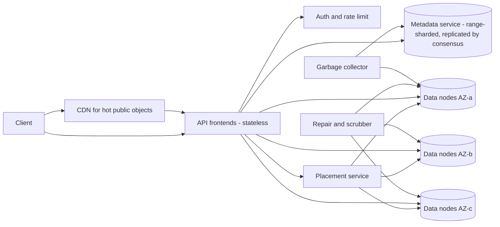
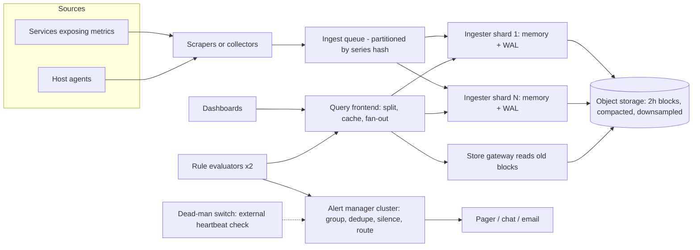
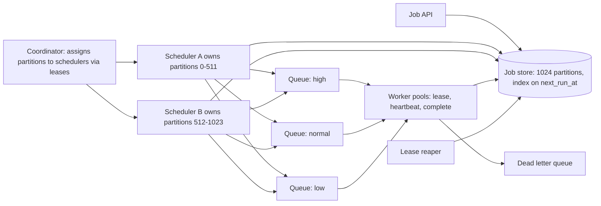
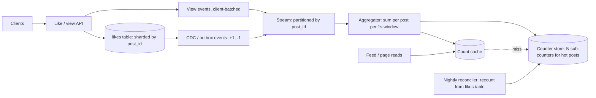
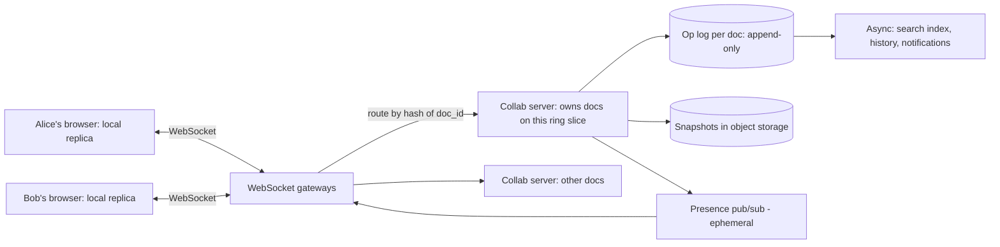

# Module 16 — Case Studies: Infrastructure

## Module Introduction

**What this module is.** Five complete designs for the systems *other* systems stand on: a blob store (for large files, "binary large objects"), the monitoring that watches everything, the scheduler that runs background work, the counters behind every "like" and "view", and the engine inside a shared document editor. Each is a popular prompt because it hides one hard idea a box diagram can't fake: durability math, time-series compression (a *time series* is a sequence of timestamped measurements), "run exactly once" on unreliable machines, write contention on one hot row, and merging concurrent edits without losing anyone's work.

**Analogy.** Module 12 designed the shops on a high street; this module designs the water mains, electricity meters, alarm clocks and the shared whiteboard in the back office — utilities that must keep working through every failure.

**The five designs**

| Design | Center of gravity (the main problem) | Key numbers you should remember |
|---|---|---|
| S3-like Object Storage | Durability per dollar: replication (full copies) vs erasure coding, and metadata (facts about each file) at 50 billion keys | 3x replication = 3.0x disk; RS(8,4) = 1.5x disk and survives 4 losses |
| Metrics Monitoring & Alerting | Ingesting 10M samples/s cheaply and alerting on symptoms, not noise | ~1.4 bytes/sample after compression; cardinality is the budget |
| Distributed Job Scheduler | Firing each due job on time, once, on machines that crash | Leases (time-limited claims) + idempotency (repeats are harmless) = "effectively once"; jitter (randomly spread) the top of the hour |
| Distributed Counter | One viral post taking 50K increments/s on a single row | Shard (split) the counter, batch the writes, keep the truth in a set |
| Collaborative Document Editor | Two people typing at the same spot at the same moment | OT (operational transformation) needs a central orderer; CRDTs (conflict-free replicated data types) need unique IDs and tombstones (deletion markers) |

**The format** is Module 12's seven stages ([see Module 12](../12-capstones/README.md#module-introduction)), with the **API and data model** written out inside stage 3 and a **trade-offs table** and **TL;DR** closing each design: 1 requirements and numbers ([back-of-envelope math](../01-thinking-in-patterns/README.md#back-of-envelope-math)) → 2 [five-questions pass](../01-thinking-in-patterns/README.md#the-five-questions) → 3 annotated architecture → 4 deep dives → 5 failure walk → 6 follow-ups → 7 pattern manifest. Basic terms (latency, replication, sharding, cache, queue, TTL, p99) are in [System Design Fundamentals](../00-system-design-fundamentals/README.md) and its [A–Z glossary](../00-system-design-fundamentals/README.md#master-az-glossary); each design links to the lesson for every pattern it uses rather than re-teaching it.

**Four terms used throughout**
- **Durability** — the probability that stored data is still there later. *Availability* is whether you can reach it *right now*; a system can be unavailable for an hour and still perfectly durable.
- **Erasure coding (EC)** — split data into *k* pieces and compute *m* extra "parity" pieces so that *any k* of the *k+m* rebuild the original. Written RS(k,m) for the common Reed–Solomon code.
- **Cardinality** — the number of distinct values something can take: in monitoring, distinct time series; in counting, distinct users.
- **Convergence** — once all replicas have seen the same set of updates, they hold the same value, whatever order the updates arrived in.

**Runnable demos** (standard-library Python, run from the repo root with `.venv-books/bin/python`):
- [`code/erasure_vs_replication.py`](code/erasure_vs_replication.py) — overhead and loss probability for 3x replication vs three Reed–Solomon layouts, plus a toy XOR parity repair (XOR, "exclusive or", lets you rebuild any one missing piece).
- [`code/crdt_counter.py`](code/crdt_counter.py) — a G-Counter / PN-Counter CRDT across three regions that converges in any merge order.

## Design 1 — S3-like Object Storage

**The prompt (in short).** Customers store files ("objects") of any size under a name ("key") inside a container ("bucket") and read them back years later — like Amazon S3, Google Cloud Storage or Azure Blob Storage.

**What makes it hard.** Two problems glued together. *Data:* keep petabytes (1 PB = 1,000 TB) safe on disks that fail daily without paying for three full copies. *Metadata:* a key-value index of tens of billions of entries that must answer "does this key exist, and where are its bytes?" with strong consistency, and also list keys by prefix.

**1. Requirements and numbers**
- *Functional:* create/delete buckets; `PUT`, `GET` (including byte ranges), `DELETE`, `HEAD`; `LIST` keys by prefix with pagination; multipart upload (a big file sent as separately retried parts) for objects up to 5 TB; optional versioning.
- *Non-functional:* **99.999999999% durability** ("eleven nines", S3's published design target) per object per year; **99.99% availability** (\~53 minutes down a year); **strong read-after-write consistency** (after a successful `PUT`, every `GET` and `LIST` sees it; S3 since December 2020); low cost per GB, since storage is the product.
- *Assumptions:* **100 PB**, **50 billion objects** → average ≈ **2 MB**, but skewed: most objects are small (thumbnails, logs), most *bytes* are in a few large ones (videos, backups).
- *Traffic:* **20K PUT/s**, **200K GET/s** at peak (10:1 reads).
- *Metadata:* 50B × ~**500 bytes** (key, size, checksum, timestamps, chunk locations) ≈ **25 TB** — too big for one machine but a small fraction of the data; must be sharded.
- *Raw disk:* 3x replication → **300 PB** ≈ **15,000** 20-TB disks; RS(8,4) → **150 PB** ≈ **7,500** disks. **Erasure coding halves the hardware bill** — the number that shapes the design.
- *Bandwidth:* 200K GET/s × 2 MB ≈ **400 GB/s** egress — ordinary over thousands of data nodes, not on one hot object (put a [CDN](../08-api-and-edge/README.md#cdn) in front).

**2. The five-questions pass**
- **Flow:** `PUT`/`GET` are synchronous. Background work (repair, EC conversion, garbage collection of deleted bytes) is asynchronous and can lag.
- **Storage:** **data nodes** hold immutable chunks; a **metadata store** holds the authoritative *key → version → chunk locations* mapping. The metadata row decides whether the object exists.
- **Speed:** every `GET` needs a metadata lookup — cache metadata for immutable versions aggressively; hot public bytes go to the CDN.
- **Failure:** disks, hosts, racks and availability zones (AZs) fail. Place every piece of an object in a *different* failure domain (hardware that fails together, e.g. a rack sharing power), and make repair outrun the next failure.
- **Growth:** bytes grow steadily (add data nodes); key count grows fastest (split metadata shards); one popular prefix like `logs/2026-09-28/` is the hot key.

**3. The architecture, annotated**

*API (REST; idempotent where possible):*
- `PUT /{bucket}/{key}` body=bytes, header `Content-MD5` (checksum so the server detects corruption) → `200 {etag, version_id}`. Re-sending is safe — it recreates the same content ([idempotency](../05-reliability/README.md#idempotency)).
- `GET /{bucket}/{key}?versionId=` with optional `Range: bytes=0-1048575` → bytes.
- `DELETE /{bucket}/{key}` → writes a **delete marker** (tombstone) rather than erasing bytes immediately.
- `GET /{bucket}?prefix=photos/&continuation-token=…&max-keys=1000` → one page of keys ([cursor pagination](../08-api-and-edge/README.md#cursor-based-pagination)).
- Multipart: `POST ?uploads` → `upload_id`; `PUT ?partNumber=N&uploadId=` (parts of 5 MB–5 GB, parallel, retried individually); `POST ?uploadId=` with the part list → the object becomes visible atomically.

*Data model:*

| Table | Key | Columns |
|---|---|---|
| `buckets` | `bucket_name` | owner, region, versioning on/off, policy |
| `objects` | `(bucket, key, version_id desc)` | size, etag/checksum, content-type, created_at, is_delete_marker, `chunks: [chunk_id…]` |
| `chunks` | `chunk_id` | size, EC scheme, `fragments: [(node, volume_id, offset, length)…]` |
| `multipart_uploads` | `upload_id` | bucket, key, parts [(n, etag, chunk_id)], started_at |

`objects` is **range-sharded** on `(bucket, key)` so `LIST prefix=` reads one contiguous range ([sharding](../03-storing-data/README.md#sharding)). Hash sharding would spread load better but make every `LIST` a scatter-gather across all shards.



A `PUT` of a 64 MB object:
1. The **frontend** authenticates, applies per-bucket [rate limiting](../08-api-and-edge/README.md#rate-limiting), and streams the body (never buffering a whole 5 GB object).
2. It splits the body into **chunks** (say 64 MB) and asks the **placement service** for 12 data nodes in distinct racks across **3 AZs** (4 per AZ).
3. Per chunk it computes **RS(8,4)** — 8 data fragments of 8 MB plus 4 parity fragments — writes all 12 in parallel, and waits for all 12 (or at least 11, scheduling repair of the last) to be durable.
4. Only then does it **commit the metadata row** `(bucket, key, new version_id) → [chunk_ids]`. This single write is the *commit point*: before it the object doesn't exist; after it everyone sees it.
5. It returns `200` with the ETag (content checksum).

A `GET` does one metadata lookup, reads any 8 of the 12 fragments (preferring the 8 *data* fragments, which need no decoding), verifies checksums and streams.

**4. Deep dives**
- **Deep dive 1 — durability per dollar: replication vs erasure coding.** Three copies tolerate 2 losses at **3.0x**; RS(8,4) tolerates **4** at **1.5x**. The demo (each disk has a 0.1% chance of failing before a missing piece is repaired, failures independent):

  ```text
  $ .venv-books/bin/python .../code/erasure_vs_replication.py
  scheme                          raw bytes per 1 byte  can lose   P(loss) per window
  3x replication                                 3.00x         2             1.00e-09
  RS(6,3)  6 data + 3 parity                     1.50x         3             1.25e-10
  RS(8,4)  8 data + 4 parity                     1.50x         4             7.87e-13
  RS(10,4) 10 data + 4 parity                    1.40x         4             1.99e-12
  ...
  lost chunk 2, rebuilt -> b'CT-ST'
  object reassembled OK; repair had to read 4 chunks to rebuild 1
  ```

  EC is cheaper *and* more durable; its prices: (a) **expensive repair** — rebuilding one 8 MB fragment reads 8 fragments (64 MB) over the network, where replication copies one; (b) **small objects waste space** — a 4 KB object in 8 pieces of 512 bytes is dominated by per-fragment overhead; (c) **reads of a degraded stripe** (a chunk's k+m fragments with some missing) **need decoding** CPU. The practical answer, as Facebook described for photos (hot blobs replicated in Haystack, moved to the RS(10,4) **f4** warm store once cool): write hot data **replicated**, then **convert sealed volumes** (full storage files that won't change) **to EC** in the background. (Some systems, e.g. Backblaze Vaults with RS(17,3), erasure-code from the first write, accepting slower writes for simplicity.) The "0.1% per window" figure is honest only if the repair window is short, so **repair bandwidth is a first-class capacity item** — eleven nines is really a statement about detection and repair speed, not just *k* and *m*. Spread fragments across **failure domains** (disk, host, rack, AZ) so one rack losing power removes at most one fragment per stripe.
- **Deep dive 2 — metadata consistency and the commit point.** Bytes first, then metadata: a crash before the commit leaves **orphan fragments** the garbage collector later deletes; a crash after leaves a complete object. The commit must be **linearizable** (every reader sees the latest committed version), so each metadata shard is a small consensus group (Raft/Paxos; [DDIA ch. 9](../../../ddia/chapters/09-consistency-and-consensus/README.md#fault-tolerant-consensus)); a [quorum](../07-consistency/README.md#quorum) alone isn't enough for read-after-write under concurrent overwrites. Overwrites never modify in place: they create a new `version_id` and flip the "latest" pointer, so mid-download readers of the old version still get consistent bytes. **Hot prefixes** (`logs/2026-09-28/…`) land in one range shard; the service splits a shard when its request rate crosses a threshold (S3 documents about 3,500 PUT and 5,500 GET per second *per prefix*, scaling by partitioning further), and customers are told to spread keys across prefixes.
- **Deep dive 3 — small objects, large objects and deletes.** A file per object collapses at billions of files (each needs an inode — the filesystem's per-file record — and several disk seeks). Instead append objects into large **volume files** (say 100 GB) with an in-memory index `needle_id → offset` — Facebook's Haystack design, about one disk seek per photo read. Large objects go the other way: **multipart upload** turns one fragile 5 TB stream into thousands of independently retried parts. **Deletes** write a metadata tombstone; bytes are reclaimed by **compaction**, which copies a mostly-dead volume's live needles into a new volume and drops the old one (like LSM-tree compaction, [DDIA ch. 3](../../../ddia/chapters/03-storage-and-retrieval/README.md#sstables-and-lsm-trees)).

**5. The failure walk**
1. **A disk dies (daily at 7,500 disks):** stripes lose one fragment; reads still work (any 8 of 12). The **scrubber** (background job re-reading and checking data) notices; repair rebuilds fragments elsewhere, rate-limited so it can't starve customer reads (a [bulkhead](../05-reliability/README.md#bulkhead) for bandwidth).
2. **Silent corruption (bit rot: stored bits flipping over time):** every fragment has a checksum; the scrubber re-reads everything on a cycle (e.g. every two weeks) and repairs mismatches. A `GET` hitting a bad checksum reads another fragment.
3. **A whole AZ down:** 4 of 12 fragments unreachable — exactly RS(8,4)'s tolerance. Reads succeed (slower, with decoding); writes continue if placement temporarily uses the two remaining AZs and rebalances when the AZ returns.
4. **A metadata shard loses its leader:** the consensus group elects a new one within seconds; that key range fails briefly and clients [retry with backoff](../05-reliability/README.md#retry-with-exponential-backoff). Other ranges are unaffected.
5. **A client retries a `PUT` after a timeout:** may create two versions; with versioning off the later wins and the earlier becomes an orphan for GC. Harmless — why a full-content `PUT` is naturally idempotent.

**6. Follow-up questions**
- **"How do you prove eleven nines?"** Model it: per-disk annual failure rate, time to detect, time to repair and fragments per stripe give a loss probability per stripe per year; multiply by stripes; verify with scrubbing statistics. *Trap:* quoting the number without repair time, which dominates it.
- **"How does `LIST` stay consistent with `PUT`?"** It reads the same range-sharded, linearizable metadata table, so a committed key appears in the next list. A separate eventually consistent search index would break this.
- **"Serve a 4 GB video to a million viewers."** Range `GET`s, a CDN in front, metadata cached at the edge; data nodes see only CDN misses.
- **"Storage classes (cold archive)?"** Lifecycle rules move old versions into wider, cheaper EC (e.g. RS(17,3)) on dense, spun-down disks; `GET` becomes a "restore" job taking minutes to hours.
- **"Cross-region replication?"** Asynchronous: a [CDC](../10-batch-and-streaming/README.md#change-data-capture) stream of committed metadata drives copies to the other region; it lags seconds to minutes — say so.

**Trade-offs**

| Decision | Option A | Option B | Choice here |
|---|---|---|---|
| Redundancy | 3x replication: cheap repair, fast writes, 3.0x disk | RS(8,4): 1.5x disk, more durable, costly repair | Replicate hot data, convert sealed volumes to EC |
| Metadata sharding | Range: fast `LIST`, hot prefixes | Hash: even load, `LIST` is scatter-gather | Range + automatic split of hot ranges |
| Object layout on disk | File per object: simple | Packed volumes + index: few seeks, needs compaction | Packed volumes |
| Delete | Erase immediately | Tombstone + background GC | Tombstone + GC |

**7. Pattern manifest**

| Pattern | Where it served |
|---|---|
| Sharding (range) + hot-range splits | Metadata table and `LIST` |
| Consensus / quorum | Linearizable metadata commit per shard |
| Write-ahead / commit point | Bytes first, metadata row last |
| Idempotency | Safe `PUT` retries, multipart part retries |
| Bulkhead | Repair traffic capped so it can't starve reads |
| CDN + Cache-Aside | Hot objects and immutable-version metadata |
| Rate Limiting | Per-bucket request limits at the frontend |
| CDC | Cross-region replication and lifecycle moves |

**TL;DR**
- Two systems: immutable **chunks** on data nodes, and a strongly consistent, **range-sharded metadata** index whose single row write is the commit point.
- **Erasure coding** gives ~1.5x overhead and better durability than 3x replication; pay in repair bandwidth, so replicate while hot, encode when cold.
- Spread fragments across racks and AZs; durability is a function of **repair speed**.
- Pack small objects into big volume files; delete with tombstones and compaction.

**Interview one-liner:** "Object storage is a strongly consistent metadata index pointing at immutable, erasure-coded chunks spread across failure domains; durability comes from placement plus fast repair, and the metadata commit is the only moment an object comes into existence."

## Design 2 — Metrics Monitoring & Alerting

**The prompt (in short).** A system like Prometheus, Datadog or Google's Monarch: every server and service reports numbers (CPU, request rate, errors, latency); engineers view dashboards and get paged when something is wrong.

**What makes it hard.** Enormous, relentless write volume of tiny samples whose value drops fast with age — while the alerting half must be *more* reliable than what it watches and page humans only when it matters.

**1. Requirements and numbers**
- *Functional:* ingest **counters** (only go up, e.g. requests served), **gauges** (up and down, e.g. memory used) and **histograms** (bucketed latency distributions); each series is a metric name plus **labels** (key-value tags), e.g. `http_requests_total{service="cart", status="500", region="eu"}`. Query by label with aggregation (`sum by (region) (rate(...[5m]))`); dashboards; alert rules; notification routing (pager, chat, email), grouping, silencing.
- *Non-functional:* ingestion must **never block or slow the measured app**; recent data queryable within ~**30 s**; alerts evaluated every **15–60 s**; full resolution for **15 days**, downsampled (many points summarised into fewer) for **1–2 years**; alerting keeps working when half the infrastructure is on fire.
- *Assumptions:* **100K hosts** × **1,000** series = **100M active series**, each every **10 s** → **10M samples/s**.
- *Storage:* raw sample = 64-bit timestamp + 64-bit float = 16 bytes → 160 MB/s ≈ **13.8 TB/day**. Gorilla compression (Facebook, VLDB 2015 — reported **~1.37 bytes per sample**) → ~**14 MB/s ≈ 1.2 TB/day**, ~**18 TB** for 15 days. 5-minute aggregates (min/max/sum/count = 4 values instead of 30 samples) make old data ~7x cheaper; a 1-hour level cuts another ~12x.
- *Queries:* thousands of auto-refreshing dashboards plus **~50K alert rules** every 30 s ≈ **1.7K rule queries/s**, mostly over recent data.
- *The real limit is cardinality, not bytes:* each active series needs an index entry and an in-memory buffer (a few KB): 100M × ~4 KB ≈ **400 GB of RAM** across the ingest tier. A `user_id` label would multiply series by millions and topple it.

**2. The five-questions pass**
- **Flow:** apps expose or emit metrics asynchronously; nothing on the request path waits for monitoring. Queries and alert evaluation are request-response.
- **Storage:** an append-only **time-series database (TSDB)**: recent data in memory + [write-ahead log](../03-storing-data/README.md#write-ahead-log) (WAL), older data in immutable compressed blocks on [object storage](#design-1--s3-like-object-storage).
- **Speed:** almost all reads cover the last few hours — keep those in memory; long-range dashboards read downsampled blocks.
- **Failure:** losing a few samples is fine; losing the *alerting path* is not. Run it redundantly and monitor the monitor.
- **Growth:** series count grows with every service, label and deployment; shard ingestion by series.

**3. The architecture, annotated**

*API:*
- Ingest (push): `POST /v1/write` with a compressed batch of `(series_labels, [(ts, value)…])`. Or pull: each target exposes `GET /metrics` in a text format and scrapers fetch it every 10 s (Prometheus's model).
- Query: `GET /v1/query_range?q=sum by (region)(rate(http_requests_total{status="500"}[5m]))&start=&end=&step=60s` → matrix of series.
- Rules: `PUT /v1/rules/{group}` with `expr`, `for: 5m`, `labels: {severity: page}`, `annotations: {runbook: …}` (a runbook is the on-call engineer's step-by-step guide).
- Alerts: `POST /v1/silences` `{matchers, starts, ends, comment}`.

*Data model:*
- **Series ID** = hash of the sorted label set. **Inverted index** `label=value → sorted series IDs` (e.g. `service=cart → [17, 93, 1042…]`); a query intersects these posting lists, exactly like a search engine.
- **Chunks**: per series, ~120 samples (20 minutes at 10 s) compressed together. Timestamps use **delta-of-delta** encoding: at a steady 10 s interval the difference between consecutive differences is usually **0**, stored in one bit. Values are **XOR-ed with the previous value**; slowly changing floats share most bits, so few remain.
- **Blocks**: every 2 h the in-memory head becomes an immutable block (chunks + index); blocks are later merged and **downsampled**.



1. **Scrapers/collectors** gather and batch samples; the app only increments an in-process counter (nanoseconds).
2. The **ingest queue** ([message queue](../02-moving-data/README.md#message-queue)) absorbs bursts and lets ingesters restart without loss; partitioned by series hash so each series always reaches the same ingester ([partitioned consumption](../10-batch-and-streaming/README.md#partitioned-consumption)).
3. **Ingesters** append to the in-memory head chunk and the WAL, replicated to 2–3 ingesters so a crash loses nothing; every 2 h they flush compressed blocks to object storage.
4. The **query frontend** splits a 30-day query into daily pieces, answers recent ones from ingesters and older ones from blocks, and caches finished days.
5. **Rule evaluators** run alert expressions on a schedule. The **alert manager** dedupes copies from redundant evaluators, groups related alerts into one notification, applies silences and inhibitions (mute an alert while a related bigger one fires), and routes by team and severity.

**4. Deep dives**
- **Deep dive 1 — cardinality is the budget.** Cost scales with *distinct series*, not write frequency. A label with unbounded values (user ID, request ID, full URL path) creates a series per value and can take down the ingest tier in minutes. Defenses: per-tenant **series limits** at ingest (reject new series over the limit, and count rejections as their own metric); a "top cardinality" report per metric; put high-cardinality detail in **logs or traces** ([distributed tracing](../09-operating-in-production/README.md#distributed-tracing)), not labels. Histograms need care: 20 buckets × every label combination = 20 series each.
- **Deep dive 2 — pull vs push.** *Pull* (monitor scrapes targets): the monitor controls load, a silent target is itself a signal (`up == 0`), and you can curl a target to debug; but it needs service discovery and struggles with short-lived jobs and firewalled targets. *Push* (agents send): works for batch jobs, serverless functions and restricted networks, but a misbehaving client can flood you, so receivers need [rate limiting](../08-api-and-edge/README.md#rate-limiting) and [backpressure](../10-batch-and-streaming/README.md#backpressure). Large systems use both: pull inside the data center, push via a gateway for the rest.
- **Deep dive 3 — alerts people trust.** Page on **symptoms users feel** (error rate, latency vs the SLO — e.g. "99.9% of requests succeed") rather than causes (CPU at 90%), per Google's *Site Reliability Engineering* book. Best is an **SLO burn-rate alert**: "consuming the 30-day error budget (the failures the SLO allows) **14.4x** faster than sustainable (2% of the month's budget gone in one hour), over both a 1 h and a 5 min window" (the *SRE Workbook*'s multi-window form; the short window lets the alert clear quickly once the outage ends) — fast for big outages, silent on blips. Also: a `for: 5m` clause so one bad scrape doesn't page; **grouping** (one page for "40 pods of cart failing", not 40); **inhibition** (region down → suppress per-service alerts); a **runbook** link on every page. And **alert on absence**: an always-firing watchdog alert must reach an *external* service every minute; if it stops, that service pages you because monitoring itself is down (a dead-man's switch).

**5. The failure walk**
1. **An ingester crashes:** its series are replicated on two others; the replacement replays the WAL. Queries dedupe replicated samples.
2. **Cardinality explosion from a bad deploy:** series limits reject new series for that tenant only; everyone else keeps ingesting ([bulkhead](../05-reliability/README.md#bulkhead) per tenant); an alert tells the team.
3. **Object storage slow:** recent in-memory data still answers dashboards and all alerts (which look back minutes); long-range dashboards [degrade gracefully](../05-reliability/README.md#graceful-degradation).
4. **A network partition cuts a region off from central monitoring:** evaluate alerts **inside each region** near the data, with a global layer only for cross-region views; the dead-man's switch catches a silent region.
5. **A query of death (a year of raw data across all series):** the frontend limits series touched and samples scanned and applies a [timeout](../05-reliability/README.md#timeout), so one dashboard can't starve alert evaluation, which has its own query capacity.

**6. Follow-up questions**
- **"Why not a relational DB or Cassandra?"** Fine at small scale. At 10M samples/s general storage pays 16+ bytes per sample plus row overhead; TSDB delta-of-delta and XOR compression is ~10x smaller, and its label index fits this exact query.
- **"p99 latency across 500 servers?"** Not by averaging each server's p99 (percentiles don't average). Each server exports a **histogram**; sum the buckets across servers and estimate the percentile from the merged histogram.
- **"Logs vs metrics vs traces?"** Metrics: cheap, aggregated, for alerting and trends. Logs: per-event detail, expensive. Traces: one request's path across services. Metrics say *that* something is wrong; traces and logs say *where* and *why*.
- **"Multi-tenant SaaS version?"** Tenant ID as a mandatory label, per-tenant limits on series and query cost, and shuffle-sharding (each tenant gets a random small subset of ingesters) so one noisy tenant affects few others.

**Trade-offs**

| Decision | Option A | Option B | Choice here |
|---|---|---|---|
| Collection | Pull: controllable load, liveness signal | Push: batch jobs, firewalls | Pull inside, push gateway for the rest |
| Retention | Full resolution forever | Downsample after 15 days | Downsample (min/max/sum/count per 5 min) |
| Alert on | Causes (CPU, disk) | Symptoms (errors, latency vs SLO) | Page on symptoms; causes go to dashboards/tickets |
| Evaluation placement | Central, global | Per region, near data | Per region + global view |

**Monitoring client-side errors (RUM, independent collectors, synthetic probers)**

Everything above measures the system **from the inside**, so it misses failures before a request reaches your servers or after the response leaves them: a DNS record that fails for one ISP, an expired certificate, a CDN edge erroring in one country, a JavaScript bug that kills the checkout button. Server dashboards stay green while users fail. The fix is outside signals plus a collector that doesn't share your failures.

*Three ways to watch from the outside.*

| Signal | What it is | What it catches | What it misses |
|---|---|---|---|
| **Real-user monitoring (RUM)** | A small script or SDK in the web page or app records each real user's experience (page-load and interaction timings, failed requests, JavaScript exceptions, app crashes) and sends batches to a collector | Problems only some users see: one country, one browser version, one app release, one ISP; true user-perceived latency | Users who can't load the page at all (the script never runs); needs real traffic, so it's quiet at 4 AM |
| **Browser network error reports** | The **Network Error Logging (NEL)** standard: a `NEL` response header tells the browser to remember a policy and later report failed requests to your site (DNS failure, TCP timeout, TLS error, HTTP 5xx) to a reporting endpoint, sampling successes if asked | Failures *before* any response exists: exactly what RUM misses and what servers can't see | Browser support is uneven; only browsers that visited once and stored the policy can report |
| **Synthetic probers** | Scripted robot users (also called black-box probes or synthetic transactions) that run a real journey (load home page, log in, add to cart) every minute from many regions and networks | Outages with no traffic yet; certificate and DNS expiry; regressions straight after a deploy; gives a clean, steady baseline | Only the paths and places you scripted; a robot is not a real device on a weak network |

Use all three: probers say *whether* critical paths work everywhere; RUM and NEL say *who* is affected and *how badly*.

*What RUM measures.* Use the browser's standard timing APIs (Navigation Timing, Resource Timing) and Google's **Core Web Vitals**, judged at the **75th percentile** of real page loads: **LCP** (Largest Contentful Paint, when the main content appears; good ≤ 2.5 s), **INP** (Interaction to Next Paint, how quickly the page reacts to a tap or click; good ≤ 200 ms; it replaced First Input Delay in March 2024) and **CLS** (Cumulative Layout Shift, how much the layout jumps; good ≤ 0.1). Add error counts per page view, failed API calls by endpoint and status, and app crash-free session rate. Tag every event with release version, country, network type and browser or device model, but never with user IDs as metric labels: that is the cardinality trap from deep dive 1. Per-user detail belongs in the event store of [Module 20 Case 2](../20-case-studies-content-search-and-platforms/README.md#case-2--distributed-logging-and-error-monitoring), which also covers symbolicating minified stack traces and grouping crashes into issues.

*The collection path.*
1. **Batch and send cheaply.** The page buffers events and sends one compressed batch every few seconds, and a final one on page hide with `navigator.sendBeacon` (a browser call that queues a small POST that survives the page being closed). Mobile SDKs write to disk and upload on the next app start if the app crashed.
2. **Sample.** At 50M users, record 100% of errors but only 1–10% of successful page views; store the sampling rate with each event so counts can be scaled back up.
3. **Run an independent collector.** The NEL standard recommends sending reports to at least one endpoint on a **different origin whose infrastructure is independent** of the site's, because a collector behind the same DNS, CDN, load balancer or region goes down in exactly the outages you most need reported. In practice: a separate domain, a separate DNS provider, and a different region or cloud from the main site.
4. **Defend the collector.** It's a public, unauthenticated write endpoint. Validate event schemas, cap payload size, rate-limit per IP and per app key, and drop events from versions too old to fix. Some ad blockers block known analytics domains, so expect undercounting and prefer a first-party subdomain for the RUM endpoint (while NEL reports still go to the independent one).
5. **Feed the same metrics pipeline.** The collector turns events into ordinary low-cardinality series (`rum_page_errors_total{page, country, release}`, LCP histograms) that flow through the ingesters above, so alerting, dashboards and SLOs work the same way.

*Alerting on the outside view.*
- **Prober SLO alerts:** page when the checkout journey fails from 2 or more regions for 3 consecutive runs (several regions, so one prober's own network problem doesn't page); this also catches the case where everything inside, monitoring included, is down.
- **RUM regression alerts:** compare a new release's error rate or LCP with the previous release's at the same time of day; a 2× jump in JS errors among users on the new version is a rollback signal even when server error rates are flat.
- **Segment alerts:** an error spike confined to one country or ISP usually means DNS, CDN or routing. Route it to the edge team, not the service owners.

*Sources:* W3C, "Network Error Logging" (w3.org/TR/network-error-logging), section on independent report collection; W3C, "Navigation Timing Level 2" and "Reporting API"; web.dev, "Web Vitals" and "How the Core Web Vitals metrics thresholds were defined"; MDN, `Navigator.sendBeacon()`; B. Beyer et al., *Site Reliability Engineering*, ch. 6 "Monitoring Distributed Systems" (black-box vs white-box monitoring), Google, 2016.

**7. Pattern manifest**

| Pattern | Where it served |
|---|---|
| Message Queue + Partitioned Consumption | Ingest buffer, series-hash partitions |
| Write-Ahead Log | Ingester crash recovery |
| Sharding / Consistent Hashing | Series spread across ingesters |
| Rate Limiting + Backpressure | Push receivers, per-tenant series limits |
| Bulkhead | Per-tenant limits; separate query capacity for alerts |
| Timeout + Graceful Degradation | Query limits; recent-only answers when storage is slow |
| Health Checks | `up` metric from scrapes; dead-man's switch |
| Object Storage (Design 1) | Immutable compressed blocks |
| Independent failure domain | RUM/NEL collector on a separate origin, DNS and region; probers outside the system |

**TL;DR**
- Series = name + labels; cost is **cardinality**, so police unbounded labels.
- Compress with delta-of-delta timestamps and XOR values (~1.4 bytes/sample); memory + WAL for recent data, immutable blocks on object storage for old, downsample for long retention.
- Page on **user-facing symptoms** with SLO burn-rate alerts; group, inhibit, silence, link runbooks.
- Monitor the monitor: redundant evaluators, an external **dead-man's switch**, and outside-in signals (RUM, NEL, probers) to an independent collector.

**Interview one-liner:** "A metrics system is a write-heavy, compressed time-series store whose real budget is series cardinality, paired with an alert pipeline that pages on user-facing symptoms and is itself watched from outside."

## Design 3 — Distributed Job Scheduler

**The prompt (in short).** A company-wide service for background work: "send this email in 10 minutes", "generate every invoice on the 1st at 02:00", "retry this failed webhook" — distributed cron (the Unix scheduler) plus a task queue, like Dropbox's Async Task Framework, Airflow's scheduler or cloud task services.

**What makes it hard.** Three promises that fight: **on time** (within seconds of due), **never lost**, and **not run twice** — on machines that crash mid-job, with clocks that disagree. Plus priority: a password-reset email must not wait behind a million newsletter jobs.

**1. Requirements and numbers**
- *Functional:* submit a job with payload and target (queue/handler name); run **now**, **at time T** or **on a cron schedule**; **priorities** (high / normal / low); retries with backoff and a max attempt count; per-job timeout; cancel; status and history.
- *Non-functional:* start within **~2 s** of due time at p99; no accepted job lost; each run executes **at least once**, and with the handler's cooperation **effectively once**; no single point of failure.
- *Assumptions:* **100M executions/day** ≈ **1,160/s** average. Cron clusters at `00:00`, on the hour and on the 1st, so peak is ~**20K/s** for the first seconds of each hour.
- *Storage:* ~**1 KB** per job record (large payloads by reference) → **100 GB/day**; 30 days hot (**3 TB**), then archive. ~5M recurring job *definitions*.
- *Workers:* average job **2 s** → ~**2,300** busy slots (Little's law: concurrency = arrival rate × duration); provision for peaks and [auto-scale](../06-scaling/README.md#auto-scaling) on queue backlog.

**2. The five-questions pass**
- **Flow:** submission is synchronous (job ID returned once durably stored); everything after is async — due jobs move to queues, workers pull.
- **Storage:** the **job store** is the truth for definitions, state and next-run time; queues hold only *ready* work, derived from it.
- **Speed:** the constant hot query is "which jobs are due in the next few seconds?" — an index on `next_run_at`, partitioned so many schedulers share it.
- **Failure:** workers die mid-job, schedulers mid-dispatch, handlers fail: every hand-off needs a lease and every job must be retry-safe.
- **Growth:** volume grows linearly; the hot spots are **time itself** (00:00) and one huge tenant.

**3. The architecture, annotated**

*API:*
- `POST /jobs` `{queue, payload, run_at | cron: "0 2 1 * *", timezone, priority, max_attempts, timeout_s, idempotency_key}` → `201 {job_id}`; `idempotency_key` makes submission retry-safe ([idempotency](../05-reliability/README.md#idempotency)).
- `GET /jobs/{id}` → state, attempts, last error; `GET /jobs/{id}/runs?cursor=`.
- `DELETE /jobs/{id}` → cancel future runs; a running attempt gets a cancel signal.
- Worker side: `POST /lease {queues, max}` → jobs with `lease_id` and expiry; `POST /lease/{id}/heartbeat`; `POST /lease/{id}/complete {result | error}`.

*Data model:*

| Table | Key | Columns |
|---|---|---|
| `job_definitions` | `job_id` | tenant, queue, payload_ref, cron, timezone, priority, retry policy, enabled |
| `job_runs` | `(partition, next_run_at, run_id)` | job_id, state (`SCHEDULED/QUEUED/RUNNING/SUCCEEDED/FAILED/DEAD`), attempt, lease_owner, lease_expires_at, fencing_token |

`partition = hash(job_id) % 1024`, each indexed by `next_run_at`, so "due now" is a short range scan.



1. The **API** writes the job row with its first `next_run_at` (cron computed in the job's timezone).
2. A **coordinator** (consensus-backed, e.g. ZooKeeper or etcd) gives each scheduler a **lease** on a set of partitions; if a scheduler dies its lease expires and the partitions move to a survivor.
3. Each **scheduler** loops every ~500 ms: `SELECT … WHERE next_run_at <= now() + interval '1 second' AND state='SCHEDULED' ORDER BY next_run_at LIMIT 500 FOR UPDATE SKIP LOCKED` (lock the picked rows, skip rows another poller holds), marks them `QUEUED`, and pushes to the queue for their priority. For recurring jobs it inserts the *next* run row in the same transaction, so a crash can't skip or double a run.
4. **Workers** pull (preferring higher priorities), run under a timeout, heartbeat every few seconds, report. Failures are rescheduled with [exponential backoff and jitter](../05-reliability/README.md#retry-with-exponential-backoff); after `max_attempts` the job goes to the [dead letter queue](../05-reliability/README.md#dead-letter-queue).
5. A **lease reaper** returns `RUNNING` rows with expired leases (dead workers) to `SCHEDULED`.

**4. Deep dives**
- **Deep dive 1 — finding due jobs without a thundering herd** (many processes rushing at the same thing at once). Options: (a) **index scan** on `next_run_at` per partition as above — simple, durable, and `SKIP LOCKED` lets pollers share a partition safely; (b) a **Redis sorted set** per partition scored by due time (`ZRANGEBYSCORE key -inf now`) — very fast but rebuilt from the store after failure; (c) a [**timing wheel**](../19-algorithms-deep-dive/README.md#hierarchical-timing-wheels) (circular array of time buckets, as in Kafka's delayed operations) for millions of short in-memory timers. The store stays the truth; (b)/(c) are accelerators. The top-of-the-hour spike is **smeared**: owners opt into a jitter window ("any time 02:00–02:10"), and jobs due in the next minute are pre-loaded into queues a few seconds early with `not_before` timestamps workers respect.
- **Deep dive 2 — "exactly once" is really at-least-once + idempotency.** A worker can finish and die before reporting; the reaper re-runs the job. No scheduler can prevent this — it can't tell "dead" from "slow" ([DDIA ch. 8](../../../ddia/chapters/08-trouble-with-distributed-systems/README.md#timeouts-and-unbounded-delays)). So: (1) every attempt carries a stable **job ID + run ID** that handlers use as an idempotency key on side effects ("insert invoice where run_id not exists"); (2) each lease carries a monotonically increasing **fencing token**; the store rejects `complete`/`heartbeat` with an older token, so a zombie worker (presumed dead, still running) can't overwrite a newer attempt ([fencing tokens, DDIA ch. 8](../../../ddia/chapters/08-trouble-with-distributed-systems/README.md#the-truth-is-defined-by-the-majority)). The same token guards against two schedulers both believing they own a partition during a handover.
- **Deep dive 3 — priority and fairness.** A single priority queue scored `(priority, enqueue_time)` causes **starvation**: under sustained high-priority load, low-priority jobs never run. Fixes: separate queues per priority with **weighted pulls** (e.g. 6 high : 3 normal : 1 low when all non-empty); **aging** (effective priority rises with wait time); per-tenant **quotas** so one tenant's million-job backfill can't fill the high queue. Isolate critical work in its own pool ([bulkhead](../05-reliability/README.md#bulkhead)): password-reset emails get workers the monthly-report backlog can never occupy.

**5. The failure walk**
1. **A worker dies mid-job:** heartbeats stop, the lease expires (e.g. 30 s), the reaper reschedules; the next attempt has a higher fencing token and the handler's idempotency key prevents double effects.
2. **A scheduler dies:** its partition leases expire and are reassigned within seconds. Jobs due in the gap start a few seconds late, none lost — the rows are still `SCHEDULED`.
3. **Job store slow or down:** schedulers stop dispatching (fail closed rather than guess); queued jobs keep running; submissions get a retryable error. On recovery the backlog drains **rate-limited** so downstream services aren't stampeded.
4. **A poison job crashes every worker:** attempt counting sends it to the DLQ after N tries; a per-handler [circuit breaker](../05-reliability/README.md#circuit-breaker) pauses a handler whose failure rate spikes.
5. **Clock skew between scheduler hosts:** only the store's clock (or the partition owner) decides due-ness; skew means seconds early/late, never a double run, thanks to the row state machine.

**6. Follow-up questions**
- **"Daylight saving time for a 02:30 cron job?"** Store cron in the user's timezone and compute each next run with a timezone library; document a rule for the skipped hour (run once at the next valid time) and the repeated hour (run once).
- **"Workflows: B only after A and C finish?"** Store a DAG (directed acyclic graph); on completion decrement each child's unfinished-parent counter and enqueue it at zero — the Airflow/Temporal shape; add a [saga](../07-consistency/README.md#saga) if steps need undoing.
- **"Why not just use Kafka?"** A classic consumer group has no per-message delay, no per-message ack or retry (it commits an offset per partition) and no priorities — a log, not a job queue. Newer "share groups" (KIP-932) add per-message acknowledgement but still no delays or priorities. Kafka can be the transport under a scheduler, not the scheduler.
- **"Run a job on every one of 10,000 hosts?"** Fan-out: one parent job creates 10,000 rate-limited child runs with an aggregate status.

**Trade-offs**

| Decision | Option A | Option B | Choice here |
|---|---|---|---|
| Due-job lookup | DB index scan: durable, simpler | In-memory sorted set / timing wheel: faster | DB as truth, sorted set as optional cache |
| Delivery guarantee | At-most-once: never repeats, may lose | At-least-once + idempotent handlers | At-least-once + idempotency keys + fencing |
| Priority | Single priority queue | Queues per priority, weighted + aging | Weighted queues + aging + critical pool |
| Scheduler coordination | One leader for everything | Partitions leased to many schedulers | Partition leases |

**7. Pattern manifest**

| Pattern | Where it served |
|---|---|
| Sharding (partitions) + leases | Many schedulers share the job store |
| Message Queue | Ready jobs, one queue per priority |
| Retry with Backoff + DLQ | Failed attempts, poison jobs |
| Idempotency + fencing tokens | Effectively-once execution |
| Timeout + heartbeat | Detecting dead workers |
| Bulkhead | Dedicated pools for critical job types |
| Circuit Breaker | Pausing a failing handler |
| Auto-Scaling on backlog | Worker pool size |

**TL;DR**
- The **job store** is the truth; queues are derived. Partition by job ID, index by `next_run_at`.
- Schedulers **lease partitions**, claim due rows with `SKIP LOCKED`, and write the next cron run in the same transaction.
- "Exactly once" = **at-least-once + idempotent handlers + fencing tokens**.
- Priority needs **weighted queues, aging and quotas**, or low priority starves; jitter the top of the hour.

**Interview one-liner:** "A job scheduler is a partitioned, time-indexed job table whose partitions are leased to schedulers, feeding priority queues that workers drain under leases; it guarantees at-least-once, and idempotency keys plus fencing tokens make that effectively once."

## Design 4 — Distributed Counter (likes and views at scale)

**The prompt (in short).** Show like and view counts on every post or video, and let users like/unlike.

**What makes it hard.** `UPDATE posts SET likes = likes + 1` works until one viral post takes **50,000 increments per second** on one row, which can't sustain it because every update takes the same row lock. Also: views run into billions, users must not like twice, and displayed counts must stay roughly right across regions.

**1. Requirements and numbers**
- *Functional:* like/unlike (one like per user per post); show like count and "you liked this"; count views; show view count.
- *Non-functional:* like counts **exact eventually** (seconds of lag fine), never double-counting a user; view counts may be **approximate** (~1%) but resist simple inflation; reads **<10 ms** (counts render on every feed item).
- *Assumptions:* **500M DAU**; **20 likes/user/day** → **10B likes/day ≈ 115K/s** average, ~**400K/s** peak; **200 views/user/day** → **100B views/day ≈ 1.2M/s**.
- *Hot key:* one viral post at **50K likes/s**. A locked relational row tops out around a few thousand updates/s — a single counter row fails by ~10x.
- *Reads:* ~20 counts per feed load; 25K loads/s × 20 = **500K count reads/s**, from cache.
- *Storage:* like fact `(post_id, user_id, ts)` ≈ 24 bytes + index ≈ **~50 bytes** → **500 GB/day** (slower net of unlikes). Views are stored only as aggregates.

**2. The five-questions pass**
- **Flow:** the like fact is written synchronously (so "you liked this" is immediately true); the count updates asynchronously. Views are client-batched fire-and-forget.
- **Storage:** the **likes table is the truth** (a set of who-liked-what); the **count is derived** and recomputable ([CQRS](../03-storing-data/README.md#cqrs)). View counts derive from an event stream.
- **Speed:** counts are read ~100x more than they change — cache, tolerate seconds of staleness.
- **Failure:** a lost count update is repairable from the truth; a lost like fact is not.
- **Growth:** volume scales horizontally; the enemy is the **single hot post**.

**3. The architecture, annotated**

*API:*
- `PUT /posts/{id}/like` → `204` (idempotent: liking twice is a no-op); `DELETE /posts/{id}/like` → unlike.
- `GET /posts/{id}/stats` → `{likes: 1204331, views: 88100234, liked_by_me: true}`; better, embed counts in the feed via batch `GET /stats?ids=…`.
- `POST /views` (client-batched) `[{post_id, watched_ms, ts}…]`.

*Data model:*
- `likes(post_id, user_id, created_at)` PK `(post_id, user_id)`, sharded by `post_id`. The PK enforces one like per user, so retries and double taps are harmless ([idempotency by data structure](../05-reliability/README.md#idempotency)).
- `user_likes(user_id, post_id)` — reverse index for "did I like this" and "my liked posts" (or a per-user Bloom filter — a compact set answering "definitely not" or "maybe" — for the fast check).
- `counters(post_id, shard_no, value)` — N sub-rows per hot post.
- Cache: `count:{post_id}` → integer, short TTL, refreshed by the aggregator.



1. A like inserts into the **likes table** (unique key rejects duplicates) and emits `+1` via [outbox or CDC](../10-batch-and-streaming/README.md#change-data-capture) — no dual write.
2. The stream is **partitioned by post ID**, so one aggregator sums each post's events in 1-second windows ([stream processing](../10-batch-and-streaming/README.md#stream-processing)): 50K events/s become **one** counter update per second.
3. The **counter store** holds totals; the **cache** serves reads.
4. A **reconciler** periodically recounts from the likes table (`COUNT(*) WHERE post_id=…`, incrementally) and corrects drift from lost or duplicated events.

**4. Deep dives**
- **Deep dive 1 — the hot row: batch, then shard.** Two independent tools. **Batching** (the [write-behind](../04-caching/README.md#write-behind) instinct): aggregate in memory, flush one `+N` per post per second — alone this turns 50K row updates/s into 1. **Sharded counters**, when writes can't be batched (e.g. must be synchronous): split one logical counter into **N sub-counters** `(post_id, 0..N-1)`; each increment picks one at random; a read sums all N (described in Google App Engine's Datastore docs). N = 20 at ~2,500 updates/s per row sustains 50K/s. Price: reads cost N lookups (cache the sum), and N should grow only for hot posts, chosen dynamically from observed write rate ([hot-key escapes](../12-capstones/README.md#pattern-review-cheat-sheet)). A Redis `INCR` key handles ~100K ops/s per shard, which is why many systems use Redis for the display count and the database for the truth.
- **Deep dive 2 — exact vs approximate, and deduplication.** Likes are **exact** because the `(post_id, user_id)` set is stored; the count is its size. Views are **approximate by design** — storing every viewer of every video costs too much. **Unique viewers:** [**HyperLogLog**](../19-algorithms-deep-dive/README.md#hyperloglog-internals), a sketch estimating distinct items in fixed memory; Redis's uses **12 KB** per counter at **0.81%** standard error whether it counted a thousand or a billion (Reddit described this for post views in 2017). **Total views:** anti-abuse rules in the stream — count only after N seconds of watch time, at most once per user/device per video per window (a short-lived dedupe key), plus bot filtering. Public counts can lag and be corrected; "views stuck at 301" was a famous YouTube behaviour while validation caught up.
- **Deep dive 3 — counting in several regions: CRDT counters.** If regions accept likes locally and replicate asynchronously, naively adding the other region's number double-counts on every repeated message. A **G-Counter** CRDT keeps one slot *per region*; each region increments only its own; merge takes the **element-wise max**; the value is the sum. Max is commutative, associative and idempotent, so merges can arrive in any order, any number of times. A **PN-Counter** is two G-Counters (increments, decrements) to support unlike. The demo shows three regions converging:

  ```text
  $ .venv-books/bin/python .../code/crdt_counter.py
  before sync: {'us': 2042, 'eu': 2042, 'ap': 1984} true total: 6068
  after sync : {'us': 6068, 'eu': 6068, 'ap': 6068}
  naive 'add the other total' would report 12136 (double counted)
  merge is commutative, associative and idempotent -> all replicas converge to 6068
  ```

  The CRDT converges *counts* but doesn't stop a user liking in two regions at once; uniqueness still comes from the per-user like record (one home region owns it). CRDTs were formalised by Shapiro et al. (2011); Riak ships counter data types; theory in [DDIA ch. 5](../../../ddia/chapters/05-replication/README.md#detecting-concurrent-writes) and [vector clocks](../07-consistency/README.md#vector-clocks).

**5. The failure walk**
1. **Aggregator crashes mid-window:** restarts from its last committed stream offset and reprocesses the uncommitted window. Avoid double counting by committing the counter update and offset together (or idempotent updates keyed `(post_id, window_id)`) — [exactly-once semantics](../10-batch-and-streaming/README.md#exactly-once-semantics).
2. **Stream lags (viral spike):** counts are a few seconds staler; likes are safely stored and "you liked this" reads the likes table ([read-your-writes, DDIA ch. 5](../../../ddia/chapters/05-replication/README.md#reading-your-own-writes)); optionally the client adds +1 locally.
3. **Cache node holding a hot count dies:** [stampede prevention](../04-caching/README.md#cache-stampede-prevention) (single-flight) means one request reloads it while the rest wait.
4. **Counter drift** from a bug or lost events: the reconciler recomputes from the likes table and overwrites — the truth makes every derived number repairable.
5. **A bot farm inflates views:** stream-side dedupe and per-device/IP rate limits, plus a delayed audit job that subtracts invalid views.

**6. Follow-up questions**
- **"Show 1.2M instead of the exact number?"** Yes — coarser display precision lowers how often the cache must refresh. Exactness matters only for the owner's analytics, served from the batch path.
- **"Top 100 most-liked posts this hour?"** A per-window heap per aggregator partition, merged; or a [Count-Min Sketch](../19-algorithms-deep-dive/README.md#count-min-sketch-with-conservative-update) (approximate frequencies in fixed memory) plus a heap for approximate heavy hitters.
- **"Why not a single Redis `INCR` per like?"** Fine for display, but Redis alone doesn't durably enforce one-like-per-user and can lose recent writes on failover; keep the likes table as truth and Redis as the fast view.
- **"Unlike storms?"** Same pipeline with `-1`; PN-Counter semantics; the reconciler keeps it from staying negative.

**Trade-offs**

| Decision | Option A | Option B | Choice here |
|---|---|---|---|
| Count update | Synchronous row update: exact now, hot-row limit | Async batched aggregation: seconds of lag | Async, batched per post per second |
| Hot post | Single counter row | N sharded sub-counters | Shard dynamically when write rate is high |
| Unique viewers | Exact set per video | HyperLogLog (12 KB, ~0.8% error) | HyperLogLog |
| Multi-region | Single home region for all counts | CRDT counters per region | CRDT for counts; per-user record for uniqueness |

**7. Pattern manifest**

| Pattern | Where it served |
|---|---|
| CQRS | Likes set = truth; counts = derived read model |
| CDC / Outbox | Like facts → count events, no dual write |
| Stream Processing + Partitioned Consumption | Per-post windowed aggregation |
| Write-Behind (batching) | 50K increments → 1 update per second |
| Sharding + hot-key splitting | Sharded sub-counters |
| Idempotency | Primary key on (post, user); idempotent window updates |
| Cache-Aside + Stampede Prevention | Count cache for 500K reads/s |
| Vector clocks / CRDT | Multi-region counters that converge |

**TL;DR**
- Store **facts** (who liked what), derive **counts**; the count is always recomputable.
- Beat the hot row by **batching** in a stream aggregator and **sharding** the counter for viral posts.
- Views: count approximately, **HyperLogLog** for unique viewers, dedupe and filter bots in the stream.
- Across regions, **CRDT counters** (per-region slots, merge by max) converge without double counting.

**Interview one-liner:** "Likes are a set and the count is a cached derivative: batch increments per post in a stream, shard the counter when one post goes viral, estimate unique views with HyperLogLog, and use CRDT counters when regions count independently."

## Design 5 — Collaborative Document Editor (Google Docs-style)

**The prompt (in short).** Several people edit one document at once in their browsers, seeing each other's typing and cursors almost immediately — like Google Docs, Notion or Figma's multiplayer mode.

**What makes it hard.** Alice and Bob both type at position 5 at the same moment. Each applies their keystroke locally at once (a server round trip per key would feel broken), so their copies briefly differ, and naively exchanging edits yields different documents. The system must guarantee **convergence** (everyone ends with the same text) and **intention preservation** (each edit lands where its author meant), with low latency and offline support.

**1. Requirements and numbers**
- *Functional:* create/open/edit rich text; real-time co-editing with remote cursors and presence ("Bob is viewing"); offline editing merged on reconnect; version history and restore; view/comment/edit permissions.
- *Non-functional:* local edits apply **instantly**; remote edits appear within **~200 ms** in-region; **no acknowledged edit lost**; replicas converge; up to ~100 simultaneous editors per document (many more viewers).
- *Assumptions:* **10M DAU**; peak **1M documents open**, **2M active editors**.
- *Operations:* bursts of ~**5 keystrokes/s**, ~**1 op/s** averaged → **2M ops/s** peak. Clients batch every ~50–100 ms, which merges ops only in fast bursts, so plan ~**1–2M messages/s**. ~**100 bytes** per op → ~**200 MB/s**.
- *Storage:* 2M ops/s × 100 B ≈ **17 TB/day** of raw op log if kept forever — hence **compaction into snapshots**. ~**50 KB** per document; 1B documents ≈ **50 TB** of snapshots.
- *Connections:* ~2M long-lived WebSockets (one per active editor; viewers add more); at ~50K per gateway, ~**40 gateway nodes** plus headroom ([bidirectional streaming](../02-moving-data/README.md#bidirectional-streaming)).

**2. The five-questions pass**
- **Flow:** edits travel over a **persistent bidirectional connection**: apply locally, send asynchronously, receive others' edits as pushes. Loading a document is a normal request.
- **Storage:** an **append-only operation log per document** is the truth ([event sourcing](../03-storing-data/README.md#event-sourcing)); **snapshots** every N ops make loading fast; version history falls out of the log.
- **Speed:** hot path in memory — one server process holds each active document and orders its incoming ops.
- **Failure:** a disconnected client keeps pending ops and resends; a dead document server is replaced by another that loads snapshot + log tail.
- **Growth:** documents are independent → shard by `doc_id`; the hot key is one document a whole company edits (an all-hands agenda).

**3. The architecture, annotated**

*API:*
- `GET /docs/{id}` → `{snapshot, revision}` (then open the socket from that revision).
- WebSocket `/docs/{id}/live`: client → `{type: "ops", base_rev: 1042, client_id, seq, ops: [insert(pos 5, "x")…]}`; server → `{type: "ack", rev: 1043}` or `{type: "remote_ops", rev: 1044, ops}`; plus `{type: "presence", user, cursor}`.
- `GET /docs/{id}/history?cursor=` → revisions; `POST /docs/{id}/restore {rev}` (creates a *new* revision equal to the old one; history is never rewritten).

*Data model:*
- `documents(doc_id, owner, title, acl, latest_snapshot_rev)` (acl = access control list: who may view, comment or edit).
- `ops(doc_id, rev, author, client_id, client_seq, op_blob, ts)` PK `(doc_id, rev)` — strictly increasing `rev` per document; `(client_id, client_seq)` unique so a resent batch isn't applied twice.
- `snapshots(doc_id, rev, content_blob)` in object storage, every ~1,000 ops or on idle.



1. Opening loads the latest **snapshot** plus later ops; the client records its revision.
2. The gateway routes all connections for a `doc_id` to the **same collaboration server** ([consistent hashing](../03-storing-data/README.md#consistent-hashing) on `doc_id`), which holds it in memory. This single owner makes ordering simple.
3. The server **orders** incoming batches (next `rev`), transforms or merges them (below), **appends to the op log** (durable before ack), then broadcasts.
4. **Presence and cursors** use lossy [pub/sub](../02-moving-data/README.md#publish-subscribe): a dropped cursor update is fixed by the next, so it never touches the durable log.
5. Search indexing, notifications ("Bob edited your doc") and history consume the op log asynchronously.

**4. Deep dives**
- **Deep dive 1 — the conflict, and Operational Transformation (OT).** Document "cat". Alice inserts "s" at 3 (→ "cats"); concurrently Bob deletes position 0 (→ "at"). Applying Alice's op as-is, Bob inserts at 3 into "at" — past the end. OT **transforms** each incoming op against concurrent ops already applied: `insert(3,"s")` against `delete(0)` becomes `insert(2,"s")`, and both reach "ats". The idea dates from Ellis and Gibbs (1989); Google Docs' practical form descends from Jupiter (Nichols et al., 1995), where **a central server defines a single order** and each client only transforms its pending ops against the server's stream. That central order matters: fully peer-to-peer OT (clients exchanging ops directly, no server ordering) needs extra transformation properties that many published algorithms were later shown to violate, so production OT keeps a server in the middle. Client protocol: at most one batch in flight, buffer the rest, transform the buffer against each ack or remote op. *Cost:* every pair of op types (insert, delete, format, table ops…) needs a correct transform, and every edit needs the server (long offline periods are hard).
- **Deep dive 2 — CRDTs for text.** Instead of shifting positions, give every character a **permanent unique ID**, e.g. `(lamport_counter, replica_id)` (a Lamport counter is a per-replica number incremented on every event, ordering events without clocks), and express inserts as "insert 's' *after character ID (3,alice)*". A delete marks a **tombstone** (hidden but kept so inserts anchored to it still find it). Concurrent inserts after the same character are ordered deterministically by ID, so every replica produces the same sequence in any arrival order — convergence by construction, no server ordering. Family: RGA, Logoot, YATA (the Yjs library's algorithm); Automerge is another open-source library (co-created by Martin Kleppmann, DDIA's author). *Costs:* per-character metadata (IDs, tombstones) can be several times the text size unless compacted and run-length encoded (modern libraries cut this dramatically); tombstone GC needs every replica to have seen the delete; some intentions (two people moving the same paragraph, interleaving of concurrent typing in some algorithms) still need care. Figma's blog describes a middle path: an authoritative central server with CRDT-inspired per-property last-writer-wins merging for design objects.
- **Deep dive 3 — persistence, history and undo.** The op log is the event-sourced truth: rev N = snapshot at S + ops S+1..N. Snapshots bound load time; history is "render at rev N"; old ops can be **compacted** (300 keystrokes → one "edited paragraph" entry) after a retention period. **Undo** is *selective*: Ctrl-Z undoes *my* last edit, not Bob's later one, so the client generates the inverse of its own op and transforms it (OT) or applies it by ID (CRDT) against everything since. **Durability rule:** ack only after the op is in the replicated log, and clients keep unacked ops locally (IndexedDB, the browser's database), so a crash on either side loses nothing ([write-ahead log](../03-storing-data/README.md#write-ahead-log)).

**OT vs CRDT at a glance**

| | Operational Transformation | CRDT (sequence) |
|---|---|---|
| Core idea | Rewrite positions of concurrent ops | Unique, immutable IDs per element; ops commute (any order gives the same result) |
| Needs a central server? | In practice yes (it defines the order) | No; peer-to-peer and offline work naturally |
| Metadata cost | Low (ops carry positions) | Higher (IDs + tombstones), reduced by compression |
| Offline for days | Painful (long transform chains) | Natural (merge on reconnect) |
| Hard part | Correct transform function for every op pair | Tombstone GC, metadata size, intention edge cases |
| Known users | Google Docs (Jupiter lineage), Etherpad | Yjs, Automerge; CRDT ideas in Figma |

**5. The failure walk**
1. **A client is offline for a minute:** keeps editing locally, queues ops with its `client_seq`, reconnects and resends from its last acked revision; the server ignores already-applied `(client_id, seq)` pairs ([idempotency](../05-reliability/README.md#idempotency)) and transforms/merges the rest.
2. **The owning collaboration server crashes:** clients reconnect; the ring routes the doc to a new owner, which loads snapshot + log tail. Acked ops are in the log; unacked ones are resent by clients. Two owners at once (split brain) would fork the order, so ownership is a lease with a **fencing token** checked on every log append.
3. **The op log store is slow:** the server stops acking (clients keep editing, showing "saving…") — [backpressure](../10-batch-and-streaming/README.md#backpressure) rather than acking unsaved ops.
4. **A hot document (5,000 people in an all-hands doc):** cap live editors (others become viewers of a throttled snapshot/op stream); batch broadcasts every 50–100 ms; presence shows "and 4,950 others".
5. **A malformed or malicious op:** validated against the document schema and permissions before ordering; the bad client is disconnected, the document not corrupted.

**6. Follow-up questions**
- **"OT or CRDT?"** Server-centric, always-online, rich formatting: OT with a central server is proven and lean. Offline-first, peer-to-peer or local-first (data lives mainly on the device): CRDT. Say why, not just which.
- **"Comments anchored to text?"** Anchor to character IDs (CRDT) or positions transformed with ops (OT); if the anchored text is deleted the comment is shown detached ("orphaned").
- **"Rich text and tables?"** Model a tree (paragraphs, runs, cells) with formatting as range attributes; each new op type needs transform rules (OT) or a tree/map CRDT.
- **"Why not lock paragraphs?"** Simple, but it kills "type anywhere" and fails badly when a lock-holder goes offline; merging is the product.

**Trade-offs**

| Decision | Option A | Option B | Choice here |
|---|---|---|---|
| Concurrency control | Locking sections | Optimistic merge (let everyone edit, fix conflicts afterwards: OT / CRDT) | Optimistic merge |
| Merge algorithm | OT + central server | CRDT, server optional | OT for a server-centric product; CRDT for offline-first |
| Ordering authority | Any server | One owner per doc (consistent hash + lease) | Single owner with fencing |
| Storage | Latest state only | Op log + snapshots | Op log + snapshots (history for free) |
| Presence | Durable | Ephemeral pub/sub | Ephemeral |

**7. Pattern manifest**

| Pattern | Where it served |
|---|---|
| Bidirectional Streaming | WebSocket edit and presence channel |
| Consistent Hashing + leases | One owner server per document |
| Event Sourcing + snapshots | Op log as truth; history and restore |
| Write-Ahead Log | Ack only after durable append; client-side pending ops |
| Idempotency | `(client_id, seq)` dedupe on resend |
| Pub/Sub | Presence and cursors |
| Vector clocks / CRDT | Concurrent-edit merge without a central order |
| Backpressure | Stop acking when the log is slow |

**TL;DR**
- Apply edits **locally first**, then reconcile so everyone **converges** and keeps their intent.
- **OT** transforms positions of concurrent ops under a **central server's order**; **CRDTs** give every character a unique ID and tombstones so ops commute with no central order.
- One **owner server per document** (consistent hashing + lease + fencing), an append-only **op log** with snapshots, ack only after durable append.
- Presence is ephemeral pub/sub; history and undo come from the log.

**Interview one-liner:** "A collaborative editor applies edits locally, then converges replicas either with OT against a single per-document server order or with CRDT unique-ID sequences that commute, while an event-sourced op log with snapshots provides durability and history."

## Pattern Review (Module 16)

**Which patterns each design leaned on** (✓ = central to the design):

| Pattern (lesson) | Object storage | Metrics | Job scheduler | Counter | Collab editor |
|---|---|---|---|---|---|
| [Sharding](../03-storing-data/README.md#sharding) | ✓ range-sharded metadata | ✓ series hash | ✓ job partitions | ✓ by post | ✓ by document |
| [Consistent Hashing](../03-storing-data/README.md#consistent-hashing) | | ✓ ingesters | | | ✓ doc owner |
| [Write-Ahead Log](../03-storing-data/README.md#write-ahead-log) | ✓ commit point | ✓ ingester WAL | | | ✓ op log |
| [Event Sourcing](../03-storing-data/README.md#event-sourcing) / [CQRS](../03-storing-data/README.md#cqrs) | | | | ✓ facts → counts | ✓ op log |
| [Quorum](../07-consistency/README.md#quorum) / consensus | ✓ metadata | | ✓ coordinator leases | | |
| [Vector Clocks](../07-consistency/README.md#vector-clocks) / CRDTs | | | | ✓ multi-region | ✓ text CRDT |
| [Message Queue](../02-moving-data/README.md#message-queue) | | ✓ ingest buffer | ✓ priority queues | ✓ event stream | |
| [Stream Processing](../10-batch-and-streaming/README.md#stream-processing) | | | | ✓ windowed sums | |
| [Idempotency](../05-reliability/README.md#idempotency) | ✓ PUT retries | | ✓ + fencing | ✓ PK (post,user) | ✓ (client, seq) |
| [Retry + Backoff](../05-reliability/README.md#retry-with-exponential-backoff) / [DLQ](../05-reliability/README.md#dead-letter-queue) | | | ✓ | | |
| [Bulkhead](../05-reliability/README.md#bulkhead) | ✓ repair bandwidth | ✓ per tenant | ✓ critical pool | | |
| [Backpressure](../10-batch-and-streaming/README.md#backpressure) / [Rate Limiting](../08-api-and-edge/README.md#rate-limiting) | ✓ per bucket | ✓ push ingest | ✓ backlog drain | ✓ anti-abuse | ✓ slow log |
| [Cache-Aside](../04-caching/README.md#cache-aside) / [CDN](../08-api-and-edge/README.md#cdn) | ✓ | ✓ query results | | ✓ counts | |
| [Write-Behind](../04-caching/README.md#write-behind) (batching) | | ✓ chunked samples | | ✓ per-second flush | ✓ op batching |
| [Bidirectional Streaming](../02-moving-data/README.md#bidirectional-streaming) / [Pub/Sub](../02-moving-data/README.md#publish-subscribe) | | | | | ✓ |

**Recurring threads across the five**
- **Store facts, derive the rest.** Object metadata rows, raw samples, job rows, like records and op logs are the truth; everything users see is derived and repairable.
- **Hot keys hide in time and popularity:** a popular prefix, a cardinality blow-up, 00:00 cron, one viral post, one all-hands doc. Each design names its hot key and escape.
- **At-least-once + idempotency** is the honest guarantee everywhere; fencing tokens stop zombies.
- **Convergence without coordination** (CRDTs) when replicas must accept writes independently; a single owner/orderer is simpler when they needn't.

**Self-check**
1. Why is RS(8,4) both cheaper and more durable than 3x replication, and what does it cost you instead?
2. A developer adds `user_id` as a metric label. What breaks, and what do you tell them?
3. A worker finishes a job and dies before acking. Walk through what happens and why nothing is charged twice.
4. Why does a G-Counter merge by max instead of by adding the other replica's value?
5. Alice inserts at position 3 while Bob deletes position 0. Show the OT fix, then describe how a CRDT avoids the problem.

**TL;DR**
- **Object storage:** linearizable range-sharded metadata + erasure-coded chunks across failure domains; durability = placement + fast repair.
- **Metrics:** compressed TSDB where **cardinality** is the budget; SLO burn-rate alerts; watch the watcher (and the user's side).
- **Job scheduler:** leased partitions of a time-indexed table → weighted priority queues → leased workers; effectively once = at-least-once + idempotency + fencing.
- **Counter:** likes are a set, counts derived; batch in a stream, shard hot counters, HyperLogLog for uniques, CRDTs across regions.
- **Collaborative editor:** local-first edits merged by OT (central order) or CRDT (unique IDs, tombstones); op log + snapshots per document owner.

**Sources (primary, for further reading)**
- Amazon S3 User Guide — data durability; strong read-after-write consistency announcement (Dec 2020); request-rate performance guidance per prefix.
- Beaver et al., "Finding a needle in Haystack: Facebook's photo storage", OSDI 2010; Muralidhar et al., "f4: Facebook's Warm BLOB Storage System", OSDI 2014; Backblaze blog on Reed–Solomon erasure coding in Backblaze Vaults.
- Pelkonen et al., "Gorilla: A Fast, Scalable, In-Memory Time Series Database", VLDB 2015; Prometheus documentation (data model, storage, Alertmanager); Adams et al., "Monarch: Google's Planet-Scale In-Memory Time Series Database", VLDB 2020.
- Beyer et al. (eds.), *Site Reliability Engineering* (Google, 2016) — "Monitoring Distributed Systems" and "Distributed Periodic Scheduling with Cron"; *The Site Reliability Workbook* (2018) — "Alerting on SLOs".
- Dropbox Tech Blog, "DATF: Dropbox's Asynchronous Task Framework" (2020); PostgreSQL documentation, `SELECT … FOR UPDATE SKIP LOCKED`; Kleppmann, *Designing Data-Intensive Applications*, ch. 8 (fencing tokens).
- Google Cloud documentation, "Sharding counters"; Redis documentation (`INCR`, HyperLogLog `PFADD`/`PFCOUNT`); Reddit engineering blog, "View Counting at Reddit" (2017); Flajolet et al., "HyperLogLog", 2007.
- Shapiro et al., "Conflict-free Replicated Data Types", SSS 2011; Ellis & Gibbs, "Concurrency Control in Groupware Systems", SIGMOD 1989; Nichols et al., "High-Latency, Low-Bandwidth Windowing in the Jupiter Collaboration System", UIST 1995; Figma blog, "How Figma's multiplayer technology works" (2019); Yjs and Automerge project documentation.
