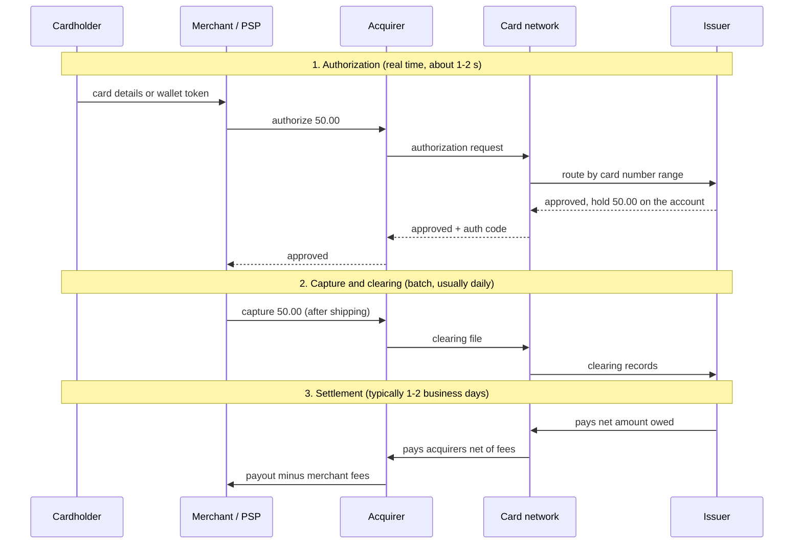
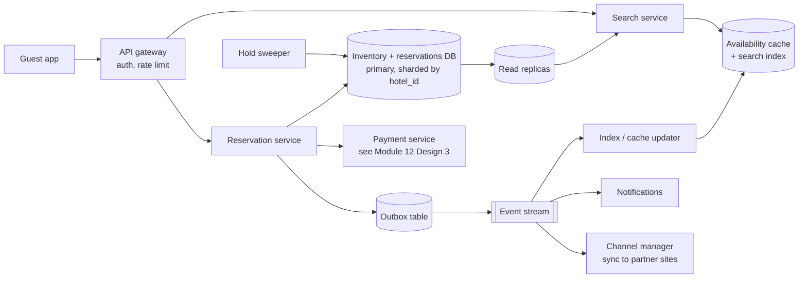
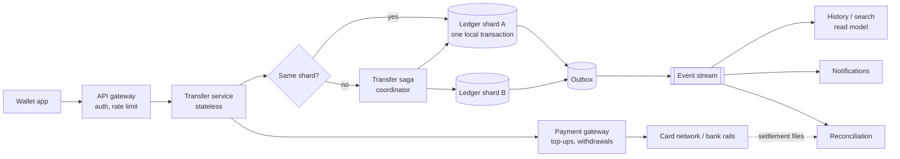
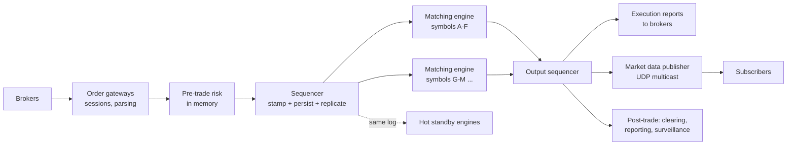
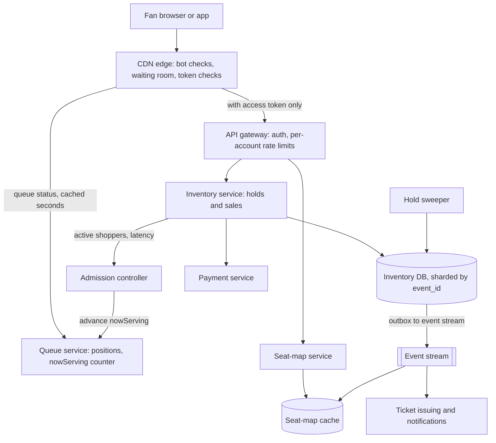
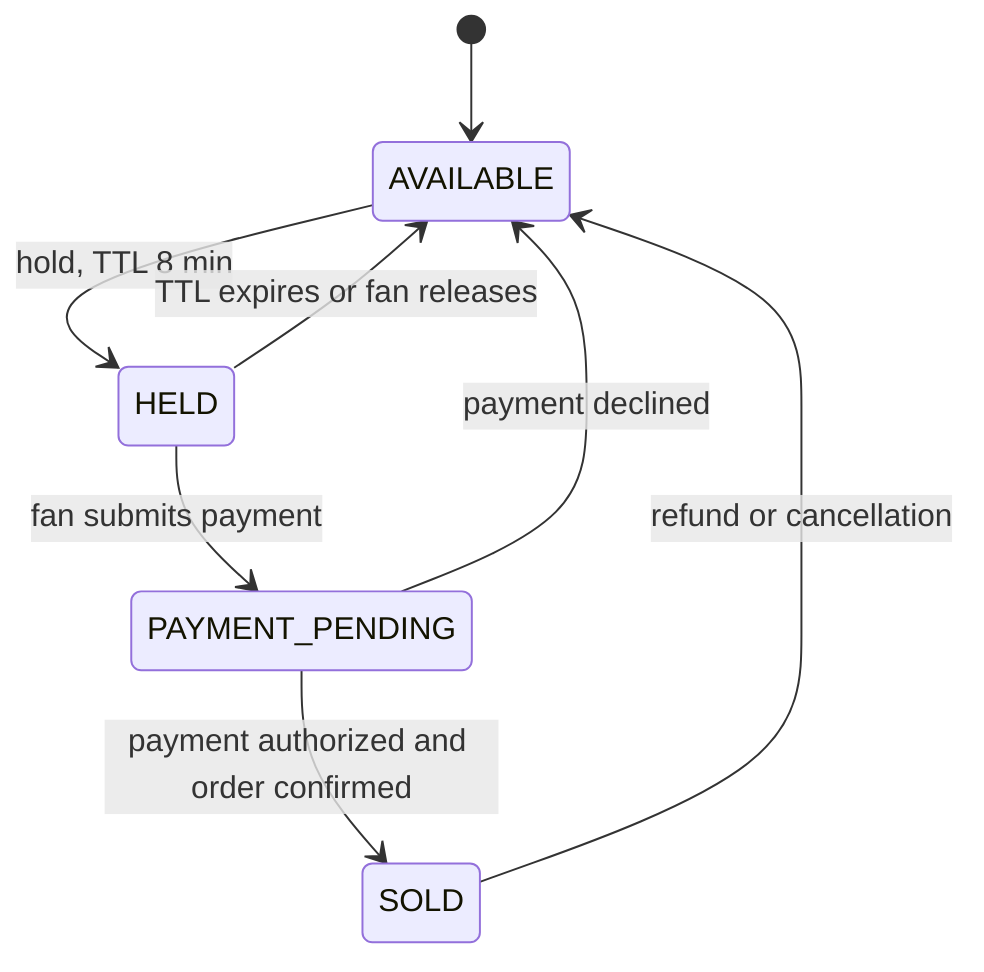

# Module 17 — Case Studies: Money and Reservations

## Module Introduction

**What this module is.** Case studies from the family where **a wrong answer costs real money**: a hotel reservation system, a digital wallet, a stock exchange and an event-ticketing (flash-sale) system, preceded by a short primer on how money moves between banks, because each of them eventually talks to that outside world. (An addition to the course notes, written from first principles, the other books in this collection, and primary sources — central-bank, payment-network and vendor documentation — listed at the end of each lesson. General terms such as latency, sharding, replication, caching, p99 and RAM are taught in [System Design Fundamentals](../00-system-design-fundamentals/README.md) and not re-defined here.)

**Analogy.** Earlier modules taught you to cook individual dishes; this module is a restaurant shift where every plate is counted. The cooking is the same, but nothing may be served twice, nothing may go missing, and the manager checks the till against the tickets every night.

**The five lessons**

| Lesson | Centre of gravity (the main problem) | Code you can run |
|---|---|---|
| How Money Moves (primer) | Payment rails (the networks that move money between banks), clearing vs settlement, reconciliation, idempotency across companies | — |
| Design a Hotel Reservation System | The last room: concurrency (many requests at the same moment) on a small, hot counter, plus deliberate overbooking | `code/hotel_inventory.py` |
| Design a Digital Wallet | A double-entry ledger (every movement recorded as a matching debit and credit) at high throughput; exactly-once transfers across shards | `code/ledger.py` |
| Design a Stock Exchange | A deterministic (same input, same output) single-threaded matching engine behind a sequencer (the component that numbers every order); microsecond latency | `code/order_book.py` |
| Design an Event Ticketing and Flash-Sale System | Millions of buyers for a few thousand seats: a virtual waiting room, seat holds that expire, no double-selling, and bot defence | — |

**Where the payment platform went.** Module 12 already has a full [Design 3 — The Payment Platform](../12-capstones/README.md#design-3--the-payment-platform) (payment intents, webhooks — HTTP calls a provider makes to your server when something happens — ledger, reconciliation). This module does **not** repeat it: the primer explains the outside world that design plugs into, and the wallet picks up where its ledger stops (throughput and cross-shard transfers).

**The case template** (also an interview-answer outline): requirements → back-of-envelope numbers → API and data model → architecture (patterns named where they appear) → 2–3 deep dives → failure walk → trade-offs, follow-up questions, pattern manifest, self-check and TL;DR.

**Four terms used everywhere in this module**
- **Ledger.** An append-only record of every movement of value. Balances are computed from it, never edited in place.
- **Clearing vs settlement.** *Clearing* is agreeing who owes whom and how much. *Settlement* is the moment the money actually moves and the obligation is discharged. They are often hours or days apart.
- **Idempotency key.** A unique ID the caller attaches to one logical operation and reuses on every retry, so it takes effect once however many times it arrives ([Module 5 — Idempotency](../05-reliability/README.md#idempotency)).
- **Reconciliation.** Comparing two independently produced records (your ledger vs a bank statement, your bookings vs a partner's) and investigating every difference.

**Before you start.** Read Module 3's [Event Sourcing](../03-storing-data/README.md#event-sourcing), Module 7's [Saga](../07-consistency/README.md#saga) and the SQL book's [transactions and concurrency chapter](../../../sql/chapters/13-transactions-and-concurrency/README.md). Demos use the shared `.venv-books` interpreter: `cd modules/17-case-studies-money-and-reservations/code && ../../../../.venv-books/bin/python ledger.py`.

---

## How Money Moves (primer)

### What it is
A payment looks like one event to a customer ("I paid"), but underneath is a chain of separate companies, each keeping its own ledger, connected by **payment rails**. A rail is a network plus a rulebook for moving money between institutions: card networks, batch bank transfers (ACH, the US Automated Clearing House), wire systems, and real-time payment systems. Every rail answers four questions differently: *how fast* is the confirmation, *when* does money really move, *can it be pulled back*, and *who is liable* when something goes wrong.

**Analogy.** Friends keep an IOU notebook through a weekend trip (clearing) and settle up with bank transfers on Monday (settlement). Card networks are that notebook at planetary scale; a wire is paying cash on the spot.

### The problem it solves
Designers who don't know the rails make three classic mistakes: treating an **authorization** as money received (it is only a promise and can expire); treating "success" as final when the rail allows **returns or chargebacks** (the customer's bank pulling money back) weeks later; and assuming an outside call happens **exactly once**, when every rail retries, times out and duplicates. Knowing the rails tells you which states you need (`authorized`, `captured` — the merchant confirmed the charge — `settled`, `returned`, `disputed`) and why reconciliation is not optional.

### How it works — card payments (the four-party model)
Five parties take part (it is called *four-party* because four hold accounts, with the network in the middle). The **cardholder** pays. The **merchant** sells. The **acquirer** (the merchant's bank, often reached through a payment service provider, or PSP, such as Stripe or Adyen) collects card payments for the merchant. The **issuer** (the cardholder's bank) gave the card and owns the account. The **card network** (Visa, Mastercard) connects thousands of acquirers to thousands of issuers and sets the rules.



1. **Authorization.** The issuer checks the account, fraud signals and limits, then places a **hold** (money reserved, not moved). If the merchant never captures, the hold expires after some days.
2. **Capture and clearing.** The merchant confirms the final amount (possibly lower, e.g. part of the order out of stock). Acquirers send captured transactions to the network in batches, and the network works out what each issuer owes each acquirer.
3. **Settlement.** Money moves between banks, usually as one **net** amount per bank per day, not one transfer per purchase. The merchant's payout comes later still.
4. **Disputes (chargebacks).** The cardholder can dispute a charge for weeks or months. The issuer pulls the money back through the network and the merchant must answer with evidence — so a "settled" card payment is still not final the way a wire is.

**Who earns what.** The merchant pays a **merchant discount rate** (a percentage fee) per sale. Most of it is **interchange**, passed by the acquirer to the issuer (funding card rewards and fraud losses); the network charges **scheme fees**; the acquirer adds its margin. Regulators cap interchange in some places: the EU's Interchange Fee Regulation (0.2% consumer debit, 0.3% consumer credit) and the US Federal Reserve's Regulation II for debit cards from large banks.

**Tokens instead of card numbers.** Storing raw card numbers drags your whole system into PCI DSS scope (the card industry's security standard; every in-scope system must pass its audits). A **PSP token** (`pm_...`) references a card held in the provider's vault and is useless to anyone else. A **network token** (EMVCo payment tokenisation standard) replaces the card number itself. Apple Pay and Google Pay store a device-specific token, and every payment carries a one-time **cryptogram** (a code computed with a secret key for this one payment), so a stolen token can't be replayed.

### How it works — bank transfers
- **ACH (batch, US).** Banks exchange files of payment instructions a few times a day through an operator (the Fed's FedACH or The Clearing House's EPN) under Nacha's rules. Cheap; handles payroll, bill pay and "pay by bank". ACH can **push** money (a credit) or **pull** it (a debit, with the customer's authorization). The designer's catch is **returns**: a debit can bounce for insufficient funds a couple of banking days later, and a consumer can dispute an unauthorized debit for up to 60 days. Same Day ACH adds settlement windows but keeps the same return rules.
- **Wires (real-time gross settlement).** In an **RTGS** system (each payment settled on its own, at once) such as the Fed's Fedwire Funds Service (or the UK's CHAPS, the eurozone's T2), each payment settles individually and immediately in central-bank money (balances held at the central bank), and is **final and irrevocable**. Expensive per payment; used for large or urgent amounts. No returns to model, but no undo: a mistaken wire is recovered only by asking the receiver to send it back.
- **Real-time payment rails.** Instant, 24/7, irrevocable **push** payments for everyday amounts: UK Faster Payments (2008), India's UPI (2016), The Clearing House's RTP network (2017), Brazil's Pix (2020), the Fed's FedNow (2023). UPI and Pix made **QR scan-to-pay** mainstream: the QR code carries the payee's address (a UPI ID or Pix key), the payer's app pushes the money, and the merchant is confirmed within seconds. Push-only and final means fraud shifts from "stolen card" to "tricked into sending", with no chargebacks to fall back on.
- **Cross-border (SWIFT and correspondent banks).** SWIFT is a **messaging** network, not a settlement system. Banks without a direct relationship move money through **correspondent banks** holding accounts for each other (a *nostro* is "our account at your bank"). Each hop may take a fee and convert currency — why cross-border is slow and costly. SWIFT gpi added an end-to-end tracking ID (the UETR), and instructions moved to the richer ISO 20022 message format (the MT/ISO 20022 coexistence period ended on 22 November 2025).

### How it works — clearing, settlement and reconciliation
**Net vs gross settlement.** Gross (each payment individually) needs a lot of cash on hand but builds no risk; net (once a day on the difference) needs far less cash but leaves banks exposed to each other until settlement. The classic failure is **settlement risk**: in 1974 the German regulator closed Bankhaus Herstatt after it had received the Deutsche Mark legs of its FX (foreign exchange) trades but before it paid the dollar legs. The fix, decades later, was CLS, which settles both currencies of an FX trade simultaneously (payment-versus-payment).

**Reconciliation.** Every party keeps its own ledger, so the only proof they agree is comparing them. A payments company typically runs a daily match between (1) its internal ledger, (2) the provider's API responses and webhooks, and (3) the provider's **settlement report** or bank statement; each mismatch (recorded but not settled, an unseen return, a differing fee) becomes a ticket. Module 12 walks through this [three-way match](../12-capstones/README.md#design-3--the-payment-platform).

**Idempotency across companies.** No rail offers exactly-once delivery; you build an **exactly-once effect**: attach an idempotency key to every outbound instruction (Stripe, Adyen and most PSPs accept one), store the key *in the same database transaction* as your own state change, and dedupe every inbound webhook on the provider's event ID. This is the end-to-end argument in the DDIA notes' [Aiming for Correctness](../../../ddia/chapters/12-future-of-data-systems/README.md#aiming-for-correctness): only the endpoints can guarantee "once", so the operation ID must travel from the user's click all the way to the bank.

**Hotspot accounts.** Some internal accounts are touched by almost every transaction — a merchant's settlement account on a big sale day, your fee revenue account, a bank's clearing account. One row updated thousands of times a second becomes a lock queue. Fixes: split it into N sub-accounts (write to a random one, sum to read), batch many credits into one entry, or give it a dedicated shard. The wallet case applies these.

**Order-to-cash, end to end.** For an online shop money states line up with business states: *order placed* → card **authorized** → goods shipped → payment **captured** → **settled** to the acquirer → **paid out** to the merchant's bank → **reconciled** against the statement → possibly **disputed** later. Give each arrow its own durable state, idempotency key and timeout policy.

### Trade-offs

| Rail | Speed to the payee | Finality | Can it be reversed? | Typical use | Design consequence |
|---|---|---|---|---|---|
| Cards | Auth in seconds, funds in 1–2 days | Low: chargebacks for months | Yes, disputes | Consumer purchases | Model auth, capture, settle, dispute as separate states; keep evidence |
| ACH | Hours to 1–2 days | Medium: returns for days (60 for unauthorized consumer debits) | Yes, returns | Payroll, bills, pay-by-bank | Don't release goods on initiation; handle late returns |
| Wires / RTGS | Seconds to minutes | High: irrevocable | Only by asking the payee | Large, urgent amounts | Strong verification before sending; no undo |
| Real-time rails (FedNow, RTP, UPI, Pix, Faster Payments) | Seconds, 24/7 | High: irrevocable | No (push-only) | Everyday P2P (person-to-person) and merchant payments | Fraud checks before sending; instant ledger updates |
| Cross-border (SWIFT correspondents) | Hours to days | Varies by hop | Hard | International, FX | Track with the UETR; fees and FX at each hop |

### When not to use it
Don't build on raw rails when a PSP already handles them. Most companies should integrate one PSP, keep their own ledger, and reconcile against the PSP's reports. Talking to networks or ACH operators directly pays off only at very large volume or when payments are your product.

### Common mistakes
- Crediting a wallet on **authorization** instead of capture or settlement.
- Treating an ACH debit as final when sent, then paying out money that bounces two days later.
- Storing card numbers "just for a moment" and pulling every service into PCI scope.
- Using floating-point for money (0.1 + 0.2 is not exactly 0.3). Use integer minor units (cents) plus a currency code.
- Retrying an outbound payment with a **new** idempotency key after a timeout, turning one payment into two.

### Real-world examples
- **Stripe** accepts an optional idempotency key on every `POST` and keeps it for at least 24 hours, so a retry within that window returns the original result.
- **Airbnb** described the double-payment problem and its fix (an idempotency library around every payment step) on its engineering blog.
- **UPI** processes billions of transactions a month with QR codes and virtual payment addresses; **Pix** did the same in Brazil within a few years of launch.

### In the interview
Show you know "the payment succeeded" means different things on different rails.

**30-second answer:** "An authorization is a promise, not money. Cards clear and settle a day or two later and can be charged back for months; ACH can be returned; wires and real-time rails are final. So I model each payment as a state machine with separate authorized, captured, settled and reversed states, send every outbound instruction with an idempotency key stored in the same transaction as my state change, and run a daily reconciliation against the provider's settlement report, because no rail gives exactly-once delivery."

**Likely follow-ups:**
- *"Why can't you just trust the webhook?"* Webhooks are at-least-once and may never arrive. The settlement report is an independent record, so reconciliation catches both duplicates and gaps.
- *"How do real-time rails change fraud?"* No chargebacks, so risk checks must happen **before** sending, and scams that trick the user into paying become the main threat.

### Self-check
- **Q1: What is the difference between clearing and settlement, and why does the gap matter?** → Clearing agrees who owes what; settlement moves the money. Until settlement the parties are exposed to each other, and your system shows money that hasn't arrived.
- **Q2: A user tops up a wallet by ACH debit and immediately withdraws to a card. What can go wrong?** → The debit can be returned days later for insufficient funds, leaving you with a loss. Hold the funds until the return window passes, or limit instant availability by risk score.
- **Q3: Why keep the idempotency key in the same transaction as your ledger write?** → Otherwise a crash between "record key" and "write ledger" (or the reverse) either loses the payment or lets a retry apply it twice.

### TL;DR
- **Problem:** "paid" means different things on different rails; outside systems retry, time out and reverse.
- **Mechanism:** cards authorize in real time but clear and settle in batches and can be charged back; ACH is batch with returns; wires and real-time rails are instant and final; SWIFT is messaging between correspondent banks.
- **Costs:** several money states, idempotency keys end to end, and a daily reconciliation.
- **Remember:** integer cents, tokens not card numbers, never credit on authorization.

**Sources.** Federal Reserve Financial Services pages for FedACH, Fedwire Funds and FedNow; Nacha Operating Rules overview (returns, Same Day ACH); The Clearing House RTP network overview; NPCI UPI product overview; Banco Central do Brasil Pix overview; Regulation (EU) 2015/751 (interchange caps) and the Federal Reserve's Regulation II; EMVCo Payment Tokenisation Specification; PCI Security Standards Council, PCI DSS; SWIFT gpi and ISO 20022 programme pages; BIS CPMI, *Principles for Financial Market Infrastructures* (2012) for settlement terms; Stripe API docs, "Idempotent requests"; Airbnb Engineering, "Avoiding Double Payments in a Distributed Payments System" (2019).

---
## Design a Hotel Reservation System

**The prompt.** "Design the booking system for a hotel chain (or a booking site covering many hotels). Guests search for rooms by city and dates, reserve a room type, pay, and can cancel. Hotels manage their room inventory and prices."

**What makes it hard.** Not the traffic, which is modest, but a **small, hot counter**: "how many rooms of this type are left on this night". Many read it, a few race to decrement it, and it must never go wrong in the direction the business didn't choose. Hotels also *deliberately* oversell (overbooking), so "never oversell" really means "never beyond the limit we picked".

The object-oriented version (classes for `Room`, `Reservation`, `Guest`) is in the LLD book, [15.4 Design a Hotel Management System](../../../lld/chapters/15-case-booking-1/README.md#154-design-a-hotel-management-system), and the full relational schema in the SQL book, [17.2 Hotel reservation system](../../../sql/chapters/17-schema-design-case-studies/README.md#172-hotel-reservation-system). This lesson is the distributed-system view.

### 1. Requirements
**Functional**
- Search availability and price by city (or hotel), check-in, check-out and guest count.
- Reserve a **room type** (not a specific room) for a date range; a physical room is assigned at check-in.
- Pay now or at the hotel; cancel with a refund per the rate's cancellation policy.
- Staff update inventory (rooms per type), nightly prices and the overbooking allowance.

**Non-functional**
- **No double booking beyond the chosen overbooking limit**, even when many guests click "book" for the last room at once.
- A retried or double-clicked booking creates **one** reservation.
- Search may be seconds stale; booking must be exact.
- High availability for search; booking may briefly refuse rather than risk being wrong (fail closed).

### 2. Back-of-envelope numbers
My own round numbers for a large chain or mid-size booking site:
- **5,000 hotels × 200 rooms = 1,000,000 rooms.** At 70% occupancy, 700,000 occupied room-nights per night.
- Average stay **3 nights** → 700,000 / 3 ≈ **233,000 new bookings/day** ≈ 2.7/s; with a **10× peak** (sale, holiday weekend) **~30 bookings/s**.
- **Look-to-book ratio 100:1** → search peaks at **~3,000 queries/s**.
- **Inventory table:** 5,000 hotels × ~20 room types × 365 days ≈ **36.5 million rows** × ~50 bytes ≈ **2 GB** — fits in RAM on one database server.
- **Reservations:** ~85 million/year × ~1 KB ≈ 85 GB/year.

**What the numbers say.** 30 writes/s is trivial for one relational database; 3,000 reads/s wants a cache or replicas. So this design is **not** about sharding for throughput but about **correctness under concurrency** for a few thousand hot rows (popular hotels on popular nights), plus the product rules around holds, payment and overbooking.

### 3. API
```text
GET    /v1/availability?city=lisbon&checkIn=2026-06-10&checkOut=2026-06-13&guests=2
       -> [{hotelId, roomTypeId, nightlyPrices[], total, currency, roomsLeftHint}]

POST   /v1/reservations              Idempotency-Key: 7c1e...   (generated by the client per "Book" click)
       {hotelId, roomTypeId, checkIn, checkOut, guest{...}, ratePlanId}
       -> 201 {reservationId, status: "HELD", holdExpiresAt, amount}
POST   /v1/reservations/{id}/confirm {paymentMethodToken}   -> {status: "CONFIRMED"}
DELETE /v1/reservations/{id}                                -> {status: "CANCELLED", refund}

PUT    /v1/hotels/{id}/room-types/{rt}/inventory  {from, to, total, overbookPct}   (staff)
PUT    /v1/hotels/{id}/room-types/{rt}/rates      {from, to, price}                (staff)
```
`roomsLeftHint` is explicitly a hint from a cache and may be seconds old.

### 4. Data model
The SQL book derives the full schema; these are the two tables that carry the design:

```sql
-- One row per room type per night: the counter everyone races on.
room_inventory (hotel_id, room_type_id, night,
                total_rooms, reserved, overbook_pct,
                PRIMARY KEY (hotel_id, room_type_id, night))

-- One row per booking; the idempotency key makes a double-click harmless.
reservation    (reservation_id, idempotency_key UNIQUE, hotel_id, room_type_id,
                check_in, check_out, guest_id, status,          -- HELD | CONFIRMED | CANCELLED | EXPIRED
                hold_expires_at, amount_cents, currency, rate_snapshot, version)
```
Two choices matter. A **per-night counter** (deliberate denormalization: storing a computable value to make reads cheap) turns "is anything free?" into reading 3 rows instead of counting overlapping reservations. And **everything for one hotel lives on one shard** (shard key `hotel_id`), so a booking never needs a distributed transaction.

### 5. The architecture



- **Search service** reads a cache and search index refreshed from the event stream, falling back to read replicas ([CQRS](../03-storing-data/README.md#cqrs)); seconds of staleness accepted.
- **Reservation service** is the only inventory writer; every booking is one short transaction on the **primary** of the hotel's shard ([Sharding](../03-storing-data/README.md#sharding)).
- **Outbox**: the booking transaction also inserts an event row; a relay publishes it to the event stream, so cache, notifications and partner sync can't miss a committed booking.
- **Payment service**: [Module 12's payment platform](../12-capstones/README.md#design-3--the-payment-platform); this system only needs "charge this reservation, with this idempotency key".
- **Channel manager**: pushes availability to online travel agencies (OTAs such as Booking.com or Expedia) and receives their bookings through the same reservation path.
- **Hold sweeper**: releases holds that expired unpaid.

### 6. Deep dive 1 — the last room (concurrency)
Twenty guests click "book" on the last three rooms; each booking touches **every night** of the stay. Naive code reads the counter, checks it in the application and writes back — the **lost update** anomaly ([SQL 13.7 Lost updates](../../../sql/chapters/13-transactions-and-concurrency/README.md#137-lost-updates-and-how-to-prevent-them)): two requests read "37 reserved", both write "38", and a booking vanishes from the count. The demo reproduces it with 20 threads on SQLite:

```output
=== Part 1: 20 guests, 3 rooms left on each of 3 nights ===
naive read-then-write : 20 bookings accepted, reserved per night = [38, 38, 38] (total 40)
conditional UPDATE    :  3 bookings accepted, reserved per night = [40, 40, 40] (total 40)
```
Twenty confirmations for three rooms, and the counter doesn't even show it. Three correct fixes, simplest first:

1. **Atomic conditional update (the default).** The database checks and writes in one statement per night, inside one transaction:
   ```sql
   UPDATE room_inventory
      SET reserved = reserved + 1
    WHERE hotel_id = :h AND room_type_id = :rt AND night = :night
      AND reserved + 1 <= total_rooms * (1 + overbook_pct / 100.0);
   -- expect 1 row updated per night; if any night returns 0 -> ROLLBACK
   ```
   The `UPDATE`'s row lock serializes the racers on that row and the `WHERE` makes the loser update zero rows. A `CHECK (reserved <= ...)` constraint adds a second guard.
2. **Pessimistic lock** (lock first, expecting conflicts). `SELECT ... FOR UPDATE` on the night rows, check in code, update ([SQL 13.10](../../../sql/chapters/13-transactions-and-concurrency/README.md#1310-lock-based-concurrency-control)). Useful when the check needs logic a `WHERE` can't express (loyalty tiers, minimum stays).
3. **Optimistic lock** (detect conflicts at write time, retry). Read a `version` column, update `WHERE version = :read_version`, retry on zero rows ([Spring 8.14](../../../spring/chapters/08-spring-data-jpa-and-hibernate/README.md#814-locking-optimistic-and-pessimistic)). Good when conflicts are rare; bad for the last room on New Year's Eve, where most attempts retry.

Three details make or break it:
- **Lock nights in the same order** (ascending date) in every transaction, or two multi-night bookings can deadlock ([SQL 13.11](../../../sql/chapters/13-transactions-and-concurrency/README.md#1311-deadlocks)).
- **Keep the transaction short** — no payment call inside it. The hold (deep dive 3) exists so the lock lasts milliseconds, not a card authorization.
- In Spring, put the whole multi-night update in one `@Transactional` service method; the transactional proxy applies only to calls from outside the bean, and checked exceptions don't roll back by default ([Spring 7.7](../../../spring/chapters/07-data-access-jdbc-and-transactions/README.md#77-how-a-spring-transaction-works), [7.10 Rollback rules](../../../spring/chapters/07-data-access-jdbc-and-transactions/README.md#710-rollback-rules), [7.13 Pitfalls](../../../spring/chapters/07-data-access-jdbc-and-transactions/README.md#713-transaction-pitfalls)).

**The other double booking** is the same guest twice (double-click, mobile retry after timeout). `idempotency_key UNIQUE` handles it: the reservation insert and inventory updates share **one** transaction, so a retry either finds and returns the existing reservation or runs the whole thing once ([Idempotency](../05-reliability/README.md#idempotency)).

### 7. Deep dive 2 — overbooking on purpose
Some confirmed guests never show. A 200-room hotel selling exactly 200 with 8% no-shows leaves ~16 rooms empty nightly, so hotels (and airlines) accept a few extra bookings. The opposite risk: more guests arrive than rooms, and the hotel must **walk** a guest (pay for a room elsewhere, transport, compensation).

A simple revenue-management rule: keep accepting bookings while the probability of running out stays below *price / (price + walk cost)* — balancing one more booking's revenue against the expected walk cost. Assuming each guest independently shows with a fixed probability, the demo computes the limit:

```output
=== Part 2: how far to overbook a 200-room hotel ===
show rate 92%, room $150, walk cost $ 400: threshold 0.273 -> accept up to 215 bookings (+15, 7.5%), expected walked guests 0.69
show rate 92%, room $150, walk cost $1200: threshold 0.111 -> accept up to 212 bookings (+12, 6.0%), expected walked guests 0.16
show rate 97%, room $150, walk cost $ 400: threshold 0.273 -> accept up to 205 bookings (+5, 2.5%), expected walked guests 0.46
```
At a 92% show rate accept 15 extra and walk fewer than one guest on an average night; if walking is expensive (a flagship hotel in a sold-out city) accept fewer; if almost everyone shows (non-refundable rates) overbooking barely pays.

**For the system:** overbooking is a **number per room type and night** (`overbook_pct`), set by a revenue-management job and read by the same conditional `UPDATE` — the booking path is unchanged, only its limit. Add an **oversold alert** at check-in and a "walk" workflow for nights when the dice roll badly.

### 8. Deep dive 3 — holds, payment, and cancellation (a small saga)
Card authorization takes 1–3 s, and 3-D Secure (the "confirm in your bank app" step) can take much longer; holding a row lock that long stalls everyone. So booking is a [saga](../07-consistency/README.md#saga) of short local transactions:

1. **Hold:** decrement inventory for all nights and insert the reservation as `HELD` with `hold_expires_at = now + 10 minutes`.
2. **Pay:** call the payment service with the reservation ID as idempotency key, outside any database transaction.
3. **Confirm:** on success, `UPDATE reservation SET status = 'CONFIRMED' WHERE id = :id AND status = 'HELD'` — the status check makes a duplicate confirm harmless.
4. **Compensate:** on payment failure or hold expiry, set `EXPIRED` and give the rooms back (decrement `reserved` per night) in one transaction.

The **hold sweeper** runs every minute, picking expired holds with `FOR UPDATE SKIP LOCKED` so several sweepers don't fight over rows ([SQL 13.12](../../../sql/chapters/13-transactions-and-concurrency/README.md#1312-row-locks-for-work-queues-for-update-nowait-skip-locked)). A race remains: payment succeeds at 10:00:01, the sweeper expired the hold at 10:00:00. Confirm sees `EXPIRED`, tries to re-take the inventory, and if the room is gone **refunds automatically**. Design that path on purpose.

**Cancellation** follows the rate's policy: release the nights (one transaction), then refund with its own idempotency key (`refund:{reservationId}`).

### 9. Scaling and the failure walk
**Scaling.** Search scales with cache and replicas. Even a hot hotel (festival weekend) sees a few hundred updates/s per night row at most, well within one database. Sharding by `hotel_id` is for data size and blast radius, not throughput; a stay never crosses shards.

**The failure walk**
1. **Primary fails over.** Bookings on that shard fail for tens of seconds and clients retry with the **same** idempotency key; search keeps working from cache.
2. **Payment times out after the hold.** The reservation stays `HELD`; ask the payment service for status by idempotency key before retrying or releasing.
3. **The outbox relay stops.** Bookings still commit; cache and partners fall behind, so search may show gone rooms that the conditional update then refuses. Alert on outbox lag.
4. **A partner site sells the last room at the same moment.** Both go through the same conditional update; one wins. If partner sync lags and they sold offline, the overbooking buffer and walk workflow absorb it.
5. **Sweeper crashes.** Holds stay `HELD` past expiry and rooms look sold. The booking transaction can first expire overdue holds for its nights before its conditional `UPDATE`, so a dead sweeper costs tidiness and alerts, not revenue.

### Trade-offs

| Decision | Option A | Option B | Choose |
|---|---|---|---|
| Inventory check | Count overlapping reservations per search | Per-night counter rows | Counter: 3 row reads instead of a range scan; costs keeping it in sync, done in the same transaction |
| Concurrency control | Optimistic (`version`) | Conditional `UPDATE` / row lock | Conditional update by default; optimistic only for low-contention edits (profile, preferences) |
| Payment timing | Pay inside the booking transaction | Hold → pay → confirm | Hold: locks last milliseconds; costs a sweeper and the late-payment race |
| Book a type or a room | Specific room | Room type, assign at check-in | Type: far simpler inventory; costs a room-assignment step at the front desk |
| Search freshness | Read the primary | Cache + index | Cache: 100× cheaper; costs "room just sold" errors at booking time |
| Overbooking | Never | Per-type limit from no-show data | Limit: in the example, expected empty rooms fall from 16 to about 3 (~6.5% of the hotel); costs occasional walked guests |

### The follow-up questions
- **"Why not a distributed lock (Redis) around the room type?"** The row lock already gives mutual exclusion *and* is tied to the transaction writing the data; a separate lock can expire or be lost mid-write and adds a dependency. *Trap:* adding Redis locks on a database that can do the job.
- **"How do you show 'only 2 rooms left' honestly?"** From the cache, labelled approximate; the booking step enforces the truth.
- **"One booking spanning two hotels?"** Two reservations in a small saga (hold both, pay once, confirm both, release on failure); hotels are separate shards and often separate companies.
- **"100× more hotels?"** More `hotel_id` shards, search fully on a search index, availability cache partitioned by city; the booking path is unchanged.
- **"Where do prices come from?"** A rates table per room type per night, snapshotted into the reservation so later price changes don't alter what the guest agreed to pay.

### Pattern manifest

| Pattern | Where it served |
|---|---|
| Idempotency | `Idempotency-Key` on booking; payment and refund keys |
| Sharding | `hotel_id`: a stay never crosses shards |
| CQRS + cache | Search reads a derived view; booking hits the primary |
| Outbox / event stream | Cache refresh, notifications, channel manager |
| Saga | Hold → pay → confirm, with release as the compensation |
| Lost-update prevention | Conditional `UPDATE`, row locks, ordered locking |
| Work queue with `SKIP LOCKED` | Hold sweeper |
| Fail closed | Booking refuses when unsure; search may be stale |

### Self-check
- **Q1: Why is the demo's naive version wrong even though every thread checked `reserved < total`?** → Check and write were separate steps; all 20 read 37 before anyone wrote, then all wrote 38. The check must be part of the write (conditional update) or protected by a lock.
- **Q2: Why lock nights in date order?** → Two multi-night bookings locking overlapping nights in different orders can each hold one lock and wait for the other: a deadlock.
- **Q3: A guest's payment succeeds one second after the hold expired. What does your system do?** → Confirm finds `EXPIRED` and tries to re-reserve the nights; if they're gone it refunds automatically and apologizes. A designed path, not an accident.
- **Q4: When does overbooking stop paying off?** → When no-shows are rare or walking is expensive; the threshold price/(price + walk cost) falls and the limit shrinks toward zero.

### TL;DR
- **Problem:** many readers, a few racing writers on a per-night counter; overselling must stay within a chosen limit.
- **Mechanism:** per-night inventory rows on the hotel's shard; one short transaction per booking with conditional `UPDATE`s in date order; idempotency key on the reservation; hold → pay → confirm saga with a sweeper; search from a cache.
- **Costs:** a denormalized counter to keep in sync, a sweeper and a late-payment path, stale search results.
- **Remember:** the database is the lock; never hold it across a payment call; overbooking is a number, not a bug.

**Sources.** PostgreSQL documentation on explicit locking (`FOR UPDATE`, `SKIP LOCKED`) and exclusion constraints; the SQL and Spring books linked above; K. T. Talluri and G. J. van Ryzin, *The Theory and Practice of Revenue Management* (2004), for overbooking and the critical-ratio rule; Stripe API docs, "Idempotent requests".

---
## Design a Digital Wallet

**The prompt.** "Design a digital wallet: users hold a balance, top up from a card or bank, send money to each other instantly, and withdraw to a bank. It must handle a very high number of transfers per second during peak events."

**What makes it hard.** Module 12's payment platform already has a double-entry ledger at ~2,000 payments/s. A wallet pushes it to **tens of thousands of transfers per second**, beyond one database. Once accounts sit on different shards, a transfer touches two machines, and "move money exactly once, never create or destroy it" becomes a distributed-systems problem. The object-oriented version is in the LLD book ([21.2 Design a Digital Wallet Service](../../../lld/chapters/21-case-machine-coding/README.md#212-design-a-digital-wallet-service)) and the relational banking schema in the SQL book ([17.3 Banking system](../../../sql/chapters/17-schema-design-case-studies/README.md#173-banking-system)).

### 1. Requirements
**Functional**
- Top up from a card or bank account; withdraw to a bank account.
- Instant transfers between two wallets in the same currency.
- Balance and paginated transaction history.

**Non-functional**
- **Money is conserved:** every transfer debits one account and credits another by the same amount; no balance below zero.
- **Exactly-once effect:** a retried or duplicated request moves money once.
- **Auditable:** every change kept forever and explainable.
- **Throughput:** peak **100,000 transfers/s** (festival sale, salary day); p99 under ~300 ms per transfer.
- **Availability:** high, but a transfer may be refused rather than risk a wrong balance (fail closed).

### 2. Back-of-envelope numbers
- **Users:** 50 million wallets; 5 million active on a peak day.
- **Peak:** 100,000 transfers/s, each writing one journal entry, two postings and one idempotency row and changing two balances: **~5 row writes per transfer → 500,000 row writes/s**.
- **Per-node capacity:** a tuned relational primary with group commit (many transactions flushed to disk in one write) might sustain a few thousand such transactions/s. Plan **5,000 transfers/s per shard** → **20 shards at peak**; provision 40–64 for headroom and hot accounts.
- **Storage:** average 20,000 transfers/s ≈ **1.7 billion/day** × ~220 bytes (entry + two postings + indexes) ≈ **380 GB/day ≈ 140 TB/year** before replication. Old journal partitions move to cheaper storage; balances don't need them thanks to snapshots (saved balances as of a known entry).

**What the numbers say.** We must shard, so most transfers involve **two shards** — the design's centre of gravity.

### 3. API
```text
POST /v1/transfers          Idempotency-Key: 5f0c...   (client-generated, one per "Send" tap)
     {fromWallet, toWallet, amount: {value: 2500, currency: "USD"}, note}
     -> 201 {transferId, status: "COMPLETED" | "PENDING" | "REJECTED", reason?}
GET  /v1/wallets/{id}/balance                 -> {available, pending, currency, asOfEntry}
GET  /v1/wallets/{id}/entries?cursor=...      -> [{entryId, amount, counterparty, time}], nextCursor
POST /v1/topups      Idempotency-Key: ...  {wallet, paymentMethodToken, amount}
POST /v1/withdrawals Idempotency-Key: ...  {wallet, bankAccountToken, amount}
```
Amounts are integers in the currency's smallest unit. History uses [cursor pagination](../08-api-and-edge/README.md#cursor-based-pagination), since offsets over billions of rows are slow.

### 4. Data model
```sql
account        (account_id, owner_id, currency, kind,          -- kind: USER | FEES | BANK_CLEARING | SUSPENSE
                balance, version, snapshot_entry_id)           -- balance = cached projection
journal_entry  (entry_id, idempotency_key UNIQUE, kind, created_at, memo)
posting        (entry_id, account_id, amount)                  -- signed: + debit, - credit; per entry, sum = 0
```
A **journal entry** is one business event ("Alice paid Bob 25.00 with a 0.25 fee"); its **postings** are the legs and always sum to zero. `balance` is a **projection** — a rebuildable cache of `sum(postings)` ([Event Sourcing](../03-storing-data/README.md#event-sourcing)).

The demo `code/ledger.py` implements exactly this. The fee transfer produces three legs; twenty user wallets start with $100 each:
```output
=== 1. Top-ups and one transfer with a fee ===
  u0    DEBIT    2525
  u1    CREDIT   2500
  fees  CREDIT     25
  u0 = 7475  u1 = 12500  fees = 25  bank = 200000  trial balance = 0
```
Why is Alice *debited*? To the wallet company a user balance is money **owed** to the user (a liability); paying out reduces it, which in accounting is a debit. The demo stores signed amounts and flips the sign for display. The **trial balance** (sum of all raw balances) is 0 after every entry — the point of double entry: money can only move.

### 5. The architecture



- **Ledger shards** are hash-partitioned by `account_id`; each owns its accounts' postings and balances, one writer per account at a time.
- **Transfer service** routes: same-shard transfers are one local transaction; cross-shard ones go through a **saga** (deep dive 1).
- **Outbox → event stream** feeds the history read model ([CQRS](../03-storing-data/README.md#cqrs)), notifications and reconciliation without dual writes.
- **Payment gateway** handles top-ups and withdrawals on external rails (see the primer); reconciliation compares our ledger with their settlement files.

### 6. Deep dive 1 — transfers across shards
Alice (shard A) sends Bob (shard B) $25. Four options:

1. **[Two-phase commit](../07-consistency/README.md#two-phase-commit) across shards.** Correct, but a coordinator crash leaves both shards holding account locks, and every transfer pays two extra round trips. At 100,000/s the blocking and tail latency hurt.
2. **Put both accounts on one shard.** Impossible in general: anyone can pay anyone.
3. **Saga through a transit account (the common choice).** Each step is a local, atomic, idempotent transaction on one shard:
   - *Step 1 (shard A):* debit Alice $25, credit shard A's transit account `TRANSIT_OUT(A→B)` $25, record transfer `T` as `DEBITED`. The balance check happens here, atomically.
   - *Step 2 (shard B):* debit shard B's mirror account `TRANSIT_IN(A→B)` $25, credit Bob $25, keyed by `T` so a repeat is a no-op.
   - *Step 3 (shard A):* mark `T` as `COMPLETED`.
   - *Compensation:* if step 2 can never succeed (Bob's account closed), post a reversing entry on shard A.

   Money is never created or lost: it is always in Alice's account, in transit, or in Bob's. Each transit account lives on its own shard so steps stay local; the pair (`TRANSIT_OUT` on A, `TRANSIT_IN` on B) must net to zero once all sagas finish — itself a reconciliation check. Cost: for a few milliseconds the money has left Alice but not reached Bob, so the API may answer `PENDING`.
4. **Log-first processing.** Write the transfer request to a partitioned, replicated log keyed by the payer. The payer's partition processor checks the balance, then emits "debit Alice" and "credit Bob" events to the two accounts' partitions, each deduplicated by transfer ID — DDIA's approach to multi-partition requests without distributed transactions ([Aiming for Correctness](../../../ddia/chapters/12-future-of-data-systems/README.md#aiming-for-correctness)). A saga too, driven by a log.

Module 12 avoided this by treating the ledger as **one logical journal** — right at 2,000/s. At 100,000/s we give that up for sharding, and the saga is the price.

### 7. Deep dive 2 — exactly-once transfers
Exactly-once *delivery* doesn't exist over a network; we build an exactly-once **effect** in three places:

- **Client → service.** The app creates the idempotency key on the "Send" tap and reuses it on retries. The ledger stores it **in the same local transaction** as the entry (`journal_entry.idempotency_key UNIQUE`); a duplicate either returns the existing entry's result or waits for the first attempt to commit.
- **Saga steps.** Keyed by transfer ID plus step number, so redelivered commands do nothing.
- **Consumers.** History, notifications and analytics read the stream at-least-once and dedupe by `entry_id` ([Exactly-Once Semantics](../10-batch-and-streaming/README.md#exactly-once-semantics)).

The demo sends each of 16,000 random transfers **twice** from 8 threads and checks the invariants (counts in part 4 and entry numbers and balances in part 6 vary between runs with thread timing; the invariants never do):
```output
=== 2. The same request delivered twice (client retry) ===
  second call returned entry #21 (same as first: True); u0 still 7475

=== 4. 8 threads x 2,000 random transfers, every one sent twice ===
  journal entries: 13,843   refused (no funds): 2,178
  user money + fees before: 200,000  after: 200,000
  accounts below zero: []   trial balance: 0
```
The lock inside `post()` stands in for "one writer per account shard": balance check and append are one atomic step, so no account goes negative under concurrency.

### 8. Deep dive 3 — throughput, hot accounts and rebuilding balances
- **Balance checks without read-modify-write races.** A conditional update (`UPDATE account SET balance = balance - :x WHERE id = :a AND balance >= :x`) in the same transaction as the postings, or a single-threaded writer per shard processing commands in order. Both avoid lost updates ([SQL 13.7](../../../sql/chapters/13-transactions-and-concurrency/README.md#137-lost-updates-and-how-to-prevent-them)).
- **Batching.** A single writer groups hundreds of transfers into one commit (group commit), trading a millisecond of latency for 10–100× throughput. Purpose-built ledger databases such as TigerBeetle (open-source, made only for debit/credit accounting) are built around this.
- **Hot accounts.** A big merchant or the fee account touched by every transfer turns one row into a queue; apply the primer's [hotspot fixes](#how-it-works--clearing-settlement-and-reconciliation) — N sub-accounts (credit a random one, sum to read) or credits accumulated in memory and posted as one entry every few hundred milliseconds. Debits from hot accounts (payouts) are rarer and can use a single sub-account.
- **Rebuilding.** The journal is the truth, so any balance can be recomputed; snapshots (`snapshot_entry_id`) keep replay short. The demo checks cached balances equal a full replay, and fixes a mistake with a reversing entry rather than an edit:
```output
=== 5. Rebuild balances from the journal (event sourcing) ===
  projection == replay: True

=== 6. Fix a mistaken transfer with a reversing entry ===
  #13844 u3->u4  ->  #13845 reversal of #13844
  u3 back from 1593 to 2093; both entries stay in the journal (13,845 entries)
```

### 9. The failure walk
1. **Shard B is down during step 2.** Money sits in the transit account; the saga retries step 2 with the same key until B returns. Alice sees "pending"; the transit balance is on a dashboard.
2. **The transfer service crashes after step 1.** Saga state (`T` = `DEBITED`) is durable on shard A; a recovery job resumes sagas stuck in `DEBITED`.
3. **A client retries after a timeout.** The idempotency key returns the original status; no second debit.
4. **A top-up card payment is charged back later.** Post a reversing entry. If the money is already spent, the balance goes negative through a controlled "debt" path and collections begin — why wallets often limit how fast new top-ups can be withdrawn.
5. **A bug posts wrong fees for an hour.** Entries are never edited; the event stream identifies affected transfers; post correcting entries. The audit trail shows mistake and fix.
6. **Reconciliation finds our bank clearing account (internal mirror of money held at the bank) $300 off the statement.** Match by rail reference IDs; usual causes are a missed return or an unrecorded fee. Nothing is "fixed" without an explaining entry.

### Trade-offs

| Decision | Option A | Option B | Choose |
|---|---|---|---|
| Storage model | Mutable `balance` column only | Journal + postings, balance as projection | Journal: audit, provable conservation, rebuildable; costs more storage and a projection |
| Cross-shard transfer | 2PC (two-phase commit) | Saga via transit account (or log-driven) | Saga: no blocking coordinator; costs a short `PENDING` window and compensation logic |
| Concurrency | Row locks per transaction | Single writer per shard with batching | Row locks to start; single writer when throughput demands it |
| Hot accounts | One row | Sub-accounts or aggregated posting | Sub-accounts: removes the queue; costs a sum on read |
| Duplicate protection | Dedupe cache with TTL | Unique key stored with the entry | Unique key in the same transaction; the cache alone can lose keys |
| Balance reads | Always sum the journal | Cached balance + snapshots | Cached for display; the conditional debit is the real check |

### The follow-up questions
- **"Why not one big database?"** At ~2,000/s you should (Module 12); at 100,000/s you can't, and sharding forces sagas. Say where the line is.
- **"How is the transit account different from 2PC?"** Nothing is locked across shards; each step commits alone. The in-between state is visible money in a real account, not hidden locks — operations and reconciliation can see it.
- **"Can a user spend money in transit to them?"** Not until step 2 commits on their shard; show it as pending.
- **"Multiple currencies?"** One account per currency. An FX transfer is one entry with four legs — debit USD wallet, credit USD FX-pool, debit EUR FX-pool, credit EUR wallet — each currency's legs summing to zero separately.
- **"Prove to an auditor nothing leaked?"** Trial balance zero, transit accounts net to zero, bank clearing account matches the statement, journal append-only.

### Pattern manifest

| Pattern | Where it served |
|---|---|
| Event Sourcing | Journal of entries and postings; balances rebuilt by replay |
| CQRS | History and search served from an event-fed read model |
| Sharding | Accounts hashed across ledger shards |
| Saga | Cross-shard transfers via a transit account |
| Two-Phase Commit (avoided) | Blocking and tail latency at 100k/s |
| Idempotency | Client key stored with the entry; saga step keys; consumer dedupe |
| Outbox | Events to history, notifications, reconciliation |
| Exactly-once effect | Idempotent writes + deduplicating consumers |
| Hot-key splitting | Sub-accounts for merchants and the fee account |
| Reconciliation | Transit accounts net to zero; bank clearing vs statements |

### Self-check
- **Q1: In `ledger.py`, why does the transfer with a fee have three legs, and what must they sum to?** → Debit the sender amount + fee, credit the receiver the amount and the fee account the fee; the legs sum to zero.
- **Q2: The saga debited Alice but the service crashed. Where is the money, and who finishes the job?** → In shard A's transit account with transfer state `DEBITED`; a recovery job resumes step 2 keyed by the transfer ID.
- **Q3: Why must the idempotency key be written in the same transaction as the ledger entry?** → Otherwise a crash between the writes lets a retry apply the transfer again, or loses the record that it happened.
- **Q4: How do you handle a merchant receiving 20,000 payments per second?** → Sub-accounts or aggregated periodic entries; balance reads sum the parts.

### TL;DR
- **Problem:** conserve money at 100k transfers/s across shards, exactly once, with a full audit trail.
- **Mechanism:** double-entry journal (legs sum to zero) as the truth; balances as projections with snapshots; accounts sharded; same-shard transfers one local transaction, cross-shard ones a saga through a transit account; idempotency keys stored with each entry.
- **Costs:** a brief pending state, compensation logic, transit-account reconciliation, more storage.
- **Remember:** exactly-once delivery doesn't exist; exactly-once effect is idempotent writes plus deduping consumers.

**Sources.** M. Kleppmann, *Designing Data-Intensive Applications* (2017), ch. 12 "Aiming for Correctness" (multi-partition requests, end-to-end request IDs); H. Garcia-Molina and K. Salem, "Sagas" (SIGMOD 1987); P. Helland, "Immutability Changes Everything" (CIDR 2015); M. Fowler, "Event Sourcing" (martinfowler.com, 2005); TigerBeetle documentation (debit/credit data model, batching, pending transfers); Modern Treasury, "Accounting for Developers" series (double-entry for engineers).

---
## Design a Stock Exchange

**The prompt.** "Design the core of a stock exchange: brokers send buy and sell orders, the exchange matches them fairly, reports trades, and publishes market data. Latency matters a lot."

**What makes it hard.** Almost every system here scales by adding machines; an exchange core does the opposite. For each stock, **one** thread on **one** machine decides the order of events, because fairness ("who was first at this price?") needs a single total order. The design then makes that thread fast (microseconds), durable (nothing lost on a crash) and replicated (a hot standby ready to take over) without two machines ever disagreeing about the order. The broker side (accounts, portfolios, stop-loss orders) is in the LLD book, [Design an Online Stock Brokerage System](../../../lld/chapters/19-case-platforms-2/README.md#design-an-online-stock-brokerage-system).

### 1. Requirements
**Functional**
- Accept **limit orders** (buy/sell up to or at a price), **market orders** (best available price now) and **cancels**; optional time-in-force (how long an order stays live) such as IOC (immediate-or-cancel).
- Match with **price-time priority**: best price first; at the same price, earliest first.
- Send brokers **execution reports** (acknowledged, filled, partially filled, cancelled, rejected).
- Publish **market data**: every change to the order book (all waiting buy and sell orders for a stock) and every trade, to all subscribers at the same time.
- Pre-trade **risk checks** (broker credit limit, maximum order size, price band around the last trade).
- Hand trades to **clearing** afterwards.

**Non-functional**
- **Fairness and determinism:** same inputs in the same order always produce the same trades.
- **Latency:** tens of microseconds from order in to acknowledgment out; predictable, not just fast on average.
- **Durability:** an acknowledged order is never lost.
- **Availability** in trading hours, failover in seconds or less, never divergent.

### 2. Back-of-envelope numbers
My own round numbers for a mid-size equities exchange:
- **8,000 listed symbols** (tickers such as AAPL), very skewed: the top 100 carry most messages.
- **500 million order messages/day** (new, cancel, modify) over a 6.5-hour session (23,400 s) → **~21,000/s average**; plan **~500,000/s** peak across the exchange (open and close) and **~50,000/s** for the busiest symbol.
- **A single-threaded matching engine** in C++ or Java with preallocated memory (reserved at start-up, nothing allocated while trading) handles millions of simple operations/s; LMAX (a London venue known for low-latency design) reported about 6 million orders/s on one thread, and even this lesson's pure-Python toy matches close to a million/s on a laptop. So **one thread per symbol is plenty**; symbols are partitioned across engines for isolation, not speed.
- **Market data out:** ~1 million updates/s × ~40 bytes ≈ 40 MB/s ≈ 320 Mbit/s — fine on 10 GbE, but too much to send separately to thousands of subscribers over TCP, hence **UDP multicast** (one packet delivered to many receivers, without TCP's delivery guarantees).
- **Event log:** ~2 billion input + output events/day × ~64 bytes ≈ **130 GB/day**.

**Latency budget (illustrative, inside the exchange):**

| Step | Budget |
|---|---|
| Order gateway: parse, session checks | ~5 µs |
| Pre-trade risk check (in memory) | ~2 µs |
| Sequencer: stamp, persist, replicate to standby | ~5–10 µs |
| Matching | ~1 µs |
| Publish execution report and market data | ~5 µs |
| **Total** | **~20 µs** |

**What the numbers say.** Throughput isn't the problem; the problems are **ordering** (one sequence for everyone), **durability without slowing the critical path**, and **tail latency** (avoiding pauses).

### 3. API
Brokers use long-lived sessions with binary or FIX messages (the Financial Information eXchange protocol, the industry's standard format), not REST:
```text
Order entry (FIX 4.4 style, or a binary protocol such as Nasdaq's OUCH):
  NewOrderSingle   (35=D)  clOrdId, symbol, side, orderType, price, qty, timeInForce
  OrderCancelRequest (35=F) origClOrdId
  ExecutionReport  (35=8)  <- ack / partial fill / fill / cancelled / rejected, with exchange order id

Market data (a binary multicast feed such as Nasdaq's ITCH):
  AddOrder, OrderExecuted, OrderCancel, Trade  — each with a gap-free sequence number
  plus a TCP "retransmit" service and periodic book snapshots for late joiners
```
Every message carries a sequence number so both sides can detect gaps and ask for replay.

### 4. Data model
Live state lives **in memory**; the database is the log.
```text
Order        {orderId, clOrdId, brokerId, symbol, side, type, priceTicks, qty, remaining, tif, seq}
Price level  {priceTicks, FIFO queue of orders, totalQty}
Order book   {bids: price levels sorted high->low, asks: price levels sorted low->high,
              index orderId -> order (for O(1) cancel)}
Input log    [seq, command]            -- the sequencer's output, the source of truth
Output log   [seq, event]              -- acks, fills, cancels: feeds brokers, market data, clearing
```
Prices are integer **ticks** (e.g. cents), never floating point. Real engines keep each price level's orders in a doubly linked list so a mid-list cancel is O(1), and price levels in an array indexed by tick (prices move in a narrow band) or a sorted tree.

### 5. The architecture



- **Gateways** terminate broker sessions and translate FIX/binary into internal commands; horizontally scaled, stateless apart from session sequence numbers.
- **Pre-trade risk** keeps each broker's exposure in memory and rejects limit breaches (credit, fat-finger size — an obviously mistyped huge quantity — price far from the market).
- **Sequencer** gives every command a gap-free sequence number, writes it durably and replicates it to the standby **before** the engine acts — the exchange's [write-ahead log](../03-storing-data/README.md#write-ahead-log).
- **Matching engines**: one thread per symbol partition, fed only by the sequenced log; pure deterministic functions of their input.
- **Output side**: execution reports to brokers; market data by multicast; post-trade (clearing, regulatory reporting, surveillance for market abuse) consumes the output log asynchronously, far from the hot path. US trades then settle through the clearing house on **T+1** (one business day after the trade, since May 2024).

### 6. Deep dive 1 — the order book and matching
A buy priced at or above the best ask **crosses** the book and trades; otherwise it **rests**. The demo `code/order_book.py` builds a small book, then sends an aggressive buy:
```output
=== 1. Build a small book (prices in cents) ===
asks: [(10050, 150), (10100, 200)]
bids: [(10000, 300), (9950, 100)]

=== 2. Aggressive buy 180 @ 101.00 walks the ask side ===
  ('ACK', 6)
  ('FILL', 6, 1, 10050, 100)
  ('FILL', 6, 2, 10050, 50)
  ('FILL', 6, 3, 10100, 30)
asks: [(10100, 170)]
```
Price-time priority: the buyer takes the two $100.50 orders in arrival order (order 1 before order 2), then 30 shares at $101.00. Each trade is at the **resting** order's price, so a buyer willing to pay $101.00 got most shares at $100.50. A market order has no price limit, and any remainder may not rest:
```output
=== 3. Cancel, then a market sell ===
  ('ACK', 7)
  ('FILL', 7, 4, 10000, 300)
  ('EXPIRED', 7, 100)
```
**Stop orders** ("sell if the price falls to $95") aren't in the book. They wait in a separate trigger list (at the broker or exchange) and enter as market or limit orders when a trade prints at or through the stop price — why they can fill far below the stop in a fast fall.

The demo keeps each side as a heap of prices plus a FIFO queue per price and removes cancelled orders lazily; production engines use preallocated arrays and intrusive linked lists (pointers stored inside the order objects) so nothing is allocated while trading.

### 7. Deep dive 2 — the sequencer, determinism and failover
Why one thread? Matching is a sequence of tiny operations on shared state. With locks, threads would spend more time coordinating than matching, and lock-acquisition order would decide who traded first — unfair and unrepeatable. A single thread over a totally ordered log is both **faster** and **fair** — DDIA's [actual serial execution](../../../ddia/chapters/07-transactions/README.md#actual-serial-execution), with the ordered log as [total order broadcast](../../../ddia/chapters/09-consistency-and-consensus/README.md#ordering-guarantees) (every node gets the same messages in the same order).

Because the engine is a deterministic function of the log, **replication is just replay**: the standby consumes the same log and ends with the identical book. The demo proves it on 20,000 random commands:
```output
=== 4. Determinism: replay the sequencer's log into a fresh engine ===
commands in log : 20008
primary digest  : 6a8d42b7fe259c65
replica digest  : 6a8d42b7fe259c65
```
Rules that keep it true:
- **Nothing non-deterministic in the engine:** no clock reads (the sequencer stamps time into the command), no random numbers, no iteration over unordered hash maps, no floating point.
- **Gap detection:** the engine refuses a command whose sequence number isn't exactly the next (the demo asserts this) and stops rather than guess.
- **Persist before acting:** each command is written and replicated before processing, so on a crash the standby has every acknowledged order.
- **Failover:** a consensus-backed coordinator (e.g. Raft) promotes the standby, guaranteeing one primary; the old primary is fenced. Book snapshots plus the log tail make restarts fast. This is [event sourcing](../03-storing-data/README.md#event-sourcing) in its purest form — the LMAX architecture.

### 8. Deep dive 3 — low latency and fairness
- **Fewer hops.** Gateway → risk → sequencer → engine on one machine or rack; each network hop costs microseconds.
- **No pauses.** Preallocate and reuse objects (no garbage-collection pauses in Java), pin the engine thread to a core, busy-spin instead of sleeping, and pass messages through lock-free ring buffers (fixed-size circular queues shared without locks; the LMAX Disruptor).
- **Kernel bypass.** NICs and libraries that deliver packets straight to user space skip the OS network stack.
- **Mechanical sympathy.** CPU-cache-friendly layout (arrays of prices, not pointer-heavy trees) matters more than big-O at this scale.
- **Multicast market data.** One packet reaches every subscriber at once — efficient and fair. Lost packets show as sequence gaps, recovered by retransmit or snapshot.
- **Co-location fairness.** Exchanges rent rack space next to the engine and give every co-located client the same cable length, so nobody gains nanoseconds by proximity.
- **Measure the tail.** Report p99 and p99.9, not averages; one pause at the open is what brokers notice.

For scale, the pure-Python toy on a laptop:
```output
=== 5. Rough single-thread throughput (this laptop, pure Python) ===
200,000 orders, 141,660 fills in 0.25s  (~805,660 orders/s)
```
The timing varies by run and machine (the counts don't) and skips what costs real engines time (persistence, replication, networking). The point: matching is cheap; the design effort goes into everything around it.

### 9. The failure walk
1. **The primary engine dies.** The standby has applied the same log; the coordinator promotes it and fences the old one. Brokers reconnect and request missed execution reports by sequence number.
2. **The sequencer's log write is slow.** Everything behind it waits — by design, since acting before persisting could lose acknowledged orders. Alert on sequencer latency, the exchange's heartbeat.
3. **A subscriber misses market-data packets.** It sees a gap and asks the retransmit service for the range, or rebuilds from a snapshot.
4. **A broker's trading algorithm goes haywire.** Pre-trade risk rejects orders past limits; a **kill switch** cancels all that broker's orders; price bands reject orders far from the last trade.
5. **The whole market drops sharply.** Market-wide **circuit breakers** halt trading (US: 7%, 13% and 20% falls in the S&P 500), and single-stock "limit up–limit down" bands pause individual stocks — enforced as rules inside the deterministic engine.
6. **A gateway crashes.** Sessions reconnect elsewhere; FIX session sequence numbers let both sides resend what was lost. Open orders stay in the book unless the broker chose cancel-on-disconnect.

### Trade-offs

| Decision | Option A | Option B | Choose |
|---|---|---|---|
| Concurrency in the engine | Multi-threaded with locks | Single thread per symbol partition | Single thread: fair, deterministic, faster; costs careful partitioning and no cross-symbol atomic trades |
| Durability | Write to a database per order | Sequenced append-only log + replay | Log: microseconds, and replay gives replication for free; costs snapshots and log management |
| Replication | Replicate the book state | Replicate the input log, replay deterministically | Input log: tiny messages, identical results; costs strict determinism rules |
| Market data | TCP per subscriber | UDP multicast + retransmit | Multicast: one send, fair arrival; costs gap handling at the receiver |
| Language/runtime | Any, with a GC (garbage collector) | C++/Rust, or Java without allocation on the hot path | Either works if nothing allocates while trading |
| Risk checks | After matching | Before sequencing, in memory | Before: stops bad orders reaching the book; costs a few microseconds per order |

### The follow-up questions
- **"Why not scale one hot symbol horizontally?"** Price-time priority needs one total order per book. Scale by spreading symbols across engines; one symbol fits a thread easily.
- **"Orders in flight during failover?"** Anything the sequencer acknowledged is in the replicated log and will be processed by the new primary; unacknowledged orders the broker resends, and `clOrdId` lets the exchange reject duplicates.
- **"A trade across two symbols (a spread)?"** Route both legs to the same partition, or run a dedicated engine for the spread product that places linked orders. No cross-engine transaction on the hot path.
- **"Where does the database fit?"** Off the critical path: post-trade reporting, clearing files, surveillance and history consume the output log asynchronously.
- **"How does this differ from a brokerage app?"** A brokerage holds customer accounts and routes orders to exchanges; the exchange only matches. Stop-loss and portfolio logic often live at the broker (see the LLD case).

### Pattern manifest

| Pattern | Where it served |
|---|---|
| Write-Ahead Log | The sequencer persists and replicates every command before matching |
| Event Sourcing | Book state is a replay of the input log; snapshots for fast restart |
| Actual serial execution | One thread per symbol partition; no locks |
| Total order broadcast | A single gap-free sequence shared by primary and standby |
| Sharding (by symbol) | Partitions of symbols across engines |
| Consensus + fencing | Choosing exactly one primary on failover |
| Pub/Sub (multicast) | Market data fan-out with sequence numbers and retransmit |
| Idempotency | Broker `clOrdId` and FIX sequence numbers on resend |
| Rate limiting / risk limits | Per-broker throttles, kill switch, price bands |
| Circuit breaker (market rule) | Trading halts on large moves |

### Self-check
- **Q1: In the demo, why did order 1 fill before order 2 even though they had the same price?** → Price-time priority: at the same price, the earlier order (lower sequence number) trades first.
- **Q2: Why may the engine not read the system clock?** → A standby replaying the log would read a different time and could decide differently; time must come stamped in the command.
- **Q3: A market-data subscriber sees sequence 1001 after 998. What does it do?** → Stop applying updates, request 999–1000 from the retransmit service (or reload a snapshot), then continue.
- **Q4: What does "acknowledged" mean for durability here?** → The sequencer has persisted and replicated the command, so failover cannot lose it.

### TL;DR
- **Problem:** fair, deterministic matching at microsecond latency, without losing acknowledged orders.
- **Mechanism:** gateways → in-memory risk → sequencer (stamp, persist, replicate) → one single-threaded engine per symbol partition → output log to brokers, multicast market data and post-trade; the standby replays the same log.
- **Costs:** strict determinism rules, careful partitioning, specialised low-latency engineering.
- **Remember:** one order per book, log before act, replicate the input not the state, integer ticks.

**Sources.** M. Fowler, "The LMAX Architecture" (martinfowler.com, 2011) and the LMAX Disruptor technical paper; Nasdaq TotalView-ITCH 5.0 and OUCH 5.0 specifications; FIX Trading Community, FIX 4.4 specification (NewOrderSingle, ExecutionReport); D. Ongaro and J. Ousterhout, "In Search of an Understandable Consensus Algorithm (Raft)" (USENIX ATC 2014); SEC, T+1 settlement cycle rule (effective 28 May 2024); SEC investor bulletin on market-wide circuit breakers and the Limit Up–Limit Down plan; M. Kleppmann, *Designing Data-Intensive Applications*, ch. 7 and 9.

---

## Design an Event Ticketing and Flash-Sale System (Ticketmaster-like)

**The prompt.** "Design a ticketing platform for concerts and sports. Fans browse events, pick seats on a seat map (or buy general-admission tickets), pay, and receive a mobile ticket. Some on-sales are huge: a stadium tour goes on sale at 10:00 and millions of people arrive at once."

**What makes it hard.** On a normal day this is the [hotel problem](#design-a-hotel-reservation-system) again: small inventory, a few racing writers, hold → pay → confirm. A **flash sale** (demand arriving all at once, far exceeding supply) changes three things: traffic is thousands of times normal in the first minute, most of it unservable because tickets run out; the inventory is tiny and **hot** (everyone wants the same front seats at the same second); and much of the "demand" is **bots** (scripts buying tickets to resell at a markup). For the Taylor Swift Eras Tour presale in November 2022, Ticketmaster reported 3.5 billion total system requests, four times its previous peak, driven partly by bot attacks and fans without presale codes. So the design must decide **who gets to try**, sell each seat at most once while thousands click it, and do both fairly.

The object-oriented version (`Show`, `Seat`, `Booking`) is in the LLD book, [15.2 Design a Movie Ticket Booking System](../../../lld/chapters/15-case-booking-1/README.md#152-design-a-movie-ticket-booking-system-bookmyshow). This lesson is the distributed view at flash-sale scale.

### 1. Requirements
**Functional**
- Browse events and see a seat map with live availability for **reserved seating** (each ticket a specific seat) and **general admission** (GA: a count of interchangeable tickets, e.g. a standing floor).
- Select seats (or let the system pick "best available"), **hold** them for a few minutes, pay, receive tickets.
- Per-event **purchase limits** (e.g. at most 4 tickets per account).
- High-demand on-sales go through a **virtual waiting room** (an online queue in front of the store admitting people at a controlled rate).
- Organisers configure events, price levels, promoter holds and the on-sale time.

**Non-functional**
- **Never sell a seat twice** — that means two people at the gate with valid-looking tickets.
- **Fairness people can see:** no queue jumping, a believable position and wait estimate, bots kept to a minimum.
- **Survive the spike:** stay responsive for admitted fans while millions wait. Queueing or rejecting is acceptable; falling over is not.
- A retried or double-clicked purchase creates one order and one charge.
- Seat maps may be seconds stale; the hold step must be exact.

### 2. Back-of-envelope numbers
My own round numbers for one big on-sale:
- **Supply:** 10 stadium shows × 60,000 seats = **600,000 tickets**; at 3 tickets per order, **200,000 orders**.
- **Demand:** **3 million** people at 10:00 (comparable to the 3.5 million registered for the Eras Tour presale). Without a queue, each browser refreshing every 2 s is **1.5 million requests/s**, before bots.
- **What the store can serve:** ~**5 minutes** from admission to paid order; capping the store at **50,000 concurrent shoppers** gives 50,000 ÷ 300 s ≈ **170 admissions/s ≈ 10,000/minute**.
- **Sale duration:** if 80% of admitted fans buy, 200,000 orders need 250,000 admissions ÷ 170/s ≈ **1,500 s ≈ 25 minutes**. Admitting all 3 million would take ≈ 17,600 s, almost **5 hours** — so most of the queue never reaches the store, and must be told early.
- **Inventory writes:** 170 admissions/s × ~3 hold attempts (some lose a seat to someone else) ≈ **500 hold attempts/s**, all on one event's rows.
- **Seat-map reads:** 50,000 shoppers refreshing every 5 s ≈ **10,000 reads/s** for the same few maps.
- **Data size:** 600,000 seat rows × ~100 bytes ≈ **60 MB** — fits in memory many times over.

**What the numbers say.** Storage and writes are small (one shard handles 500 conditional updates/s). The real problems are the **3,000:1 gap** between people present and people the store can serve, absorbed at the edge by the waiting room, and **contention** on a few thousand popular seats, handled by the hold design. Not a "shard everything" problem.

### 3. API
```text
# Waiting room (served at the edge / CDN)
POST /v1/queue/{eventId}/join                -> {queueToken, position, estWaitSec}
GET  /v1/queue/{eventId}/status              (queueToken cookie) -> {position, nowServing, estWaitSec, likelySoldOut}
POST /v1/queue/{eventId}/admit               (queueToken) -> {accessToken, expiresAt}   only when position <= nowServing

# Store (every call needs a valid accessToken for this event)
GET  /v1/events/{eventId}/seatmap            -> {sections:[{id, priceLevel, available:[seatIds] or count}], version}
POST /v1/holds    Idempotency-Key: 4b2e...
     {eventId, seats:[...]} or {eventId, section, quantity, bestAvailable:true}
     -> 201 {holdId, seats, expiresAt, amount}
POST /v1/orders   Idempotency-Key: 9d1a...  {holdId, paymentMethodToken} -> 202 {orderId, status:"PAYMENT_PENDING"}
GET  /v1/orders/{orderId}                    -> {status: PAYMENT_PENDING | CONFIRMED | FAILED, tickets[]}
DELETE /v1/holds/{holdId}                    -> 204 (fan gives the seats back)
```
Two tokens: the **queue token** records a place in line; the **access token** is short-lived, account-bound permission to use this event's store. The store never sees anyone without one.

### 4. Data model
```sql
-- One row per sellable seat per event: the rows everyone races on.
seat        (event_id, seat_id, section, row_label, seat_no, price_level,
             status,                 -- AVAILABLE | HELD | PAYMENT_PENDING | SOLD | BLOCKED
             hold_id, hold_expires_at, order_id, version,
             PRIMARY KEY (event_id, seat_id))

-- General admission: a counter per section, split into buckets (deep dive 2).
ga_bucket   (event_id, section, bucket_no, remaining,
             PRIMARY KEY (event_id, section, bucket_no))

hold        (hold_id, event_id, account_id, seat_ids[], quantity, expires_at, status)
orders      (order_id, idempotency_key UNIQUE, hold_id UNIQUE, account_id, event_id,
             amount_cents, currency, status, payment_ref, created_at)
purchase_count (event_id, account_id, tickets, PRIMARY KEY (event_id, account_id))
```
Three choices matter: **one event per shard** (`event_id`), so a hold never needs a distributed transaction; **status on the seat row**, so "is it free?" and "take it" are one conditional statement; and `purchase_count`, which turns the per-account limit into a row the purchase transaction checks and updates.

### 5. The architecture



1. **Edge ([CDN](../08-api-and-edge/README.md#cdn)).** All traffic lands here. Bot screening (deep dive 3) and the waiting room's hot path — issuing and checking signed tokens — run without calling the origin.
2. **Queue service** assigns positions and holds the one number everyone needs: **nowServing**, the highest position currently allowed in. Because it is a single value, the status endpoint can be edge-cached for seconds, turning 3 million pollers into a few origin requests/s.
3. **Admission controller** advances `nowServing` from store health — active shoppers, checkout latency, hold failure rate — a feedback loop, not a fixed rate (deep dive 1).
4. **API gateway** accepts only valid access tokens and applies per-account [rate limiting](../08-api-and-edge/README.md#rate-limiting).
5. **Seat-map service** serves maps from a stream-refreshed cache — a read model ([CQRS](../03-storing-data/README.md#cqrs)), approximate and cheap.
6. **Inventory service** is the only writer of seat state; holds and sales are short transactions on the event's shard ([Sharding](../03-storing-data/README.md#sharding)).
7. **Payment service** is [Module 12 Design 3](../12-capstones/README.md#design-3--the-payment-platform), called with the order ID as idempotency key.
8. **Outbox → event stream**, as in the hotel case: cache, ticket issuing and notifications can't miss a committed sale.
9. **Hold sweeper** returns expired holds to the pool.

### 6. Deep dive 1 — the virtual waiting room
The waiting room turns an unmanageable spike into a steady flow, in four parts.

**1. Pre-queue and the start.** Arrivals before 10:00 wait in a **pre-queue** with a countdown. At 10:00 everyone in it gets a **random** position; later arrivals join the back in arrival order. Queue-it (a waiting-room vendor) documents this model, and Cloudflare's Waiting Room offers random admission. Pure first-come rewards whoever's request lands first at 10:00:00.000 — bots and fast connections — and pushes everyone to arrive ever earlier; randomising the on-time crowd removes the reason to race.

**2. Signed tokens, so the edge can check them.** A queue token `{eventId, position, accountId, deviceId, issuedAt}` is signed with an **HMAC** (a hash of content plus a secret key, proving the server issued it unedited). Any edge node verifies it without a database lookup; changing the position breaks the signature; binding to account and device stops one token being shared across a bot farm.

**3. The serving counter and the feedback loop.** Admission is `position ≤ nowServing`. Every few seconds the controller measures active shoppers, p99 hold and checkout latency, and hold failure rate, then raises `nowServing` by roughly *capacity left × expected conversion*, slowing if latency climbs — [backpressure](../10-batch-and-streaming/README.md#backpressure): the slowest stage sets the pace. With the numbers above, about 10,000 admissions per minute.

**4. Honest waiting.** Wait estimate = *positions ahead ÷ recent admission rate* (Cloudflare documents the same formula). Status polls come every 20–30 s with jitter so pollers don't arrive in lockstep. `likelySoldOut` is set when remaining inventory ÷ tickets per order is smaller than the number of people ahead, so someone at position 2,000,000 learns within minutes, not after 5 hours. On admission the queue token is exchanged once for an **access token** valid ~15 minutes for that account and event only.

**Why at the edge.** It absorbs millions of requests/s only if almost none reach the origin: static waiting page from the CDN, edge token checks, one cached `nowServing`. The origin sees joins, admissions and real shoppers.

### 7. Deep dive 2 — seat holds with a TTL, inventory consistency, and payment timeouts
**Holding seats exactly once.** One conditional update across all requested seats, in one transaction (the hotel's [last-room technique](#6-deep-dive-1--the-last-room-concurrency) applied to seats):
```sql
UPDATE seat
   SET status = 'HELD', hold_id = :h, hold_expires_at = now() + interval '8 minutes',
       version = version + 1
 WHERE event_id = :e AND seat_id = ANY(:seats)
   AND (status = 'AVAILABLE' OR (status = 'HELD' AND hold_expires_at < now()));
-- expect rowcount = number of seats requested; otherwise ROLLBACK and tell the fan which seats went
```
All-or-nothing matters: a family of four doesn't want three seats together and one elsewhere. The second `WHERE` branch treats an **expired** hold as free, so a stuck sweeper never strands inventory. Lock rows in a fixed order (`seat_id`) to avoid deadlocks; the row lock is the mutex, and a separate Redis lock would be a second thing that can disagree with the data.

**Taking contention off the hottest rows.** If everyone clicks seat A1, hundreds fight over one row and all but one fail. Two fixes:
- **Best available.** The server picks the seats ("2 tickets, section 101, best available") and hands *different* adjacent blocks to concurrent requests, so most succeed first try.
- **Bucketed GA counters.** A 20,000-ticket GA section as one counter is a hot row; split it into, say, 10 buckets of 2,000. A purchase picks a random bucket and runs `UPDATE ga_bucket SET remaining = remaining - :q WHERE ... AND remaining >= :q`, trying another if short. Ten rows, ten times less lock contention; cost: a section is sold out only when every bucket is empty, so the last tickets need a sweep across buckets.

For a truly extreme event, a single-threaded in-memory **inventory owner** per event fed by a log (the stock-exchange pattern above) is the next step — at 500 holds/s a database shard suffices, so it is a follow-up, not the default.

**Hold → pay → confirm, and the payment timeout.** Seat states form a small state machine:



1. **Hold** (above). The fan sees a countdown. The 8-minute TTL balances fairness against conversion: too short and fans lose seats while typing card details; too long and abandoned carts lock inventory in the busiest minutes.
2. **Submit payment.** In one transaction move the seats `HELD → PAYMENT_PENDING` (only if the hold is still valid) and insert the order with its idempotency key. From now on **the sweeper doesn't touch these seats** — a hold must never expire *while* a payment is in flight.
3. **Pay** outside any transaction, order ID as idempotency key. Authorise (reserve the money) rather than capture (take it).
4. **Confirm.** On success set seats `SOLD`, increment `purchase_count` (fail if over the limit), then capture and issue tickets via the outbox.
5. **Payment timeout.** A timed-out call is *unknown*, not failed. Seats stay `PAYMENT_PENDING` with a deadline (say 2 minutes) while a reconciler asks the payment service for the status *by idempotency key*: authorized → confirm; declined or not found by the deadline → release the seats and void (cancel) any late authorization. Never release first and ask later — that is how one seat gets paid for twice.

This is a [saga](../07-consistency/README.md#saga): releasing seats compensates the hold; voiding compensates the authorization.

**Keeping everything else consistent.** Seat maps, "only 12 left" banners and `likelySoldOut` are stream-derived and may lag seconds; only the conditional update decides. Released seats reappear on the map within seconds — why fans see tickets "drop" after a sell-out.

### 8. Deep dive 3 — bots and fairness
Bots buy fast, in volume, with many identities. No single defence stops them, so stack defences at each step, cheapest to most expensive for the attacker:

1. **Before the sale: registration and lottery.** For the biggest on-sales, fans register days ahead with a verified phone number and an account with purchase history; a lottery invites a subset (Ticketmaster's Verified Fan). The fight moves from "fastest request at 10:00" to "who is a real, distinct person", where bots are weakest and there's time to analyse.
2. **At the edge: screening.** Per-IP and per-network rate limits, browser and TLS fingerprinting (recognising automation by how connections and browsers behave), and an invisible challenge or CAPTCHA for suspicious sessions. A **proof-of-work** challenge (the browser solves a small puzzle) raises the cost of thousands of sessions.
3. **In the queue: one place per person.** Tokens bound to account and device; a second join from the same account returns the *same* position. Randomised start positions remove the millisecond advantage.
4. **In the store: limits enforced in the transaction.** `purchase_count` per account, plus cross-account checks on payment card, billing address and phone. UI-only limits don't count.
5. **After the sale: detection and enforcement.** Find account clusters sharing cards, addresses or devices and cancel their orders. Mobile tickets with **rotating barcodes** (the code changes every few seconds, so screenshots are useless) hinder resale outside approved channels.
6. **The law.** The US Better Online Ticket Sales (BOTS) Act of 2016 makes circumventing a seller's purchase-limit security illegal; the FTC enforces it. In January 2021 it announced its first cases: three brokers accused of buying about 150,000 tickets with bots and hundreds of fake accounts, with $31 million in penalties, of which $3.7 million was payable after the rest was suspended for inability to pay. The platform's job is keeping logs good enough to support such cases.

*Trade-off:* every defence also catches real fans (shared university networks, privacy browsers, buying for family). Prefer challenges over blocks, and measure false positives as carefully as bots stopped.

### 9. Scaling and the failure walk
**Scaling.** Edge and queue scale horizontally with little per-fan state. Inventory scales by event: each event's rows on one shard, the year's hottest event on a dedicated shard (a [bulkhead](../05-reliability/README.md#bulkhead): a stadium on-sale can't slow the local theatre). Seat maps come from cache, so database load tracks holds, not page views.

**The failure walk**
1. **Queue service down at 10:00.** Fail closed: the edge serves the static waiting page and admits no one. A delayed on-sale is embarrassing; a collapsed store that oversells is far worse.
2. **Admission controller overshoots** (checkout latency jumps). The feedback loop pauses admission; issued access tokens keep working. Admitted fans see slower pages; the queue sees a stalled counter.
3. **Inventory primary fails over.** Holds and orders are in the database, so nothing is lost; requests fail for tens of seconds and clients retry with the **same** idempotency keys. Extend hold timers by the outage length so fans don't lose seats to an incident they didn't cause.
4. **Payment provider slow or down.** Orders pile up in `PAYMENT_PENDING` for the reconciler. If it stays down, pause admission (no point admitting people who can't pay) and show an honest banner.
5. **The sweeper stops.** Expired holds count as free in the conditional `WHERE`, so sales continue; only the seat map overstates what's taken. Alert on hold age.
6. **Seat-map cache or stream lags.** Fans pick gone seats and the hold refuses them; "best available" hides most of this because the server chooses.

### Trade-offs

| Decision | Option A | Option B | Choose |
|---|---|---|---|
| Who gets in first | Pure first-come at T0 | Random positions for the pre-queue, then first-come | Random: removes the millisecond race; costs "I was on time and got 1,500,000" complaints, so explain it up front |
| Admission rate | Fixed rate | Feedback on store health | Feedback: absorbs slow payments and hot seats; costs a control loop to tune and watch |
| Hold storage | Redis keys with a TTL | Status and expiry on the seat row | Seat row: one source of truth and one atomic statement; costs database writes for every hold |
| Hold length | 3–5 minutes | 8–10 minutes | ~8 min with a payment extension: fairness vs fans losing seats mid-typing |
| Seat choice | Fan clicks exact seats | Server picks "best available" | Offer both; default to best available in flash sales to cut contention |
| GA inventory | One counter | Bucketed counters | Buckets during on-sales: less contention; costs a final sweep for the last tickets |
| Bot defence | Block suspects | Challenge suspects | Challenge by default, block on strong signals; false positives are real fans |

### The follow-up questions
- **"Why not autoscale the store for 3 million people?"** The bottleneck is seats, not servers: 600,000 tickets make at most 200,000 people happy. A store sized for 3 million concurrent shoppers just makes the hot rows a bigger battlefield and a sell-out into errors. *Trap:* treating a supply problem as a capacity problem.
- **"A live seat map for 50,000 people?"** Serve it from cache with a version number and push small deltas ("seats 101-A-1..4 held") over SSE or WebSockets, or let clients poll every few seconds. A second behind is fine; the hold is the truth.
- **"Skip seat selection and run a pure lottery?"** Yes: collect entries, draw winners, give winners a purchase window. Fairer and kinder to the infrastructure, but it delays purchase and needs a fallback for winners who don't pay.
- **"Dynamic pricing?"** Price becomes a per-seat or per-section value updated by a pricing job; snapshot it into the hold so the fan pays what they saw.
- **"Two data centres, active-active?"** Each event's inventory is owned by one home region and holds route there; waiting room and seat maps can be served everywhere. Writing one seat from two regions needs consensus or invites double sales.

### Pattern manifest

| Pattern | Where it served | Taught in |
|---|---|---|
| CDN + edge logic | Waiting page, token checks, cached `nowServing` | [Module 08](../08-api-and-edge/README.md#cdn) |
| Rate Limiting | Per IP and per account, at the edge and the gateway | [Module 08](../08-api-and-edge/README.md#rate-limiting) |
| Backpressure | Admission controller paced by store health | [Module 10](../10-batch-and-streaming/README.md#backpressure) |
| Sharding | `event_id`: a hold never crosses shards | [Module 03](../03-storing-data/README.md#sharding) |
| Lost-update prevention | Conditional `UPDATE` on seat rows, ordered locking | Hotel case above |
| Saga | Hold → pay → confirm, with release and void as compensations | [Module 07](../07-consistency/README.md#saga) |
| Idempotency | Hold and order keys; payment keyed by order ID | [Module 05](../05-reliability/README.md#idempotency) |
| CQRS + cache | Seat maps and availability banners | [Module 03](../03-storing-data/README.md#cqrs) |
| Outbox / event stream | Cache refresh, ticket issuing, notifications | [Module 10](../10-batch-and-streaming/README.md#change-data-capture) |
| Bulkhead | Hot events on dedicated shards | [Module 05](../05-reliability/README.md#bulkhead) |
| Fail closed | Queue outage admits no one | [Module 05](../05-reliability/README.md#graceful-degradation) |

### Self-check
- **Q1: Why is the waiting room's status endpoint cheap even with 3 million pollers?** → Its answer depends on one shared number (`nowServing`) plus the fan's own signed token, so the edge caches that number for seconds and computes the rest locally; the origin barely sees the polls.
- **Q2: A fan's payment times out. Do you release the seats?** → No. They are `PAYMENT_PENDING`, which the sweeper ignores. Ask the payment service for status by idempotency key; confirm if authorized; release and void only once it is known failed or the deadline passes without authorization.
- **Q3: Why randomise positions at the start instead of using arrival order?** → Arrival order at 10:00:00 rewards bots and fast connections by milliseconds and pushes everyone to arrive earlier; randomising the on-time crowd gives each the same chance.
- **Q4: The sweeper has been down for an hour. Are seats lost?** → No. The hold `UPDATE` treats expired holds as available; only the seat map overstates what's taken until the sweeper runs.

### TL;DR
- **Problem:** a few hundred thousand seats, millions of people and bots at the same second; never sell a seat twice, and be fair.
- **Mechanism:** an edge waiting room (random pre-queue, signed tokens, one cached `nowServing` advanced by a feedback loop); seat status on the seat row with an all-or-nothing conditional `UPDATE` and an 8-minute TTL; hold → payment pending → sold, the sweeper never touching in-flight payments; layered bot defences from registration to purchase limits.
- **Costs:** most of the queue never gets in (say so early), a control loop to tune, false positives among real fans, a reconciler for unknown payment outcomes.
- **Remember:** the waiting room protects the store; the seat row is the lock; a timed-out payment is unknown, not failed.

**Sources.** Ticketmaster, statement on the Taylor Swift Eras Tour presale (business.ticketmaster.com, November 2022); Cloudflare Waiting Room developer documentation ("About Waiting Room", "Waiting Room cookie", estimated-wait formula) and blog on random queueing; Queue-it blog, "First-in-first-out vs randomization" (pre-queue model); US Public Law 114-274, Better Online Ticket Sales Act of 2016; FTC press release on its first BOTS Act cases (January 2021); PostgreSQL documentation on explicit locking; Stripe API docs, "Idempotent requests".

---

## Pattern Review (money and reservations)

**Symptom → pattern, across the case studies**

| Symptom | Reach for | Seen in |
|---|---|---|
| Two users grabbed the last unit and both got a confirmation | Conditional `UPDATE` or row lock in one short transaction | Hotel, ticketing |
| A retry or double-click created a second booking or transfer | Idempotency key stored in the same transaction as the write | All four |
| A long external call (payment) holds a database lock | Hold → act → confirm saga with expiry | Hotel, ticketing, wallet top-ups |
| Balances drift or can't be explained | Double-entry journal; balances as projections | Wallet |
| A transfer spans two shards | Saga through a transit account (or a log-driven processor), not 2PC | Wallet |
| One account or row receives thousands of writes per second | Split into sub-accounts or buckets, aggregate, dedicate a shard | Wallet (merchant, fees), ticketing (GA buckets) |
| "Who was first?" must be fair and repeatable | Sequencer + single-threaded deterministic engine | Exchange |
| A replica must be identical to the primary | Replicate the input log and replay | Exchange |
| Search traffic is 100× bookings | Cache / read model, exact check only at write time | Hotel, ticketing |
| Demand is thousands of times what the store can serve | Edge waiting room with admission paced by store health | Ticketing |
| Our records and the bank's disagree | Reconciliation with independent reports | Primer, wallet |

**Comparison of the designs**

| | Hotel reservation | Digital wallet | Stock exchange |
|---|---|---|---|
| Peak writes | ~30 bookings/s | ~100,000 transfers/s | ~500,000 messages/s |
| Hard part | Last-room race, overbooking policy | Cross-shard transfers, exactly-once, hot accounts | Total order, determinism, microsecond latency |
| Source of truth | Relational rows (inventory + reservations) | Append-only journal | Sequenced input log |
| Scaling unit | Hotel (`hotel_id` shard) | Account (hash shard) | Symbol (engine partition) |
| Concurrency control | Row locks / conditional updates | Conditional debit or single writer per shard | Single thread, no locks |
| Crosses a trust boundary | Payment provider, partner sites | Card and bank rails | Brokers, clearing house |
| Demo | `hotel_inventory.py` | `ledger.py` | `order_book.py` |

(Ticketing has the hotel's shape — ~500 hold attempts/s on one `event_id` shard, conditional updates on seat rows — plus an edge waiting room in front.)

**Where to read more in the other books:** SQL [13 Transactions and concurrency](../../../sql/chapters/13-transactions-and-concurrency/README.md) and [17 Schema design case studies](../../../sql/chapters/17-schema-design-case-studies/README.md); Spring [07 Data access and transactions](../../../spring/chapters/07-data-access-jdbc-and-transactions/README.md); DDIA [07 Transactions](../../../ddia/chapters/07-transactions/README.md), [11 Stream processing](../../../ddia/chapters/11-stream-processing/README.md#databases-and-streams) and [12 The future of data systems](../../../ddia/chapters/12-future-of-data-systems/README.md#aiming-for-correctness); LLD [15.4 Hotel](../../../lld/chapters/15-case-booking-1/README.md#154-design-a-hotel-management-system), [19 Stock brokerage](../../../lld/chapters/19-case-platforms-2/README.md#design-an-online-stock-brokerage-system) and [21.2 Digital wallet](../../../lld/chapters/21-case-machine-coding/README.md#212-design-a-digital-wallet-service); microservices [Saga](../../../microservices-patterns/chapters/10-saga/README.md).

## Module TL;DR
- **Money moves on rails with different finality:** cards authorize now and settle later (and can be charged back), ACH is batch with returns, wires and real-time rails are final. Never credit on authorization; reconcile daily.
- **Hotel:** the database row is the lock — conditional per-night `UPDATE`s in date order, one short transaction, an idempotency key, hold → pay → confirm. Overbooking is a limit you compute, not an accident.
- **Wallet:** a double-entry journal is the truth, balances are projections; shard by account; cross-shard transfers are sagas through a transit account; exactly-once is idempotent writes plus deduplicating consumers.
- **Exchange:** one sequencer, one thread per book, log before act, replicate the input and replay. Fairness and determinism come from the single order, speed from memory and few network hops.
- **Ticketing:** an edge waiting room (random pre-queue, signed tokens, `nowServing` paced by store health) protects the store; the seat row is the lock; a timed-out payment is unknown, not failed.
- **Payments platform:** already in [Module 12 Design 3](../12-capstones/README.md#design-3--the-payment-platform); this module supplies the rails underneath it and the high-throughput ledger beside it.
