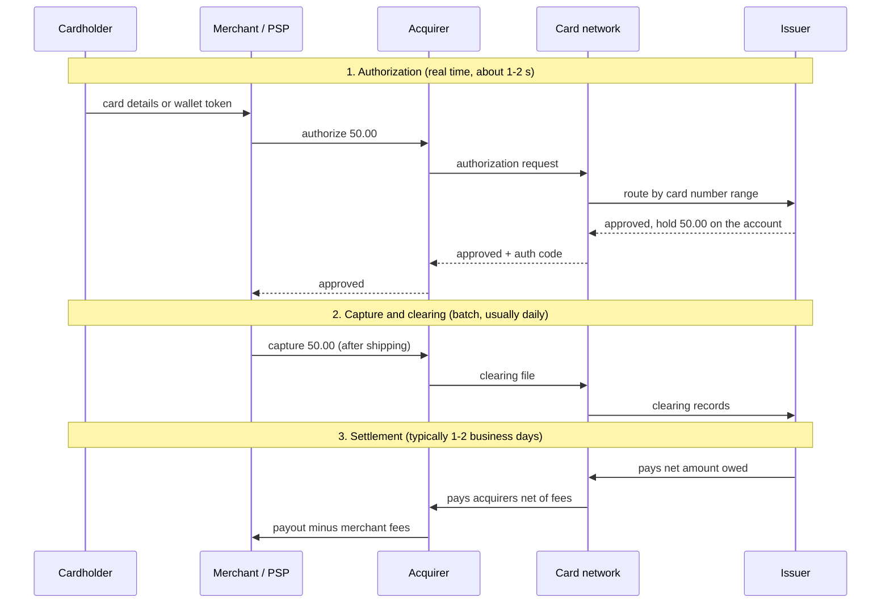
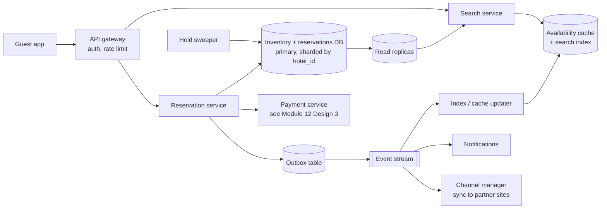
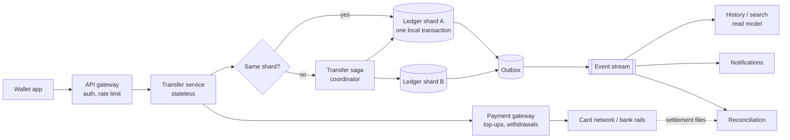
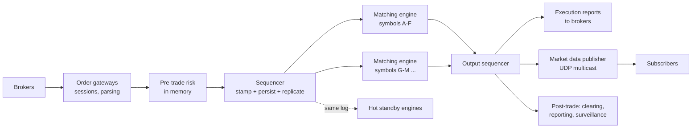
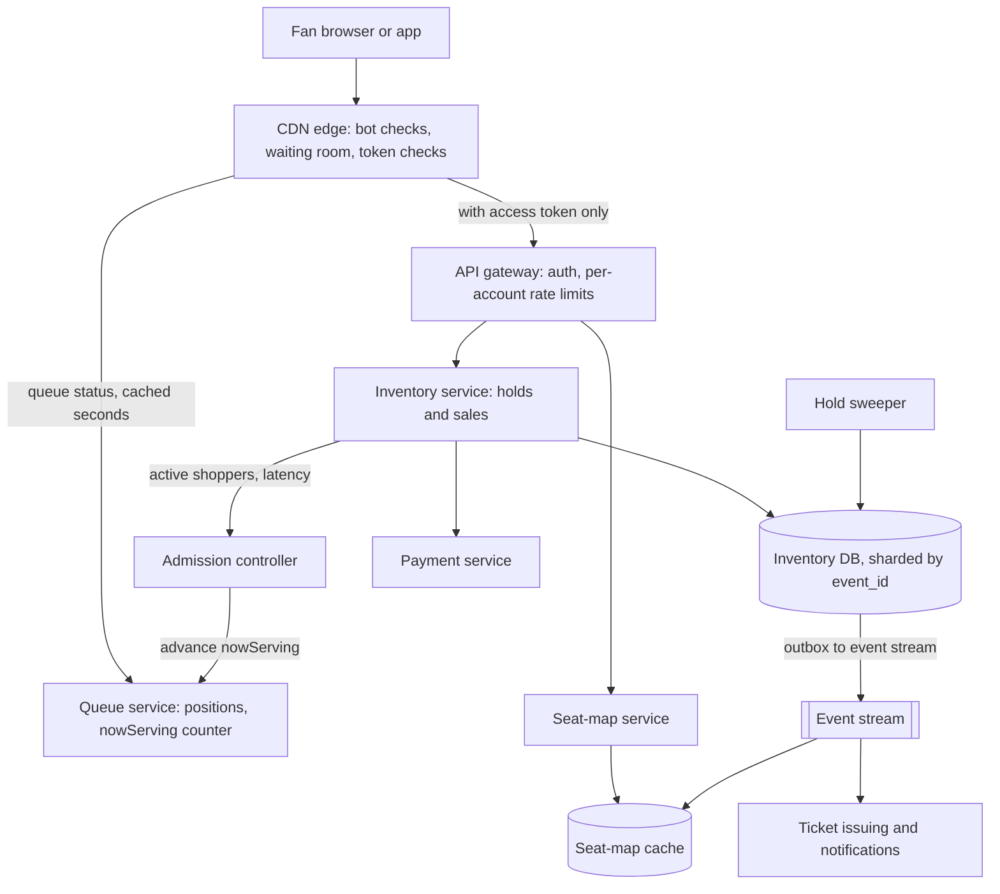
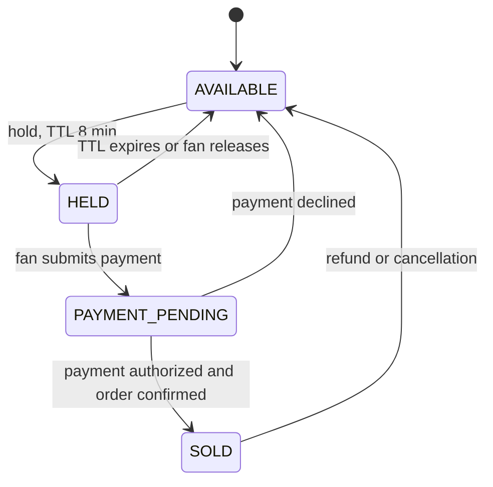

# Module 17 — Case Studies: Money and Reservations

## Module Introduction

**What this module is.** Module 12 showed you how to compose patterns into four big systems. This module adds three more case studies from the same family: systems where **a wrong answer costs real money**. You'll design a hotel reservation system, a digital wallet, a stock exchange and an event-ticketing (flash-sale) system. Before those, a short primer explains how money actually moves between banks, because every one of these systems eventually has to talk to that outside world. (This module is an addition to the course notes. It was written from first principles, the other books in this collection, and primary sources such as central-bank, payment-network and vendor documentation, which each lesson lists at the end. If general system-design terms such as latency, sharding, replication or caching are new to you, read [System Design Fundamentals](../00-system-design-fundamentals/README.md) first.)

**Analogy.** If the earlier modules taught you to cook individual dishes, this module is a shift in a restaurant where every plate is counted. The cooking is the same. What changes is that nothing may be served twice, nothing may go missing, and the manager checks the till against the tickets every night.

**The five lessons**

| Lesson | Centre of gravity (the main problem) | Code you can run |
|---|---|---|
| How Money Moves (primer) | Payment rails (the networks that move money between banks), clearing vs settlement, reconciliation, idempotency across companies | — |
| Design a Hotel Reservation System | The last room: concurrency (many requests at the same moment) on a small, hot counter, plus deliberate overbooking | `code/hotel_inventory.py` |
| Design a Digital Wallet | A double-entry ledger (every movement recorded as a matching debit and credit) at high throughput (operations per second); exactly-once transfers across shards (database pieces on separate servers) | `code/ledger.py` |
| Design a Stock Exchange | A deterministic (same input, same output) single-threaded matching engine behind a sequencer (the component that numbers every order); microsecond (millionth of a second) latency | `code/order_book.py` |
| Design an Event Ticketing and Flash-Sale System | Millions of buyers for a few thousand seats: a virtual waiting room, seat holds that expire, no double-selling, and bot defence | — |

**Where the payment platform went.** Module 12 already has a full [Design 3 — The Payment Platform](../12-capstones/README.md#design-3--the-payment-platform) (payment intents, webhooks, i.e. HTTP calls a provider makes to your server when something happens, ledger, reconciliation). This module does **not** repeat it. The primer below explains the outside world that design plugs into, and the wallet case study picks up where its ledger stops (throughput and cross-shard transfers).

**The case template.** Every case study uses the same stages, which also work as the outline of an interview answer:
1. **Requirements** — functional and non-functional, agreed before drawing anything.
2. **Back-of-envelope numbers** — worked arithmetic that decides what the architecture must handle.
3. **API** and **data model** — the contract and the tables.
4. **The architecture** — a diagram with each pattern named where it appears.
5. **Deep dives** — the two or three genuinely hard parts, at whiteboard depth.
6. **The failure walk** — what breaks, what users see, and the planned response.
7. **Trade-offs**, **follow-up questions**, a **pattern manifest**, a **self-check** and a **TL;DR**.

**Four terms used everywhere in this module**
- **Ledger.** An append-only record of every movement of value. Balances are computed from it, never edited in place.
- **Clearing vs settlement.** *Clearing* is agreeing who owes whom and how much. *Settlement* is the moment the money actually moves and the obligation is discharged. They are often hours or days apart.
- **Idempotency key.** A unique ID the caller attaches to one logical operation and reuses on every retry, so the operation takes effect once no matter how many times it arrives ([Module 5 — Idempotency](../05-reliability/README.md#idempotency)).
- **Reconciliation.** Comparing two independently produced records (your ledger vs a bank statement, your bookings vs a partner's) and investigating every difference.

**Before you start.** You'll get the most out of this module if you have read Module 3's [Event Sourcing](../03-storing-data/README.md#event-sourcing), Module 7's [Saga](../07-consistency/README.md#saga) and the SQL book's [transactions and concurrency chapter](../../../sql/chapters/13-transactions-and-concurrency/README.md). The runnable demos use the shared `.venv-books` interpreter (a Python virtual environment, a private Python with its own libraries): `cd modules/17-case-studies-money-and-reservations/code && ../../../../.venv-books/bin/python ledger.py`.

---

## How Money Moves (primer)

### What it is
A payment looks like one event to a customer ("I paid"), but underneath it is a chain of separate companies, each keeping its own ledger, connected by **payment rails**. A rail is a network plus a rulebook for moving money between institutions: card networks, batch bank transfers (ACH, the US Automated Clearing House), wire systems, and real-time payment systems. Every rail answers the same four questions differently: *how fast* is the confirmation, *when* does money really move, *can it be pulled back*, and *who is liable* (has to pay) when something goes wrong.

**Analogy.** Think of a group of friends who keep an IOU notebook through a weekend trip (clearing) and settle up with actual bank transfers on Monday (settlement). Card networks work like that notebook at planetary scale. A wire is paying cash on the spot.

### The problem it solves
System designers who don't know the rails make three classic mistakes. They treat an **authorization** as money received (it is only a promise, and it can expire). They treat a "success" response as final when the rail allows **returns or chargebacks** (the customer's bank pulling the money back) weeks later. And they assume an outside call happens **exactly once**, when every rail retries, times out and duplicates. Knowing the rails tells you which states your system needs (`authorized`, `captured`, i.e. the merchant confirmed the charge, `settled`, `returned`, `disputed`) and why reconciliation is not optional.

### How it works — card payments (the four-party model)
Five parties take part in a card payment (it is called the *four-party* model because four of them hold accounts, with the network in the middle). The **cardholder** pays. The **merchant** sells. The **acquirer** (the merchant's bank, often reached through a payment service provider, or PSP, such as Stripe or Adyen) collects card payments for the merchant. The **issuer** (the cardholder's bank) gave the card and owns the customer's account. The **card network** (Visa, Mastercard) connects thousands of acquirers to thousands of issuers and sets the rules.



1. **Authorization.** The issuer checks the account, fraud signals and limits, then places a **hold** (the money is reserved, not moved). If the merchant never captures, the hold simply expires after some days.
2. **Capture and clearing.** The merchant confirms the final amount (it may be lower, for example if part of the order was out of stock). Acquirers send captured transactions to the network in batches, and the network works out what each issuer owes each acquirer.
3. **Settlement.** Money moves between the banks, usually as one **net** amount per bank per day rather than one transfer per purchase. The merchant sees a payout later still.
4. **Disputes (chargebacks).** The cardholder can dispute a charge for weeks or months afterwards. The issuer pulls the money back through the network and the merchant must respond with evidence. So a "settled" card payment is still not final in the way a wire is.

**Who earns what.** The merchant pays a **merchant discount rate** (a percentage fee) on each sale. Most of it is **interchange**, which the acquirer passes to the issuer (this funds card rewards and fraud losses). The network charges **scheme fees**, and the acquirer adds its own margin. Regulators cap interchange in some places, for example the EU's Interchange Fee Regulation (0.2% for consumer debit and 0.3% for consumer credit cards) and the US Federal Reserve's Regulation II for debit cards from large banks.

**Tokens instead of card numbers.** Storing raw card numbers drags your whole system into PCI DSS scope (the card industry's security standard; every system "in scope" must pass its audits). Two kinds of token avoid it. A **PSP token** (`pm_...`) is a reference to a card held in the payment provider's vault (its secured store of card data), which is useless to anyone else. A **network token** (the EMVCo payment tokenisation standard) replaces the card number itself. Apple Pay and Google Pay store a device-specific token, and every payment carries a one-time **cryptogram** (a code computed with a secret key for this one payment), so a stolen token can't be replayed (sent again to make another payment).

### How it works — bank transfers
- **ACH (batch, US).** Banks collect payment instructions in files and exchange them a few times a day (in batches) through an operator (the Federal Reserve's FedACH or The Clearing House's EPN), under Nacha's rules. It is cheap and handles payroll, bill pay and "pay by bank". ACH can **push** money (a credit) or **pull** it (a debit, with the customer's authorization). The catch for designers is **returns**: a debit can bounce for insufficient funds a couple of banking days later, and a consumer can dispute an unauthorized debit for up to 60 days. Same Day ACH adds several settlement windows per day but keeps the same return rules.
- **Wires (real-time gross settlement).** In an **RTGS** system (real-time gross settlement: each payment settled on its own, at once) such as the Fed's Fedwire Funds Service (or the UK's CHAPS, the eurozone's T2), each payment settles individually and immediately in central-bank money (balances held at the central bank itself), and it is **final and irrevocable** (cannot be cancelled). Expensive per payment, used for large or urgent amounts. There are no returns to model, but there is also no undo: a mistaken wire must be recovered by asking the receiver to send it back.
- **Real-time payment rails.** Newer systems give instant, 24/7, irrevocable **push** payments for everyday amounts: the UK's Faster Payments (2008), India's UPI (2016), The Clearing House's RTP network (2017), Brazil's Pix (2020) and the Fed's FedNow (2023). UPI and Pix made **QR scan-to-pay** (scanning a square barcode with a phone) mainstream: the QR code carries the payee's address (a UPI ID or a Pix key), the payer's app pushes the money, and the merchant gets a confirmation within seconds. Because payments are push-only and final, fraud moves from "stolen card" to "tricked into sending", and there are no chargebacks to fall back on.
- **Cross-border (SWIFT and correspondent banks).** SWIFT (the global network banks use to send payment instructions) is a **messaging** network, not a settlement system. Banks without a direct relationship move money through **correspondent banks** that hold accounts for each other (a *nostro* is "our account at your bank"). Each hop may take a fee and convert currency, which is why cross-border payments are slow and costly. SWIFT gpi added an end-to-end tracking ID (the UETR), and cross-border payment instructions have moved to the richer ISO 20022 format (an international standard for financial messages) (the MT/ISO 20022 coexistence period ended on 22 November 2025).

### How it works — clearing, settlement and reconciliation
**Net vs gross settlement.** Settling every payment individually (gross) needs a lot of cash on hand but carries no build-up of risk. Settling once a day on the net difference (net) needs far less cash but means banks are exposed to each other until settlement. The classic failure is **settlement risk**: in 1974 the German regulator closed Bankhaus Herstatt after it had received the Deutsche Mark legs of its FX (foreign exchange, i.e. currency) trades but before it paid the dollar legs. The fix, decades later, was CLS, which settles both currencies of an FX trade simultaneously (payment-versus-payment).

**Reconciliation.** Every party in the chain keeps its own ledger, so the only way to prove they agree is to compare them. A payments company typically runs a daily match between (1) its internal ledger, (2) the provider's API responses and webhooks, and (3) the provider's **settlement report** or bank statement. Each mismatch (a payment you recorded but the bank didn't settle, a return you never heard about, a fee that differs) becomes a ticket. Module 12 walks through this [three-way match](../12-capstones/README.md#design-3--the-payment-platform).

**Idempotency across companies.** No rail offers exactly-once delivery. What you can build is an **exactly-once effect**: attach an idempotency key to every outbound instruction (Stripe, Adyen and most PSPs accept one), store the key *in the same database transaction* (a group of writes that all succeed or all fail together) as your own state change, and make every inbound webhook handler dedupe on the provider's event ID. This is the end-to-end argument that the DDIA notes (notes on Kleppmann's book *Designing Data-Intensive Applications*) discuss under [Aiming for Correctness](../../../ddia/chapters/12-future-of-data-systems/README.md#aiming-for-correctness): only the endpoints can guarantee "once", so the operation ID must travel from the user's click all the way to the bank.

**Hotspot accounts.** Some internal accounts are touched by almost every transaction: the merchant's settlement account on a big sale day, your fee revenue account, a bank's clearing account. A single row updated thousands of times a second becomes a lock queue (every writer must wait for the row lock in turn). Common fixes are splitting it into N sub-accounts (write to a random one, sum them to read), batching many credits into one entry, and giving it a dedicated shard (a database server of its own). You'll see this again in the wallet case.

**Order-to-cash, end to end.** For an online shop the money states line up with the business states: *order placed* → card **authorized** → goods shipped → payment **captured** → **settled** to the acquirer → **paid out** to the merchant's bank → **reconciled** against the bank statement → possibly **disputed** later. A good design gives each arrow its own durable state, its own idempotency key, and its own timeout policy.

### Trade-offs

| Rail | Speed to the payee | Finality | Can it be reversed? | Typical use | Design consequence |
|---|---|---|---|---|---|
| Cards | Auth in seconds, funds in 1–2 days | Low: chargebacks for months | Yes, disputes | Consumer purchases | Model auth, capture, settle, dispute as separate states; keep evidence |
| ACH | Hours to 1–2 days | Medium: returns for days (60 for unauthorized consumer debits) | Yes, returns | Payroll, bills, pay-by-bank | Don't release goods on initiation; handle late returns |
| Wires / RTGS | Seconds to minutes | High: irrevocable | Only by asking the payee | Large, urgent amounts | Strong verification before sending; no undo |
| Real-time rails (FedNow, RTP, UPI, Pix, Faster Payments) | Seconds, 24/7 | High: irrevocable | No (push-only) | Everyday P2P (person-to-person) and merchant payments | Fraud checks before sending; instant ledger updates |
| Cross-border (SWIFT correspondents) | Hours to days | Varies by hop | Hard | International, FX | Track with the UETR; fees and FX at each hop |

### When not to use it
You don't need to build on raw rails when a payment service provider already handles them. Most companies should integrate one PSP, keep their own ledger, and reconcile against the PSP's reports. Talking to networks or ACH operators directly only pays off at very large volume or when payments are your product.

### Common mistakes
- Crediting a user's wallet on **authorization** instead of on capture or settlement.
- Treating an ACH debit as final the moment it is sent, then paying out money that bounces two days later.
- Storing card numbers "just for a moment" and pulling every service into PCI scope.
- Using floating-point numbers for money. Use integer minor units (cents) plus a currency code. (Floating-point numbers store decimals approximately, so 0.1 + 0.2 is not exactly 0.3.)
- Retrying an outbound payment with a **new** idempotency key after a timeout, which turns one payment into two.

### Real-world examples
- **Stripe** accepts an optional idempotency key on every `POST` request and keeps it for at least 24 hours, so a retry within that window returns the original result.
- **Airbnb** described the double-payment problem and its fix (an idempotency library around every payment step) on its engineering blog.
- **UPI** processes billions of transactions a month using QR codes and virtual payment addresses; **Pix** did the same in Brazil within a few years of launch.

### In the interview
Use the primer to show you know that "the payment succeeded" means different things on different rails.

**30-second answer:** "An authorization is a promise, not money. Cards clear and settle a day or two later and can be charged back for months; ACH can be returned; wires and real-time rails are final. So I model each payment as a state machine (a fixed set of states with allowed moves between them) with separate authorized, captured, settled and reversed states, send every outbound instruction with an idempotency key stored in the same transaction as my state change, and run a daily reconciliation against the provider's settlement report, because no rail gives exactly-once delivery."

**Likely follow-ups:**
- *"Why can't you just trust the webhook?"* Webhooks are at-least-once (may arrive more than once) and may never arrive. The settlement report is an independent record, so reconciliation catches both duplicates and gaps.
- *"How do real-time rails change fraud?"* There are no chargebacks, so risk checks must happen **before** sending, and scams where the user is tricked into paying become the main threat.

### Self-check
- **Q1: What is the difference between clearing and settlement, and why does the gap matter?** → Clearing agrees who owes what; settlement actually moves the money. Until settlement the parties are exposed to each other, and your system shows money that hasn't arrived yet.
- **Q2: A user tops up a wallet by ACH debit and immediately withdraws to a card. What can go wrong?** → The ACH debit can be returned days later for insufficient funds, leaving you with a loss. Hold the funds until the return window has passed, or limit instant availability by risk score.
- **Q3: Why keep the idempotency key in the same transaction as your ledger write?** → Otherwise a crash between "record key" and "write ledger" (or the reverse) either loses the payment or lets a retry apply it twice.

### TL;DR
- **Problem:** "paid" means different things on different rails; outside systems retry, time out and reverse.
- **Mechanism:** cards authorize in real time but clear and settle in batches and can be charged back; ACH is batch with returns; wires and real-time rails are instant and final; SWIFT is messaging between correspondent banks.
- **Costs:** you must model several money states, idempotency keys end to end, and a daily reconciliation.
- **Remember:** integer cents, tokens not card numbers, never credit on authorization.

**Sources.** Federal Reserve Financial Services pages for FedACH, Fedwire Funds and FedNow; Nacha Operating Rules overview (returns, Same Day ACH); The Clearing House RTP network overview; NPCI UPI product overview; Banco Central do Brasil Pix overview; Regulation (EU) 2015/751 (interchange caps) and the Federal Reserve's Regulation II; EMVCo Payment Tokenisation Specification; PCI Security Standards Council, PCI DSS; SWIFT gpi and ISO 20022 programme pages; BIS CPMI, *Principles for Financial Market Infrastructures* (2012) for settlement terms; Stripe API docs, "Idempotent requests"; Airbnb Engineering, "Avoiding Double Payments in a Distributed Payments System" (2019).

---
## Design a Hotel Reservation System

**The prompt.** "Design the booking system for a hotel chain (or a booking site covering many hotels). Guests search for rooms by city and dates, reserve a room type, pay, and can cancel. Hotels manage their room inventory and prices."

**What makes it hard.** Not the traffic, which is modest. The hard part is a **small, hot counter**: "how many rooms of this type are left on this night". Many people read it, a few people race to decrement it, and it must never go wrong in the direction the business didn't choose. Hotels also *deliberately* sell more rooms than they have (overbooking), so "never oversell" is really "never oversell beyond the limit we picked".

The object-oriented version of this problem (classes for `Room`, `Reservation`, `Guest`) is in the LLD (low-level design) book, [15.4 Design a Hotel Management System](../../../lld/chapters/15-case-booking-1/README.md#154-design-a-hotel-management-system), and the full relational schema is in the SQL book, [17.2 Hotel reservation system](../../../sql/chapters/17-schema-design-case-studies/README.md#172-hotel-reservation-system). This lesson is the distributed-system view.

### 1. Requirements
**Functional**
- Search availability and price by city (or hotel), check-in date, check-out date and number of guests.
- Reserve a **room type** (not a specific room) for a date range; a physical room is assigned at check-in.
- Pay now or pay at the hotel; cancel, with a refund according to the rate's cancellation policy.
- Hotel staff update inventory (rooms per type), prices per night and the overbooking allowance.

**Non-functional**
- **No double booking beyond the chosen overbooking limit**, even when many guests click "book" for the last room at once.
- A retried or double-clicked booking must create **one** reservation.
- Search can be a little stale (seconds); the booking step must be exact.
- High availability (the service is up nearly all the time) for search; booking may briefly refuse rather than risk being wrong (fail closed: when in doubt, say no).

### 2. Back-of-envelope numbers
Assumptions for a large chain or a mid-size booking site (my own round numbers):
- **5,000 hotels × 200 rooms = 1,000,000 rooms.** At 70% occupancy that is 700,000 occupied room-nights per night.
- Average stay **3 nights** → 700,000 / 3 ≈ **233,000 new bookings per day** ≈ 2.7 per second on average. Assume a **10× peak** (a sale, a holiday weekend): **~30 bookings/s**.
- Guests look a lot more than they book. With a **look-to-book ratio of 100:1** (100 searches for every booking), search peaks at **~3,000 queries/s**.
- **Inventory table:** 5,000 hotels × ~20 room types × 365 bookable days ≈ **36.5 million rows**. At ~50 bytes each, about **2 GB**. It fits in memory (RAM) on one database server.
- **Reservations:** 233,000/day × 365 ≈ 85 million a year; at ~1 KB each, ~85 GB/year.

**What the numbers say.** Writes (30/s) are trivial for one relational database (a classic SQL database). Reads (3,000/s) want a cache (a fast copy of hot data) or replicas (read-only copies of the database). So this design is **not** about sharding for throughput. It is about **correctness under concurrency** for a few thousand hot rows (popular hotels on popular nights), plus the product rules around holds, payment and overbooking.

### 3. API
```text
GET    /v1/availability?city=lisbon&checkIn=2026-06-10&checkOut=2026-06-13&guests=2
       -> [{hotelId, roomTypeId, nightlyPrices[], total, currency, roomsLeftHint}]

POST   /v1/reservations              Idempotency-Key: 7c1e...   (generated by the client per "Book" click)
       {hotelId, roomTypeId, checkIn, checkOut, guest{...}, ratePlanId}
       -> 201 {reservationId, status: "HELD", holdExpiresAt, amount}
POST   /v1/reservations/{id}/confirm {paymentMethodToken}   -> {status: "CONFIRMED"}
DELETE /v1/reservations/{id}                                -> {status: "CANCELLED", refund}

PUT    /v1/hotels/{id}/room-types/{rt}/inventory  {from, to, total, overbookPct}   (staff)
PUT    /v1/hotels/{id}/room-types/{rt}/rates      {from, to, price}                (staff)
```
The `roomsLeftHint` in search is explicitly a hint: it comes from a cache and may be seconds old.

### 4. Data model
The SQL book already derives the schema, so here are only the two tables that carry the design:

```sql
-- One row per room type per night: the counter everyone races on.
room_inventory (hotel_id, room_type_id, night,
                total_rooms, reserved, overbook_pct,
                PRIMARY KEY (hotel_id, room_type_id, night))

-- One row per booking; the idempotency key makes a double-click harmless.
reservation    (reservation_id, idempotency_key UNIQUE, hotel_id, room_type_id,
                check_in, check_out, guest_id, status,          -- HELD | CONFIRMED | CANCELLED | EXPIRED
                hold_expires_at, amount_cents, currency, rate_snapshot, version)
```
Two choices matter. First, keeping a **per-night counter** (a deliberate denormalization: storing a value that could be computed, to make reads cheap) turns "is anything free?" into reading 3 rows instead of counting overlapping reservations. Second, **everything for one hotel lives on one database shard** (shard key `hotel_id`), so a booking never needs a distributed transaction (one transaction spanning several servers, which is slow and fragile).

### 5. The architecture



- **Search service** reads from a cache and search index kept fresh from the event stream, falling back to read replicas ([CQRS](../03-storing-data/README.md#cqrs): separate models for writing and for reading). Staleness of a few seconds is accepted.
- **Reservation service** is the only writer of inventory. Every booking runs as one short transaction on the **primary** (the copy that accepts writes) of the hotel's shard ([Sharding](../03-storing-data/README.md#sharding)).
- **Outbox**: the booking transaction also inserts an event row (into an "outbox" table); a relay publishes it to the event stream (a durable log that other services read), so the cache, notifications and partner sync can never miss a booking that committed.
- **Payment service**: the same design as [Module 12's payment platform](../12-capstones/README.md#design-3--the-payment-platform). This system only needs "charge this reservation, with this idempotency key".
- **Channel manager**: many hotels also sell through online travel agencies (OTAs, such as Booking.com or Expedia). The channel manager pushes availability changes to them and receives their bookings, which enter through the same reservation path.
- **Hold sweeper**: releases holds that expired without payment.

### 6. Deep dive 1 — the last room (concurrency)
Twenty guests click "book" on the last three rooms. Each booking touches **every night** of the stay. The naive code reads the counter, checks it in application code, and writes the new value back. That is the **lost update** anomaly from the SQL book ([13.7 Lost updates](../../../sql/chapters/13-transactions-and-concurrency/README.md#137-lost-updates-and-how-to-prevent-them)): two requests read "37 reserved", both write "38", and one booking silently vanishes from the count. The demo reproduces it with 20 threads (parallel paths of execution in one program) on SQLite (a small file-based SQL database):

```output
=== Part 1: 20 guests, 3 rooms left on each of 3 nights ===
naive read-then-write : 20 bookings accepted, reserved per night = [38, 38, 38] (total 40)
conditional UPDATE    :  3 bookings accepted, reserved per night = [40, 40, 40] (total 40)
```
Twenty guests got confirmations for three rooms, and the counter doesn't even show it. Three correct fixes, from simplest to most flexible:

1. **Atomic conditional update (the default).** Let the database do the check and the write in one statement, once per night, inside one transaction:
   ```sql
   UPDATE room_inventory
      SET reserved = reserved + 1
    WHERE hotel_id = :h AND room_type_id = :rt AND night = :night
      AND reserved + 1 <= total_rooms * (1 + overbook_pct / 100.0);
   -- expect 1 row updated per night; if any night returns 0 -> ROLLBACK
   ```
   The row lock taken by the `UPDATE` serializes the racers (makes them go one at a time) on that row, and the `WHERE` clause makes the loser update zero rows. A `CHECK (reserved <= ...)` constraint (a rule the database enforces on every write) adds a second guard.
2. **Pessimistic lock** (lock first, assuming conflicts are likely). `SELECT ... FOR UPDATE` on the night rows, check in code, then update ([13.10 Lock-based concurrency control](../../../sql/chapters/13-transactions-and-concurrency/README.md#1310-lock-based-concurrency-control)). Useful when the check needs logic the `WHERE` clause can't express (loyalty tiers, minimum stays).
3. **Optimistic lock** (don't lock; detect a conflict at write time and retry). Read the row with a `version` column, update `WHERE version = :read_version`, retry on zero rows ([Spring 8.14 — optimistic and pessimistic locking](../../../spring/chapters/08-spring-data-jpa-and-hibernate/README.md#814-locking-optimistic-and-pessimistic)). Good when conflicts are rare; bad for the last room on New Year's Eve, where most attempts would retry.

Three details make or break it:
- **Lock nights in the same order** (ascending date) in every transaction, or two multi-night bookings can deadlock (each waits forever for a lock the other holds) ([13.11 Deadlocks](../../../sql/chapters/13-transactions-and-concurrency/README.md#1311-deadlocks)).
- **Keep the transaction short**: no payment call inside it. The hold (deep dive 3) exists precisely so the lock is held for milliseconds, not for a card authorization.
- In Spring (the Java framework), put the whole multi-night update in one `@Transactional` service method, and remember that the proxy (the wrapper object Spring puts around your class to start and commit transactions) only applies to calls coming from outside the bean (a Spring-managed object) and that checked exceptions (Java errors that must be declared) don't roll back (undo the transaction) by default ([Spring 7.7 How a Spring transaction works](../../../spring/chapters/07-data-access-jdbc-and-transactions/README.md#77-how-a-spring-transaction-works), [7.10 Rollback rules](../../../spring/chapters/07-data-access-jdbc-and-transactions/README.md#710-rollback-rules), [7.13 Transaction pitfalls](../../../spring/chapters/07-data-access-jdbc-and-transactions/README.md#713-transaction-pitfalls)).

**The other double booking** is the same guest twice: a double-click or a mobile retry after a timeout. The `idempotency_key UNIQUE` column handles that. The insert of the reservation row and the inventory updates happen in the **same** transaction, so a retry either finds the existing reservation (and returns it) or runs the whole thing once ([Module 5 — Idempotency](../05-reliability/README.md#idempotency)).

### 7. Deep dive 2 — overbooking on purpose
Some guests with confirmed bookings never show up. If a 200-room hotel sells exactly 200 rooms and 8% don't come, about 16 rooms stay empty every night. So hotels (and airlines) accept a few more bookings than they have rooms. The risk is the opposite: more guests arrive than there are rooms, and the hotel must **walk** a guest (pay for a room elsewhere, transport, compensation).

A simple rule from revenue management (the discipline of pricing and selling limited capacity): keep accepting bookings while the probability of running out stays below *price / (price + walk cost)*. That threshold balances the revenue of one more booking against the expected cost of walking someone. Assuming each guest independently shows up with a fixed probability, the demo computes the limit:

```output
=== Part 2: how far to overbook a 200-room hotel ===
show rate 92%, room $150, walk cost $ 400: threshold 0.273 -> accept up to 215 bookings (+15, 7.5%), expected walked guests 0.69
show rate 92%, room $150, walk cost $1200: threshold 0.111 -> accept up to 212 bookings (+12, 6.0%), expected walked guests 0.16
show rate 97%, room $150, walk cost $ 400: threshold 0.273 -> accept up to 205 bookings (+5, 2.5%), expected walked guests 0.46
```
Read it like this: at a 92% show rate the hotel should accept 15 extra bookings, and on an average night it walks fewer than one guest. If walking is expensive (a flagship hotel in a sold-out city), accept fewer. If almost everyone shows up (non-refundable rates), overbooking barely pays.

**What this means for the system.** Overbooking is a **number per room type and night** (`overbook_pct`), set by a revenue-management job and read by the same conditional `UPDATE`. The booking path doesn't change; only its limit does. The system also needs an **oversold alert** at check-in time and a "walk" workflow, because sometimes the dice roll badly.

### 8. Deep dive 3 — holds, payment, and cancellation (a small saga)
Card authorization takes 1–3 seconds, and 3-D Secure (the extra "confirm in your bank app" step for online card payments) may send the guest to their bank's app for much longer. Holding a row lock that long would stall every other guest. So booking is split into steps, each a short local transaction ([Saga](../07-consistency/README.md#saga): a chain of local steps, each with a compensating undo step):

1. **Hold:** decrement inventory for all nights and insert the reservation as `HELD` with `hold_expires_at = now + 10 minutes`. The room is now reserved for this guest only.
2. **Pay:** call the payment service with the reservation ID as idempotency key. Outside any database transaction.
3. **Confirm:** on success, `UPDATE reservation SET status = 'CONFIRMED' WHERE id = :id AND status = 'HELD'`. The status check makes a duplicate confirm harmless.
4. **Compensate:** on payment failure or when the hold expires, set status `EXPIRED` and give the rooms back (decrement `reserved` for each night) in one transaction.

The **hold sweeper** runs every minute, picking expired holds with `FOR UPDATE SKIP LOCKED` (lock the rows you pick and skip rows someone else has locked) so several sweepers can run without fighting over the same rows ([13.12 Row locks for work queues](../../../sql/chapters/13-transactions-and-concurrency/README.md#1312-row-locks-for-work-queues-for-update-nowait-skip-locked)). A race remains: the payment succeeds at 10:00:01 but the sweeper expired the hold at 10:00:00. The confirm step sees status `EXPIRED`, tries to re-take the inventory, and if the room is gone it **refunds automatically**. Design that path on purpose; don't discover it in production.

**Cancellation** follows the rate's policy: release the nights (one transaction), then refund through the payment service with its own idempotency key (`refund:{reservationId}`).

### 9. Scaling and the failure walk
**Scaling.** Search scales with cache and replicas. If a single hotel's rows ever got hot (a festival weekend), the per-night row is still only a few hundred updates per second at most, well within one database. Sharding by `hotel_id` is for data size and blast radius (how much breaks when one part fails) rather than throughput; a booking never crosses shards because a stay is always in one hotel.

**The failure walk**
1. **Primary database fails over** (a replica is promoted to replace it). Bookings for hotels on that shard fail for tens of seconds and are retried by the client with the **same** idempotency key. Search keeps working from the cache.
2. **Payment times out after the hold.** The reservation stays `HELD`. The payment service is asked for the status using the idempotency key before anything is retried or released.
3. **The outbox relay stops.** Bookings still commit; the cache and partner sites fall behind. Search may show rooms that are gone, and the conditional update refuses them at booking time. Alert on outbox lag (how far the relay is behind).
4. **A partner site sells the last room at the same moment.** Both bookings enter through the same conditional update, so one wins. If partner sync is lagging and they sold offline, the overbooking buffer and the walk workflow absorb it.
5. **Sweeper crashes.** Holds stay `HELD` past expiry and rooms look sold. Because `reserved` still counts them, the booking transaction can first expire any overdue holds for its nights (release them, as the sweeper would) before its conditional `UPDATE`, so a dead sweeper costs tidiness and alerts, not revenue.

### Trade-offs

| Decision | Option A | Option B | Choose |
|---|---|---|---|
| Inventory check | Count overlapping reservations per search | Per-night counter rows | Counter: 3 row reads instead of a range scan (reading many consecutive rows); costs keeping it in sync, done in the same transaction |
| Concurrency control | Optimistic (`version`) | Conditional `UPDATE` / row lock | Conditional update by default; optimistic only for low-contention edits (profile, preferences) |
| Payment timing | Pay inside the booking transaction | Hold → pay → confirm | Hold: locks last milliseconds; costs a sweeper and the late-payment race |
| Book a type or a room | Specific room | Room type, assign at check-in | Type: far simpler inventory; costs a room-assignment step at the front desk |
| Search freshness | Read the primary | Cache + index | Cache: 100× cheaper; costs "room just sold" errors at booking time |
| Overbooking | Never | Per-type limit from no-show data | Limit: in the example, expected empty rooms fall from 16 to about 3 (~6.5% of the hotel); costs occasional walked guests |

### The follow-up questions
- **"Why not a distributed lock (Redis) around the room type?"** The database row lock already gives mutual exclusion (only one holder at a time), *and* it is tied to the transaction that writes the data. A separate lock can expire or be lost while the write is still in progress, and it adds a dependency. *Trap:* adding Redis locks on top of a database that can do the job.
- **"How do you show 'only 2 rooms left' honestly?"** Read it from the cache and label it as approximate; the booking step is where the truth is enforced.
- **"What if one booking spans two hotels?"** It's two reservations in a small saga (hold both, pay once, confirm both, release on failure). Hotels are separate shards and often separate companies.
- **"How would you support 100× more hotels?"** More shards by `hotel_id`, search moved fully to a search index, and the availability cache partitioned by city. The booking path is unchanged.
- **"Where do prices come from?"** A rates table per room type per night, snapshotted into the reservation at booking time so later price changes don't alter what the guest agreed to pay.

### Pattern manifest

| Pattern | Where it served |
|---|---|
| Idempotency | `Idempotency-Key` on booking; payment and refund keys |
| Sharding | `hotel_id`: a stay never crosses shards |
| CQRS + cache | Search reads a derived view; booking hits the primary |
| Outbox / event stream | Cache refresh, notifications, channel manager |
| Saga | Hold → pay → confirm, with release as the compensation |
| Lost-update prevention | Conditional `UPDATE`, row locks, ordered locking |
| Work queue with `SKIP LOCKED` | Hold sweeper |
| Fail closed | Booking refuses when unsure; search may be stale |

### Self-check
- **Q1: Why is the demo's naive version wrong even though every thread checked `reserved < total`?** → The check and the write were separate steps; all 20 read 37 before anyone wrote, then all wrote 38. The check must be part of the write (conditional update) or protected by a lock.
- **Q2: Why lock nights in date order?** → Two multi-night bookings that lock overlapping nights in different orders can each hold one lock and wait for the other: a deadlock.
- **Q3: A guest's payment succeeds one second after the hold expired. What does your system do?** → The confirm finds `EXPIRED`, tries to re-reserve the nights; if they're gone, it refunds automatically and apologizes. This path is designed, not accidental.
- **Q4: When does overbooking stop paying off?** → When no-shows are rare (high show rate) or walking a guest is expensive; the threshold price/(price + walk cost) falls and the limit shrinks toward zero.

### TL;DR
- **Problem:** many readers, a few racing writers on a per-night counter; overselling must stay within a chosen limit.
- **Mechanism:** per-night inventory rows on the hotel's shard; one short transaction per booking with conditional `UPDATE`s in date order; idempotency key on the reservation; hold → pay → confirm saga with a sweeper; search from a cache.
- **Costs:** a denormalized counter to keep in sync, a sweeper and a late-payment path, stale search results.
- **Remember:** the database is the lock; never hold it across a payment call; overbooking is a number, not a bug.

**Sources.** PostgreSQL documentation on explicit locking (`FOR UPDATE`, `SKIP LOCKED`) and exclusion constraints; the SQL and Spring books linked above; K. T. Talluri and G. J. van Ryzin, *The Theory and Practice of Revenue Management* (2004), for overbooking and the critical-ratio rule; Stripe API docs, "Idempotent requests".

---
## Design a Digital Wallet

**The prompt.** "Design a digital wallet: users hold a balance, top up from a card or bank, send money to each other instantly, and withdraw to a bank. It must handle a very high number of transfers per second during peak events."

**What makes it hard.** Module 12's payment platform already has a double-entry ledger at ~2,000 payments/s. A wallet pushes the same idea to **tens of thousands of transfers per second**, where one database can't keep up. Once accounts sit on different shards, a single transfer touches two machines, and "move money exactly once, never create or destroy it" becomes a distributed-systems problem. The object-oriented version is in the LLD book ([21.2 Design a Digital Wallet Service](../../../lld/chapters/21-case-machine-coding/README.md#212-design-a-digital-wallet-service)) and the relational banking schema in the SQL book ([17.3 Banking system](../../../sql/chapters/17-schema-design-case-studies/README.md#173-banking-system)).

### 1. Requirements
**Functional**
- Top up from a card or bank account; withdraw to a bank account.
- Transfer between two wallets in the same currency, instantly.
- Show the balance and a paginated transaction history.

**Non-functional**
- **Money is conserved:** every transfer debits one account and credits another by the same amount; no balance goes below zero.
- **Exactly-once effect:** a retried or duplicated transfer request moves money once.
- **Auditable:** every change is kept forever and can be explained.
- **Throughput:** peak **100,000 transfers/s** (a festival sale, salary day). Latency: p99 under ~300 ms for a transfer (p99 = 99 out of 100 transfers finish faster than this).
- **Availability:** high, but a transfer may be refused rather than risk a wrong balance (fail closed).

### 2. Back-of-envelope numbers
- **Users:** 50 million wallets; 5 million active on a peak day.
- **Peak:** 100,000 transfers/s. Each transfer writes one journal entry, two postings (debit and credit) and one idempotency row, and changes two balances. Call it **~5 row writes per transfer → 500,000 row writes/s**.
- **Per-node capacity:** a well-tuned relational primary with group commit (saving many transactions to disk in one write) might sustain a few thousand such transfer transactions per second. Take **5,000 transfers/s per shard** as a planning figure → **20 shards at peak**; provision 40–64 for headroom and hot accounts.
- **Storage:** average 20,000 transfers/s ≈ **1.7 billion/day**. At ~220 bytes per transfer (entry + two postings + indexes) ≈ **380 GB/day ≈ 140 TB/year**, before replication (extra copies kept for safety). Old journal partitions move to cheaper storage; balances don't need them because of snapshots (saved balances as of a known entry).

**What the numbers say.** We must shard, so most transfers will involve **two shards**. That is the design's centre of gravity.

### 3. API
```text
POST /v1/transfers          Idempotency-Key: 5f0c...   (client-generated, one per "Send" tap)
     {fromWallet, toWallet, amount: {value: 2500, currency: "USD"}, note}
     -> 201 {transferId, status: "COMPLETED" | "PENDING" | "REJECTED", reason?}
GET  /v1/wallets/{id}/balance                 -> {available, pending, currency, asOfEntry}
GET  /v1/wallets/{id}/entries?cursor=...      -> [{entryId, amount, counterparty, time}], nextCursor
POST /v1/topups      Idempotency-Key: ...  {wallet, paymentMethodToken, amount}
POST /v1/withdrawals Idempotency-Key: ...  {wallet, bankAccountToken, amount}
```
Amounts are integers in the currency's smallest unit. History uses [cursor pagination](../08-api-and-edge/README.md#cursor-based-pagination) ("give me the next page after this bookmark") because offsets ("skip the first N rows") over billions of rows are slow.

### 4. Data model
```sql
account        (account_id, owner_id, currency, kind,          -- kind: USER | FEES | BANK_CLEARING | SUSPENSE
                balance, version, snapshot_entry_id)           -- balance = cached projection
journal_entry  (entry_id, idempotency_key UNIQUE, kind, created_at, memo)
posting        (entry_id, account_id, amount)                  -- signed: + debit, - credit; per entry, sum = 0
```
A **journal entry** is one business event ("Alice paid Bob 25.00 with a 0.25 fee"). Its **postings** are the legs, and they always sum to zero. The account's `balance` column is a **projection**: a cache of `sum(postings)` that can be rebuilt ([Event Sourcing](../03-storing-data/README.md#event-sourcing)).

The runnable demo `code/ledger.py` implements exactly this. The fee transfer produces three legs, and twenty user wallets start with $100 each:
```output
=== 1. Top-ups and one transfer with a fee ===
  u0    DEBIT    2525
  u1    CREDIT   2500
  fees  CREDIT     25
  u0 = 7475  u1 = 12500  fees = 25  bank = 200000  trial balance = 0
```
Why is Alice's wallet *debited*? From the wallet company's point of view, a user balance is money **owed** to the user (a liability, something the company owes). Paying out reduces what we owe, which in accounting is a debit. The demo stores signed amounts and flips the sign for display, so balances read naturally. The **trial balance** (sum of all raw balances) is 0 after every entry, which is the whole point of double entry: money can only move.

### 5. The architecture



- **Ledger shards** are partitioned by `account_id` (hash: each account is placed by a scrambled number computed from its ID, which spreads accounts evenly). Each shard owns its accounts' postings and balances; one writer per account at a time.
- **Transfer service** routes: same-shard transfers become one local transaction; cross-shard transfers go through a **saga** (deep dive 1).
- **Outbox → event stream** feeds the history read model ([CQRS](../03-storing-data/README.md#cqrs)), notifications and reconciliation, without dual writes (the app writing to two systems separately, which can leave them disagreeing).
- **Payment gateway** handles top-ups and withdrawals on external rails (see the primer); reconciliation compares our ledger with the rails' settlement files.

### 6. Deep dive 1 — transfers across shards
Alice (shard A) sends Bob (shard B) $25. Four options:

1. **Two-phase commit across shards** ([Two-Phase Commit](../07-consistency/README.md#two-phase-commit)). Correct, but a coordinator crash leaves both shards holding locks on the accounts, and every transfer pays two extra round trips. At 100,000/s the blocking and tail latency (the slowest requests, e.g. the worst 1%) hurt.
2. **Put both accounts on one shard.** Impossible in general: anyone can pay anyone.
3. **Saga through a transit account (the common choice).** Each step is a local, atomic (all-or-nothing), idempotent (safe to repeat) transaction on one shard:
   - *Step 1 (shard A):* debit Alice $25, credit shard A's transit account `TRANSIT_OUT(A→B)` $25, record transfer `T` as `DEBITED`. The balance check happens here, atomically.
   - *Step 2 (shard B):* debit shard B's mirror account `TRANSIT_IN(A→B)` $25, credit Bob $25, keyed by `T` so a repeat is a no-op.
   - *Step 3 (shard A):* mark `T` as `COMPLETED`.
   - *Compensation:* if step 2 can never succeed (Bob's account is closed), post a reversing entry on shard A.

   Money is never created or lost: at every moment it is in Alice's account, in transit, or in Bob's. Each transit account lives on its own shard, so each step stays local; the pair (`TRANSIT_OUT` on A, `TRANSIT_IN` on B) must net to zero once all sagas finish, which is itself a reconciliation check. The cost: for a few milliseconds Alice's money has left and Bob's hasn't arrived, so the API may answer `PENDING`.
4. **Log-first processing.** Write the transfer request to a partitioned, replicated log (an append-only, ordered list of events, split into partitions and copied to several machines) first, keyed by the payer. A processor for the payer's partition checks the balance, then emits "debit Alice" and "credit Bob" events to the two accounts' partitions, each deduplicated by the transfer ID. This is the approach DDIA describes for multi-partition requests without distributed transactions ([Aiming for Correctness](../../../ddia/chapters/12-future-of-data-systems/README.md#aiming-for-correctness)). It is a saga too, just driven by a log.

Module 12 avoided this problem by treating the ledger as **one logical journal**, which is the right call at 2,000/s. At 100,000/s we give that up for sharding, and the saga is the price.

### 7. Deep dive 2 — exactly-once transfers
Exactly-once *delivery* doesn't exist over a network. What we build is an exactly-once **effect**, in three places:

- **Client → service.** The app creates the idempotency key when the user taps "Send" and reuses it on every retry. The ledger stores the key **in the same local transaction** as the entry (`journal_entry.idempotency_key UNIQUE`). A duplicate either sees the existing entry and returns its result, or waits until the first attempt commits.
- **Saga steps.** Each step is keyed by the transfer ID plus the step number, so redelivered commands do nothing.
- **Consumers.** History, notifications and analytics read the event stream at-least-once and dedupe (drop repeats) by `entry_id` ([Exactly-Once Semantics](../10-batch-and-streaming/README.md#exactly-once-semantics)).

The demo sends every one of 16,000 random transfers **twice** from 8 threads and then checks the invariants. (The counts in part 4, and the entry numbers and balances in part 6 below, vary from run to run because thread timing varies; the invariants never do.)
```output
=== 2. The same request delivered twice (client retry) ===
  second call returned entry #21 (same as first: True); u0 still 7475

=== 4. 8 threads x 2,000 random transfers, every one sent twice ===
  journal entries: 13,843   refused (no funds): 2,178
  user money + fees before: 200,000  after: 200,000
  accounts below zero: []   trial balance: 0
```
Here the lock inside `post()` stands in for "one writer per account shard": the balance check and the append happen as one atomic step, so no account goes negative even under concurrency.

### 8. Deep dive 3 — throughput, hot accounts and rebuilding balances
- **Balance checks without read-modify-write races.** Use a conditional update (`UPDATE account SET balance = balance - :x WHERE id = :a AND balance >= :x`) inside the same transaction as the postings, or a single-threaded writer per shard that processes commands in order. Both avoid lost updates; see the SQL book's [13.7](../../../sql/chapters/13-transactions-and-concurrency/README.md#137-lost-updates-and-how-to-prevent-them).
- **Batching.** A single writer can group hundreds of transfers into one database commit (group commit), trading a millisecond of latency for 10–100× throughput. Purpose-built ledger databases such as TigerBeetle (an open-source database made only for debit/credit accounting) are built around this idea.
- **Hot accounts.** A big merchant receiving thousands of payments per second, or the fee account touched by every transfer, turns one row into a queue. Split it into N sub-accounts (credit a random one, sum them to read), or accumulate credits in memory and post one aggregated entry every few hundred milliseconds. Debits from hot accounts (payouts) are rarer and can go through a single sub-account.
- **Rebuilding.** Because the journal is the source of truth, any balance can be recomputed. Snapshots (`snapshot_entry_id`) keep the replay short. The demo checks that the cached balances equal a full replay, and it fixes a mistake with a reversing entry rather than an edit:
```output
=== 5. Rebuild balances from the journal (event sourcing) ===
  projection == replay: True

=== 6. Fix a mistaken transfer with a reversing entry ===
  #13844 u3->u4  ->  #13845 reversal of #13844
  u3 back from 1593 to 2093; both entries stay in the journal (13,845 entries)
```

### 9. The failure walk
1. **Shard B is down during step 2.** Money sits in the transit account; the saga retries step 2 with the same key until B is back. Alice sees "pending"; the transit balance is visible on a dashboard.
2. **The transfer service crashes after step 1.** The saga's own state (transfer `T` = `DEBITED`) is durable on shard A. A recovery job scans for sagas stuck in `DEBITED` and resumes them.
3. **A client retries after a timeout.** The idempotency key returns the original transfer's status; no second debit.
4. **A top-up card payment is later charged back.** Post a reversing entry. If the user has already spent the money, their balance goes negative through a controlled "debt" path and collections (the process of recovering money owed) begin. This is why wallets often limit how fast new top-ups can be withdrawn.
5. **A bug posts wrong fees for an hour.** Journal entries are never edited; the event stream identifies affected transfers; post correcting entries. The audit trail shows the mistake and the fix.
6. **Reconciliation finds our bank clearing account (the internal account mirroring money held at the bank) is $300 off the bank statement.** Match by rail reference IDs; the usual causes are a return we missed or a fee we didn't record. Nothing is "fixed" without an entry that explains it.

### Trade-offs

| Decision | Option A | Option B | Choose |
|---|---|---|---|
| Storage model | Mutable `balance` column only | Journal + postings, balance as projection | Journal: audit, provable conservation, rebuildable; costs more storage and a projection |
| Cross-shard transfer | 2PC (two-phase commit) | Saga via transit account (or log-driven) | Saga: no blocking coordinator; costs a short `PENDING` window and compensation logic |
| Concurrency | Row locks per transaction | Single writer per shard with batching | Row locks to start; single writer when throughput demands it |
| Hot accounts | One row | Sub-accounts or aggregated posting | Sub-accounts: removes the queue; costs a sum on read |
| Duplicate protection | Dedupe cache with TTL | Unique key stored with the entry | Unique key in the same transaction; the cache alone can lose keys |
| Balance reads | Always sum the journal | Cached balance + snapshots | Cached for display; the conditional debit is the real check |

### The follow-up questions
- **"Why not keep everything in one big database?"** At ~2,000/s you should (Module 12). At 100,000/s you can't; sharding forces sagas. Say where the line is.
- **"How is the transit account different from 2PC?"** Nothing is locked across shards; each step commits on its own. The "in between" state is visible money in a real account instead of hidden locks, which operations and reconciliation can see.
- **"Can a user spend money that is in transit to them?"** Not until step 2 commits on their shard. Show it as pending.
- **"Multiple currencies?"** One account per currency. An FX transfer is one entry with four legs: debit USD wallet, credit USD FX-pool, debit EUR FX-pool, credit EUR wallet; each currency's legs sum to zero separately.
- **"How do you prove to an auditor that nothing leaked?"** The trial balance is zero, transit accounts net to zero, the bank clearing account matches the bank statement, and the journal is append-only.

### Pattern manifest

| Pattern | Where it served |
|---|---|
| Event Sourcing | Journal of entries and postings; balances rebuilt by replay |
| CQRS | History and search served from an event-fed read model |
| Sharding | Accounts hashed across ledger shards |
| Saga | Cross-shard transfers via a transit account |
| Two-Phase Commit (avoided) | Blocking and tail latency at 100k/s |
| Idempotency | Client key stored with the entry; saga step keys; consumer dedupe |
| Outbox | Events to history, notifications, reconciliation |
| Exactly-once effect | Idempotent writes + deduplicating consumers |
| Hot-key splitting | Sub-accounts for merchants and the fee account |
| Reconciliation | Transit accounts net to zero; bank clearing vs statements |

### Self-check
- **Q1: In `ledger.py`, why does the transfer with a fee have three legs, and what must they sum to?** → Debit the sender for amount + fee, credit the receiver the amount and the fee account the fee; the legs sum to zero.
- **Q2: The saga debited Alice but the service crashed. Where is the money, and who finishes the job?** → In the transit account on shard A, with transfer state `DEBITED`; a recovery job resumes step 2 using the transfer ID as the key.
- **Q3: Why must the idempotency key be written in the same transaction as the ledger entry?** → Otherwise a crash between the two writes lets a retry apply the transfer again, or loses the record that it happened.
- **Q4: How do you handle a merchant receiving 20,000 payments per second?** → Split its account into sub-accounts or aggregate credits into periodic entries; balance reads sum the parts.

### TL;DR
- **Problem:** conserve money at 100k transfers/s across shards, exactly once, with a full audit trail.
- **Mechanism:** double-entry journal (legs sum to zero) as the source of truth; balances as projections with snapshots; accounts sharded; same-shard transfers are one local transaction, cross-shard ones a saga through a transit account; idempotency keys stored with each entry.
- **Costs:** a brief pending state, compensation logic, reconciliation of transit accounts, more storage.
- **Remember:** exactly-once delivery doesn't exist; exactly-once effect is built from idempotent writes and deduping consumers.

**Sources.** M. Kleppmann, *Designing Data-Intensive Applications* (2017), ch. 12 "Aiming for Correctness" (multi-partition requests, end-to-end request IDs); H. Garcia-Molina and K. Salem, "Sagas" (SIGMOD 1987); P. Helland, "Immutability Changes Everything" (CIDR 2015); M. Fowler, "Event Sourcing" (martinfowler.com, 2005); TigerBeetle documentation (debit/credit data model, batching, pending transfers); Modern Treasury, "Accounting for Developers" series (double-entry for engineers).

---
## Design a Stock Exchange

**The prompt.** "Design the core of a stock exchange: brokers send buy and sell orders, the exchange matches them fairly, reports trades, and publishes market data. Latency matters a lot."

**What makes it hard.** Almost every system in this course scales by adding machines. An exchange's core does the opposite: for each stock, **one** thread on **one** machine decides the order of events, because fairness ("who was first at this price?") needs a single, total order. The design then works hard to make that single thread fast (microseconds), durable (nothing lost on a crash) and replicated (a standby, a spare copy, ready to take over) without ever letting two machines disagree about the order. The broker-side view (accounts, portfolios, stop-loss orders in a brokerage app) is in the LLD book, [Design an Online Stock Brokerage System](../../../lld/chapters/19-case-platforms-2/README.md#design-an-online-stock-brokerage-system).

### 1. Requirements
**Functional**
- Accept **limit orders** (buy/sell up to or at a price), **market orders** (at the best available price now) and **cancels**; optionally time-in-force options (how long an order stays live) such as IOC (immediate-or-cancel).
- Match orders with **price-time priority**: the best price trades first; at the same price, the earliest order trades first.
- Send each broker **execution reports** (acknowledged, filled, partially filled, cancelled, rejected).
- Publish **market data**: every change to the order book (the list of all waiting buy and sell orders for a stock) and every trade, to all subscribers at the same time.
- Pre-trade **risk checks** (a broker's credit limit, a maximum order size, a price band around the last trade).
- Hand trades to **clearing** (working out who owes what to whom) after the fact.

**Non-functional**
- **Fairness and determinism:** the same inputs in the same order always produce the same trades.
- **Latency:** tens of microseconds inside the exchange from order in to acknowledgment out; predictable, not just fast on average.
- **Durability:** an acknowledged order is never lost.
- **Availability** during trading hours, with failover (switching to the standby) in seconds or less and no divergence (the copies never disagree).

### 2. Back-of-envelope numbers
My own round numbers for a mid-size equities exchange:
- **8,000 listed symbols** (a symbol is a stock's ticker, such as AAPL), but trading is very skewed: the top 100 symbols carry most of the messages.
- **500 million order messages per day** (new, cancel, modify) over a 6.5-hour session (23,400 s) → **~21,000 messages/s on average**. The open and close are far busier; plan for **~500,000 messages/s** at peak across the exchange and **~50,000/s** for the single busiest symbol.
- **A single-threaded matching engine** written in C++ or Java with preallocated memory (all memory reserved at start-up, so nothing is allocated while trading) processes millions of simple operations per second; LMAX (a London trading venue known for its low-latency design) reported about 6 million orders per second on one thread. Even the pure-Python toy in this lesson matches close to a million simple orders per second on a laptop (see below). So **one thread per symbol is plenty**; we partition symbols across engines for isolation, not raw speed.
- **Market data out:** every order event changes the book; say 1 million updates/s × ~40 bytes ≈ 40 MB/s ≈ 320 Mbit/s. Fine on 10 GbE (10-gigabit Ethernet), but too much to send separately to each of thousands of subscribers over TCP (the reliable, one-to-one internet protocol), which is why exchanges use **UDP multicast** (UDP is a lighter protocol without delivery guarantees; multicast lets one packet be delivered to many receivers at once).
- **Event log:** ~2 billion input + output events/day × ~64 bytes ≈ **130 GB/day**.

**Latency budget (illustrative, inside the exchange):**

| Step | Budget |
|---|---|
| Order gateway: parse, session checks | ~5 µs |
| Pre-trade risk check (in memory) | ~2 µs |
| Sequencer: stamp, persist, replicate to standby | ~5–10 µs |
| Matching | ~1 µs |
| Publish execution report and market data | ~5 µs |
| **Total** | **~20 µs** |

**What the numbers say.** Throughput is not the problem; one thread handles a symbol easily. The problems are **ordering** (one sequence for everyone), **durability without slowing the critical path** (the steps every order must pass through), and **tail latency** (avoiding pauses).

### 3. API
Brokers don't use REST (ordinary HTTP-style APIs) here. They use long-lived sessions with binary or FIX messages (FIX, the Financial Information eXchange protocol, is the trading industry's standard message format):
```text
Order entry (FIX 4.4 style, or a binary protocol such as Nasdaq's OUCH):
  NewOrderSingle   (35=D)  clOrdId, symbol, side, orderType, price, qty, timeInForce
  OrderCancelRequest (35=F) origClOrdId
  ExecutionReport  (35=8)  <- ack / partial fill / fill / cancelled / rejected, with exchange order id

Market data (a binary multicast feed such as Nasdaq's ITCH):
  AddOrder, OrderExecuted, OrderCancel, Trade  — each with a gap-free sequence number
  plus a TCP "retransmit" service and periodic book snapshots for late joiners
```
Every message carries a sequence number so both sides can detect gaps and ask for a replay.

### 4. Data model
The live state lives **in memory**; the database is the log.
```text
Order        {orderId, clOrdId, brokerId, symbol, side, type, priceTicks, qty, remaining, tif, seq}
Price level  {priceTicks, FIFO queue of orders, totalQty}
Order book   {bids: price levels sorted high->low, asks: price levels sorted low->high,
              index orderId -> order (for O(1) cancel)}
Input log    [seq, command]            -- the sequencer's output, the source of truth
Output log   [seq, event]              -- acks, fills, cancels: feeds brokers, market data, clearing
```
Prices are integer **ticks** (for example cents), never floating-point numbers. Real engines keep each price level's orders in a doubly linked list (each item points to both its neighbours) so a cancel from the middle is O(1) (constant time, however big the list), and keep the price levels in an array indexed by tick (prices move in a narrow band) or in a sorted tree.

### 5. The architecture



- **Gateways** terminate broker sessions and translate FIX/binary into internal commands. Scaled horizontally (more machines added side by side); stateless apart from session sequence numbers.
- **Pre-trade risk** keeps each broker's exposure in memory and rejects orders that break limits (credit, fat-finger size, i.e. an obviously mistyped huge quantity, price far from the market).
- **Sequencer** gives every command a gap-free sequence number, writes it to a durable log and replicates it to the standby **before** the engine acts on it. This is the exchange's [write-ahead log](../03-storing-data/README.md#write-ahead-log) (a log written to disk before acting, so nothing acknowledged can be lost).
- **Matching engines**: one thread per partition of symbols, fed only by the sequenced log. Pure, deterministic functions of their input.
- **Output side**: execution reports go back to brokers; market data goes out by multicast; post-trade systems (clearing, regulatory reporting, surveillance, i.e. watching for market abuse) consume the output log asynchronously (in the background), far from the hot path. In the US, trades then settle through the clearing house on **T+1** (one business day after the trade, since May 2024).

### 6. Deep dive 1 — the order book and matching
A buy order that is priced at or above the best ask **crosses** the book and trades; otherwise it **rests** in the book. The runnable demo `code/order_book.py` builds a small book, then sends an aggressive buy:
```output
=== 1. Build a small book (prices in cents) ===
asks: [(10050, 150), (10100, 200)]
bids: [(10000, 300), (9950, 100)]

=== 2. Aggressive buy 180 @ 101.00 walks the ask side ===
  ('ACK', 6)
  ('FILL', 6, 1, 10050, 100)
  ('FILL', 6, 2, 10050, 50)
  ('FILL', 6, 3, 10100, 30)
asks: [(10100, 170)]
```
Price-time priority in action: the buyer first takes the two orders at $100.50 in arrival order (order 1 was there before order 2), then 30 shares at $101.00. Each trade happens at the **resting** order's price, so the buyer who was willing to pay $101.00 still got most shares at $100.50. A market order simply has no price limit; anything left over is not allowed to rest:
```output
=== 3. Cancel, then a market sell ===
  ('ACK', 7)
  ('FILL', 7, 4, 10000, 300)
  ('EXPIRED', 7, 100)
```
**Stop orders** ("sell if the price falls to $95") are not in the book at all. They wait in a separate trigger list (at the broker or the exchange) and enter the book as market or limit orders when a trade prints at or through the stop price. That is why they can fill far below the stop in a fast fall.

The demo keeps each side as a heap (a structure that always returns the best item quickly) of prices plus a FIFO (first in, first out) queue per price, and removes cancelled orders lazily. Production engines use preallocated arrays and intrusive linked lists (the list pointers live inside the order objects themselves) so that nothing is allocated while trading.

### 7. Deep dive 2 — the sequencer, determinism and failover
Why one thread? Matching is a sequence of tiny operations on shared state (the book). With locks, several threads would spend more time coordinating than matching, and the order in which they got the lock would decide who traded first, which is unfair and unrepeatable. A single thread processing a totally ordered log is both **faster** and **fair**. The DDIA notes discuss the same idea as [actual serial execution](../../../ddia/chapters/07-transactions/README.md#actual-serial-execution), and the ordered log is [total order broadcast](../../../ddia/chapters/09-consistency-and-consensus/README.md#ordering-guarantees) (every node receives the same messages in the same order).

Because the engine is a deterministic function of the log, **replication is just replay**. The standby consumes the same sequenced log and ends up with the identical book. The demo proves it on 20,000 random commands:
```output
=== 4. Determinism: replay the sequencer's log into a fresh engine ===
commands in log : 20008
primary digest  : 6a8d42b7fe259c65
replica digest  : 6a8d42b7fe259c65
```
The rules that keep this true:
- **Nothing non-deterministic inside the engine:** no reading the clock (the sequencer stamps the time into the command), no random numbers, no iteration over unordered hash maps (whose visiting order can differ between runs), no floating point.
- **Gap detection:** the engine refuses a command whose sequence number isn't exactly the next one (the demo asserts this) and stops rather than guess.
- **Persist before acting:** the sequencer writes and replicates each command before the engine processes it. On a crash, the standby has every acknowledged order.
- **Failover:** the standby is promoted by a coordinator that uses consensus (a protocol, for example Raft, that lets machines agree even when some fail) to guarantee only one primary; the old primary is fenced (blocked from writing). Snapshots of the book plus the log tail make restarts fast. This is [event sourcing](../03-storing-data/README.md#event-sourcing) in its purest form, and it is how the LMAX architecture works.

### 8. Deep dive 3 — low latency and fairness
- **Fewer hops.** Keep gateway → risk → sequencer → engine on the same machine or the same rack; each network hop costs microseconds.
- **No pauses.** Preallocate objects and reuse them (no garbage-collection pauses in Java; the garbage collector is the runtime component that frees unused memory and can briefly stop the program), pin the engine thread to a CPU core, busy-spin (loop checking for work) instead of sleeping, and pass messages through lock-free ring buffers (fixed-size circular queues that threads share without locks; the LMAX Disruptor).
- **Kernel bypass.** Network cards and libraries that deliver packets straight to user space (the application's own memory) skip the operating system's network stack (the kernel code that normally handles every packet).
- **Mechanical sympathy.** Data laid out for the CPU cache (the processor's small, very fast memory; arrays of prices, not pointer-heavy trees) matters more than big-O (how work grows with input size) at this scale.
- **Multicast market data.** One packet reaches every subscriber at once, which is both efficient and fair. Lost packets are detected by sequence gaps and recovered through a retransmit service or a snapshot.
- **Co-location fairness.** Exchanges rent rack space (room for a trader's servers) next to the engine and give every co-located client the same cable length, so nobody gains nanoseconds from being closer.
- **Measure the tail.** Report p99 and p99.9 latency, not averages; a single pause at the open is what brokers notice.

For scale, the pure-Python toy on a laptop:
```output
=== 5. Rough single-thread throughput (this laptop, pure Python) ===
200,000 orders, 141,660 fills in 0.25s  (~805,660 orders/s)
```
The timing line changes on every run and machine (the order and fill counts do not), and it skips the parts that cost real engines time (persistence, replication, networking). The point is only that matching itself is cheap; the design effort goes into everything around it.

### 9. The failure walk
1. **The primary matching engine dies.** The standby has applied the same log; the coordinator promotes it and fences the old one. Brokers reconnect and ask for any execution reports they missed by sequence number.
2. **The sequencer's log write is slow.** Everything behind it waits: that is by design, because acting before persisting could lose acknowledged orders. Alert on sequencer latency; it is the heartbeat of the exchange.
3. **A subscriber misses market-data packets.** It sees a sequence gap, asks the retransmit service for the missing range, or rebuilds from a snapshot.
4. **A broker's algorithm (automated trading program) goes haywire.** Pre-trade risk rejects orders past its limits; a **kill switch** cancels all of that broker's orders. Price bands reject orders far from the last trade.
5. **The whole market drops sharply.** Market-wide **circuit breakers** halt trading (in the US at 7%, 13% and 20% falls in the S&P 500, the index of 500 large US companies), and single-stock "limit up–limit down" bands pause individual stocks. The engine enforces these as rules in its deterministic logic.
6. **A gateway crashes.** Its sessions reconnect to another gateway; FIX session sequence numbers let both sides resend what was lost. Open orders stay in the book unless the broker asked for cancel-on-disconnect.

### Trade-offs

| Decision | Option A | Option B | Choose |
|---|---|---|---|
| Concurrency in the engine | Multi-threaded with locks | Single thread per symbol partition | Single thread: fair, deterministic, faster; costs careful partitioning and no cross-symbol atomic trades |
| Durability | Write to a database per order | Sequenced append-only log + replay | Log: microseconds, and replay gives replication for free; costs snapshots and log management |
| Replication | Replicate the book state | Replicate the input log, replay deterministically | Input log: tiny messages, identical results; costs strict determinism rules |
| Market data | TCP per subscriber | UDP multicast + retransmit | Multicast: one send, fair arrival; costs gap handling at the receiver |
| Language/runtime | Any, with a GC (garbage collector) | C++/Rust, or Java without allocation on the hot path | Either works if nothing allocates while trading |
| Risk checks | After matching | Before sequencing, in memory | Before: stops bad orders reaching the book; costs a few microseconds per order |

### The follow-up questions
- **"Why not scale the matching engine horizontally for one hot symbol?"** Price-time priority needs one total order per book. You scale by putting different symbols on different engines; one symbol's load fits a single thread easily.
- **"What happens to orders in flight during failover?"** Anything the sequencer acknowledged is in the replicated log and will be processed by the new primary; anything not acknowledged the broker must resend, and its `clOrdId` lets the exchange reject a duplicate.
- **"How do you handle a trade across two symbols (a spread)?"** Either route both legs to the same engine partition, or run a dedicated engine for the spread product that places linked orders. There's no cross-engine transaction on the hot path.
- **"Where does the database fit?"** Off the critical path: post-trade reporting, clearing files, surveillance and history consume the output log asynchronously.
- **"How is this different from a brokerage app?"** A brokerage holds customer accounts and routes orders to exchanges; the exchange only matches. Stop-loss and portfolio logic often live at the broker (see the LLD case).

### Pattern manifest

| Pattern | Where it served |
|---|---|
| Write-Ahead Log | The sequencer persists and replicates every command before matching |
| Event Sourcing | Book state is a replay of the input log; snapshots for fast restart |
| Actual serial execution | One thread per symbol partition; no locks |
| Total order broadcast | A single gap-free sequence shared by primary and standby |
| Sharding (by symbol) | Partitions of symbols across engines |
| Consensus + fencing | Choosing exactly one primary on failover |
| Pub/Sub (multicast) | Market data fan-out with sequence numbers and retransmit |
| Idempotency | Broker `clOrdId` and FIX sequence numbers on resend |
| Rate limiting / risk limits | Per-broker throttles, kill switch, price bands |
| Circuit breaker (market rule) | Trading halts on large moves |

### Self-check
- **Q1: In the demo, why did order 1 fill before order 2 even though they had the same price?** → Price-time priority: at the same price, the earlier order (lower sequence number) trades first.
- **Q2: Why may the engine not read the system clock?** → A standby replaying the log would read a different time and could make different decisions; time must come stamped in the command from the sequencer.
- **Q3: A market-data subscriber sees sequence 1001 after 998. What does it do?** → Stop applying updates, request 999–1000 from the retransmit service (or reload a snapshot), then continue.
- **Q4: What does "acknowledged" mean for durability here?** → The sequencer has persisted and replicated the command, so failover cannot lose it.

### TL;DR
- **Problem:** fair, deterministic matching at microsecond latency, without losing acknowledged orders.
- **Mechanism:** gateways → in-memory risk → sequencer (stamp, persist, replicate) → one single-threaded matching engine per symbol partition → output log to brokers, multicast market data and post-trade; standby replays the same log.
- **Costs:** strict determinism rules, careful partitioning, specialised low-latency engineering.
- **Remember:** one order per book, log before act, replicate the input not the state, integer ticks.

**Sources.** M. Fowler, "The LMAX Architecture" (martinfowler.com, 2011) and the LMAX Disruptor technical paper; Nasdaq TotalView-ITCH 5.0 and OUCH 5.0 specifications; FIX Trading Community, FIX 4.4 specification (NewOrderSingle, ExecutionReport); D. Ongaro and J. Ousterhout, "In Search of an Understandable Consensus Algorithm (Raft)" (USENIX ATC 2014); SEC, T+1 settlement cycle rule (effective 28 May 2024); SEC investor bulletin on market-wide circuit breakers and the Limit Up–Limit Down plan; M. Kleppmann, *Designing Data-Intensive Applications*, ch. 7 and 9.

---

## Design an Event Ticketing and Flash-Sale System (Ticketmaster-like)

**The prompt.** "Design a ticketing platform for concerts and sports. Fans browse events, pick seats on a seat map (or buy general-admission tickets), pay, and receive a mobile ticket. Some on-sales are huge: a stadium tour goes on sale at 10:00 and millions of people arrive at once."

**What makes it hard.** On a normal day this is the hotel problem again: a small inventory, a few racing writers, hold → pay → confirm. A **flash sale** (a sale where demand arrives all at once and far exceeds supply) changes three things. First, traffic is not 10× normal but thousands of times normal, all in the first minute, and most of it can never be served because the tickets run out. Second, the inventory is tiny and **hot**: everyone wants the same front-section seats at the same second. Third, a large share of the "demand" is **bots** (automated scripts that buy tickets to resell them at a markup). For Taylor Swift's Eras Tour presale in November 2022, Ticketmaster reported 3.5 billion total system requests, four times its previous peak, driven partly by bot attacks and by fans without presale codes. So the design has to decide **who gets to try**, keep a seat sold at most once while thousands click it, and do both fairly.

The object-oriented version (classes for `Show`, `Seat`, `Booking`) is in the LLD book, [15.2 Design a Movie Ticket Booking System](../../../lld/chapters/15-case-booking-1/README.md#152-design-a-movie-ticket-booking-system-bookmyshow). This lesson is the distributed-system view, at flash-sale scale.

### 1. Requirements
**Functional**
- Browse events and view a seat map with live availability for **reserved seating** (each ticket is a specific seat) and **general admission** (GA: a count of interchangeable tickets, such as a standing floor).
- Select seats (or let the system pick "best available"), place them on a **hold** for a few minutes, pay, and receive tickets.
- Per-event **purchase limits** (for example, at most 4 tickets per account).
- High-demand on-sales go through a **virtual waiting room** (an online queue in front of the store that admits people at a controlled rate).
- Organisers configure events, price levels, holds for promoters, and the on-sale time.

**Non-functional**
- **Never sell a seat twice.** A double-sold seat means two people at the gate with valid-looking tickets.
- **Fairness people can see:** no queue jumping, a believable position and wait estimate, and bots kept to a minimum.
- **Survive the spike.** The store must stay responsive for admitted fans while millions wait. Rejecting or queueing people is acceptable. Falling over is not.
- A retried or double-clicked purchase creates one order and one charge.
- Seat maps can be a few seconds stale. The hold step must be exact.

### 2. Back-of-envelope numbers
My own round numbers for one big on-sale:
- **Supply:** 10 stadium shows × 60,000 seats = **600,000 tickets**. At an average of 3 tickets per order that is **200,000 orders**.
- **Demand:** **3 million** people present at 10:00 (comparable to the 3.5 million who registered for the Eras Tour presale). Without a queue, each browser refreshing every 2 seconds is 3M ÷ 2 = **1.5 million requests/s**, before counting bots.
- **What the store can actually serve:** suppose a fan needs about **5 minutes** from admission to paid order (choose seats, log in, pay). Capping the store at **50,000 concurrent shoppers** gives an admission rate of 50,000 ÷ 300 s ≈ **170 people/s ≈ 10,000/minute**.
- **How long the sale lasts:** if 80% of admitted fans buy, 200,000 orders need 250,000 admissions. 250,000 ÷ 170/s ≈ **1,500 s ≈ 25 minutes**. Admitting all 3 million at that rate would take 3,000,000 ÷ 170 ≈ 17,600 s, almost **5 hours**. So most of the queue will never reach the store, and the design must tell them so early.
- **Inventory writes:** 170 admissions/s × ~3 hold attempts each (some fail because someone else got the seat first) ≈ **500 hold attempts/s**, all against one event's rows.
- **Seat-map reads:** 50,000 shoppers refreshing every 5 s ≈ **10,000 reads/s**, all for the same few maps.
- **Data size:** 600,000 seat rows × ~100 bytes ≈ **60 MB**. It fits in memory many times over.

**What the numbers say.** Storage and write throughput are small; one database shard handles 500 conditional updates per second. The two real problems are the **3,000:1 gap** between people present and people the store can serve at once, which the waiting room absorbs at the edge, and the **contention** on a few thousand popular seats, which the hold design handles. This is not a "shard everything" problem.

### 3. API
```text
# Waiting room (served at the edge / CDN)
POST /v1/queue/{eventId}/join                -> {queueToken, position, estWaitSec}
GET  /v1/queue/{eventId}/status              (queueToken cookie) -> {position, nowServing, estWaitSec, likelySoldOut}
POST /v1/queue/{eventId}/admit               (queueToken) -> {accessToken, expiresAt}   only when position <= nowServing

# Store (every call needs a valid accessToken for this event)
GET  /v1/events/{eventId}/seatmap            -> {sections:[{id, priceLevel, available:[seatIds] or count}], version}
POST /v1/holds    Idempotency-Key: 4b2e...
     {eventId, seats:[...]} or {eventId, section, quantity, bestAvailable:true}
     -> 201 {holdId, seats, expiresAt, amount}
POST /v1/orders   Idempotency-Key: 9d1a...  {holdId, paymentMethodToken} -> 202 {orderId, status:"PAYMENT_PENDING"}
GET  /v1/orders/{orderId}                    -> {status: PAYMENT_PENDING | CONFIRMED | FAILED, tickets[]}
DELETE /v1/holds/{holdId}                    -> 204 (fan gives the seats back)
```
Two tokens do different jobs. The **queue token** records a place in line. The **access token** is short-lived permission to use the store for this event, bound to one account. The store never sees anyone who doesn't hold an access token.

### 4. Data model
```sql
-- One row per sellable seat per event: the rows everyone races on.
seat        (event_id, seat_id, section, row_label, seat_no, price_level,
             status,                 -- AVAILABLE | HELD | PAYMENT_PENDING | SOLD | BLOCKED
             hold_id, hold_expires_at, order_id, version,
             PRIMARY KEY (event_id, seat_id))

-- General admission: a counter per section, split into buckets (deep dive 2).
ga_bucket   (event_id, section, bucket_no, remaining,
             PRIMARY KEY (event_id, section, bucket_no))

hold        (hold_id, event_id, account_id, seat_ids[], quantity, expires_at, status)
orders      (order_id, idempotency_key UNIQUE, hold_id UNIQUE, account_id, event_id,
             amount_cents, currency, status, payment_ref, created_at)
purchase_count (event_id, account_id, tickets, PRIMARY KEY (event_id, account_id))
```
Three choices matter. **Everything for one event lives on one shard** (shard key `event_id`), so a hold never needs a distributed transaction. **Status lives on the seat row itself**, so "is it free?" and "take it" are one conditional statement. And `purchase_count` turns the per-account limit into a row the purchase transaction can check and update in the same transaction.

### 5. The architecture



1. **Edge (CDN).** All traffic lands on the CDN (content delivery network, see [CDN](../08-api-and-edge/README.md#cdn)). Bot screening runs there (deep dive 3), and so does the waiting room's hot path: issuing and checking signed tokens without a call to the origin (the company's own servers behind the CDN).
2. **Queue service** assigns positions and holds one number that matters to everyone: **nowServing**, the highest position currently allowed in. Because that is a single value, the status endpoint can be cached at the edge for a few seconds, so 3 million pollers become a few requests per second to the origin.
3. **Admission controller** advances `nowServing` according to how busy the store is: active shoppers, checkout latency and the hold failure rate. It is a feedback loop, not a fixed rate (deep dive 1).
4. **API gateway** accepts only valid access tokens and applies per-account [Rate Limiting](../08-api-and-edge/README.md#rate-limiting).
5. **Seat-map service** serves maps from a cache that the event stream refreshes. Maps are a read model ([CQRS](../03-storing-data/README.md#cqrs)): approximate and cheap.
6. **Inventory service** is the only writer of seat state. Holds and sales are short transactions on the event's shard ([Sharding](../03-storing-data/README.md#sharding)).
7. **Payment service** is the platform from [Module 12 Design 3](../12-capstones/README.md#design-3--the-payment-platform), called with the order ID as the idempotency key.
8. **Outbox → event stream.** Each state change also writes an outbox row (an "event to publish" record in the same transaction), which a relay publishes. The cache, ticket issuing and notifications can't miss a sale that committed.
9. **Hold sweeper** returns expired holds to the pool.

### 6. Deep dive 1 — the virtual waiting room
The waiting room turns an unmanageable spike into a steady flow the store can serve. It has four parts.

**1. Pre-queue and the start.** People who arrive before 10:00 wait in a **pre-queue** with a countdown. At 10:00 everyone in the pre-queue gets a **random** position, and later arrivals join the back in arrival order. Queue-it, a waiting-room vendor, documents this model, and Cloudflare's Waiting Room offers random admission as an option. The randomisation matters: in a pure first-come queue, whoever's request lands first at 10:00:00.000 wins, which rewards bots and fast connections and pushes everyone to arrive earlier and earlier. Randomising the people who were on time removes the reason to race.

**2. Signed tokens, so the edge can check them.** A queue token is a small record `{eventId, position, accountId, deviceId, issuedAt}` signed with an **HMAC** (a hash of the content plus a secret key, which proves the server issued it and nobody edited it). Any edge node can verify it without a database lookup. Changing the position breaks the signature. Binding it to the account and device stops one token from being shared across a bot farm.

**3. The serving counter and the feedback loop.** Admission is `position ≤ nowServing`. Every few seconds the admission controller measures how many shoppers are active, the p99 (99th-percentile) latency of hold and checkout, and how often holds fail. It then raises `nowServing` by roughly *capacity left × expected conversion*. If latency climbs, it slows down. This is the same idea as [Backpressure](../10-batch-and-streaming/README.md#backpressure): the slowest stage sets the pace for everything in front of it. With the numbers above it admits about 10,000 people per minute.

**4. Honest waiting.** The wait estimate is *positions ahead ÷ recent admission rate* (Cloudflare documents the same formula). Status polls arrive every 20–30 seconds with jitter (a random spread, so pollers don't arrive in lockstep). The response also includes `likelySoldOut`: when the remaining inventory divided by tickets per order is smaller than the number of people ahead, the page says so. In the example, someone at position 2,000,000 should learn within minutes, not after 5 hours. On admission, the queue token is exchanged once for an **access token** that lasts, say, 15 minutes and works only for that account and event.

**Why at the edge.** The waiting room absorbs millions of requests per second only if almost none of them reach the origin. Static waiting page from the CDN, token checks at the edge, and one cached `nowServing` number: the origin sees joins, admissions and real shoppers.

### 7. Deep dive 2 — seat holds with a TTL, inventory consistency, and payment timeouts
**Holding seats exactly once.** A hold is one conditional update across all the requested seats, inside one transaction:
```sql
UPDATE seat
   SET status = 'HELD', hold_id = :h, hold_expires_at = now() + interval '8 minutes',
       version = version + 1
 WHERE event_id = :e AND seat_id = ANY(:seats)
   AND (status = 'AVAILABLE' OR (status = 'HELD' AND hold_expires_at < now()));
-- expect rowcount = number of seats requested; otherwise ROLLBACK and tell the fan which seats went
```
All-or-nothing matters: a family of four does not want three seats together and one in another section. The second branch of the `WHERE` treats an **expired** hold as free, so a stuck sweeper never strands inventory. As in the hotel case, lock rows in a fixed order (by `seat_id`) to avoid deadlocks. The database row lock is the mutex (only one writer at a time). A separate Redis lock would add a second thing that can disagree with the data.

**Taking contention off the hottest rows.** If everyone clicks seat A1 of row 1, a few hundred requests fight over one row and all but one fail. Two fixes help:
- **Best available.** Let the server pick the seats ("2 tickets, section 101, best available"). It can hand out *different* adjacent blocks to concurrent requests, so most attempts succeed on the first try.
- **Bucketed GA counters.** A general-admission section of 20,000 is one counter that every buyer decrements: a hot row. Split it into, say, 10 bucket rows of 2,000 each. A purchase picks a random bucket and runs `UPDATE ga_bucket SET remaining = remaining - :q WHERE ... AND remaining >= :q`, trying another bucket if this one is short. Ten rows mean ten times less lock contention. The cost is that a section looks sold out only when every bucket is empty, so the last few tickets need a sweep across all buckets.

For a truly extreme event, a further step is a single-threaded **inventory owner** per event in memory, fed by a log (the stock-exchange pattern from earlier in this module). At 500 holds/s a database shard is enough, so it is a follow-up, not the default.

**Hold → pay → confirm, and the payment timeout.** Seat states form a small state machine:



1. **Hold** (above). The fan sees a countdown. The 8-minute TTL (time to live) balances fairness against conversion: too short and fans lose seats while typing card details, too long and abandoned carts lock up inventory during the busiest minutes.
2. **Submit payment.** In one transaction, move the seats `HELD → PAYMENT_PENDING` (only if the hold is still valid) and insert the order with its idempotency key. From now on, **the sweeper does not touch these seats**. This is the key rule: a hold must not expire *while* a payment is in flight.
3. **Pay**, outside any database transaction, with the order ID as the payment idempotency key. Authorise the card (reserve the money) rather than capture it (actually take it).
4. **Confirm.** On success, set the seats to `SOLD`, increment `purchase_count` (fail if it would exceed the limit), then capture the payment and issue tickets through the outbox.
5. **Payment timeout.** If the payment call times out, the result is *unknown*, not failed. The seats stay `PAYMENT_PENDING` with a deadline (say 2 minutes). A reconciler asks the payment service for the status *by idempotency key*. If authorized, confirm. If declined or not found after the deadline, release the seats and void any late authorization (cancel the reserved money). Never release first and ask later: that is how one seat ends up paid for twice.

This is a [Saga](../07-consistency/README.md#saga) (a chain of local steps, each with a compensating undo). Releasing seats is the compensation for the hold; voiding is the compensation for the authorization.

**Keeping everything else consistent.** Seat maps, "only 12 left" banners and the waiting room's `likelySoldOut` are all derived from the stream and may lag by seconds. Only the conditional update decides. Released seats re-enter the pool and appear on the map within seconds, which is why fans see tickets "drop" after a sell-out.

### 8. Deep dive 3 — bots and fairness
Bots buy fast, buy in volume and use many identities. No single defence stops them, so the design stacks defences at each step, from cheapest to most expensive for the attacker:

1. **Before the sale: registration and lottery.** For the biggest on-sales, fans register days ahead with a verified phone number and an account with a purchase history. The platform then invites a subset by lottery (Ticketmaster calls its version Verified Fan). This moves the fight from "fastest request at 10:00" to "who is a real, distinct person", where bots are weakest and there's time to analyse.
2. **At the edge: screening.** Rate limits per IP address and per network, browser and TLS fingerprinting (recognising automation tools by how their connections and browsers behave), and an invisible challenge or a CAPTCHA (a test meant to be easy for humans and hard for scripts) for suspicious sessions. A **proof-of-work** challenge (making the browser solve a small puzzle) raises the cost of running thousands of sessions.
3. **In the queue: one place per person.** Tokens are bound to account and device. A second join from the same account returns the *same* position, not a second ticket in the lottery. Randomised start positions remove the advantage of being a millisecond faster.
4. **In the store: limits enforced in the transaction.** `purchase_count` per account, plus checks on payment card, billing address and phone number across accounts. Limits enforced only in the UI don't count.
5. **After the sale: detection and enforcement.** Look for clusters of accounts sharing cards, addresses or devices, and cancel those orders. Mobile tickets with **rotating barcodes** (the code shown changes every few seconds, so a screenshot is useless) make reselling outside approved channels harder.
6. **The law.** In the US, the Better Online Ticket Sales (BOTS) Act of 2016 makes it illegal to circumvent the security measures a ticket seller uses to enforce purchase limits, and the FTC (Federal Trade Commission) enforces it. In January 2021 it announced its first cases: three brokers accused of buying about 150,000 tickets with bots and hundreds of fake accounts, with $31 million in penalties, of which $3.7 million was payable after the rest was suspended for inability to pay. The platform's job is to keep logs good enough to support such cases.

*The trade-off:* every defence also catches some real fans (shared university networks, privacy browsers, people buying for family). Prefer challenges over blocks, and measure false positives as carefully as bots stopped.

### 9. Scaling and the failure walk
**Scaling.** The edge and the queue scale horizontally and hold little state per fan. Inventory scales by event: each event's rows sit on one shard, and the hottest event of the year gets a dedicated shard (a [Bulkhead](../05-reliability/README.md#bulkhead): a stadium on-sale can't slow down the local theatre). Seat-map reads come from the cache, so database load tracks holds, not page views.

**The failure walk**
1. **The queue service is down at 10:00.** Fail closed: the edge serves the static waiting page to everyone and admits no one, rather than opening the floodgates. A delayed on-sale is embarrassing. A collapsed store that oversells is far worse.
2. **The admission controller overshoots** (admits too fast and checkout latency jumps). The feedback loop pauses admission, and access tokens already issued keep working. Admitted fans see slower pages, and the queue sees a stalled counter.
3. **The inventory primary fails over.** Holds and orders are in the database, so nothing is lost. Hold and order requests fail for tens of seconds, and clients retry with the **same** idempotency keys. Hold timers should be extended by the length of the outage, so fans don't lose seats to an incident they didn't cause.
4. **The payment provider is slow or down.** Orders pile up in `PAYMENT_PENDING`, and the reconciler resolves them by idempotency key. If it stays down, pause admission (no point admitting people who can't pay) and show an honest banner.
5. **The sweeper stops.** Expired holds stay `HELD` but count as free in the conditional `WHERE`, so sales continue. Only the seat map is wrong (it shows them as taken) until the sweeper returns. Alert on hold age.
6. **The seat-map cache or event stream lags.** Fans pick seats that are already gone, and the hold step refuses them. "Best available" hides most of this because the server chooses.

### Trade-offs

| Decision | Option A | Option B | Choose |
|---|---|---|---|
| Who gets in first | Pure first-come at T0 | Random positions for the pre-queue, then first-come | Random: removes the millisecond race; costs "I was on time and got 1,500,000" complaints, so explain it up front |
| Admission rate | Fixed rate | Feedback on store health | Feedback: absorbs slow payments and hot seats; costs a control loop to tune and watch |
| Hold storage | Redis keys with a TTL | Status and expiry on the seat row | Seat row: one source of truth and one atomic statement; costs database writes for every hold |
| Hold length | 3–5 minutes | 8–10 minutes | ~8 min with a payment extension: fairness vs fans losing seats mid-typing |
| Seat choice | Fan clicks exact seats | Server picks "best available" | Offer both; default to best available in flash sales to cut contention |
| GA inventory | One counter | Bucketed counters | Buckets during on-sales: less contention; costs a final sweep for the last tickets |
| Bot defence | Block suspects | Challenge suspects | Challenge by default, block on strong signals; false positives are real fans |

### The follow-up questions
- **"Why not just autoscale the store to handle 3 million people?"** The bottleneck is not servers but seats: 600,000 tickets can only make 200,000 people happy. Scaling the store to 3 million concurrent shoppers would only make the hot rows a bigger battlefield and turn a sell-out into errors. *Trap:* treating a supply problem as a capacity problem.
- **"How do you show a live seat map to 50,000 people?"** Serve it from the cache with a version number, and push small deltas ("seats 101-A-1..4 held") over SSE (server-sent events) or WebSockets, or let clients poll every few seconds. It's fine to be a second behind. The hold is the truth.
- **"Could you skip seat selection and run a pure lottery?"** Yes: collect entries, draw winners, then give winners a purchase window. That is fairer and kinder to the infrastructure, but it delays the purchase and needs a fallback for winners who don't pay.
- **"What about dynamic pricing?"** The price level becomes a per-seat or per-section value that a pricing job updates. Snapshot the price into the hold, so the fan pays what they saw when they clicked.
- **"Two data centres, active-active?"** Keep each event's inventory owned by one region (its home), and route holds there. The waiting room and seat maps can be served everywhere. Writing one seat from two regions needs consensus or invites double sales.

### Pattern manifest

| Pattern | Where it served | Taught in |
|---|---|---|
| CDN + edge logic | Waiting page, token checks, cached `nowServing` | [Module 08](../08-api-and-edge/README.md#cdn) |
| Rate Limiting | Per IP and per account, at the edge and the gateway | [Module 08](../08-api-and-edge/README.md#rate-limiting) |
| Backpressure | Admission controller paced by store health | [Module 10](../10-batch-and-streaming/README.md#backpressure) |
| Sharding | `event_id`: a hold never crosses shards | [Module 03](../03-storing-data/README.md#sharding) |
| Lost-update prevention | Conditional `UPDATE` on seat rows, ordered locking | Hotel case above |
| Saga | Hold → pay → confirm, with release and void as compensations | [Module 07](../07-consistency/README.md#saga) |
| Idempotency | Hold and order keys; payment keyed by order ID | [Module 05](../05-reliability/README.md#idempotency) |
| CQRS + cache | Seat maps and availability banners | [Module 03](../03-storing-data/README.md#cqrs) |
| Outbox / event stream | Cache refresh, ticket issuing, notifications | [Module 10](../10-batch-and-streaming/README.md#change-data-capture) |
| Bulkhead | Hot events on dedicated shards | [Module 05](../05-reliability/README.md#bulkhead) |
| Fail closed | Queue outage admits no one | [Module 05](../05-reliability/README.md#graceful-degradation) |

### Self-check
- **Q1: Why is the waiting room's status endpoint cheap even with 3 million pollers?** → Its answer depends on one shared number (`nowServing`) plus the fan's own signed token, so the edge can cache that number for seconds and compute the rest locally. The origin barely sees the polls.
- **Q2: A fan's payment times out. Do you release the seats?** → No. The seats are `PAYMENT_PENDING`, which the sweeper ignores. Ask the payment service for the status by idempotency key. Confirm if authorized; release and void only once it is known to have failed or the deadline passes with no authorization.
- **Q3: Why randomise positions at the start instead of using arrival order?** → Arrival order at 10:00:00 rewards bots and fast connections by milliseconds and pushes everyone to arrive earlier. Randomising the on-time crowd gives each of them the same chance.
- **Q4: The sweeper has been down for an hour. Are seats lost?** → No. The hold `UPDATE` treats expired holds as available, so sales continue. Only the seat map overstates what's taken until the sweeper runs again.

### TL;DR
- **Problem:** a few hundred thousand seats, millions of people and bots at the same second; never sell a seat twice, and be fair.
- **Mechanism:** an edge waiting room (random pre-queue, signed tokens, one cached `nowServing` counter advanced by a feedback loop); seat status on the seat row with an all-or-nothing conditional `UPDATE` and an 8-minute TTL; hold → payment pending → sold, with the sweeper never touching in-flight payments; layered bot defences from registration to purchase limits.
- **Costs:** most of the queue never gets in (say so early), a control loop to tune, false positives among real fans, and a reconciler for unknown payment outcomes.
- **Remember:** the waiting room protects the store; the seat row is the lock; a timed-out payment is unknown, not failed.

**Sources.** Ticketmaster, statement on the Taylor Swift Eras Tour presale (business.ticketmaster.com, November 2022); Cloudflare Waiting Room developer documentation ("About Waiting Room", "Waiting Room cookie", estimated-wait formula) and blog on random queueing; Queue-it blog, "First-in-first-out vs randomization" (pre-queue model); US Public Law 114-274, Better Online Ticket Sales Act of 2016; FTC press release on its first BOTS Act cases (January 2021); PostgreSQL documentation on explicit locking; Stripe API docs, "Idempotent requests".

---

## Pattern Review (money and reservations)

**Symptom → pattern, across the three case studies**

| Symptom | Reach for | Seen in |
|---|---|---|
| Two users grabbed the last unit and both got a confirmation | Conditional `UPDATE` or row lock in one short transaction | Hotel |
| A retry or double-click created a second booking or transfer | Idempotency key stored in the same transaction as the write | All three |
| A long external call (payment) holds a database lock | Hold → act → confirm saga with expiry | Hotel, wallet top-ups |
| Balances drift or can't be explained | Double-entry journal; balances as projections | Wallet |
| A transfer spans two shards | Saga through a transit account (or a log-driven processor), not 2PC | Wallet |
| One account or row receives thousands of writes per second | Split into sub-accounts, aggregate, dedicate a shard | Wallet (merchant, fees) |
| "Who was first?" must be fair and repeatable | Sequencer + single-threaded deterministic engine | Exchange |
| A replica must be identical to the primary | Replicate the input log and replay | Exchange |
| Search traffic is 100× bookings | Cache / read model, exact check only at write time | Hotel |
| Our records and the bank's disagree | Reconciliation with independent reports | Primer, wallet |

**Comparison of the three designs**

| | Hotel reservation | Digital wallet | Stock exchange |
|---|---|---|---|
| Peak writes | ~30 bookings/s | ~100,000 transfers/s | ~500,000 messages/s |
| Hard part | Last-room race, overbooking policy | Cross-shard transfers, exactly-once, hot accounts | Total order, determinism, microsecond latency |
| Source of truth | Relational rows (inventory + reservations) | Append-only journal | Sequenced input log |
| Scaling unit | Hotel (`hotel_id` shard) | Account (hash shard) | Symbol (engine partition) |
| Concurrency control | Row locks / conditional updates | Conditional debit or single writer per shard | Single thread, no locks |
| Crosses a trust boundary | Payment provider, partner sites | Card and bank rails | Brokers, clearing house |
| Demo | `hotel_inventory.py` | `ledger.py` | `order_book.py` |

**Where to read more in the other books:** SQL [13 Transactions and concurrency](../../../sql/chapters/13-transactions-and-concurrency/README.md) and [17 Schema design case studies](../../../sql/chapters/17-schema-design-case-studies/README.md); Spring [07 Data access and transactions](../../../spring/chapters/07-data-access-jdbc-and-transactions/README.md); DDIA [07 Transactions](../../../ddia/chapters/07-transactions/README.md), [11 Stream processing](../../../ddia/chapters/11-stream-processing/README.md#databases-and-streams) and [12 The future of data systems](../../../ddia/chapters/12-future-of-data-systems/README.md#aiming-for-correctness); LLD [15.4 Hotel](../../../lld/chapters/15-case-booking-1/README.md#154-design-a-hotel-management-system), [19 Stock brokerage](../../../lld/chapters/19-case-platforms-2/README.md#design-an-online-stock-brokerage-system) and [21.2 Digital wallet](../../../lld/chapters/21-case-machine-coding/README.md#212-design-a-digital-wallet-service); microservices [Saga](../../../microservices-patterns/chapters/10-saga/README.md).

## Module TL;DR
- **Money moves on rails with different finality:** cards authorize now and settle later (and can be charged back), ACH is batch with returns, wires and real-time rails are final. Never credit on authorization; reconcile daily.
- **Hotel:** the database row is the lock. Conditional per-night `UPDATE`s in date order, one short transaction, an idempotency key, and hold → pay → confirm. Overbooking is a limit you compute, not an accident.
- **Wallet:** a double-entry journal is the truth and balances are projections. Shard by account; cross-shard transfers are sagas through a transit account; exactly-once is idempotent writes plus deduplicating consumers.
- **Exchange:** one sequencer, one thread per book, log before act, replicate the input and replay. Fairness and determinism come from the single order, speed from keeping everything in memory and off the network.
- **Payments platform:** already covered in [Module 12 Design 3](../12-capstones/README.md#design-3--the-payment-platform); this module supplies the rails underneath it and the high-throughput ledger beside it.
