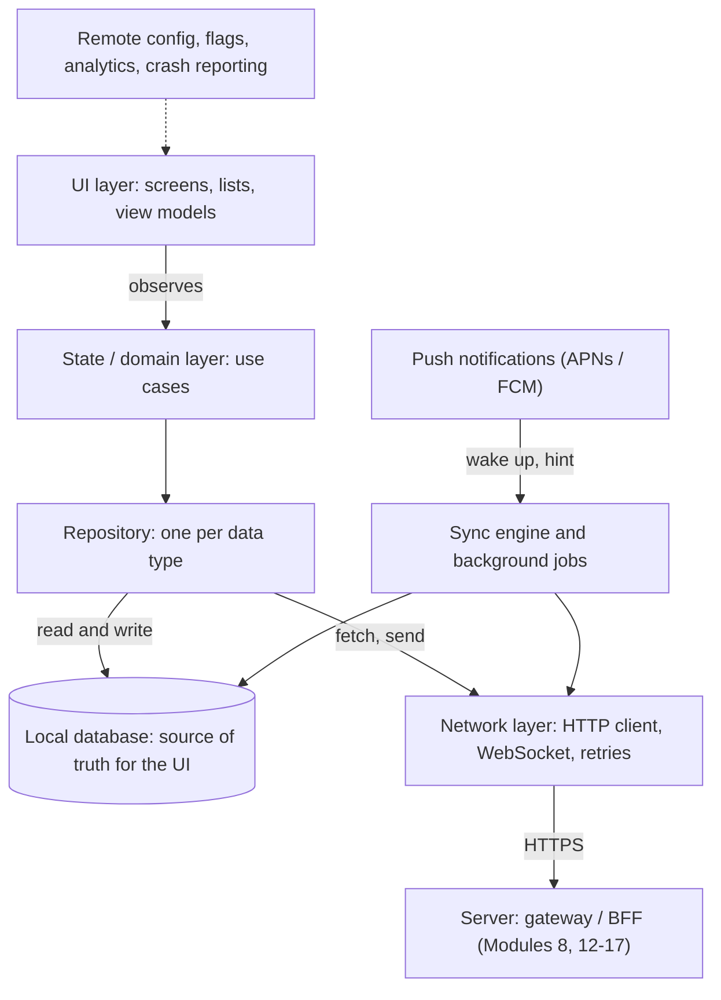
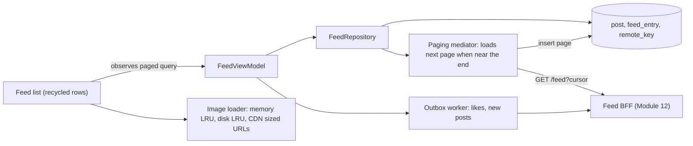
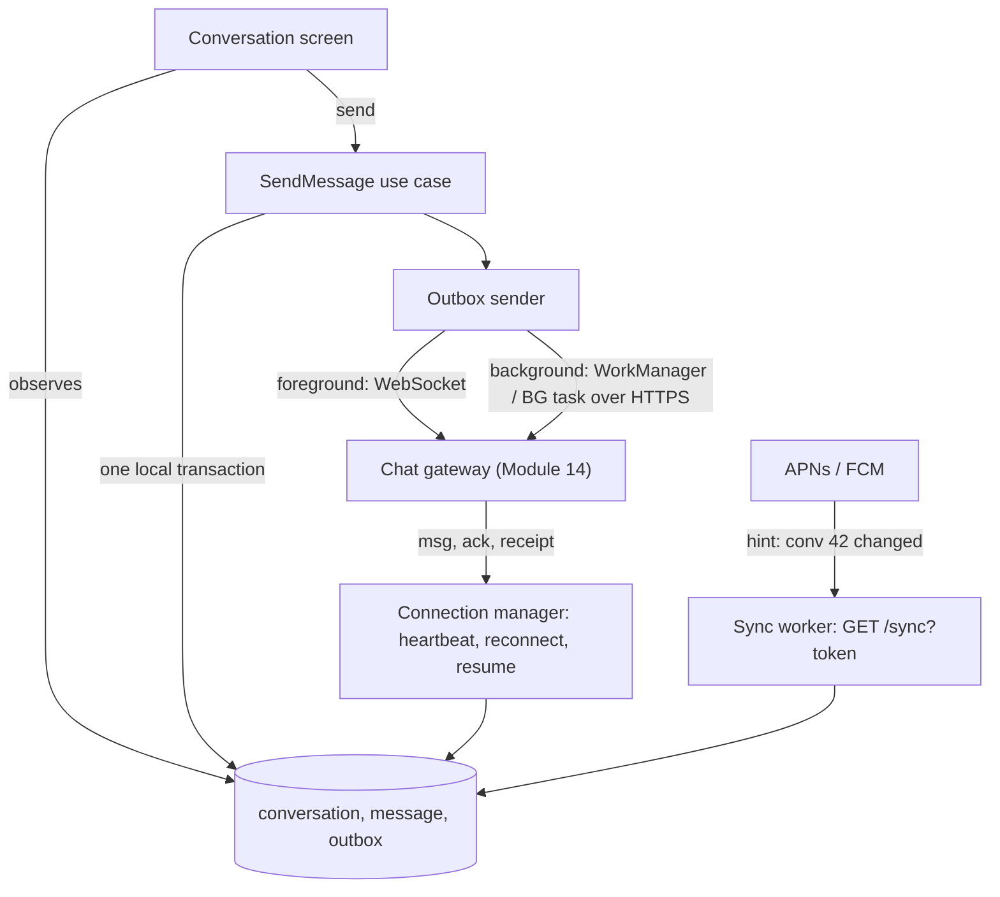
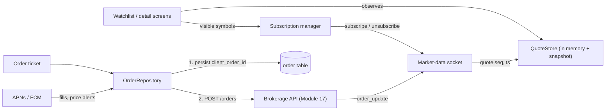
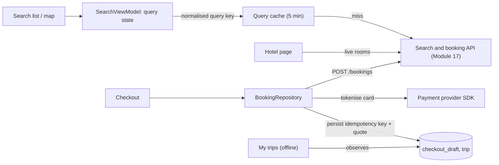
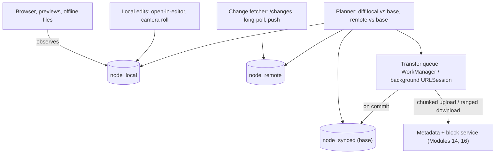
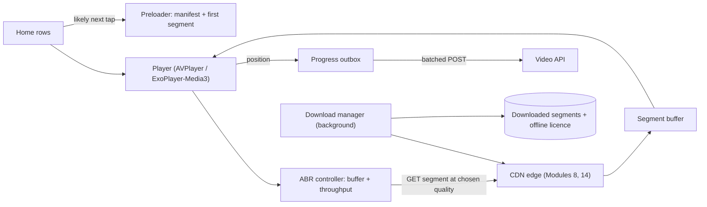

# Module 18 — Client & Mobile System Design (The App Side)

## Module Introduction

**What this module is.** Modules 1–17 design the *server* behind an API. This module designs the **client**: the app on a phone (or in a browser) at the other end of that API. Client/mobile system design interviews are common for iOS, Android and front-end roles; they ask the same kind of question ("design a chat app") but grade different decisions: what the app stores on the device, how it behaves with a bad or missing network, how it stays current without draining the battery, and how you ship and fix a binary (the installed app package) you cannot redeploy. First a **framework** (nine building blocks every client design reuses), then **six apps** as compact case studies, each linking to the server-side design for the other half. Server terms (queue, shard, cache, replica, CDN, p95) are in [System Design Fundamentals](../00-system-design-fundamentals/README.md).

**Analogy.** A server is a restaurant kitchen: reliable power, plenty of staff, a menu you can change any evening. A mobile app is a food truck: a small pantry (local storage), no signal in tunnels (offline), a limited fuel tank (battery and data plan), and once it's on the road you can't swap its engine — only radio new instructions (remote config and feature flags). Good food-truck design is about the pantry, the radio and the fuel.

**How a client interview differs from a backend interview**

| | Backend interview | Client / mobile interview |
|---|---|---|
| Main constraint | Throughput (requests per second), storage, fan-out (one event delivered to many) at scale | One device: flaky network, battery, memory, OS (operating system) limits |
| "Source of truth" question | Which database is authoritative? | Does the UI read from the network or from a local database? |
| Failure you design for | A node or region dies | The network is slow, gone, or switches mid-request; the OS kills the app |
| Numbers you estimate | QPS (queries per second), TB, nodes (servers) | MB on disk, MB per day of data, requests per hour, frames per second |
| Deploy model | Redeploy in minutes, roll back (return to the previous version) | Store review, users update slowly, old versions live for years |
| API | You design the servers behind it | You mostly *consume* it; you may shape it (BFF, a backend built for one front end; pagination; sync endpoints) |

**The six apps**

| App | Center of gravity (the main client problem) | Server side lives in |
|---|---|---|
| News feed app | Paging an endless list, image caching, smooth scrolling, prefetch (loading data before it is needed) | [Module 12 — Design 1](../12-capstones/README.md#design-1--the-news-feed) |
| Chat app | Offline outbox (a local queue of unsent actions), ordering, real-time connection, push | [Module 14 — Chat System](../14-case-studies-messaging-and-media/README.md#case-1--chat-system) |
| Stock trading app | Live price stream, freshness vs battery, safe order placement | [Module 17 — Stock Exchange](../17-case-studies-money-and-reservations/README.md#design-a-stock-exchange) |
| Hotel reservation app | Search/filter/paging, stale prices, idempotent (safe to repeat) booking | [Module 17 — Hotel Reservation](../17-case-studies-money-and-reservations/README.md#design-a-hotel-reservation-system) |
| File sync app | Resumable chunked transfer, sync engine, conflicts | [Module 14 — File Sync and Storage](../14-case-studies-messaging-and-media/README.md#case-4--file-sync-and-storage-google-drive--dropbox-like) |
| Video streaming app | Adaptive bitrate (switching video quality to match the connection), buffering, downloads for offline | [Module 14 — Video Platform](../14-case-studies-messaging-and-media/README.md#case-3--video-platform-youtube-like) |

**The seven-stage format, client edition** ([Module 12's stages](../12-capstones/README.md#module-introduction) adjusted for a device):
1. **Requirements and numbers:** scope, then phone-specific targets (launch time, scroll smoothness, offline, battery, data use), then device-side estimates (MB of cache, requests per session, bytes per screen).
2. **The five-questions pass, client edition.** **Flow**: what does the user wait for, what can run in the background? **Storage**: what lives on the device, and is it the UI's source of truth? **Speed**: what renders instantly from cache, how stale may it be? **Failure**: offline, flaky network, OS kills the app mid-task? **Growth**: what grows on the device over months, and what evicts it?
3. **The API and local data model:** endpoints (or the real-time channel) and on-device tables.
4. **The architecture, annotated:** client layers (UI → state → repository → local DB / network / sync), the server as one linked box.
5. **Deep dives:** the 2–3 hard client problems.
6. **The failure walk:** network, OS, server and user failures, and what the user sees.
7. **Follow-up questions and the pattern manifest.**

**Three rules for every client design** (interviewers grade all three):
1. **The UI reads from local state, never directly from the network.** The network *updates* local state; the screen *observes* it — giving instant launch, offline support and consistent screens.
2. **Every network call has an offline story:** what the user sees if it is slow, fails, or succeeds after the app was killed.
3. **Assume you cannot hot-fix.** Anything that may need changing after release (a threshold, an endpoint URL, a risky feature) goes behind remote config or a feature flag, and the server keeps supporting old app versions.

### Terms used throughout

- **Client / device** — the app on the user's phone, tablet or browser.
- **Local database** — an embedded database inside the app (SQLite, a single-file SQL database, usually wrapped by Room on Android or Core Data / SwiftData on iOS; IndexedDB in a browser — see [JS 14.4](../../../javascript/chapters/14-browser-apis-and-security/README.md#144-cookies-and-indexeddb--choosing-storage)).
- **Offline-first** — the local database is the UI's source of truth and the network is a background sync step, not a prerequisite.
- **Sync** — bringing local and server state into agreement in both directions (upload local changes, download remote ones).
- **Optimistic update** — show an action's result immediately, before the server confirms; roll back if it fails.
- **Push notification** — a message delivered by the OS push service (APNs on Apple devices, FCM on Android) that can reach the app even when it isn't running.
- **Remote config / feature flag** — values and on/off switches downloaded at runtime so behaviour changes without a new binary ([Module 9 — Feature Flags](../09-operating-in-production/README.md#feature-flags)).
- **Jank** — visible stutter when the app misses frame deadlines (16.7 ms per frame at 60 Hz; 8.3 ms at 120 Hz).

### How to read the module

Read **The Client Framework** first — every case study names its nine blocks. Then the **News feed app** (the most common prompt; introduces paging and image caching), then **Chat** (offline outbox and real-time). The other four each add one hard problem: live data (trading), money-safe writes (hotel), bidirectional sync of large files (file sync) and media delivery (video). Finish with the **Pattern Review**.

> Short on time? Read the framework's **Offline-first and sync**, **Networking and pagination** and **Push notifications** blocks, then the chat app. Those four cover most follow-up questions in any client interview.

### Before you start — questions about your own app

1. If you put your phone in airplane mode and open your app, what do you see? A spinner, an error, or yesterday's content?
2. If a user taps "send" in a tunnel and then swipes the app away, does the action ever happen?
3. How many versions of your app are still in active use today, and does your API still work for the oldest one?

---

## The Client Framework (building blocks)

**What this lesson is.** Nine building blocks that recur in every client design — what each is, how it works, what it costs, what to say — so the case studies only name the block and focus on what is special. Web and React readers will recognise many; links point to the React book for code.

*The layered client architecture used in every case study*


### 1. Client architecture layers

**What it is.** Splitting the app into single-purpose layers so network, storage and UI change independently and test alone. Android's official guide recommends a *UI layer*, an optional *domain layer* and a *data layer* of repositories, with "drive the UI from data models" and a single source of truth per data type ([Android guide to app architecture](https://developer.android.com/topic/architecture)).

**How it works.**
- **UI layer** — screens plus a **view model** (holds screen state and survives rotation), or on the web components plus a state store. The UI only *renders state* and *sends events* ("user tapped like"). Presentation patterns: MVC, MVP, MVVM, VIPER (ways of splitting screen code into model, view and controller-like parts) or unidirectional data flow (Redux/MVI: state flows one way from a single store to the UI, events flow back); naming MVVM + unidirectional flow is enough in an interview. Web equivalents: React [Chapter 14](../../../react/chapters/14-patterns-and-architecture/README.md) and state management [Chapter 6](../../../react/chapters/06-state-management/README.md).
- **Domain layer (optional)** — use cases combining repositories ("send message" = write to outbox + schedule sync).
- **Data layer** — one **repository** per data type (posts, messages, files), hiding *where* data comes from: it exposes an observable stream from the local database (the UI is told of every change) and methods that trigger network refreshes.
- **Cross-cutting services** — network client, sync engine, push handler, image loader, analytics, remote config; created once and injected (dependency injection).

**Trade-offs.** Layers cost boilerplate and an extra hop on simple screens; they pay back the first time you add offline support or swap an API, because only the repository changes.

**In the interview.** Draw the layer diagram in the first five minutes and say "the UI observes the local database; the network only writes into it."

### 2. Offline-first and sync

**What it is.** The local database is the UI's source of truth; the network updates it in the background. Android calls this an [offline-first app](https://developer.android.com/topic/architecture/data-layer/offline-first); the stronger research version is [local-first software](https://www.inkandswitch.com/local-first/) (Kleppmann, Wiggins, van Hardenberg, McGranaghan, 2019), where the device copy is primary and the server is one more replica.

**The problem it solves.** A network-first app shows a spinner on every launch, a blank screen offline, and loses actions typed in a tunnel. A moving phone sees latency from 50 ms to many seconds and regular gaps with no connection.

**How it works.**
- **Reads:** screen → repository → local DB (instant). In parallel the repository asks the server "what changed since my **sync token**?" (a cursor or version the server gave last time) and writes the answer into the DB; the UI updates because it observes the DB. Stale-while-revalidate applied to a whole database.
- **Writes:** the action is written to the local DB *and* an **outbox** table in one local transaction. The UI shows it immediately (optimistic, marked "sending"). A sync worker drains the outbox when online, sending each operation with a **client-generated ID** so a retry is [idempotent](../05-reliability/README.md#idempotency). The server's response replaces the optimistic row.
- **Conflicts:** when one record was edited on two devices offline, pick a rule, simplest first: **last-writer-wins** on a timestamp (silently loses an edit), **server wins** (the device re-applies or discards), **field-level merge** (different fields both survive), **keep both** (a "conflicted copy", as in file sync), or **CRDTs** (conflict-free replicated data types, whose concurrent edits always merge to the same result; Shapiro et al., 2011). This is multi-leader replication with each phone a leader — DDIA's [use cases for multi-leader replication](../../../ddia/chapters/05-replication/README.md#use-cases-for-multi-leader-replication) and [handling write conflicts](../../../ddia/chapters/05-replication/README.md#handling-write-conflicts); [Module 7 — Vector Clocks](../07-consistency/README.md#vector-clocks) detects concurrency.

**Trade-offs.** Gain instant screens, offline use, fewer requests. Pay with a schema on every device that must be migrated on upgrade, conflict rules to design and explain, and storage to evict.

**When not to use it.** Where stale data is dangerous or useless — a payment confirmation, a live auction bid, a one-time password: stay online-only with a clear "you're offline" state.

**Common mistakes.** Writing to the network first and the DB after (lost if the app dies in between); retrying writes without an idempotency key (duplicate messages or orders); treating the local cache as optional so each screen invents its own.

### 3. Caching and persistence

**What it is.** Choosing *where* each kind of data lives on the device and *when* it is thrown away.

**How it works — four tiers.**

| Tier | Holds | Lifetime | Example size budget |
|---|---|---|---|
| Memory cache (LRU: least recently used items are evicted first) | Decoded images, current screen state | Until memory pressure or app exit | 1/8 of the app's memory limit for bitmaps is a common start ([Android caching bitmaps](https://developer.android.com/topic/performance/graphics/cache-bitmap)) |
| Disk cache (HTTP / image) | Raw responses and image bytes, keyed by URL | Evicted by size (LRU) | 100–250 MB |
| Local database | Structured data the UI shows (posts, messages, file metadata) | Until evicted by your own policy | 10–500 MB, grows with history |
| Key-value prefs / secure storage | Settings, flags, tokens (Keychain / Keystore, the OS's encrypted stores for secrets) | Until logout | KB |

- **HTTP caching:** honour `Cache-Control` (how long a response may be reused) and use `ETag` (a response version tag) + `If-None-Match` so an unchanged resource costs a bodiless 304 ("not modified") ([RFC 9111](https://www.rfc-editor.org/rfc/rfc9111) caching, [RFC 9110](https://www.rfc-editor.org/rfc/rfc9110) conditional requests).
- **Images:** request the displayed size (the server or CDN resizes), decode off the main (UI-drawing) thread, cache decoded bitmaps in memory and bytes on disk, and cancel loads for rows scrolled away.
- **Eviction:** every tier gets a byte budget and LRU; keep the latest N items per conversation/feed and re-fetch older ones on demand.
- **Security:** tokens in Keychain / Android Keystore, never plain preferences; sensitive tables can be encrypted at rest.

**Trade-offs.** More caching means faster screens and fewer bytes, but more stale data, more disk on often-full phones, and more invalidation logic. Server-side patterns carry over: [Module 4 — Cache-Aside](../04-caching/README.md#cache-aside).

### 4. Networking and pagination

**What it is.** How the app talks to the server: protocol, request shape, paging, retries and real-time channels.

**How it works.**
- **Request/response over HTTPS** (HTTP/2 or HTTP/3 multiplex many requests on one connection, saving radio time). A **BFF** gives one screen one request with exactly the fields it shows ([Module 8 — Backend for Frontend](../08-api-and-edge/README.md#backend-for-frontend)); GraphQL (the client names exactly the fields it wants) is the alternative when many clients need different shapes.
- **Pagination:** [cursor pagination](../08-api-and-edge/README.md#cursor-based-pagination) for any list that changes while you scroll. A client **paging library** loads pages as the user nears the end, keeps a bounded window in memory, stores pages in the DB, and exposes load states (loading / error / end). Android's [Paging 3](https://developer.android.com/topic/libraries/architecture/paging/v3-overview) with `RemoteMediator` (network → DB → UI) is the reference design; React versions: [15.12 infinite scroll](../../../react/chapters/15-react-interview-and-machine-coding/README.md#1512-build-3--infinite-scroll), [15.16 pagination](../../../react/chapters/15-react-interview-and-machine-coding/README.md#1516-build-7--pagination), [9.9 query keys and pagination](../../../react/chapters/09-routing-and-data-fetching/README.md#99-query-keys-pagination-and-dependent-queries).
- **Retries:** only idempotent requests (or ones with an idempotency key), with [exponential backoff and jitter](../05-reliability/README.md#retry-with-exponential-backoff), honouring `Retry-After`. Pause retries while the OS reports no connectivity instead of burning attempts.
- **Real-time:** for server-initiated updates in the foreground, choose polling (simple, wasteful), long polling (the server holds each request until it has news), **SSE** (server → client only; [Module 2 — Server-Sent Events](../02-moving-data/README.md#server-sent-events)) or **WebSocket** (both directions; [RFC 6455](https://www.rfc-editor.org/rfc/rfc6455); [Module 2 — Bidirectional Streaming](../02-moving-data/README.md#bidirectional-streaming)). Reconnect with backoff + jitter, send ~30 s heartbeats to detect dead connections, and **resume from the last sequence number** so nothing is missed. Close the socket in the background; use push instead.
- **Versioning:** the app sends its version on every request; the server keeps old response shapes working ([Module 8 — API Versioning](../08-api-and-edge/README.md#api-versioning)).

**Trade-offs.** A persistent socket gives sub-second updates but keeps the radio awake; polling is simpler but stale or wasteful. Big pages mean fewer requests but slower first paint; small pages the opposite (20–30 items is a common default).

### 5. Push notifications

**What it is.** Messages delivered through the OS push service — **APNs** for Apple ([Apple: sending notification requests to APNs](https://developer.apple.com/documentation/usernotifications/sending-notification-requests-to-apns)) and **FCM** for Android ([Firebase Cloud Messaging](https://firebase.google.com/docs/cloud-messaging)). The OS keeps *one* shared, battery-efficient connection per device, so your app needs no socket in the background.

**How it works.**
1. On first launch the app gets a **device token** (an address for this install) from the OS and registers it with your server against the user. Tokens change; re-register every launch.
2. Your server sends to APNs/FCM with the token; the OS delivers.
3. Two kinds: **visible notifications** (title/body shown by the OS, even if the app isn't running) and **data / background messages** (silent, briefly wake the app to sync). The OS throttles silent pushes: Apple documents background notifications as low-priority and possibly delayed or dropped, and FCM distinguishes normal and high priority ([FCM message priority](https://firebase.google.com/docs/cloud-messaging/android-message-priority)).
4. Push is a **hint, not the data**: "conversation 42 has new messages" → the app syncs. Payloads are small (APNs limit 4 KB) and may arrive late, out of order, more than once or not at all, and may be collapsed (a **collapse key** keeps only the latest of a group).

**Trade-offs.** The only reliable way to reach a backgrounded app without draining the battery, but best-effort, rate-limited, and permission-gated (iOS asks explicitly; Android 13+ too). Server side (fan-out, preferences, provider calls): [Module 2 — Capstone: Designing a Notification System](../02-moving-data/README.md#capstone---designing-a-notification-system).

**Common mistake.** Putting the message content in the push and treating it as delivered: a dropped push loses the message. The sync API is always the source of truth.

### 6. Background work

**What it is.** Work done while the user isn't looking: uploading the outbox, syncing, downloading a video, cleaning caches.

**How it works.** Both platforms strictly limit background execution to protect the battery.
- **Android:** `WorkManager` for deferrable, guaranteed work with constraints ("only on Wi-Fi", "only while charging") that survives restarts and reboots ([WorkManager guide](https://developer.android.com/topic/libraries/architecture/workmanager)); foreground services (visible, with a notification) for long user-started tasks. Doze and App Standby (battery-saving modes) defer jobs and network for idle apps ([Optimize for Doze and App Standby](https://developer.android.com/training/monitoring-device-state/doze-standby)).
- **iOS:** `BGTaskScheduler` for app-refresh and longer processing tasks the system runs when it chooses ([BackgroundTasks framework](https://developer.apple.com/documentation/backgroundtasks)); **background `URLSession`** for transfers the OS continues after the app is suspended or killed ([Downloading files in the background](https://developer.apple.com/documentation/foundation/url_loading_system/downloading_files_in_the_background)).
- **Design rule:** every background job is **idempotent and resumable** (it can be killed at any second and rerun), persists progress in the DB, and never assumes a precise run time.

**Trade-offs.** The OS decides when background work runs, so "sync every 5 minutes in the background" is wrong on mobile: use push to trigger sync and let the OS batch the rest.

### 7. Battery, data and device constraints

**What it is.** The budgets a phone imposes: battery, cellular data, memory, CPU, disk and frame time.

**How it works — the rules of thumb.**
- **The radio is the battery hog.** A cellular radio stays in high power for several seconds after each transfer (the "tail"), so ten small requests over a minute cost far more than one batched request. **Batch**, **prefetch** while the radio is already up, avoid chatty polling ([Android: optimize network access](https://developer.android.com/develop/connectivity/network-ops/network-access-optimization)).
- **Check network type and user settings:** prefetch video and large images only on unmetered Wi-Fi, respect Low Data Mode / Data Saver, lower image quality on slow networks.
- **Memory:** the OS kills background apps that use too much; decoded images dominate (a 1080×1080 image is ~4.7 MB at 4 bytes/pixel). Downsample to display size and bound memory caches.
- **Main thread:** never do disk, network, JSON parsing or image decoding on the UI thread (16.7 ms per frame at 60 Hz). Lists must **recycle** row views (RecyclerView / UICollectionView / list virtualisation — [React 10.9](../../../react/chapters/10-performance/README.md#109-list-virtualization)).
- **Disk:** phones fill up; every cache has a budget and eviction policy, and downloads are visible and deletable.
- **App size and startup:** cold start (app not already in memory) under ~1–2 s; defer non-essential initialisation, lazy-load features.

**In the interview.** Say the numbers: "each radio wake-up costs seconds of high power, so I batch analytics every few minutes and piggyback them on other requests."

### 8. App releases and feature flags

**What it is.** How new code reaches users, and how you change behaviour after it has shipped.

**The problem it solves.** A server bug is fixed by redeploying in minutes. A mobile bug ships in a binary that passes store review (hours to days) and reaches users only when they update — some never do. So the release process is part of the design.

**How it works.**
- **Release train:** a fixed cadence (weekly or fortnightly) — branch cut (code freeze), internal testing, beta (TestFlight, Play testing tracks), store submission.
- **Staged / phased rollout:** release to a small percentage and watch crash and business metrics. Google Play supports haltable [staged rollouts](https://support.google.com/googleplay/android-developer/answer/6346149); Apple offers a 7-day [phased release](https://developer.apple.com/help/app-store-connect/update-your-app/release-a-version-update-in-phases) for automatic updates. [Canary deployment](../09-operating-in-production/README.md#canary-deployment) for binaries.
- **Feature flags and remote config:** ship code "dark" (included but off) and enable it from the server per user segment, with a kill switch ([Module 9 — Feature Flags](../09-operating-in-production/README.md#feature-flags); e.g. [Firebase Remote Config](https://firebase.google.com/docs/remote-config)). Cache the last config on disk with safe defaults so the app works if the fetch fails.
- **Minimum supported version / forced upgrade:** the server tells very old versions "please update" (hard block only for security or breaking changes; soft prompt otherwise).
- **Backward-compatible APIs and DB migrations:** the server supports N old app versions; each app version ships local-schema migrations tested from every version still in the wild.

**Trade-offs.** Flags multiply code paths and need cleanup; forced upgrades annoy users; supporting old versions slows the server team. All cheaper than a bug you cannot recall.

### 9. Observability on the client

**What it is.** Knowing what happens on millions of devices you cannot log into.

**How it works.**
- **Crash and hang reporting** (e.g. Firebase Crashlytics, Sentry, Apple MetricKit, Android vitals): symbolicated stack traces (call stacks translated back to readable names) grouped by issue, with app version and device; "crash-free users" is the release gate.
- **Performance metrics:** cold start, time to first content, frame drops (jank), request latency and errors *as seen from the device* — including DNS, TLS handshake and radio wake-up that server metrics never see.
- **Product analytics events:** batched, stored locally, uploaded in the background with a sample rate; each carries app version, flag values and a session ID so a flag's on/off groups can be compared.
- **Tracing across the boundary:** the app sends a trace/request ID header so a slow screen can be followed into the backend ([Module 9 — Distributed Tracing](../09-operating-in-production/README.md#distributed-tracing); [OpenTelemetry](https://opentelemetry.io/) has mobile SDKs).
- **Privacy:** no personal data in logs, consent where required, a server-side switch to lower sampling.

The server-side half — RUM collectors, Core Web Vitals, independent collection endpoints and synthetic probers — is in [Module 16 — Monitoring client-side errors](../16-case-studies-infrastructure/README.md#design-2--metrics-monitoring--alerting).

**Trade-offs.** Every event costs battery, data and privacy review; sample aggressively and batch.

### The framework as an interview checklist

| Stage of the answer | What to say for the client |
|---|---|
| First 5 minutes | Scope, platforms, offline required?, real-time required?, scale per device (items, MB) |
| Architecture | Layer diagram; "UI observes local DB"; list the repositories |
| API | Endpoints or socket messages, pagination style, sync token, idempotency keys |
| Data model | Local tables, indexes, what is evicted |
| Deep dives | Pick 2–3 of: offline writes, real-time channel, paging + images, large transfers, media |
| Failure walk | Offline, flaky, killed mid-task, server error, stale data, old app version |
| Wrap-up | Battery/data budget, release + flags, metrics you would watch |

### Self-check

- **Q1: Why should the UI observe the local database instead of the network response?** → The screen is instant (local reads), consistent (every screen shows the same row) and offline-capable (yesterday's data is still there); the network becomes a background writer into the DB.
- **Q2: A message sent in a tunnel is lost when the user swipes the app away. What was missing?** → A durable outbox: write the message and an outbox row in one local transaction, then let a background job (WorkManager / background task) drain it with a client-generated ID.
- **Q3: Why is "poll every minute in the background" a bad design on mobile?** → The OS won't run it on schedule (Doze, background limits), and each wake-up keeps the radio in high power. Use push as a hint and sync when woken or opened.

### TL;DR

| | |
|---|---|
| Core idea | The device has its own database, network and battery budget; design those, and treat the server as a box with a link. |
| The nine blocks | Layers · offline-first & sync · caching & persistence · networking & pagination · push · background work · battery/data · releases & flags · observability |
| Golden rules | UI reads local state · every call has an offline story · assume you cannot hot-fix |

---
## App 1 — News Feed App

**The prompt (in short).** The mobile client for a social feed: an endless list of posts with text and images, likes and comments, pull-to-refresh, and something to show offline.

**What makes it hard.** The list never ends, changes while you scroll, and is mostly images. The client must page without duplicates or jumps, scroll at 60–120 fps while images load, and do it on a limited data plan. Server half (fan-out, celebrity merge, ranking): [Module 12 — Design 1](../12-capstones/README.md#design-1--the-news-feed); here it is one box behind a BFF.

### 1. Requirements and numbers

- **Functional:** scroll the home feed; pull to refresh; a "new posts" pill when newer items exist; like/unlike with instant feedback; open comments; post up to 4 photos; show the last-seen feed offline.
- **Non-functional:** first content **< 1 s** after cold start (from cache); no dropped frames while scrolling; a like never lost or doubled; unnoticeable data use (~10 MB per cellular session).
- **Per-session estimates (my assumptions):**
  - A 10-minute session scrolls ~**150 posts**; at **20 per page**, ~**8 page requests**; ~1.5 KB JSON per post → ~**30 KB** per page, ~**240 KB of JSON** per session. JSON is cheap; images are not.
  - ~60% of posts have an image: **90 images**, ~**100 KB** each at display width (1080 px WebP) → ~**9 MB per session**. Full-resolution originals (1–3 MB) would cost **~150 MB**: requesting the right size matters 15x.
  - **Memory:** one 1080×1350 image decoded at 4 bytes/pixel is **~5.8 MB**; a 64 MB memory cache holds only ~11, so rows must recycle and images downsample.
  - **Disk:** keep the latest ~**300 posts** (~0.5 MB) plus a **150 MB** LRU image disk cache.

### 2. The five-questions pass (client edition)

- **Flow:** the user waits only for the first screen, from the local DB; page loads, image downloads, likes and post uploads are async.
- **Storage:** the local DB is the source of truth for the displayed list; the server is authoritative for posts and counts.
- **Speed:** first screen from cache; minutes-stale is fine because a refresh runs immediately.
- **Failure:** offline → cached feed plus banner; a failed like rolls back; an offline post waits in the outbox.
- **Growth:** image cache and post table grow every session, so both are bounded and evicted by LRU / age.

### 3. The API and local data model

```text
GET  /v1/feed?cursor=<opaque>&limit=20      -> { items:[post], next_cursor, feed_version }
GET  /v1/feed/new-count?after=<top_cursor>  -> { count }            (cheap, polled while visible)
POST /v1/posts/{id}/like    Idempotency-Key: <uuid>                (PUT-like: sets state, safe to retry)
DELETE /v1/posts/{id}/like  Idempotency-Key: <uuid>
POST /v1/media/upload-url   -> { upload_url, media_id }            (pre-signed URL to object storage)
POST /v1/posts  { client_post_id, text, media_ids[] }
```

Each post carries `image: { url_template, width, height, dominant_color }` so the client asks the CDN for exactly its display width and reserves space before the image arrives. `upload-url` returns a pre-signed URL: a temporary signed link to upload one file straight to object storage.

| Local table | Key columns | Notes |
|---|---|---|
| `post` | `id` PK (primary key), `author_id`, `text`, `image_json`, `like_count`, `liked_by_me`, `created_at` | Upserted (inserted, or updated if it exists) from every page |
| `feed_entry` | (`feed_id`, `position`) PK, `post_id` | The order the server gave; the UI observes this joined to `post` |
| `remote_key` | `feed_id` PK, `next_cursor`, `last_refresh_at` | Where to continue paging |
| `pending_action` | `id` PK, `type`, `payload`, `idempotency_key`, `attempts` | The outbox (likes, new posts) |

### 4. The architecture, annotated

*Feed client: paging through the database*


1. **Cold start:** the view model opens a paged query on `feed_entry ⋈ post` (⋈ = join); the first 20 rows come from SQLite in milliseconds.
2. **Refresh:** in parallel the mediator calls `GET /feed` without a cursor. If the new first page overlaps the screen it **doesn't shift the list under the thumb**: it shows a "new posts" pill and applies the page on tap or pull-to-refresh.
3. **Scrolling:** within ~5 rows of the end of loaded data, the mediator fetches the next page with `next_cursor`, inserts it in a transaction, and the list grows. Paging is a *database* concern; the UI never holds the network response. (Web: [React 15.12 infinite scroll](../../../react/chapters/15-react-interview-and-machine-coding/README.md#1512-build-3--infinite-scroll), [10.9 list virtualization](../../../react/chapters/10-performance/README.md#109-list-virtualization).)
4. **Images:** sized CDN URL → memory → disk → network, decoded off the main thread, cancelled for rows that left the screen.
5. **Likes and posts** go through the outbox (below).

### 5. Deep dives

**Deep dive 1 — pagination that does not drift or duplicate.** The cursor is tied to a row, not an offset, so inserts at the top don't shift page 2. The client adds two rules: (a) **de-duplicate by post ID** on insert (a ranked feed can return a post again); (b) a full refresh after a long absence **replaces** the feed rather than merging, since merging a new ranked page onto a day-old list creates a "gap" of posts the user never sees. Paging 3's `RemoteMediator` implements this "network → database → UI" loop with `REFRESH`, `APPEND` and `PREPEND` load types ([Paging 3 overview](https://developer.android.com/topic/libraries/architecture/paging/v3-overview)). Keep a **bounded window**: ~200 items in memory, far pages dropped and re-read from the DB on scroll-back.

**Deep dive 2 — images without jank or huge data bills.**
- **Size:** request displayed width × screen density (e.g. 360 dp × 3 = 1080 px) in WebP/AVIF — the biggest saving (the 15x above).
- **No layout jumps:** width/height from the API reserve the row's space; a dominant colour or tiny blurred placeholder fills it until load.
- **Prefetch:** when a page lands, prefetch images for its first ~5 rows; thumbnails only on cellular or Data Saver, full images on Wi-Fi.
- **Memory:** an LRU memory cache sized as a fraction of the app's memory class, released on the OS's memory-pressure callback.
- **Video posts:** autoplay muted only when ≥ 50% visible, one at a time, never preloaded on cellular.

**Deep dive 3 — optimistic likes that survive retries.** A tap sets `liked_by_me = true, like_count + 1` locally (instant red heart) and inserts an outbox row with a fresh **idempotency key**. The worker sends it; success stores the server's authoritative count; a permanent error (post deleted) rolls back with a toast. Like → unlike → like taps before the network returns are **collapsed**: the outbox keeps only the final desired state per post ("set liked = true"), sent as a naturally idempotent PUT-style operation — cheaper and safer than three ordered toggles. (React/TanStack version: [9.10 optimistic updates](../../../react/chapters/09-routing-and-data-fetching/README.md#910-mutations-invalidation-and-optimistic-updates).)

### 6. The failure walk

1. **Offline at launch:** cached feed + "You're offline" banner; pull-to-refresh shows the banner instead of spinning forever; paging stops at the end of cached data with a "retry" row.
2. **Flaky network while scrolling:** the append times out → footer "Tap to retry"; the mediator retries with backoff when connectivity returns; loaded rows are unaffected.
3. **App killed during a photo-post upload:** the upload is a background job (WorkManager / background `URLSession`) resuming from the outbox; the draft shows "Posting…"; `client_post_id` prevents a double post on retried commit.
4. **Server returns a post already on screen:** de-duplicated by ID on insert.
5. **Old app version:** the BFF keeps the old shape; post types the old app can't render come with a fallback ("Update the app to see this post").

### 7. Trade-offs

| Decision | Chosen | Alternative | Why |
|---|---|---|---|
| Source of truth for the list | Local DB | In-memory list from the network | Instant launch, offline, survives process death |
| New posts while reading | "New posts" pill | Auto-insert at top | Content never jumps under the thumb |
| Page size | 20 | 50 | Faster first paint; the extra requests are tiny |
| Likes | Collapsed desired-state in outbox | Send each toggle | Idempotent, fewer requests, no ordering bugs |
| Image quality | Sized per device + network | One size for all | 10–15x less data; less memory |

### 8. Follow-up questions

- **"'N new posts' without a socket?"** Poll `new-count` every ~60 s *only while the feed is visible and foregrounded*, piggybacked where possible, or SSE if seconds-level freshness is needed. Nothing in the background; a push can prompt a refresh.
- **"Ranking changed between page 1 and page 2."** The cursor encodes a snapshot/version of the ranked list (`feed_version`), so pages come from one ordering; pull-to-refresh starts a new version.
- **"Ads?"** The server interleaves them as another item type; the client needs a renderer per type and impression logging.
- **"Scroll position after the app was killed?"** Save the first visible post ID; on relaunch scroll to it if the cache is fresh (say < 30 min), else start at the top.

### 9. Pattern manifest

| Pattern | Where it served |
|---|---|
| Offline-first + outbox | Feed renders from DB; likes and posts queue in the outbox |
| Cursor pagination + paging mediator | Endless list without drift |
| Cache tiers + CDN sizing | Images: memory LRU, disk LRU, sized URLs |
| Idempotency | Like state and `client_post_id` |
| BFF | One request per screen with sized image templates |
| Background work | Photo upload survives app death |
| Battery/data rules | Prefetch on Wi-Fi only, no video preload on cellular |

**Interview one-liner:** "The feed screen observes a local table that a paging mediator fills page by page with cursors; images are requested at display size and cached in two tiers, and every user action is an optimistic local write drained idempotently by an outbox."

---

## App 2 — Chat App

**The prompt (in short).** A mobile messaging client: one-to-one and group chats, text and photos, delivery and read receipts, typing indicators, push notifications, and sending while offline.

**What makes it hard.** Messages must never be lost or duplicated, must appear in a sensible order on every device, and must arrive in real time with the app open *and* closed — without a permanent connection draining the battery. Server half (gateways, per-conversation sequencing, fan-out, storage): [Module 14 — Chat System](../14-case-studies-messaging-and-media/README.md#case-1--chat-system); delivery pattern: [Module 2 — Bidirectional Streaming](../02-moving-data/README.md#bidirectional-streaming).

### 1. Requirements and numbers

- **Functional:** conversation list with unread counts; conversation history; send text/photo; states *sending → sent → delivered → read*; typing indicator; push for new messages; several devices per user; local search of recent history.
- **Non-functional:** an online send shows *sent* in **< 500 ms** at p95; nothing typed is ever lost (even if the app is killed); no duplicates; conversations open instantly (local DB); little background battery use.
- **Estimates (assumptions):** an active user sends **40** and receives **200** messages/day; at ~300 bytes each that's ~**70 KB/day** — nothing; photos dominate (10 received × 150 KB thumbnail-then-full = 1.5 MB/day). **1 year ≈ 90,000 messages** × ~0.5 KB per row with indexes ≈ **45 MB** of SQLite — fine locally, with full-text search. Groups up to 256 members.

### 2. The five-questions pass (client edition)

- **Flow:** typing and send never block; the message is written locally and shown at once; delivery is async.
- **Storage:** the local DB holds conversations and messages and is what every screen observes; the server's per-conversation **sequence number** is the authority on order.
- **Speed:** opening a conversation = local query of the last 50 messages; older history pages in on scroll-up.
- **Failure:** offline → *sending* with a clock icon in the outbox; server rejects → *failed* with "tap to retry".
- **Growth:** history and media grow forever: keep text, evict (re-downloadable) media by LRU, let the user clear storage per chat.

### 3. The API and local data model

A **WebSocket** while foregrounded, plus HTTPS for sync, history and media.

```text
WS  -> {type:"send", client_msg_id, conv_id, body, attachments[]}
WS  <- {type:"ack",  client_msg_id, conv_id, seq, server_ts}
WS  <- {type:"msg",  conv_id, seq, sender_id, body, server_ts}
WS  <-> {type:"receipt", conv_id, up_to_seq, kind:"delivered"|"read"}
WS  <-> {type:"typing", conv_id}                         (ephemeral, never stored)
GET /v1/sync?token=<opaque>         -> { changes:[msgs, receipts, convs], next_token, has_more }
GET /v1/conversations/{id}/messages?before_seq=<n>&limit=50
POST /v1/devices { push_token, platform }
```

| Local table | Key columns | Notes |
|---|---|---|
| `conversation` | `id` PK, `title`, `last_seq`, `last_read_seq`, `unread_count`, `updated_at` | Conversation list sorted by `updated_at` |
| `message` | `client_msg_id` UNIQUE, `conv_id`, `seq` (null while pending), `sender_id`, `body`, `status`, `local_ts`, `server_ts` | Index on (`conv_id`, `seq`) |
| `outbox` | `client_msg_id` PK, `attempts`, `next_attempt_at` | Drained in order per conversation |
| `sync_state` | `sync_token` | Where the last sync stopped |
| `message_fts` | full-text index over `body` | On-device search |

### 4. The architecture, annotated

*Chat client: one write path, two delivery paths in*


1. **Send:** one local transaction inserts the message (`status = pending`, `seq = null`) and an outbox row; the UI shows it with a clock icon.
2. The **outbox sender** uses the socket if connected, else schedules a background job with a "network connected" constraint.
3. The server assigns the per-conversation `seq` and **acks** with `client_msg_id`; the client updates that row (`status = sent`, `seq`, `server_ts`) and deletes the outbox row.
4. Incoming messages arrive by socket in the foreground or **push → sync** in the background; both write the same tables, so the UI doesn't care which path delivered.

### 5. Deep dives

**Deep dive 1 — never lost, never duplicated.** The durable outbox prevents loss: the message is on disk before it shows as sent. `client_msg_id` (a device-made UUID) prevents duplication: the server stores it under a unique constraint and returns the *same* ack for a repeat, so a retry after a lost ack is harmless ([Idempotency](../05-reliability/README.md#idempotency)). On receive the client upserts by `client_msg_id`/`(conv_id, seq)`, so a message delivered by both socket and sync appears once. At-least-once delivery plus idempotent processing — the same combination as server-side [exactly-once semantics](../10-batch-and-streaming/README.md#exactly-once-semantics).

**Deep dive 2 — ordering.** Device clocks are wrong and people type at once, so order by the server's **per-conversation sequence number**, not local time. Pending messages (no `seq`) sort *after* all acked ones in local send order and move into their `seq` slot when acked (usually the same place). The outbox sends a conversation's messages **in order, one in flight at a time** (or pipelined with ordered acks), so "Meet at 5" never lands after "Actually 6". **Gap detection:** holding seq 101 and receiving 104 means 102–103 are missing → `sync` before marking read.

**Deep dive 3 — real time without killing the battery.**
- **Foreground:** one WebSocket per app (not per conversation); heartbeat every ~30 s, since mobile NATs (carrier address translators between phones and the internet) silently drop idle connections. Reconnect with **exponential backoff plus jitter** (1 s, 2 s, 4 s … capped at 30–60 s, randomised) so a million phones leaving a tunnel region don't reconnect in the same second. After reconnecting, `sync?token=` first to fetch what was missed, then resume the live stream.
- **Background:** close the socket (the OS would suspend it anyway); new messages arrive as **push**. For normal chats the push is visible ("Alice: are you free?") *and* a hint: the app runs a short sync so the conversation is loaded when tapped. For **end-to-end encrypted** chats the server can't read the text, so the push carries only an encrypted payload or ID and an iOS Notification Service Extension (a small process that may modify a notification before display) decrypts or fetches it ([Apple: modifying content in newly delivered notifications](https://developer.apple.com/documentation/usernotifications/modifying-content-in-newly-delivered-notifications)).
- **Don't double-notify:** no system notification for the open conversation; cancel notifications for a conversation read on *another* device (the server sends a silent "read up to seq N" push).
- **Typing indicators:** at most once every few seconds, socket only, never stored or retried.

### 6. The failure walk

1. **Sent in a tunnel, app swiped away:** the outbox row survives; a WorkManager / BGTask job (or next launch) sends it. *Sending* until then; *failed + retry* after a long timeout (say 24 h).
2. **Ack lost after the server stored the message:** retry with the same `client_msg_id`; the server returns the original ack; no duplicate.
3. **Push dropped by the OS:** only delayed — the next launch or foreground syncs from the stored token.
4. **Socket connected but silently dead:** two missed heartbeats → reconnect → sync.
5. **Two devices read the same chat:** receipts are "read up to seq N" (monotonic, max wins), so they merge without conflict.
6. **Local schema upgrade on app update:** a migration runs before the UI opens, tested from every schema version in use.

### 7. Trade-offs

| Decision | Chosen | Alternative | Why |
|---|---|---|---|
| Order | Server per-conversation `seq` | Device timestamps | Clocks skew; one authority per conversation |
| Foreground channel | One WebSocket | Polling / SSE + POST | Two-way, low latency, one connection for all chats |
| Background delivery | Push as hint + sync | Keep a socket alive | OS forbids it; battery |
| Receipts | "Up to seq N" | Per-message receipts | O(1) (constant size) per conversation; merges trivially |
| History | Local, recent year; older on demand | Everything always from server | Instant open, offline read, local search |

### 8. Follow-up questions

- **"Sync a new device with 5 years of history?"** Conversation list + last ~50 messages each first (usable in seconds), then backfill older history in a background job on Wi-Fi while charging; media stays server-side until opened.
- **"Group of 256: 'read by'?"** Per-member `last_read_seq`; read by members whose value ≥ the message's seq. Fetch the list lazily when message info opens.
- **"Edits and deletes?"** New events with their own `seq` referencing the original, applied to the row; deletes become tombstones so a late sync can't resurrect the message.
- **"Photo sending?"** Compress and resize on device, upload to a pre-signed URL in a background job, then send the message referencing `media_id`; the bubble shows a local thumbnail and progress.

### 9. Pattern manifest

| Pattern | Where it served |
|---|---|
| Outbox + idempotency key | Never lose or duplicate a sent message |
| Bidirectional streaming (WebSocket) | Foreground real-time messages, acks, receipts, typing |
| Push as hint + sync token | Background delivery and catch-up |
| Retry with backoff + jitter | Reconnect storms after network loss |
| Sequence numbers + gap detection | Ordering and completeness |
| Monotonic (only moves forward) "max wins" merge | Read receipts across devices |
| Background work | Outbox drain and history backfill |

**Interview one-liner:** "Messages are written to a local outbox first and sent with a client ID so retries are safe; the server's per-conversation sequence number defines order; the socket is for the foreground and push-plus-sync covers everything else."

---
## App 3 — Stock Trading App

**The prompt (in short).** The mobile client of a retail brokerage: a watchlist with live prices, charts, portfolio value, placing and cancelling orders, and price-alert notifications.

**What makes it hard.** Two opposite needs share one screen: prices must be *fresh* (a seconds-old quote can mislead a trade), but streaming everything wastes battery and data; orders must be placed *exactly once* even when the network times out at the worst moment, and money must display correctly. Unlike the feed, **offline trading is not allowed**: the app must know when its data is stale and say so. Exchange and ledger: [Module 17 — Stock Exchange](../17-case-studies-money-and-reservations/README.md#design-a-stock-exchange) and [Digital Wallet](../17-case-studies-money-and-reservations/README.md#design-a-digital-wallet); consistency ideas: [Module 7](../07-consistency/README.md) and [Module 12 — Design 3, the payment platform](../12-capstones/README.md#design-3--the-payment-platform).

### 1. Requirements and numbers

- **Functional:** watchlist (~50 symbols) with last price and daily change; symbol detail with chart (1D, 1W, 1M, 1Y, 5Y); portfolio value and positions; market and limit orders; order status and fills; cancel open orders; price alerts by push.
- **Non-functional:** on-screen prices **≤ 1 s old** in the foreground; an order never placed twice and its final state always known; exact decimals; biometric re-authentication for trading; clear "market closed" and "prices delayed" states.
- **Estimates (assumptions):**
  - A liquid symbol can print **dozens of trades per second**, but a human reads only a few updates per second. The server **conflates** (keeps only the latest price per symbol per interval) to **at most 4 updates/s per symbol**; the client renders at most ~1–2 changes/s per row.
  - All 50 symbols at 4 updates/s × ~60 bytes = **12 KB/s ≈ 43 MB/hour**; only the ~**10 visible rows** → **~9 MB/hour**; at 1 update/s → **~2 MB/hour**. Visibility-based subscription is the biggest lever.
  - A 1D chart at 1-minute bars: 390 points (a US trading day) × ~40 bytes ≈ **16 KB**; 5Y daily ~1,260 points ≈ **50 KB**. Cache long ranges for hours; only 1D changes intraday.

### 2. The five-questions pass (client edition)

- **Flow:** the user waits for order submission (seconds, with a clear pending state); everything else is streamed or cached.
- **Storage:** the server is the only truth for balances, positions and orders; the device caches the last snapshot *for display* with its timestamp, never as a basis for trading.
- **Speed:** watchlist and portfolio render instantly from the cached snapshot, labelled with its age, then go live.
- **Failure:** offline or stalled stream → grey prices, "as of 10:42:13", Buy disabled; order timeout → query, never blindly resend.
- **Growth:** small on device; the growth problem is subscription count, handled by visibility.

### 3. The API and local data model

```text
GET  /v1/portfolio                      -> { cash, positions[], as_of }
GET  /v1/quotes?symbols=AAPL,MSFT       -> snapshot { symbol, price, change, seq, ts }[]
GET  /v1/charts/{symbol}?range=1D       -> bars[]  (Cache-Control per range)
WS   -> {type:"subscribe", symbols:[...]} / {type:"unsubscribe", symbols:[...]}
WS   <- {type:"quote", symbol, price, seq, ts}         (conflated server-side)
WS   <- {type:"order_update", order_id, client_order_id, status, filled_qty, avg_price}
POST /v1/orders  { client_order_id, symbol, side, qty, type, limit_price?, max_price? } -> 202 { order_id, status:"pending" }
GET  /v1/orders?client_order_id=<id>    -> the order, if the server ever received it
DELETE /v1/orders/{order_id}            (cancel request; the final state comes via order_update)
```

Money and prices travel as **decimal strings** ("189.4200") parsed into decimal types, never binary floats (0.1 + 0.2 ≠ 0.3).

| Local table / store | Contents | Why it exists |
|---|---|---|
| `quote_snapshot` | symbol, price, change, `ts` | Instant first paint, labelled with its age |
| `chart_cache` | symbol, range, bars, `fetched_at` | Avoid refetching 5Y data every time |
| `order` | `client_order_id` PK, `order_id`, status, fields, `updated_at` | Survives a crash between submit and response |
| `watchlist` | ordered symbols | Synced to the server for other devices |

### 4. The architecture, annotated

*Trading client: a live stream for display, a careful path for orders*


1. The **subscription manager** keeps the socket's subscriptions equal to "symbols visible right now" (debounced ~300 ms while scrolling — act only once changes stop for 300 ms), plus open-order symbols.
2. Quotes flow into an in-memory **QuoteStore**; rows observe their symbol and re-render at most ~2×/s (UI throttling), flashing green/red.
3. The **order path** is separate, deliberately slow and explicit: persist, submit, follow status.

### 5. Deep dives

**Deep dive 1 — snapshot + stream, and knowing when data is stale.** On open, fetch a REST **snapshot** (each quote carries a per-symbol `seq`), then subscribe and apply only updates with a higher `seq` (dropping older ones that raced the snapshot) — the same "snapshot, then follow the log from its position" as bootstrapping a replica ([DDIA ch. 5](../../../ddia/chapters/05-replication/README.md#setting-up-new-followers)). Track the **last message time**: no quote or heartbeat for ~3 s → mark all prices *stale* (greyed, timestamped), reconnect with backoff + jitter, re-snapshot. **Backgrounding** closes the socket; returning re-snapshots. At market close stop streaming and show the closing price. Alerts ("AAPL crossed $200") are evaluated **on the server** and pushed, because the app can't watch prices in the background.

**Deep dive 2 — placing an order exactly once.** The danger is a timeout after *Buy*: did the order reach the broker? Resending could buy twice; giving up could leave an unknown open order.
1. On opening the confirm sheet, generate a **`client_order_id`** (UUID) and persist the draft locally. (Exchanges do the same: FIX's `ClOrdID` is a client-assigned identifier; [FIX Trading Community](https://www.fixtrading.org/standards/).)
2. `POST /orders` with that ID; the server treats it as an **idempotency key** (unique per account), so a retry returns the same order.
3. On timeout or connection loss **don't blindly resend**: `GET /orders?client_order_id=…`. Found → adopt its status. Not found → resubmit **with the same ID**; if the first request was merely delayed, the unique constraint rejects it, so two orders are impossible.
4. The order is a user-visible **state machine**: *pending → accepted → partially filled → filled*, or *rejected / cancelled / expired*; updates by socket in the foreground, push in the background, REST as fallback.
5. **Market orders** (buy/sell now at any price) **get a price guard:** a `max_price` collar computed from the quote the user saw, so a stale screen can't buy at a wildly different price. Show "Estimated cost", never a promise.

**Deep dive 3 — correctness and trust in what is shown.**
- The **server computes** portfolio value, buying power and P&L (profit and loss); the client formats. A locally recomputed live total from streamed prices is fine for display, but anything used for a decision (buying power) comes from the server.
- **Decimals, currencies and time zones:** exchange time for market hours; the user's zone for display.
- **Security:** tokens in Keychain/Keystore; biometric prompt before orders and after N idle minutes; certificate pinning (trust only one specific server certificate) is optional and needs a remote kill switch, since rotating a pinned certificate could brick old app versions; account screens can block screenshots on Android (`FLAG_SECURE`).

### 6. The failure walk

1. **Stream stalls (still "connected"):** heartbeat timeout → prices greyed "as of …"; trading still allowed but the ticket fetches a fresh REST quote before confirm.
2. **Offline:** cached portfolio with age label; order button disabled with "No connection".
3. **Timeout on order submit:** state *unknown* shown as "Checking order status…"; query by `client_order_id`; never a second POST with a new ID.
4. **App killed after submit:** on relaunch a pending order without `order_id` → reconcile by `client_order_id` (ask the server, adopt its answer).
5. **Duplicate or out-of-order `order_update`:** apply only if the status moves forward in the state machine (or `updated_at`/version is newer).
6. **Exchange halts a symbol:** the server sends a status flag; the ticket disables and explains.

### 7. Trade-offs

| Decision | Chosen | Alternative | Why |
|---|---|---|---|
| Price updates | WebSocket, conflated, visible symbols only | Poll every second | Sub-second freshness at ~2–9 MB/hour instead of 40+ |
| UI refresh rate | Throttled to ~2 Hz (twice per second) per row | Render every tick | Humans cannot read faster; saves CPU and battery |
| Offline | Read-only cached view, no trading | Queue orders offline | A queued order would execute at an unknown future price |
| Order retries | Query by `client_order_id` then resubmit same ID | Retry POST on timeout | Prevents double buys |
| Money types | Decimal strings | Floats | Exactness |

### 8. Follow-up questions

- **"Why not queue orders offline like chat messages?"** A chat message means the same in an hour; an order doesn't. Markets move, so an offline order must be re-confirmed with a fresh quote.
- **"A live 1D chart efficiently?"** Load 1-minute bars once; update only the last bar from the stream (high/low/close); append a bar each minute; redraw on a timer, not per tick.
- **"Price alerts?"** Server-side rules on the market-data stream, pushed with a collapse key per alert so the phone shows only the latest.
- **"Testing the order path?"** Fault injection in a debug build: drop the response after the server commits, kill the app after submit, deliver updates twice and out of order.

### 9. Pattern manifest

| Pattern | Where it served |
|---|---|
| Snapshot + ordered stream (seq) | Quotes without gaps or regressions |
| Subscription by visibility + conflation | Battery and data budget for live prices |
| Idempotency key (client order ID) | Exactly-once order placement |
| State machine with monotonic updates | Order status across socket, push and REST |
| Graceful degradation | Stale prices greyed and timestamped; trading disabled offline |
| Push | Fills and server-evaluated price alerts |
| Feature flags / kill switches | Certificate pinning, risky features |

**Interview one-liner:** "Display data streams over one socket, subscribed only for visible symbols and conflated, with every price labelled by age; orders take a separate path with a client-generated ID, and on any doubt the app asks the server what happened instead of resending."

---

## App 4 — Hotel Reservation App

**The prompt (in short).** The mobile client for booking hotels: search by place and dates, filter and sort, map view, hotel details and photos, choose a room, pay, and "My trips" (including offline).

**What makes it hard.** Two different halves. **Search** is read-heavy, filter-heavy, paged, image-heavy browsing whose results go stale fast. **Booking** is a money-moving write that must happen exactly once and survive the network dropping during payment. And **My trips** must work offline at reception. Inventory and double-booking live on the server: [Module 17 — Hotel Reservation](../17-case-studies-money-and-reservations/README.md#design-a-hotel-reservation-system).

### 1. Requirements and numbers

- **Functional:** search by destination (autocomplete), dates, guests; filters (price, stars, amenities) and sort; list and map views; hotel page with photos, room types and prices; book by card or wallet; cancel; "My trips" with confirmation details offline.
- **Non-functional:** search results **< 1.5 s** at p95; the agreed price is the price charged (or the user is told before paying); never booked twice; trips offline; accessible and localised (currencies, date formats).
- **Estimates (assumptions):** a search page of **20 hotels** ≈ 20 KB JSON + 20 thumbnails × 25 KB = **~520 KB**; a session views ~3 pages (~1.6 MB) and 5 hotel pages (~15 photos × 120 KB = 1.8 MB each, lazily loaded, users swipe a few) — **2–5 MB per session**, up to ~10 MB if every photo is opened. Map panning could fire a search per frame; debounced to one request per ~500 ms of rest, 20 s of panning makes ~10 requests instead of hundreds. Prices change often: search results cached **~5 minutes**; a **quote** (a price locked for booking) lives ~**15 minutes**.

### 2. The five-questions pass (client edition)

- **Flow:** the user waits for search results and the booking result; photos and map tiles load progressively.
- **Storage:** search results are a short-lived cache keyed by the full query; the server is truth for availability and prices. Confirmed bookings are copied locally and **pinned** (never evicted).
- **Speed:** repeat searches and "back" come from the query cache; the hotel page shows the cached card and fills in live room prices.
- **Failure:** stale price → re-quote and tell the user; booking timeout → check status by idempotency key; offline → My trips still works.
- **Growth:** photo cache bounded by LRU; trips kept until a while after checkout.

### 3. The API and local data model

```text
GET  /v1/destinations/suggest?q=par                     (autocomplete, debounced 200 ms)
GET  /v1/search?dest=..&checkin=..&checkout=..&guests=2&filters=..&sort=..&cursor=..  -> { hotels[], next_cursor, result_id }
GET  /v1/search/map?bbox=..&checkin=..&filters=..       -> { pins[] } (lightweight: id, lat, lng, price)
GET  /v1/hotels/{id}/rooms?checkin=..&checkout=..&guests=2   -> room types with prices
POST /v1/quotes { hotel_id, room_type_id, dates, guests } -> { quote_id, total, currency, expires_at, cancellation_policy }
POST /v1/bookings  Idempotency-Key: <uuid>  { quote_id, guest, payment_token } -> { booking_id, status }
GET  /v1/bookings?idempotency_key=<uuid>   /   GET /v1/trips
```

| Local store | Contents | Lifetime |
|---|---|---|
| Query cache (memory + DB) | search pages keyed by the normalised query | ~5 min, LRU |
| `recent_search` | last 10 queries | Weeks |
| `checkout_draft` | `idempotency_key`, `quote_id`, guest details (no card data) | Until booked or abandoned |
| `trip` | booking, hotel address, phone, check-in times, confirmation code, map snapshot | Pinned until checkout + 30 days |

### 4. The architecture, annotated

*Hotel client: a cached search half and a careful booking half*


### 5. Deep dives

**Deep dive 1 — search state, paging and cancellation.** The whole search (destination, dates, guests, filters, sort, map bounds) is one immutable **query object** whose normalised form is the **cache key** and the pagination scope: changing any filter starts a new query with a fresh cursor and **cancels in-flight requests** for the old one, so late responses can't overwrite newer results (the classic race; React: [9.9 query keys](../../../react/chapters/09-routing-and-data-fetching/README.md#99-query-keys-pagination-and-dependent-queries), abort pattern in [15.11 autocomplete](../../../react/chapters/15-react-interview-and-machine-coding/README.md#1511-build-2--autocomplete-debounce-abort-keyboard)). The list pages by cursor; the map uses a separate lightweight "pins in this bounding box" (`bbox`, the on-screen map rectangle) call, debounced while panning and clustered on device when zoomed out. Autocomplete is debounced ~200 ms and cached per prefix. The query lives in navigation state so "back" restores the exact list and scroll position without refetching.

**Deep dive 2 — stale prices and the quote.** Search prices are *indicative* ("from $142") and may be minutes old; opening a hotel fetches live room prices. *Reserve* creates a server-side **quote**: price and policy locked ~15 minutes with an `expires_at`. Checkout shows a countdown; on expiry the app re-quotes and, if the price changed, shows old vs new before payment. "The price you agreed to is the price you pay" becomes a server-enforced promise, not a client hope. Currency and tax display come from the quote, not client math.

**Deep dive 3 — booking exactly once through payment.**
1. When checkout opens, generate an **idempotency key** and persist it with the quote in `checkout_draft`; reuse it for every retry of this checkout.
2. Card details go straight to the payment provider's SDK, which returns a **payment token**; raw card numbers never touch your storage or servers (keeping you out of most PCI DSS scope — see the [Module 17 primer](../17-case-studies-money-and-reservations/README.md#how-money-moves-primer)). Apple Pay / Google Pay return a token the same way.
3. `POST /bookings` with the key. The server reserves inventory, authorises payment and confirms, all keyed by it, so a retry returns the same booking ([Idempotency](../05-reliability/README.md#idempotency); the server flow is a [saga](../07-consistency/README.md#saga)).
4. **Extra verification** (e.g. 3-D Secure, where the bank asks the user to confirm in a web view or bank app) can leave the app; it resumes on return from the persisted draft.
5. **Timeout or app killed:** on next open, any `checkout_draft` without a result triggers `GET /bookings?idempotency_key=…`; the user sees "Confirming your booking…", never a second charge.
6. On success, write the **trip** locally (pinned), add a calendar event if allowed, optionally a Wallet pass.

### 6. The failure walk

1. **Offline in search:** recent searches and last results labelled "Prices may have changed"; Reserve disabled.
2. **Quote expired during a slow checkout:** re-quote; show any price change; require re-confirmation.
3. **Payment declined:** the server gives a reason; draft and key are kept and the user picks another method (new payment attempt, same booking intent).
4. **Response lost after success:** reconciliation by idempotency key finds the booking; the confirmation appears.
5. **Room sold out between quote and booking:** clean server rejection (no charge); the app offers other rooms there.
6. **At the hotel with no signal:** My trips renders from the pinned copy: confirmation code, address, phone, offline map snapshot.

### 7. Trade-offs

| Decision | Chosen | Alternative | Why |
|---|---|---|---|
| Search caching | 5-minute query cache | No cache / long cache | Fast back navigation without showing hour-old prices |
| Price lock | Server quote with expiry | Trust the displayed price | Server-enforced agreement; handles price changes explicitly |
| Card handling | Provider SDK tokenisation | Collect card in own form and send | Security and PCI scope |
| Booking retries | Same idempotency key, reconcile on doubt | Retry with a new request | No double bookings or charges |
| Trips | Pinned local copy | Fetch on demand | Works at reception with no signal |

### 8. Follow-up questions

- **"Map and list show different results."** Make them two views of one query object: the list is paged, the map shows pins for the visible box; moving the map updates the query explicitly ("search this area"), not silently.
- **"Many currencies and languages?"** The server returns display-ready formatted amounts plus raw decimal and currency code; the app formats dates and numbers by device locale; strings come from per-language localisation bundles; right-to-left layouts (Arabic, Hebrew) are tested.
- **"A promotion push to 5 million users overloads the backend?"** The server spreads the push over minutes, and the app adds random jitter before prefetching deals.
- **"Cancellation?"** An idempotent `DELETE` or `POST /cancel` with its own key; the trip shows *cancelling* until confirmed; refunds appear as server-driven status.

### 9. Pattern manifest

| Pattern | Where it served |
|---|---|
| Query object as cache key + cursor pagination | Search list, back navigation, filter changes |
| Request cancellation + debounce | Filters, map panning, autocomplete |
| Server-side quote with TTL | Stale prices made explicit |
| Idempotency key + reconcile | Exactly-once booking and payment |
| Saga (server) | Reserve → authorise → confirm, with compensation |
| Offline pinned data | My trips at reception |
| Tokenisation (replacing card data with a meaningless reference) | Card data never stored by the app |

**Interview one-liner:** "Search is a cached, cancellable, paged read keyed by the full query; booking is a quoted, tokenised, idempotent write the app can always reconcile; and confirmed trips are pinned locally so they work with no signal."

---
## App 5 — File Sync App

**The prompt (in short).** The mobile client of a cloud drive: browse folders, upload and download files (up to several GB), automatic camera-roll backup, "available offline" files, edits syncing across devices, and conflict handling.

**What makes it hard.** The only app here where the device *writes large amounts of data* and two devices can edit the *same* thing offline. Gigabyte transfers over mobile networks will be interrupted, so they must resume; multi-device edits must converge without silently losing anyone's work. Server side (block storage, metadata DB, change notifications): [Module 14 — File Sync and Storage](../14-case-studies-messaging-and-media/README.md#case-4--file-sync-and-storage-google-drive--dropbox-like); blob store: [Module 16 — S3-like Object Storage](../16-case-studies-infrastructure/README.md#design-1--s3-like-object-storage).

### 1. Requirements and numbers

- **Functional:** browse the tree; open/preview; upload (manual and camera backup); download; mark files or folders "available offline"; rename, move, delete; see other devices' changes within seconds while open; resolve conflicts; restore old versions (server-side).
- **Non-functional:** no silent data loss, ever; transfers resume after interruption; camera backup respects Wi-Fi-only and battery settings; browsing instant (metadata cached locally).
- **Estimates (assumptions):**
  - **50,000 files** × ~300 bytes metadata → **~15 MB** local DB: keep the whole tree's metadata locally, but **not** content (mobile is *on-demand*, unlike desktop clients that mirror everything).
  - Camera backup: **20 photos/day × 3 MB = 60 MB/day** (Wi-Fi only by default).
  - A **2 GB video** over a 10 Mbit/s uplink: 2 GB × 8 / 10 Mbit/s ≈ **1,600 s ≈ 27 minutes** — interruption is almost certain, so uploads are **chunked** (8 MB chunks → 256 chunks) and resumable: an interruption costs at most one chunk (~6 s), not the file.

### 2. The five-questions pass (client edition)

- **Flow:** browsing is instant from the metadata DB; every transfer is a background job with progress UI.
- **Storage:** the server's metadata DB is authoritative; the device keeps a full metadata replica, cached content for recently opened files, and pinned content for offline files.
- **Speed:** folder listing is a local query; previews use server thumbnails.
- **Failure:** interrupted transfer → resume from the last confirmed chunk; concurrent edits → conflicted copy, never overwrite.
- **Growth:** content cache bounded (e.g. 2 GB LRU); pinned files counted separately in a storage screen.

### 3. The API and local data model

```text
GET  /v1/changes?cursor=<opaque>       -> { entries:[{id, parent_id, name, rev, content_hash, size, deleted}], cursor, has_more }
GET  /v1/changes/longpoll?cursor=..    -> { changes: true|false }   (held ~60 s; foreground only)
POST /v1/uploads { size, chunk_hashes[] }            -> { upload_id, missing_chunks[] }
PUT  /v1/uploads/{upload_id}/chunks/{n}              (8 MB body; idempotent by n + hash)
POST /v1/uploads/{upload_id}/commit { parent_id, name, parent_rev } -> { id, rev } | 409 conflict
GET  /v1/files/{id}/content   Range: bytes=...       (resumable download)
```

| Local table | Key columns | Notes |
|---|---|---|
| `node_remote` | `id`, `parent_id`, `name`, `rev`, `content_hash`, `size` | Latest server state (from `/changes`) |
| `node_synced` | same columns | The last state both sides agreed on (the **base**) |
| `node_local` | same columns + `local_path`, `dirty` | What is on this device, including unsynced edits |
| `transfer` | `node_id`, `direction`, `upload_id`, `chunks_done` bitmap (one bit per chunk), `state` | Resumable job state |
| `pin` | `node_id` | Offline-available files and folders |
| `sync_state` | `changes_cursor` | Where `/changes` stopped |

### 4. The architecture, annotated

*File sync client: three trees and a planner*


This is the "three trees" model Dropbox describes for its rewritten sync engine, Nucleus: a **remote** tree, a **local** tree and a **synced** tree recording the last agreed state, so the engine can tell *which side* changed something ([Dropbox tech blog, "Testing sync at Dropbox", 2020](https://dropbox.tech/infrastructure/-testing-our-new-sync-engine); background in ["Rewriting the heart of our sync engine"](https://dropbox.tech/infrastructure/rewriting-the-heart-of-our-sync-engine)).

### 5. Deep dives

**Deep dive 1 — the sync planner.** "Local and remote differ" doesn't say whether *this* device or the *other* edited the file. With the base tree, each node is classified:

| local vs base | remote vs base | Action |
|---|---|---|
| same | same | Nothing |
| changed | same | Upload local change |
| same | changed | Download remote change |
| changed | changed (to the same content hash) | Mark synced (both made the same edit) |
| changed | changed (differently) | **Conflict** (deep dive 3) |

After each successful operation the node's base becomes the agreed state. The planner runs whenever `/changes` returns entries or a local node turns dirty. Creates apply **parents before children**, deletes **children before parents**. Every step is idempotent, so a crash mid-plan just re-plans.

**Deep dive 2 — resumable, deduplicated transfers.**
- **Chunking:** split into 8 MB chunks and hash each (SHA-256, a fixed 256-bit fingerprint). `POST /uploads` sends the hash list; the server answers **`missing_chunks`**, so a file it already has (or a re-upload after a crash) sends only what's missing — **deduplication** and **resume** in one mechanism.
- **Delta on edit:** a small edit in a large file changes one or two fixed-size chunks; only those upload. (Content-defined chunking, which derives boundaries from the data, survives inserted bytes, but fixed chunks are simpler and fine for most mobile uploads.)
- **Commit:** after all chunks, `commit` with `parent_rev` (the revision the edit was based on); if the server's revision differs it returns **409** → conflict path. Optimistic concurrency control: no locks, detect the clash at commit (the same check-and-set databases use).
- **Background execution:** background `URLSession` tasks on iOS (continue after suspension); WorkManager jobs with `NetworkType.UNMETERED` and battery constraints on Android for camera backup. The `transfer` chunk bitmap survives restarts; downloads resume with HTTP `Range` requests.
- **Integrity:** verify each chunk's hash on the server and the final content hash on both sides.

**Deep dive 3 — conflicts without data loss.** When both sides changed a file differently, never overwrite: keep the server's version under the original name and upload the device's as **"report (Alice's phone conflicted copy 2026-09-28).docx"**, and tell the user. Other cases need explicit rules:
- **Edit vs delete:** the edit wins; the file is restored (deleting someone's unsynced work is the worst outcome).
- **Rename/move vs edit:** apply both (different attributes).
- **Two renames of the same file:** the server's first commit wins; the other device adopts it.
- **Name clashes** on case-insensitive file systems (`Report.pdf` vs `report.pdf`): suffix one.

Real-time co-editing *inside* a document needs OT or CRDTs: see the [collaborative document editor in Module 16](../16-case-studies-infrastructure/README.md#design-5--collaborative-document-editor-google-docs-style) and DDIA on [handling write conflicts](../../../ddia/chapters/05-replication/README.md#handling-write-conflicts).

### 6. The failure walk

1. **Upload interrupted at 70%:** the job restarts; `POST /uploads` (or the stored `upload_id`) reports missing chunks; ~30% is re-sent.
2. **App killed during a plan:** re-plan from the three trees on next start; idempotent steps make repeats harmless.
3. **Two devices edit offline:** conflicted copy created; both versions kept; server keeps revision history.
4. **Phone disk nearly full:** evict unpinned cached content by LRU; pause downloads with a message; never evict dirty (unsynced) files.
5. **Server says the cursor is too old:** full metadata re-list (15 MB, background), then re-plan.
6. **Camera backup on cellular:** paused by default; the setting and a counter ("128 photos waiting for Wi-Fi") are visible.

### 7. Trade-offs

| Decision | Chosen | Alternative | Why |
|---|---|---|---|
| Content on mobile | Metadata full, content on demand + pins | Mirror everything | Phones lack the disk and data budget |
| Change detection | Three trees (local, remote, base) | Two-way diff | Knows which side changed; enables safe conflict rules |
| Upload unit | 8 MB chunks with hashes | Whole-file upload | Resume, dedup, delta in one mechanism |
| Conflicts | Conflicted copy | Last-writer-wins | No silent loss of work |
| Change notification | Long-poll/push hint + `/changes` cursor | Push the data itself | Push is best-effort; the cursor is the truth |

### 8. Follow-up questions

- **"How does the phone learn about changes quickly?"** Foreground: long-poll `/changes/longpoll` (returns as soon as something changes). Background: a silent push hint, then `/changes`. The cursor guarantees nothing is missed even if hints are lost.
- **"Camera backup of 10,000 existing photos?"** A background queue processing batches on Wi-Fi while charging, deduplicating by content hash first; progress survives restarts.
- **"Sharing a folder?"** Server-side ACLs (access control lists); the client shows shared roots and treats permission errors on commit as "read-only now", keeping the local edit as a copy.
- **"Encrypting files at rest on the device?"** Platform file protection (iOS Data Protection classes, Android file-based encryption), with cached content in the app sandbox (private storage other apps can't read).

### 9. Pattern manifest

| Pattern | Where it served |
|---|---|
| Offline-first metadata replica + cursor | Instant browsing; change sync |
| Three-tree planner | Knowing which side changed |
| Chunking + content hashes | Resume, dedup, delta upload |
| Optimistic concurrency (`parent_rev`, 409) | Detecting concurrent edits on commit |
| Keep-both conflict resolution | No silent data loss |
| Background work with constraints | Transfers and camera backup |
| Push/long-poll as hint | Fast change discovery without trusting push |

**Interview one-liner:** "Keep the whole metadata tree locally with a change cursor, detect who changed what with a base tree, move content as hashed resumable chunks in background jobs, and on a real conflict keep both copies."

---

## App 6 — Video Streaming App

**The prompt (in short).** The mobile client for a video platform: a home screen of recommended videos, smooth playback that adapts to the network, resume on any device, and offline downloads.

**What makes it hard.** Video is by far the heaviest data an app moves (hundreds of MB per hour), phone bandwidth can change tenfold in seconds, and users judge the app by two numbers: how fast playback starts and how often it stalls. The client picks the quality of every few seconds of video. Server side (upload, transcoding, CDN delivery): [Module 14 — Video Platform](../14-case-studies-messaging-and-media/README.md#case-3--video-platform-youtube-like) and [Module 8 — CDN](../08-api-and-edge/README.md#cdn).

### 1. Requirements and numbers

- **Functional:** home feed of videos (rows, thumbnails, optional autoplay preview); play/pause/seek, quality (auto by default), captions; resume position synced across devices; downloads with an expiry; comments/likes (App 1's patterns).
- **Non-functional:** **time to first frame < 2 s** at p90; **rebuffering < 0.5%** of watch time (playback frozen waiting for data); respect Data Saver/cellular limits; downloads survive restarts.
- **Estimates (assumptions):**
  - Bitrates: 480p ≈ **1 Mbit/s** (≈ 450 MB/hour), 720p ≈ **2.5 Mbit/s** (≈ 1.1 GB/hour), 1080p ≈ **5 Mbit/s** (≈ 2.25 GB/hour). A 10 GB monthly plan affords only ~9 hours of 720p — why a cellular data-saver default matters.
  - **4-second segments**: a 10-minute video is 150 segments per quality level.
  - A 10-episode season (45 min each) at 480p: 10 × 0.75 h × 450 MB ≈ **3.4 GB** — downloads need a quality choice and a visible storage budget.

### 2. The five-questions pass (client edition)

- **Flow:** the user waits only for the first frame; next segments, thumbnails and progress sync are background.
- **Storage:** an in-memory **buffer** of upcoming segments (up to ~30 s ahead); downloads on disk with an offline licence; the server is truth for watch history.
- **Speed:** manifest and first segment prefetched for the video most likely to be tapped.
- **Failure:** bandwidth drop → step down quality before the buffer empties; offline → downloads only.
- **Growth:** downloads grow disk use; expired licences and watched episodes are cleaned up per user settings.

### 3. The API and protocol

Playback uses **HTTP adaptive streaming**: the video is encoded at several qualities (a **bitrate ladder**), each cut into short segments listed in a **manifest**. Apple's **HLS** (HTTP Live Streaming, [RFC 8216](https://www.rfc-editor.org/rfc/rfc8216)) and **MPEG-DASH** (ISO/IEC 23009-1) are the standards; segments are ordinary HTTP files from a CDN. The player fetches the manifest, then segments one by one, choosing each one's quality.

```text
GET  /v1/home                         -> rows[] of { video_id, title, thumb_url_template, duration }   (BFF)
GET  /v1/videos/{id}/playback         -> { manifest_url (signed, expires), licence_url?, resume_position_s }
GET  <cdn>/v/{id}/master.m3u8         -> quality ladder;  GET <cdn>/v/{id}/720p/seg_00042.m4s
POST /v1/progress  { video_id, position_s, device_ts }    (batched: every 30 s, on pause, on exit)
POST /v1/downloads/{id}  -> { download_manifest_url, offline_licence, expires_at }
```

| Local store | Contents |
|---|---|
| Segment buffer (memory) | Next ~10–30 s of video |
| `progress` | video_id, position, `updated_at`, `synced` flag (outbox for progress) |
| `download` | video_id, quality, bytes_done, state, licence expiry, file paths |

### 4. The architecture, annotated

*Video client: a player that chooses every segment*


iOS `AVPlayer` plays HLS natively; Android's ExoPlayer (now in Jetpack **Media3**) plays HLS and DASH ([Media3 ExoPlayer](https://developer.android.com/media/media3/exoplayer)). You configure and wrap them rather than write a player.

### 5. Deep dives

**Deep dive 1 — adaptive bitrate (ABR).** Before each segment the player picks a quality. Two families of rules:
- **Throughput-based:** estimate bandwidth from recent downloads and pick the highest bitrate below ~80% of it. Reacts quickly, but mobile estimates are noisy, so quality oscillates and a sudden drop can drain the buffer before the estimate catches up.
- **Buffer-based:** pick quality from *seconds buffered*: low buffer → lowest quality (refill fast), full → highest. Huang et al. showed at Netflix that buffer-based selection reduced rebuffering versus capacity estimation while keeping video rate high ([Huang et al., "A Buffer-Based Approach to Rate Adaptation", SIGCOMM 2014](https://dl.acm.org/doi/10.1145/2619239.2626296)).
- Production players combine both (throughput at startup when the buffer is empty, buffer level once filled) and add **hysteresis** (don't switch up until the higher level has been sustainable for a while) so quality doesn't flicker.

A toy simulation (my own code) of 30 four-second segments while bandwidth drops from 6 to 1.2 Mbit/s between t = 20 s and t = 60 s, ladder 0.4 / 1.0 / 2.5 / 5.0 Mbit/s, 30 s buffer cap:

```python
LADDER = [0.4, 1.0, 2.5, 5.0]; SEG = 4.0
def bandwidth(t): return 1.2 if 20 <= t < 60 else 6.0
def play(choose, n=30):
    t, buf, est, stall, picks = 0.0, 0.0, 3.0, 0.0, []
    for _ in range(n):
        rate = choose(buf, est); picks.append(rate)
        dl = rate * SEG / bandwidth(t)                 # download time of this segment
        est = 0.7 * est + 0.3 * (rate * SEG / dl)      # smoothed throughput estimate
        if dl > buf: stall += dl - buf; buf = 0.0      # buffer ran dry -> rebuffering
        else: buf -= dl
        buf = min(buf + SEG, 30.0); t += dl
    return stall, sum(picks) / n, picks
def throughput_rule(buf, est):
    ok = [r for r in LADDER if r <= 0.8 * est]; return ok[-1] if ok else LADDER[0]
def buffer_rule(buf, est):                             # reservoir 8 s, cushion up to 24 s
    if buf < 8: return LADDER[0]
    if buf >= 24: return LADDER[-1]
    return LADDER[min(int((buf - 8) / 16 * 3) + 1, 3)]
for name, rule in [("throughput", throughput_rule), ("buffer", buffer_rule)]:
    stall, avg, picks = play(rule)
    print(f"{name:10s} stall={stall:5.1f}s  avg_bitrate={avg:4.2f} Mbps  first12={picks[:12]}")
```

```output
throughput stall=  0.7s  avg_bitrate=2.10 Mbps  first12=[1.0, 2.5, 2.5, 2.5, 2.5, 2.5, 2.5, 2.5, 2.5, 2.5, 2.5, 2.5]
buffer     stall=  0.3s  avg_bitrate=3.06 Mbps  first12=[0.4, 0.4, 0.4, 1.0, 2.5, 2.5, 5.0, 5.0, 5.0, 5.0, 5.0, 5.0]
```

The buffer rule starts at the lowest quality (slower-looking start, but the buffer fills fast), climbs as the buffer grows, and rides out the drop on its 30 s cushion — fewer stalls *and* a higher average bitrate. The throughput rule's safety margin keeps it below 1080p, and it notices the drop only after slow downloads have eaten the buffer. Deliberately simple (no hysteresis, one drop), but it shows *why* the buffer is the better control signal once it exists.

**Deep dive 2 — fast start.**
- **Preload the likely next video:** once a thumbnail has been on screen ~1 s (or the next episode in autoplay), fetch its playback info, manifest and first low-quality segment — on Wi-Fi, or at most one on cellular.
- **Start low, switch up:** a low-rung first segment arrives fast; ABR climbs within seconds.
- **Short first segments** (e.g. 2 s), a nearby [CDN](../08-api-and-edge/README.md#cdn) edge, and warm (already-open HTTP/2 or HTTP/3) connections.
- **Reuse player instances** from a small pool in short-video feeds; creating decoders is slow and memory-heavy.
- **Measure it:** time to first frame and rebuffer ratio per app version, network type and CDN, as analytics events.

**Deep dive 3 — offline downloads.**
- The **download manager** fetches the chosen quality's segments as a background job (background `URLSession` / `AVAssetDownloadURLSession` on iOS, a Media3 `DownloadService` on Android), recording per-segment progress to resume after interruption; Wi-Fi only by default.
- **DRM** (digital rights management, the encryption that stops copying): the server issues an **offline licence** with an expiry (e.g. 30 days, or 48 hours after first play); the app renews when online and shows "Expires in 3 days".
- **Storage:** show size before download; enforce a budget; auto-delete watched episodes if the user opts in; warn or refuse when space is low.
- **Offline progress:** saved locally and synced later via the progress outbox, merged by **latest `updated_at` wins** — fine for a watch position.

### 6. The failure walk

1. **Bandwidth collapses mid-play:** ABR steps down within one or two segments; if the buffer still empties, spinner, then resume at a low rung.
2. **CDN edge error:** retry the segment with a short timeout, then an alternate CDN host from the manifest.
3. **Signed manifest URL expired during a long pause:** refetch playback info, resume at the same position.
4. **App backgrounded:** pause (or continue audio / picture-in-picture if the product allows); flush the progress outbox.
5. **Offline licence expired:** the download won't play; prompt to go online to renew.
6. **Progress conflict (two devices):** latest `updated_at` wins; small skew is harmless.

### 7. Trade-offs

| Decision | Chosen | Alternative | Why |
|---|---|---|---|
| Delivery | HLS/DASH segments over CDN | Progressive MP4 download (one file played while it downloads) | Per-segment quality switching, CDN-cacheable |
| ABR signal | Buffer level (+ throughput at start) | Throughput only | Fewer stalls, steadier quality |
| Cellular default | Data saver (≤ 480p) | Auto up to 1080p | User data plans |
| Preload | Manifest + first segment of likely next | Nothing / whole video | Faster start at small cost |
| Progress conflicts | Latest timestamp wins | CRDT / merge | Position is a single overwrite-able value |

### 8. Follow-up questions

- **"Short-video vertical feed (swipe to next)?"** Preload the next 1–2 videos' first segments, keep a pool of 3 players (previous, current, next), play instantly on swipe; the feed uses App 1's paging.
- **"Live streaming?"** Same HLS/DASH machinery with a sliding manifest and target latency; low-latency variants use shorter partial segments. Server side: [Module 14 — Live Streaming](../14-case-studies-messaging-and-media/README.md#case-5--live-streaming).
- **"How do you know the ABR works?"** A/B test ABR parameters behind a feature flag and compare rebuffer ratio, average bitrate and watch time per cohort.
- **"Captions and audio tracks?"** Separate renditions in the manifest; the player switches without restarting.

### 9. Pattern manifest

| Pattern | Where it served |
|---|---|
| CDN + segmented adaptive streaming | Delivery at every network quality |
| Buffer-based ABR with hysteresis | Stall-free, steady quality |
| Prefetch on likely intent | Fast start |
| Background work (resumable) | Offline downloads |
| Outbox + last-writer-wins | Watch progress across devices |
| Battery/data rules | Cellular data saver, Wi-Fi-only downloads |
| Feature flags + client metrics | Tuning ABR and measuring start time |

**Interview one-liner:** "The player downloads a ladder of short segments from the CDN and picks each one's quality mainly from how much is buffered, starts low and preloads the likely next video, and downloads are background jobs with expiring offline licences."

---

## Pattern Review (client cheat sheet)

**What this lesson is.** The six apps on one page: which blocks each leaned on, the symptoms that point to each pattern, and the decision rules.

**Building block → where it mattered most**

| Building block | Feed | Chat | Trading | Hotel | File sync | Video |
|---|---|---|---|---|---|---|
| Layers (UI → repo → DB/network) | Core | Core | Core | Core | Core | Core |
| Offline-first + outbox | Likes, posts | **Central** | Read-only cache only | Trips pinned | **Central** (three trees) | Progress, downloads |
| Caching & persistence | **Images** | History + FTS | Charts, snapshot | Query cache | Content LRU + pins | Buffer, downloads |
| Networking & pagination | **Cursor paging** | Sync token, history paging | Snapshot + stream | Paged search, map bbox | Changes cursor, chunks | Segments, manifest |
| Real-time channel | Poll/SSE for "new posts" | **WebSocket** | **WebSocket (conflated)** | — | Long-poll | — |
| Push notifications | Engagement | **Messages** | Fills, alerts | Trip updates | Change hints | New episodes |
| Background work | Post upload | Outbox drain | — | Booking reconcile | **Transfers** | **Downloads** |
| Battery / data | Image sizing, prefetch rules | Socket only in foreground | Visible-only subscriptions | Debounced map | Wi-Fi-only backup | **Data saver, ABR** |
| Idempotency | Like state, post ID | Message ID | **Order ID** | **Booking key** | Chunk hash, `parent_rev` | — |
| Releases & flags | New post types | Protocol versions | Kill switches | Payment methods | Sync engine changes | ABR tuning |
| Observability | Scroll jank | Send latency | Stream staleness | Funnel drop-off | Transfer failures | Start time, rebuffering |

**Symptom → pattern**

| Symptom on the device | Reach for |
|---|---|
| Spinner on every launch; blank screen offline | Offline-first: UI observes the local DB |
| Actions typed offline vanish when the app is killed | Durable outbox + background job |
| Duplicate messages / orders after retries | Client-generated idempotency key |
| Items repeat or skip while scrolling | Cursor pagination + de-duplication by ID |
| Scrolling stutters when images load | Off-main-thread decode, sized URLs, recycled rows, memory LRU |
| Huge data use | Request display-size media, Wi-Fi-only prefetch, conflation, data-saver defaults |
| Battery drain in the background | Close sockets in background; push as a hint; batch requests |
| Messages missing after reconnect | Sync token / sequence numbers with gap detection, then resume stream |
| "Did my payment go through?" after a timeout | Reconcile by idempotency key before any retry |
| Two devices overwrote each other's edits | Base version + optimistic concurrency; keep both on conflict |
| Large uploads restart from zero | Chunked, hashed, resumable transfers |
| A bad release crashed 5% of users and you cannot recall it | Phased rollout + feature-flag kill switch + minimum version |
| "It's slow for users" but server metrics look fine | Client-side performance metrics and traces from the device |

**Decision rules**
1. The UI reads local state; the network writes into it.
2. Every write gets an idempotency key before it leaves the device.
3. Push is a hint; a cursor or sequence number is the truth.
4. Real-time sockets are for the foreground only.
5. Request only what the screen shows: sized images, visible symbols, the next page.
6. Anything that may need changing after release goes behind a flag or remote config.
7. Show staleness honestly (timestamps, banners) instead of pretending data is live.

---

## Module TL;DR

| | |
|---|---|
| What the module teaches | Client/mobile system design: design the device side (storage, sync, networking, battery, releases), with the server as a linked box |
| The framework | Nine blocks: layers · offline-first & sync · caching & persistence · networking & pagination · push · background work · battery/data · releases & flags · observability |
| News feed app | DB-backed paging with cursors; sized, two-tier image cache; optimistic likes via outbox |
| Chat app | Outbox + client message ID; server sequence numbers; WebSocket in foreground, push + sync in background |
| Stock trading app | Snapshot + conflated stream for visible symbols; staleness shown; orders with client order ID and reconcile-before-retry |
| Hotel reservation app | Cancellable, cached, paged search; server quote with expiry; idempotent tokenised booking; trips pinned offline |
| File sync app | Local metadata tree + change cursor; three-tree planner; chunked resumable transfers; conflicted copies |
| Video streaming app | HLS/DASH segments from a CDN; buffer-based ABR; preload for fast start; background downloads with offline licences |
| Golden rules | UI reads local state · every call has an offline story · push is a hint · assume you cannot hot-fix |

**Sources used in this module (primary, not course material):** Android Developers — [app architecture](https://developer.android.com/topic/architecture), [offline-first](https://developer.android.com/topic/architecture/data-layer/offline-first), [Paging 3](https://developer.android.com/topic/libraries/architecture/paging/v3-overview), [WorkManager](https://developer.android.com/topic/libraries/architecture/workmanager), [Doze and App Standby](https://developer.android.com/training/monitoring-device-state/doze-standby), [Media3 ExoPlayer](https://developer.android.com/media/media3/exoplayer); Apple Developer — [BackgroundTasks](https://developer.apple.com/documentation/backgroundtasks), [background downloads](https://developer.apple.com/documentation/foundation/url_loading_system/downloading_files_in_the_background), [APNs](https://developer.apple.com/documentation/usernotifications/sending-notification-requests-to-apns), [phased release](https://developer.apple.com/help/app-store-connect/update-your-app/release-a-version-update-in-phases); [Firebase Cloud Messaging](https://firebase.google.com/docs/cloud-messaging) and [Remote Config](https://firebase.google.com/docs/remote-config); IETF [RFC 6455](https://www.rfc-editor.org/rfc/rfc6455) (WebSocket), [RFC 8216](https://www.rfc-editor.org/rfc/rfc8216) (HLS), [RFC 9110](https://www.rfc-editor.org/rfc/rfc9110) / [RFC 9111](https://www.rfc-editor.org/rfc/rfc9111) (HTTP semantics and caching); Kleppmann et al., [Local-first software](https://www.inkandswitch.com/local-first/) (2019); Shapiro et al., "Conflict-free Replicated Data Types" (SSS 2011); Dropbox, [Rewriting the heart of our sync engine](https://dropbox.tech/infrastructure/rewriting-the-heart-of-our-sync-engine) and [Testing sync at Dropbox](https://dropbox.tech/infrastructure/-testing-our-new-sync-engine) (2020); Huang et al., [A Buffer-Based Approach to Rate Adaptation](https://dl.acm.org/doi/10.1145/2619239.2626296) (SIGCOMM 2014). All numbers are illustrative estimates worked out for these notes.
