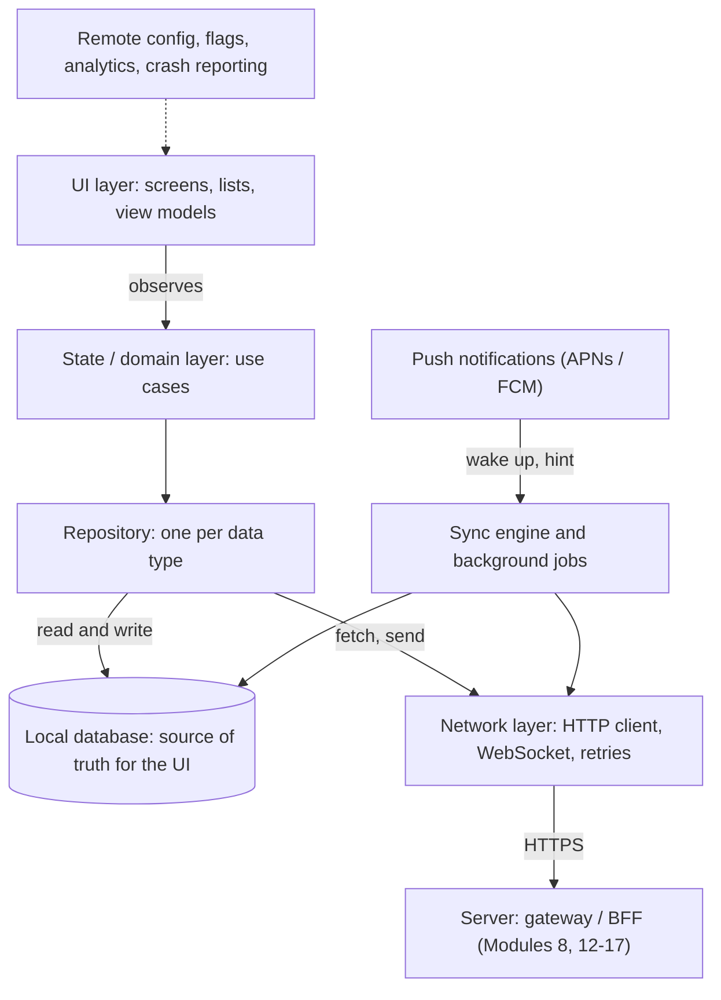
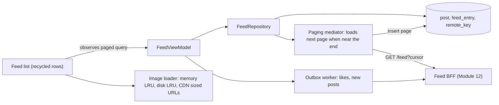
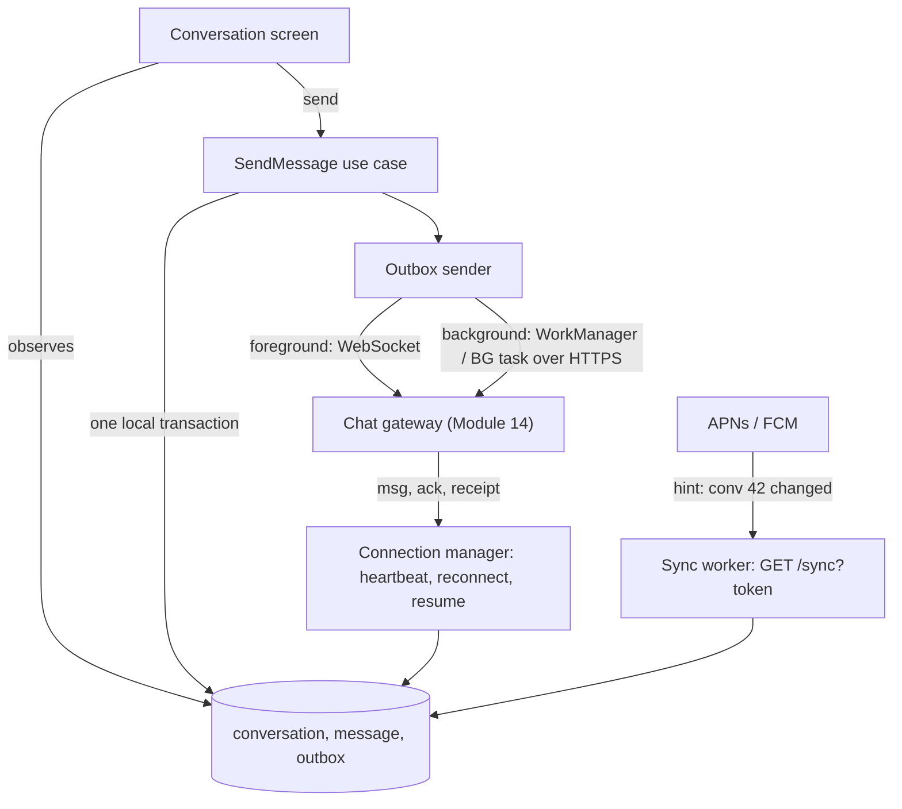
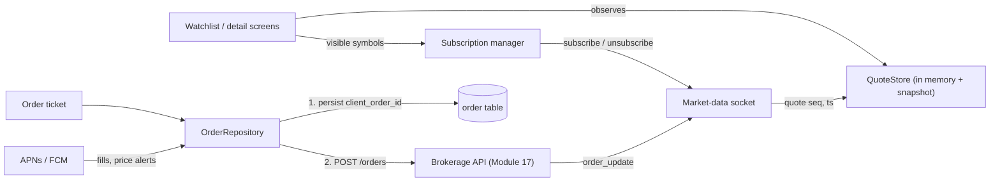
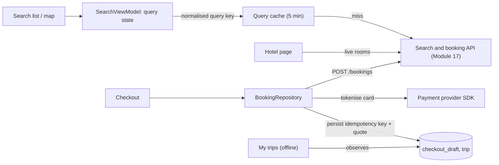
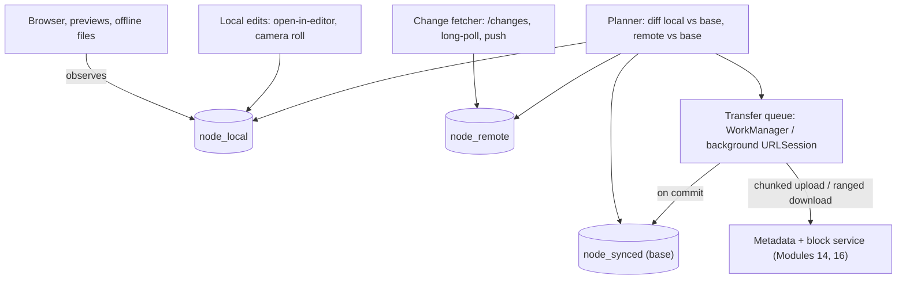
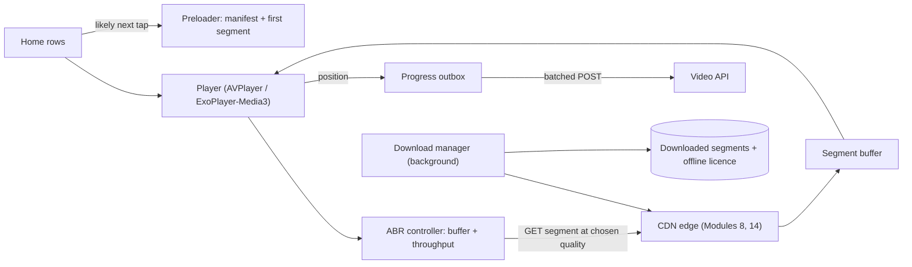

# Module 18 — Client & Mobile System Design (The App Side)

## Module Introduction

**What this module is.** Modules 1–17 design the *server*: queues, shards, caches and replicas behind an API. This module designs the **client**, the app running on a phone (or in a browser) that sits on the other end of that API (application programming interface: the set of requests the server accepts). If server terms such as queue, shard, cache or replica are unfamiliar, [System Design Fundamentals](../00-system-design-fundamentals/README.md) explains them. Client/mobile system design interviews are common for iOS, Android and front-end roles. They ask the same kind of question ("design a chat app") but grade a different set of decisions: what the app stores on the device, how it behaves with a bad or missing network, how it stays up to date without draining the battery, and how you ship and fix a binary (the compiled app package users install) you cannot redeploy. The module gives you a **framework** first (the nine building blocks every client design reuses), then **six apps** as compact case studies, each pointing to the server-side design for the other half.

**Analogy.** A server is a restaurant kitchen: it has reliable power, plenty of staff and you can change the menu any evening. A mobile app is a food truck. It carries its own small pantry (local storage), loses signal in tunnels (offline), runs on a limited fuel tank (battery and data plan), and once a truck is out on the road you cannot swap its engine; you can only send it new instructions over the radio (remote config and feature flags). Good food-truck design is about the pantry, the radio and the fuel, not the kitchen.

**How a client interview differs from a backend interview**

| | Backend interview | Client / mobile interview |
|---|---|---|
| Main constraint | Throughput (requests per second), storage, fan-out (one event delivered to many) at scale | One device: flaky network, battery, memory, OS (operating system) limits |
| "Source of truth" question | Which database is authoritative? | Does the UI read from the network or from a local database? |
| Failure you design for | A node or region dies | The network is slow, gone, or switches mid-request; the OS kills the app |
| Numbers you estimate | QPS (queries per second), TB, nodes (servers) | MB on disk, MB per day of data, requests per hour, frames per second |
| Deploy model | Redeploy in minutes, roll back (return to the previous version) | Store review, users update slowly, old versions live for years |
| API | You design the servers behind it | You mostly *consume* it; you may shape it (BFF, a backend built for one front end; pagination; sync endpoints) |

**The six apps**

| App | Center of gravity (the main client problem) | Server side lives in |
|---|---|---|
| News feed app | Paging an endless list, image caching, smooth scrolling, prefetch (loading data before it is needed) | [Module 12 — Design 1](../12-capstones/README.md#design-1--the-news-feed) |
| Chat app | Offline outbox (a local queue of unsent actions), ordering, real-time connection, push | [Module 14 — Chat System](../14-case-studies-messaging-and-media/README.md#case-1--chat-system) |
| Stock trading app | Live price stream, freshness vs battery, safe order placement | [Module 17 — Stock Exchange](../17-case-studies-money-and-reservations/README.md#design-a-stock-exchange) |
| Hotel reservation app | Search/filter/paging, stale prices, idempotent (safe to repeat) booking | [Module 17 — Hotel Reservation](../17-case-studies-money-and-reservations/README.md#design-a-hotel-reservation-system) |
| File sync app | Resumable chunked transfer, sync engine, conflicts | [Module 14 — File Sync and Storage](../14-case-studies-messaging-and-media/README.md#case-4--file-sync-and-storage-google-drive--dropbox-like) |
| Video streaming app | Adaptive bitrate (switching video quality to match the connection), buffering, downloads for offline | [Module 14 — Video Platform](../14-case-studies-messaging-and-media/README.md#case-3--video-platform-youtube-like) |

**The seven-stage format, client edition.** The case studies reuse [Module 12's seven stages](../12-capstones/README.md#module-introduction), adjusted for a device:
1. **Requirements and numbers:** functional scope, then non-functional targets that matter on a phone (launch time, scroll smoothness, offline support, battery, data use), then device-side estimates (MB of cache, requests per session, bytes per screen).
2. **The five-questions pass, client edition.** **Flow**: what does the user wait for, and what can happen in the background? **Storage**: what lives on the device, and is it the source of truth for the UI? **Speed**: what must render instantly from cache, and how stale may it be? **Failure**: what happens offline, on a flaky network, when the OS kills the app mid-task? **Growth**: what grows on the device over months (cache, message history, downloads), and what evicts it?
3. **The API and local data model:** the endpoints the app calls (or the real-time channel) and the tables in the on-device database.
4. **The architecture, annotated:** client layers (UI → state → repository → local DB / network / sync), with the server shown as one box plus a link to its module.
5. **Deep dives:** the 2–3 hard client problems.
6. **The failure walk:** network, OS, server and user failures, and what the user sees.
7. **Follow-up questions and the pattern manifest.**

**Three rules for every client design** (interviewers grade all three):
1. **The UI reads from local state, never directly from the network.** The network *updates* local state; the screen *observes* it. This single rule gives you instant launch, offline support and consistent screens.
2. **Every network call has an offline story.** For each request say what the user sees if it is slow, fails, or succeeds after the app was killed.
3. **Assume you cannot hot-fix.** Anything that might need changing after release (a threshold, an endpoint, i.e. a server URL the app calls, a risky feature) goes behind remote config or a feature flag, and the server keeps supporting old app versions.

### Terms used throughout

- **Client / device** — the app on the user's phone, tablet or browser.
- **Local database** — an embedded database inside the app (SQLite, a small SQL database stored in one file, usually wrapped by Room on Android or Core Data / SwiftData on iOS; IndexedDB in a browser — see [JS 14.4](../../../javascript/chapters/14-browser-apis-and-security/README.md#144-cookies-and-indexeddb--choosing-storage)).
- **Offline-first** — the app is designed so the local database is the source of truth (the copy that wins) for the UI (user interface) and the network is a background sync step, not a prerequisite.
- **Sync** — bringing local and server state into agreement in both directions (upload local changes, download remote changes).
- **Optimistic update** — show the result of a user action immediately, before the server confirms; roll back if it fails.
- **Push notification** — a message delivered by the operating system's push service (APNs on Apple devices, FCM on Android) that can reach the app even when it is not running.
- **Remote config / feature flag** — values and on/off switches the app downloads at runtime (while it is running) so behaviour can change without shipping a new binary ([Module 9 — Feature Flags](../09-operating-in-production/README.md#feature-flags)).
- **Jank** — visible stutter when the app misses frame deadlines (16.7 ms per frame at 60 Hz, i.e. 60 screen refreshes per second; 8.3 ms at 120 Hz).

### How to read the module

Read **The Client Framework** first: every case study refers back to its nine blocks by name. Then start with the **News feed app** (the most common prompt, and it introduces paging and image caching), then **Chat** (offline outbox and real-time). The other four each add one new hard problem: live data (trading), money-safe writes (hotel), bidirectional sync of large files (file sync) and media delivery (video). Finish with the **Pattern Review** table.

> Short on time? Read the framework's **Offline-first and sync**, **Networking and pagination** and **Push notifications** blocks, then the chat app. Those four cover most follow-up questions in any client interview.

### Before you start — questions about your own app

1. If you put your phone in airplane mode and open your app, what do you see? A spinner, an error, or yesterday's content?
2. If a user taps "send" in a tunnel and then swipes the app away, does the action ever happen?
3. How many versions of your app are still in active use today, and does your API still work for the oldest one?

---

## The Client Framework (building blocks)

**What this lesson is.** Nine building blocks that recur in every client design, each in a few paragraphs: what it is, how it works, what it costs and what to say in the interview. The case studies then only name the block and focus on what is special about that app. Web and React readers will recognise many of these from the React book; the links point there for code.

*The layered client architecture used in every case study*


### 1. Client architecture layers

**What it is.** Splitting the app into layers with one job each, so that network, storage and UI can change independently and be tested alone. Android's official architecture guide recommends a *UI layer*, an optional *domain layer* and a *data layer* built from repositories, with the principle "drive the UI from data models" and a single source of truth per data type ([Android guide to app architecture](https://developer.android.com/topic/architecture)).

**How it works.**
- **UI layer** — screens and a **view model** (an object that holds the screen's state and survives screen rotation) or, on the web, components plus a state store. The UI only *renders state* and *sends events* ("user tapped like"). Presentation patterns here are MVC, MVP, MVVM, VIPER (different ways to split screen code into model, view and controller-like parts) or unidirectional data flow (Redux/MVI style: state flows one way, from a single store to the UI, and events flow back); in an interview naming MVVM + unidirectional flow is enough. The React book covers the web equivalents in [Chapter 14](../../../react/chapters/14-patterns-and-architecture/README.md) and state management in [Chapter 6](../../../react/chapters/06-state-management/README.md).
- **Domain layer (optional)** — use cases that combine repositories ("send message" = write to outbox + schedule sync).
- **Data layer** — one **repository** per data type (posts, messages, files). The repository hides *where* data comes from. It exposes an observable stream (a value the UI can subscribe to and be told about every change) from the local database and methods that trigger network refreshes.
- **Cross-cutting services** — network client, sync engine, push handler, image loader, analytics, remote config. Created once and injected (dependency injection: objects receive the services they need from outside instead of creating them).

**Trade-offs.** Layers cost boilerplate (repetitive set-up code) and an extra hop for simple screens. They pay back the first time you add offline support or swap an API, because only the repository changes.

**In the interview.** Draw the layer diagram above in the first five minutes, then say "the UI observes the local database; the network only writes into it." Interviewers look for that separation.

### 2. Offline-first and sync

**What it is.** The local database is the source of truth for the UI; the network brings it up to date in the background. Android's guide calls this an [offline-first app](https://developer.android.com/topic/architecture/data-layer/offline-first); the research community's stronger version is [local-first software](https://www.inkandswitch.com/local-first/) (Kleppmann, Wiggins, van Hardenberg, McGranaghan, 2019), where the device copy is primary and the server is one more replica.

**The problem it solves.** A network-first app shows a spinner on every launch, a blank screen offline and loses actions typed in a tunnel. A phone on the move sees latency (the delay before a response arrives) from 50 ms to many seconds and regular gaps with no connection at all.

**How it works.**
- **Reads:** screen → repository → local DB (instant). In parallel the repository asks the server "what changed since my **sync token**?" (a cursor or version number the server gave last time) and writes the answer into the DB; the UI updates because it observes the DB. Stale-while-revalidate (show the cached copy now, fetch a fresh one in the background), applied to a whole database.
- **Writes:** the user's action is written to the local DB *and* to an **outbox** table (a queue of pending operations) in one local transaction (writes that all succeed or all fail together). The UI shows it immediately (optimistic, marked "sending"). A sync worker drains the outbox when the network is available, sending each operation with a **client-generated ID** so a retry is idempotent (has no extra effect) ([Module 5 — Idempotency](../05-reliability/README.md#idempotency)). The server's response replaces the optimistic row.
- **Conflicts:** when the same record was edited on two devices while offline, you need a rule. Options, from simplest: **last-writer-wins** on a timestamp (loses one edit silently), **server wins** (the device re-applies or discards), **field-level merge** (different fields both survive), **keep both** (a "conflicted copy", used by file sync), or **CRDTs** (conflict-free replicated data types, data structures whose concurrent edits always merge to the same result; Shapiro et al., 2011). This is multi-leader replication (several copies all accept writes and exchange them) with each phone as a leader — see DDIA's [use cases for multi-leader replication](../../../ddia/chapters/05-replication/README.md#use-cases-for-multi-leader-replication) and [handling write conflicts](../../../ddia/chapters/05-replication/README.md#handling-write-conflicts), and [Module 7 — Vector Clocks](../07-consistency/README.md#vector-clocks) for detecting concurrency.

**Trade-offs.** You gain instant screens, offline use and fewer requests. You pay with a schema (the table layout) on every device that must be migrated (converted to the new layout) on upgrade, conflict rules you must design and explain, and storage you must evict.

**When not to use it.** Screens where stale data is dangerous or useless: a payment confirmation, a live auction bid, a one-time password. Those stay online-only with a clear "you're offline" state.

**Common mistakes.** Writing to the network first and the DB after (the action is lost if the app dies in between); retrying writes without an idempotency key (duplicate messages or orders); treating the local cache as optional so each screen invents its own.

### 3. Caching and persistence

**What it is.** Choosing *where* each kind of data lives on the device and *when* it is thrown away.

**How it works — four tiers.**

| Tier | Holds | Lifetime | Example size budget |
|---|---|---|---|
| Memory cache (LRU: least recently used items are evicted first) | Decoded images, current screen state | Until memory pressure or app exit | 1/8 of the app's memory limit for bitmaps is a common start ([Android caching bitmaps](https://developer.android.com/topic/performance/graphics/cache-bitmap)) |
| Disk cache (HTTP / image) | Raw responses and image bytes, keyed by URL | Evicted by size (LRU) | 100–250 MB |
| Local database | Structured data the UI shows (posts, messages, file metadata) | Until evicted by your own policy | 10–500 MB, grows with history |
| Key-value prefs / secure storage | Settings, flags, tokens (Keychain / Keystore, the OS's encrypted stores for secrets) | Until logout | KB |

- **HTTP caching:** honour `Cache-Control` (the header that says how long a response may be reused) and use `ETag` (a version tag for the response) + `If-None-Match` so an unchanged resource costs a 304 ("not modified") with no body ([RFC 9111](https://www.rfc-editor.org/rfc/rfc9111) caching, [RFC 9110](https://www.rfc-editor.org/rfc/rfc9110) conditional requests).
- **Images:** request the size you display (the server or CDN, the content delivery network of cache servers near users, resizes), decode off the main thread (the one thread that draws the UI), cache decoded bitmaps in memory and bytes on disk, and cancel loads for rows that scrolled away.
- **Eviction:** give every tier a byte budget and an LRU policy; keep the most recent N items of history per conversation/feed and re-fetch older ones on demand.
- **Security:** tokens go in the Keychain / Android Keystore, never in plain preferences; sensitive tables can be encrypted at rest (encrypted while stored on disk).

**Trade-offs.** More caching means faster screens and fewer bytes, but more stale data, more disk used on phones that are often nearly full, and more invalidation logic (deciding when cached data is out of date). Server-side caching patterns carry over: see [Module 4 — Cache-Aside](../04-caching/README.md#cache-aside).

### 4. Networking and pagination

**What it is.** How the app talks to the server: protocol, request shape, paging, retries and real-time channels.

**How it works.**
- **Request/response over HTTPS** (HTTP/2 or HTTP/3 multiplex, i.e. interleave, many requests on one connection, which saves radio time). Use a **BFF** so one screen needs one request with exactly the fields it shows ([Module 8 — Backend for Frontend](../08-api-and-edge/README.md#backend-for-frontend)); GraphQL (a query language where the client names exactly the fields it wants) is the alternative when many clients need different shapes.
- **Pagination:** use **cursor pagination** for any list that changes while you scroll ([Module 8 — Cursor-Based Pagination](../08-api-and-edge/README.md#cursor-based-pagination)). On the client, a **paging library** loads pages as the user nears the end, keeps a bounded window in memory, stores pages in the DB, and exposes load states (loading / error / end) to the UI. Android's [Paging 3](https://developer.android.com/topic/libraries/architecture/paging/v3-overview) with its `RemoteMediator` (network → DB → UI) is the reference design; the React versions are [15.12 infinite scroll](../../../react/chapters/15-react-interview-and-machine-coding/README.md#1512-build-3--infinite-scroll), [15.16 pagination](../../../react/chapters/15-react-interview-and-machine-coding/README.md#1516-build-7--pagination) and [9.9 query keys and pagination](../../../react/chapters/09-routing-and-data-fetching/README.md#99-query-keys-pagination-and-dependent-queries).
- **Retries:** retry only idempotent requests (or requests with an idempotency key), with exponential backoff (doubling waits between tries) and jitter (a random extra delay so clients don't retry in lockstep) ([Module 5 — Retry with Exponential Backoff](../05-reliability/README.md#retry-with-exponential-backoff)), and respect `Retry-After` (a server header saying when to try again). Pause retries while the OS reports no connectivity instead of burning attempts.
- **Real-time:** when the app is in the foreground and needs server-initiated updates, pick from polling (asking repeatedly; simple, wasteful), long polling (the server holds each request open until it has news), **SSE** (server → client only; [Module 2 — Server-Sent Events](../02-moving-data/README.md#server-sent-events)) or **WebSocket** (both directions; [RFC 6455](https://www.rfc-editor.org/rfc/rfc6455); [Module 2 — Bidirectional Streaming](../02-moving-data/README.md#bidirectional-streaming)). Reconnect with backoff + jitter, send heartbeats (tiny periodic "still here" messages, ~30 s) to detect dead connections, and **resume from the last sequence number** so nothing is missed. Close the socket when the app goes to the background; use push instead.
- **Versioning:** the app sends its version in every request; the server keeps old response shapes working ([Module 8 — API Versioning](../08-api-and-edge/README.md#api-versioning)).

**Trade-offs.** A persistent socket gives sub-second updates but keeps the radio awake; polling is simpler but either stale or wasteful. Big pages mean fewer requests but slower first paint (the first time content appears on screen); small pages the opposite (20–30 items is a common default).

### 5. Push notifications

**What it is.** Messages delivered through the OS push service — **APNs** for Apple platforms ([Apple: sending notification requests to APNs](https://developer.apple.com/documentation/usernotifications/sending-notification-requests-to-apns)) and **FCM** for Android ([Firebase Cloud Messaging](https://firebase.google.com/docs/cloud-messaging)). The OS keeps *one* shared, battery-efficient connection per device, so your app does not need its own socket while in the background.

**How it works.**
1. On first launch the app asks the OS for a **device token** (an address for this app install) and registers it with your server, tied to the user. Tokens change; re-register on every launch.
2. Your server sends a message to APNs/FCM with the token; the OS delivers it.
3. Two kinds: **visible notifications** (title/body shown by the OS, even if the app is not running) and **data / background messages** (silent, wake the app briefly to sync). The OS throttles silent pushes; Apple documents that background notifications are low-priority and may be delayed or dropped, and FCM distinguishes normal and high priority ([FCM message priority](https://firebase.google.com/docs/cloud-messaging/android-message-priority)).
4. Use push as a **hint, not the data**: "conversation 42 has new messages" → the app syncs from the server. Payloads (the message contents) are small (APNs limit 4 KB), may be delivered late, out of order, more than once, or not at all, and may be collapsed (a **collapse key** keeps only the latest of a group).

**Trade-offs.** Push is the only reliable way to reach a backgrounded app without draining the battery, but it is best-effort (no delivery guarantee), rate-limited (capped in how many you can send) and needs user permission (iOS asks explicitly; Android 13+ also asks). The server side (fan-out, per-user preferences, provider calls) is [Module 2 — Capstone: Designing a Notification System](../02-moving-data/README.md#capstone---designing-a-notification-system).

**Common mistake.** Putting the message content in the push and treating it as delivered. If the push is dropped, the message is lost. The source of truth is always the sync API.

### 6. Background work

**What it is.** Work that must happen when the user is not looking at the screen: uploading the outbox, syncing, downloading a video, cleaning caches.

**How it works.** Both platforms strictly limit background execution to protect the battery.
- **Android:** `WorkManager` for deferrable, guaranteed work with constraints ("only on Wi-Fi", "only while charging") that survives app restarts and reboots ([WorkManager guide](https://developer.android.com/topic/libraries/architecture/workmanager)); foreground services (background work the user can see, with a visible notification) for long user-started tasks. Doze and App Standby (Android's battery-saving modes) defer jobs and network access for idle apps ([Optimize for Doze and App Standby](https://developer.android.com/training/monitoring-device-state/doze-standby)).
- **iOS:** `BGTaskScheduler` for app-refresh and longer processing tasks that the system runs at a time it chooses ([BackgroundTasks framework](https://developer.apple.com/documentation/backgroundtasks)); **background `URLSession`** for uploads and downloads that the OS continues even after your app is suspended or killed ([Downloading files in the background](https://developer.apple.com/documentation/foundation/url_loading_system/downloading_files_in_the_background)).
- **Design rule:** make every background job **idempotent and resumable** (able to continue where it stopped) (it can be killed at any second and run again), persist its progress in the DB, and never assume it runs at a precise time.

**Trade-offs.** The OS, not you, decides when background work runs. Designs that need "sync every 5 minutes in the background" are wrong on mobile; use push to trigger sync and let the OS batch the rest.

### 7. Battery, data and device constraints

**What it is.** The budgets a phone imposes: battery, cellular data, memory, CPU, disk and frame time.

**How it works — the rules of thumb.**
- **The radio is the battery hog.** A cellular radio stays in a high-power state for several seconds after each transfer (the "tail"), so ten small requests spread over a minute cost far more than one batched (grouped) request. **Batch** requests, **prefetch** while the radio is already up, and avoid chatty polling ([Android: optimize network access](https://developer.android.com/develop/connectivity/network-ops/network-access-optimization)).
- **Check the network type and user settings:** prefetch video and large images only on unmetered (not charged per byte) Wi-Fi, respect Low Data Mode / Data Saver, and lower image quality on slow networks.
- **Memory:** the OS kills background apps that use too much memory; decoded images dominate (a 1080×1080 image is ~4.7 MB decoded at 4 bytes/pixel). Downsample to the displayed size and bound memory caches.
- **Main thread:** never do disk, network, JSON parsing (turning the text data format into objects) or image decoding on the UI thread; a frame has 16.7 ms at 60 Hz. Lists must **recycle** row views (RecyclerView / UICollectionView / list virtualisation — [React 10.9](../../../react/chapters/10-performance/README.md#109-list-virtualization)).
- **Disk:** phones fill up. Every cache has a budget and an eviction policy, and downloads are user-visible and deletable.
- **App size and startup:** a cold start (launching when the app is not already in memory) target of under ~1–2 s; defer non-essential initialisation, lazy-load features.

**In the interview.** Say the numbers: "each wake-up of the radio costs seconds of high power, so I batch analytics every few minutes and piggyback them on other requests."

### 8. App releases and feature flags

**What it is.** How new code reaches users, and how you change behaviour after it has shipped.

**The problem it solves.** A server bug is fixed by a redeploy in minutes. A mobile bug ships in a binary that goes through store review (hours to days) and then reaches users only when they update, which some never do. So the release process itself is part of the design.

**How it works.**
- **Release train:** a fixed cadence (weekly or every two weeks) — branch cut (freezing the code for this release), internal testing, beta (TestFlight, Play testing tracks: pre-release channels for testers), then store submission.
- **Staged / phased rollout:** release to a small percentage first and watch crash and business metrics. Google Play supports [staged rollouts](https://support.google.com/googleplay/android-developer/answer/6346149) you can halt; Apple offers a 7-day [phased release](https://developer.apple.com/help/app-store-connect/update-your-app/release-a-version-update-in-phases) for automatic updates. This is [Module 9 — Canary Deployment](../09-operating-in-production/README.md#canary-deployment) for binaries.
- **Feature flags and remote config:** ship code "dark" (included but switched off) and turn it on from the server, per user segment, with a kill switch (a flag that turns a feature off instantly) ([Module 9 — Feature Flags](../09-operating-in-production/README.md#feature-flags); e.g. [Firebase Remote Config](https://firebase.google.com/docs/remote-config)). Cache the last config on disk with safe defaults so the app works if the config fetch fails.
- **Minimum supported version / forced upgrade:** the server can tell very old versions "please update" (hard block only for security or breaking changes; soft prompt otherwise).
- **Backward-compatible APIs and DB migrations:** the server supports N old app versions; each app version ships migrations for its local schema, tested from every version still in the wild.

**Trade-offs.** Flags multiply code paths and must be cleaned up; forced upgrades annoy users; supporting old versions slows the server team. All are cheaper than a bug you cannot recall.

### 9. Observability on the client

**What it is.** Knowing what is happening on millions of devices you cannot log into.

**How it works.**
- **Crash and hang reporting** (e.g. Firebase Crashlytics, Sentry, Apple MetricKit, Android vitals): symbolicated stack traces (the list of function calls at the crash, translated back to readable names) grouped by issue, with the app version and device, and "crash-free users" as the release gate.
- **Performance metrics:** cold start time, time to first content, frame drops (jank), request latency and error rate *as seen from the device* (which includes DNS, the name-to-address lookup, TLS, the encryption handshake, and radio wake-up that server metrics never see).
- **Product analytics events:** batched, stored locally, uploaded in the background with a sample rate (only a fraction of events is kept); each event carries app version, flag values and a session ID so you can compare a flag's on/off groups.
- **Tracing across the boundary:** the app sends a trace/request ID header so a slow screen can be followed into the backend ([Module 9 — Distributed Tracing](../09-operating-in-production/README.md#distributed-tracing); [OpenTelemetry](https://opentelemetry.io/) has mobile SDKs).
- **Privacy:** no personal data in logs, consent where required, and a server-side switch to lower sampling.

**Trade-offs.** Every event costs battery, data and privacy review; sample aggressively and batch.

### The framework as an interview checklist

| Stage of the answer | What to say for the client |
|---|---|
| First 5 minutes | Scope, platforms, offline required?, real-time required?, scale per device (items, MB) |
| Architecture | Layer diagram; "UI observes local DB"; list the repositories |
| API | Endpoints or socket messages, pagination style, sync token, idempotency keys |
| Data model | Local tables, indexes, what is evicted |
| Deep dives | Pick 2–3 of: offline writes, real-time channel, paging + images, large transfers, media |
| Failure walk | Offline, flaky, killed mid-task, server error, stale data, old app version |
| Wrap-up | Battery/data budget, release + flags, metrics you would watch |

### Self-check

- **Q1: Why should the UI observe the local database instead of the network response?** → It makes the screen instant (reads are local), consistent (every screen shows the same row), and offline-capable (the DB still has yesterday's data). The network becomes a background writer into the DB.
- **Q2: A message sent in a tunnel is lost when the user swipes the app away. What was missing?** → A durable outbox: write the message to the DB and an outbox row in one local transaction, then let a background job (WorkManager / background task) drain it with a client-generated ID.
- **Q3: Why is "poll every minute in the background" a bad design on mobile?** → The OS will not run it on schedule (Doze, background limits), and each wake-up keeps the radio in a high-power state. Use push as a hint and sync when woken or when the app opens.

### TL;DR

| | |
|---|---|
| Core idea | The device has its own database, network and battery budget; design those, and treat the server as a box with a link. |
| The nine blocks | Layers · offline-first & sync · caching & persistence · networking & pagination · push · background work · battery/data · releases & flags · observability |
| Golden rules | UI reads local state · every call has an offline story · assume you cannot hot-fix |

---
## App 1 — News Feed App

**The prompt (in short).** Design the mobile client for a social feed: an endless, scrollable list of posts with text and images, likes and comments, pull-to-refresh, and a feed that still shows something offline.

**What makes it hard.** The list never ends, changes while you scroll, and is mostly images. The client must page it without duplicates or jumps, keep scrolling at 60–120 frames per second while images load, and do all of it on a limited data plan. The server half (fan-out, celebrity merge, ranking) is [Module 12 — Design 1](../12-capstones/README.md#design-1--the-news-feed); here the server is one box behind a BFF.

### 1. Requirements and numbers

- **Functional:** scroll the home feed; pull to refresh; a "new posts" pill when newer items exist; like (and unlike) with instant feedback; open comments; create a post with up to 4 photos; show the last-seen feed when offline.
- **Non-functional:** first content on screen **< 1 s** after a cold start (from cache); no dropped frames while scrolling; a like never lost or doubled; data use a user would not notice (~10 MB per session on cellular).
- **Per-session estimates (my assumptions):**
  - A 10-minute session scrolls ~**150 posts**. With **20 posts per page** that is ~**8 page requests**. At ~1.5 KB of JSON per post, each page is ~**30 KB**, so ~**240 KB of JSON** per session. JSON is cheap; images are not.
  - ~60% of posts have an image: **90 images**. Served at display width (1080 px WebP, a compact image format) they average ~**100 KB**, so ~**9 MB per session**. Asking for full-resolution originals (1–3 MB) instead would cost **~150 MB**: requesting the right size matters 15x.
  - **Memory:** one 1080×1350 image decoded at 4 bytes per pixel is **~5.8 MB**. A 64 MB memory cache holds only ~11 such images, so the list must recycle rows and downsample.
  - **Disk:** keep the latest ~**300 posts** in the database (~0.5 MB) plus a **150 MB** image disk cache (LRU).

### 2. The five-questions pass (client edition)

- **Flow:** the user waits only for the first screen, which comes from the local database. Page loads, image downloads, likes and post uploads are async.
- **Storage:** the local DB is the source of truth for the list the UI shows; the server is authoritative for posts and counts.
- **Speed:** the first screen renders from cache; stale by minutes is fine because a refresh runs immediately.
- **Failure:** offline → show cached feed plus a banner; a failed like rolls back; a post created offline waits in the outbox.
- **Growth:** the image cache and post table grow with every session, so both are bounded and evicted by LRU / age.

### 3. The API and local data model

```text
GET  /v1/feed?cursor=<opaque>&limit=20      -> { items:[post], next_cursor, feed_version }
GET  /v1/feed/new-count?after=<top_cursor>  -> { count }            (cheap, polled while visible)
POST /v1/posts/{id}/like    Idempotency-Key: <uuid>                (PUT-like: sets state, safe to retry)
DELETE /v1/posts/{id}/like  Idempotency-Key: <uuid>
POST /v1/media/upload-url   -> { upload_url, media_id }            (pre-signed URL to object storage)
POST /v1/posts  { client_post_id, text, media_ids[] }
```

Each post in the response carries `image: { url_template, width, height, dominant_color }` so the client asks the CDN for exactly its display width and reserves the right space before the image arrives. (`upload-url` returns a pre-signed URL: a temporary signed link that lets the app upload one file straight to object storage, a cheap store for large files.)

| Local table | Key columns | Notes |
|---|---|---|
| `post` | `id` PK (primary key), `author_id`, `text`, `image_json`, `like_count`, `liked_by_me`, `created_at` | Upserted (inserted, or updated if it exists) from every page |
| `feed_entry` | (`feed_id`, `position`) PK, `post_id` | The order the server gave; the UI observes this joined to `post` |
| `remote_key` | `feed_id` PK, `next_cursor`, `last_refresh_at` | Where to continue paging |
| `pending_action` | `id` PK, `type`, `payload`, `idempotency_key`, `attempts` | The outbox (likes, new posts) |

### 4. The architecture, annotated

*Feed client: paging through the database*


1. **Cold start:** the view model opens a paged query on `feed_entry ⋈ post` (⋈ = a join of the two tables); the first 20 rows come from SQLite in a few milliseconds.
2. **Refresh:** in parallel the paging mediator calls `GET /feed` without a cursor. If the new first page overlaps what is on screen, it **does not shift the list under the user's thumb**; it shows a "new posts" pill, and applies the new page when the user taps it or pulls to refresh.
3. **Scrolling:** when the user is within ~5 rows of the end of loaded data, the mediator fetches the next page with `next_cursor` ([cursor pagination](../08-api-and-edge/README.md#cursor-based-pagination)), inserts it in a transaction, and the list grows. Paging is a *database* concern; the UI never holds the network response. (Web version: [React 15.12 infinite scroll](../../../react/chapters/15-react-interview-and-machine-coding/README.md#1512-build-3--infinite-scroll) and [10.9 list virtualization](../../../react/chapters/10-performance/README.md#109-list-virtualization).)
4. **Images:** the loader builds a sized CDN URL, checks memory then disk, decodes off the main thread and cancels requests for rows that left the screen.
5. **Likes and posts** go through the outbox (below).

### 5. Deep dives

**Deep dive 1 — pagination that does not drift or duplicate.** The server's cursor is tied to a row, not an offset, so inserts at the top do not shift page 2. The client adds two rules: (a) it **de-duplicates by post ID** when inserting a page (a ranked feed can return a post again), and (b) a full refresh after a long absence **replaces** the feed rather than merging, because merging a new ranked page onto a day-old list creates a "gap" of posts the user never sees. Android's Paging 3 `RemoteMediator` implements exactly this "network → database → UI" loop with `REFRESH`, `APPEND` and `PREPEND` load types ([Paging 3 overview](https://developer.android.com/topic/libraries/architecture/paging/v3-overview)). Keep a **bounded window**: the list holds maybe 200 items in memory and drops far-away pages, re-reading them from the DB if the user scrolls back.

**Deep dive 2 — images without jank or huge data bills.**
- **Size:** request the displayed width times screen density (e.g. 360 dp, density-independent pixels, × 3 = 1080 px), in WebP/AVIF. This is the single biggest saving (the 15x above).
- **No layout jumps:** the API returns width/height, so the row reserves its space; a dominant colour or a tiny blurred placeholder fills it until the image arrives.
- **Prefetch:** when the next page lands, prefetch images for its first ~5 rows. On cellular or Data Saver, prefetch only thumbnails; on Wi-Fi prefetch full images.
- **Memory:** an LRU memory cache sized as a fraction of the app's memory class; release it on the OS's memory-pressure callback.
- **Video posts:** autoplay muted only when ≥ 50% visible, only one at a time, and never preload video on cellular.

**Deep dive 3 — optimistic likes that survive retries.** Tapping like updates `liked_by_me = true, like_count + 1` locally (the heart turns red instantly) and inserts an outbox row with a fresh **idempotency key**. The worker sends it; on success it stores the server's authoritative count; on a permanent error (post deleted) it rolls back and shows a small toast (a brief pop-up message). Double taps like → unlike → like before the network returns are **collapsed**: the outbox keeps only the final desired state per post ("set liked = true"), sent as a PUT-style operation that is naturally idempotent. That is cheaper and safer than sending three toggles in order. (React/TanStack, a React data-fetching library, version: [9.10 optimistic updates](../../../react/chapters/09-routing-and-data-fetching/README.md#910-mutations-invalidation-and-optimistic-updates).)

### 6. The failure walk

1. **Offline at launch:** the cached feed renders; a banner says "You're offline"; pull-to-refresh shows the banner instead of spinning forever. Paging stops at the end of cached data with a "retry" row.
2. **Flaky network while scrolling:** the append request times out → the footer shows "Tap to retry"; the mediator retries with backoff when connectivity returns. Already-loaded rows are unaffected.
3. **App killed while a post with photos is uploading:** the upload runs as a background job (WorkManager / background `URLSession`) that resumes from the outbox; the draft stays visible as "Posting…". The `client_post_id` prevents a double post if the commit is retried.
4. **Server returns a post already on screen:** de-duplicated by ID on insert.
5. **Old app version:** the BFF keeps the old response shape; new post types the old app cannot render come with a fallback ("Update the app to see this post").

### 7. Trade-offs

| Decision | Chosen | Alternative | Why |
|---|---|---|---|
| Source of truth for the list | Local DB | In-memory list from the network | Instant launch, offline, survives process death |
| New posts while reading | "New posts" pill | Auto-insert at top | Content never jumps under the thumb |
| Page size | 20 | 50 | Faster first paint; the extra requests are tiny |
| Likes | Collapsed desired-state in outbox | Send each toggle | Idempotent, fewer requests, no ordering bugs |
| Image quality | Sized per device + network | One size for all | 10–15x less data; less memory |

### 8. Follow-up questions

- **"How do you show 'N new posts' without a socket?"** Poll `new-count` every ~60 s *only while the feed is on screen and in the foreground*, piggybacked on other requests where possible; or use an SSE stream if the product needs seconds-level freshness. In the background, do nothing; a push can prompt a refresh.
- **"Ranking changed between page 1 and page 2."** The cursor encodes a snapshot/version of the ranked list (`feed_version`), so pages come from one consistent ordering; a pull-to-refresh starts a new version.
- **"How would you add ads?"** The server interleaves them into the page as another item type; the client only needs a renderer per type and impression logging via analytics.
- **"Scroll position after the app was killed?"** Save the first visible post ID; on relaunch, scroll to it in the cached list if the cache is fresh (say < 30 min), otherwise start at the top.

### 9. Pattern manifest

| Pattern | Where it served |
|---|---|
| Offline-first + outbox | Feed renders from DB; likes and posts queue in the outbox |
| Cursor pagination + paging mediator | Endless list without drift |
| Cache tiers + CDN sizing | Images: memory LRU, disk LRU, sized URLs |
| Idempotency | Like state and `client_post_id` |
| BFF | One request per screen with sized image templates |
| Background work | Photo upload survives app death |
| Battery/data rules | Prefetch on Wi-Fi only, no video preload on cellular |

**Interview one-liner:** "The feed screen observes a local table that a paging mediator fills page by page with cursors; images are requested at display size and cached in two tiers, and every user action is an optimistic local write drained idempotently by an outbox."

---

## App 2 — Chat App

**The prompt (in short).** Design a mobile messaging client: one-to-one and group chats, text and photos, delivery and read receipts, typing indicators, push notifications, and sending while offline.

**What makes it hard.** Messages must never be lost or duplicated, must appear in a sensible order on every device, and must arrive in real time when the app is open *and* when it is closed, all without a permanently open connection draining the battery. The server half (connection gateways, per-conversation sequencing, fan-out, storage) is in [Module 14 — Chat System](../14-case-studies-messaging-and-media/README.md#case-1--chat-system); the delivery pattern is [Module 2 — Bidirectional Streaming](../02-moving-data/README.md#bidirectional-streaming).

### 1. Requirements and numbers

- **Functional:** conversation list with unread counts; conversation screen with history; send text/photo; states *sending → sent → delivered → read*; typing indicator; push for new messages; works on several devices per user; local search of recent history.
- **Non-functional:** a message sent while online shows as *sent* in **< 500 ms** at p95 (95 out of 100 messages are faster); nothing typed is ever lost (even if the app is killed); no duplicates; opening a conversation is instant (from local DB); little battery use in the background.
- **Estimates (assumptions):** an active user sends **40** and receives **200** messages a day. At ~300 bytes each (JSON, text only) that is ~**70 KB/day** of message traffic, which is nothing; photos dominate (10 received × 150 KB thumbnail-then-full = 1.5 MB/day). History: **1 year ≈ 90,000 messages**; at ~0.5 KB per row including indexes, that is ~**45 MB** of SQLite, fine to keep locally with full-text search (searching inside message text). Groups of up to 256 members.

### 2. The five-questions pass (client edition)

- **Flow:** typing and tapping send must never block. The message is written locally and shown immediately; delivery is async.
- **Storage:** the local DB holds conversations and messages and is what every screen observes. The server's per-conversation **sequence number** is the authority on order.
- **Speed:** open conversation = local query of the last 50 messages. Older history pages in from the server on scroll-up.
- **Failure:** offline → messages wait in the outbox as *sending*, with a clock icon; server rejects → *failed* with "tap to retry".
- **Growth:** history and media grow forever; keep text, evict media files by LRU (re-downloadable), let the user clear storage per chat.

### 3. The API and local data model

A **WebSocket** while the app is in the foreground, plus HTTPS for sync, history and media.

```text
WS  -> {type:"send", client_msg_id, conv_id, body, attachments[]}
WS  <- {type:"ack",  client_msg_id, conv_id, seq, server_ts}
WS  <- {type:"msg",  conv_id, seq, sender_id, body, server_ts}
WS  <-> {type:"receipt", conv_id, up_to_seq, kind:"delivered"|"read"}
WS  <-> {type:"typing", conv_id}                         (ephemeral, never stored)
GET /v1/sync?token=<opaque>         -> { changes:[msgs, receipts, convs], next_token, has_more }
GET /v1/conversations/{id}/messages?before_seq=<n>&limit=50
POST /v1/devices { push_token, platform }
```

| Local table | Key columns | Notes |
|---|---|---|
| `conversation` | `id` PK, `title`, `last_seq`, `last_read_seq`, `unread_count`, `updated_at` | Conversation list sorted by `updated_at` |
| `message` | `client_msg_id` UNIQUE, `conv_id`, `seq` (null while pending), `sender_id`, `body`, `status`, `local_ts`, `server_ts` | Index on (`conv_id`, `seq`) |
| `outbox` | `client_msg_id` PK, `attempts`, `next_attempt_at` | Drained in order per conversation |
| `sync_state` | `sync_token` | Where the last sync stopped |
| `message_fts` | full-text index over `body` | On-device search |

### 4. The architecture, annotated

*Chat client: one write path, two delivery paths in*


1. **Send:** one local transaction inserts the message (`status = pending`, `seq = null`) and an outbox row. The UI shows it at the bottom with a clock icon.
2. The **outbox sender** transmits over the socket if connected, otherwise schedules a background job with a "network connected" constraint.
3. The server assigns the per-conversation `seq` and replies with an **ack** carrying `client_msg_id`; the client updates that row (`status = sent`, `seq`, `server_ts`) and deletes the outbox row.
4. Incoming messages arrive over the socket in the foreground, or via **push → sync** in the background. Both paths write into the same tables, so the UI does not care which one delivered.

### 5. Deep dives

**Deep dive 1 — never lost, never duplicated.** Loss is prevented by the durable outbox: the message is on disk before the user sees it as sent. Duplication is prevented by `client_msg_id` (a UUID made on the device): the server stores it with a unique constraint and returns the *same* ack for a repeat, so a retry after a lost ack is harmless ([Module 5 — Idempotency](../05-reliability/README.md#idempotency)). On receive, the client upserts by `client_msg_id`/`(conv_id, seq)`, so a message delivered by both socket and sync appears once. This is at-least-once delivery (repeat until confirmed, so duplicates are possible) plus idempotent processing, the same combination as [exactly-once semantics](../10-batch-and-streaming/README.md#exactly-once-semantics) on the server.

**Deep dive 2 — ordering.** Device clocks are wrong and two people type at once, so order by the server's **per-conversation sequence number**, not by local time. Pending messages (no `seq` yet) sort *after* all acknowledged ones, in local send order; when acked they move into their `seq` slot (usually the same place). The outbox sends one conversation's messages **in order, one in flight at a time** (or pipelined with ordered acks), so "Meet at 5" never lands after "Actually 6". **Gap detection:** if the client holds seq 101 and receives 104, it knows 102–103 are missing and calls `sync` before marking the conversation read.

**Deep dive 3 — real time without killing the battery.**
- **Foreground:** one WebSocket per app (not per conversation). Heartbeat every ~30 s to detect dead links (mobile NATs, the network address translators carriers put between phones and the internet, silently drop idle connections). On disconnect, reconnect with **exponential backoff plus jitter** (1 s, 2 s, 4 s … capped at 30–60 s, randomised) so a million phones leaving a tunnel region do not reconnect in the same second ([Module 5 — Retry with Exponential Backoff](../05-reliability/README.md#retry-with-exponential-backoff)). After reconnecting, call `sync?token=` first to fetch what was missed, then resume the live stream.
- **Background:** close the socket (the OS would suspend it anyway). New messages arrive as **push notifications**. For a normal chat, the push is visible ("Alice: are you free?") *and* acts as a hint; on receipt the app runs a short sync so the conversation is already loaded when the user taps. For **end-to-end encrypted** chats the server cannot read the text, so the push carries only an encrypted payload or an ID, and an iOS Notification Service Extension (a small process allowed to modify a notification before display) decrypts or fetches it ([Apple: modifying content in newly delivered notifications](https://developer.apple.com/documentation/usernotifications/modifying-content-in-newly-delivered-notifications)).
- **Don't double-notify:** no system notification for a conversation currently open; cancel notifications for a conversation once it is read on *another* device (the server sends a silent "read up to seq N" push).
- **Typing indicators** are sent at most once every few seconds, only over the socket, and never stored or retried.

### 6. The failure walk

1. **Sent in a tunnel, app swiped away:** the outbox row survives; a WorkManager / BGTask job (or the next launch) sends it. The user sees *sending* until then, and *failed + retry* after a long timeout (say 24 h).
2. **Ack lost after the server stored the message:** the client retries with the same `client_msg_id`; the server returns the original ack; no duplicate.
3. **Push dropped by the OS:** nothing is lost, only delayed; the next launch or foreground runs `sync` from the stored token.
4. **Socket connected but silently dead:** the heartbeat misses twice → reconnect → sync.
5. **Two devices read the same chat:** read receipts are "read up to seq N" (monotonic, max wins), so they merge without conflict across devices.
6. **Local DB schema upgrade on app update:** a migration runs before the UI opens; tested from every schema version still in use.

### 7. Trade-offs

| Decision | Chosen | Alternative | Why |
|---|---|---|---|
| Order | Server per-conversation `seq` | Device timestamps | Clocks skew; one authority per conversation |
| Foreground channel | One WebSocket | Polling / SSE + POST | Two-way, low latency, one connection for all chats |
| Background delivery | Push as hint + sync | Keep a socket alive | OS forbids it; battery |
| Receipts | "Up to seq N" | Per-message receipts | O(1) (constant size) per conversation; merges trivially |
| History | Local, recent year; older on demand | Everything always from server | Instant open, offline read, local search |

### 8. Follow-up questions

- **"How do you sync a new device with 5 years of history?"** Download conversation list + last ~50 messages per conversation first (usable in seconds), then backfill older history in a background job on Wi-Fi and while charging. Media stays on the server until opened.
- **"Group of 256: how do you show 'read by'?"** Store per-member `last_read_seq`; a message is read by members whose value ≥ its seq. Fetch the per-member list lazily when the user opens message info.
- **"Edits and deletes?"** They are new events with their own `seq` that reference the original message; the client applies them to the row. Deletes become tombstones (markers saying "deleted") so a late sync does not resurrect the message.
- **"Photo sending?"** Compress and resize on the device, upload to a pre-signed URL in a background upload job, then send the message referencing `media_id`. The bubble shows a local thumbnail and upload progress.

### 9. Pattern manifest

| Pattern | Where it served |
|---|---|
| Outbox + idempotency key | Never lose or duplicate a sent message |
| Bidirectional streaming (WebSocket) | Foreground real-time messages, acks, receipts, typing |
| Push as hint + sync token | Background delivery and catch-up |
| Retry with backoff + jitter | Reconnect storms after network loss |
| Sequence numbers + gap detection | Ordering and completeness |
| Monotonic (only moves forward) "max wins" merge | Read receipts across devices |
| Background work | Outbox drain and history backfill |

**Interview one-liner:** "Messages are written to a local outbox first and sent with a client ID so retries are safe; the server's per-conversation sequence number defines order; the socket is for the foreground and push-plus-sync covers everything else."

---
## App 3 — Stock Trading App

**The prompt (in short).** Design the mobile client of a retail brokerage: a watchlist with live prices, price charts, portfolio value, placing and cancelling orders, and price-alert notifications.

**What makes it hard.** Two opposite requirements share one screen. Prices must be *fresh* (a quote seconds old can mislead a trade) but streaming everything all the time wastes battery and data. Orders must be placed *exactly once*, even when the network times out at the worst moment, and money must be displayed correctly. Unlike the feed, **offline trading is not allowed**: the app must know when its data is stale and say so. The exchange and ledger (the append-only record of money movements) behind it are in [Module 17 — Stock Exchange](../17-case-studies-money-and-reservations/README.md#design-a-stock-exchange) and [Digital Wallet](../17-case-studies-money-and-reservations/README.md#design-a-digital-wallet); the consistency ideas come from [Module 7](../07-consistency/README.md) and [Module 12 — Design 3, the payment platform](../12-capstones/README.md#design-3--the-payment-platform).

### 1. Requirements and numbers

- **Functional:** watchlist (up to ~50 symbols) with last price and daily change; symbol detail with a chart (1D, 1W, 1M, 1Y, 5Y); portfolio value and positions; place market and limit orders; see order status and fills; cancel open orders; price alerts by push.
- **Non-functional:** prices on screen **≤ 1 s old** while the app is in the foreground; an order is never placed twice and its final state is always known; figures in exact decimal; biometric re-authentication (fingerprint or face check) for trading; clear "market closed" and "prices delayed" states.
- **Estimates (assumptions):**
  - A liquid symbol can print **dozens of trades per second**, but a human cannot read more than a few updates per second. The server **conflates** (keeps only the latest price per symbol, i.e. stock ticker, per interval) to **at most 4 updates/s per symbol**; the client renders at most ~1–2 changes/s per row.
  - Streaming all 50 watchlist symbols at 4 updates/s × ~60 bytes = **12 KB/s ≈ 43 MB/hour**. Subscribing only to the ~**10 visible rows** cuts it to **~9 MB/hour**, and dropping to 1 update/s to **~2 MB/hour**. Visibility-based subscription is the biggest lever.
  - A 1D chart at 1-minute bars is 390 points (a US trading day) × ~40 bytes ≈ **16 KB**; a 5Y chart at daily bars ~1,260 points ≈ **50 KB**. Cache the long ranges for hours; only 1D changes during the day.

### 2. The five-questions pass (client edition)

- **Flow:** the user waits for order submission (seconds, with a clear pending state). Everything else is streamed or cached.
- **Storage:** the server is the only source of truth for balances, positions and orders. The device caches the last snapshot *for display* with its timestamp, never as a basis for trading.
- **Speed:** watchlist and portfolio render instantly from the cached snapshot, marked with its age, then go live.
- **Failure:** offline or stream stalled → grey out prices, show "as of 10:42:13", disable the Buy button; order timeout → query, never blindly resend.
- **Growth:** small on the device (charts and snapshots); the growth problem is subscription count, handled by visibility.

### 3. The API and local data model

```text
GET  /v1/portfolio                      -> { cash, positions[], as_of }
GET  /v1/quotes?symbols=AAPL,MSFT       -> snapshot { symbol, price, change, seq, ts }[]
GET  /v1/charts/{symbol}?range=1D       -> bars[]  (Cache-Control per range)
WS   -> {type:"subscribe", symbols:[...]} / {type:"unsubscribe", symbols:[...]}
WS   <- {type:"quote", symbol, price, seq, ts}         (conflated server-side)
WS   <- {type:"order_update", order_id, client_order_id, status, filled_qty, avg_price}
POST /v1/orders  { client_order_id, symbol, side, qty, type, limit_price?, max_price? } -> 202 { order_id, status:"pending" }
GET  /v1/orders?client_order_id=<id>    -> the order, if the server ever received it
DELETE /v1/orders/{order_id}            (cancel request; the final state comes via order_update)
```

Money and prices travel as **decimal strings** ("189.4200") and are parsed into decimal types on the device, never binary floats (0.1 + 0.2 ≠ 0.3 in floating point).

| Local table / store | Contents | Why it exists |
|---|---|---|
| `quote_snapshot` | symbol, price, change, `ts` | Instant first paint, labelled with its age |
| `chart_cache` | symbol, range, bars, `fetched_at` | Avoid refetching 5Y data every time |
| `order` | `client_order_id` PK, `order_id`, status, fields, `updated_at` | Survives a crash between submit and response |
| `watchlist` | ordered symbols | Synced to the server for other devices |

### 4. The architecture, annotated

*Trading client: a live stream for display, a careful path for orders*


1. The **subscription manager** keeps the socket's subscription set equal to "symbols visible on screen right now" (debounced ~300 ms while scrolling: wait until changes stop for 300 ms before acting), plus open-order symbols.
2. Quotes flow into an in-memory **QuoteStore**; rows observe their symbol and re-render at most ~2 times per second (UI throttling), flashing green/red on change.
3. The **order path** is separate, deliberately slow and explicit: persist, submit, then follow status updates.

### 5. Deep dives

**Deep dive 1 — snapshot + stream, and knowing when data is stale.** On open, fetch a REST **snapshot** (each quote carries a per-symbol `seq`), then subscribe to the stream and apply only updates with a higher `seq` (drop older ones that raced the snapshot). This is the same "load a snapshot, then follow the log from its position" idea as bootstrapping a replica in [DDIA ch. 5](../../../ddia/chapters/05-replication/README.md#setting-up-new-followers). The client tracks the **last message time**; if no quote or heartbeat arrives for ~3 s it marks all prices *stale* (greyed, timestamped) and reconnects with backoff + jitter, then re-snapshots. **Backgrounding** closes the socket immediately; returning re-snapshots. During market close the app stops streaming entirely and shows the closing price, because nothing is changing. Alerts ("AAPL crossed $200") are evaluated **on the server** and delivered by push, because the app cannot watch prices in the background.

**Deep dive 2 — placing an order exactly once.** The dangerous moment is a timeout after tapping *Buy*: did the order reach the broker or not? Resending could buy twice; giving up could leave an unknown open order.
1. When the user opens the confirm sheet, generate a **`client_order_id`** (UUID) and persist the draft order locally. (Exchanges use the same idea: the FIX protocol's `ClOrdID` is a client-assigned order identifier; [FIX Trading Community](https://www.fixtrading.org/standards/).)
2. `POST /orders` with that ID; the server treats it as an **idempotency key** (a unique constraint per account), so a retry returns the same order.
3. On timeout or connection loss, **do not blindly resend**: query `GET /orders?client_order_id=…`. If found, adopt its status. If not found, resubmit **with the same ID**: if the first request was only delayed and arrives later, the server's unique constraint rejects it as a duplicate, so the user can never get two orders.
4. The order is a **state machine** shown to the user: *pending → accepted → partially filled → filled*, or *rejected / cancelled / expired*. Updates arrive over the socket in the foreground and push in the background; the REST query is the fallback.
5. **Market orders** (buy or sell now at whatever the price is) **get a price guard:** send a `max_price` (collar) computed from the quote the user saw, so a stale screen cannot buy at a wildly different price. Show "Estimated cost", never a promise.

**Deep dive 3 — correctness and trust in what is shown.**
- The **server computes** portfolio value, buying power and P&L (profit and loss); the client only formats them. Locally recomputing from streamed prices is fine for a live-moving total, but anything used for a decision (buying power) comes from the server.
- **Decimals, currencies and time zones:** exchange time for market hours; user's time zone for display.
- **Security:** tokens in Keychain/Keystore; biometric prompt before placing orders and after N minutes idle; certificate pinning (the app trusts only one specific server certificate) is optional and must be paired with a remote kill switch because a pinned certificate rotation (replacement) could brick (permanently break) old app versions; screenshots of account screens can be blocked on Android (`FLAG_SECURE`).

### 6. The failure walk

1. **Stream stalls (still "connected"):** heartbeat timeout → prices greyed "as of …", trading still allowed but the ticket shows a fresh REST quote before confirm.
2. **Offline:** cached portfolio with age label; order button disabled with "No connection".
3. **Timeout on order submit:** state *unknown* shown as "Checking order status…"; query by `client_order_id`; never a second POST with a new ID.
4. **App killed after submit:** on relaunch the `order` table shows a pending order with no `order_id` → reconcile (ask the server and adopt its answer) by `client_order_id`.
5. **Duplicate or out-of-order `order_update`:** apply only if the status moves forward in the state machine (or `updated_at`/version is newer).
6. **Exchange halts a symbol:** the server sends a status flag; the ticket disables and explains.

### 7. Trade-offs

| Decision | Chosen | Alternative | Why |
|---|---|---|---|
| Price updates | WebSocket, conflated, visible symbols only | Poll every second | Sub-second freshness at ~2–9 MB/hour instead of 40+ |
| UI refresh rate | Throttled to ~2 Hz (twice per second) per row | Render every tick | Humans cannot read faster; saves CPU and battery |
| Offline | Read-only cached view, no trading | Queue orders offline | A queued order would execute at an unknown future price |
| Order retries | Query by `client_order_id` then resubmit same ID | Retry POST on timeout | Prevents double buys |
| Money types | Decimal strings | Floats | Exactness |

### 8. Follow-up questions

- **"Why not queue orders offline like chat messages?"** A chat message has the same meaning in an hour; an order does not. Market conditions change, so an offline order must be re-confirmed by the user with a fresh quote.
- **"How do you draw a live 1D chart efficiently?"** Load 1-minute bars once; update only the last bar from the stream (adjust high/low/close); append a new bar each minute. Redraw on a timer, not per tick.
- **"Price alerts?"** Server-side rules evaluated against the market-data stream, delivered by push with a collapse key per alert so the phone shows only the latest.
- **"How do you test the order path?"** Fault injection (deliberately causing failures to test handling) in a debug build: drop the response after the server commits, kill the app after submit, deliver updates twice and out of order.

### 9. Pattern manifest

| Pattern | Where it served |
|---|---|
| Snapshot + ordered stream (seq) | Quotes without gaps or regressions |
| Subscription by visibility + conflation | Battery and data budget for live prices |
| Idempotency key (client order ID) | Exactly-once order placement |
| State machine with monotonic updates | Order status across socket, push and REST |
| Graceful degradation | Stale prices greyed and timestamped; trading disabled offline |
| Push | Fills and server-evaluated price alerts |
| Feature flags / kill switches | Certificate pinning, risky features |

**Interview one-liner:** "Display data streams over one socket, subscribed only for visible symbols and conflated, with every price labelled by age; orders take a separate path with a client-generated ID, and on any doubt the app asks the server what happened instead of resending."

---

## App 4 — Hotel Reservation App

**The prompt (in short).** Design the mobile client for booking hotels: search by place and dates, filter and sort, map view, hotel details and photos, choose a room, pay, and view "My trips" (including offline).

**What makes it hard.** It mixes two very different halves. **Search** is a read-heavy, filter-heavy, paged and image-heavy browsing experience where results go stale quickly. **Booking** is a money-moving write that must happen exactly once and must survive the network dropping during payment. Then **My trips** must work offline at the hotel reception with no signal. The inventory and double-booking problem lives on the server, in [Module 17 — Hotel Reservation](../17-case-studies-money-and-reservations/README.md#design-a-hotel-reservation-system).

### 1. Requirements and numbers

- **Functional:** search by destination (autocomplete), dates, guests; filters (price, stars, amenities) and sort; list and map views; hotel page with photos, room types and prices; book with card or wallet payment; cancel; "My trips" with confirmation details offline.
- **Non-functional:** search results in **< 1.5 s** at p95; the price the user agrees to is the price charged (or they are told before paying); a booking is never made twice; trips available offline; accessible and localised (currencies, date formats).
- **Estimates (assumptions):** a search page of **20 hotels** ≈ 20 KB JSON + 20 thumbnails × 25 KB = **~520 KB**; a typical session views 3 pages (~1.6 MB) and 5 hotel pages (each has ~15 photos × 120 KB = 1.8 MB, but they load lazily and users swipe through only a few) — roughly **2–5 MB per session**, up to ~10 MB for a user who opens every photo. Map panning could fire a search per frame; debounced to one request per ~500 ms of rest, a user panning for 20 s makes ~10 requests instead of hundreds. Prices change often, so search results are cached for only **~5 minutes**; a **quote** (a price locked for booking) lives ~**15 minutes**.

### 2. The five-questions pass (client edition)

- **Flow:** the user waits for search results and for the booking result; photos and map tiles load progressively.
- **Storage:** search results are a short-lived cache keyed by the full query; the server is the truth for availability and prices. Confirmed bookings are copied to the local DB and **pinned** (never evicted).
- **Speed:** repeat searches and "back" navigation come from the query cache; the hotel page shows the cached card instantly and fills in live room prices.
- **Failure:** stale price → re-quote and tell the user; booking timeout → check status with the idempotency key; offline → My trips still works.
- **Growth:** photo cache bounded by LRU; trips kept until a while after checkout.

### 3. The API and local data model

```text
GET  /v1/destinations/suggest?q=par                     (autocomplete, debounced 200 ms)
GET  /v1/search?dest=..&checkin=..&checkout=..&guests=2&filters=..&sort=..&cursor=..  -> { hotels[], next_cursor, result_id }
GET  /v1/search/map?bbox=..&checkin=..&filters=..       -> { pins[] } (lightweight: id, lat, lng, price)
GET  /v1/hotels/{id}/rooms?checkin=..&checkout=..&guests=2   -> room types with prices
POST /v1/quotes { hotel_id, room_type_id, dates, guests } -> { quote_id, total, currency, expires_at, cancellation_policy }
POST /v1/bookings  Idempotency-Key: <uuid>  { quote_id, guest, payment_token } -> { booking_id, status }
GET  /v1/bookings?idempotency_key=<uuid>   /   GET /v1/trips
```

| Local store | Contents | Lifetime |
|---|---|---|
| Query cache (memory + DB) | search pages keyed by the normalised query | ~5 min, LRU |
| `recent_search` | last 10 queries | Weeks |
| `checkout_draft` | `idempotency_key`, `quote_id`, guest details (no card data) | Until booked or abandoned |
| `trip` | booking, hotel address, phone, check-in times, confirmation code, map snapshot | Pinned until checkout + 30 days |

### 4. The architecture, annotated

*Hotel client: a cached search half and a careful booking half*


### 5. Deep dives

**Deep dive 1 — search state, paging and cancellation.** The whole search (destination, dates, guests, filters, sort, map bounds) is one immutable **query object**. Its normalised form is the **cache key** and the pagination scope: changing any filter starts a new query with a fresh cursor, and **cancels in-flight requests** for the old one so late responses cannot overwrite newer results (the classic race; the React version is [9.9 query keys](../../../react/chapters/09-routing-and-data-fetching/README.md#99-query-keys-pagination-and-dependent-queries) and the abort pattern in [15.11 autocomplete](../../../react/chapters/15-react-interview-and-machine-coding/README.md#1511-build-2--autocomplete-debounce-abort-keyboard)). The list pages with cursors; the map uses a separate lightweight "pins in this bounding box" (the rectangle of map on screen, `bbox`) call, debounced while panning and clustered on the device when zoomed out. Autocomplete is debounced ~200 ms and cached per prefix. The query is saved in the navigation state so "back" restores the exact list and scroll position without a refetch.

**Deep dive 2 — stale prices and the quote.** Search prices are *indicative* ("from $142") and may be minutes old. Opening a hotel fetches live room prices. Tapping *Reserve* creates a server-side **quote**: a price and policy locked for ~15 minutes with an `expires_at`. The checkout screen shows a countdown; if it expires, the app re-quotes and, if the price changed, shows old vs new before the user can pay. This makes "the price you agreed to is the price you pay" a server-enforced promise instead of a client hope. Currency and tax display come from the quote, not from client math.

**Deep dive 3 — booking exactly once through payment.**
1. When checkout opens, generate an **idempotency key** and persist it with the quote in `checkout_draft`. The same key is reused for every retry of this checkout.
2. Card details go straight to the payment provider's SDK, which returns a **payment token**; raw card numbers never touch your app's storage or servers (keeping you out of most PCI DSS scope, the card industry's security-audit rules). Wallet payments (Apple Pay / Google Pay) return a token the same way.
3. `POST /bookings` with the key. The server reserves inventory, authorises the payment and confirms, all keyed by the idempotency key, so a retry returns the same booking ([Module 5 — Idempotency](../05-reliability/README.md#idempotency); the multi-step server flow is a [saga](../07-consistency/README.md#saga): a chain of steps, each with an undo).
4. **Extra verification** (for example 3-D Secure, where the bank asks the user to confirm in a web view or their bank app) can take the user out of the app. The app resumes on return using the persisted draft.
5. **Timeout or app killed:** on the next open, any `checkout_draft` without a result triggers `GET /bookings?idempotency_key=…`. The user sees "Confirming your booking…", never a second charge.
6. On success, write the **trip** to the local DB (pinned), add a calendar event if allowed, and optionally a Wallet pass.

### 6. The failure walk

1. **Offline in search:** show recent searches and last results labelled "Prices may have changed"; disable Reserve.
2. **Quote expired during a slow checkout:** re-quote; show any price change; require re-confirmation.
3. **Payment declined:** the server returns a specific reason; the draft and key are kept, and the user picks another method (a new payment attempt, same booking intent).
4. **Response lost after success:** reconciliation by idempotency key finds the booking; the confirmation appears.
5. **Room sold out between quote and booking:** the server rejects cleanly (no charge); the app offers other rooms at that hotel.
6. **At the hotel with no signal:** My trips renders from the pinned local copy: confirmation code, address, phone, and an offline map snapshot.

### 7. Trade-offs

| Decision | Chosen | Alternative | Why |
|---|---|---|---|
| Search caching | 5-minute query cache | No cache / long cache | Fast back navigation without showing hour-old prices |
| Price lock | Server quote with expiry | Trust the displayed price | Server-enforced agreement; handles price changes explicitly |
| Card handling | Provider SDK tokenisation | Collect card in own form and send | Security and PCI scope |
| Booking retries | Same idempotency key, reconcile on doubt | Retry with a new request | No double bookings or charges |
| Trips | Pinned local copy | Fetch on demand | Works at reception with no signal |

### 8. Follow-up questions

- **"Map and list show different results."** Make them two views of the same query object; the list is paged, the map shows pins for the visible box; moving the map updates the query ("search this area") explicitly rather than silently.
- **"How do you support many currencies and languages?"** The server returns display-ready formatted amounts plus raw decimal and currency code; the app formats dates and numbers with the device locale; strings come from localisation bundles (per-language text files); right-to-left layouts (for Arabic, Hebrew) are tested.
- **"How do you avoid overloading the backend when a promotion push goes to 5 million users?"** The push is spread over minutes by the server, and the app adds random jitter before prefetching deals.
- **"Cancellation?"** An idempotent `DELETE` or `POST /cancel` with its own key; the trip shows *cancelling* until confirmed; refunds appear as server-driven status.

### 9. Pattern manifest

| Pattern | Where it served |
|---|---|
| Query object as cache key + cursor pagination | Search list, back navigation, filter changes |
| Request cancellation + debounce | Filters, map panning, autocomplete |
| Server-side quote with TTL | Stale prices made explicit |
| Idempotency key + reconcile | Exactly-once booking and payment |
| Saga (server) | Reserve → authorise → confirm, with compensation |
| Offline pinned data | My trips at reception |
| Tokenisation (replacing card data with a meaningless reference) | Card data never stored by the app |

**Interview one-liner:** "Search is a cached, cancellable, paged read keyed by the full query; booking is a quoted, tokenised, idempotent write the app can always reconcile; and confirmed trips are pinned locally so they work with no signal."

---
## App 5 — File Sync App

**The prompt (in short).** Design the mobile client of a cloud drive: browse folders, upload and download files (up to several GB), automatic camera-roll backup, "available offline" files, edits syncing across devices, and conflict handling.

**What makes it hard.** It is the only app here where the device *writes large amounts of data* and where two devices can edit the *same* thing while offline. Transfers of gigabytes over mobile networks will be interrupted, so they must resume. Edits from several devices must converge without silently losing anyone's work. The server side (block storage, metadata DB, change notifications) is in [Module 14 — File Sync and Storage](../14-case-studies-messaging-and-media/README.md#case-4--file-sync-and-storage-google-drive--dropbox-like), with the blob store (store of large files) in [Module 16 — S3-like Object Storage](../16-case-studies-infrastructure/README.md#design-1--s3-like-object-storage).

### 1. Requirements and numbers

- **Functional:** browse the tree; open/preview files; upload (manual and camera backup); download; mark files or folders "available offline"; rename, move, delete; see changes from other devices within seconds while the app is open; resolve conflicts; restore old versions (server-side).
- **Non-functional:** no silent data loss, ever; transfers resume after interruption; camera backup respects Wi-Fi-only and battery settings; browsing is instant (metadata cached locally).
- **Estimates (assumptions):**
  - A user with **50,000 files**: metadata ≈ 300 bytes per node → **~15 MB** local DB. Fine to keep the whole tree's metadata locally; **not** the content (mobile uses *on-demand* content, unlike desktop clients that mirror everything).
  - Camera backup: **20 photos/day × 3 MB = 60 MB/day** (upload, Wi-Fi only by default).
  - A **2 GB video** over a 10 Mbit/s uplink takes 2 GB × 8 / 10 Mbit/s ≈ **1,600 s ≈ 27 minutes**. Over half an hour on a phone, an interruption is almost certain, so uploads are **chunked** (split into pieces: 8 MB chunks → 256 chunks) and resumable: an interruption costs at most one chunk (~6 s), not the whole file.

### 2. The five-questions pass (client edition)

- **Flow:** browsing is instant from the metadata DB; every transfer is a background job with progress UI.
- **Storage:** the server's metadata DB is authoritative for the tree; the device keeps a full metadata replica, cached content for recently opened files, and pinned content for offline files.
- **Speed:** listing a folder is a local query; previews use server-generated thumbnails.
- **Failure:** interrupted transfer → resume from the last confirmed chunk; concurrent edits → conflicted copy, never overwrite.
- **Growth:** the content cache is bounded (e.g. 2 GB LRU); pinned files are counted separately and shown in a storage screen.

### 3. The API and local data model

```text
GET  /v1/changes?cursor=<opaque>       -> { entries:[{id, parent_id, name, rev, content_hash, size, deleted}], cursor, has_more }
GET  /v1/changes/longpoll?cursor=..    -> { changes: true|false }   (held ~60 s; foreground only)
POST /v1/uploads { size, chunk_hashes[] }            -> { upload_id, missing_chunks[] }
PUT  /v1/uploads/{upload_id}/chunks/{n}              (8 MB body; idempotent by n + hash)
POST /v1/uploads/{upload_id}/commit { parent_id, name, parent_rev } -> { id, rev } | 409 conflict
GET  /v1/files/{id}/content   Range: bytes=...       (resumable download)
```

| Local table | Key columns | Notes |
|---|---|---|
| `node_remote` | `id`, `parent_id`, `name`, `rev`, `content_hash`, `size` | Latest server state (from `/changes`) |
| `node_synced` | same columns | The last state both sides agreed on (the **base**) |
| `node_local` | same columns + `local_path`, `dirty` | What is on this device, including unsynced edits |
| `transfer` | `node_id`, `direction`, `upload_id`, `chunks_done` bitmap (one bit per chunk), `state` | Resumable job state |
| `pin` | `node_id` | Offline-available files and folders |
| `sync_state` | `changes_cursor` | Where `/changes` stopped |

### 4. The architecture, annotated

*File sync client: three trees and a planner*


This follows the "three trees" model Dropbox describes for its rewritten sync engine, Nucleus: a **remote** tree, a **local** tree and a **synced** tree that records the last agreed state, so the engine can tell *which side* changed something ([Dropbox tech blog, "Testing sync at Dropbox", 2020](https://dropbox.tech/infrastructure/-testing-our-new-sync-engine); background in ["Rewriting the heart of our sync engine"](https://dropbox.tech/infrastructure/rewriting-the-heart-of-our-sync-engine)).

### 5. Deep dives

**Deep dive 1 — the sync planner.** Knowing only "local and remote differ" is not enough: you cannot tell whether *this* device edited the file or the *other* device did. With the base (synced) tree, each node is classified:

| local vs base | remote vs base | Action |
|---|---|---|
| same | same | Nothing |
| changed | same | Upload local change |
| same | changed | Download remote change |
| changed | changed (to the same content hash) | Mark synced (both made the same edit) |
| changed | changed (differently) | **Conflict** (deep dive 3) |

After each successful operation the node's base is updated to the agreed state. The planner runs whenever `/changes` returns entries or the local side marks a node dirty. Changes are applied **parents before children** for creates and **children before parents** for deletes. Every step is idempotent, so a crash mid-plan simply re-plans.

**Deep dive 2 — resumable, deduplicated transfers.**
- **Chunking:** split the file into 8 MB chunks and hash each (SHA-256, a function that turns data into a fixed 256-bit fingerprint). `POST /uploads` sends the list of hashes; the server answers with **`missing_chunks`**, so a file the server already has (or a re-upload after a crash) sends only what is missing. That is **deduplication** and **resume** with one mechanism.
- **Delta on edit:** a small edit in a large file changes one or two fixed-size chunks; only those are uploaded. (Content-defined chunking, which picks boundaries from the data itself, keeps working even when bytes are inserted, but fixed chunks are simpler and fine for most mobile uploads.)
- **Commit:** after all chunks, `commit` with `parent_rev` (the revision this edit was based on). If the server's current revision differs, it returns **409** → conflict path. This is optimistic concurrency control (no locks; detect a clash at commit time), the same check-and-set used for databases.
- **Background execution:** uploads run as background `URLSession` tasks on iOS (they continue after the app is suspended) and as WorkManager jobs with `NetworkType.UNMETERED` and battery constraints on Android for camera backup. The `transfer` row's chunk bitmap survives restarts. Downloads use HTTP `Range` requests to resume.
- **Integrity:** verify each chunk's hash on the server and the final content hash on both sides.

**Deep dive 3 — conflicts without data loss.** When both sides changed the same file differently, never overwrite. Keep the server's version under the original name and upload the device's version as **"report (Alice's phone conflicted copy 2026-09-28).docx"**; tell the user. Other cases need explicit rules:
- **Edit vs delete:** the edit wins; the file is restored (deleting someone's unsynced work is the worst outcome).
- **Rename/move vs edit:** apply both (they touch different attributes).
- **Two renames of the same file:** the server's first commit wins; the second device adopts it.
- **Name clashes** on case-insensitive file systems (`Report.pdf` vs `report.pdf`): rename one with a suffix.

For real-time co-editing inside a document (not whole files), you would need operational transformation or CRDTs (two techniques for automatically merging simultaneous edits); see the [collaborative document editor in Module 16](../16-case-studies-infrastructure/README.md#design-5--collaborative-document-editor-google-docs-style) and DDIA on [handling write conflicts](../../../ddia/chapters/05-replication/README.md#handling-write-conflicts).

### 6. The failure walk

1. **Upload interrupted at 70%:** the job restarts; `POST /uploads` (or the stored `upload_id`) reports missing chunks; ~30% is re-sent.
2. **App killed during a plan:** re-plan from the three trees on next start; idempotent steps make repeats harmless.
3. **Two devices edit offline:** conflicted copy created; both versions kept; server keeps revision history.
4. **Disk nearly full on the phone:** evict unpinned cached content by LRU; pause downloads with a clear message; never evict dirty (unsynced) files.
5. **Server says the cursor is too old:** full re-list of metadata (15 MB, in the background), then re-plan.
6. **Camera backup on cellular:** paused by default; the setting and a counter ("128 photos waiting for Wi-Fi") are visible.

### 7. Trade-offs

| Decision | Chosen | Alternative | Why |
|---|---|---|---|
| Content on mobile | Metadata full, content on demand + pins | Mirror everything | Phones lack the disk and data budget |
| Change detection | Three trees (local, remote, base) | Two-way diff | Knows which side changed; enables safe conflict rules |
| Upload unit | 8 MB chunks with hashes | Whole-file upload | Resume, dedup, delta in one mechanism |
| Conflicts | Conflicted copy | Last-writer-wins | No silent loss of work |
| Change notification | Long-poll/push hint + `/changes` cursor | Push the data itself | Push is best-effort; the cursor is the truth |

### 8. Follow-up questions

- **"How does the phone learn about changes quickly?"** In the foreground, a long-poll on `/changes/longpoll` (returns as soon as something changes). In the background, a silent push hint, then a `/changes` call. The cursor guarantees nothing is missed even if hints are lost.
- **"Camera backup of 10,000 existing photos?"** A background queue that processes in batches when on Wi-Fi and charging, deduplicating by content hash first; progress survives restarts.
- **"Sharing a folder?"** Server-side ACLs (access control lists: who may read or write what); the client shows shared roots and treats permission errors on commit as "read-only now", keeping the local edit as a copy.
- **"Encrypting files at rest on the device?"** Use the platform's file protection (iOS Data Protection classes, Android file-based encryption) and keep cached content in the app sandbox (the private storage area other apps cannot read).

### 9. Pattern manifest

| Pattern | Where it served |
|---|---|
| Offline-first metadata replica + cursor | Instant browsing; change sync |
| Three-tree planner | Knowing which side changed |
| Chunking + content hashes | Resume, dedup, delta upload |
| Optimistic concurrency (`parent_rev`, 409) | Detecting concurrent edits on commit |
| Keep-both conflict resolution | No silent data loss |
| Background work with constraints | Transfers and camera backup |
| Push/long-poll as hint | Fast change discovery without trusting push |

**Interview one-liner:** "Keep the whole metadata tree locally with a change cursor, detect who changed what with a base tree, move content as hashed resumable chunks in background jobs, and on a real conflict keep both copies."

---

## App 6 — Video Streaming App

**The prompt (in short).** Design the mobile client for a video platform: a home screen of recommended videos, smooth playback that adapts to the network, resume where you left off on any device, and downloads for offline viewing.

**What makes it hard.** Video is by far the heaviest data an app moves (hundreds of MB per hour), network bandwidth (how much data per second the connection carries) on a phone can change tenfold in seconds, and users judge the app by two numbers: how fast playback starts, and how often it stalls. The client picks the quality of every few seconds of video. The server side (upload, transcoding, CDN delivery) is in [Module 14 — Video Platform](../14-case-studies-messaging-and-media/README.md#case-3--video-platform-youtube-like) and [Module 8 — CDN](../08-api-and-edge/README.md#cdn).

### 1. Requirements and numbers

- **Functional:** home feed of videos (rows, thumbnails, autoplay preview optional); watch with play/pause/seek, quality selection (auto by default), captions; resume position synced across devices; download for offline with an expiry; comments/likes (reuse the feed patterns from App 1).
- **Non-functional:** **time to first frame < 2 s** at p90; **rebuffering < 0.5%** of watch time (rebuffering = playback freezing while waiting for data); respect Data Saver/cellular limits; downloads survive app restarts.
- **Estimates (assumptions):**
  - Typical bitrates: 480p ≈ **1 Mbit/s** (≈ 450 MB/hour), 720p ≈ **2.5 Mbit/s** (≈ 1.1 GB/hour), 1080p ≈ **5 Mbit/s** (≈ 2.25 GB/hour). A user on a 10 GB mobile plan can afford only ~9 hours of 720p per month, which is why a data-saver default on cellular matters.
  - Video is cut into **4-second segments**; a 10-minute video is 150 segments per quality level.
  - Downloading a 10-episode season (45 min each) at 480p: 10 × 0.75 h × 450 MB ≈ **3.4 GB**. Downloads need a quality choice and a visible storage budget.

### 2. The five-questions pass (client edition)

- **Flow:** the user waits only for the first frame; everything else (next segments, thumbnails, progress sync) is background.
- **Storage:** a short in-memory **buffer** of upcoming segments (say up to 30 s ahead); downloaded videos on disk with an offline licence; the server is the truth for watch history.
- **Speed:** the manifest and first segment are prefetched for the video the user is most likely to tap.
- **Failure:** bandwidth drop → step down quality before the buffer runs out; offline → downloads only.
- **Growth:** downloads grow disk use; expired licences and watched episodes are cleaned up (with the user's settings).

### 3. The API and protocol

Playback uses **HTTP adaptive streaming**: the video is encoded at several quality levels (a **bitrate ladder**), each cut into short segments, listed in a **manifest** file. Apple's **HLS** (HTTP Live Streaming, [RFC 8216](https://www.rfc-editor.org/rfc/rfc8216)) and **MPEG-DASH** (ISO/IEC 23009-1) are the two standards; segments are ordinary HTTP files served from a CDN. The player downloads the manifest, then fetches segments one by one, choosing the quality for each.

```text
GET  /v1/home                         -> rows[] of { video_id, title, thumb_url_template, duration }   (BFF)
GET  /v1/videos/{id}/playback         -> { manifest_url (signed, expires), licence_url?, resume_position_s }
GET  <cdn>/v/{id}/master.m3u8         -> quality ladder;  GET <cdn>/v/{id}/720p/seg_00042.m4s
POST /v1/progress  { video_id, position_s, device_ts }    (batched: every 30 s, on pause, on exit)
POST /v1/downloads/{id}  -> { download_manifest_url, offline_licence, expires_at }
```

| Local store | Contents |
|---|---|
| Segment buffer (memory) | Next ~10–30 s of video |
| `progress` | video_id, position, `updated_at`, `synced` flag (outbox for progress) |
| `download` | video_id, quality, bytes_done, state, licence expiry, file paths |

### 4. The architecture, annotated

*Video client: a player that chooses every segment*


On iOS, `AVPlayer` plays HLS natively; on Android, ExoPlayer (now part of Jetpack **Media3**) plays HLS and DASH ([Media3 ExoPlayer](https://developer.android.com/media/media3/exoplayer)). You configure and wrap them rather than write a player.

### 5. Deep dives

**Deep dive 1 — adaptive bitrate (ABR).** Before each segment the player picks a quality. Two families of rules:
- **Throughput-based:** estimate bandwidth from recent downloads and pick the highest bitrate below ~80% of it. Reacts quickly, but bandwidth estimates on mobile are noisy, so quality oscillates and a sudden drop can drain the buffer before the estimate catches up.
- **Buffer-based:** pick quality from *how many seconds are buffered*: low buffer → lowest quality (refill fast), full buffer → highest. Huang et al. showed at Netflix that buffer-based selection reduced rebuffering compared with capacity estimation while keeping video rate high ([Huang et al., "A Buffer-Based Approach to Rate Adaptation", SIGCOMM 2014](https://dl.acm.org/doi/10.1145/2619239.2626296)).
- Production players combine both (throughput at startup when the buffer is empty, buffer level once it has filled) and add **hysteresis** (do not switch up until the higher level has been sustainable for a while) so quality does not flicker.

A toy simulation (my own code) of 30 four-second segments while bandwidth drops from 6 to 1.2 Mbit/s between t = 20 s and t = 60 s, ladder 0.4 / 1.0 / 2.5 / 5.0 Mbit/s, 30 s buffer cap:

```python
LADDER = [0.4, 1.0, 2.5, 5.0]; SEG = 4.0
def bandwidth(t): return 1.2 if 20 <= t < 60 else 6.0
def play(choose, n=30):
    t, buf, est, stall, picks = 0.0, 0.0, 3.0, 0.0, []
    for _ in range(n):
        rate = choose(buf, est); picks.append(rate)
        dl = rate * SEG / bandwidth(t)                 # download time of this segment
        est = 0.7 * est + 0.3 * (rate * SEG / dl)      # smoothed throughput estimate
        if dl > buf: stall += dl - buf; buf = 0.0      # buffer ran dry -> rebuffering
        else: buf -= dl
        buf = min(buf + SEG, 30.0); t += dl
    return stall, sum(picks) / n, picks
def throughput_rule(buf, est):
    ok = [r for r in LADDER if r <= 0.8 * est]; return ok[-1] if ok else LADDER[0]
def buffer_rule(buf, est):                             # reservoir 8 s, cushion up to 24 s
    if buf < 8: return LADDER[0]
    if buf >= 24: return LADDER[-1]
    return LADDER[min(int((buf - 8) / 16 * 3) + 1, 3)]
for name, rule in [("throughput", throughput_rule), ("buffer", buffer_rule)]:
    stall, avg, picks = play(rule)
    print(f"{name:10s} stall={stall:5.1f}s  avg_bitrate={avg:4.2f} Mbps  first12={picks[:12]}")
```

```output
throughput stall=  0.7s  avg_bitrate=2.10 Mbps  first12=[1.0, 2.5, 2.5, 2.5, 2.5, 2.5, 2.5, 2.5, 2.5, 2.5, 2.5, 2.5]
buffer     stall=  0.3s  avg_bitrate=3.06 Mbps  first12=[0.4, 0.4, 0.4, 1.0, 2.5, 2.5, 5.0, 5.0, 5.0, 5.0, 5.0, 5.0]
```

Reading it: the buffer rule starts at the lowest quality (slower-looking start, but the buffer fills fast), climbs as the buffer grows, and rides out the bandwidth drop on its 30 s cushion, stalling less while averaging a higher bitrate. The throughput rule's safety margin keeps it below 1080p and it notices the drop only after slow downloads have already eaten the buffer. The toy is deliberately simple (no hysteresis, one drop), but it shows *why* the buffer is the better control signal once it exists.

**Deep dive 2 — fast start.**
- **Preload the likely next video:** when a thumbnail has been on screen for ~1 s (or the next episode in autoplay), fetch its playback info, manifest and the first low-quality segment. On Wi-Fi only, or at most one on cellular.
- **Start low, switch up:** the first segment at a low rung arrives quickly; ABR climbs within seconds.
- **Short first segments** (e.g. 2 s) and a CDN edge close to the user ([Module 8 — CDN](../08-api-and-edge/README.md#cdn)); keep connections warm (already open and ready; HTTP/2 or HTTP/3 to the CDN).
- **Reuse player instances** from a small pool for feeds of short videos instead of creating one per item; creating decoders (the components that unpack compressed video) is slow and memory-heavy.
- **Measure it:** time to first frame and rebuffer ratio per app version, network type and CDN, sent as analytics events.

**Deep dive 3 — offline downloads.**
- The **download manager** fetches the chosen quality's segments as a background job (background `URLSession` / `AVAssetDownloadURLSession` on iOS, a Media3 `DownloadService` on Android), saving progress per segment so it resumes after interruption; defaults to Wi-Fi only.
- **DRM** (digital rights management, the encryption that stops copying): the server issues an **offline licence** with an expiry (e.g. 30 days, or 48 hours after first play). The app renews licences when online and shows "Expires in 3 days".
- **Storage:** show size before download; enforce a budget; delete watched episodes automatically if the user opts in; refuse or warn when free space is low.
- **Offline progress:** positions are saved locally and synced later (the progress outbox), merged by **latest `updated_at` wins**, which is fine for a watch position.

### 6. The failure walk

1. **Bandwidth collapses mid-play:** ABR steps down within one or two segments; if the buffer still empties, show a spinner and resume at a low rung.
2. **CDN edge error:** retry the segment with a short timeout, then try an alternate CDN host from the manifest.
3. **Signed manifest URL expired during a long pause:** refetch playback info, resume at the same position.
4. **App backgrounded:** pause (or continue audio / picture-in-picture, the small floating video window, if the product allows); flush the progress outbox.
5. **Offline licence expired:** the downloaded file cannot play; prompt to go online to renew.
6. **Progress sync conflict (two devices):** latest `updated_at` wins; small skew is harmless.

### 7. Trade-offs

| Decision | Chosen | Alternative | Why |
|---|---|---|---|
| Delivery | HLS/DASH segments over CDN | Progressive MP4 download (one file played while it downloads) | Per-segment quality switching, CDN-cacheable |
| ABR signal | Buffer level (+ throughput at start) | Throughput only | Fewer stalls, steadier quality |
| Cellular default | Data saver (≤ 480p) | Auto up to 1080p | User data plans |
| Preload | Manifest + first segment of likely next | Nothing / whole video | Faster start at small cost |
| Progress conflicts | Latest timestamp wins | CRDT / merge | Position is a single overwrite-able value |

### 8. Follow-up questions

- **"Short-video vertical feed (swipe to next)?"** Preload the next 1–2 videos' first segments, keep a pool of 3 players (previous, current, next), and play instantly on swipe; the feed itself uses App 1's paging.
- **"Live streaming?"** Same HLS/DASH machinery with a sliding manifest and a target latency; low-latency variants use shorter partial segments. The server side is in [Module 14 — Live Streaming](../14-case-studies-messaging-and-media/README.md#case-5--live-streaming).
- **"How do you know the ABR works?"** A/B test (show two variants to random groups and compare) ABR parameters behind a feature flag and compare rebuffer ratio, average bitrate and watch time per cohort (group of users).
- **"Captions and audio tracks?"** Separate renditions listed in the manifest; the player switches without restarting the video.

### 9. Pattern manifest

| Pattern | Where it served |
|---|---|
| CDN + segmented adaptive streaming | Delivery at every network quality |
| Buffer-based ABR with hysteresis | Stall-free, steady quality |
| Prefetch on likely intent | Fast start |
| Background work (resumable) | Offline downloads |
| Outbox + last-writer-wins | Watch progress across devices |
| Battery/data rules | Cellular data saver, Wi-Fi-only downloads |
| Feature flags + client metrics | Tuning ABR and measuring start time |

**Interview one-liner:** "The player downloads a ladder of short segments from the CDN and picks each one's quality mainly from how much is buffered, starts low and preloads the likely next video, and downloads are background jobs with expiring offline licences."

---

## Pattern Review (client cheat sheet)

**What this lesson is.** The six apps on one page: which building blocks each one leaned on, the client symptoms that point to each pattern, and the decision rules.

**Building block → where it mattered most**

| Building block | Feed | Chat | Trading | Hotel | File sync | Video |
|---|---|---|---|---|---|---|
| Layers (UI → repo → DB/network) | Core | Core | Core | Core | Core | Core |
| Offline-first + outbox | Likes, posts | **Central** | Read-only cache only | Trips pinned | **Central** (three trees) | Progress, downloads |
| Caching & persistence | **Images** | History + FTS | Charts, snapshot | Query cache | Content LRU + pins | Buffer, downloads |
| Networking & pagination | **Cursor paging** | Sync token, history paging | Snapshot + stream | Paged search, map bbox | Changes cursor, chunks | Segments, manifest |
| Real-time channel | Poll/SSE for "new posts" | **WebSocket** | **WebSocket (conflated)** | — | Long-poll | — |
| Push notifications | Engagement | **Messages** | Fills, alerts | Trip updates | Change hints | New episodes |
| Background work | Post upload | Outbox drain | — | Booking reconcile | **Transfers** | **Downloads** |
| Battery / data | Image sizing, prefetch rules | Socket only in foreground | Visible-only subscriptions | Debounced map | Wi-Fi-only backup | **Data saver, ABR** |
| Idempotency | Like state, post ID | Message ID | **Order ID** | **Booking key** | Chunk hash, `parent_rev` | — |
| Releases & flags | New post types | Protocol versions | Kill switches | Payment methods | Sync engine changes | ABR tuning |
| Observability | Scroll jank | Send latency | Stream staleness | Funnel drop-off | Transfer failures | Start time, rebuffering |

**Symptom → pattern**

| Symptom on the device | Reach for |
|---|---|
| Spinner on every launch; blank screen offline | Offline-first: UI observes the local DB |
| Actions typed offline vanish when the app is killed | Durable outbox + background job |
| Duplicate messages / orders after retries | Client-generated idempotency key |
| Items repeat or skip while scrolling | Cursor pagination + de-duplication by ID |
| Scrolling stutters when images load | Off-main-thread decode, sized URLs, recycled rows, memory LRU |
| Huge data use | Request display-size media, Wi-Fi-only prefetch, conflation, data-saver defaults |
| Battery drain in the background | Close sockets in background; push as a hint; batch requests |
| Messages missing after reconnect | Sync token / sequence numbers with gap detection, then resume stream |
| "Did my payment go through?" after a timeout | Reconcile by idempotency key before any retry |
| Two devices overwrote each other's edits | Base version + optimistic concurrency; keep both on conflict |
| Large uploads restart from zero | Chunked, hashed, resumable transfers |
| A bad release crashed 5% of users and you cannot recall it | Phased rollout + feature-flag kill switch + minimum version |
| "It's slow for users" but server metrics look fine | Client-side performance metrics and traces from the device |

**Decision rules**
1. The UI reads local state; the network writes into it.
2. Every write gets an idempotency key before it leaves the device.
3. Push is a hint; a cursor or sequence number is the truth.
4. Real-time sockets are for the foreground only.
5. Request only what the screen shows: sized images, visible symbols, the next page.
6. Anything that may need changing after release goes behind a flag or remote config.
7. Show staleness honestly (timestamps, banners) instead of pretending data is live.

---

## Module TL;DR

| | |
|---|---|
| What the module teaches | Client/mobile system design: design the device side (storage, sync, networking, battery, releases), with the server as a linked box |
| The framework | Nine blocks: layers · offline-first & sync · caching & persistence · networking & pagination · push · background work · battery/data · releases & flags · observability |
| News feed app | DB-backed paging with cursors; sized, two-tier image cache; optimistic likes via outbox |
| Chat app | Outbox + client message ID; server sequence numbers; WebSocket in foreground, push + sync in background |
| Stock trading app | Snapshot + conflated stream for visible symbols; staleness shown; orders with client order ID and reconcile-before-retry |
| Hotel reservation app | Cancellable, cached, paged search; server quote with expiry; idempotent tokenised booking; trips pinned offline |
| File sync app | Local metadata tree + change cursor; three-tree planner; chunked resumable transfers; conflicted copies |
| Video streaming app | HLS/DASH segments from a CDN; buffer-based ABR; preload for fast start; background downloads with offline licences |
| Golden rules | UI reads local state · every call has an offline story · push is a hint · assume you cannot hot-fix |

**Sources used in this module (primary, not course material):** Android Developers — [app architecture](https://developer.android.com/topic/architecture), [offline-first](https://developer.android.com/topic/architecture/data-layer/offline-first), [Paging 3](https://developer.android.com/topic/libraries/architecture/paging/v3-overview), [WorkManager](https://developer.android.com/topic/libraries/architecture/workmanager), [Doze and App Standby](https://developer.android.com/training/monitoring-device-state/doze-standby), [Media3 ExoPlayer](https://developer.android.com/media/media3/exoplayer); Apple Developer — [BackgroundTasks](https://developer.apple.com/documentation/backgroundtasks), [background downloads](https://developer.apple.com/documentation/foundation/url_loading_system/downloading_files_in_the_background), [APNs](https://developer.apple.com/documentation/usernotifications/sending-notification-requests-to-apns), [phased release](https://developer.apple.com/help/app-store-connect/update-your-app/release-a-version-update-in-phases); [Firebase Cloud Messaging](https://firebase.google.com/docs/cloud-messaging) and [Remote Config](https://firebase.google.com/docs/remote-config); IETF [RFC 6455](https://www.rfc-editor.org/rfc/rfc6455) (WebSocket), [RFC 8216](https://www.rfc-editor.org/rfc/rfc8216) (HLS), [RFC 9110](https://www.rfc-editor.org/rfc/rfc9110) / [RFC 9111](https://www.rfc-editor.org/rfc/rfc9111) (HTTP semantics and caching); Kleppmann et al., [Local-first software](https://www.inkandswitch.com/local-first/) (2019); Shapiro et al., "Conflict-free Replicated Data Types" (SSS 2011); Dropbox, [Rewriting the heart of our sync engine](https://dropbox.tech/infrastructure/rewriting-the-heart-of-our-sync-engine) and [Testing sync at Dropbox](https://dropbox.tech/infrastructure/-testing-our-new-sync-engine) (2020); Huang et al., [A Buffer-Based Approach to Rate Adaptation](https://dl.acm.org/doi/10.1145/2619239.2626296) (SIGCOMM 2014). All numbers are illustrative estimates worked out for these notes.
