# Module 19 — Algorithms Deep Dive

## Module Introduction

**What this module is.** The earlier modules name many algorithms in passing: "use consistent hashing", "a HyperLogLog counts distinct users", "the database uses MVCC". This module opens each one up and shows how it works step by step, with small worked examples and numbers, so you can explain it at a whiteboard and know its limits. It assumes the basics from [Module 0 — System Design Fundamentals](../00-system-design-fundamentals/README.md) (Raft, the hash ring with virtual nodes, Bloom filters, Merkle trees, gossip, token buckets and Lamport/vector clocks are explained there).

**The four groups**

| Group | Algorithms |
|---|---|
| Consensus, coordination and time | Paxos and Multi-Paxos vs Raft and ZAB, 2PC vs 3PC, leases and leader election, failure detection (heartbeats, phi-accrual, SWIM), chain replication and CRAQ, hybrid logical clocks, TrueTime and commit-wait, version vectors |
| Partitioning and streaming sketches | Jump, rendezvous and Maglev hashing, consistent hashing with bounded loads, HyperLogLog internals, count-min sketch, heavy hitters (Misra-Gries, Space-Saving), reservoir sampling, t-digest percentiles, trending detection |
| Storage engines, caching and scheduling | LSM trees and compaction, B+-trees, MVCC, two-phase locking and SSI, skip lists, CLOCK / ARC / TinyLFU eviction, hierarchical timing wheels, Chandy-Lamport snapshots and Flink barriers |
| Search, similarity and routing | Inverted indexes, TF-IDF and BM25, SimHash / MinHash / LSH, vector search (HNSW, IVF, PQ), Dijkstra / A* / contraction hierarchies, feed ranking |

Every topic follows the same rhythm: *What it is → The problem it solves → How it works (step by step) → Trade-offs → Real-world examples → In the interview → TL;DR*, with its sources at the end.

## Paxos and Multi-Paxos (compared with Raft and ZAB)

### What it is

**Paxos** is a **consensus algorithm**: a set of rules that lets a group of machines agree on one value even when some machines crash, restart or lose messages. Leslie Lamport first described it in "The Part-Time Parliament" (submitted 1990, published 1998) and then rewrote it plainly in "Paxos Made Simple" (2001). The basic version, **single-decree Paxos**, decides exactly one value. **Multi-Paxos** runs many Paxos instances in a row, one per position (called a **slot**) in a replicated log, and adds a stable leader so most slots need only one round trip.

Module 00 (*Consensus, leader election and distributed locks*) already walks through **Raft** step by step: terms, elections, log replication and the majority rule. This section explains the older algorithm Raft was designed to simplify, and then compares the two with **ZAB** (ZooKeeper Atomic Broadcast), the protocol inside Apache ZooKeeper.

### The problem it solves

Imagine three database replicas that must agree which transaction is number 42 in the log. If two replicas pick different transactions, their data diverges forever. Messages can be delayed, duplicated or lost, and any machine can crash between two steps. Paxos guarantees **safety** (no two machines ever decide different values for the same slot) under all of those conditions, and **liveness** (it eventually decides) once a majority can talk to each other for long enough.

### How it works

Paxos has three roles. One process often plays all three.

- **Proposer**: suggests a value.
- **Acceptor**: votes. A **majority** (also called a **quorum**: more than half, so 2 of 3 or 3 of 5) of acceptors must agree.
- **Learner**: finds out which value was chosen.

Each proposal carries a **proposal number** (also called a **ballot**) that is unique and can be ordered, for example `round.serverId` such as 1.1, 2.3. Each acceptor stores two things on disk: the highest number it has **promised** to respect, and the last proposal it **accepted** (number and value).

**Single-decree Paxos, step by step**

1. **Phase 1a, Prepare.** A proposer picks a number `n` higher than any it has used and sends `Prepare(n)` to the acceptors.
2. **Phase 1b, Promise.** An acceptor that has not promised anything higher than `n` replies "I promise to ignore proposals numbered below `n`" and includes the highest-numbered proposal it has already accepted, if any.
3. **Choose the value.** When the proposer has promises from a majority, it looks at the accepted proposals inside those replies. If any exist, it **must** use the value of the highest-numbered one. Only if none exist may it use its own value. This rule is the heart of Paxos safety.
4. **Phase 2a, Accept.** The proposer sends `Accept(n, value)`.
5. **Phase 2b, Accepted.** An acceptor accepts unless it has since promised a higher number. It records `(n, value)` and tells the learners.
6. **Decision.** Once a majority has accepted the same `(n, value)`, that value is **chosen**. It can never change.

**Worked example (3 acceptors A1, A2, A3).**

- Proposer P1 sends `Prepare(1)`. All three promise; none has accepted anything. P1 sends `Accept(1, "X")`. A1 accepts. The messages to A2 and A3 are delayed, then P1 crashes. Nothing is chosen yet (1 of 3).
- Proposer P2 sends `Prepare(2)` and hears back from A1 and A2 (a majority). A1 reports "I accepted (1, X)". By step 3, P2 must propose X, not its own value "Y". It sends `Accept(2, "X")`, A1 and A2 accept, and X is chosen.
- The delayed `Accept(1, "X")` now reaches A3. A3 never received `Prepare(2)`, so it has promised nothing higher than 1 and accepts (1, X). That is harmless, because it is the same value. Had A3 promised 2 first, it would simply have rejected the old message.

The key insight: any two majorities of 3 overlap in at least one acceptor. That overlap carries forward any value that might already have been chosen.

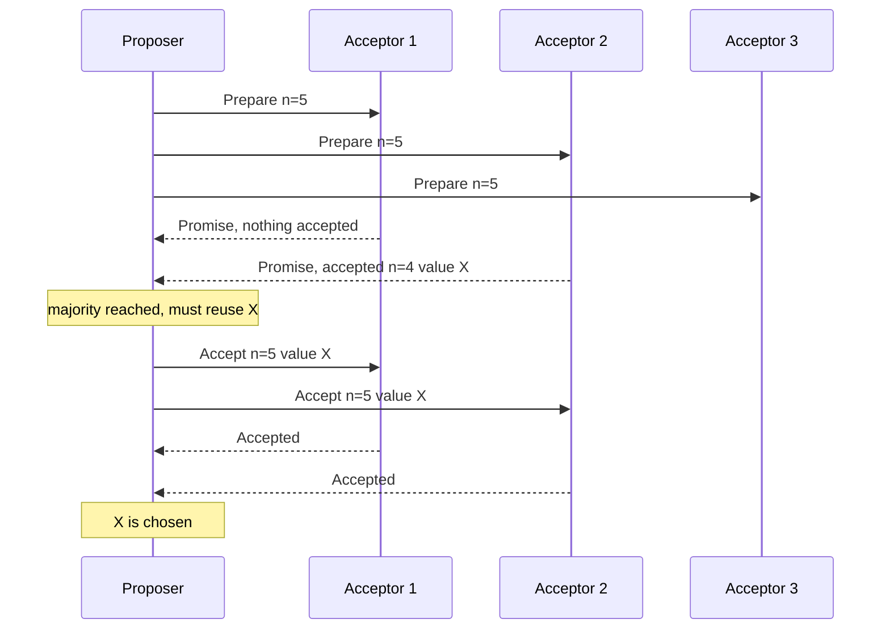

**Pseudo-code for an acceptor:**

```text
on Prepare(n):
    if n > promised:
        promised = n                      # write to disk before replying
        reply Promise(n, accepted_n, accepted_value)
on Accept(n, v):
    if n >= promised:
        promised = n
        accepted_n, accepted_value = n, v # write to disk before replying
        reply Accepted(n, v)
```

**Multi-Paxos.** Running both phases for every log slot costs two round trips per decision. Multi-Paxos notices that Phase 1 does not depend on the value, so a proposer that wins Phase 1 for "all slots from here on" becomes the **distinguished proposer**, in practice a leader. For every later slot it only sends Phase 2 (`Accept(n, slot, value)`), one round trip. If the leader dies, another node runs Phase 1 with a higher number, learns any values already accepted in unfinished slots, re-proposes them, and continues.

**Cost.** One decision in steady-state Multi-Paxos is one round trip to a majority: O(N) messages for N acceptors. Each acceptor stores O(1) state per slot. Classic single-decree Paxos is two round trips. With 2F+1 acceptors, it tolerates F crashed acceptors.

**Duelling proposers.** Two proposers can keep pre-empting each other with ever-higher numbers (P1 prepares 3, P2 prepares 4, P1 prepares 5, and so on), and nothing is ever chosen. Paxos is safe but this **livelock** stops progress. The fix is the same as in Raft: one leader at a time plus randomised back-off.

**Paxos vs Raft vs ZAB**

| | Multi-Paxos | Raft | ZAB |
|---|---|---|---|
| Leadership | Optional optimisation, not part of the core proof | Built in: strong leader, one per term | Built in: one primary per epoch |
| Era counter | Proposal number | Term | Epoch (high 32 bits of the 64-bit zxid) |
| Log holes | Allowed: slot 7 can be decided before slot 6 | Not allowed: log is contiguous | Not allowed: strict order |
| Who can become leader | Anyone; new leader recovers values via Phase 1 | Only a node whose log is at least as up to date (election restriction) | Node with latest epoch and highest zxid in a quorum |
| Leader catch-up | New leader learns from acceptors | Leader overwrites followers' conflicting entries | Synchronisation phase before new broadcasts |
| Spec completeness | Many details (membership, snapshots) left to implementers | Full spec, including membership change | Tailored to ZooKeeper's primary-backup model |

In practice, all three do the same thing in the normal case: a leader sends each entry to followers and commits it when a majority acknowledges. They differ mostly in how a new leader cleans up after the old one.

### Trade-offs

- **Paxos is flexible but underspecified.** Allowing holes and out-of-order decisions helps parallelism, but every real system must invent its own leader election, log compaction and membership change. Google's "Paxos Made Live" (2007) describes how hard that was for Chubby.
- **Raft is easier to get right** because it fixes those choices. The price is less flexibility (for example, no holes in the log).
- **Every write costs a majority round trip.** A 5-node group across three regions pays a cross-region round trip on each commit.
- **More nodes means more fault tolerance but slower commits.** 3 nodes tolerate 1 failure, 5 tolerate 2.

### Real-world examples

- **Google Chubby** (lock service) and **Spanner** (each data shard is replicated by its own Paxos group).
- **Apache ZooKeeper** uses ZAB, and was the coordination layer for older Kafka, HBase and Hadoop.
- **etcd**, **Consul**, **CockroachDB**, **TiKV** and Kafka's **KRaft** controller use Raft.
- **Apache Cassandra** uses single-decree Paxos rounds per key for its lightweight transactions (`IF NOT EXISTS`).

### In the interview

**Q:** Why must a Paxos proposer reuse a previously accepted value?

**A:** That value might already have been chosen by a majority. Any majority it hears from overlaps the earlier majority, so at least one promise will report it. Reusing it guarantees that a later proposal can never overwrite a decision.

**Q:** What does Multi-Paxos add to basic Paxos?

**A:** A stable leader that runs Phase 1 once and then only Phase 2 for every log slot. That cuts each decision from two round trips to one, which is why it is the version used in practice.

**Q:** Raft or Paxos for a new system?

**A:** Use an existing, tested library or service (etcd, ZooKeeper, a Raft library). If choosing, Raft has a complete specification and many production implementations. Paxos variants are worth it only for special needs, such as decisions that may complete out of order.

### TL;DR

Paxos reaches agreement with two phases (promise, then accept) and one golden rule: reuse the highest value already accepted by the majority you heard from. Multi-Paxos adds a stable leader so each log entry costs one round trip. Raft and ZAB are leader-centred cousins with a fuller specification. Refer to Module 00 for Raft's step-by-step flow.

**Sources**

- Lamport, "The Part-Time Parliament", ACM TOCS 16(2), 1998, and "Paxos Made Simple", ACM SIGACT News 32(4), 2001: https://www.microsoft.com/en-us/research/publication/part-time-parliament/
- Chandra, Griesemer, Redstone, "Paxos Made Live: An Engineering Perspective", PODC 2007: https://research.google.com/archive/paxos_made_live.html
- Junqueira, Reed, Serafini, "Zab: High-performance broadcast for primary-backup systems", DSN 2011: https://ieeexplore.ieee.org/document/5958223
- Ongaro, Ousterhout, "In Search of an Understandable Consensus Algorithm (Raft)", USENIX ATC 2014: https://raft.github.io/raft.pdf

## Two-phase commit vs three-phase commit

### What it is

An **atomic commit protocol** makes a transaction that touches several machines either commit everywhere or abort everywhere. The machines holding data are **participants** (also called resource managers or cohorts); one machine, the **coordinator** (or transaction manager), runs the protocol.

- **Two-phase commit (2PC)**: a vote phase then a decision phase.
- **Three-phase commit (3PC)**: adds a middle "pre-commit" phase so participants can finish without the coordinator in some failure cases. Dale Skeen described non-blocking commit protocols in 1981.

Module 00 introduces 2PC briefly. Here we focus on exactly where it blocks, how 3PC tries to fix that, and why industry instead puts 2PC on top of consensus.

### The problem it solves

A money transfer debits account 17 on shard A and credits account 99 on shard B. If A commits and B aborts, money disappears. Each shard can make its own change durable, but neither can decide alone, because the other might fail its checks (a constraint violation, a full disk, a deadlock).

### How it works

**2PC step by step (coordinator C, participants A and B):**

1. **Prepare.** C sends `PREPARE` to A and B.
2. **Vote.** Each participant checks it can commit, writes all changes plus a "prepared" record to its durable log, keeps its locks, and answers `YES`. Or it answers `NO` and aborts. After voting YES a participant has given up the right to decide alone: it must wait for C.
3. **Decide.** If every vote is YES, C writes "commit" to its own log (this write is the actual **commit point**) and sends `COMMIT`. If any vote is NO or missing after a timeout, it sends `ABORT`.
4. **Finish.** Participants apply the decision, release locks and acknowledge. C can forget the transaction when all acknowledgements arrive.

**Messages:** 4 per participant (prepare, vote, decision, ack), so 4N for N participants, and 2 round trips plus 2 forced disk writes on the critical path.

**Where it blocks.** Suppose A and B both voted YES and then C crashes before sending the decision. A and B are **in doubt**: C may already have told someone COMMIT, or may have decided ABORT. They cannot guess. They hold their locks until C recovers, which could be minutes. Rows 17 and 99 are frozen for every other transaction meanwhile. This is the **blocking problem**.

**3PC step by step:**

1. **CanCommit.** C asks "can you commit?" Participants vote YES or NO, but do not lock themselves in yet.
2. **PreCommit.** If all said YES, C sends `PRECOMMIT`. Participants acknowledge. Now everyone knows that everyone voted YES.
3. **DoCommit.** After all PreCommit acks, C sends `COMMIT`.

The recovery rule: if C disappears, the surviving participants talk among themselves. If any of them has received PRECOMMIT, nobody can have aborted, so they commit. If none has, nobody can have committed, so they abort. Participants use timeouts to move forward without waiting for C.

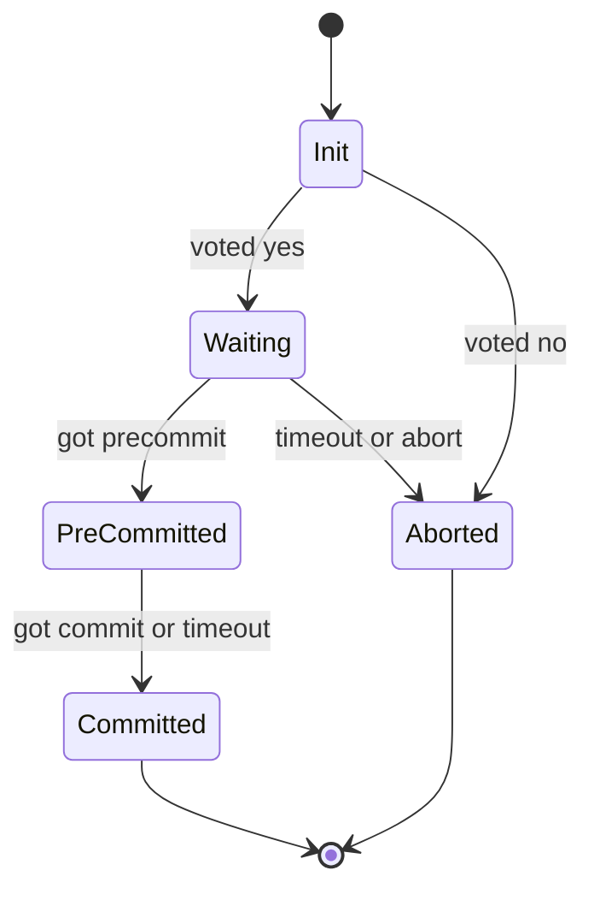

**Worked example of the timeout logic.** Five participants, C crashes after sending PRECOMMIT to P1 only. P2 to P5 time out and elect a recovery coordinator, say P2. P2 asks everyone their state, sees that P1 is pre-committed, and commits all. If P1 had also crashed, the survivors see nobody pre-committed and abort. With a reliable network, both cases end consistently.

### Why 3PC is rarely used

- **It is not safe under network partitions.** 3PC's timeouts assume a **synchronous network**: messages arrive within a known bound, so "no reply" really means "crashed". Real networks are asynchronous. If a partition separates P1 (pre-committed) from P2 to P5 (not), P1's side times out and commits while the other side times out and aborts. The two halves disagree, which is worse than blocking.
- **It costs an extra round trip** on every transaction, even in the common case where nothing fails.
- **A better fix exists.** Jim Gray and Leslie Lamport's "Consensus on Transaction Commit" (2006) showed that if the coordinator's decision is itself replicated with Paxos (**Paxos Commit**), commit no longer blocks while a majority of coordinators is alive. Plain 2PC turns out to be the special case with zero tolerated coordinator failures. Modern systems do this: they run ordinary 2PC, but the coordinator and every participant are consensus groups, not single machines, so no single crash leaves anyone in doubt.

### Trade-offs

| | 2PC | 3PC | 2PC over consensus groups |
|---|---|---|---|
| Round trips (normal case) | 2 | 3 | 2, each also replicated |
| Blocks if coordinator dies | Yes | Not with reliable network | No, while a majority survives |
| Safe under partition | Yes (it blocks instead) | No | Yes |
| Typical use | XA, database-internal | Textbooks | Spanner, CockroachDB-style systems |

2PC also holds locks for the whole protocol, so cross-shard transactions are slower and lower-throughput than single-shard ones. That is why designers try to keep related data on one shard, or use **sagas** (a chain of local transactions with compensations, taught in the microservices modules) when they can tolerate temporary inconsistency.

### Real-world examples

- **XA transactions** (the X/Open standard used by Java EE and many databases) and PostgreSQL's `PREPARE TRANSACTION` are plain 2PC.
- **Google Spanner** runs 2PC across Paxos groups: the coordinator leader and the participant leaders each replicate their prepare and commit records through Paxos.
- **Apache Kafka transactions** use a transaction coordinator that writes a prepare marker to its replicated log and then commit markers to each partition, a 2PC-style flow on replicated logs.

### In the interview

**Q:** What is the blocking problem in 2PC?

**A:** After voting YES, a participant cannot decide alone. If the coordinator crashes before telling it the result, it must hold its locks until the coordinator returns.

**Q:** Why don't we use 3PC to fix it?

**A:** 3PC only works if a missing reply reliably means a crash. With network partitions, two groups can time out in different directions, one committing and one aborting. It also adds a round trip. Replicating the coordinator with Paxos or Raft solves blocking safely.

**Q:** How would you design a cross-shard transaction today?

**A:** 2PC where the coordinator and participants are consensus-replicated shards, a durable transaction record as the commit point, and idempotent retries. Better still, design the data so most transactions hit one shard.

### TL;DR

2PC is correct but blocks when the coordinator dies after participants vote YES. 3PC adds a pre-commit phase to avoid blocking, but becomes unsafe under partitions and costs a round trip, so almost nobody ships it. The industry answer is 2PC whose coordinator and participants are each replicated by consensus.

**Sources**

- Skeen, "Nonblocking Commit Protocols", ACM SIGMOD 1981: https://web.eecs.umich.edu/~manosk/assets/papers/Ske81.pdf
- Gray, Lamport, "Consensus on Transaction Commit", ACM TODS 31(1), 2006: https://arxiv.org/abs/cs/0408036
- Corbett et al., "Spanner: Google's Globally-Distributed Database", OSDI 2012: https://www.usenix.org/conference/osdi12/technical-sessions/presentation/corbett
- Apache Kafka documentation, message delivery semantics and transactions: https://kafka.apache.org/documentation/

## Leases and lease-based leader election

### What it is

A **lease** is a lock with an expiry time. The holder gets a right (to cache a file, to be the leader, to serve reads) for a fixed period, say 10 seconds. To keep it, the holder must **renew** before it expires. If the holder crashes or is cut off, it stops renewing, and after the period ends the right can be given to someone else without asking the old holder. Cary Gray and David Cheriton introduced leases for file-cache consistency at SOSP 1989.

**Lease-based leader election** uses a lease as "the leadership token": whoever holds the lease is the leader.

### The problem it solves

A plain lock has a fatal flaw in a distributed system: if the holder crashes, the lock is never released, and everyone waits forever. You cannot tell a crashed holder from a slow one. A lease converts "wait until the holder says it's done" into "wait until a known time has passed", which you can always do on your own. Leases also make reads cheap: a leader that holds a valid lease knows no other leader exists, so it can answer reads from local state without a majority round trip.

### How it works

**Basic lease leader election, step by step (with a coordination store such as etcd):**

1. Every candidate tries to create the key `/service/leader` with its own ID, attached to a lease with a **TTL** (time to live) of, say, 15 seconds. The store allows only one create to succeed (a compare-and-swap: "create only if absent").
2. The winner is the leader. It renews (sends **keep-alives**) well before expiry, for example every 2 to 5 seconds.
3. The losers **watch** the key. If the leader dies, its renewals stop, the store deletes the key when the TTL runs out, and the watchers race to create it again.
4. Each successful create gets a new, larger **revision number** from the store. The leader attaches it as a **fencing token** to every write, so storage can reject writes from an old leader (Module 00 explains fencing tokens).
5. A leader that cannot renew before its own **renew deadline** must stop acting as leader immediately, even if it is not sure it has lost.

**Clocks and the safety margin.** A lease is measured with each machine's own clock. Clocks **drift** (run fast or slow). The rule is that the holder must believe the lease ends *earlier* than the granter believes it does.

Worked example: lease length L = 10 s, maximum drift rate 0.1% (1 ms per second), and the holder measures from when it *sent* the request.

- Holder sends the request at its local time 0 and gets the grant at local time 0.05 s. It treats the lease as running from 0, not 0.05, so network delay only makes it more cautious.
- Over 10 s, its clock could be off by 10 ms. It stops acting at local 10 − 0.01 = 9.99 s, minus a safety margin, say at 9.5 s.
- The granter will not hand the lease to anyone else until its own clock shows 10 s plus margin, say 10.5 s.
- The two windows can never overlap, so at most one leader exists at any instant, provided no process pauses longer than the margin without checking time. That last condition is why a fencing token is still needed: a 20-second garbage-collection pause makes the old leader act on stale beliefs.

**Kubernetes defaults as a concrete example.** Components like `kube-controller-manager` use a `Lease` object with lease duration 15 s, renew deadline 10 s and retry period 2 s. The leader tries to renew every 2 s, gives up leadership if it has not renewed within 10 s, and others may take over 15 s after the last renewal. Worst-case failover is therefore about 15 s.

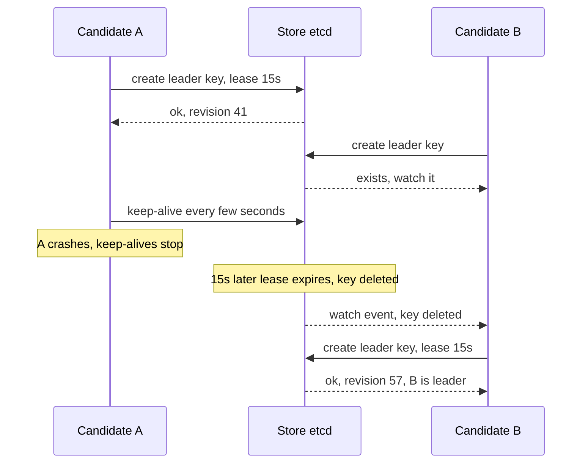

**Leader leases inside consensus.** Raft and Multi-Paxos leaders can also hold a lease granted by a majority of followers: followers promise not to vote for anyone else for, say, 10 s after acknowledging the leader. During that window the leader can serve **linearizable reads** (reads guaranteed to see the latest committed write) locally. Spanner's Paxos leaders use leases of 10 seconds by default.

**Complexity.** Each holder sends one renewal per interval: O(1) messages per period. Failover time is bounded by the lease length plus detection and election time.

### Trade-offs

- **Short leases** (a few seconds) mean fast failover but more renewal traffic and more false failovers when the network hiccups.
- **Long leases** mean fewer renewals but a longer outage after a real crash: nobody can lead until the lease expires.
- **Leases depend on bounded clock drift**, not synchronised clocks. Gray and Cheriton found little extra benefit beyond about 10 seconds for their workload.
- **Process pauses break the assumption** that the holder checks time often. Always pair leases with fencing tokens if correctness matters.

### Real-world examples

- **Google Chubby**: sessions are leases (default extension 12 s); after a lease lapses the client enters "jeopardy" and waits a 45-second grace period for a new master. Chubby's master itself holds a master lease of a few seconds from its replicas.
- **etcd** leases and **ZooKeeper** ephemeral nodes (deleted when the session times out) are the standard building blocks for leader election.
- **Kubernetes** control-plane components and many operators use `coordination.k8s.io` Lease objects.
- **HDFS** uses leases to give one client at a time the right to write a file.

### In the interview

**Q:** How does a lease differ from a lock?

**A:** A lease expires on its own. If the holder disappears, the system waits a bounded time and moves on, instead of waiting forever.

**Q:** Can two leaders exist at once with leases?

**A:** Not if clocks drift within the assumed bound and the old leader stops before its lease ends. But a long process pause can make an old leader act after expiry, so writes should carry a fencing token that storage checks.

**Q:** How do you choose the lease length?

**A:** It is the worst-case failover time. Pick it from the recovery target (for example 10 to 15 s), then set renewals at a fraction of it (every 2 to 5 s) so a couple of lost renewals don't cost leadership.

### TL;DR

A lease is a lock that expires. Leader election with leases means "whoever holds the unexpired lease leads"; others take over after expiry. Make the holder stop early, the granter wait late, and use fencing tokens for pauses.

**Sources**

- Gray, Cheriton, "Leases: An Efficient Fault-Tolerant Mechanism for Distributed File Cache Consistency", SOSP 1989: https://courses.cs.duke.edu/spring15/cps210/readings/leases-sosp89.pdf
- Burrows, "The Chubby lock service for loosely-coupled distributed systems", OSDI 2006: https://static.usenix.org/events/osdi06/tech/full_papers/burrows/burrows_html/
- Kubernetes, `kube-controller-manager` reference (leader-elect flags): https://kubernetes.io/docs/reference/command-line-tools-reference/kube-controller-manager/
- etcd documentation, lease API: https://etcd.io/docs/latest/learning/api/
- Corbett et al., "Spanner", OSDI 2012 (Paxos leader leases, 10 s default): https://www.usenix.org/conference/osdi12/technical-sessions/presentation/corbett

## Failure detection: heartbeats, phi-accrual and SWIM

### What it is

A **failure detector** is the part of a distributed system that decides "that node is probably dead". It cannot be certain: from the outside, a crashed node, a slow node and a lost network link look identical. So every failure detector is a guess, tuned between two properties:

- **Completeness**: every crashed node is eventually suspected.
- **Accuracy**: healthy nodes are rarely suspected by mistake (few **false positives**).

Three common designs: fixed-timeout **heartbeats**, the adaptive **phi accrual** detector (Hayashibara and colleagues, 2004), and **SWIM** (Das, Gupta and Motivala, DSN 2002), which combines probing with gossip for large clusters.

### The problem it solves

Leader election, replica placement, load balancing and membership lists all need to know who is alive. A detector that is too eager causes needless failovers and data movement (a "flapping" node is declared dead and alive repeatedly). A detector that is too slow leaves clients waiting on a dead node. In a cluster of 1,000 nodes, the detection traffic itself must also stay small.

### How it works

**1. Fixed-timeout heartbeats.**

1. Each node sends "I'm alive" to a monitor every interval, for example every 1 s.
2. The monitor records the arrival time of the last heartbeat.
3. If no heartbeat arrives for the timeout, for example 5 s, the node is declared dead.

Simple, but a single fixed number cannot fit every network. Five seconds is far too slow inside one rack and too twitchy across a congested WAN link. If every node heartbeats every other node, traffic grows as O(N²): 1,000 nodes means about a million messages per interval.

**2. Phi accrual detector.** Instead of a yes/no answer, it outputs a suspicion level **phi (φ)** that rises the longer a heartbeat is overdue, scaled by how regular the heartbeats have been.

1. Keep a sliding window of recent **inter-arrival times** (gaps between heartbeats), say the last 1,000.
2. Estimate their mean μ and standard deviation σ.
3. At any moment, let t be the time since the last heartbeat. Compute the probability that a healthy node's next heartbeat would be *this* late, P = 1 − F(t), where F is the cumulative distribution of the observed gaps.
4. φ = −log10(P). So φ = 1 means a 10% chance it is just late; φ = 3 means 0.1%; φ = 8 means 1 in 100 million.
5. The application chooses a threshold. Cassandra's `phi_convict_threshold` defaults to 8.

Worked example with gaps averaging μ = 1,000 ms and σ = 100 ms (normal distribution):

| Time since last heartbeat | z = (t − μ)/σ | P(just late) | φ |
|---|---|---|---|
| 1,100 ms | 1 | 0.159 | 0.8 |
| 1,200 ms | 2 | 0.023 | 1.6 |
| 1,300 ms | 3 | 0.0013 | 2.9 |
| 1,500 ms | 5 | 2.9e-7 | 6.5 |
| 1,560 ms | 5.6 | 1.1e-8 | 8.0 |

So with these statistics a node is convicted about 1.56 s after its last heartbeat. If the network becomes jittery and σ grows to 300 ms, the same φ = 8 is reached only after about 2.7 s. The detector adapts by itself. Implementations differ in which distribution they assume; the paper used a normal distribution, and some systems use a simpler exponential model.

**3. SWIM (Scalable Weakly-consistent Infection-style process group Membership).** SWIM separates *detecting* failures from *spreading* the news.

1. Every **protocol period** T (say 1 s), each member picks one random member M and sends it `ping`.
2. If M replies `ack` within a short timeout, done.
3. If not, the member asks k other random members (say k = 3) to `ping-req` M on its behalf. If any of them gets an ack, it relays it back. This **indirect probe** avoids blaming M for a bad link between just two nodes.
4. If nobody hears from M, it is marked **suspect**, not dead. The suspicion is gossiped.
5. If M hears it is suspected, it **refutes** by gossiping "alive" with a higher **incarnation number** (a counter only M itself may increase).
6. If the suspicion is not refuted within a suspicion timeout, M is declared **dead**.
7. Membership updates (join, suspect, alive, dead) are **piggybacked** on the ping and ack messages, so news spreads like an infection, reaching all N members in about O(log N) periods without extra messages.

Cost per member per period is constant: one ping plus at most k indirect probes. Total traffic is O(N), not O(N²), and the expected time to first detect a failure does not grow with cluster size.

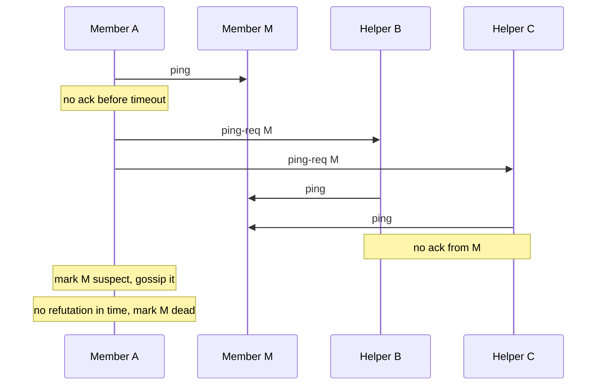

### Trade-offs

- **Fixed timeouts** are simple and predictable but must be tuned per environment and cause either slow detection or false alarms.
- **Phi accrual** adapts to network conditions and gives a tunable confidence level, but needs history (warm-up) and can be fooled when the heartbeat pattern suddenly changes.
- **SWIM** scales to thousands of nodes with constant per-node load, at the cost of eventual (not instant) agreement on membership. A node that is itself overloaded (CPU starved) can wrongly accuse healthy peers. HashiCorp's **Lifeguard** extensions address this, and report about 50 times fewer false positives.
- **No detector is perfect.** Pair it with fencing and idempotency so a wrong guess costs a failover, not corrupt data.

### Real-world examples

- **Apache Cassandra** and **Akka Cluster** use phi accrual detectors.
- **HashiCorp memberlist** (inside Consul, Serf and Nomad) implements SWIM with Lifeguard.
- **Raft and ZooKeeper** use simple heartbeats with timeouts, randomised in Raft's case.
- **Kubernetes** marks nodes unhealthy when their node Lease is not renewed in time, a heartbeat via a shared store.

### In the interview

**Q:** Why not just use a 5-second heartbeat timeout?

**A:** One number cannot fit every network and load level. It is too slow in a quiet data centre and gives false alarms during congestion. Adaptive detectors like phi accrual set the bar from observed heartbeat timing.

**Q:** How does SWIM avoid O(N²) heartbeat traffic?

**A:** Each node probes just one random peer per period and spreads membership changes by piggybacking on those probes. Load per node stays constant and news reaches everyone in about log N rounds.

**Q:** Why does SWIM use indirect pings and a suspect state?

**A:** To avoid declaring a node dead because of one bad link or a short pause. Indirect pings test other paths, and the suspect state gives the node a chance to refute before it is removed.

### TL;DR

You can only suspect failures, never prove them. Heartbeats with timeouts are simplest. Phi accrual turns lateness into a probability-based suspicion level that adapts to the network. SWIM probes one random peer per period, uses indirect probes and suspicion, and gossips results, giving constant per-node cost at large scale.

**Sources**

- Hayashibara, Défago, Yared, Katayama, "The phi accrual failure detector", SRDS 2004 (as implemented and documented in Akka): https://doc.akka.io/api/akka-core/2.9/akka/remote/PhiAccrualFailureDetector.html
- Apache Cassandra / DataStax docs, failure detection and `phi_convict_threshold`: https://docs.datastax.com/en/cassandra-oss/3.0/cassandra/architecture/archDataDistributeFailDetect.html
- Das, Gupta, Motivala, "SWIM: Scalable Weakly-consistent Infection-style Process Group Membership Protocol", DSN 2002: https://www.cs.cornell.edu/projects/Quicksilver/public_pdfs/SWIM.pdf
- HashiCorp, "Making Gossip More Robust with Lifeguard": https://www.hashicorp.com/blog/making-gossip-more-robust-with-lifeguard

## Chain replication and CRAQ

### What it is

**Chain replication** (Robbert van Renesse and Fred Schneider, OSDI 2004) arranges the replicas of a piece of data in a line called a **chain**. The first node is the **head**, the last is the **tail**. Writes enter at the head and flow down the chain; reads are answered by the tail. A separate, consensus-backed **configuration manager** (also called the master) decides who is in the chain.

**CRAQ** (Chain Replication with Apportioned Queries, Jeff Terrace and Michael Freedman, USENIX ATC 2009) keeps the same write path but lets **any** node in the chain answer reads, while still giving strongly consistent answers.

### The problem it solves

Primary-backup replication makes one primary do everything: receive the write, send it to every backup, wait for acks, and serve reads. The primary's network card and CPU become the bottleneck. Chain replication spreads the work: each node sends each write to just one successor, and reads go to a different node (the tail) from writes (the head). It still offers **linearizability** (every read sees the latest completed write, as if there were one copy). CRAQ then solves chain replication's own weakness: the tail serving every read becomes a hot spot for read-heavy workloads.

### How it works

**Chain replication, step by step (chain H, M, T for head, middle, tail):**

1. Client sends `put(x, 5)` to H.
2. H applies it (in its local log or store) and forwards it to M.
3. M applies it and forwards it to T.
4. T applies it. The write is now **committed**, because every replica has it. T replies to the client (or acks back up the chain so H can reply).
5. Reads `get(x)` go to T. Because T only has committed writes, every read returns committed data, and since there is one tail, reads and writes are totally ordered.

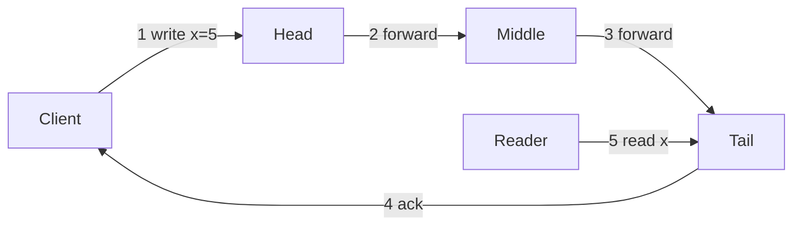

**Failure handling (driven by the configuration manager):**

- **Head fails**: its successor M becomes the new head. Writes that H had not yet forwarded are lost, but they were never acknowledged, so clients will retry.
- **Tail fails**: its predecessor M becomes the new tail. M already has every write T had, and possibly more, so nothing committed is lost.
- **Middle fails**: the manager links H directly to T. H re-sends to T every write it has forwarded but that is not yet acknowledged from downstream. Each node keeps a list of these **pending** writes until the tail's ack flows back.
- **Adding a node**: a new node copies state from the current tail, then is appended as the new tail.

**Worked example with numbers.** Each hop takes 0.5 ms inside a data centre. With 3 nodes, a write travels client to H, H to M, M to T, then T back to the client: 4 hops, roughly 2 ms. With primary-backup, the client sends to the primary, the primary sends to both backups in parallel, the acks come back and the primary replies: also 4 hops, about 2 ms, and it stays at 4 hops however many backups there are, while a 5-node chain needs 6. The difference is in the sending work: the primary sends 2 copies of every write while each chain node sends only 1. For 10,000 writes per second of 1 KB, the chain head sends 10 MB/s; a primary-backup leader with 4 backups would send 40 MB/s.

**Complexity.** Write latency grows with chain length: O(n) hops. Messages per write: n (one per link) plus acks. Storage: n full copies. A chain of n nodes tolerates n − 1 failures (the manager, not the chain, needs a majority).

**CRAQ, step by step.** Every node may store several **versions** of an object, each marked **clean** (known committed) or **dirty** (seen but not yet known committed).

1. A write travels head to tail as before. Each node stores the new version as **dirty**.
2. When the tail applies it, the version is committed. The tail sends an ack back up the chain.
3. As the ack passes, each node marks that version **clean** and deletes older versions.
4. A read can go to **any** node:
   - If the node's latest version is clean, it returns it immediately.
   - If it is dirty, the node asks the tail "what is the latest committed version number of x?" (a tiny **version query**, not a full read) and returns that version from its own store.

Worked example: x has version 7 (clean) everywhere. A write creates version 8. It has reached H and M (dirty) but not T. A reader at M sees a dirty latest version, asks T, learns "7", and returns version 7. One millisecond later T applies version 8, acks flow back, M marks 8 clean, and the next read at M returns 8 with no query. In a read-mostly workload most objects are clean most of the time, so read throughput scales with the number of nodes, not just one tail.

CRAQ can also relax to **eventual consistency** on request: return the newest local version, dirty or not, and skip the tail query.

### Trade-offs

- **Higher write latency** than parallel fan-out: n sequential hops instead of 1 parallel round.
- **One slow node slows every write**, because every write passes through every node.
- **Needs an external configuration manager** (usually Paxos, Raft or ZooKeeper) to avoid split brain. Chain replication itself does not run consensus.
- **Strong consistency with simple logic**: no voting on each write, and the tail is a single point of truth for ordering.
- **CRAQ** fixes the read hot spot at the cost of multi-version storage and extra tail queries under write-heavy load.

### Real-world examples

- **Hibari**, an open-source key-value store, uses chain replication with head, middle and tail "bricks".
- **FAWN-KV** (a research key-value store on low-power nodes) and CRAQ itself build on it.
- **HDFS** writes blocks through a **pipeline** of DataNodes, a chain-like pattern where each node forwards to the next.
- Course and industry write-ups cite chain-style replication in object stores and block storage; the pattern recurs wherever per-node bandwidth matters most.

### In the interview

**Q:** Why are reads served by the tail in chain replication?

**A:** The tail is the only node guaranteed to hold just committed writes. Reading there gives linearizable reads without any coordination.

**Q:** How does CRAQ read from any node and stay consistent?

**A:** Nodes track whether each version is clean or dirty. Clean versions are returned directly. For dirty ones, the node asks the tail which version is committed and returns that one.

**Q:** When would you prefer quorum or Raft replication to a chain?

**A:** When write latency or tolerance of one slow replica matters more. A majority quorum commits after the fastest majority answers, while a chain waits for every node.

### TL;DR

Chain replication pipes writes head to tail and serves reads from the tail, giving strong consistency and good throughput with simple logic, at the cost of latency proportional to chain length. CRAQ lets every node serve reads by tracking clean and dirty versions and asking the tail only when unsure.

**Sources**

- van Renesse, Schneider, "Chain Replication for Supporting High Throughput and Availability", OSDI 2004: https://www.usenix.org/conference/osdi-04/chain-replication-supporting-high-throughput-and-availability
- Terrace, Freedman, "Object Storage on CRAQ: High-Throughput Chain Replication for Read-Mostly Workloads", USENIX ATC 2009: https://www.usenix.org/conference/usenix-09/object-storage-craq-high-throughput-chain-replication-read-mostly-workloads
- Hibari documentation, architecture: https://hibari.readthedocs.io/en/latest/admin-guide/architecture.html
- Apache Hadoop HDFS architecture guide (replication pipelining): https://hadoop.apache.org/docs/stable/hadoop-project-dist/hadoop-hdfs/HdfsDesign.html

## Hybrid logical clocks

### What it is

A **hybrid logical clock (HLC)** gives every event a timestamp made of two parts: `l`, close to real **physical (wall-clock) time**, and `c`, a small **logical counter**. It was proposed by Sandeep Kulkarni, Murat Demirbas and colleagues in "Logical Physical Clocks" (OPODIS 2014).

Two older ideas it combines:

- **Physical timestamps** from each machine's clock. Easy to read and compare with human time, but machines disagree by milliseconds or more (**clock skew**), so a message can arrive "before" it was sent.
- **Lamport clocks**: plain counters bumped on every event and on every received message. They guarantee **causality** (if event e could have influenced f, e gets a smaller number), but the numbers have no relation to real time.

### The problem it solves

A distributed database wants timestamps that (1) never violate cause and effect, (2) fit in a normal 64-bit field, and (3) stay close enough to real time to answer "show me the data as of 10:00:00" or "snapshot at time t". Physical clocks fail (1). Lamport clocks fail (3). Vector clocks (see the version vectors section) satisfy (1) but grow with the number of nodes, failing (2). HLC satisfies all three.

### How it works

Each node j keeps `l.j` (largest physical time it has heard of) and `c.j` (counter). `pt.j` is its own physical clock.

```text
on local or send event:
    l_old = l
    l = max(l_old, pt)
    c = c + 1 if l == l_old else 0
    stamp event (and message) with (l, c)

on receive of message m with (l_m, c_m):
    l_old = l
    l = max(l_old, l_m, pt)
    if   l == l_old == l_m: c = max(c, c_m) + 1
    elif l == l_old:        c = c + 1
    elif l == l_m:          c = c_m + 1
    else:                   c = 0
    stamp event with (l, c)
```

Compare timestamps by `l` first, then `c` (and node ID to break exact ties).

**Worked example.** Node A's clock reads 100 ms. Node B's clock is 8 ms slow. B's last stamp was (85, 0).

1. A writes a row at pt = 100: `l = max(0, 100) = 100`, `c = 0`. Stamp **(100, 0)**.
2. Still at pt = 100, A sends a message to B: `l` stays 100, so `c = 1`. Stamp **(100, 1)**.
3. B receives it when its clock reads 92: `l = max(85, 100, 92) = 100`, which equals the message's `l`, so `c = 1 + 1 = 2`. Stamp **(100, 2)**. With raw physical time, B would have stamped 92, *earlier* than the send at 100: causality broken. HLC keeps it in order.
4. B does a local write at pt = 95: `l = max(100, 95) = 100`, unchanged, so `c = 3`. Stamp **(100, 3)**.
5. B's clock reaches 101: `l = 101`, `c` resets to 0. Stamp **(101, 0)**. Once physical time passes the largest time heard, the counter goes back to zero.

**Properties.**

- If e happened before f, then HLC(e) < HLC(f). Same guarantee as a Lamport clock.
- `l` is never more than the clock skew ahead of a node's own physical time, so HLC stays within the skew bound of real time.
- `c` stays small (bounded by the number of nodes in theory, and tiny in practice). The paper packs it into 64 bits: 48 bits for `l` (the NTP-format time rounded) and 16 bits for `c`.
- O(1) time per event, O(1) space per timestamp, compared with O(N) for a vector clock.

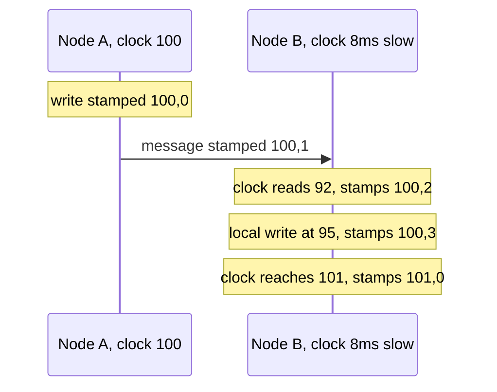

**What HLC does not do.** It does not make clocks *accurate*. Two unrelated writes on different nodes 1 ms apart in real time can still be stamped in the "wrong" order if their clocks disagree by more than 1 ms. Systems that need "a transaction that starts after another commits sees it" (external consistency) add a rule on top, such as CockroachDB's **uncertainty interval**.

### Trade-offs

- **Pros**: causally consistent, close to wall time, fixed 64-bit size, cheap. Great for MVCC (multi-version concurrency control) timestamps, snapshot reads and change-data-capture ordering.
- **Cons**: relies on clocks staying within a configured maximum skew. If a node's clock jumps far ahead, everyone's `l` follows it, so systems must reject or fence nodes with bad clocks.
- **Cannot detect concurrency**: unlike vector clocks, two HLC timestamps are always ordered, even for truly concurrent events, so HLC is not a conflict detector.

### Real-world examples

- **CockroachDB** stamps transactions with HLC. Its `--max-offset` flag (default 500 ms) is the maximum allowed clock offset. A read treats any value with a timestamp within that offset above its own as **uncertain** and restarts at a higher timestamp. Nodes whose clocks drift too far shut themselves down.
- **MongoDB** uses a hybrid logical clock for **cluster time**, which powers causally consistent sessions across replica sets and shards.
- **YugabyteDB** uses HLC for its distributed transactions.

### In the interview

**Q:** Why not just use NTP timestamps for ordering?

**A:** Clocks disagree by milliseconds or more and can jump backwards, so a reply can appear to happen before the request. HLC never goes backwards and always orders a received message after its send.

**Q:** HLC vs vector clock?

**A:** HLC is a fixed-size scalar that respects causality and stays near real time, but it cannot tell you two events were concurrent. Vector clocks detect concurrency but grow with the number of nodes.

**Q:** What does CockroachDB do about clock skew with HLC?

**A:** It sets a maximum offset. Reads that see values slightly newer than their timestamp, within that offset, cannot be sure of the order, so they restart at a later timestamp. Nodes whose clocks drift too far stop serving.

### TL;DR

HLC = max physical time heard so far plus a small counter for ties. It respects cause and effect like a Lamport clock, stays within clock skew of real time, and fits in 64 bits. CockroachDB, MongoDB and YugabyteDB use it for transaction and snapshot timestamps.

**Sources**

- Kulkarni, Demirbas, Madappa, Avva, Leone, "Logical Physical Clocks and Consistent Snapshots in Globally Distributed Databases", OPODIS 2014 (UB tech report 2014-04): https://cse.buffalo.edu/tech-reports/2014-04.pdf
- Lamport, "Time, Clocks, and the Ordering of Events in a Distributed System", CACM 1978: https://lamport.azurewebsites.net/pubs/time-clocks.pdf
- CockroachDB docs, `cockroach start` (`--max-offset`, default 500 ms) and transaction layer: https://www.cockroachlabs.com/docs/stable/architecture/transaction-layer
- Tyulenev et al., "Implementation of Cluster-wide Logical Clock and Causal Consistency in MongoDB", SIGMOD 2019: https://doi.org/10.1145/3299869.3314049

## Google TrueTime and commit-wait

### What it is

**TrueTime** is the clock service inside Google **Spanner**, a globally distributed SQL database (Corbett et al., OSDI 2012). Instead of returning a single time, `TT.now()` returns an **interval** `[earliest, latest]` that is guaranteed to contain the true absolute time. Half the interval's width is called **epsilon (ε)**, the uncertainty.

**Commit-wait** is the rule that uses it: after choosing a commit timestamp, the transaction waits until that timestamp is definitely in the past before making its writes visible.

### The problem it solves

Spanner promises **external consistency** (the strongest form of linearizability for transactions): if transaction T1 commits before T2 starts, in real time, then T2's timestamp is larger, so T2 sees T1's writes. With ordinary clocks that can be off by milliseconds, a later transaction on a slow-clock server could receive a *smaller* timestamp than an earlier one on a fast-clock server, and a snapshot read could miss a write that, in the real world, had already finished. TrueTime makes clock error **explicit and bounded**, and commit-wait turns that bound into a guarantee.

### How it works

**Building the interval.**

1. Each data centre has several **time masters**. Most have GPS receivers. The rest, called **Armageddon masters**, have atomic clocks. The two kinds fail in different ways.
2. A daemon on every machine polls several masters (every 30 seconds in the paper), rejects outliers with a variant of Marzullo's algorithm, and syncs the local clock.
3. Between polls, it assumes the local clock might drift at a worst-case rate (200 microseconds per second in the paper). After 30 s, that is up to 6 ms of possible drift, plus about 1 ms for network delay to the masters.
4. So ε follows a **sawtooth**: about 1 ms right after a poll, growing to about 7 ms just before the next. The paper reports ε is about 4 ms on average.

**The API:**

- `TT.now()` returns `[earliest, latest]`.
- `TT.after(t)` is true if t has definitely passed (`t < now.earliest`).
- `TT.before(t)` is true if t has definitely not arrived (`t > now.latest`).

**Commit-wait, step by step.**

1. A read-write transaction acquires its locks (Spanner uses two-phase locking).
2. The coordinator leader picks commit timestamp `s = TT.now().latest`. Because `latest` is at or after the true time, `s` is not in the past.
3. It replicates the commit record through Paxos (and runs two-phase commit if several shards are involved).
4. **Commit-wait:** it waits until `TT.after(s)` is true, so the true time is definitely later than `s`.
5. Only then does it release locks and tell the client "committed".

**Worked example with ε = 4 ms.**

- At true time 1000.000 s, `TT.now()` returns `[999.996, 1000.004]`. The coordinator picks s = 1000.004.
- It must wait until `earliest > 1000.004`, which happens at true time about 1000.008. That is about 2ε = 8 ms after it started.
- Paxos replication to other replicas runs in parallel during this wait (often longer than 8 ms across zones), so in practice much of the wait is hidden. The paper measured commit-wait at about 5 ms in a single-replica test.
- Any transaction T2 that starts after the client hears "committed" begins after true time 1000.008. Its timestamp is at least its own `TT.now().latest`, which is at least true time, so it is greater than 1000.004. T2 is guaranteed to be ordered after T1.

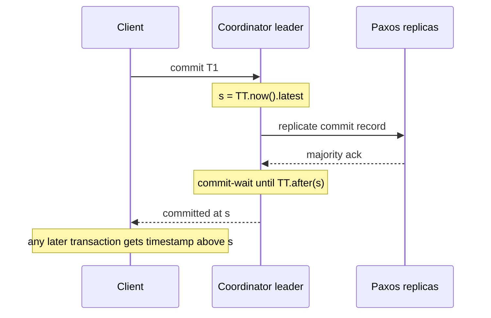

**Why it pays off.** Every committed write has a timestamp that matches real-time order, so a **read-only transaction** or **snapshot read** at timestamp t needs no locks: any replica that has caught up to t can answer it. Spanner leaders also use TrueTime to keep their **leader leases** (10 s by default) from overlapping.

**Cost.** Commit-wait adds roughly 2ε to write latency, O(1) work. Smaller ε means faster commits, which is why Google invests in GPS and atomic clock hardware.

### Trade-offs

- **Write latency** includes the uncertainty. If time masters are unreachable, ε grows and so does every commit.
- **Specialised infrastructure**: GPS antennas and atomic clocks in every data centre, plus careful monitoring. Machines with clocks behaving worse than the assumed bound are evicted.
- **Lock-free consistent reads** anywhere in the world, at any past timestamp, are the big reward.
- **Alternatives without special hardware**: CockroachDB uses HLC with a larger maximum offset and restarts uncertain reads instead of waiting on every write. Cloud providers now expose clock error bounds too, for example AWS ClockBound returns an `[earliest, latest]` window much like TrueTime.

### Real-world examples

- **Google Spanner** and Cloud Spanner (TrueTime plus commit-wait). Google's documentation notes that when uncertainty is smaller than the Paxos round trip, commit-wait does not add to commit latency.
- **CockroachDB** has a similar but opt-in "commit wait" for global tables, built on HLC and a configured clock offset instead of TrueTime.
- **AWS ClockBound** with Amazon Time Sync Service gives EC2 applications a bounded-uncertainty clock API.

### In the interview

**Q:** What is commit-wait and why is it needed?

**A:** After picking a commit timestamp at the top of the uncertainty interval, the leader waits until that timestamp is certainly past before acknowledging. Then any transaction that starts afterwards must get a larger timestamp, giving external consistency.

**Q:** How long is the wait?

**A:** About twice the uncertainty, a few milliseconds in Spanner's environment (ε was 1 to 7 ms, about 4 ms on average, in the 2012 paper). It overlaps with Paxos replication, so the added latency is often small.

**Q:** Can I build this on AWS or with NTP?

**A:** Yes, if you have a trustworthy error bound. With NTP the bound is larger, so waits would be longer. That is why most open-source databases use HLC plus uncertainty restarts instead of waiting on every write.

### TL;DR

TrueTime returns a time interval guaranteed to contain the true time, kept narrow (a few ms) by GPS and atomic clocks. Spanner stamps commits at the top of the interval and waits until that time has definitely passed. This makes timestamps follow real-time order, enabling globally consistent, lock-free snapshot reads.

**Sources**

- Corbett et al., "Spanner: Google's Globally-Distributed Database", OSDI 2012 (sections 3 and 4): https://www.usenix.org/conference/osdi12/technical-sessions/presentation/corbett
- Google Cloud, "Spanner: TrueTime and external consistency": https://cloud.google.com/spanner/docs/true-time-external-consistency
- AWS EC2 User Guide, "Compare timestamps for your Linux instances" (ClockBound): https://docs.aws.amazon.com/AWSEC2/latest/UserGuide/compare-timestamps-with-clockbound.html
- CockroachDB docs, transaction layer and clock offset: https://www.cockroachlabs.com/docs/stable/architecture/transaction-layer

## Version vectors vs vector clocks (and dotted version vectors)

### What it is

All three are lists of counters, one per participant, used to decide whether one thing **happened before** another or whether they are **concurrent** (neither knew about the other).

- A **vector clock** (Fidge and Mattern, 1988) tracks causality between **events** in processes. Every process keeps one counter per process and updates it on every local event, send and receive.
- A **version vector** (Parker and colleagues, 1983) tracks causality between **versions of data** on replicas. There is one counter per **replica** (the server that coordinates a write), and it changes only when data is written or merged.
- A **dotted version vector (DVV)** (Preguiça, Baquero, Almeida and colleagues, 2010) is a version vector plus a **dot**: one `(replica, counter)` pair that names the exact write that created a value. It fixes false conflicts that plain version vectors create when many clients write through the same server.

Module 07 (*Vector Clocks*) explains how a leaderless store uses these labels to detect conflicting writes. Here we pin down the differences and the DVV improvement.

### The problem it solves

In a leaderless or multi-leader database (Dynamo-style), two clients can update the same key on different replicas at the same time. The database must decide: is version B a newer edit of version A (keep only B), or were they made independently (keep both as **siblings** and let the application merge)? Timestamps cannot answer this (Module 00, *Clocks and ordering*). Counter vectors can.

### How it works

**Comparing any two vectors V and W** (same for all three):

1. V ≤ W if every entry of V is less than or equal to the matching entry in W.
2. If V ≤ W and V ≠ W, then V happened before W, so W supersedes V.
3. If neither V ≤ W nor W ≤ V, they are **concurrent**: a conflict.

Example: `{A:2, B:1}` vs `{A:3, B:1}`: the first is older. `{A:2, B:1}` vs `{A:1, B:2}`: concurrent.

**Vector clocks vs version vectors.**

| | Vector clock | Version vector |
|---|---|---|
| Orders | Events (messages, computations) | Versions of a data item |
| One entry per | Process | Replica that coordinates writes |
| Updated on | Every event, send and receive | Writes and merges only |
| Size | Grows with processes involved | Grows with replicas (usually 3 to 5) |
| Typical use | Debugging, causal message delivery | Conflict detection in replicated stores |

People often say "vector clock" for both, as the Dynamo paper does. The distinction matters because using **client IDs** as entries makes vectors grow with the number of clients (millions), while using **server IDs** keeps them small but loses information, which is the problem DVVs solve.

**The sibling explosion problem, step by step.** One replica, A, coordinates all writes to key `cart`. Version vectors use server IDs.

1. Client C1 writes `v1` with no context (it never read the key). A stores v1 with `{A:1}`.
2. Client C2, also without reading, writes `v2`. A cannot tell if v2 replaces v1, so it keeps both as siblings and bumps the vector to `{A:2}`. Both siblings now share one vector, `{A:2}`.
3. C1 now writes `v3`, sending the context it got back from step 1, `{A:1}`. C1 had seen only v1, so v3 should replace v1 but stay concurrent with v2.
4. A's vector `{A:2}` is newer than the context `{A:1}`, but A cannot tell *which* sibling the context covers, because they share one vector. To be safe it keeps v1, v2 and v3: three siblings. With retries and many clients, siblings pile up without bound. This is **sibling explosion**, and it comes from **false concurrency**.

**The same steps with dotted version vectors.**

1. v1 gets dot `(A,1)`. Store: `{v1@(A,1)}`, context returned `{A:1}`.
2. v2 (empty context) gets dot `(A,2)`. Store: `{v1@(A,1), v2@(A,2)}`.
3. v3 arrives with context `{A:1}`. The context **covers** dot (A,1), so v1 is discarded. It does not cover (A,2), so v2 stays. v3 gets dot `(A,3)`.
4. Store: `{v2@(A,2), v3@(A,3)}`. Exactly the two truly concurrent values. Correct.

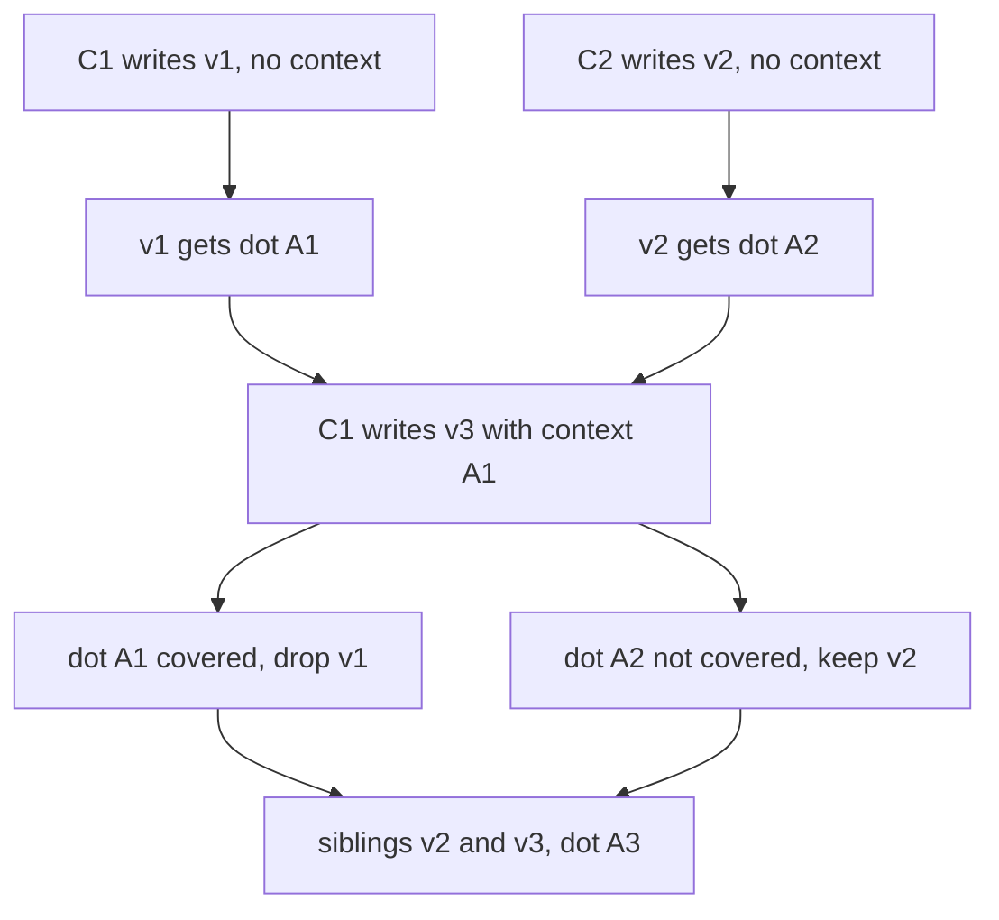

**Pseudo-code for a DVV-style write at replica r:**

```text
on write(value, context):            # context is a version vector
    siblings = [s for s in siblings if not covered(s.dot, context)]
    vv[r] = vv[r] + 1
    siblings.append(Sibling(value, dot=(r, vv[r])))
covered(dot, ctx): return dot.counter <= ctx.get(dot.replica, 0)
```

**Complexity.** Comparison is O(R) for R entries. A version vector costs O(R) space per key (R is the number of replicas, small). A DVV adds one dot per sibling. Vector clocks over processes cost O(P) for P processes, which can be large.

### Trade-offs

- **Vector clocks** capture full causality between events, but grow with the number of processes, so they suit debugging and messaging more than storage.
- **Version vectors** keyed by replicas stay small but, without dots, create false conflicts when several clients write through one replica.
- **Client-keyed vectors** are precise but can grow without bound; Dynamo's paper truncated vectors once they reached a threshold (it gives 10 pairs), risking incorrect reconciliation.
- **DVVs** keep the small server-keyed size and remove false concurrency, at the cost of slightly more complex code.
- **All of them only detect conflicts.** The application or a **CRDT** (a conflict-free replicated data type, a structure that merges automatically) must resolve them. Many systems choose **last-write-wins** instead, which is simpler but silently drops concurrent writes.

### Real-world examples

- **Amazon Dynamo** (2007) attached vector clocks of `(node, counter)` pairs to each object and returned siblings to the client for merging.
- **Riak** 2.0 added dotted version vectors as an option and recommends them to keep sibling counts bounded.
- **Project Voldemort** (LinkedIn) used vector clocks in a Dynamo-style design.
- **Apache Cassandra** deliberately avoids them and uses per-column last-write-wins timestamps.

### In the interview

**Q:** What is the difference between a vector clock and a version vector?

**A:** A vector clock orders events between processes and ticks on every event and message. A version vector orders versions of data across replicas and ticks only on writes. Same comparison rule, different purpose and size.

**Q:** Why did Riak move to dotted version vectors?

**A:** With one counter per server, several clients writing through the same server made all their values share one vector, so the server couldn't tell which value a new write replaced. Siblings piled up. A dot names each value's exact write, so a new write's context can discard exactly the values it saw.

**Q:** Two versions have vectors `{A:3, B:1}` and `{A:2, B:2}`. What do you do?

**A:** Neither dominates, so they are concurrent. Keep both as siblings and merge them on read, with application logic, a CRDT, or last-write-wins if losing one is acceptable.

### TL;DR

Vector clocks order events between processes; version vectors order data versions across replicas; both flag concurrency when neither vector dominates. Dotted version vectors tag each value with the exact write that created it, avoiding false conflicts and sibling explosion while keeping vectors small.

**Sources**

- Preguiça, Baquero, Almeida, Fonte, Gonçalves, "Dotted Version Vectors: Logical Clocks for Optimistic Replication", 2010: https://arxiv.org/abs/1011.5808
- DeCandia et al., "Dynamo: Amazon's Highly Available Key-value Store", SOSP 2007: https://www.allthingsdistributed.com/files/amazon-dynamo-sosp2007.pdf
- Riak KV docs, "Causal Context": https://docs.riak.com/riak/kv/2.2.3/learn/concepts/causal-context
- Riak engineering blog, "Vector Clocks Revisited Part 2: Dotted Version Vectors": https://riak.com/posts/technical/vector-clocks-revisited-part-2-dotted-version-vectors/


## Consistent hashing variants: jump, rendezvous, Maglev and bounded loads

### What it is

Module 0 introduced the **hash ring with virtual nodes**: servers and keys are hashed onto a circle, each key belongs to the next server clockwise, and each server owns many small arcs. That is one answer to a general question: *how do I map a key to one of N servers so that changing N moves as few keys as possible?* Any method that answers it is a **consistent hashing** scheme. This section covers four other well-known answers:

- **Jump consistent hash** — a few lines of arithmetic, no memory at all, for servers numbered 0 to N−1.
- **Rendezvous hashing**, also called **highest random weight (HRW)** — every server "bids" for the key and the highest bid wins.
- **Maglev hashing** — Google's load-balancer method, which precomputes a fixed-size lookup table so each lookup is a single array read.
- **Consistent hashing with bounded loads** — a ring (or similar) plus a hard cap so no server gets more than, say, 25% above the average.

Terms used below: a **key** is whatever you route on (user ID, URL, connection 5-tuple). A **bucket**, **backend** or **server** is the destination. **Disruption** or **movement** is the share of keys that change destination when the server set changes. The theoretical minimum, when going from N to N+1 servers, is 1/(N+1): the new server must take its fair share and nothing else should move.

### The problem it solves

The ring works, but it has costs that matter at scale:

1. **Memory and lookup time.** With 1,000 servers and 200 virtual nodes each, the ring holds 200,000 points, and every lookup is a binary search over them.
2. **Imperfect balance.** Even with 100–200 virtual nodes, the biggest server typically carries several percent more than the smallest. More vnodes means more memory.
3. **Hot keys and uneven load.** The ring balances *keys*, not *load*. If one key is very popular, or keys are unevenly costly, a server can be overloaded no matter how evenly the arcs are spread.

Each variant attacks a different one of these.

### How it works

**1. Jump consistent hash (Lamping and Veach, Google, 2014).**

The idea: imagine growing the cluster one bucket at a time, from 1 bucket to N. When bucket number b is added (going from b to b+1 buckets), each key should move to the new bucket with probability exactly 1/(b+1), and otherwise stay put. If you simulated that bucket by bucket it would cost O(N). The trick is a pseudo-random generator seeded by the key that lets you *jump* straight to the next bucket count at which this key would move, skipping all the ones where it stays. The expected number of jumps is about ln N, so for N = 1,000 it is about 7 steps.

```text
function jump_hash(key, num_buckets):
    b = -1            # last bucket the key moved to
    j = 0             # next bucket count at which it might move
    while j < num_buckets:
        b = j
        key = key * 2862933555777941757 + 1          # 64-bit LCG step
        j = floor((b + 1) * 2^31 / ((key >> 33) + 1))
    return b
```

Worked example (computed with the published constant). Key 99999 maps to bucket 0 with 1 bucket, then bucket 1 for every cluster size from 2 to 7, and then jumps to bucket 7 when the 8th bucket appears, staying there for sizes 9 and 10. So this key moves exactly twice as the cluster grows from 1 to 10, and each time it moves *into the newly added bucket*, never sideways between old buckets. Running 100,000 keys from 10 to 11 buckets moved 9,042 of them (9.04%), almost exactly the ideal 1/11 = 9.09%.

Cost: O(ln N) time, O(1) memory, essentially perfect balance. The catch: buckets must be numbered 0..N−1 and you can only add or remove at the **end**. If bucket 3 of 10 dies, you cannot simply delete "3". The usual fix is to put jump hash on top of a layer that maps bucket numbers to replicas (bucket 3 is a replica group whose members can change), which is why the paper aims it at sharded storage rather than at caches where any node can vanish.

**2. Rendezvous hashing / HRW (Thaler and Ravishankar, 1996–1998).**

For each key, compute a score for every server, `score = hash(key, server)`, and send the key to the server with the highest score.

Worked example. Key `photo:7`, three servers, pretend hash outputs scaled to 0..1:

| Server | hash("photo:7", server) |
|---|---|
| S1 | 0.62 |
| S2 | **0.91** |
| S3 | 0.17 |

The key goes to S2. If S2 dies, recompute among the survivors: S1 (0.62) wins. Keys whose top scorer was S1 or S3 are untouched, because their scores did not change. So exactly the dead server's keys move, and they spread evenly over all survivors (each key's runner-up is random). Adding S4 steals only the keys for which S4 scores highest, about 1/4 of them.

- **Replication for free:** the top 3 scores give 3 replicas, and the order is stable.
- **Weights:** a common weighted form is `score = -w / ln(h)` where h is the hash scaled to (0,1) and w is the server weight, so a server with weight 2 wins about twice as often.
- **Cost:** O(N) hash computations per lookup. For 10 servers that is nothing. For 10,000 it is too slow, and people use a tree of rendezvous choices (pick a group, then a server inside it).

**3. Maglev hashing (Google, NSDI 2016).**

Maglev is Google's software network load balancer, serving Google traffic since 2008. Each Maglev machine must send every packet of a TCP connection to the same backend, at line rate, so lookup must be a single array read. It builds a lookup table of prime size M (65,537 by default in the paper) where each slot holds a backend.

Steps:

1. For each backend i, hash its name twice: `offset = h1(name) mod M`, `skip = h2(name) mod (M-1) + 1`.
2. Its **preference list** is `permutation[i][j] = (offset + j * skip) mod M` for j = 0, 1, 2, ... Because M is prime, this visits every slot exactly once.
3. Fill the table in rounds: each backend in turn claims its next preferred slot that is still empty. Repeat until all M slots are full.
4. Lookup: `backend = table[hash(packet 5-tuple) mod M]`.

Worked example with M = 7 and three backends:

| Backend | (offset, skip) | Preference list |
|---|---|---|
| B0 | (3, 4) | 3, 0, 4, 1, 5, 2, 6 |
| B1 | (0, 2) | 0, 2, 4, 6, 1, 3, 5 |
| B2 | (3, 1) | 3, 4, 5, 6, 0, 1, 2 |

Filling: B0 takes 3. B1 takes 0. B2 wants 3 (taken), takes 4. B0 wants 0, 4 (taken), takes 1. B1 takes 2. B2 takes 5. B0 wants 5, 2 (taken), takes 6. Table: `[B1, B0, B1, B0, B2, B2, B0]` — 3, 2, 2 slots, as even as 7 slots allow.

Now remove B1 and refill with only B0 and B2: `[B0, B0, B0, B0, B2, B2, B2]`. B1's two slots (0 and 2) moved, which is required. Slot 6 also moved from B0 to B2, which was not strictly required. That is Maglev's deliberate trade: **near-perfect balance and O(1) lookup in exchange for a little extra disruption**. Maglev hides the extra disruption with a per-machine connection-tracking table, so existing flows keep their backend. The paper measured that, with a 65,537-entry table, Karger-style ring hashing and rendezvous hashing would need 29.7% and 49.5% over-provisioning to absorb their imbalance, while Maglev was almost perfectly even. Envoy's documentation reports the flip side: when hosts are removed, Maglev moves about twice as many keys as its ring hash.

**4. Consistent hashing with bounded loads (Mirrokni, Thorup, Zadimoghaddam, Google, 2016).**

Pick a balance factor c = 1 + ε, for example 1.25. With m active keys (or requests) and n servers, no server may hold more than `ceil(c * m / n)`. Lookup:

1. Hash the key onto the ring as usual and find the first server clockwise.
2. If that server is below its cap, use it.
3. Otherwise keep walking clockwise to the next server with spare capacity.

Worked example: 12 active keys, 4 servers, ε = 0.25. Cap = ceil(1.25 × 12 / 4) = ceil(3.75) = 4. Suppose the plain ring sends 6 keys to A, 3 to B, 2 to C and 1 to D. A keeps its first 4, and the other 2 walk on to the next servers clockwise that are under 4. Final loads might be 4, 4, 3, 1 instead of 6, 3, 2, 1: the hottest server went from 2× the average (3) down to 1.33×.

The paper proves that the cap holds always, and that the number of keys moved per change stays small: about O(1/ε²) times the ideal for small ε. Vimeo implemented it in HAProxy for its video cache tier and reported cutting cache bandwidth by almost 8×; HAProxy exposes it as `hash-balance-factor` (a percentage such as 150 for 1.5× the average), and Google Cloud Pub/Sub used it internally.

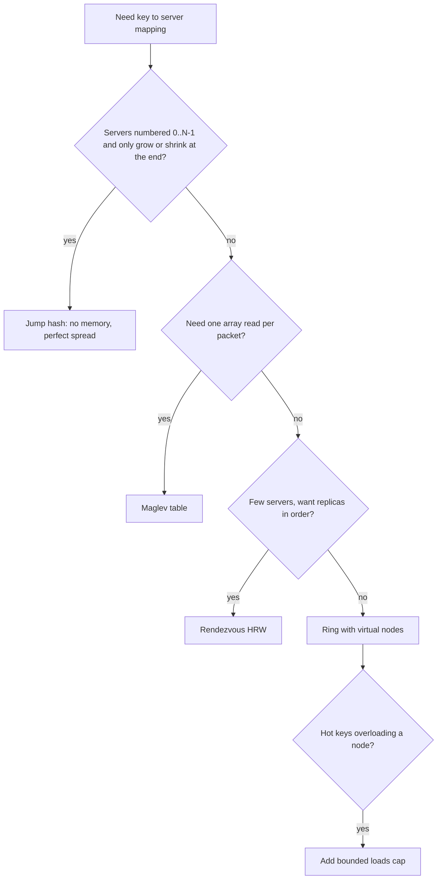

**Comparison against the ring with virtual nodes (N servers, V vnodes each, table size M):**

| Property | Ring + vnodes | Jump hash | Rendezvous (HRW) | Maglev | Bounded loads |
|---|---|---|---|---|---|
| Lookup time | O(log(N·V)) binary search | O(ln N) | O(N) | O(1) array read | Ring lookup plus a short walk |
| Memory | O(N·V) points | O(1) | O(N) server list | O(M), e.g. 65,537 slots | Ring plus live load counts |
| Keys moved on change | ≈1/N | Exactly the minimum | Exactly the minimum | Minimum plus a little | More than the ring, bounded by ε |
| Balance | Good with many vnodes | Perfect | Good | Near perfect | Hard cap of (1+ε)× average |
| Remove an arbitrary server | Yes | No, only the last | Yes | Yes | Yes |
| Weights | More vnodes | Not natively | Weighted score | More table slots | Weighted caps |
| Typical home | Dynamo, Cassandra, memcached clients | Sharded storage, Guava library | Small caches, CDNs, replica placement | L4 load balancers, Envoy | Cache tiers with hot keys, HAProxy |

### Trade-offs

- **Jump** is the fastest and smallest but cannot drop a server from the middle, so it needs a stable numbering layer.
- **Rendezvous** is the simplest to reason about and gives ordered replicas for free, but lookup is linear in the number of servers.
- **Maglev** buys O(1) lookups and excellent balance with a fixed memory cost per service and slightly more churn. Rebuilding a bigger table also takes longer (the paper measured 1.8 ms at 65,537 entries versus 22.9 ms at 655,373).
- **Bounded loads** is the only one that looks at *actual load*, so it protects against hot keys, but it needs shared, current load numbers and gives up some stickiness: an overflowing key may land somewhere different from one moment to the next.

### Real-world examples

- **Google Maglev** and **Envoy's Maglev load balancer** (default table size 65,537) for connection-level balancing.
- **Guava's `Hashing.consistentHash`** implements jump hash.
- **Rendezvous hashing** appears in caching proxies and in many object-placement schemes where replica order matters.
- **Vimeo with HAProxy** and **Google Cloud Pub/Sub** used consistent hashing with bounded loads.

### In the interview

**Q:** You are building an L4 load balancer that must handle millions of packets per second. Ring hash or Maglev?

**A:** Maglev. Each packet becomes one array read into a precomputed table, and the table splits traffic almost perfectly evenly. The small extra key movement on backend changes is covered by a connection-tracking table that pins existing flows.

**Q:** Why not use jump hash for a memcached fleet?

**A:** Any cache node can die, and jump hash can only remove the highest-numbered bucket. Removing node 3 of 10 would renumber and remap most keys unless you add an indirection layer. A ring or rendezvous handles arbitrary removal directly.

**Q:** One celebrity key is overloading its cache node. Does adding virtual nodes help?

**A:** No. Virtual nodes balance how many keys each node owns, not how hot they are. Bounded loads caps each node at (1+ε) × average load and spills overflow clockwise. For a single extremely hot key you also replicate it or put a local cache in front.

**Q:** How does rendezvous hashing give you replicas?

**A:** Sort the servers by score for that key and take the top R. When one dies, the next in the list steps up, and every client computes the same order without coordination.

### TL;DR

All consistent hashing schemes keep key movement near the 1/N minimum. Jump hash uses no memory but can only add or remove the last bucket. Rendezvous is simple, gives ordered replicas, and costs O(N) per lookup. Maglev answers each lookup with one array read and nearly perfect balance, at the price of slightly more churn. Bounded loads puts a hard cap on each server's load to absorb hot keys.

**Sources**

- Lamping and Veach, "A Fast, Minimal Memory, Consistent Hash Algorithm" (2014): https://arxiv.org/abs/1406.2294
- Guava `Hashing.consistentHash` source: https://github.com/google/guava/blob/master/guava/src/com/google/common/hash/Hashing.java
- Thaler and Ravishankar, "Using Name-Based Mappings to Increase Hit Rates", IEEE/ACM ToN 1998: https://www.cs.ucr.edu/~ravi/Papers/Jrnl/HRW98.pdf
- Eisenbud et al., "Maglev: A Fast and Reliable Software Network Load Balancer", NSDI 2016: https://www.usenix.org/conference/nsdi16/technical-sessions/presentation/eisenbud
- Envoy load balancers (ring hash vs Maglev): https://www.envoyproxy.io/docs/envoy/latest/intro/arch_overview/upstream/load_balancing/load_balancers
- Mirrokni, Thorup, Zadimoghaddam, "Consistent Hashing with Bounded Loads": https://arxiv.org/abs/1608.01350
- Google Research blog on bounded loads (Vimeo, Pub/Sub): https://research.google/blog/consistent-hashing-with-bounded-loads/
- Vimeo engineering blog: https://medium.com/vimeo-engineering-blog/improving-load-balancing-with-a-new-consistent-hashing-algorithm-9f1bd75709ed

## HyperLogLog internals

### What it is

**HyperLogLog (HLL)** is a **sketch**, a small fixed-size summary of a big stream, that estimates **cardinality**: the number of *distinct* items seen. It was published by Flajolet, Fusy, Gandouet and Meunier in 2007. With m small counters called **registers** its typical relative error is 1.04/√m. Redis uses m = 16,384 registers of 6 bits each, so about 12 KB answers "how many unique visitors?" for billions of visitors with about 0.81% error.

### The problem it solves

Counting distinct items exactly means remembering every item you have seen, for example in a hash set. 100 million unique user IDs at 8 bytes each is 800 MB per counter, and you may want one counter per page per day. HLL replaces that with a few kilobytes, and two HLLs can be **merged** to get the distinct count of the union, which a plain count cannot do (you cannot add two distinct counts because users overlap).

### How it works

**The core intuition.** Hash each item to a random-looking bit string. In a random bit string, a run of 1 leading zero happens half the time, 2 leading zeros a quarter of the time, k leading zeros about 1 in 2^k. If the longest run of leading zeros you have ever seen is 10, you have probably seen around 2^10 ≈ 1,000 distinct hashes. Duplicates do not matter, because the same item always gives the same hash. One counter is very noisy (one lucky hash ruins it), so HLL keeps many and averages them.

**Steps (precision p, m = 2^p registers):**

1. Hash the item to 64 bits.
2. Use the first p bits as the **register index** (which of the m registers this item belongs to).
3. In the remaining bits, find ρ ("rho"), the position of the first 1-bit, which is the number of leading zeros plus 1.
4. Set `register[index] = max(register[index], ρ)`. Registers only ever grow.
5. To estimate, combine the registers with a **harmonic mean**: `E = α_m · m² / Σ 2^(−register[j])`. α_m is a bias-correction constant, about 0.7213/(1 + 1.079/m) for m ≥ 128, and 0.673 for m = 16.
6. **Small-range correction:** if E ≤ 2.5·m and some registers are still 0, use **linear counting** instead: `m · ln(m / V)` where V is the number of zero registers. This is far more accurate when most registers are still empty.

**Worked example 1 (update).** p = 2, so 4 registers. An item hashes to `10 0001 1...`. The first two bits `10` select register 2. The rest starts with `0001`, three zeros then a 1, so ρ = 4. If register 2 held 2, it becomes max(2, 4) = 4. Another item hashing to `10 1...` has ρ = 1 and leaves register 2 at 4.

**Worked example 2 (estimate).** m = 16 registers with values `3,2,4,1,2,5,3,2,1,3,2,4,2,3,1,2`. Then Σ 2^(−R) = 3.656, and E = 0.673 × 16² / 3.656 ≈ 47. Since 47 > 2.5 × 16 = 40, the raw estimate stands: about 47 distinct items. With m = 16 the error is 1.04/4 = 26%, which is why real systems use thousands of registers.

**Worked example 3 (small range).** Registers `3,0,2,0,1,0,0,2,0,1,0,0,0,1,0,0`: the raw estimate is 14.2, below 40, and V = 10 registers are zero, so linear counting gives 16 × ln(16/10) ≈ 7.5, about 8 items.

**Why a harmonic mean?** Take four registers `2, 2, 2, 20`. The fourth saw one freak hash. The arithmetic mean of 2^R is (4 + 4 + 4 + 1,048,576)/4 ≈ 262,000, which is ruined. The harmonic mean is 4 / (0.25 + 0.25 + 0.25 + 2^(−20)) ≈ 5.3, which barely notices the outlier. The harmonic mean is dominated by the small values, which is what you want when the noise is occasional huge outliers.

**Error and size.** Standard error ≈ 1.04/√m:

| p | m | Error | Dense size at 6 bits/register |
|---|---|---|---|
| 10 | 1,024 | 3.25% | 768 bytes |
| 14 | 16,384 | 0.81% | 12 KB |
| 16 | 65,536 | 0.41% | 48 KB |

Each 4× increase in memory halves the error. Six bits per register suffice because ρ never exceeds 64 for a 64-bit hash.

**Sparse representation.** A fresh 12 KB HLL that has seen 5 items is 99.9% zeros. **HyperLogLog++** (Heule, Nunkesser and Hall, Google, EDBT 2013) adds three improvements: a 64-bit hash so huge cardinalities need no large-range correction, an empirical bias-correction table for the awkward middle range, and a **sparse mode** that stores only the non-zero (index, ρ) pairs as a sorted, compressed list, using a higher precision (p′ = 25) while sparse. When the list would grow larger than the dense array, it converts to dense. Redis does something similar with run-length opcodes: `XZERO:1000, VAL:2, ZERO:19, VAL:3 x2, XZERO:15362` encodes three non-zero registers in 7 bytes instead of 12 KB, and Redis switches to dense once the sparse form passes `hll-sparse-max-bytes` (3,000 bytes by default).

**Merging.** Two HLLs with the same p and the same hash function merge by taking the register-wise maximum: `merged[j] = max(a[j], b[j])`. The result is exactly the sketch you would have built from the union stream. So you can keep one HLL per hour and merge 24 of them for a daily count, or one per shard and merge at query time. Intersections are not directly supported: |A ∩ B| = |A| + |B| − |A ∪ B| works, but the errors of three estimates add up, so it is poor when the overlap is small.

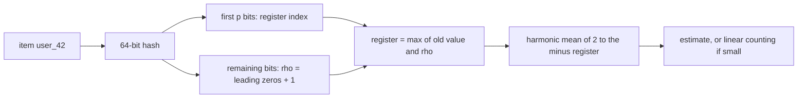

Complexity: O(1) per add (one hash and one max), O(m) per estimate (Redis caches the last estimate and invalidates it only when a register changes), O(m) per merge, O(m) memory.

### Trade-offs

- Error is relative, about 0.8% at 12 KB, and never zero. Fine for dashboards, not for billing.
- No deletions: registers only grow. To get "unique users in the last 7 days" you keep daily HLLs and merge the window.
- Cannot list the items, only count them.
- Merge requires identical p and hash function across all producers.
- Intersections and small overlaps are inaccurate. Theta or KMV sketches handle set operations better.

### Real-world examples

- **Redis** `PFADD`, `PFCOUNT`, `PFMERGE`: up to 12 KB per key, 0.81% standard error.
- **Google** uses HLL++ internally and in BigQuery's approximate count functions.
- Analytics databases such as Druid, ClickHouse, Presto/Trino and Spark offer `approx_count_distinct`-style functions built on HLL variants.

### In the interview

**Q:** How do you count daily unique visitors per page for 10 million pages?

**A:** One HLL per page per day. At 12 KB dense that is up to 120 GB, but most pages are small and stay in sparse form, so real usage is far lower. Weekly and monthly uniques come from merging daily sketches.

**Q:** Why can you merge HLLs but not add distinct counts?

**A:** Adding counts double-counts users who appear in both sets. An HLL register stores the maximum ρ seen, and max over the union is the max of the two maxes, so a register-wise max gives exactly the union's sketch.

**Q:** What does 1.04/√m mean in practice?

**A:** With 16,384 registers the estimate is typically within about ±0.81% of the truth (one standard error), and within about ±2.4% roughly 99% of the time (three standard errors).

### TL;DR

HyperLogLog hashes items, uses some bits to pick a register and the run of leading zeros in the rest as evidence of how many distinct items there are, keeps the maximum per register, and combines registers with a bias-corrected harmonic mean. 12 KB gives about 0.8% error. Sketches merge by register-wise max, and a sparse encoding keeps small sketches tiny.

**Sources**

- Flajolet, Fusy, Gandouet, Meunier, "HyperLogLog: the analysis of a near-optimal cardinality estimation algorithm" (2007): https://dmtcs.episciences.org/3545/pdf
- Heule, Nunkesser, Hall, "HyperLogLog in Practice" (EDBT 2013): https://research.google/pubs/hyperloglog-in-practice-algorithmic-engineering-of-a-state-of-the-art-cardinality-estimation-algorithm/
- Redis HyperLogLog docs: https://redis.io/docs/latest/develop/data-types/probabilistic/hyperloglogs/
- Salvatore Sanfilippo, "Redis new data structure: the HyperLogLog": http://antirez.com/news/75
- Redis `hyperloglog.c` (sparse opcodes, 3,000-byte limit), Valkey copy: https://fossies.org/linux/valkey/src/hyperloglog.c

## Count-min sketch with conservative update

### What it is

A **count-min sketch (CMS)** estimates *how many times* each item has appeared in a stream, using a small fixed grid of counters instead of one counter per item. It was introduced by Cormode and Muthukrishnan in 2005. Its estimates can be too high but never too low. **Conservative update** is a small change to the update rule, from Estan and Varghese's 2002 traffic-measurement work, that makes the over-estimates much smaller.

### The problem it solves

You want per-key frequencies over a huge or unbounded key space: requests per IP for rate limiting, clicks per URL, queries per search term. An exact hash map needs memory proportional to the number of distinct keys, which might be hundreds of millions. A CMS uses a fixed size chosen from the accuracy you need, and it merges across machines by adding grids.

### How it works

**Structure:** d rows by w columns of counters, and d independent hash functions, one per row.

**Sizing:** to guarantee that every estimate is at most the true count + ε·N (N = total of all counts) with probability at least 1 − δ, choose `w = ceil(e / ε)` and `d = ceil(ln(1/δ))`, where e ≈ 2.718. For ε = 0.001 and δ = 0.01: w = 2,719 and d = 5, so 13,595 counters, about 54 KB at 4 bytes each, however many distinct keys there are. (Some implementations use w = 2/ε. Redis's `CMS.INITBYPROB` with error 0.001 builds a 2,000-wide sketch.)

**Standard update** `add(x, c)`: for every row i, `table[i][h_i(x)] += c`.
**Query** `estimate(x)`: `min over i of table[i][h_i(x)]`.

Why the minimum? Every counter x touches holds x's true count plus the counts of whatever else collided there. Collisions only add, so each counter is an over-estimate, and the smallest is the least polluted.

**Worked example.** w = 5, d = 3. The hash positions are:

| Item | row 1 | row 2 | row 3 |
|---|---|---|---|
| dog | 3 | 4 | 0 |
| cat | 1 | 4 | 2 |
| fox | 1 | 0 | 3 |
| owl (never seen) | 1 | 4 | 0 |

Stream: dog ×5, then cat ×3, then fox ×2.

Standard update, final grid (columns 0..4):

```text
row 1: [0, 5, 0, 5, 0]    cat 3 + fox 2 collide in column 1
row 2: [2, 0, 0, 0, 8]    dog 5 + cat 3 collide in column 4
row 3: [5, 0, 3, 2, 0]
```

- cat = min(5, 8, 3) = 3 (exact). dog = min(5, 8, 5) = 5 (exact). fox = min(5, 2, 2) = 2 (exact).
- owl, never seen = min(5, 8, 5) = **5**. That is a false over-estimate caused by collisions in every row.

**Conservative update.** When adding c to x, first compute the current estimate `e = min of x's counters`. The true count is now at most e + c, so no counter needs to go *above* e + c. Raise each of x's counters to `max(counter, e + c)` and leave the rest alone.

```text
function add_conservative(x, c):
    e = min(table[i][h_i(x)] for i in 1..d)
    for i in 1..d:
        table[i][h_i(x)] = max(table[i][h_i(x)], e + c)
```

Same stream with conservative update, one unit at a time:

- dog ×5: all its counters are 0, so they rise together to 5. Row 1 col 3 = 5, row 2 col 4 = 5, row 3 col 0 = 5.
- cat ×3: its counters are (0, 5, 0), estimate 0. After the first cat they become (1, 5, 1), because row 2's 5 is already ≥ 1. After three cats: (3, 5, 3). Row 2 col 4 **stays 5** instead of rising to 8.
- fox ×2: its counters (row 1 col 1 = 3, row 2 col 0 = 0, row 3 col 3 = 0) have estimate 0. After two foxes: (3, 2, 2). Row 1 col 1 **stays 3** instead of 5.

Now owl = min(3, 5, 5) = **3** instead of 5. Real items are still never under-estimated, and the noise from collisions shrinks. On real traffic Estan and Varghese reported that this kind of optimisation improved accuracy by about an order of magnitude.

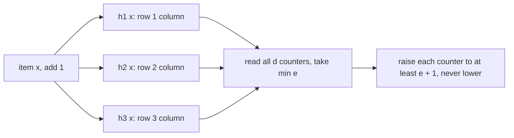

Complexity: O(d) time per update and per query (d is usually 4–8), O(w·d) memory.

### Trade-offs

- **Error is relative to the total stream size N**, not to the item. With ε = 0.001 and N = 10 million, any item can be over-estimated by up to 10,000. A CMS is excellent for heavy items and useless for rare ones. Redis's docs say to treat estimates below ε·N as noise.
- **Conservative update gives up mergeability and deletes.** Standard sketches merge by adding grids cell by cell, and support negative updates. A conservatively-updated sketch is no longer a plain sum, so adding two of them still gives an over-estimate but loses the formal error bound, and decrements are not allowed.
- **No item list.** A CMS cannot tell you *which* items are heavy. Pair it with a heap (next section).
- **Aging:** counts grow forever. Use time-bucketed sketches (one per minute) or periodically halve every counter.

### Real-world examples

- **Redis** `CMS.INITBYPROB`, `CMS.INCRBY`, `CMS.QUERY`, `CMS.MERGE`.
- Network monitoring and DDoS detection on routers and switches, the original motivation for Estan and Varghese.
- The TinyLFU cache-admission policy, used by Caffeine in Java, uses a count-min-style frequency sketch with periodic halving to decide whether a new key deserves a cache slot.
- Stream processors (Flink, Spark) provide CMS helpers for approximate frequency queries.

### In the interview

**Q:** Can a count-min sketch under-count?

**A:** Not with non-negative updates. Each counter holds the true count plus colliding counts, so the minimum is still at least the true count. It only over-counts.

**Q:** How do you size it for "error at most 0.1% of traffic with 99% confidence"?

**A:** ε = 0.001 gives w = ceil(e/0.001) = 2,719, and δ = 0.01 gives d = ceil(ln 100) = 5, so about 13,600 counters, roughly 54 KB with 32-bit counters.

**Q:** What does conservative update buy and cost?

**A:** It only raises the counters that are lower than the new lower-bound estimate, so collisions inflate counters much less, often making errors many times smaller. The cost is that you lose clean merging and deletions.

### TL;DR

A count-min sketch is a d × w grid of counters. Adding an item increments one counter per row, and the estimate is the minimum over those counters. That estimate is never too low and is too high by at most ε·N with probability 1 − δ. Conservative update raises only the counters below min + c and sharply cuts over-counting, at the cost of mergeability and deletes.

**Sources**

- Cormode and Muthukrishnan, "An Improved Data Stream Summary: The Count-Min Sketch and its Applications": https://www.cs.tufts.edu/~nr/cs257/archive/graham-cormode/count-min.pdf (J. Algorithms 55(1), 2005)
- Estan and Varghese, "New Directions in Traffic Measurement and Accounting", SIGCOMM 2002: https://conferences2.sigcomm.org/sigcomm/2002/papers/account.html
- Redis count-min sketch docs: https://redis.io/docs/latest/develop/data-types/probabilistic/count-min-sketch/

## Heavy hitters: Misra-Gries, Space-Saving and streaming top-k

### What it is

**Heavy hitters** are the items that make up a large share of a stream, for example every search term above 1% of all queries. **Top-k** asks for the k most frequent items. Two classic algorithms solve this with a fixed number of counters, keeping the *items themselves*, which a count-min sketch cannot do:

- **Misra-Gries** (Misra and Gries, 1982): k counters, and when they are full, decrement everyone.
- **Space-Saving** (Metwally, Agrawal and El Abbadi, 2005): k counters, and when they are full, evict the smallest and let the newcomer inherit its count.

### The problem it solves

"What are the top 10 hashtags right now?" or "which 100 IPs send the most traffic?" An exact answer requires a counter per distinct item, which could be hundreds of millions. These algorithms keep only k entries and guarantee that every truly heavy item is among them, with bounded count error.

### How it works

Stream for both examples (n = 10): `A B A C D A B A E A`. True counts are A = 5, B = 2, C = D = E = 1. Both use **k = 3 counters**.

**Misra-Gries.** For each item x:

1. If x has a counter, increment it.
2. Else if a counter slot is free, add x with count 1.
3. Else decrement **every** counter by 1 and drop those that reach 0. (x itself is not stored.)

Trace:

| Arrival | Counters after |
|---|---|
| A, B, A, C | A:2, B:1, C:1 |
| D (full) | decrement all: A:1 (B, C dropped) |
| A | A:2 |
| B | A:2, B:1 |
| A | A:3, B:1 |
| E | A:3, B:1, E:1 |
| A | A:4, B:1, E:1 |

Guarantee: each stored count is an **under-estimate** by at most n/(k+1) = 10/4 = 2.5. A is reported as 4 against a true 5. Any item with true frequency above n/(k+1) is guaranteed to be in the table. Each decrement step throws away k+1 occurrences (k counters plus the arriving item), so it can happen at most n/(k+1) times.

**Space-Saving.** For each item x:

1. If x has a counter, increment it.
2. Else if a slot is free, add x with count 1, error 0.
3. Else find the counter with the **minimum** count `min`, replace its item with x, set count = min + 1 and error = min.

Trace:

| Arrival | Counters after (count, error) |
|---|---|
| A, B, A, C | A:2, B:1, C:1 |
| D | evict B (min 1): A:2, C:1, D:2(err 1) |
| A | A:3, C:1, D:2 |
| B | evict C (min 1): A:3, D:2, B:2(err 1) |
| A | A:4, D:2, B:2 |
| E | evict D (min 2): A:4, B:2, E:3(err 2) |
| A | A:5, B:2, E:3 |

Counts here are **over-estimates**, and `count − error` is a guaranteed lower bound: E shows 3 with error 2, so its true count is between 1 and 3. A is exact at 5. The over-estimate is at most n/k. In practice Space-Saving is usually more accurate than Misra-Gries for the same k, especially on skewed (Zipf-like) data where a few items dominate. With a "stream summary" structure (buckets of equal counts in a linked list) each update is O(1). With a min-heap it is O(log k).

```text
function space_saving(x):
    if x in counters: counters[x].count += 1
    elif len(counters) < k: counters[x] = (count=1, error=0)
    else:
        y = item with smallest count     # min-heap or stream-summary
        m = counters[y].count
        delete counters[y]
        counters[x] = (count=m+1, error=m)
```

**Streaming top-k in practice: sketch plus heap.** Another common pattern is a count-min sketch for frequencies plus a min-heap of size k for the current top items. On each arrival, update the CMS, read x's estimate, and if it beats the heap's minimum (or x is already in the heap) update the heap. Redis's `TOPK` commands use **HeavyKeeper** (Gong et al., USENIX ATC 2018), which pairs a sketch-like table with a heap and *decays* counters of colliding small items so large flows keep their place.

**Distributed top-k.** You cannot take the top 10 from each of 50 shards and merge them: an item that is 11th everywhere can be 1st globally. Options: (1) shards send Misra-Gries or Space-Saving summaries, which are designed to merge (add counts, then trim back to k), (2) shards send a larger top-k′ (for example 10×k) with counts and the coordinator accepts a small error, or (3) partition by item (hash the hashtag to a shard) so each item is counted in exactly one place and local top-k lists merge exactly.

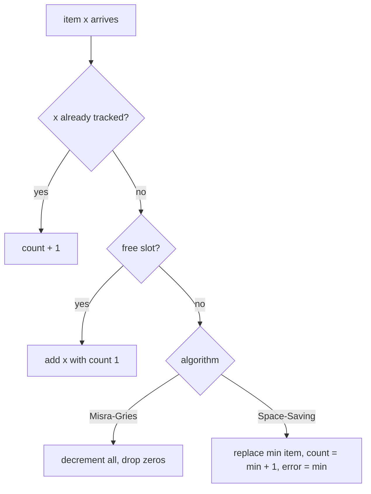

Complexity: O(k) memory for both. Misra-Gries is O(1) amortised per item with the right structure (O(k) naively). Space-Saving is O(1) with stream-summary or O(log k) with a heap.

### Trade-offs

- **Misra-Gries** under-counts and is simple and mergeable, but its counts are less useful as numbers.
- **Space-Saving** over-counts but tracks an error per entry and is usually more accurate. Its ranking at the bottom of the list is noisy because evicted items re-enter with inflated counts.
- **CMS + heap** gives estimates for *any* item, not just tracked ones, but costs more memory and inherits CMS error relative to N.
- All of them count since the start. For "top right now" you need windows (one summary per minute, merged) or decay (next sections).

### Real-world examples

- **Redis** `TOPK.ADD` / `TOPK.LIST` (HeavyKeeper).
- **Apache DataSketches** "frequent items" sketch, used in Druid and other analytics engines, is based on Misra-Gries-style reduction.
- Network gear and CDNs find "elephant flows" and abusive clients with these algorithms.
- Trending hashtags, top search queries, most-viewed products dashboards.

### In the interview

**Q:** Design "top 100 search queries in the last hour" at 100,000 queries per second.

**A:** Hash each query to one of P aggregator partitions so a query is counted in one place. Each partition keeps a Space-Saving summary per minute (say 10,000 entries for top-100 accuracy). Every few seconds each partition merges its last 60 minute-summaries and publishes its top 100. A coordinator merges the P lists. That merge is exact because the partitions hold disjoint queries.

**Q:** Why not just take the top 10 from every server and merge?

**A:** Because a query that is just below the cut on every server can be the largest overall. Either partition by key, or send much larger lists or mergeable summaries.

**Q:** Misra-Gries says A = 4 but truth is 5. Is that a bug?

**A:** No. Misra-Gries always under-counts, by at most n/(k+1). Its promise is that every item above that threshold is in the table. If you need exact counts for the winners, do a second pass or keep exact counters for the candidates.

### TL;DR

Misra-Gries and Space-Saving find frequent items with k counters. Misra-Gries decrements all counters when full and under-counts by at most n/(k+1). Space-Saving evicts the smallest counter, lets the newcomer inherit its count, records the error, and over-counts by at most n/k. For distributed top-k, partition by item or merge proper summaries, never just local top-k lists.

**Sources**

- Misra and Gries, "Finding Repeated Elements", Science of Computer Programming, 1982: https://users.cs.utah.edu/~pandey/courses/cs6968/spring23/papers/mg.pdf
- Metwally, Agrawal, El Abbadi, "Efficient Computation of Frequent and Top-k Elements in Data Streams" (ICDT 2005; UCSB TR 2005-23): https://old.cs.ucsb.edu/research/tech_reports/reports/2005-23.pdf
- Gong et al., "HeavyKeeper", USENIX ATC 2018: https://www.usenix.org/conference/atc18/presentation/gong
- Redis `TOPK.ADD`: https://redis.io/commands/topk.add

## Reservoir sampling: Algorithm R and the weighted variant

### What it is

**Reservoir sampling** keeps a uniform random sample of exactly k items from a stream whose length you do not know in advance, in one pass and O(k) memory. The **reservoir** is the array of k slots. **Algorithm R** is the classic version, analysed in Vitter's 1985 paper "Random Sampling with a Reservoir". **Weighted reservoir sampling** (Efraimidis and Spirakis, 2006) lets heavier items be more likely to be picked.

### The problem it solves

"Keep 1,000 representative log lines from today", "show 100 random requests from this endpoint for debugging", "sample 1% of traces but cap at 10,000 per minute". You cannot store the whole stream and pick at the end, and you do not know how long it will be. Simple "keep each with probability p" sampling gives a random-size sample that can blow up on a busy day.

### How it works

**Algorithm R:**

1. Put the first k items straight into the reservoir.
2. For item number i (counting from 1) with i > k, pick a random integer j uniformly in 1..i.
3. If j ≤ k, replace reservoir slot j with item i. Otherwise discard item i.

```text
function reservoir(stream, k):
    R = []
    for i, x in enumerate(stream, start=1):
        if i <= k: R.append(x)
        else:
            j = random_int(1, i)
            if j <= k: R[j] = x
    return R
```

**Worked example.** k = 2, stream `a b c d e`.

- a, b fill the reservoir: `[a, b]`.
- c (i = 3): draw j from 1..3, say j = 1. 1 ≤ 2, so replace slot 1: `[c, b]`.
- d (i = 4): draw j = 4. 4 > 2, discard: `[c, b]`.
- e (i = 5): draw j = 2. Replace slot 2: `[c, e]`.

**Why it is fair.** Every item should end up in the sample with probability k/n = 2/5. Check item c: it enters with probability 2/3. It survives d unless d is kept (2/4) *and* d lands on c's slot (1/2), so it survives with 1 − 1/4 = 3/4. It survives e with 1 − (2/5)(1/2) = 4/5. Total: 2/3 × 3/4 × 4/5 = 2/5. The product telescopes like this for every position, so all items are equally likely.

Complexity: O(1) per item, O(k) memory. For very long streams, skip-ahead variants (Vitter's Algorithm Z, or Algorithm L) compute how many items to skip before the next replacement, so they draw far fewer random numbers.

**Weighted variant (A-Res, Efraimidis and Spirakis).** Each item has a weight w > 0.

1. For each item draw u uniformly in (0, 1) and compute the key `u^(1/w)`.
2. Keep the k items with the **largest** keys, using a min-heap of size k.

Higher weights push the key toward 1, so heavy items tend to win, but luck still plays a part. Worked example, k = 2:

| Item | weight w | u | key = u^(1/w) |
|---|---|---|---|
| A | 1 | 0.50 | 0.500 |
| B | 4 | 0.30 | 0.740 |
| C | 2 | 0.80 | 0.894 |
| D | 1 | 0.90 | 0.900 |

The sample is {D, C}. B had the highest weight but drew a small u, which happens with the right probability. Use `log(u) / w` as the key (same order, numerically safer) when weights are large.

**Distributed sampling.** The "random key, keep the top k" form is **mergeable**: each shard keeps its top-k keys and the coordinator keeps the top k of the union. The result is exactly a sample of the whole stream. Uniform sampling is the special case where every weight is 1, so the key is just u.

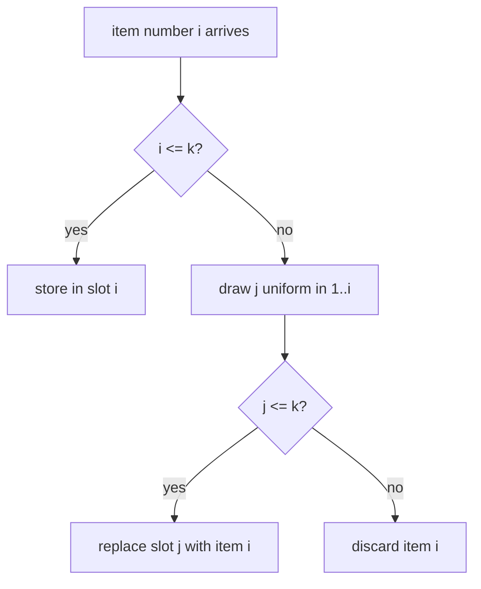

### Trade-offs

- Exactly k items regardless of volume, which is great for bounded memory and storage. The effective sampling rate drops as volume grows, so record n (items seen) to scale counts back up.
- Uniform samples miss rare but important events (errors, slow requests). Use weights, or a separate always-keep rule for errors.
- Algorithm R needs one random number per item. Skip-based versions are faster for huge streams.
- A sample is not a sketch: it cannot answer "how many distinct" or "how often did X occur" reliably for rare X.

### Real-world examples

- **Dropwizard Metrics** (Java) uses reservoir-based histograms (uniform and exponentially decaying) to keep latency samples.
- Tail-based trace samplers and log samplers that cap traces per minute.
- Database `TABLESAMPLE` and approximate query engines use reservoir-style sampling to build statistics.

### In the interview

**Q:** Pick 1 random line from a file of unknown length in one pass with O(1) memory.

**A:** Reservoir with k = 1: keep line 1, then replace the kept line with line i with probability 1/i. Every line ends up chosen with probability 1/n.

**Q:** How do you sample uniformly across 100 shards?

**A:** Give every item a random key u, keep the k items with the largest keys per shard, and take the top k of the union at the coordinator. For weighted sampling use u^(1/w) as the key.

**Q:** Why not just keep each request with probability 1%?

**A:** That sample's size grows with traffic and is unbounded during spikes. A reservoir guarantees exactly k items per window.

### TL;DR

Algorithm R keeps the first k items, then keeps item i with probability k/i in a random slot, so every item ends up sampled with probability k/n in one pass and O(k) memory. Weighted sampling gives each item the key u^(1/w) and keeps the top k keys, which also merges across shards.

**Sources**

- Vitter, "Random Sampling with a Reservoir", ACM TOMS 11(1), 1985: https://doi.org/10.1145/3147.3165
- Efraimidis and Spirakis, "Weighted random sampling with a reservoir", Information Processing Letters 97(5), 2006: https://doi.org/10.1016/j.ipl.2005.11.003

## t-digest and percentile estimation

### What it is

A **percentile** (or **quantile**) answers "what value are q% of observations below?". p99 latency is the value 99% of requests beat. A **t-digest** (Ted Dunning, refined with Otmar Ertl, 2019 paper) is a small summary of a distribution that answers any percentile query approximately, is very accurate near the extremes (p99, p99.9) and **merges** across machines without losing accuracy.

### The problem it solves

Exact percentiles need every value sorted. With a billion requests a day across 500 servers that is impractical, so each server keeps a summary. The tempting shortcut, **averaging percentiles** from each server, is wrong. Example:

- Server A: 9,900 requests. 9,800 at 20 ms and 100 at 50 ms. Its p99 (the 9,801st value) is 50 ms.
- Server B: 100 requests, all at 1,000 ms. Its p99 is 1,000 ms.
- Average of the p99s: (50 + 1,000)/2 = **525 ms**.
- True p99 of all 10,000 requests: sort them, and the 9,900th value is 50 ms, so p99 = **50 ms**. (The 1,000 ms requests are exactly the slowest 1%, and they show up in p99.5.)

The average is 10× off. You cannot average or add percentiles. You need a summary of each distribution that can be merged, and *then* you query the merged summary.

### How it works

**Centroids.** A t-digest is a sorted list of **centroids**, each a (mean, count) pair standing for a cluster of nearby values. The key rule is that **centroids near the middle of the distribution may be large, and centroids near the tails must be tiny**. The tails, where p99 lives, keep nearly every point. The middle, which you rarely ask about precisely, is summarised coarsely.

**The size limit.** A **scale function** k(q) sets how wide a centroid may be at quantile position q. A centroid covering quantiles q_left to q_right is allowed only if `k(q_right) − k(q_left) ≤ 1`. The function is steep near q = 0 and q = 1 and flat in the middle. A **compression** parameter δ (often 100) controls how many centroids exist overall. The original paper's simpler bound gives a feel for the numbers: a centroid at quantile q may hold about `4 · N · q · (1 − q) / δ` points. With N = 10,000 points and δ = 100:

| Quantile q | Max points per centroid |
|---|---|
| 0.5 (median) | 4 × 10,000 × 0.25 / 100 = 100 |
| 0.1 | 4 × 10,000 × 0.09 / 100 = 36 |
| 0.01 | 4 × 10,000 × 0.0099 / 100 ≈ 4 |
| 0.001 | ≈ 0.4, so single points |

So the median is known to within a bucket of ~100 points, while the extreme tail keeps individual values.

**Adding points (merging variant):**

1. Buffer incoming values. When the buffer fills, sort buffer and existing centroids together by mean.
2. Walk left to right, greedily merging each item into the current centroid if the size limit at that quantile still allows it. Otherwise start a new centroid.
3. The new centroid's mean is the weighted mean, and its count is the sum.

**Querying p99:**

1. Target rank = 0.99 × N.
2. Walk centroids accumulating counts until you pass the target rank.
3. **Interpolate** between the two neighbouring centroid means according to where the target falls. Exact minimum and maximum are kept for the ends.

**Merging digests** from many servers works the same way: concatenate all their centroids, sort, and run the same greedy merge. Because the size rule depends only on quantile position, the merged digest has the same accuracy guarantees, which is the property averaging percentiles lacks.

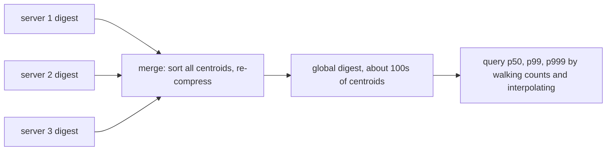

Complexity: amortised O(log δ) or better per insert with buffering, memory O(δ) centroids (Elasticsearch caps it at 20 × compression nodes, about 64 KB worst case at the default of 100), merge O(total centroids × log).

**Alternatives worth naming:**

- **HDR Histogram** (fixed log-scale buckets with a chosen number of significant digits): fast, mergeable by adding buckets, bounded relative error, needs a known value range. Very common for latency.
- **DDSketch** (Datadog): log-scale buckets with a guaranteed relative error, fully mergeable.
- **KLL** and other rank-error sketches (in Apache DataSketches): proven worst-case error bounds on rank.

### Trade-offs

- t-digest is very accurate at the tails and small, but its error bounds are mostly empirical, and the result can depend a little on insertion order.
- Middle percentiles are less precise than tail percentiles, which is usually the right trade for latency.
- HDR or DDSketch are simpler and give hard relative-error guarantees, but need a range (HDR) or use more memory for wide ranges.
- Any sketch beats the wrong answer you get from averaging per-host percentiles.

### Real-world examples

- **Elasticsearch / OpenSearch** `percentiles` aggregation uses t-digest by default (compression 100), with HDR histogram as an option.
- Many metrics libraries and stream processors offer t-digest. Prometheus **histograms** (fixed buckets, mergeable) are the bucket-based alternative, and Prometheus **summaries** compute quantiles per process, which cannot be aggregated across instances for exactly the reason shown above.
- Datadog uses DDSketch for distribution metrics.

### In the interview

**Q:** Your dashboard averages p99 across 200 hosts. What is wrong?

**A:** Percentiles do not average. A host with few but slow requests drags the average far from the real p99, or a busy host's tail gets diluted. Ship mergeable sketches (t-digest, HDR, DDSketch) or bucketed histograms, merge them, then compute p99 once.

**Q:** Why is t-digest more accurate at p99.9 than at p50?

**A:** Its scale function forces centroids near the tails to hold very few points, often single values, while centroids near the median can hold many. Precision is spent where tail-latency questions are asked.

**Q:** Can you compute a weekly p99 from daily p99s?

**A:** No. Keep daily digests and merge seven of them, then query.

### TL;DR

Never average percentiles. A t-digest summarises a distribution as sorted (mean, count) centroids that are tiny at the tails and larger in the middle, queries percentiles by walking counts and interpolating, and merges across hosts and time windows while keeping its accuracy. HDR Histogram and DDSketch are bucket-based alternatives with hard relative-error bounds.

**Sources**

- Dunning and Ertl, "Computing Extremely Accurate Quantiles Using t-Digests" (2019): https://arxiv.org/abs/1902.04023
- t-digest reference implementation: https://github.com/tdunning/t-digest
- Elasticsearch percentiles aggregation: https://www.elastic.co/docs/reference/aggregations/search-aggregations-metrics-percentile-aggregation
- Prometheus histograms and summaries: https://prometheus.io/docs/practices/histograms/

## Trending detection with decayed counts and z-scores

### What it is

**Trending detection** finds items whose activity is *unusually high compared with their own normal*, not simply the most popular. "#WorldCup" with 50,000 mentions an hour every day is popular. A small band's name jumping from 20 to 2,000 mentions an hour is trending. The standard building blocks are **exponentially decayed counts**, which weight recent events more and let old ones fade smoothly, and **z-scores**, which measure how many standard deviations the current rate is above the usual rate.

### The problem it solves

Raw counts always rank the same giants on top. Fixed windows ("count in the last hour") are expensive (you must expire old events) and jumpy (an event falls off a cliff exactly 60 minutes later). You want something that:

1. Reacts within minutes to a real surge.
2. Ignores items that are big but steady.
3. Uses O(1) state per item and O(1) work per event.
4. Does not fire on noise in tiny counts (2 mentions to 6 is "3×" but meaningless).

### How it works

**1. Exponentially decayed count.** Keep for each item a value c and the time t_last it was updated. On a new event at time t:

```text
c = c * 2^(-(t - t_last) / H) + 1     # H = half-life
t_last = t
```

After one half-life with no events, the count halves. Worked example with H = 10 minutes: 1,000 mentions arrive around 12:00, so c ≈ 1,000. By 12:10 with no new mentions c = 500, by 12:20 it is 250, by 12:30 it is 125. No window bookkeeping, no expiring of events, and the count reflects "recent activity". Keep two decayed counts with different half-lives, for example 5 minutes (short-term rate) and 24 hours (long-term baseline). A high short/long ratio means "much hotter than usual".

**2. Baseline with an exponentially weighted moving average.** Count events per item in fixed buckets (say per minute, giving x_t). Track an **exponentially weighted moving average (EWMA)** mean μ and variance σ² with smoothing factor λ (NIST suggests 0.2–0.3 for control charts, and trending systems often use smaller values for longer memory):

```text
diff  = x - mu
z     = diff / sqrt(var)            # score BEFORE updating the baseline
mu    = mu + lam * diff
var   = (1 - lam) * (var + lam * diff * diff)
```

**3. z-score and threshold.** z = (x − μ)/σ says how unusual this minute is for *this item*. Flag as trending when z exceeds a threshold (for example 3) and the volume passes a minimum.

**Worked example.** λ = 0.2.

- A small topic has baseline μ = 100 per minute, σ² = 400 (σ = 20). This minute x = 180.
  - z = (180 − 100)/20 = **4.0**: trending.
  - Update: μ = 100 + 0.2 × 80 = 116. σ² = 0.8 × (400 + 0.2 × 80²) = 0.8 × 1,680 = 1,344, so σ ≈ 36.7.
  - Next minute x = 260: z = (260 − 116)/36.7 ≈ **3.9**, still trending. The baseline is catching up, so a surge that persists for hours eventually stops being "trending", which is the intended behaviour.
- A giant topic has μ = 10,000, σ = 1,000, and this minute x = 10,500. It has the higher raw count but z = 0.5: **not trending**.

**4. Guard against small numbers.** With μ = 2 and σ = 1, a jump to 6 gives z = 4. Fixes: require a minimum count (x ≥ 50), add a prior to the variance (`z = diff / sqrt(var + c)`), or score with a smoothed ratio `(x + β) / (μ + β)` with β around 10–50.

**5. At scale.** Per-item state for every hashtag is too much, so first find candidates with a heavy-hitter structure (Space-Saving or CMS + heap on the decayed counts), keep μ and σ² only for candidates and a long tail of recently-seen items, and partition by item hash across workers. Each worker emits its top trending scores every few seconds, and a coordinator merges them. Then add product filters: de-duplicate near-identical terms, remove spam and bot bursts, and localise by region.

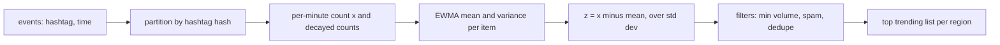

Complexity: O(1) time and O(1) state per tracked item per event. Total memory depends on how many items you track, which is bounded with a heavy-hitter front end.

### Trade-offs

- **Half-life / λ choice:** short half-lives react fast but flag noise. Long ones are stable but late. Many systems run two or three timescales together.
- **z-scores assume roughly normal noise.** Counts are bursty and follow daily cycles. Compare against the same hour last week, or model the seasonality, to avoid "every morning is a trend".
- **Small-count bias** needs explicit guards, or the trending list fills with tiny items.
- **Manipulation:** coordinated accounts can manufacture a spike. Count distinct users (HLL per item) rather than raw posts, and weight by account trust.
- Approximate structures (sketches) at the front cost a little accuracy for huge memory savings.

### Real-world examples

- **Twitter / X trends** compare a topic's current volume with its own past volume rather than ranking raw popularity, and the company described rebuilding the trends back end on stream processing (Storm) to compute this in real time.
- **EWMA control charts** are a decades-old industrial quality-control method (NIST handbook) and the same math drives anomaly alerts in monitoring systems.
- News, e-commerce "trending now" and music charts use decayed scores so yesterday's hits fade smoothly.

### In the interview

**Q:** Design trending hashtags for a social network.

**A:** Stream posts to workers partitioned by hashtag. Each worker keeps per-minute counts, a short-half-life decayed count and an EWMA mean and variance per tracked hashtag, with a Space-Saving front end to bound how many it tracks. Score by z-score with a minimum-volume floor and count distinct authors to resist spam. Every 30 seconds publish each worker's top N per region, and merge them at a coordinator into the cache that the app reads.

**Q:** Why not just rank by count in the last hour?

**A:** That shows the always-popular topics and nothing new. Trending means "unusual for this item", so normalise against the item's own baseline.

**Q:** Why exponential decay instead of a sliding window?

**A:** A decayed count is one number and one timestamp, updated in O(1), with no per-event storage or expiry. It also fades smoothly instead of dropping a burst exactly when it leaves the window.

### TL;DR

Trending means "much higher than this item's own normal". Keep exponentially decayed counts (one number per item with a half-life) and an EWMA mean and variance per item, score each interval with z = (x − μ)/σ, guard against small counts and spam, and bound the set of tracked items with a heavy-hitter sketch partitioned by item.

**Sources**

- NIST/SEMATECH e-Handbook, EWMA control charts: https://www.itl.nist.gov/div898/handbook/pmc/section3/pmc324.htm
- Finch, "Incremental calculation of weighted mean and variance" (2009): https://fanf2.user.srcf.net/hermes/doc/antiforgery/stats.pdf
- Coverage of Twitter's trends back-end rebuild (Storm): https://www.smartcompany.com.au/technology/twitter-overhauls-trending-topics-adds-more-contextual-information/
- Nikolov and Shah, trend detection research with Twitter data (MIT, 2012), summary: https://flowingdata.com/2013/06/19/twitter-trend-detection-algorithm/


## LSM trees in depth

### What it is
An **LSM tree** (log-structured merge tree) is a way of storing sorted key-value data on disk that turns every write into a fast, sequential append and does the sorting work later, in the background. It was described by Patrick O'Neil and colleagues in 1996 and is the storage engine behind LevelDB, RocksDB, Cassandra, ScyllaDB and HBase.

It has three moving parts:

- **Memtable:** an in-memory sorted structure (RocksDB's default is a skip list) that receives every new write.
- **SSTable** (sorted string table): an immutable file on disk holding key-value pairs sorted by key, plus a small index and a filter. "Immutable" means it is never edited after being written; changes go into newer files.
- **Compaction:** a background job that merges several SSTables into new ones, dropping overwritten values and deleted keys.

A **write-ahead log (WAL)** sits next to the memtable: an append-only file on disk that records each write first, so the memtable can be rebuilt after a crash.

### The problem it solves
A B-tree updates data in place: changing one 100-byte row may mean reading and rewriting a whole 16 KB page at a random location on disk. Random writes are slow on spinning disks and wear out SSDs (solid-state drives). Workloads such as logging, metrics, messaging and time series write far more than they read. An LSM tree batches writes in memory and flushes them as large sequential files, so it can absorb much higher write rates on the same hardware.

### How it works
**Write path, step by step**

1. Append the write (`put user:42 = "Ana"`) to the WAL and `fsync` it (force it to physical disk), or batch several writes per `fsync`.
2. Insert it into the memtable. Done: the client gets its acknowledgement. Cost: one sequential append plus an O(log n) in-memory insert.
3. When the memtable reaches its size limit (RocksDB default: 64 MB), it becomes **immutable** (read-only) and a fresh memtable takes new writes.
4. A background thread writes the immutable memtable out, in key order, as a new SSTable. This is a **flush**. The matching WAL segment can then be deleted.
5. A **delete** is just another write: a special marker called a **tombstone** that says "this key is gone as of now". The old value is removed only when compaction merges the tombstone with it.

**Read path (point lookup), step by step**

1. Check the active memtable, then any immutable memtables. Newest data wins.
2. Check SSTables from newest to oldest. For each SSTable, first ask its **Bloom filter**: a compact bit array that answers "definitely not here" or "maybe here". Skip the file on "definitely not".
3. On "maybe", use the file's index block to find the right 4 KB-ish data block, read it, and binary search inside.
4. Stop at the first file that contains the key (or a tombstone for it).

**Bloom filter per SSTable.** Each SSTable carries its own filter, built when the file is written. With about 10 bits per key the false-positive rate is about 1% (RocksDB measures about 0.95% for its cache-friendly variant). Worked example: a lookup for a missing key in a store with 8 SSTables would otherwise read 8 data blocks. With 1% filters it reads on average 8 x 0.01 = 0.08 blocks. That is why LSM point reads stay fast even with many files.

**Compaction strategies.** This is where LSM designs differ most.

- **Size-tiered compaction** (Cassandra's STCS, RocksDB's "universal"): group SSTables of similar size into tiers. When enough similar files pile up (Cassandra's default `min_threshold` is 4), merge them into one bigger file. Example: four 64 MB flushes merge into one ~256 MB file; four of those merge into one ~1 GB file.
- **Leveled compaction** (LevelDB, RocksDB default): disk is split into levels L0, L1, L2... L0 holds raw flushes whose key ranges overlap. From L1 down, each level is one sorted run: its files do not overlap, so a key lives in at most one file per level. Each level has a target size about 10x the previous one (the `max_bytes_for_level_multiplier`). When a level exceeds its target, pick one file, find the files in the next level whose key ranges overlap it, merge them, and write the result into the next level.

Worked example of leveled sizing with L1 = 256 MB and multiplier 10: L2 = 2.56 GB, L3 = 25.6 GB, L4 = 256 GB. The last level holds roughly 90% of the data, so the extra copies sitting in upper levels add only about 1/9 = 11% of overhead.

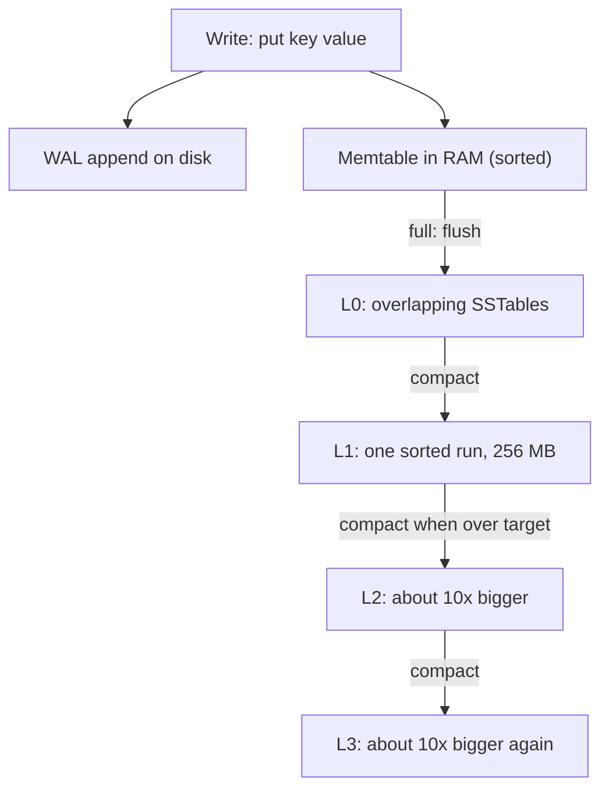

**The three amplifications.** These are the vocabulary for comparing storage engines.

- **Write amplification:** bytes written to disk divided by bytes the user wrote. Every compaction rewrites data. In leveled compaction, moving one file down can rewrite up to ~10 overlapping files in the next level, so the worst case is about the fanout (10) per level; across 4 to 5 levels that adds up to tens. Size-tiered rewrites each byte roughly once per tier, so it is much lower.
- **Read amplification:** number of disk reads per query. Leveled: at most one file per level plus the L0 files. Size-tiered: possibly many overlapping files per tier, so range scans especially suffer.
- **Space amplification:** bytes on disk divided by bytes of live data. Leveled: about 1.1. Size-tiered: old and new copies of a key can coexist across tiers, and a big merge needs room for inputs and outputs at the same time. RocksDB's universal compaction allows up to 200% extra by default, so 100 bytes of data may need up to 300 bytes of disk.

**Complexity.** Writes: O(log m) in-memory (m = memtable entries) plus amortised compaction I/O. Point reads: O(number of levels) filter checks, usually one disk read. Space: as above.

### Trade-offs
- Excellent write throughput and good compression (sorted, immutable files compress well), in exchange for background compaction that steals disk bandwidth and CPU and can cause latency spikes when it falls behind.
- Leveled favours reads and space; size-tiered favours writes. Many systems offer both, plus hybrids (Cassandra's time-window compaction for time series).
- Deletes are not instant: tombstones linger until compaction reaches them, and a range scan over many tombstones is slow.
- Range scans must merge results from the memtable and every level, so they are costlier than in a B-tree.

### Real-world examples
- **RocksDB** (Meta) underpins MyRocks, Kafka Streams state stores, CockroachDB's earlier storage, and many others. Default: skip-list memtable, leveled compaction, per-file Bloom filters.
- **Cassandra** defaults to size-tiered compaction and offers leveled and time-window strategies per table.
- **Bigtable/HBase** use the same memtable-plus-immutable-files idea.

### In the interview
**Q:** Why are LSM trees faster for writes than B-trees?

**A:** Writes go to a sequential log and an in-memory table, and are flushed in big sorted batches. A B-tree must find and rewrite a page at a random disk location for each update.

**Q:** How does an LSM tree avoid checking every SSTable on a read?

**A:** Each SSTable has a Bloom filter. At 10 bits per key, about 99% of files that do not hold the key are skipped without any disk read. Leveled compaction also guarantees at most one candidate file per level below L0.

**Q:** Leveled or size-tiered for a write-heavy metrics store?

**A:** Size-tiered (or time-window): lower write amplification, and metrics are mostly appended and read in recent ranges. Leveled suits read-heavy or space-constrained workloads.

### TL;DR
An LSM tree writes to a log and an in-memory sorted table, flushes it as immutable sorted files, and merges those files in the background. Bloom filters keep reads cheap. Leveled compaction gives low read and space amplification at a higher write cost; size-tiered does the opposite.

**Sources**
- O'Neil, Cheng, Gawlick, O'Neil, "The Log-Structured Merge-Tree (LSM-Tree)", Acta Informatica 33, 1996: https://www.cs.umb.edu/~poneil/lsmtree.pdf
- RocksDB wiki, MemTable: https://github.com/facebook/rocksdb/wiki/MemTable
- RocksDB wiki, Leveled Compaction: https://github.com/facebook/rocksdb/wiki/Leveled-Compaction
- RocksDB wiki, Compaction (amplification, universal compaction): https://github.com/facebook/rocksdb/wiki/Compaction
- RocksDB wiki, Bloom Filter: https://github.com/facebook/rocksdb/wiki/RocksDB-Bloom-Filter
- Apache Cassandra docs, Size Tiered Compaction Strategy: https://cassandra.apache.org/doc/latest/cassandra/managing/operating/compaction/stcs.html

---

## B+-trees

### What it is
A **B+-tree** is a balanced search tree designed for storage that is read in fixed-size blocks called **pages** (InnoDB's default page is 16 KB; PostgreSQL's is 8 KB). Each node is one page and holds many keys, so the tree is very wide and very shallow. In a B+-tree, all actual records (or pointers to them) live in the **leaf** nodes at the bottom, and the leaves are linked left-to-right. The **internal** nodes above only hold separator keys that steer the search. "Balanced" means every leaf is at the same depth.

### The problem it solves
Disks and SSDs read whole pages, and each page read is expensive compared with work in memory. A binary search tree with one key per node would need about 30 page reads to find one row among a billion. A B+-tree with hundreds of keys per node needs 3 or 4, and the top levels are almost always cached in RAM. Linked leaves also make range queries (`WHERE created_at BETWEEN ...`) and `ORDER BY` cheap: find the start, then walk sideways.

### How it works
**Fan-out arithmetic.** Suppose an internal entry is an 8-byte key plus a 6-byte child page number, about 14 bytes. A 16 KB page then holds about 16,384 / 14 = roughly 1,170 children. With leaves holding about 15 rows of 1 KB each:

- Height 2: 1,170 leaves x 15 = about 17,500 rows.
- Height 3: 1,170 x 1,170 x 15 = about 20 million rows.
- Height 4: about 24 billion rows.

So any row is 3 to 4 page reads away, and usually only the leaf read misses the cache.

**Search, step by step.**

1. Start at the root page.
2. Binary search its keys to find the child whose range contains the target.
3. Repeat on that child until you reach a leaf.
4. Binary search the leaf. Cost: O(log_B n) page reads, where B is the fan-out, and O(log n) comparisons in total.

**Insert with page split, step by step** (tiny example, max 4 keys per leaf).

1. Search for the leaf where the key belongs. Leaf A holds [10, 20, 30, 40]. We insert 25.
2. If there is room, insert in sorted position and finish. Here the leaf is full.
3. **Split:** allocate a new leaf B. Keep the lower half in A ([10, 20]) and move the upper half to B ([25, 30, 40]).
4. Fix the sibling links: A points to B, B points to A's old right neighbour.
5. Insert a separator key (25, the first key of B) plus a pointer to B into the parent.
6. If the parent is also full, split it too and push a separator up. If the root splits, create a new root: this is the only way the tree grows taller, which is why all leaves stay at the same depth.

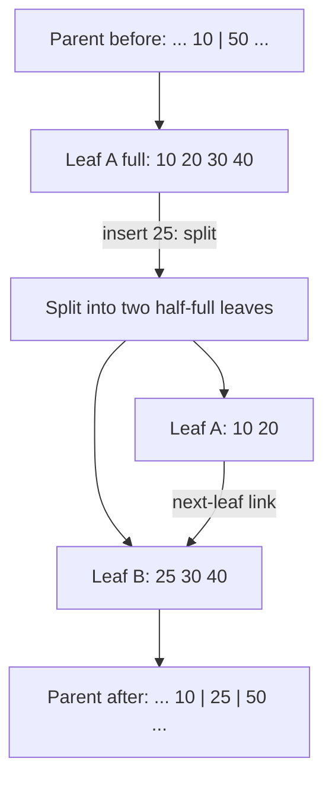

**Delete** is the mirror image: remove the key, and if a page drops below a threshold, borrow from or merge with a sibling. InnoDB tries to merge when a page falls below 50% full (its `MERGE_THRESHOLD` default). Many systems are lazy here and leave half-empty pages.

**Fill factor.** The **fill factor** is how full pages are packed when an index is built or appended to. Leaving free space means future inserts into the middle of the range land in existing pages instead of triggering splits.

- PostgreSQL B-tree indexes default to a fill factor of 90: leaf pages are packed to 90% during a build and when appending new largest keys.
- InnoDB leaves 1/16 of each clustered-index page free. Sequential inserts produce pages about 15/16 full; random inserts produce pages between 1/2 and 15/16 full, because splits leave two half-full pages.

This is why a random UUID primary key in InnoDB causes more splits, more partly-empty pages and a bigger index than an auto-increment key, which always appends at the right edge.

**Complexity.** Search, insert and delete: O(log_B n) page I/Os. Range scan of k results: O(log_B n + k/B). Space: O(n), with typical page utilisation of roughly 50% to 100%.

### Trade-offs
- Great reads and range scans; predictable latency (no background compaction).
- Every update rewrites a whole page in place, and the database must also write the change to its WAL first, so write amplification is high for small random updates.
- Random-key inserts cause splits and fragmentation; periodic rebuilds (`REINDEX`, `OPTIMIZE TABLE`) may be needed.
- Concurrency control inside the tree (latching pages during splits) is subtle; real engines use techniques such as latch crabbing or B-link trees.

### Real-world examples
- **InnoDB** (MySQL): the table itself is a B+-tree keyed by the primary key (a **clustered index**: rows are stored in the leaves). Secondary indexes are separate B+-trees whose leaves hold the primary key.
- **PostgreSQL**: tables are unordered heaps; B-tree indexes point into the heap.
- **SQLite**, Oracle, SQL Server, and file systems such as NTFS, XFS and Btrfs all use B-tree variants.

### In the interview
**Q:** Why do databases use B+-trees rather than binary trees or hash tables?

**A:** Pages are the unit of I/O, and a B+-tree packs hundreds of keys per page, so lookups take 3 to 4 page reads even for billions of rows. Unlike a hash table it keeps keys sorted, so range queries and ordering are cheap.

**Q:** Why is a random UUID a poor InnoDB primary key?

**A:** Inserts land on random leaves, causing page splits, half-full pages, more cache misses and a larger index. A monotonic key (auto-increment, or time-ordered UUIDv7) appends at the right edge.

**Q:** B+-tree or LSM tree?

**A:** B+-tree for read-heavy, range-heavy, latency-sensitive OLTP (online transaction processing). LSM for write-heavy workloads where some read and compaction cost is acceptable.

### TL;DR
A B+-tree is a short, wide, balanced tree of pages with all data in linked leaves. Lookups take a handful of page reads, ranges are a sideways walk, and inserts split full pages and push separators upward. Fill factor leaves room to postpone splits.

**Sources**
- Bayer and McCreight, "Organization and Maintenance of Large Ordered Indexes", Acta Informatica, 1972, and Comer, "The Ubiquitous B-Tree", ACM Computing Surveys, 1979 (background).
- MySQL 8.0 Reference Manual, The Physical Structure of an InnoDB Index: https://dev.mysql.com/doc/refman/8.0/en/innodb-physical-structure.html
- PostgreSQL docs, CREATE INDEX (fillfactor): https://www.postgresql.org/docs/current/sql-createindex.html

---

## MVCC step by step

### What it is
**MVCC** (multi-version concurrency control) is a technique where the database keeps several versions of a row at once, so that readers see a consistent **snapshot** (a frozen view of committed data as of some moment) while writers create new versions. The key promise: readers never block writers and writers never block readers. PostgreSQL, MySQL InnoDB, Oracle, SQL Server (with snapshot isolation), CockroachDB and many others use it.

### The problem it solves
With plain locking, a long report query that reads a million rows would hold shared locks and stop every update to those rows until it finished, or updates would block the report. MVCC lets the report read the old versions while updates write new ones. It is the basis of **snapshot isolation**, the guarantee that every read in a transaction sees the same consistent snapshot.

### How it works
**Core ideas.**

- Every transaction gets a **transaction ID** (XID), a number that increases over time.
- Every row version records which transaction created it and, if it has been replaced or deleted, which transaction did that.
- A snapshot records which transactions had committed when it was taken.
- A **visibility rule** decides, for each version, whether the snapshot should see it.
- Old versions that no snapshot can see any more are garbage-collected (PostgreSQL **vacuum**, InnoDB **purge**).

**PostgreSQL: new versions in the table itself.** Each row version (a **tuple**) has hidden header fields `xmin` (the XID that inserted it) and `xmax` (the XID that deleted or updated it, or empty). An `UPDATE` does not change the tuple in place: it sets `xmax` on the old tuple and inserts a new tuple with `xmin` = the updater's XID. The chain of versions lives in the table's heap.

Worked example. Row `account 7, balance 100` was inserted by XID 90, long committed.

1. T100 starts and takes a snapshot: "everything below 100 that committed is visible, T100 itself is in progress".
2. T101 runs `UPDATE ... SET balance = 80`. Old tuple: xmin 90, xmax 101. New tuple: xmin 101, xmax empty. T101 commits.
3. T100 reads account 7. Old tuple: created by 90 (committed, visible to T100), deleted by 101 (started after T100's snapshot, so the delete is invisible). Old tuple is visible: balance 100. New tuple: created by 101, invisible. T100 consistently sees 100.
4. T102 starts after T101 committed: it sees the new tuple, balance 80.

**The visibility rule** (simplified): a version is visible to snapshot S if its creator committed before S was taken (or is S's own transaction), and its deleter is either empty, aborted, or not yet committed as of S.

**InnoDB: newest version in place, older ones rebuilt from undo.** InnoDB updates the row in the clustered index in place. Each row carries a hidden 6-byte `DB_TRX_ID` (last transaction to modify it) and a 7-byte `DB_ROLL_PTR` (roll pointer) to an **undo log** record that describes how to rebuild the previous version. Following roll pointers backward gives the **version chain**. When a consistent read starts, InnoDB creates a **read view**: the list of transactions active at that moment, plus the bounds of IDs. To read a row, InnoDB checks `DB_TRX_ID` against the read view; if that change is not visible, it follows the roll pointer and applies undo records until it reaches a visible version. In REPEATABLE READ (InnoDB's default) the read view is created at the first consistent read in the transaction; in READ COMMITTED a fresh one is taken for each statement.

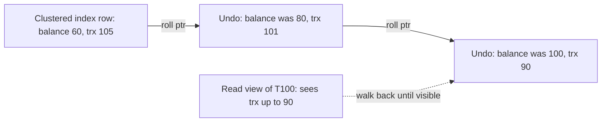

**Garbage collection, step by step.**

- **PostgreSQL VACUUM:** scan pages, find tuples whose `xmax` committed before the oldest snapshot still running, mark their space reusable, and remove index entries pointing to them. It also **freezes** very old tuples: XIDs are 32-bit and compared in a circle, so after about 2 billion transactions an old XID would appear to be "in the future". Freezing marks the tuple as visible to everyone forever. Autovacuum forces an anti-wraparound vacuum when a table's oldest unfrozen XID is 200 million transactions old (the default `autovacuum_freeze_max_age`).
- **HOT updates** (heap-only tuples): if an update changes no indexed column and the page has room, PostgreSQL puts the new version on the same page and skips new index entries. Lowering the table's fill factor makes this more likely.
- **InnoDB purge:** insert-undo records are dropped at commit. Update-undo records stay until no read view could need them, then a purge thread removes them and physically removes delete-marked rows.

**Complexity.** Reading a recent version: O(1) extra. Reading under a long-running snapshot: O(length of version chain). Space: proportional to the number of live old versions.

### Trade-offs
- **PostgreSQL style** (append new versions): rollback is instant (the new tuple is just ignored), but tables and indexes bloat until vacuum runs, and every non-HOT update writes new index entries.
- **InnoDB style** (in place plus undo): the table stays compact and current reads are fast, but old snapshots must rebuild versions by walking undo, and a long transaction makes the undo log grow (the "history list length" problem).
- In both, one forgotten long-running transaction blocks cleanup for everyone.
- Snapshot isolation still allows **write skew** (see the next section), so it is not full serializability.

### Real-world examples
- PostgreSQL: heap versions, `xmin`/`xmax`, VACUUM and autovacuum.
- MySQL InnoDB, Oracle: undo-based versions.
- CockroachDB and Spanner: versions keyed by timestamp in a key-value store, with garbage collection after a configurable time.

### In the interview
**Q:** How do readers avoid blocking writers in PostgreSQL?

**A:** An update writes a new tuple and marks the old one with its XID. Readers use their snapshot to decide which tuple version is visible, so they never need to wait for the writer.

**Q:** Why can a long-running transaction hurt a database that is otherwise idle?

**A:** Its snapshot pins every old version created since it started. PostgreSQL cannot vacuum them and InnoDB cannot purge undo, so tables and undo logs grow and reads slow down.

**Q:** What is transaction ID wraparound?

**A:** PostgreSQL XIDs are 32-bit and compared modulo 2^32. Without freezing old tuples, after about 2 billion transactions old rows would look like they were created in the future and vanish. Vacuum freezing prevents it.

### TL;DR
MVCC keeps multiple row versions tagged with transaction IDs. Each transaction reads through a snapshot, using visibility rules to pick the right version. PostgreSQL stores versions in the table and needs VACUUM; InnoDB updates in place, keeps old versions in undo logs and purges them later.

**Sources**
- PostgreSQL docs, Routine Vacuuming: https://www.postgresql.org/docs/current/routine-vacuuming.html
- PostgreSQL docs, Heap-Only Tuples: https://www.postgresql.org/docs/current/storage-hot.html
- MySQL 8.0 Reference Manual, InnoDB Multi-Versioning: https://dev.mysql.com/doc/refman/8.0/en/innodb-multi-versioning.html
- MySQL 8.0 Reference Manual, Consistent Nonlocking Reads: https://dev.mysql.com/doc/refman/8.0/en/innodb-consistent-read.html

---

## Two-phase locking and Serializable Snapshot Isolation

### What it is
Both are ways to give **serializability**: the guarantee that concurrent transactions produce the same result as if they had run one at a time, in some order.

- **Two-phase locking (2PL)** is the classic, pessimistic approach: transactions take locks on data and wait for each other.
- **Serializable Snapshot Isolation (SSI)** is an optimistic approach built on MVCC snapshots: transactions run without blocking each other, and the database aborts one if it detects a pattern that could break serializability. It was introduced by Cahill, Röhm and Fekete (SIGMOD 2008) and has been PostgreSQL's SERIALIZABLE level since version 9.1.

### The problem it solves
Snapshot isolation alone permits **write skew**: two transactions read overlapping data, each makes a decision based on what it read, and each writes to a *different* row, so no write-write conflict is detected.

Example: a hospital rule says at least one doctor must be on call. Alice and Bob are both on call. Each, at the same moment, checks "how many are on call?", sees 2, and takes themselves off call. Both commits succeed under snapshot isolation. Now nobody is on call. No serial order could produce this result.

### How it works
**2PL, step by step.**

1. Before reading an item, take a **shared lock** (many readers can hold it). Before writing, take an **exclusive lock** (only one holder, no readers).
2. **Growing phase:** a transaction may acquire locks but not release any.
3. **Shrinking phase:** once it releases one lock, it may not acquire any more.
4. **Strict 2PL** (what databases actually do): hold all locks until commit or abort, which avoids other transactions reading uncommitted data.
5. To stop **phantoms** (new rows appearing that match a query's condition), lock ranges, not just rows: **predicate locks** or, in InnoDB, **next-key/gap locks** on index ranges.
6. **Deadlock** handling: T1 waits for T2 while T2 waits for T1. The database detects the cycle in its wait-for graph (or times out) and aborts one.

Applied to the doctors: Alice's transaction takes shared locks on the "on call" rows it reads. Bob's does too. Alice tries to update her row and needs an exclusive lock, but Bob holds a shared lock on it: wait. Bob tries to update his row: wait on Alice. Deadlock is detected, one is aborted, the other proceeds. Correct, but with blocking.

**SSI, step by step.**

1. Every transaction reads from an MVCC snapshot exactly as in snapshot isolation. No read blocks.
2. Reads also leave non-blocking markers called **SIREAD locks** (PostgreSQL shows them as `SIReadLock` in `pg_locks`) on the rows, pages or relations they read.
3. When a transaction writes something another concurrent transaction read, the database records a **rw-antidependency** (an edge "reader -> writer": the reader did not see the writer's change, so the reader must come first in any serial order).
4. Cahill's theorem: every snapshot-isolation anomaly contains a **dangerous structure**: two consecutive rw edges T1 -> T2 -> T3 among concurrent transactions (T1 and T3 may be the same). T2 is called the **pivot**.
5. When such a structure appears, abort one transaction with a serialization failure (SQLSTATE `40001`). The application retries it.

Doctors again: Alice reads Bob's row, Bob writes it (edge Alice -> Bob). Bob reads Alice's row, Alice writes it (edge Bob -> Alice). That is a cycle of two rw edges: one of them is aborted at commit. Neither ever waited.

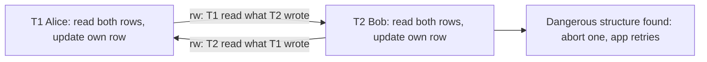

**False positives.** SSI tracks a sufficient condition, not the exact cycle, and may coarsen tuple locks to page or table locks to save memory. So it sometimes aborts transactions that would have been safe. PostgreSQL's docs warn that sequential scans take relation-level predicate locks and raise the failure rate.

**Complexity.** 2PL: lock acquire O(1) per item, but waiting time depends on contention. SSI: O(1) bookkeeping per read and write, memory proportional to concurrent transactions' read sets, and retries cost a whole transaction.

### Trade-offs
- **2PL:** simple guarantee, no retries for anomalies, but readers block writers, throughput collapses under contention, and deadlocks must be handled.
- **SSI:** read-only and low-conflict workloads run at nearly snapshot-isolation speed, but applications *must* retry on `40001`, aborts waste work under high contention, and some aborts are false positives.
- Neither removes the need for good transaction design: keep transactions short and touch rows in a consistent order.

### Real-world examples
- **PostgreSQL** SERIALIZABLE = SSI (since 9.1); REPEATABLE READ = plain snapshot isolation.
- **MySQL InnoDB** SERIALIZABLE = lock-based: plain `SELECT`s become locking reads, with next-key locks to prevent phantoms.
- **SQL Server** offers both a lock-based SERIALIZABLE and a separate SNAPSHOT level.

### In the interview
**Q:** What is write skew and which isolation level prevents it?

**A:** Two transactions read the same data, then each update a different row based on what they read, breaking an invariant. Snapshot isolation allows it; serializable (2PL or SSI) prevents it. A workaround under weaker levels is `SELECT ... FOR UPDATE` on the rows the decision depends on.

**Q:** Why is SSI called optimistic?

**A:** It lets transactions run without blocking and only checks for dangerous dependency patterns, aborting at the end if needed. 2PL is pessimistic: it blocks up front in case of conflict.

**Q:** What must the application do differently under SSI?

**A:** Treat SQLSTATE 40001 as normal and retry the whole transaction, discarding anything computed in the failed attempt.

### TL;DR
2PL achieves serializability by locking: grow locks, hold them until commit, block and break deadlocks. SSI runs on MVCC snapshots without blocking, tracks read-write dependencies, and aborts a transaction when two consecutive rw-edges form a dangerous structure. 2PL pays in waiting; SSI pays in retries.

**Sources**
- Cahill, Röhm, Fekete, "Serializable Isolation for Snapshot Databases", SIGMOD 2008: https://courses.cs.washington.edu/courses/csep544/09sp/resources/fekete-sigmod2008.pdf
- PostgreSQL docs, Transaction Isolation: https://www.postgresql.org/docs/current/transaction-iso.html
- PostgreSQL wiki, SSI: https://wiki.postgresql.org/wiki/SSI

---

## Skip lists

### What it is
A **skip list** is a sorted linked list with extra "express lanes" stacked on top. The bottom level links every element in order. Each element is also randomly promoted to higher levels, so level 1 links about every 4th element (with promotion probability 1/4), level 2 every 16th, and so on. Searching starts in the top lane and drops down when it would overshoot. William Pugh published it in 1990 as a simpler alternative to balanced trees.

### The problem it solves
A plain sorted linked list costs O(n) to search. Balanced trees (red-black, AVL) give O(log n) but need rotations to stay balanced, which are fiddly to code and hard to make concurrent. A skip list gets expected O(log n) search, insert and delete using only coin flips and pointer updates, and its bottom level is already an ordered list, so range scans are trivial.

### How it works
**Structure.** Each node has a key (and value) plus an array of forward pointers, one per level it belongs to. A head node has pointers at every level. A node's height is chosen at insert time: start at 1, and keep adding a level with probability p (Redis uses p = 1/4) up to a maximum (Redis: 32).

**Search for 70, step by step.** Keys: 10, 25, 40, 55, 70, 85. Suppose 40 and 85 reached level 1, and 40 reached level 2.

1. Start at the head, top level (2). Next is 40, which is less than 70: move to 40.
2. At 40, level 2: next is nothing. Drop to level 1.
3. Level 1: next is 85, greater than 70. Drop to level 0.
4. Level 0: next is 55, less than 70: move. Next is 70: found.

We touched 40, 55 and 70 instead of walking from 10.

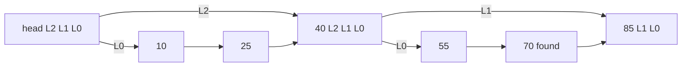

**Insert, step by step.**

1. Search as above, but remember at each level the last node visited before dropping down (the `update` array).
2. Pick a random height h for the new node.
3. For each level 0 to h-1, splice the node in after `update[level]`.

```
insert(key):
  x = head
  for lvl from top down to 0:
    while x.next[lvl] and x.next[lvl].key < key:
      x = x.next[lvl]
    update[lvl] = x
  h = 1
  while random() < p and h < MAX: h += 1
  node = new Node(key, h)
  for lvl in 0..h-1:
    node.next[lvl] = update[lvl].next[lvl]
    update[lvl].next[lvl] = node
```

**Delete** uses the same `update` array and unsplices the node at each of its levels.

**Complexity.** Expected search, insert and delete: O(log n), with expected number of levels log base 1/p of n. With p = 1/4 and one million items, that is log4(10^6), about 10 levels. Space: each node has on average 1/(1 - p) pointers, so 1.33 pointers per node at p = 1/4 (versus 2 at p = 1/2, and 2 for a binary tree). The worst case is O(n), but it is astronomically unlikely and does not depend on input order, only on the random number generator.

**Rank queries.** Store on each forward pointer a **span**: how many bottom-level nodes it jumps over. Summing spans along the search path gives the element's position (rank) in O(log n). This is exactly what Redis does.

### Trade-offs
- Simple code, no rotations, easy to reason about; ordered iteration for free.
- Expected, not guaranteed, O(log n). Fine in practice.
- Pointer-chasing across random memory locations is less cache-friendly than a B-tree with packed arrays; for on-disk data B-trees win.
- Lock-free concurrent versions are comparatively easy (Java's `ConcurrentSkipListMap`), because inserts only touch a few local pointers.

### Real-world examples
- **Redis sorted sets** (`ZADD`, `ZRANGE`, `ZRANK`, leaderboards). Once a sorted set grows beyond 128 entries or any member exceeds 64 bytes (the `zset-max-listpack-entries` and `zset-max-listpack-value` defaults), Redis stores it as a skip list plus a hash table. The hash table maps member to score for O(1) `ZSCORE`; the skip list orders by score for ranges and ranks. Each node also has a `backward` pointer for reverse iteration. Small sets use a compact flat encoding (a listpack) instead.
- **Why Redis chose a skip list** over a balanced tree, per its author: comparable memory use (tunable through p), range iteration that is at least as cache-friendly as trees, and much simpler code, which made adding O(log n) `ZRANK` via spans a small change.
- **LevelDB and RocksDB memtables** default to skip lists.
- Java's `ConcurrentSkipListMap` and `ConcurrentSkipListSet`.

### In the interview
**Q:** How would you build a real-time leaderboard with "top 10" and "what is my rank"?

**A:** A Redis sorted set: `ZADD` to update scores, `ZREVRANGE 0 9` for the top 10, `ZREVRANK` for a player's rank, all O(log n) thanks to the skip list with spans. Shard by game or region if one set gets too large.

**Q:** Why not use a balanced binary tree?

**A:** Same asymptotic cost, but a skip list is simpler to implement and to extend (rank via spans), needs no rebalancing, and naturally supports ordered range scans along the bottom level.

**Q:** What is the expected height of a skip list?

**A:** About log base 1/p of n. For p = 1/4 and a million entries, around 10 levels.

### TL;DR
A skip list is a sorted linked list with randomly built express lanes, giving expected O(log n) search, insert and delete without rebalancing. Redis sorted sets pair one with a hash table: the hash for score lookup, the skip list (with spans) for ranges and ranks.

**Sources**
- Pugh, "Skip Lists: A Probabilistic Alternative to Balanced Trees", CACM 33(6), 1990: https://homepage.cs.uiowa.edu/~ghosh/skip.pdf
- Redis source, `server.h` (ZSKIPLIST_MAXLEVEL, ZSKIPLIST_P, zskiplistNode): https://github.com/redis/redis/blob/unstable/src/server.h
- Redis default configuration, `redis.conf` (zset-max-listpack-*): https://github.com/redis/redis/blob/unstable/redis.conf
- Redis docs, Sorted sets: https://redis.io/docs/latest/develop/data-types/sorted-sets/
- antirez on why Redis uses skip lists (Hacker News): https://news.ycombinator.com/item?id=1171423

---

## Cache eviction beyond LRU

### What it is
An **eviction policy** decides which item to throw out when a cache is full. **LRU** (least recently used) evicts the item untouched for the longest. This section covers three better-behaved families:

- **CLOCK:** a cheap approximation of LRU.
- **ARC** (Adaptive Replacement Cache): balances recency and frequency and tunes itself.
- **TinyLFU / W-TinyLFU:** an admission filter based on approximate frequency counts, used by the Java library Caffeine.

Two terms: **recency** is how recently an item was used; **frequency** is how often. **Hit ratio** is the fraction of requests served from the cache.

### The problem it solves
LRU has two weaknesses:

1. **Cost:** every hit must move the item to the front of a linked list, which needs a lock and touches shared memory on every read.
2. **Scan pollution:** one big sequential scan (a backup, a report) reads many items once each and pushes all the genuinely popular items out. LRU only knows recency, not frequency.

### How it works
**CLOCK, step by step.** Arrange cache slots in a circle, each with a **reference bit**, and keep a pointer (the "hand").

1. On a hit, set the item's bit to 1. Nothing moves, so hits are nearly free.
2. To evict, look at the slot under the hand. If its bit is 1, clear it to 0 and advance (a "second chance"). If its bit is 0, evict that item.

Example: slots A(1) B(0) C(1) D(1), hand at A. Evict: A has 1, clear and move. B has 0: evict B. A cleared bit means "not used since the hand last passed". PostgreSQL's shared buffer cache uses a "clock sweep" variant with small usage counters instead of a single bit.

**ARC, step by step** (Megiddo and Modha, IBM, FAST 2003). For a cache of c pages, ARC keeps four lists:

- **T1:** pages seen once recently (recency).
- **T2:** pages seen at least twice recently (frequency).
- **B1, B2:** **ghost lists** holding only the keys (no data) of pages recently evicted from T1 and T2.
- A target size **p** for T1, adjusted on the fly.

1. Hit in T1 or T2: move the page to the front of T2.
2. Miss, but key found in ghost list B1: we evicted a recency page too early, so increase p (give T1 more room), then load the page into T2.
3. Miss found in B2: we evicted a frequency page too early, so decrease p.
4. Complete miss: put the page in T1.
5. When evicting, take from T1 if it is larger than p, else from T2, and record the key in the matching ghost list.

A one-off scan only ever touches T1, so it cannot flush T2. In the paper's SPC1-like benchmark with a 4 GB cache, LRU achieved a 9.19% hit ratio and ARC 20%. ARC was patented by IBM; PostgreSQL briefly used it in 8.0 and replaced it (2Q in 8.0.2, then clock sweep in 8.1) partly to avoid the patent.

**TinyLFU and W-TinyLFU, step by step** (Einziger, Friedman and Manes).

TinyLFU is an **admission policy**: when a new item arrives and the cache is full, it decides whether the newcomer deserves to replace the eviction victim at all.

1. Every access increments the item's count in a **count-min sketch**: a small 2D array of counters indexed by several hash functions. The estimate is the minimum of the item's counters, so it can overcount slightly but never undercounts. Caffeine uses 4-bit counters.
2. **Aging (reset):** after W accesses (Caffeine uses W = 10 x cache size), halve every counter, so old popularity fades.
3. A **doorkeeper** (a small Bloom filter) absorbs first-time items so one-hit wonders do not consume sketch counters.
4. **Admission:** compare the estimated frequency of the candidate with that of the victim. Admit the candidate only if it is more frequent.

Plain TinyLFU rejects new items that are about to become popular but have no history yet (sudden bursts). **W-TinyLFU** adds a **window**:

1. New items enter a small LRU window (1% of capacity in the paper).
2. Items evicted from the window become candidates for the **main cache** (99%), which is a **segmented LRU** (SLRU): 20% probation, 80% protected. Items hit while in probation are promoted to protected.
3. When main is full, the TinyLFU filter compares the window's candidate with probation's victim, and the more frequent one stays.
4. Caffeine goes further and resizes the window with **hill climbing**: it nudges the window bigger or smaller and keeps the change if the hit ratio improves.

Worked example: cache of 100 items: window 1, probation 20, protected 79. A backup job reads 10,000 cold keys. Each enters the window and is immediately a candidate; its estimated frequency is about 1, while probation's victim has, say, 6. Every cold key is rejected, and the hot set survives.

```mermaid
flowchart LR
    N["New item"] --> WIN["Window LRU (1 percent)"]
    WIN -->|"evicted candidate"| F{"TinyLFU: candidate more frequent than victim?"}
    PROB["Main SLRU probation (20 percent)"] -->|"victim"| F
    F -->|"yes: admit"| PROB
    F -->|"no: drop candidate"| D["Discarded"]
    PROB -->|"hit: promote"| PROT["Main SLRU protected (80 percent)"]
```

**Complexity.** CLOCK: O(1) hit, amortised O(1) eviction, 1 bit per entry. ARC: O(1) per request, plus ghost metadata for up to c extra keys. W-TinyLFU: O(1) per request plus a sketch of a few bytes per entry (Caffeine's docs cite about 8 bytes per entry for the 4-bit sketch).

### Trade-offs
- CLOCK: very cheap and concurrent-friendly, but only approximates LRU and is still not scan-resistant on its own.
- ARC: self-tuning and scan-resistant, but uses ghost lists and is more complex; patent history limited adoption.
- W-TinyLFU: near-optimal hit ratios across many traces with tiny metadata, but frequency estimates are approximate and the design has more knobs (window size, sample size).
- Any fancy policy only pays off if the workload has skew; for uniform random access, everything performs about the same.

### Real-world examples
- **PostgreSQL** shared buffers: clock sweep with usage counts.
- **ARC**: ZFS uses an ARC-derived cache (also called the ARC).
- **Caffeine** (W-TinyLFU) is used by Cassandra, Kafka, HBase, Solr, Neo4j, Druid and frameworks such as Spring Cache and Quarkus.

### In the interview
**Q:** Why is LRU vulnerable to scans and how do you fix it?

**A:** LRU treats one access the same as many, so a big one-time scan evicts popular items. Fix with a policy that considers frequency: ARC's separate T1/T2 lists, SLRU segments, or a TinyLFU admission filter that refuses cold items.

**Q:** What does TinyLFU use instead of exact counters?

**A:** A count-min sketch with small counters that are halved periodically. It estimates frequency for far more keys than the cache holds, in a few bytes per entry.

**Q:** Why does CLOCK scale better than LRU under concurrency?

**A:** A hit just sets a bit; there is no list reordering, so readers do not contend on a shared lock.

### TL;DR
CLOCK makes LRU cheap with a reference bit and a sweeping hand. ARC keeps recency and frequency lists plus ghosts and adapts the split. W-TinyLFU puts a small LRU window in front of an SLRU main cache and admits items only if a count-min sketch says they are more popular than the victim, which beats LRU on skewed and scan-heavy workloads.

**Sources**
- Megiddo and Modha, "ARC: A Self-Tuning, Low Overhead Replacement Cache", USENIX FAST 2003: https://www.usenix.org/conference/fast-03/arc-self-tuning-low-overhead-replacement-cache
- Einziger, Friedman, Manes, "TinyLFU: A Highly Efficient Cache Admission Policy" (arXiv 1512.00727): https://arxiv.org/abs/1512.00727
- Caffeine wiki, Efficiency: https://github.com/ben-manes/caffeine/wiki/Efficiency
- Caffeine README (users and integrations): https://github.com/ben-manes/caffeine
- Ben Manes, "Design of a Modern Cache", High Scalability: https://highscalability.com/design-of-a-modern-cache/
- PostgreSQL 8.0.2 release notes (2Q replaces ARC): https://www.postgresql.org/docs/release/8.0.2/
- PostgreSQL 8.1 release notes (clock sweep): https://www.postgresql.org/docs/release/8.1.0/

---

## Hierarchical timing wheels

### What it is
A **timing wheel** is a data structure for managing a very large number of timers (timeouts, retries, scheduled tasks) cheaply. Picture a clock face divided into slots. Each slot holds a list of timers due in that time interval, and a pointer advances one slot per **tick** (a fixed time unit, such as 1 ms). A **hierarchical** timing wheel stacks several wheels with coarser ticks, like the seconds, minutes and hours hands of a clock. George Varghese and Tony Lauck described the family in 1987.

### The problem it solves
Servers track enormous numbers of timers: every open connection has an idle timeout, every request has a deadline, every retry has a back-off. Most are cancelled before they fire (the response arrived in time). The usual alternative, a **priority queue** (a heap ordered by deadline), costs O(log n) to add and to cancel. A timing wheel makes add and cancel O(1) and fires timers in batches.

### How it works
**A single (simple) wheel.** n slots, tick u. A timer due in d ticks (d < n) goes in slot `(current + d) mod n`. Each tick: advance the pointer and fire everything in the new slot. Cancel: remove the timer from its slot's doubly linked list in O(1). Limit: it only covers n x u of time.

**Hashed wheel.** For longer delays, put the timer in slot `(current + d) mod n` anyway and store how many full rotations it must wait. Each pass decrements the count and fires timers at zero. Simple, but long timers are visited on every lap.

**Hierarchical wheels, step by step.** Example modelled on Kafka: tick 1 ms, 20 slots per wheel.

- Level 0: 20 slots of 1 ms, covering 20 ms.
- Level 1: 20 slots of 20 ms, covering 400 ms.
- Level 2: 20 slots of 400 ms, covering 8 s. (Kafka creates higher "overflow" wheels on demand.)

Add a timer due 350 ms from now (time 0):

1. Too far for level 0 (20 ms). Fits level 1 (400 ms). Slot = 350 / 20 = 17 (rounded down), the bucket that covers 340 to 359 ms.
2. At t = 340 ms that level-1 bucket comes due. Its timers are not fired yet; they are **re-inserted** with their remaining time. Our timer has 10 ms left, so it lands in level 0 slot 10 (relative).
3. At t = 350 ms level 0 reaches that slot and the timer fires.

Each timer moves down at most once per level, so add costs O(m) where m is the number of levels (tiny), cancel is O(1), and per-tick work is proportional only to timers that actually come due.

**Avoiding wasted ticks.** Ticking every millisecond when nothing is due wastes CPU. Kafka keeps only the *buckets* (not individual timers) in a Java `DelayQueue` ordered by bucket expiry, so the timer thread sleeps until the next non-empty bucket is due.

```
add(timer):
  if timer.deadline < currentTime + tick: run(timer) and return
  if timer.deadline < currentTime + tick * slots:
    bucket = buckets[(timer.deadline / tick) mod slots]
    bucket.append(timer)
    if bucket expiry changed: delayQueue.offer(bucket)
  else:
    overflowWheel().add(timer)   # coarser wheel, created lazily

advanceTo(t):  # called when delayQueue hands back a due bucket
  currentTime = t rounded down to tick
  for each timer in bucket: add(timer)   # re-insert lower or run
```

```mermaid
flowchart TD
    A["Add timer due in 350 ms"] --> Q0{"Fits level 0 (20 ms)?"}
    Q0 -->|"no"| L1["Level 1 slot 17 (340 to 359 ms)"]
    L1 -->|"at 340 ms: bucket due"| R["Re-insert with 10 ms left"]
    R --> L0["Level 0 slot for 350 ms"]
    L0 -->|"at 350 ms"| F["Fire callback"]
    Q0 -->|"yes"| L0
```

**Complexity.** Add: O(m) for m levels (O(1) for a single wheel). Cancel: O(1). Per tick: O(1) plus the timers that expire or cascade. Space: O(number of slots + timers).

### Trade-offs
- Precision is limited to the tick (and coarser on upper levels if they fire in place). Good for timeouts, wrong for high-precision scheduling.
- Re-inserting (cascading) timers from upper wheels costs work in bursts; the Linux kernel's 2015 rework chose to let timers on coarse levels fire in place, slightly late, to avoid cascading.
- A heap is simpler and exact; it wins when timers are few or must fire precisely.
- Memory for the slot arrays is fixed even when idle.

### Real-world examples
- **Apache Kafka** "purgatory" (requests waiting for acks or data) moved to hierarchical timing wheels. In Confluent's benchmark with a high timeout, the old design saturated at about 25,000 requests per second while the new one reached about 105,000.
- **Netty** `HashedWheelTimer`: default 100 ms tick, 512-slot wheel, for I/O timeouts that need not be exact.
- **Linux kernel** timer wheel for low-resolution timeouts (network, I/O).
- Job schedulers and delay queues built on Redis or in-process often use the same idea.

### In the interview
**Q:** You need ten million connection idle timeouts, most of which get reset. What data structure?

**A:** A hashed or hierarchical timing wheel: O(1) add and cancel, batch firing per tick. A heap costs O(log n) for every reset and cancel.

**Q:** What do you give up compared with a priority queue?

**A:** Precision: timers fire at tick granularity. Plus some cascade work as timers move from coarse wheels to fine ones.

**Q:** How do you avoid the CPU cost of ticking every millisecond?

**A:** Only wake when a non-empty bucket is due, for example by keeping buckets in a delay queue, as Kafka does.

### TL;DR
A timing wheel is a circular array of time slots with a moving pointer; timers drop into the slot for their deadline. Stacking wheels with coarser ticks covers long delays with O(1) cancel and near-O(1) add, which is why Kafka, Netty and the Linux kernel use them for huge numbers of mostly-cancelled timeouts.

**Sources**
- Varghese and Lauck, "Hashed and Hierarchical Timing Wheels", SOSP 1987: http://www.cs.columbia.edu/~nahum/w6998/papers/sosp87-timing-wheels.pdf
- Confluent blog, "Apache Kafka, Purgatory, and Hierarchical Timing Wheels": https://www.confluent.io/blog/apache-kafka-purgatory-hierarchical-timing-wheels/
- Netty API, HashedWheelTimer: https://netty.io/4.1/api/io/netty/util/HashedWheelTimer.html
- LWN, "Reinventing the timer wheel" (2015): https://lwn.net/Articles/646950/

---

## Distributed snapshots: Chandy-Lamport and Flink checkpoint barriers

### What it is
A **distributed snapshot** is a record of the state of every process in a distributed system, plus the messages in flight between them, that together form a **consistent cut**: a moment that *could* have happened, where no message is recorded as received without also being recorded as sent. The **Chandy-Lamport algorithm** (K. Mani Chandy and Leslie Lamport, 1985) takes such a snapshot without stopping the system. Apache Flink's **checkpoint barriers** are a variant tailored to streaming dataflows.

### The problem it solves
There is no global clock, so you cannot say "everyone record your state at 12:00:00.000". If each process just records whenever it likes, the result can be inconsistent. Example: two bank branches, P and Q, each hold $100. P sends $10 to Q. If P records after sending ($90) and Q records before receiving ($100), the snapshot shows $190 and $10 has vanished. A consistent snapshot is needed for checkpointing (restart after a crash), detecting deadlock or termination, and debugging.

### How it works
**Assumptions.** Channels between processes are reliable and FIFO (first in, first out: messages arrive in the order sent). A special **marker** message is used to separate "before the snapshot" from "after".

**Chandy-Lamport, step by step.**

1. The **initiator** records its own state, then sends a marker on every outgoing channel before sending anything else.
2. When a process receives a marker on channel C for the first time:
   - record its own state,
   - record channel C's state as empty,
   - send a marker on every outgoing channel,
   - start recording every message that arrives on each *other* incoming channel.
3. When a process that has already recorded receives a marker on channel C: stop recording C. The messages recorded on C between the process's own snapshot and this marker are C's in-flight state.
4. The snapshot is complete when every process has received a marker on every incoming channel.

Worked example with the bank. P is initiator.

1. P sends $10 to Q (P now $90), then records "P = 90" and sends a marker to Q. Q, meanwhile, sends $5 to P (Q now $95).
2. Q receives the $10 (Q = $105), then the marker (FIFO guarantees the $10 arrived first). Q records "Q = 105", records channel P->Q as empty, sends a marker to P.
3. P receives Q's $5 *after* its own snapshot and before Q's marker, so P records it as in flight on channel Q->P.
4. P receives Q's marker: done. Snapshot: P = 90, Q = 105, in flight Q->P = 5. Total 200. Consistent.

```mermaid
sequenceDiagram
    participant P as "P (initiator)"
    participant Q as "Q"
    P->>Q: "transfer 10"
    Note over P: "record P = 90"
    P->>Q: "marker"
    Q->>P: "transfer 5 (sent before Q saw marker)"
    Note over Q: "on marker: record Q = 105"
    Q->>P: "marker"
    Note over P: "5 arrived between own record and Q marker: in flight"
```

**Flink checkpoint barriers, step by step.** A Flink job is a graph of sources, operators and sinks running in parallel. Flink's mechanism is inspired by Chandy-Lamport and described in Carbone et al., "Lightweight Asynchronous Snapshots for Distributed Dataflows" (2015).

1. The **checkpoint coordinator** (in the JobManager) asks every source to start checkpoint n.
2. Each source records its position (for example, Kafka partition offsets) and injects **barrier n** into its output stream. Barriers flow in line with records and never overtake them.
3. An operator with one input, on seeing barrier n, snapshots its state (asynchronously to durable storage such as S3) and forwards the barrier.
4. An operator with several inputs performs **alignment**: once barrier n arrives on one input, it buffers further records from that input until barrier n has arrived on all inputs. Then it snapshots and forwards the barrier. This keeps the cut consistent, giving exactly-once state.
5. Each sink acknowledges when it has seen barrier n on all inputs. When all acknowledgements arrive, checkpoint n is complete.
6. On failure, Flink restores every operator's state from the latest complete checkpoint and rewinds sources to the recorded offsets.

Why no in-flight channel state? Because the data graph is acyclic and sources are replayable: aligned barriers guarantee no record is "between" operators at the cut, so channel state is empty. (Cycles in the graph do need recorded channel state, as in the original algorithm.)

**Unaligned checkpoints** (Flink 1.11, 2020): under backpressure, alignment can stall for a long time. Instead, the operator forwards the barrier as soon as the first copy arrives and stores the overtaken in-flight buffers as part of the checkpoint, which is closer to classic Chandy-Lamport. Checkpoints finish fast regardless of throughput, at the cost of more I/O.

**At-least-once mode** simply skips alignment: records after the barrier may be processed before the snapshot, so they are replayed and may appear twice after recovery.

**Complexity.** Messages: one marker per channel, O(E) for E channels. Storage: total process state plus in-flight messages (zero in aligned Flink). Time: roughly the time for markers to cross the graph's longest path, plus the time to persist state.

### Trade-offs
- No global pause, but snapshots cost bandwidth and storage; frequent checkpoints shorten replay after failure but add overhead.
- Aligned barriers: no channel state, but alignment adds latency and stalls under backpressure.
- Unaligned: fast checkpoints under backpressure, but larger checkpoints and more I/O.
- End-to-end exactly-once also needs a replayable source and a transactional or idempotent sink (for example Flink's two-phase-commit Kafka sink); the snapshot alone covers only internal state.

### Real-world examples
- **Apache Flink**: barriers, aligned and unaligned checkpoints, savepoints (always aligned).
- Distributed debuggers and deadlock or termination detectors, the original motivation in the 1985 paper.
- Similar marker-based ideas appear in other stream processors and in consistent backups of sharded systems.

### In the interview
**Q:** Why can't each node just snapshot its own state at 12:00?

**A:** Clocks drift and messages are in flight, so you may record a message as received but not sent, or lose one. You need a consistent cut, which markers (or barriers) provide.

**Q:** How does Flink achieve exactly-once state?

**A:** Sources inject barriers and record offsets, operators align barriers across inputs and snapshot state, and on failure everything rolls back to the last complete checkpoint and sources replay from the stored offsets.

**Q:** What problem do unaligned checkpoints solve?

**A:** Under backpressure, aligned barriers queue behind slow data and checkpoints take very long or time out. Unaligned checkpoints let the barrier overtake buffered data and save that data as part of the snapshot.

### TL;DR
Chandy-Lamport takes a consistent global snapshot without stopping anything: record local state, flood markers, and record messages that arrive on a channel before its marker. Flink adapts it with barriers injected at sources and aligned at multi-input operators, plus replayable sources, to give exactly-once state; unaligned checkpoints trade larger snapshots for speed under backpressure.

**Sources**
- Chandy and Lamport, "Distributed Snapshots: Determining Global States of Distributed Systems", ACM TOCS 3(1), 1985: https://www.microsoft.com/en-us/research/publication/distributed-snapshots-determining-global-states-distributed-system/
- Carbone et al., "Lightweight Asynchronous Snapshots for Distributed Dataflows" (arXiv 1506.08603): https://arxiv.org/abs/1506.08603
- Apache Flink docs, Stateful Stream Processing: https://nightlies.apache.org/flink/flink-docs-stable/docs/concepts/stateful-stream-processing/
- Apache Flink 1.11.0 release announcement (unaligned checkpoints): https://flink.apache.org/2020/07/06/apache-flink-1.11.0-release-announcement/


## Inverted index

### What it is
An **inverted index** is the data structure behind almost every search box. A normal ("forward") index maps a document to the words it contains. An inverted index flips that around: it maps each word to the list of documents that contain it.

- A **term** is one searchable unit, usually a lower-cased word after cleanup.
- The **dictionary** (or term dictionary) is the sorted list of all distinct terms.
- A **posting** is one entry saying "this term appears in document N" (optionally with how often and at which positions).
- A **posting list** is all the postings for one term, sorted by document ID.

**Analogy:** the index at the back of a textbook. You look up "photosynthesis" and get a list of page numbers. You never read the whole book to find it.

### The problem it solves
Scanning every document for every query is hopeless at scale. With 1 billion documents of 10 KB each (10 TB), even a machine reading 1 GB/s would need almost 3 hours per query. An inverted index lets a query touch only the posting lists for its own terms, which is usually a tiny fraction of the data, and turns "find documents with apple AND pie" into "intersect two sorted lists of integers".

### How it works
**Step 1: Analyse the text.** Each document goes through an **analyser**: split into tokens (tokenise), lower-case, optionally drop very common "stop words" (the, a, of) and reduce words to a root form (**stemming**: "apples" becomes "apple").

**Step 2: Build postings.** Take three tiny documents:

| Doc ID | Text |
|---|---|
| 1 | Red apple pie |
| 2 | Green apple |
| 3 | Red car |

Emit (term, docID) pairs, sort them by term then docID, and group:

| Term | Posting list |
|---|---|
| apple | 1, 2 |
| car | 3 |
| green | 2 |
| pie | 1 |
| red | 1, 3 |

The query "red AND apple" intersects [1, 3] with [1, 2] by walking both lists with two pointers: result [1]. Because lists are sorted, intersection costs O(length of list A + length of list B), and with **skip pointers** (stored jumps such as "the 128th entry is doc 9,412") it can leap over long runs instead of stepping through them.

**Step 3: Write immutable segments.** Real engines such as Lucene (used by Elasticsearch, OpenSearch and Solr) do not update one giant index in place. New documents collect in a memory buffer; when it fills or a refresh timer fires, the buffer is written to disk as a small, complete, **immutable segment** (a mini inverted index that never changes once written). A search queries every segment and merges the results. A delete does not rewrite a segment; it just marks the document as dead in a small "live documents" bitmap, and an update is a delete plus a new add.

**Step 4: Merge segments.** Thousands of tiny segments would make every query slow (one lookup per segment) and keep dead documents on disk forever. A background **merge policy** combines small segments into bigger ones, dropping deleted documents as it copies. Lucene's default `TieredMergePolicy` groups segments of similar size into tiers; Solr documents its defaults as about 10 segments per tier, merging 10 at once, with a cap of about 5 GB per merged segment.

Worked numbers: suppose each flush produces a 10 MB segment.

1. After 10 flushes there are ten 10 MB segments, so they merge into one 100 MB segment.
2. After ten 100 MB segments exist, they merge into one 1 GB segment.
3. Growth stops near the 5 GB cap.

Each document is therefore rewritten about log10(5,000 MB / 10 MB) = log10(500), roughly 2.7, so about 3 times over its life. That repeated rewriting is called **write amplification**, and it is the price paid for append-only segments.

**Step 5: Compress posting lists.** A popular term can appear in hundreds of millions of documents, so lists must be small. Two tricks combine:

- **Delta (gap) encoding:** store the difference from the previous doc ID instead of the ID itself. Sorted IDs give small, positive gaps.
- **Varint (variable-length integer, also called VByte):** store each number in as few bytes as possible. Each byte carries 7 bits of the number; the top bit says "more bytes follow" (1) or "this is the last byte" (0). Numbers below 128 take 1 byte, below 16,384 take 2 bytes.

Worked example: posting list [3, 7, 150, 152, 1000].

1. Gaps: 3, 4, 143, 2, 848.
2. 3, 4 and 2 are below 128, so 1 byte each.
3. 143 = 1 x 128 + 15. Low 7 bits = 15, so the first byte is 15 + 128 (continuation bit) = 143 = 0x8F, the second byte is 1 = 0x01. Two bytes.
4. 848 = 6 x 128 + 80. First byte 80 + 128 = 208 = 0xD0, second byte 6 = 0x06. Two bytes.
5. Total: 1 + 1 + 2 + 1 + 2 = 7 bytes, against 5 x 4 = 20 bytes as plain 32-bit integers. That is almost 3 times smaller, and real lists with dense terms compress far better.

```text
encode_varint(n):
    out = []
    while n >= 128:
        out.append((n % 128) + 128)   # low 7 bits, continuation bit set
        n = n // 128
    out.append(n)                     # last byte, top bit clear
    return out
```

Modern Lucene goes further: it packs gaps in blocks of 128 integers using the smallest bit width that fits the largest gap in the block, and uses varints only for the leftover tail. Block packing decodes much faster on modern CPUs (central processing units) than byte-at-a-time varints.

**Step 6: Partition across machines.** When the index outgrows one machine there are two ways to split it:

- **Document-partitioned (local index):** each shard holds a complete inverted index for a subset of documents. A query is sent to every shard (**scatter-gather**), each returns its local top 10, and a coordinator merges them.
- **Term-partitioned (global index):** each shard owns whole posting lists for a subset of terms ("apple" lives on shard 7). A query only visits the shards owning its terms.

Worked comparison: 1 billion documents over 100 shards.

- Document-partitioned: a two-word query fans out to all 100 shards, each scans posting lists for its 10 million documents, returns 10 hits, and the coordinator merges 1,000 candidates into a top 10. Load is even, but every query touches every shard, and the slowest shard sets the response time.
- Term-partitioned: the same query touches 2 shards, but if "apple" appears in 50 million documents, that shard must ship (or intersect against) a 50-million-entry list. Popular terms create **hot spots** (overloaded shards), and indexing one document must update many shards.

```mermaid
flowchart TD
    D["New documents"] --> A["Analyser: tokenise, lower-case, stem"]
    A --> B["In-memory buffer"]
    B -->|"refresh or full"| S1["Small immutable segment"]
    S1 --> M["Background tiered merge, drops deleted docs"]
    M --> S2["Larger segment, delta plus block-packed postings"]
    S2 --> Q["Query: look up terms, intersect posting lists, score"]
```

**Complexity:** building is dominated by sorting (term, doc) pairs, O(P log P) for P postings. A query costs roughly the total length of the posting lists it reads, less with skip pointers. Space is roughly proportional to P after compression, often a fraction of the raw text size.

### Trade-offs
- **Freshness vs throughput:** refreshing every second gives near-real-time search but creates many small segments and more merge work. Refreshing every 30 seconds is cheaper but staler.
- **Compression vs CPU:** tighter encodings save disk and memory but cost decode time on every query. Block packing is the usual sweet spot.
- **Document vs term partitioning:** document partitioning is simpler, balances load and keeps indexing local, at the cost of fan-out to every shard. Term partitioning reduces fan-out but suffers hot terms and expensive multi-term queries. Nearly all production systems choose document partitioning.
- **Merging vs I/O (input/output):** aggressive merging keeps queries fast but burns disk bandwidth and can starve indexing.

### Real-world examples
- **Lucene, Elasticsearch, OpenSearch, Solr:** immutable segments, tiered merging, delta plus block-packed postings, document-partitioned shards.
- **Google (2003 paper by Barroso, Dean and Holzle):** the index was split into shards of documents so that one query could run in parallel across many machines, with each shard replicated for throughput.
- **Database full-text indexes**, such as PostgreSQL's GIN (generalised inverted index), use the same term-to-rows idea.

### In the interview
**Q:** Why are Lucene segments immutable?

**A:** Immutability means no locks for readers, files can be cached aggressively by the operating system, and compression can be tuned once at write time. The cost is that deletes become tombstones and the system needs background merges to reclaim space.

**Q:** How do you split a 10 TB index?

**A:** By document, into shards sized so each fits comfortably on a node (tens of GB), and replicate each shard for read throughput and failover. Queries scatter to all shards and a coordinator merges the top results. I would mention term partitioning only to explain why hot terms make it a poor default.

**Q:** Why delta-encode before varint?

**A:** Varint saves space only when numbers are small. Raw doc IDs grow into the millions, but gaps between sorted IDs are small, especially for common terms, so most gaps fit in one byte.

### TL;DR
An inverted index maps each term to a sorted list of document IDs. Engines write it as immutable segments, merge them in the background, compress postings with delta encoding plus varint or block packing, and shard by document so every query scatters to all shards and gathers a merged top-k.

**Sources**
- Lucene 9.12 postings format, block size and VInt tail: https://lucene.apache.org/core/9_12_2/core/org/apache/lucene/codecs/lucene912/Lucene912PostingsFormat.html
- Solr guide, index segments and merging (TieredMergePolicy defaults): https://solr.apache.org/guide/solr/9_9/configuration-guide/index-segments-merging.html
- Barroso, Dean, Holzle, "Web Search for a Planet: The Google Cluster Architecture", IEEE Micro 2003: https://research.google/pubs/web-search-for-a-planet-the-google-cluster-architecture/
- Manning, Raghavan, Schutze, *Introduction to Information Retrieval*, chapters 1, 4 and 5 (index construction and compression): https://nlp.stanford.edu/IR-book/

---

## Ranking with TF-IDF and BM25

### What it is
Once the inverted index finds the documents that match, **ranking** decides which order to show them in. Two classic scoring formulas dominate keyword search:

- **TF-IDF** (term frequency times inverse document frequency) scores a document higher when the query word appears often in it (TF) and when the word is rare across the whole collection (IDF).
- **BM25** ("Best Matching 25", from the Okapi research system) is a refined TF-IDF that stops rewarding repetition after a while and adjusts for document length. It is the default scoring function in Lucene, Elasticsearch and OpenSearch.

Terms used below: **N** is the number of documents in the collection. **df** (document frequency) is how many documents contain a term. **tf** (term frequency) is how many times the term appears in one document. **dl** is a document's length in words, and **avgdl** is the average length.

### The problem it solves
A query like "apple pie" may match millions of pages. Users look at the first few results, so the order is the product. Simple matching ("does it contain the words?") gives no order at all. TF-IDF and BM25 are cheap, need no training data, and give a sensible order out of the box. They also serve as the first stage in modern systems, where a machine-learned model re-ranks the top few hundred BM25 results.

### How it works
**The intuition, in three ideas:**

1. A document that mentions "apple" five times is probably more about apples than one that mentions it once (term frequency).
2. A match on a rare word ("apple") tells you more than a match on a common word ("the") (inverse document frequency).
3. A long document mentions everything more often just by being long, so its counts should be discounted (length normalisation, BM25 only).

**Worked collection** (N = 4), query "apple pie":

| Doc | Text | Length dl |
|---|---|---|
| D1 | apple pie recipe apple | 4 |
| D2 | apple phone review | 3 |
| D3 | cherry pie | 2 |
| D4 | best pie shop in town today | 6 |

df(apple) = 2 (D1, D2), df(pie) = 3 (D1, D3, D4), avgdl = (4 + 3 + 2 + 6) / 4 = 3.75.

**Step 1: TF-IDF.** Use idf = log10(N / df) and score = sum over query terms of tf x idf.

- idf(apple) = log10(4/2) = 0.301
- idf(pie) = log10(4/3) = 0.125
- D1: 2 x 0.301 + 1 x 0.125 = **0.727**
- D2: 1 x 0.301 = **0.301**
- D3: 1 x 0.125 = **0.125**
- D4: 1 x 0.125 = **0.125**

Two problems show up. D3 and D4 tie, although D3 is a two-word document squarely about pie and D4 is a six-word document that mentions it in passing. And if D1 said "apple" 50 times, its score would grow 25-fold, which rewards spam.

**Step 2: BM25.** For each query term in a document:

```text
idf(t)  = ln(1 + (N - df + 0.5) / (df + 0.5))           # Lucene's variant, never negative
norm(d) = 1 - b + b * dl / avgdl                         # 1.0 for an average-length doc
score(t, d) = idf(t) * tf * (k1 + 1) / (tf + k1 * norm(d))
score(q, d) = sum of score(t, d) over query terms t
```

The two knobs: **k1** controls how fast repeated terms saturate (default 1.2), and **b** controls how strongly length matters (default 0.75, where 0 means ignore length and 1 means full normalisation).

IDFs:
- idf(apple) = ln(1 + 2.5/2.5) = ln 2 = 0.693
- idf(pie) = ln(1 + 1.5/3.5) = ln 1.4286 = 0.357

Length factors (k1 x norm):
- D1: norm = 0.25 + 0.75 x 4/3.75 = 1.05, so k1 x norm = 1.26
- D2: norm = 0.25 + 0.75 x 0.8 = 0.85, so 1.02
- D3: norm = 0.25 + 0.75 x 0.533 = 0.65, so 0.78
- D4: norm = 0.25 + 0.75 x 1.6 = 1.45, so 1.74

Scores (k1 + 1 = 2.2):
- D1: apple = 0.693 x (2 x 2.2)/(2 + 1.26) = 0.693 x 1.350 = 0.936. pie = 0.357 x 2.2/(1 + 1.26) = 0.357 x 0.973 = 0.347. Total **1.28**.
- D2: apple = 0.693 x 2.2/(1 + 1.02) = 0.693 x 1.089 = **0.755**.
- D3: pie = 0.357 x 2.2/(1 + 0.78) = 0.357 x 1.236 = **0.441**.
- D4: pie = 0.357 x 2.2/(1 + 1.74) = 0.357 x 0.803 = **0.286**.

Ranking: D1 > D2 > D3 > D4. The tie is broken in favour of the short, focused document.

**Step 3: See saturation.** For D1's length factor, the tf part tf x 2.2 / (tf + 1.26) gives 0.97 at tf = 1, 1.35 at tf = 2, 1.95 at tf = 10, and can never exceed k1 + 1 = 2.2 however many times the word is repeated. Keyword stuffing stops paying.

```mermaid
flowchart LR
    Q["Query: apple pie"] --> L["Look up posting lists"]
    L --> T["Per term: tf, df, doc length"]
    T --> S["BM25 per term, saturating tf and length norm"]
    S --> A["Sum over terms"]
    A --> K["Top-k heap"]
    K --> R["Optional ML re-ranker on top 100 to 1000"]
```

**Complexity:** scoring is O(total postings read) with a heap of size k, O(log k) per insert. Engines avoid scoring every match with tricks such as WAND and block-max WAND, which skip documents whose best possible score cannot enter the current top k.

### Trade-offs
- **No semantics:** BM25 only matches exact (analysed) words. "Car" will not match "automobile" unless you add synonyms or combine it with vector search ("hybrid search").
- **Tuning:** k1 and b are rarely tuned, but short fields (titles) and long fields (bodies) often want different b values. Elastic's guidance is that defaults are a reasonable start and any change must be measured on real queries.
- **Per-shard statistics:** each shard computes df and avgdl from its own documents, so the same document can score slightly differently on different shards. Elasticsearch offers a "DFS" mode that gathers global statistics first, at the cost of an extra round trip.
- **Cheap and explainable:** no training data needed, and a score can be broken down term by term, which is valuable for debugging.

### Real-world examples
- Lucene switched its default similarity from classic TF-IDF to BM25 in version 6 (2016), and Elasticsearch and OpenSearch inherit it.
- Retrieval-augmented generation (RAG) systems commonly run BM25 alongside an embedding search and fuse the two result lists, because BM25 handles rare identifiers, product codes and names well.
- Web search engines historically used BM25-style features as just one input among hundreds to a learned ranking model.

### In the interview
**Q:** Why does BM25 beat raw TF-IDF?

**A:** Two reasons: term frequency saturates (the tenth mention adds much less than the second), and length normalisation stops long documents winning just because they contain more words. Both are controlled by k1 and b.

**Q:** Where does BM25 sit in a modern search stack?

**A:** As the cheap first stage. It retrieves the top few hundred candidates from the inverted index in milliseconds, then a learned re-ranker (gradient-boosted trees or a cross-encoder neural model) re-orders that short list using many more features.

**Q:** What happens if you set b = 0?

**A:** Length is ignored, so long documents gain an advantage. That can be right for fields of roughly fixed length, such as titles or tags.

### TL;DR
TF-IDF scores a document by how often it contains the query terms, weighted by how rare those terms are. BM25 adds saturation (k1, default 1.2) and length normalisation (b, default 0.75), which makes it robust enough to be the default first-stage ranker in Lucene-based search.

**Sources**
- Elastic, "Practical BM25, Part 2: The BM25 algorithm and its variables": https://www.elastic.co/blog/practical-bm25-part-2-the-bm25-algorithm-and-its-variables
- Elastic, "Practical BM25, Part 3: Considerations for picking b and k1": https://www.elastic.co/blog/practical-bm25-part-3-considerations-for-picking-b-and-k1-in-elasticsearch
- Robertson and Zaragoza, "The Probabilistic Relevance Framework: BM25 and Beyond", Foundations and Trends in IR, 2009: https://www.staff.city.ac.uk/~sbrp622/papers/foundations_bm25_review.pdf
- Manning, Raghavan, Schutze, *Introduction to Information Retrieval*, chapter 6 (tf-idf) and 11 (BM25): https://nlp.stanford.edu/IR-book/

---

## Near-duplicate detection with SimHash, MinHash and LSH

### What it is
**Near-duplicate detection** finds items that are almost, but not exactly, the same: two copies of a news article with different adverts, a product listing reposted with one changed word, the same web page under two URLs. Exact duplicates are easy (compare a cryptographic hash such as SHA-256). Near-duplicates need hashes where similar inputs give similar outputs. Three tools do this:

- **SimHash** turns a document into a short bit string (often 64 bits) so that similar documents differ in only a few bit positions. Closeness is measured by **Hamming distance**, the number of positions where two bit strings differ.
- **MinHash** turns a document into a short list of numbers (a **signature**) so that the fraction of matching numbers estimates the **Jaccard similarity**: the size of the overlap of two sets divided by the size of their union.
- **LSH (locality-sensitive hashing)** is a way to bucket those signatures so that similar items land in the same bucket and you only compare items that share one, instead of comparing every pair.

### The problem it solves
Comparing every pair is quadratic. With 1 billion pages there are about 5 x 10^17 pairs, which no cluster can check. Crawlers need to decide "have I seen this page already?" in milliseconds per page, and data pipelines (for example, de-duplicating training data for language models) need to cluster billions of documents. Both need a compact fingerprint plus an index that finds close fingerprints without scanning everything.

### How it works
**Step 1: Turn documents into features.** A common choice is **shingles**: overlapping sequences of k words or characters. "the cat sat on" with 2-word shingles gives {the cat, cat sat, sat on}. Similar documents share most shingles.

**Step 2a: SimHash (Charikar 2002, used at Google by Manku, Jain and Das Sarma).** Toy version with 8-bit hashes and weighted features:

| Feature | Weight | 8-bit hash |
|---|---|---|
| apple | 2 | 10110010 |
| pie | 1 | 01110100 |
| recipe | 1 | 10011001 |

1. Keep 8 counters, one per bit position, all starting at 0.
2. For each feature and each bit: add its weight if the bit is 1, subtract it if the bit is 0.
3. Sums per bit: +2, -2, +2, +4, -2, -2, 0, -2.
4. Output 1 where the sum is positive, else 0: **10110000**.

Now document B swaps "recipe" for "easy" (hash 00011101, weight 1). Its sums are 0, -2, +2, +4, -2, 0, 0, -2, giving **00110000**. Hamming distance from A: 1 bit. An unrelated document would differ in about half the bits (4 of 8, or 32 of 64).

**Finding close SimHashes fast.** Manku and colleagues reported that for about 8 billion pages, 64-bit SimHashes with a threshold of k = 3 differing bits worked well. The lookup trick is the pigeonhole principle: split the 64 bits into 4 blocks of 16. If two fingerprints differ in at most 3 bits, at least one of the 4 blocks must match exactly. So keep 4 tables, each keyed by one block, look up the new fingerprint's 4 blocks exactly, and only check full Hamming distance on the few hits.

**Step 2b: MinHash (Broder 1997, built for AltaVista).** Treat each document as a set of shingles. A = {a, b, c, d}, B = {b, c, d, e}. True Jaccard = |{b, c, d}| / |{a, b, c, d, e}| = 3/5 = **0.6**.

Pick several hash functions. For each, a document's MinHash value is the smallest hash among its shingles. The key fact: the probability that two sets have the same minimum equals their Jaccard similarity.

| Hash | a | b | c | d | e | min of A | min of B | Match? |
|---|---|---|---|---|---|---|---|---|
| h1 | 3 | 7 | 1 | 9 | 5 | 1 (c) | 1 (c) | yes |
| h2 | 2 | 8 | 6 | 4 | 1 | 2 (a) | 1 (e) | no |
| h3 | 9 | 2 | 5 | 7 | 3 | 2 (b) | 2 (b) | yes |
| h4 | 4 | 6 | 8 | 3 | 9 | 3 (d) | 3 (d) | yes |

Estimate = 3 matches / 4 hashes = 0.75, against the true 0.6. With 4 hashes the estimate is noisy. The standard error is about sqrt(J(1 - J)/n), so 100 hashes give sqrt(0.6 x 0.4 / 100), about 0.05. A 100-number signature (400 bytes at 4 bytes each) summarises a document of any size.

**Step 3: LSH banding.** Signatures still need pairwise comparison. Split each 100-number signature into **b = 20 bands of r = 5 rows**. Hash each band to a bucket. Two documents become a **candidate pair** if any one band matches exactly. For two documents with Jaccard s:

- P(one band matches) = s^r
- P(candidate) = 1 - (1 - s^r)^b

| Similarity s | s^5 | P(candidate) with b = 20 |
|---|---|---|
| 0.3 | 0.0024 | 0.047 |
| 0.5 | 0.031 | 0.47 |
| 0.8 | 0.328 | 0.9996 |

This is an S-shaped curve with its steep part near (1/b)^(1/r) = (1/20)^(1/5), about 0.55. Pairs above 0.8 are almost always caught; pairs below 0.3 are rarely compared. More rows per band raises the threshold (fewer false positives), more bands lowers it (fewer misses).

```text
for doc in docs:
    sig = [min(h_i(s) for s in shingles(doc)) for i in 1..100]
    for band in 0..19:
        key = hash(band, sig[band*5 : band*5+5])
        for other in buckets[key]: candidates.add((doc, other))
        buckets[key].append(doc)
verify each candidate pair with exact Jaccard (or signature agreement)
```

```mermaid
flowchart TD
    D["Document"] --> S["Shingles: overlapping word n-grams"]
    S --> M["MinHash signature: 100 minimums"]
    S --> H["SimHash: 64-bit fingerprint"]
    M --> B["LSH: 20 bands x 5 rows, bucket per band"]
    H --> T["4 tables keyed by 16-bit blocks"]
    B --> C["Candidate pairs only"]
    T --> C
    C --> V["Verify true similarity, then cluster or drop"]
```

**Complexity:** MinHash costs O(n x number of shingles) per document for n hashes, and O(n) space. LSH insert and lookup are O(b) bucket operations per document, so the whole job is close to linear instead of quadratic. SimHash costs O(features x 64) per document and 8 bytes of storage.

### Trade-offs
- **SimHash vs MinHash:** SimHash is tiny (8 bytes) and good for "almost identical" pages with weighted features. MinHash estimates Jaccard directly, behaves predictably at moderate similarities (0.5 to 0.8) and is easier to tune with banding.
- **Banding parameters:** the b and r choice trades false positives (wasted verification work) against false negatives (missed duplicates). Choose them from the target threshold.
- **Shingle size:** small shingles make unrelated documents look similar; large shingles make one changed word break many shingles. Word 5-grams or character 5- to 9-grams are common starting points.
- **Memory:** LSH tables for billions of documents are large; systems often run it as a batch job (Spark, MapReduce) rather than an online index.

### Real-world examples
- **AltaVista:** Broder's shingling and MinHash sketches clustered the whole crawl to remove near-duplicate pages.
- **Google crawling:** the Manku paper used 64-bit SimHash with k = 3 over roughly 8 billion pages.
- **Large-language-model data pipelines** de-duplicate web text with MinHash plus LSH before training, since repeated text wastes compute and encourages memorisation.
- **Plagiarism checkers and news aggregators** group syndicated copies of the same story.

### In the interview
**Q:** How would a web crawler avoid storing the same page under many URLs?

**A:** Compute a 64-bit SimHash of each fetched page's text. Store fingerprints in a few tables keyed by fixed bit blocks; for a new page, look up each block, then check full Hamming distance on the hits. If any is within 3 bits, treat it as a duplicate and skip or canonicalise it.

**Q:** Why not just compare MinHash signatures pairwise?

**A:** Pairwise is still quadratic in the number of documents. LSH banding puts likely-similar documents in a shared bucket so you only compare within buckets, which makes the whole job near-linear.

**Q:** How do you pick b and r?

**A:** Fix the signature length n = b x r, then pick values so the threshold (1/b)^(1/r) sits just below the similarity you care about, and check the false-positive and false-negative rates with the 1 - (1 - s^r)^b formula.

### TL;DR
Hash documents so that similar ones collide. SimHash gives a 64-bit fingerprint compared by Hamming distance; MinHash gives a signature whose agreement rate estimates Jaccard similarity. LSH banding then finds candidate pairs without an all-pairs comparison, turning a quadratic problem into a near-linear one.

**Sources**
- Manku, Jain, Das Sarma, "Detecting Near-Duplicates for Web Crawling", WWW 2007: https://www.www2007.cpsc.ucalgary.ca/papers/paper215.pdf
- Broder, "On the Resemblance and Containment of Documents", 1997: https://www.cs.princeton.edu/courses/archive/spring13/cos598C/broder97resemblance.pdf
- Broder et al., "Syntactic Clustering of the Web", WWW6 1997: https://archives.iw3c2.org/www6/proceedings/Technical/Paper205/Paper205.html
- Leskovec, Rajaraman, Ullman, *Mining of Massive Datasets*, chapter 3 (MinHash and LSH banding): http://www.mmds.org/

---

## Vector search with HNSW, IVF and product quantization

### What it is
**Vector search** finds the items whose **embeddings** are closest to a query's embedding. An embedding is a list of numbers (a **vector**, for example 768 numbers long) produced by a machine-learning model so that similar meaning gives nearby vectors. "Closest" is measured by a **distance** or **similarity**: Euclidean (L2) distance, inner product, or cosine similarity.

Exact search compares the query with every vector. **Approximate nearest neighbour (ANN)** search accepts missing a few true neighbours in exchange for huge speed-ups. Quality is measured by **recall@k**: of the true k nearest neighbours, what fraction did the search return? Recall@10 = 0.95 means 9.5 of the true top 10 on average.

Three building blocks cover most systems:

- **HNSW** (Hierarchical Navigable Small World): a layered graph you walk greedily towards the query.
- **IVF** (inverted file index): cluster the vectors and only search the few clusters nearest the query.
- **PQ** (product quantization): compress each vector to a few bytes so far more fit in memory.

### The problem it solves
Brute force does not scale. 100 million vectors x 768 dimensions x 4 bytes = **307 GB** of raw floats, and each query needs 100 million x 768, about 77 billion multiply-adds. Semantic search, retrieval-augmented generation, recommendations and image search need answers in tens of milliseconds, often over billions of vectors. ANN indexes trade a little recall for orders of magnitude less latency and memory.

### How it works
**Step 1: Brute force baseline.** Compute the distance to every vector and keep the top k in a heap. O(N x d) per query. Use it for small sets (under roughly 100,000 vectors) and as the ground truth when measuring recall.

**Step 2: IVF, search only nearby clusters.**

1. **Train:** run k-means (an algorithm that finds nlist cluster centres) on a sample. With N = 1,000,000, a common starting point is nlist close to sqrt(N), so 1,000 centres.
2. **Assign:** put each vector into the list of its nearest centre, like an inverted index where the "terms" are clusters. Each list holds about 1,000 vectors on average.
3. **Query:** compare the query with the 1,000 centres, pick the closest **nprobe** of them (say 10), and scan only those lists: 10 x 1,000 = 10,000 vectors plus 1,000 centres, about **1% of the brute-force work**.
4. **Tune:** raising nprobe increases recall and latency roughly linearly. A true neighbour sitting just across a cluster boundary is missed if its cluster is not probed, which is why nprobe = 1 gives poor recall.

**Step 3: PQ, shrink the vectors.** Split each vector into m sub-vectors, run k-means separately in each sub-space with 256 centres, and store only the centre number (1 byte) per sub-vector.

Tiny example with 4 dimensions, m = 2 sub-vectors and 4 centres each (2 bits):

- Vector x = [0.1, 0.9, 0.4, 0.3] splits into [0.1, 0.9] and [0.4, 0.3].
- Codebook 1: c0 = [0,0], c1 = [0,1], c2 = [1,0], c3 = [1,1]. Nearest to [0.1, 0.9] is c1 (squared distance 0.01 + 0.01 = 0.02).
- Codebook 2: c0 = [0.5,0.5], c1 = [0,0], c2 = [1,0], c3 = [0.5,0]. Nearest to [0.4, 0.3] is c0 (0.01 + 0.04 = 0.05, versus 0.10 for c3).
- Stored code: (1, 0). Four floats (16 bytes) became 4 bits.

**Asymmetric distance computation (ADC):** at query time, compute the distance from each query sub-vector to every centre in its codebook once (an m x 256 table). The distance to any stored vector is then m table lookups added together, no floating-point vector maths.

Real numbers: 768 dimensions, m = 96 sub-vectors of 8 dimensions, 8 bits each, gives **96 bytes per vector** instead of 3,072, a 32x reduction. 100 million vectors shrink from 307 GB to about **9.6 GB**, which fits in one server's memory. Combining the two gives **IVF-PQ**: cluster with IVF, store residuals with PQ, and optionally **re-rank** the top few hundred with the full vectors kept on SSD.

**Step 4: HNSW, walk a graph.**

1. Each vector becomes a node. When inserted, it is linked to about **M** of its nearest existing nodes (M is commonly 16; the bottom layer allows 2M links).
2. Each node is also given a random top layer, with exponentially fewer nodes on higher layers, like an express-lane skip list.
3. **Search:** start at the single entry point on the top layer, greedily move to whichever neighbour is closest to the query until no neighbour is closer, then drop a layer and repeat. On the bottom layer, keep a candidate list of size **efSearch** (for example 64) and explore until it stops improving, then return the best k.
4. **Build quality** is set by **efConstruction** (candidate list size while inserting); higher means better graphs and slower indexing.

Search cost grows roughly with log N, and HNSW typically gives the best recall for a given latency when everything fits in RAM. Memory: with M = 16, the bottom layer stores 32 neighbour IDs x 4 bytes = 128 bytes per vector on top of the raw vector. For 100 million 768-dimension vectors that is about 13 GB of links plus 307 GB of vectors.

```mermaid
flowchart TD
    Q["Query embedding"] --> C{"Index type"}
    C -->|"HNSW"| H1["Top layer: greedy hop to closest node"]
    H1 --> H2["Drop layers, keep efSearch candidates"]
    C -->|"IVF-PQ"| I1["Compare with nlist centroids"]
    I1 --> I2["Scan nprobe lists with PQ table lookups"]
    H2 --> R["Top-k by distance"]
    I2 --> RR["Re-rank shortlist with full vectors"]
    RR --> R
```

**Complexity summary** (N vectors, d dimensions):

| Method | Query time | Memory per vector | Notes |
|---|---|---|---|
| Brute force | O(N d) | 4d bytes | 100% recall |
| IVF (flat lists) | O(nlist d + nprobe (N/nlist) d) | 4d bytes | recall set by nprobe |
| IVF-PQ | same scan, but m lookups per vector | m bytes plus IDs | lowest memory, lower recall |
| HNSW | roughly O(log N) hops x M x d | 4d + about 8M bytes | best recall/latency in RAM, slow build |

### Trade-offs
- **Recall vs latency:** every method has a dial (nprobe for IVF, efSearch for HNSW). Plot recall@10 against p99 latency and choose a point, such as 0.95 recall at 10 ms.
- **Memory vs recall:** PQ cuts memory 10 to 60 times but loses precision. Re-ranking a shortlist with full vectors recovers much of it.
- **Updates and deletes:** HNSW inserts are cheap-ish but deletes are awkward (tombstones, periodic rebuild). IVF needs retraining when the data distribution drifts.
- **Filtering:** "nearest products in stock under 20 dollars" interacts badly with ANN; filtering after search can return too few results, and filtering during graph traversal can disconnect the graph.
- **Build time:** HNSW builds are CPU-heavy; IVF-PQ needs a training pass but builds quickly.

### Real-world examples
- **FAISS** (Meta's library) implements flat, IVF, PQ, IVF-PQ and HNSW indexes, plus GPU versions.
- **pgvector, Elasticsearch, OpenSearch, Redis, Qdrant, Weaviate and Milvus** all offer HNSW indexes; several also offer IVF or quantised variants.
- **Retrieval-augmented generation** stores document-chunk embeddings and retrieves the top 5 to 50 chunks per question.
- **Recommendation candidate generation** retrieves items whose embeddings are near the user's embedding (see Feed ranking below).

### In the interview
**Q:** You have 1 billion 768-dimension embeddings. What index?

**A:** Raw floats would be about 3 TB, so not HNSW on full vectors in RAM. I would use IVF-PQ: tens of thousands of clusters, 64 to 96 byte PQ codes (64 to 96 GB total, sharded across a few machines), probe a few dozen lists, then re-rank the top few hundred candidates with full vectors from SSD.

**Q:** What do efSearch and nprobe control?

**A:** Both are query-time recall vs latency knobs. efSearch is how many candidates HNSW keeps while exploring the bottom layer; nprobe is how many IVF clusters are scanned. Neither needs a rebuild to change.

**Q:** How do you measure whether the ANN index is good enough?

**A:** Compute exact top-k with brute force for a sample of real queries, then measure recall@k and latency percentiles of the ANN index on the same queries, and also watch end-to-end quality metrics, because 0.9 recall may be fine if the downstream re-ranker is strong.

### TL;DR
Vector search finds nearest embeddings approximately. HNSW walks a layered graph and gives the best recall for latency when vectors fit in memory. IVF searches only the closest clusters. PQ compresses vectors to tens of bytes using per-subspace codebooks. Real systems combine them and tune nprobe or efSearch for recall vs latency vs memory.

**Sources**
- Malkov and Yashunin, "Efficient and robust approximate nearest neighbor search using Hierarchical Navigable Small World graphs", IEEE TPAMI 2018: https://arxiv.org/abs/1603.09320
- Jegou, Douze, Schmid, "Product Quantization for Nearest Neighbor Search", IEEE TPAMI 2011: https://doi.org/10.1109/TPAMI.2010.57
- FAISS wiki, "Faster search" and index guidelines: https://github.com/facebookresearch/faiss/wiki/Faster-search
- Johnson, Douze, Jegou, "Billion-scale similarity search with GPUs" (FAISS paper), 2017: https://arxiv.org/abs/1702.08734

---

## Shortest paths for maps: Dijkstra, A* and contraction hierarchies

### What it is
A road map is a **graph**: **nodes** are intersections and **edges** are road segments, each with a **weight** (length in metres or, more usefully, travel time in seconds). The **shortest path** problem asks for the route between two nodes with the smallest total weight. Three algorithms build on each other:

- **Dijkstra's algorithm** grows outward from the start in order of distance, settling one node at a time. It is exact for non-negative weights.
- **A\*** (A-star) is Dijkstra with a **heuristic**, an estimate of the remaining distance to the goal, that steers the search towards the target.
- **Contraction hierarchies (CH)** precompute **shortcut** edges once, so that each query explores only a few hundred nodes even on a continental map.

### The problem it solves
A continental road network has tens of millions of nodes. Plain Dijkstra from London to Rome settles millions of them, which takes seconds; a navigation service handling thousands of requests per second, plus distance-matrix requests (ETAs from 100 drivers to 100 riders = 10,000 routes), needs answers in milliseconds. Road networks have structure (motorways matter more than cul-de-sacs) that clever preprocessing can exploit.

### How it works
**The worked graph** (undirected, weights in minutes):

```mermaid
flowchart LR
    A(("A")) ---|"4"| B(("B"))
    A ---|"2"| C(("C"))
    C ---|"1"| B
    B ---|"5"| D(("D"))
    C ---|"8"| D
    C ---|"10"| E(("E"))
    D ---|"2"| E
```

Goal: shortest path from A to E.

**Step 1: Dijkstra.** Keep a tentative distance for each node (infinity at first) and a **priority queue** (a min-heap that always returns the smallest distance). Repeatedly take the closest unsettled node and **relax** its edges: if going through it gives a neighbour a shorter distance, update that neighbour.

```text
dist[s] = 0, all others infinity, push (0, s)
while queue not empty:
    (d, u) = pop_min(queue)
    if u settled: continue
    mark u settled, if u == target: stop
    for (v, w) in edges(u):
        if d + w < dist[v]:
            dist[v] = d + w, prev[v] = u, push (dist[v], v)
```

| Pop | Settled distance | Updates |
|---|---|---|
| A | 0 | B = 4, C = 2 |
| C | 2 | B = 3 (via C beats 4), D = 10, E = 12 |
| B | 3 | D = 8 (3 + 5 beats 10) |
| D | 8 | E = 10 (8 + 2 beats 12) |
| E | 10 | done |

Answer: **A to C to B to D to E, 10 minutes**, found by following `prev` back from E. Note that the direct A-B road (4) lost to the detour through C (3). Complexity with a binary heap: O((V + E) log V) time, O(V) space.

**Step 2: A\*.** Pop nodes by f = g + h, where g is the distance so far and h is the heuristic estimate to the goal. On maps h is usually straight-line distance divided by the maximum road speed.

- A heuristic is **admissible** if it never overestimates the true remaining distance. Admissible means A\* still returns the optimal path.
- It is **consistent** (monotone) if for every edge u to v, h(u) <= w(u, v) + h(v). Consistency means each node is settled once, like Dijkstra.

Heuristic values: h(A) = 7, h(B) = 6, h(C) = 7, h(D) = 2, h(E) = 0. True remaining distances are A 10, B 7, C 8, D 2, so every h is at or below the truth (admissible), and checking each edge confirms consistency (for example C to B: 7 <= 1 + 6).

| Pop (f) | g | Pushes (g, f) |
|---|---|---|
| A (7) | 0 | B (4, 10), C (2, 9) |
| C (9) | 2 | B (3, 9), D (10, 12), E (12, 12) |
| B (9) | 3 | D (8, 10) |
| D (10) | 8 | E (10, 10) |
| E (10) | 10 | done |

Same answer. On this tiny graph the saving is nil, but on a real map Dijkstra explores a disc around the start while A\* explores an ellipse stretched towards the goal. A weak heuristic (h = 0) turns A\* back into Dijkstra; an overestimating one is faster but can return a worse route.

**Step 3: Contraction hierarchies.** Two phases.

*Preprocessing (once, minutes to hours for a continent):*

1. Order nodes by **importance** (heuristics such as how many shortcuts removing it would add; motorway junctions end up important, dead ends unimportant).
2. **Contract** nodes from least to most important. Removing node v, for every pair of its remaining neighbours u and w: if the shortest u-to-w path goes through v, add a shortcut edge u-w with that weight. If a **witness path** (an equally short path avoiding v) exists, skip it.

On our graph, order C (rank 1), A (2), B (3), D (4), E (5):

- Contract C (neighbours A, B, D, E). A-B via C = 3, shorter than the direct 4 and no witness, so **add shortcut A-B = 3 (via C)**. A-D via C = 10, but witness A-B-D = 9, skip. A-E via C = 12, witness A-B-D-E = 11, skip. B-D via C = 9 > direct 5, skip. B-E via C = 11, witness B-D-E = 7, skip. D-E via C = 18, skip.
- Contract A: only neighbour left is B, no pairs, no shortcuts. Same for B (only D left) and D (only E).

*Query:* run a bidirectional Dijkstra where the forward search from the start and the backward search from the target both only follow edges **upward** to higher-ranked nodes.

- Forward from A: up-edges are A-B (shortcut, 3). From B: B-D, total 8. From D: D-E, total 10.
- Backward from E: E is the top node, nothing higher.
- Best meeting node: E with 10 + 0 = **10**. Unpack the shortcut A-B into A-C-B: route A-C-B-D-E.

Every shortest path in the original graph goes "up then down" in rank, which is why the restricted search is still exact. On continental road networks the CH authors report queries that visit only a few hundred nodes and take well under a millisecond, against millions of settled nodes for plain Dijkstra.

```mermaid
flowchart TD
    P1["Order nodes by importance"] --> P2["Contract least important node"]
    P2 --> P3["Add shortcut if no witness path"]
    P3 -->|"repeat for all nodes"| P2
    P3 --> Q1["Query: bidirectional upward-only Dijkstra"]
    Q1 --> Q2["Best meeting node gives distance"]
    Q2 --> Q3["Unpack shortcuts into real roads"]
```

### Trade-offs
- **Dijkstra:** no preprocessing, handles any change instantly, but slow on big graphs.
- **A\*:** easy speed-up when good geometry is available; benefit shrinks when weights are travel times on fast motorways (straight-line over top speed is a weak estimate).
- **CH:** fastest queries and excellent for distance matrices, but the hierarchy must be rebuilt when weights change. Live traffic therefore pushes systems towards **customisable** techniques such as multi-level Dijkstra (MLD) or customisable CH, which separate the slow metric-independent step from a fast reweighting step.
- **Memory:** shortcuts roughly double the edge count, which is acceptable in practice.

### Real-world examples
- **OSRM** (Open Source Routing Machine, used with OpenStreetMap data) ships both a CH pipeline and an MLD pipeline. Its wiki recommends MLD for most uses because it supports frequent traffic updates, and CH where raw query speed for very large distance matrices matters most.
- **GraphHopper** offers CH, A\* and a landmark-based A\* variant.
- Commercial map providers combine hierarchical preprocessing with live traffic layers, and ride-hailing ETA systems run millions of shortest-path queries per minute for dispatch.

### In the interview
**Q:** Why not just run Dijkstra for every route request?

**A:** On a continental graph it settles millions of nodes per query, which means seconds of CPU per route. Preprocessing such as contraction hierarchies lets each query touch only a few hundred nodes, so queries drop below a millisecond.

**Q:** What makes an A\* heuristic admissible, and why does it matter?

**A:** It never overestimates the true remaining cost. That guarantees the first time the goal is popped its distance is optimal. Straight-line distance divided by the maximum speed is the standard admissible choice for travel-time maps.

**Q:** How do you handle live traffic with contraction hierarchies?

**A:** Full re-contraction is too slow to run every minute. Use a customisable variant: precompute the node order or partition once, then recompute only the edge weights when traffic changes (OSRM's MLD, or customisable CH), and fall back to A\* on small regions for very fresh incidents.

### TL;DR
Dijkstra settles nodes in distance order and is exact but slow on huge graphs. A\* adds an admissible heuristic to aim the search at the goal. Contraction hierarchies precompute shortcuts by contracting unimportant nodes, so a bidirectional upward-only search answers continental queries in under a millisecond, at the cost of rebuilding (or customising) when weights change.

**Sources**
- Geisberger, Sanders, Schultes, Delling, "Contraction Hierarchies: Faster and Simpler Hierarchical Routing in Road Networks", WEA 2008: https://ae.iti.kit.edu/1129.php
- Geisberger, Sanders, Schultes, Vetter, "Exact Routing in Large Road Networks Using Contraction Hierarchies", Transportation Science 2012: https://ideas.repec.org/a/inm/ortrsc/v46y2012i3p388-404.html
- OSRM wiki, "Running OSRM" (CH vs MLD guidance): https://github.com/Project-OSRM/osrm-backend/wiki/Running-OSRM
- Hart, Nilsson, Raphael, "A Formal Basis for the Heuristic Determination of Minimum Cost Paths", IEEE 1968 (original A\*): https://doi.org/10.1109/TSSC.1968.300136
- Dijkstra, "A note on two problems in connexion with graphs", Numerische Mathematik 1959: https://doi.org/10.1007/BF01386390

---

## Feed ranking

### What it is
**Feed ranking** decides which posts, out of everything a user could see, appear in their home feed and in what order. A **chronological feed** simply shows newest first. A **ranked feed** scores every eligible post by how likely the user is to find it valuable and shows the best first.

Key terms:
- **Candidate generation (retrieval):** quickly picking a few hundred to a few thousand plausible posts out of millions.
- **Ranking (scoring):** running a heavier model on those candidates to predict engagement such as P(like), P(comment), P(share).
- **Re-ranking:** adjusting the scored list for goals the model does not capture: diversity, freshness, policy, ads.
- **In-network** posts come from accounts the user follows; **out-of-network** posts come from accounts they do not.

### The problem it solves
A user following 500 accounts may have thousands of unseen posts, and a platform with out-of-network recommendations has hundreds of millions. A user opens the app and scrolls maybe 20 to 50 items. Chronological order buries the post from a close friend under bursts from prolific accounts. Ranking every post with a big neural model is impossible within a 200 ms budget, so the work is split into stages, each cheaper per item and handling more items than the next.

### How it works
**Step 1: EdgeRank, the classic intuition.** Facebook's early News Feed (around 2010) was publicly described as summing, over the interactions ("edges") attached to a story, three factors:

- **Affinity** (u): how close the viewer is to the author, from past interactions. It is one-directional.
- **Weight** (w): how valuable the edge type is. A comment counts more than a like; photos counted more than text.
- **Time decay** (d): older edges count less.

Score = sum over edges of u x w x d. Worked example, with decay d = 1 / (1 + hours old):

- Post P from a close friend (u = 0.9), one comment (w = 4), 1 hour old (d = 0.5): 0.9 x 4 x 0.5 = **1.8**.
- Post Q from an acquaintance (u = 0.2), three likes (w = 1 each), 1 hour old: 3 x (0.2 x 1 x 0.5) = **0.3**.

P ranks first, even though Q has more raw engagement. The hand-tuned formula was later replaced by machine-learned models, but the three ideas (relationship, content value, recency) remain as features.

**Step 2: Candidate generation.** Several **sources** each return a few hundred items, cheaply:

1. Recent posts from followed accounts (read from a precomputed timeline cache or a fan-out store).
2. Posts liked by people similar to you (collaborative filtering).
3. **Embedding retrieval:** a **two-tower model** learns one embedding for the user and one for each post so that their dot product predicts engagement. Post embeddings go into an ANN index (see Vector search) and the user embedding retrieves the nearest few hundred.
4. Trending or topic-based posts.

Twitter's open-sourced 2023 pipeline, for example, gathered around 1,500 candidates per request from a pool of hundreds of millions, roughly half in-network and half out-of-network.

**Step 3: Light ranking (optional).** A small model (logistic regression or a tiny network) trims 1,500 candidates to about 500 using cheap features.

**Step 4: Heavy ranking.** A large model predicts several probabilities for each candidate using hundreds of **features**: author-viewer affinity, post age, media type, the viewer's past behaviour, the post's early engagement. The predictions are combined with business-chosen weights into one value score.

Illustrative weights: score = 1 x P(like) + 5 x P(comment) + 10 x P(share) - 50 x P(hide).

| Post | P(like) | P(comment) | P(share) | P(hide) | Score |
|---|---|---|---|---|---|
| Friend's photo | 0.30 | 0.05 | 0.01 | 0.001 | 0.30 + 0.25 + 0.10 - 0.05 = **0.60** |
| Viral meme | 0.40 | 0.02 | 0.03 | 0.005 | 0.40 + 0.10 + 0.30 - 0.25 = **0.55** |
| Brand ad-like post | 0.10 | 0.01 | 0.00 | 0.002 | 0.10 + 0.05 + 0 - 0.10 = **0.05** |

The meme has the highest like probability, but the friend's photo wins because comments are weighted highly and the meme is more likely to be hidden. Changing these weights changes what the platform optimises for, which is a product decision, not just an engineering one.

**Step 5: Re-ranking for diversity and rules.** A pure score sort can show five posts from one prolific author in a row. Common fixes:

- **Author caps:** for example, no more than 2 consecutive posts from one author, or at most N per page. Example: sorted list A1 (0.9), A2 (0.85), A3 (0.8), B1 (0.7), C1 (0.6). With "no more than 2 consecutive from the same author" the feed becomes A1, A2, B1, A3, C1.
- **Maximal marginal relevance (MMR):** choose the next item maximising lambda x score - (1 - lambda) x similarity to items already chosen.
- **Freshness boosts, filters** (blocked users, already seen, policy violations) and **ad insertion** at fixed slots.

```mermaid
flowchart TD
    U["User opens app"] --> CG["Candidate generation: follows, two-tower ANN, trending"]
    CG -->|"about 1500"| LR["Light ranker"]
    LR -->|"about 500"| HR["Heavy ranker: predict like, comment, share, hide"]
    HR --> VS["Weighted value score"]
    VS --> RR["Re-rank: author caps, diversity, filters, ads"]
    RR -->|"top 50"| F["Feed page served and cached"]
    F --> L["Impressions and actions logged as training data"]
```

```text
def build_feed(user):
    cands = union(follow_source(user, 500), ann_source(user_emb(user), 800), trending(200))
    cands = dedupe_and_filter(cands, user)                # blocked, seen, policy
    cands = top_n(cands, light_model.score, 500)
    for c in cands: c.p = heavy_model.predict(user, c)     # several probabilities
    for c in cands: c.value = dot(WEIGHTS, c.p)
    return rerank_with_diversity(sort_desc(cands, "value"))[:50]
```

**Complexity and budget:** each stage handles fewer items with a more expensive model. A typical budget might be 20 to 40 ms for retrieval, 50 to 100 ms for heavy ranking on GPU or CPU batches, and a few ms for re-ranking, all inside a 200 to 300 ms request.

### Trade-offs
- **Engagement vs well-being:** optimising clicks can promote outrage or clickbait. Negative signals (hide, report) and survey-based "was this worth your time?" labels counteract it.
- **Freshness vs quality:** new posts have no engagement history (cold start); ranking must explore new content or it never gets a chance.
- **Precompute vs on demand:** ranking at request time uses the freshest signals but costs compute on every open; precomputing feeds is cheaper but stale.
- **Feedback loops:** the model is trained on what it chose to show, so it can reinforce its own biases. Random exploration and position-bias correction help.
- **Explainability:** a weighted sum of predicted actions is easier to reason about than a single opaque score.

### Real-world examples
- **YouTube** (Covington, Adams and Sargin, 2016) described the canonical two-stage design: a deep candidate generation network narrowing millions of videos to hundreds, followed by a deep ranking network.
- **Twitter/X** open-sourced its "For You" pipeline in 2023: candidate sources, a light ranker, a heavy neural ranker, then heuristics and filters.
- **Facebook News Feed** evolved from the EdgeRank formula to multi-task neural models predicting many actions combined into a value score.
- **Instagram, TikTok and LinkedIn** all publicly describe multi-stage retrieve-then-rank systems.

### In the interview
**Q:** Why split feed ranking into stages?

**A:** Cost. The heavy model may take a millisecond or more per item; scoring millions of posts per request is impossible. Cheap retrieval narrows to about a thousand, a light model to a few hundred, and only those get the expensive model, keeping the whole request within a couple of hundred milliseconds.

**Q:** How would you stop one popular creator dominating the feed?

**A:** Add a re-ranking pass after scoring: per-author caps in a window, or MMR that penalises similarity to already-chosen items, plus a diversity metric tracked in A/B tests.

**Q:** What would you log, and why?

**A:** Every impression with its position, the candidate source, model scores, and the subsequent actions (or lack of them). That is the training data for the next model and lets you correct for position bias and measure each source's contribution.

### TL;DR
Modern feeds are a funnel: candidate generation pulls about a thousand posts from follows, embedding retrieval and trends; a light ranker trims; a heavy multi-task model predicts actions combined into a weighted value score; re-ranking adds diversity, filters and ads. EdgeRank's affinity x weight x time decay is the intuition that still lives on as features.

**Sources**
- Covington, Adams, Sargin, "Deep Neural Networks for YouTube Recommendations", RecSys 2016: https://research.google/pubs/pub45530/
- Twitter Engineering, "Twitter's Recommendation Algorithm" (2023) and code: https://blog.x.com/engineering/en_us/topics/open-source/2023/twitter-recommendation-algorithm and https://github.com/twitter/the-algorithm
- Carbonell and Goldstein, "The Use of MMR, Diversity-Based Reranking for Reordering Documents and Producing Summaries", SIGIR 1998: https://doi.org/10.1145/290941.291025
- Yi et al., "Sampling-Bias-Corrected Neural Modeling for Large Corpus Item Recommendations" (two-tower retrieval at YouTube), RecSys 2019: https://research.google/pubs/pub48840/


