# Module 19 — Algorithms Deep Dive

## Module Introduction

Earlier modules name algorithms in passing ("use consistent hashing", "a HyperLogLog counts distinct users", "the database uses MVCC"). This module opens each one up step by step, with small worked examples and numbers, so you can explain it at a whiteboard and know its limits. It assumes [Module 0](../00-system-design-fundamentals/README.md), where Raft, the hash ring with virtual nodes, Bloom filters, Merkle trees, gossip, token buckets and Lamport/vector clocks are explained.

| Group | Algorithms |
|---|---|
| Consensus, coordination and time | Paxos and Multi-Paxos vs Raft and ZAB, 2PC vs 3PC, leases and leader election, failure detection (heartbeats, phi-accrual, SWIM), chain replication and CRAQ, hybrid logical clocks, TrueTime and commit-wait, version vectors |
| Partitioning and streaming sketches | Jump, rendezvous and Maglev hashing, consistent hashing with bounded loads, HyperLogLog internals, count-min sketch, heavy hitters (Misra-Gries, Space-Saving), reservoir sampling, t-digest percentiles, trending detection |
| Storage engines, caching and scheduling | LSM trees and compaction, B+-trees, MVCC, two-phase locking and SSI, skip lists, CLOCK / ARC / TinyLFU eviction, hierarchical timing wheels, Chandy-Lamport snapshots and Flink barriers |
| Search, similarity and routing | Inverted indexes, TF-IDF and BM25, SimHash / MinHash / LSH, vector search (HNSW, IVF, PQ), Dijkstra / A* / contraction hierarchies, feed ranking |

Every topic follows *What it is → The problem it solves → How it works → Trade-offs → Real-world examples → In the interview → TL;DR*, with sources at the end.

## Paxos and Multi-Paxos (compared with Raft and ZAB)

### What it is

**Paxos** is a **consensus algorithm**: rules that let a group of machines agree on one value even when some crash, restart or lose messages. Leslie Lamport described it in "The Part-Time Parliament" (submitted 1990, published 1998) and plainly in "Paxos Made Simple" (2001). **Single-decree Paxos** decides exactly one value. **Multi-Paxos** runs one instance per position (**slot**) in a replicated log and adds a stable leader so most slots need one round trip.

Raft is walked through step by step in [Module 0 — Consensus](../00-system-design-fundamentals/README.md#consensus-leader-election-and-distributed-locks); here we cover the older algorithm Raft simplified, and compare both with **ZAB** (ZooKeeper Atomic Broadcast).

### The problem it solves

Three replicas must agree which transaction is number 42 in the log; if two pick different ones, their data diverges forever. Messages can be delayed, duplicated or lost, and machines crash between steps. Paxos guarantees **safety** (no two machines decide different values for a slot) under all of this, and **liveness** (it eventually decides) once a majority can communicate long enough.

### How it works

Three roles, often played by one process: **Proposer** (suggests a value), **Acceptor** (votes; a **majority** or **quorum**, more than half, e.g. 2 of 3 or 3 of 5, must agree), **Learner** (finds out what was chosen).

Each proposal carries a unique, ordered **proposal number** (**ballot**), e.g. `round.serverId` such as 1.1, 2.3. Each acceptor stores on disk, and persists before replying, the highest number it has **promised** and the last proposal it **accepted** (number and value). It accepts `Accept(n, v)` only if `n >= promised`.

**Single-decree Paxos, step by step**

1. **Phase 1a, Prepare.** A proposer picks `n` higher than any it has used and sends `Prepare(n)`.
2. **Phase 1b, Promise.** An acceptor that has promised nothing higher replies "I will ignore proposals below `n`", including the highest-numbered proposal it already accepted, if any.
3. **Choose the value.** With promises from a majority, if any reply carries an accepted proposal the proposer **must** use the value of the highest-numbered one; only otherwise may it use its own. This rule is the heart of Paxos safety.
4. **Phase 2a, Accept.** Send `Accept(n, value)`.
5. **Phase 2b, Accepted.** An acceptor accepts unless it has since promised higher; it records `(n, value)` and tells learners.
6. **Decision.** Once a majority accepted the same `(n, value)`, it is **chosen** and never changes.

**Worked example (acceptors A1, A2, A3).**

- P1 sends `Prepare(1)`; all promise, none accepted anything. P1 sends `Accept(1, "X")`; A1 accepts, messages to A2/A3 are delayed, P1 crashes. Nothing chosen (1 of 3).
- P2 sends `Prepare(2)`, hears from A1 and A2. A1 reports "accepted (1, X)", so P2 must propose X, not its own "Y". A1 and A2 accept `(2, X)`: X is chosen.
- The delayed `Accept(1, "X")` reaches A3, which never saw `Prepare(2)`, so it accepts (1, X). Harmless: same value. Had A3 promised 2 first, it would reject the old message.

Key insight: any two majorities of 3 overlap in at least one acceptor, and that overlap carries forward any value that might already be chosen.

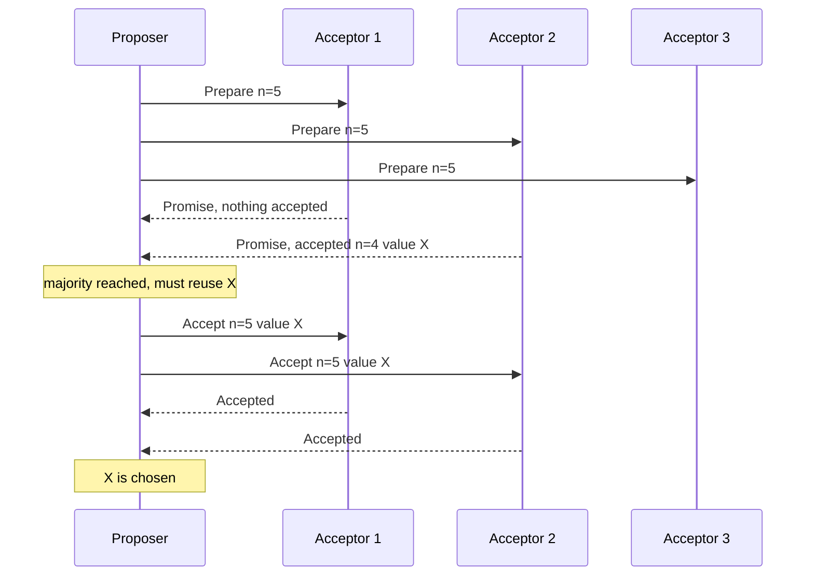

**Multi-Paxos.** Both phases per slot cost two round trips. Phase 1 does not depend on the value, so a proposer that wins Phase 1 for "all slots from here on" becomes the **distinguished proposer** (in practice, the leader) and sends only Phase 2 (`Accept(n, slot, value)`) per slot: one round trip. If it dies, another node runs Phase 1 with a higher number, learns values accepted in unfinished slots, re-proposes them and continues.

**Cost.** Steady-state Multi-Paxos: one round trip to a majority, O(N) messages for N acceptors, O(1) acceptor state per slot. Classic Paxos: two round trips. 2F+1 acceptors tolerate F crashes.

**Duelling proposers.** Two proposers can keep pre-empting each other (P1 prepares 3, P2 prepares 4, P1 prepares 5, ...) so nothing is chosen. Paxos stays safe but this **livelock** stops progress. Fix, as in Raft: one leader at a time plus randomised back-off.

**Paxos vs Raft vs ZAB**

| | Multi-Paxos | Raft | ZAB |
|---|---|---|---|
| Leadership | Optional optimisation, not part of the core proof | Built in: strong leader, one per term | Built in: one primary per epoch |
| Era counter | Proposal number | Term | Epoch (high 32 bits of the 64-bit zxid) |
| Log holes | Allowed: slot 7 can be decided before slot 6 | Not allowed: log is contiguous | Not allowed: strict order |
| Who can become leader | Anyone; new leader recovers values via Phase 1 | Only a node whose log is at least as up to date (election restriction) | Node with latest epoch and highest zxid in a quorum |
| Leader catch-up | New leader learns from acceptors | Leader overwrites followers' conflicting entries | Synchronisation phase before new broadcasts |
| Spec completeness | Many details (membership, snapshots) left to implementers | Full spec, including membership change | Tailored to ZooKeeper's primary-backup model |

In the normal case all three do the same thing (leader sends each entry, commits on majority ack); they differ mostly in how a new leader cleans up after the old one.

### Trade-offs

- **Paxos is flexible but underspecified.** Holes and out-of-order decisions help parallelism, but every real system must invent leader election, log compaction and membership change; Google's "Paxos Made Live" (2007) describes how hard that was for Chubby.
- **Raft is easier to get right** because it fixes those choices, at the price of flexibility (no log holes).
- **Every write costs a majority round trip**: a 5-node group across three regions pays a cross-region round trip per commit.
- **More nodes, more tolerance, slower commits**: 3 nodes tolerate 1 failure, 5 tolerate 2.

### Real-world examples

- **Google Chubby** (lock service) and **Spanner** (each shard replicated by its own Paxos group).
- **Apache ZooKeeper** uses ZAB; it coordinated older Kafka, HBase and Hadoop.
- **etcd**, **Consul**, **CockroachDB**, **TiKV** and Kafka's **KRaft** controller use Raft.
- **Apache Cassandra** runs single-decree Paxos per key for lightweight transactions (`IF NOT EXISTS`).

### In the interview

**Q:** Why must a Paxos proposer reuse a previously accepted value?

**A:** It might already be chosen by a majority. Any majority the proposer hears from overlaps that one, so some promise reports it; reusing it means a later proposal never overwrites a decision.

**Q:** What does Multi-Paxos add?

**A:** A stable leader that runs Phase 1 once, then only Phase 2 per slot: one round trip per decision instead of two. That is the version used in practice.

**Q:** Raft or Paxos for a new system?

**A:** Use a tested library or service (etcd, ZooKeeper, a Raft library). If choosing, Raft has a complete spec and many production implementations; Paxos variants only for special needs such as out-of-order decisions.

### TL;DR

Paxos agrees in two phases (promise, accept) with one golden rule: reuse the highest value already accepted in the majority you heard from. Multi-Paxos adds a stable leader so each log entry costs one round trip. Raft and ZAB are leader-centred cousins with fuller specifications.

**Sources**

- Lamport, "The Part-Time Parliament", ACM TOCS 16(2), 1998, and "Paxos Made Simple", ACM SIGACT News 32(4), 2001: https://www.microsoft.com/en-us/research/publication/part-time-parliament/
- Chandra, Griesemer, Redstone, "Paxos Made Live: An Engineering Perspective", PODC 2007: https://research.google.com/archive/paxos_made_live.html
- Junqueira, Reed, Serafini, "Zab: High-performance broadcast for primary-backup systems", DSN 2011: https://ieeexplore.ieee.org/document/5958223
- Ongaro, Ousterhout, "In Search of an Understandable Consensus Algorithm (Raft)", USENIX ATC 2014: https://raft.github.io/raft.pdf

## Two-phase commit vs three-phase commit

### What it is

An **atomic commit protocol** makes a multi-machine transaction commit everywhere or abort everywhere. Data holders are **participants** (resource managers, cohorts); the **coordinator** (transaction manager) runs the protocol.

- **Two-phase commit (2PC)**: vote phase, then decision phase.
- **Three-phase commit (3PC)**: adds a "pre-commit" phase so participants can finish without the coordinator in some failures (Dale Skeen, non-blocking commit protocols, 1981).

2PC basics are in [Module 7 — Two-Phase Commit](../07-consistency/README.md#two-phase-commit); here: exactly where it blocks, how 3PC tries to fix that, and why industry instead runs 2PC on top of consensus.

### The problem it solves

A transfer debits account 17 on shard A and credits 99 on shard B. If A commits and B aborts, money disappears. Each shard can make its change durable, but neither can decide alone: the other might fail its checks (constraint violation, full disk, deadlock).

### How it works

**2PC (coordinator C, participants A and B):**

1. **Prepare.** C sends `PREPARE`.
2. **Vote.** Each participant checks it can commit, writes changes plus a "prepared" record to its durable log, keeps its locks and answers `YES`, or answers `NO` and aborts. After YES it can no longer decide alone.
3. **Decide.** All YES: C writes "commit" to its log (the actual **commit point**) and sends `COMMIT`. Any NO or timeout: `ABORT`.
4. **Finish.** Participants apply, release locks, acknowledge; C then forgets the transaction.

**Cost:** 4 messages per participant (prepare, vote, decision, ack) = 4N, plus 2 round trips and 2 forced disk writes on the critical path.

**Where it blocks.** A and B voted YES, then C crashes before sending the decision. They are **in doubt**: C may have told someone COMMIT, or decided ABORT. They must hold their locks until C recovers (possibly minutes), freezing rows 17 and 99. This is the **blocking problem**.

**3PC:**

1. **CanCommit.** Participants vote YES/NO but do not lock themselves in yet.
2. **PreCommit.** If all YES, C sends `PRECOMMIT`; participants ack. Now everyone knows everyone voted YES.
3. **DoCommit.** After all acks, C sends `COMMIT`.

Recovery rule: if C disappears, survivors confer. If any received PRECOMMIT, nobody can have aborted, so commit; if none did, nobody can have committed, so abort. Timeouts let participants proceed without C.

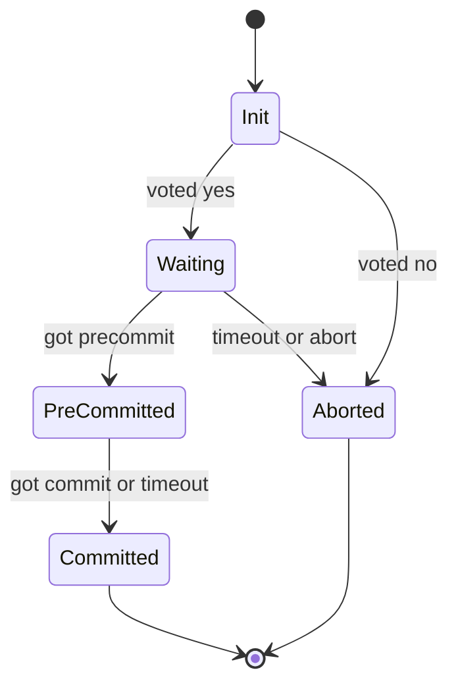

**Worked example.** Five participants; C crashes after sending PRECOMMIT to P1 only. P2 to P5 time out and elect a recovery coordinator (P2), which sees P1 pre-committed and commits all. Had P1 also crashed, survivors see nobody pre-committed and abort. With a reliable network both cases end consistently.

### Why 3PC is rarely used

- **Unsafe under network partitions.** Its timeouts assume a **synchronous network** (bounded delivery, so "no reply" means "crashed"). Real networks are asynchronous: if a partition separates P1 (pre-committed) from P2 to P5, one side commits and the other aborts, which is worse than blocking.
- **An extra round trip** on every transaction, even when nothing fails.
- **A better fix exists.** Gray and Lamport's "Consensus on Transaction Commit" (2006): replicate the coordinator's decision with Paxos (**Paxos Commit**) and commit no longer blocks while a majority of coordinators lives; plain 2PC is the special case tolerating zero coordinator failures. Modern systems run ordinary 2PC where coordinator and every participant are consensus groups, so no single crash leaves anyone in doubt.

### Trade-offs

| | 2PC | 3PC | 2PC over consensus groups |
|---|---|---|---|
| Round trips (normal case) | 2 | 3 | 2, each also replicated |
| Blocks if coordinator dies | Yes | Not with reliable network | No, while a majority survives |
| Safe under partition | Yes (it blocks instead) | No | Yes |
| Typical use | XA, database-internal | Textbooks | Spanner, CockroachDB-style systems |

2PC holds locks for the whole protocol, so cross-shard transactions are slower than single-shard ones. Designers keep related data on one shard, or use **sagas** (local transactions with compensations, [Module 7 — Saga](../07-consistency/README.md#saga)) when temporary inconsistency is acceptable.

### Real-world examples

- **XA transactions** (X/Open standard, Java EE, many databases) and PostgreSQL's `PREPARE TRANSACTION` are plain 2PC.
- **Google Spanner** runs 2PC across Paxos groups: coordinator and participant leaders replicate prepare and commit records through Paxos.
- **Apache Kafka transactions**: a transaction coordinator writes a prepare marker to its replicated log, then commit markers to each partition (2PC on replicated logs).

### In the interview

**Q:** What is the blocking problem in 2PC?

**A:** After voting YES a participant cannot decide alone; if the coordinator crashes before telling it the result, it holds its locks until the coordinator returns.

**Q:** Why not use 3PC?

**A:** It needs a missing reply to reliably mean a crash. Under partitions two groups time out in different directions, one committing and one aborting, and it adds a round trip. Replicating the coordinator with Paxos or Raft fixes blocking safely.

**Q:** How would you design a cross-shard transaction today?

**A:** 2PC over consensus-replicated shards, a durable transaction record as the commit point, idempotent retries. Better, design data so most transactions hit one shard.

### TL;DR

2PC is correct but blocks if the coordinator dies after YES votes. 3PC's pre-commit avoids blocking but is unsafe under partitions and costs a round trip, so almost nobody ships it. Industry runs 2PC whose coordinator and participants are each consensus-replicated.

**Sources**

- Skeen, "Nonblocking Commit Protocols", ACM SIGMOD 1981: https://web.eecs.umich.edu/~manosk/assets/papers/Ske81.pdf
- Gray, Lamport, "Consensus on Transaction Commit", ACM TODS 31(1), 2006: https://arxiv.org/abs/cs/0408036
- Corbett et al., "Spanner: Google's Globally-Distributed Database", OSDI 2012: https://www.usenix.org/conference/osdi12/technical-sessions/presentation/corbett
- Apache Kafka documentation, message delivery semantics and transactions: https://kafka.apache.org/documentation/

## Leases and lease-based leader election

### What it is

A **lease** is a lock with an expiry. The holder gets a right (cache a file, be leader, serve reads) for a fixed period, say 10 s, and must **renew** before it expires. If it crashes or is cut off, renewals stop and after expiry the right can be granted elsewhere without asking it. Cary Gray and David Cheriton introduced leases for file-cache consistency (SOSP 1989). In **lease-based leader election**, whoever holds the lease is the leader.

### The problem it solves

A plain lock held by a crashed node is never released, and you cannot tell crashed from slow. A lease turns "wait until the holder says done" into "wait until a known time passes", which you can always do alone. Leases also make reads cheap: a leader with a valid lease knows no other leader exists, so it serves reads locally without a majority round trip.

### How it works

**Lease leader election with a coordination store such as etcd:**

1. Each candidate tries to create `/service/leader` with its ID, attached to a lease with a **TTL** (time to live) of, say, 15 s. Only one create succeeds (compare-and-swap, "create only if absent").
2. The winner leads and renews (**keep-alives**) well before expiry, e.g. every 2 to 5 s.
3. Losers **watch** the key. If the leader dies, renewals stop, the store deletes the key at TTL, and watchers race to create it.
4. Each successful create gets a new, larger **revision number**, which the leader attaches as a **fencing token** to every write so storage rejects an old leader's writes ([Module 0](../00-system-design-fundamentals/README.md#consensus-leader-election-and-distributed-locks) explains fencing).
5. A leader that cannot renew before its **renew deadline** must stop acting as leader immediately, even if unsure it lost.

**Clocks and the safety margin.** Each machine measures the lease with its own clock, and clocks **drift**. Rule: the holder must believe the lease ends *earlier* than the granter does.

Worked example: L = 10 s, max drift 0.1% (1 ms/s), holder measures from when it *sent* the request.

- Request sent at local 0, grant received at 0.05 s; the lease counts from 0, so network delay only adds caution.
- Over 10 s the clock may be 10 ms off; the holder stops at 10 − 0.01 = 9.99 s minus a margin, say 9.5 s.
- The granter will not re-grant until its clock shows 10 s plus margin, say 10.5 s.
- The windows never overlap, so at most one leader exists, provided no process pauses longer than the margin without checking time. Hence fencing tokens are still needed: a 20 s garbage-collection pause makes the old leader act on stale beliefs.

**Kubernetes defaults.** `kube-controller-manager` and similar use a `Lease` object: lease duration 15 s, renew deadline 10 s, retry period 2 s. The leader renews every 2 s, gives up if not renewed within 10 s, and others may take over 15 s after the last renewal: worst-case failover about 15 s.

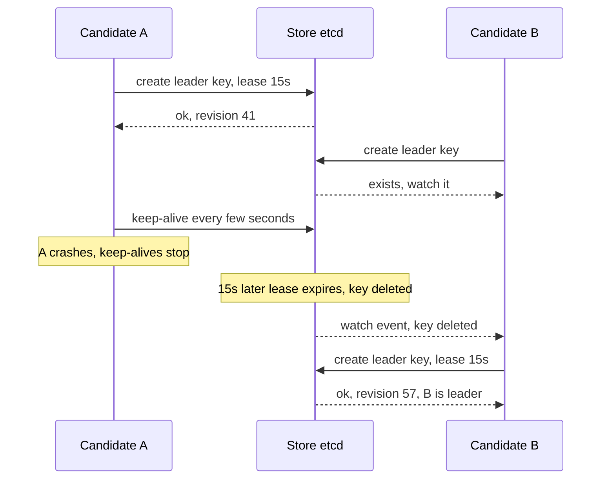

**Leader leases inside consensus.** A Raft or Multi-Paxos leader can hold a lease from a majority of followers, who promise not to vote for anyone else for, say, 10 s after acknowledging it. In that window the leader serves **linearizable reads** (guaranteed to see the latest committed write) locally. Spanner's Paxos leader leases default to 10 s.

**Complexity.** One renewal per interval, O(1) messages per period. Failover is bounded by lease length plus detection and election time.

### Trade-offs

- **Short leases** (a few seconds): fast failover, more renewal traffic and more false failovers on network hiccups.
- **Long leases**: fewer renewals, longer outage after a real crash (nobody leads until expiry).
- **Leases need bounded clock drift**, not synchronised clocks. Gray and Cheriton found little extra benefit beyond about 10 s for their workload.
- **Process pauses break the assumption** that the holder checks time often: pair leases with fencing tokens when correctness matters.

### Real-world examples

- **Google Chubby**: sessions are leases (default extension 12 s); after a lapse the client enters "jeopardy" and waits a 45-second grace period for a new master. The master holds a master lease of a few seconds from its replicas.
- **etcd** leases and **ZooKeeper** ephemeral nodes (deleted on session timeout) are the standard leader-election building blocks.
- **Kubernetes** control-plane components and many operators use `coordination.k8s.io` Lease objects.
- **HDFS** leases give one client at a time the right to write a file.

### In the interview

**Q:** Lease vs lock?

**A:** A lease expires on its own; if the holder disappears the system waits a bounded time and moves on instead of forever.

**Q:** Can two leaders exist at once with leases?

**A:** Not if drift stays within the bound and the old leader stops before expiry. A long process pause can still make it act late, so writes carry a fencing token that storage checks.

**Q:** How do you choose the lease length?

**A:** It is the worst-case failover time: pick it from the recovery target (e.g. 10 to 15 s), then renew at a fraction of it (every 2 to 5 s) so a couple of lost renewals don't cost leadership.

### TL;DR

A lease is a lock that expires; the unexpired holder leads and others take over after expiry. Holder stops early, granter waits late, fencing tokens cover pauses.

**Sources**

- Gray, Cheriton, "Leases: An Efficient Fault-Tolerant Mechanism for Distributed File Cache Consistency", SOSP 1989: https://courses.cs.duke.edu/spring15/cps210/readings/leases-sosp89.pdf
- Burrows, "The Chubby lock service for loosely-coupled distributed systems", OSDI 2006: https://static.usenix.org/events/osdi06/tech/full_papers/burrows/burrows_html/
- Kubernetes, `kube-controller-manager` reference (leader-elect flags): https://kubernetes.io/docs/reference/command-line-tools-reference/kube-controller-manager/
- etcd documentation, lease API: https://etcd.io/docs/latest/learning/api/
- Corbett et al., "Spanner", OSDI 2012 (Paxos leader leases, 10 s default): https://www.usenix.org/conference/osdi12/technical-sessions/presentation/corbett

## Failure detection: heartbeats, phi-accrual and SWIM

### What it is

A **failure detector** decides "that node is probably dead". It cannot be certain (crashed node, slow node and lost link look identical), so it is a guess tuned between **completeness** (every crashed node is eventually suspected) and **accuracy** (few **false positives** on healthy nodes). Three designs: fixed-timeout **heartbeats**, the adaptive **phi accrual** detector (Hayashibara et al., 2004), and **SWIM** (Das, Gupta, Motivala, DSN 2002), which combines probing with gossip for large clusters. Basics: [Module 0 — Heartbeats, gossip and failure detection](../00-system-design-fundamentals/README.md#heartbeats-gossip-and-failure-detection).

### The problem it solves

Leader election, replica placement, load balancing and membership all need to know who is alive. Too eager a detector causes needless failovers and data movement (a "flapping" node declared dead and alive repeatedly); too slow leaves clients waiting on a dead node. At 1,000 nodes the detection traffic itself must stay small.

### How it works

**1. Fixed-timeout heartbeats.** Each node sends "I'm alive" every interval (e.g. 1 s); the monitor records the last arrival; no heartbeat for the timeout (e.g. 5 s) means dead. One fixed number fits no network: 5 s is far too slow in a rack and too twitchy over a congested WAN. All-to-all heartbeating is O(N²): about a million messages per interval at 1,000 nodes.

**2. Phi accrual detector.** Outputs a suspicion level **phi (φ)** that rises the longer a heartbeat is overdue, scaled by how regular heartbeats have been.

1. Keep a sliding window of recent **inter-arrival times** (say the last 1,000).
2. Estimate mean μ and standard deviation σ.
3. With t = time since the last heartbeat, P = 1 − F(t) is the probability a healthy node is *this* late (F = cumulative distribution of observed gaps).
4. φ = −log10(P): φ = 1 is a 10% chance it is just late, φ = 3 is 0.1%, φ = 8 is 1 in 100 million.
5. The application picks a threshold; Cassandra's `phi_convict_threshold` defaults to 8.

Worked example, μ = 1,000 ms, σ = 100 ms (normal):

| Time since last heartbeat | z = (t − μ)/σ | P(just late) | φ |
|---|---|---|---|
| 1,100 ms | 1 | 0.159 | 0.8 |
| 1,200 ms | 2 | 0.023 | 1.6 |
| 1,300 ms | 3 | 0.0013 | 2.9 |
| 1,500 ms | 5 | 2.9e-7 | 6.5 |
| 1,560 ms | 5.6 | 1.1e-8 | 8.0 |

A node is convicted about 1.56 s after its last heartbeat. If jitter grows σ to 300 ms, φ = 8 arrives only after about 2.7 s: the detector adapts itself. The paper assumed a normal distribution; some systems use a simpler exponential model.

**3. SWIM (Scalable Weakly-consistent Infection-style process group Membership)** separates *detecting* failures from *spreading* the news.

1. Every **protocol period** T (say 1 s), each member pings one random member M.
2. An `ack` within a short timeout ends it.
3. Otherwise it asks k random members (say 3) to `ping-req` M on its behalf; any ack is relayed back. This **indirect probe** avoids blaming M for one bad link.
4. If nobody hears from M, it is marked **suspect** (not dead) and the suspicion is gossiped.
5. M **refutes** by gossiping "alive" with a higher **incarnation number** (a counter only M may increase).
6. Unrefuted within a suspicion timeout, M is declared **dead**.
7. Membership updates (join, suspect, alive, dead) are **piggybacked** on pings and acks, spreading like an infection to all N members in about O(log N) periods with no extra messages.

Per-member cost per period is constant (one ping plus at most k indirect probes); total traffic is O(N), not O(N²), and expected first-detection time does not grow with cluster size.

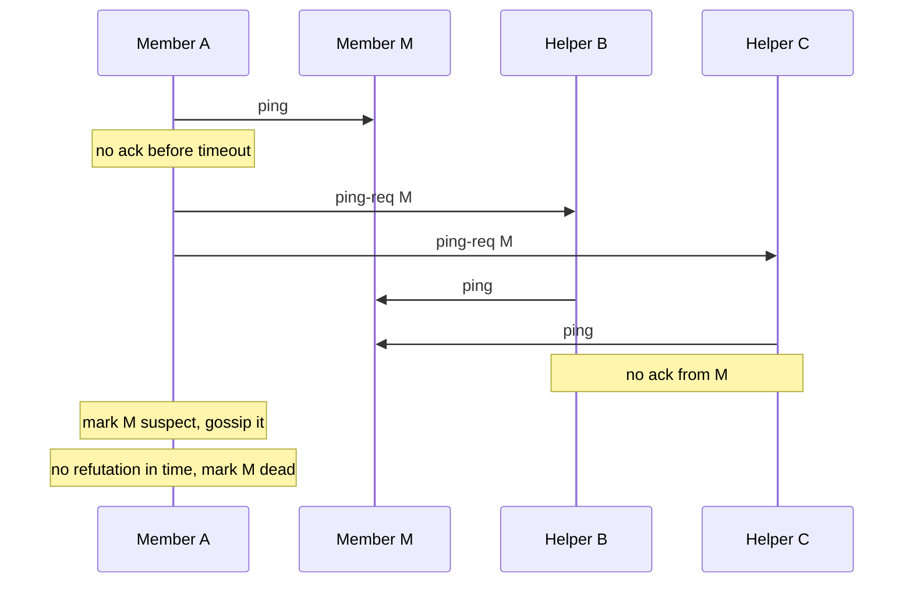

### Trade-offs

- **Fixed timeouts**: simple and predictable, but per-environment tuning; either slow detection or false alarms.
- **Phi accrual**: adapts and gives a tunable confidence level, but needs history (warm-up) and can be fooled when the heartbeat pattern suddenly changes.
- **SWIM**: thousands of nodes at constant per-node load, with eventual (not instant) membership agreement. An overloaded (CPU-starved) node can wrongly accuse healthy peers; HashiCorp's **Lifeguard** extensions address this, reporting about 50 times fewer false positives.
- **No detector is perfect**: pair with fencing and idempotency so a wrong guess costs a failover, not corrupt data.

### Real-world examples

- **Apache Cassandra** and **Akka Cluster**: phi accrual.
- **HashiCorp memberlist** (Consul, Serf, Nomad): SWIM with Lifeguard.
- **Raft and ZooKeeper**: simple heartbeats with timeouts (randomised in Raft).
- **Kubernetes**: a node is unhealthy when its node Lease is not renewed in time (a heartbeat via a shared store).

### In the interview

**Q:** Why not just a 5-second heartbeat timeout?

**A:** One number fits no network or load: too slow in a quiet data centre, false alarms during congestion. Phi accrual sets the bar from observed heartbeat timing.

**Q:** How does SWIM avoid O(N²) traffic?

**A:** Each node probes one random peer per period and piggybacks membership changes on those probes: constant per-node load, news reaches everyone in about log N rounds.

**Q:** Why indirect pings and a suspect state?

**A:** So one bad link or a short pause doesn't kill a node: indirect pings test other paths, and suspicion gives it a chance to refute.

### TL;DR

Failures can only be suspected. Heartbeats with timeouts are simplest; phi accrual turns lateness into an adaptive probability-based suspicion level; SWIM probes one random peer per period with indirect probes and suspicion, gossiping results at constant per-node cost.

**Sources**

- Hayashibara, Défago, Yared, Katayama, "The phi accrual failure detector", SRDS 2004 (as implemented and documented in Akka): https://doc.akka.io/api/akka-core/2.9/akka/remote/PhiAccrualFailureDetector.html
- Apache Cassandra / DataStax docs, failure detection and `phi_convict_threshold`: https://docs.datastax.com/en/cassandra-oss/3.0/cassandra/architecture/archDataDistributeFailDetect.html
- Das, Gupta, Motivala, "SWIM: Scalable Weakly-consistent Infection-style Process Group Membership Protocol", DSN 2002: https://www.cs.cornell.edu/projects/Quicksilver/public_pdfs/SWIM.pdf
- HashiCorp, "Making Gossip More Robust with Lifeguard": https://www.hashicorp.com/blog/making-gossip-more-robust-with-lifeguard

## Chain replication and CRAQ

### What it is

**Chain replication** (van Renesse and Schneider, OSDI 2004) arranges a data item's replicas in a line, a **chain**, from **head** to **tail**. Writes enter at the head and flow down; the tail answers reads. A separate, consensus-backed **configuration manager** (master) decides chain membership.

**CRAQ** (Chain Replication with Apportioned Queries, Terrace and Freedman, USENIX ATC 2009) keeps the write path but lets **any** node answer reads, still strongly consistent.

### The problem it solves

In primary-backup, one primary receives each write, sends it to every backup, collects acks and serves reads, so its NIC and CPU bottleneck. A chain spreads the work: each node forwards each write to one successor, and reads (tail) are separated from writes (head), while still giving **linearizability** (every read sees the latest completed write, as if there were one copy). CRAQ fixes the chain's own weakness: the tail serving every read is a hot spot for read-heavy workloads.

### How it works

**Chain replication (H, M, T):**

1. Client sends `put(x, 5)` to H.
2. H applies it and forwards to M; M applies and forwards to T.
3. T applies it: the write is **committed** (every replica has it). T replies to the client (or acks back up so H replies).
4. `get(x)` goes to T, which holds only committed writes; one tail means reads and writes are totally ordered.

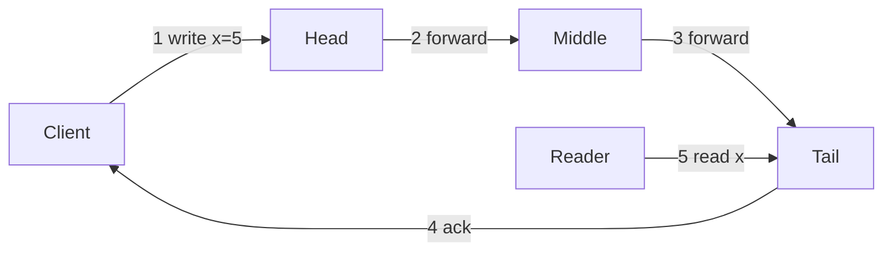

**Failure handling (by the configuration manager):**

- **Head fails**: M becomes head. Writes H had not forwarded are lost, but were never acknowledged, so clients retry.
- **Tail fails**: M becomes tail; it has every write T had, maybe more, so nothing committed is lost.
- **Middle fails**: H is linked to T and re-sends every write forwarded but not yet acked downstream. Each node keeps such **pending** writes until the tail's ack flows back.
- **Adding a node**: it copies state from the tail, then is appended as the new tail.

**Worked example.** 0.5 ms per hop. A 3-node chain write is client→H→M→T→client: 4 hops, about 2 ms. Primary-backup (client→primary, parallel fan-out to backups, acks, reply) is also 4 hops and stays 4 however many backups, while a 5-node chain needs 6. The difference is sending work: a primary sends one copy per backup, each chain node sends 1. At 10,000 writes/s of 1 KB, the chain head sends 10 MB/s; a primary with 4 backups sends 40 MB/s.

**Complexity.** Write latency O(n) hops; n messages per write (one per link) plus acks; n full copies; tolerates n − 1 failures (the manager, not the chain, needs a majority).

**CRAQ.** Each node may store several **versions** of an object, each **clean** (known committed) or **dirty** (not yet known committed).

1. A write travels head to tail; each node stores the new version as dirty.
2. When the tail applies it, it is committed and the tail acks back up the chain.
3. As the ack passes, each node marks that version clean and deletes older ones.
4. A read can go to **any** node: if its latest version is clean, return it; if dirty, ask the tail for the latest committed version number of x (a tiny **version query**, not a full read) and return that version from local storage.

Worked example: x is version 7 (clean) everywhere. Write 8 has reached H and M (dirty) but not T. A reader at M sees dirty, asks T, learns "7", returns 7. A millisecond later T applies 8, acks flow back, M marks 8 clean, and the next read at M returns 8 with no query. In read-mostly workloads most objects are clean, so read throughput scales with the number of nodes.

CRAQ can also relax to **eventual consistency** on request: return the newest local version, dirty or not, skipping the tail query.

### Trade-offs

- **Higher write latency** than parallel fan-out: n sequential hops instead of one parallel round.
- **One slow node slows every write**, since every write passes every node.
- **Needs an external configuration manager** (Paxos, Raft or ZooKeeper) to avoid split brain; the chain itself runs no consensus.
- **Strong consistency with simple logic**: no per-write voting; the tail is the single point of truth for ordering.
- **CRAQ** removes the read hot spot at the cost of multi-version storage and extra tail queries under write-heavy load.

### Real-world examples

- **Hibari** (open-source key-value store): chain replication with head, middle and tail "bricks".
- **FAWN-KV** (research store on low-power nodes) and CRAQ itself build on it.
- **HDFS** writes blocks through a **pipeline** of DataNodes, each forwarding to the next.
- The pattern recurs in object and block storage wherever per-node bandwidth matters most.

### In the interview

**Q:** Why does the tail serve reads?

**A:** It is the only node guaranteed to hold only committed writes, so reading there is linearizable without coordination.

**Q:** How does CRAQ read from any node and stay consistent?

**A:** Clean versions are returned directly; for a dirty one the node asks the tail which version is committed and returns that.

**Q:** When prefer quorum or Raft replication to a chain?

**A:** When write latency or tolerance of one slow replica matters more: a majority quorum commits after the fastest majority, a chain waits for every node.

### TL;DR

Chain replication pipes writes head to tail and reads from the tail: strong consistency and good throughput with simple logic, latency proportional to chain length. CRAQ lets every node serve reads by tracking clean/dirty versions and asking the tail only when unsure.

**Sources**

- van Renesse, Schneider, "Chain Replication for Supporting High Throughput and Availability", OSDI 2004: https://www.usenix.org/conference/osdi-04/chain-replication-supporting-high-throughput-and-availability
- Terrace, Freedman, "Object Storage on CRAQ: High-Throughput Chain Replication for Read-Mostly Workloads", USENIX ATC 2009: https://www.usenix.org/conference/usenix-09/object-storage-craq-high-throughput-chain-replication-read-mostly-workloads
- Hibari documentation, architecture: https://hibari.readthedocs.io/en/latest/admin-guide/architecture.html
- Apache Hadoop HDFS architecture guide (replication pipelining): https://hadoop.apache.org/docs/stable/hadoop-project-dist/hadoop-hdfs/HdfsDesign.html

## Hybrid logical clocks

### What it is

A **hybrid logical clock (HLC)** stamps each event with `l`, close to **physical (wall-clock) time**, and `c`, a small **logical counter** (Kulkarni, Demirbas et al., "Logical Physical Clocks", OPODIS 2014). It combines **physical timestamps** (human-readable, but machines disagree by milliseconds or more, **clock skew**, so a message can arrive "before" it was sent) with **Lamport clocks** (counters that guarantee **causality**, if e could influence f then e is smaller, but bear no relation to real time). Background: [Module 0 — Clocks and ordering](../00-system-design-fundamentals/README.md#clocks-and-ordering).

### The problem it solves

A distributed database wants timestamps that (1) never violate cause and effect, (2) fit a 64-bit field, and (3) stay near real time for "data as of 10:00:00" or "snapshot at t". Physical clocks fail (1), Lamport clocks fail (3), vector clocks satisfy (1) but grow with node count, failing (2). HLC satisfies all three.

### How it works

Node j keeps `l` (largest physical time heard of) and `c` (counter); `pt` is its physical clock.

```text
on local or send event:
    l_old = l
    l = max(l_old, pt)
    c = c + 1 if l == l_old else 0
    stamp event (and message) with (l, c)

on receive of message m with (l_m, c_m):
    l_old = l
    l = max(l_old, l_m, pt)
    if   l == l_old == l_m: c = max(c, c_m) + 1
    elif l == l_old:        c = c + 1
    elif l == l_m:          c = c_m + 1
    else:                   c = 0
    stamp event with (l, c)
```

Compare by `l`, then `c` (node ID breaks exact ties).

**Worked example.** A's clock reads 100 ms; B's is 8 ms slow and B's last stamp was (85, 0).

1. A writes at pt = 100: `l = 100`, `c = 0` → **(100, 0)**.
2. Still at 100, A sends to B: `l` unchanged, `c = 1` → **(100, 1)**.
3. B receives at its pt = 92: `l = max(85, 100, 92) = 100` = message's `l`, so `c = 2` → **(100, 2)**. Raw physical time would stamp 92, *before* the send: causality broken.
4. B writes locally at pt = 95: `l` stays 100, `c = 3` → **(100, 3)**.
5. B's clock reaches 101: `l = 101`, `c` resets → **(101, 0)**.

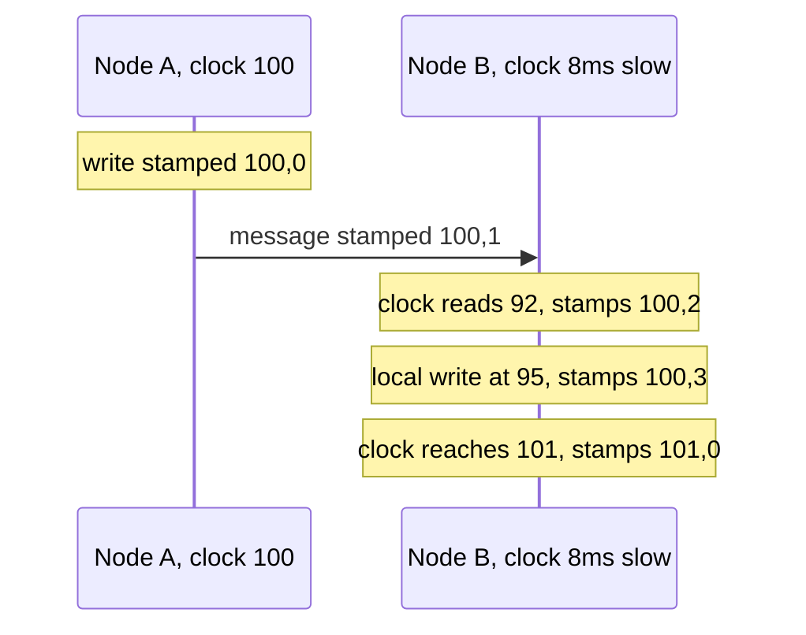

**Properties.**

- e happened before f ⇒ HLC(e) < HLC(f), as with Lamport clocks.
- `l` is never more than the clock skew ahead of the node's physical time.
- `c` stays small (bounded by node count in theory, tiny in practice). The paper packs 64 bits: 48 for `l` (NTP-format time, rounded), 16 for `c`.
- O(1) time per event and O(1) space per timestamp, vs O(N) for a vector clock.

**What HLC does not do.** It does not make clocks *accurate*: unrelated writes 1 ms apart on different nodes can be ordered "wrongly" if clocks disagree by more than 1 ms. External consistency ("a transaction starting after another commits sees it") needs an extra rule, such as CockroachDB's **uncertainty interval**.

### Trade-offs

- **Pros**: causal, near wall time, fixed 64 bits, cheap; ideal for MVCC timestamps, snapshot reads and change-data-capture ordering.
- **Cons**: relies on a configured maximum skew. A node whose clock jumps far ahead drags everyone's `l`, so bad-clock nodes must be rejected or fenced.
- **Cannot detect concurrency**: any two HLC stamps are ordered, even for concurrent events, so it is not a conflict detector.

### Real-world examples

- **CockroachDB** stamps transactions with HLC. `--max-offset` (default 500 ms) is the maximum allowed clock offset; a read treats values stamped within that offset above its own timestamp as **uncertain** and restarts higher. Nodes that drift too far shut themselves down.
- **MongoDB** uses an HLC for **cluster time**, powering causally consistent sessions across replica sets and shards.
- **YugabyteDB** uses HLC for distributed transactions.

### In the interview

**Q:** Why not order by NTP timestamps?

**A:** Clocks disagree by milliseconds or more and can jump backwards, so a reply can precede its request. HLC never goes backwards and always orders a receive after its send.

**Q:** HLC vs vector clock?

**A:** HLC is a fixed-size scalar respecting causality and near real time, but cannot say two events were concurrent; vector clocks can, but grow with node count.

**Q:** How does CockroachDB handle skew?

**A:** A maximum offset: reads seeing values slightly newer than their timestamp (within the offset) restart later; nodes drifting too far stop serving.

### TL;DR

HLC = max physical time heard so far plus a tie counter: causal like Lamport, within clock skew of real time, 64 bits. CockroachDB, MongoDB and YugabyteDB use it for transaction and snapshot timestamps.

**Sources**

- Kulkarni, Demirbas, Madappa, Avva, Leone, "Logical Physical Clocks and Consistent Snapshots in Globally Distributed Databases", OPODIS 2014 (UB tech report 2014-04): https://cse.buffalo.edu/tech-reports/2014-04.pdf
- Lamport, "Time, Clocks, and the Ordering of Events in a Distributed System", CACM 1978: https://lamport.azurewebsites.net/pubs/time-clocks.pdf
- CockroachDB docs, `cockroach start` (`--max-offset`, default 500 ms) and transaction layer: https://www.cockroachlabs.com/docs/stable/architecture/transaction-layer
- Tyulenev et al., "Implementation of Cluster-wide Logical Clock and Causal Consistency in MongoDB", SIGMOD 2019: https://doi.org/10.1145/3299869.3314049

## Google TrueTime and commit-wait

### What it is

**TrueTime** is the clock service in Google **Spanner** (Corbett et al., OSDI 2012). `TT.now()` returns an **interval** `[earliest, latest]` guaranteed to contain true absolute time; half its width is **epsilon (ε)**, the uncertainty. **Commit-wait** uses it: after choosing a commit timestamp, wait until it is definitely past before making writes visible.

### The problem it solves

Spanner promises **external consistency** (the strongest form of linearizability for transactions): if T1 commits before T2 starts in real time, T2's timestamp is larger and T2 sees T1's writes. With ordinary clocks off by milliseconds, a later transaction on a slow-clock server could get a *smaller* timestamp, and a snapshot read could miss a write that had already finished. TrueTime makes clock error **explicit and bounded**; commit-wait turns the bound into a guarantee.

### How it works

**Building the interval.**

1. Each data centre has several **time masters**: most with GPS receivers, the rest (**Armageddon masters**) with atomic clocks, which fail in different ways.
2. A daemon per machine polls several masters (every 30 s in the paper), rejects outliers with a variant of Marzullo's algorithm, and syncs the local clock.
3. Between polls it assumes worst-case drift (200 µs/s in the paper): up to 6 ms after 30 s, plus about 1 ms of network delay to the masters.
4. So ε follows a **sawtooth** from about 1 ms after a poll to about 7 ms before the next; about 4 ms on average.

**API:** `TT.now()` → `[earliest, latest]`; `TT.after(t)` true if t has definitely passed (`t < now.earliest`); `TT.before(t)` true if t has definitely not arrived (`t > now.latest`).

**Commit-wait:**

1. A read-write transaction acquires locks (two-phase locking).
2. The coordinator leader picks `s = TT.now().latest`, which is not in the past.
3. It replicates the commit record through Paxos (plus 2PC across shards).
4. **Commit-wait:** wait until `TT.after(s)`.
5. Then release locks and reply "committed".

**Worked example, ε = 4 ms.** At true time 1000.000 s, `TT.now()` = `[999.996, 1000.004]`, so s = 1000.004. It waits until `earliest > 1000.004`, at true time about 1000.008: about 2ε = 8 ms. Paxos replication runs during the wait (often longer than 8 ms across zones), hiding much of it; the paper measured commit-wait at about 5 ms in a single-replica test. Any T2 starting after the client hears "committed" starts after 1000.008, and its timestamp ≥ its own `TT.now().latest` ≥ true time > 1000.004, so it is ordered after T1.

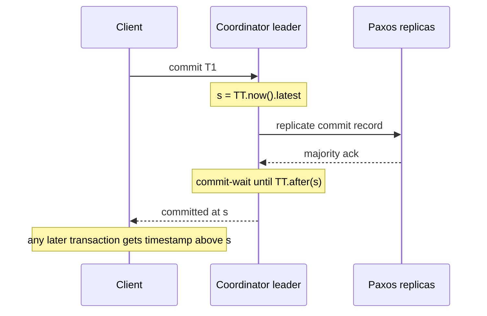

**Why it pays off.** Timestamps match real-time order, so a **read-only transaction** or **snapshot read** at t needs no locks: any replica caught up to t can answer. Spanner leaders also use TrueTime to keep their **leader leases** (10 s default) from overlapping.

**Cost.** About 2ε added write latency, O(1) work; smaller ε means faster commits, hence Google's GPS and atomic-clock investment.

### Trade-offs

- **Write latency includes the uncertainty**: unreachable time masters grow ε and every commit.
- **Specialised infrastructure**: GPS antennas and atomic clocks per data centre plus monitoring; machines whose clocks exceed the assumed bound are evicted.
- **Reward**: lock-free consistent reads anywhere, at any past timestamp.
- **Alternatives without special hardware**: CockroachDB uses HLC with a larger maximum offset and restarts uncertain reads instead of waiting on every write. Cloud providers expose clock error bounds too: AWS ClockBound returns an `[earliest, latest]` window like TrueTime.

### Real-world examples

- **Google Spanner** and Cloud Spanner (TrueTime plus commit-wait); Google notes that when uncertainty is below the Paxos round trip, commit-wait adds nothing to commit latency.
- **CockroachDB**: a similar opt-in "commit wait" for global tables, on HLC and a configured clock offset.
- **AWS ClockBound** with Amazon Time Sync Service: a bounded-uncertainty clock API for EC2.

### In the interview

**Q:** What is commit-wait and why is it needed?

**A:** Having stamped the commit at the top of the uncertainty interval, the leader waits until that time is certainly past before acknowledging, so any later-starting transaction gets a larger timestamp: external consistency.

**Q:** How long is the wait?

**A:** About 2ε, a few ms in Spanner (ε was 1 to 7 ms, about 4 ms average, in the 2012 paper), overlapping Paxos replication, so the added latency is often small.

**Q:** Can I build this on AWS or with NTP?

**A:** Yes, given a trustworthy error bound; NTP's is larger, so waits are longer. That is why most open-source databases use HLC plus uncertainty restarts.

### TL;DR

TrueTime returns an interval guaranteed to contain true time, a few ms wide thanks to GPS and atomic clocks. Spanner stamps commits at the top of the interval and waits until that time has passed, so timestamps follow real-time order and global snapshot reads need no locks.

**Sources**

- Corbett et al., "Spanner: Google's Globally-Distributed Database", OSDI 2012 (sections 3 and 4): https://www.usenix.org/conference/osdi12/technical-sessions/presentation/corbett
- Google Cloud, "Spanner: TrueTime and external consistency": https://cloud.google.com/spanner/docs/true-time-external-consistency
- AWS EC2 User Guide, "Compare timestamps for your Linux instances" (ClockBound): https://docs.aws.amazon.com/AWSEC2/latest/UserGuide/compare-timestamps-with-clockbound.html
- CockroachDB docs, transaction layer and clock offset: https://www.cockroachlabs.com/docs/stable/architecture/transaction-layer

## Version vectors vs vector clocks (and dotted version vectors)

### What it is

All three are lists of counters, one per participant, used to decide whether one thing **happened before** another or they are **concurrent** (neither knew of the other).

- **Vector clock** (Fidge and Mattern, 1988): causality between **events**; each process keeps one counter per process, updated on every local event, send and receive.
- **Version vector** (Parker et al., 1983): causality between **versions of data**; one counter per **replica** (the server coordinating a write), changed only on writes and merges.
- **Dotted version vector (DVV)** (Preguiça, Baquero, Almeida et al., 2010): a version vector plus a **dot**, one `(replica, counter)` pair naming the exact write that created a value. It fixes false conflicts that plain version vectors create when many clients write through one server.

How a leaderless store uses these to detect conflicts is in [Module 7 — Vector Clocks](../07-consistency/README.md#vector-clocks); here, the differences and the DVV fix.

### The problem it solves

In a leaderless or multi-leader (Dynamo-style) database, two clients can update a key on different replicas at once. Is B a newer edit of A (keep B), or independent (keep both as **siblings** for the application to merge)? Timestamps cannot answer ([Module 0 — Clocks and ordering](../00-system-design-fundamentals/README.md#clocks-and-ordering)); counter vectors can.

### How it works

**Comparing V and W** (all three): V ≤ W if every entry of V ≤ W's. If V ≤ W and V ≠ W, V happened before W (W supersedes). If neither ≤ the other, they are **concurrent**: a conflict. `{A:2, B:1}` vs `{A:3, B:1}`: first is older. `{A:2, B:1}` vs `{A:1, B:2}`: concurrent.

| | Vector clock | Version vector |
|---|---|---|
| Orders | Events (messages, computations) | Versions of a data item |
| One entry per | Process | Replica that coordinates writes |
| Updated on | Every event, send and receive | Writes and merges only |
| Size | Grows with processes involved | Grows with replicas (usually 3 to 5) |
| Typical use | Debugging, causal message delivery | Conflict detection in replicated stores |

People often say "vector clock" for both, as the Dynamo paper does. It matters because **client-ID** entries grow with clients (millions), while **server-ID** entries stay small but lose information: the problem DVVs solve.

**Sibling explosion, step by step.** Replica A coordinates all writes to `cart`; vectors use server IDs.

1. C1 writes `v1` with no context (never read the key): A stores v1 with `{A:1}`.
2. C2, also without reading, writes `v2`. A can't tell if v2 replaces v1, keeps both as siblings and bumps to `{A:2}`; both siblings share `{A:2}`.
3. C1 writes `v3` with its context from step 1, `{A:1}`: v3 should replace v1 but stay concurrent with v2.
4. A cannot tell *which* sibling `{A:1}` covers, so it keeps v1, v2 and v3. With retries and many clients, siblings pile up without bound: **sibling explosion**, caused by **false concurrency**.

**Same steps with DVVs.**

1. v1 gets dot `(A,1)`; store `{v1@(A,1)}`, context returned `{A:1}`.
2. v2 (empty context) gets dot `(A,2)`; store `{v1@(A,1), v2@(A,2)}`.
3. v3 arrives with context `{A:1}`, which **covers** dot (A,1) (drop v1) but not (A,2) (keep v2); v3 gets `(A,3)`.
4. Store `{v2@(A,2), v3@(A,3)}`: exactly the two truly concurrent values.

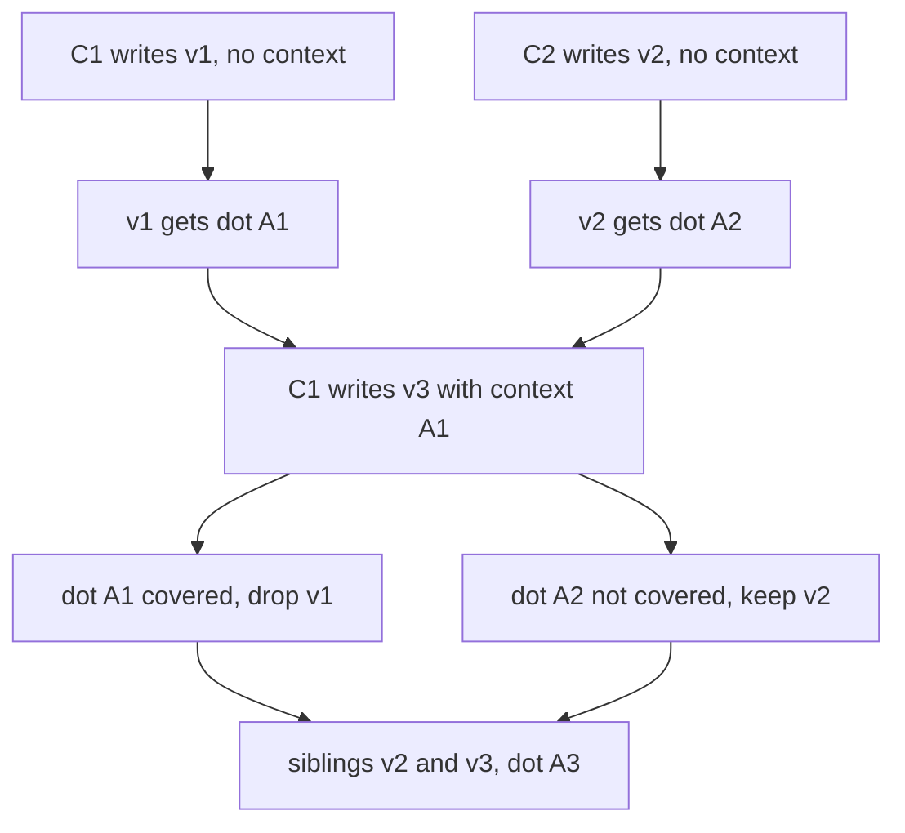

**DVV-style write at replica r:**

```text
on write(value, context):            # context is a version vector
    siblings = [s for s in siblings if not covered(s.dot, context)]
    vv[r] = vv[r] + 1
    siblings.append(Sibling(value, dot=(r, vv[r])))
covered(dot, ctx): return dot.counter <= ctx.get(dot.replica, 0)
```

**Complexity.** Comparison O(R) for R entries; version vector O(R) space per key (R = replicas, small); DVV adds one dot per sibling; vector clocks over P processes cost O(P), possibly large.

### Trade-offs

- **Vector clocks** capture full event causality but grow with processes: better for debugging and messaging than storage.
- **Replica-keyed version vectors** stay small but, without dots, create false conflicts when several clients write through one replica.
- **Client-keyed vectors** are precise but unbounded; Dynamo truncated them at a threshold (the paper gives 10 pairs), risking incorrect reconciliation.
- **DVVs** keep the small server-keyed size and remove false concurrency, with slightly more complex code.
- **All only detect conflicts.** The application or a **CRDT** (conflict-free replicated data type, which merges automatically) must resolve them. Many systems use **last-write-wins** instead: simpler, but silently drops concurrent writes.

### Real-world examples

- **Amazon Dynamo** (2007): vector clocks of `(node, counter)` pairs per object; siblings returned to the client to merge.
- **Riak** 2.0 added DVVs as an option and recommends them to bound siblings.
- **Project Voldemort** (LinkedIn): vector clocks in a Dynamo-style design.
- **Apache Cassandra** avoids them, using per-column last-write-wins timestamps.

### In the interview

**Q:** Vector clock vs version vector?

**A:** A vector clock orders events between processes and ticks on every event and message; a version vector orders data versions across replicas and ticks only on writes. Same comparison rule, different purpose and size.

**Q:** Why did Riak move to dotted version vectors?

**A:** With one counter per server, values written by several clients through one server shared one vector, so the server couldn't tell which a new write replaced and siblings piled up. A dot names each value's write, so a new write's context discards exactly the values it saw.

**Q:** `{A:3, B:1}` vs `{A:2, B:2}`?

**A:** Neither dominates: concurrent. Keep both as siblings and merge on read (application logic, a CRDT, or last-write-wins if losing one is acceptable).

### TL;DR

Vector clocks order events between processes; version vectors order data versions across replicas; both flag concurrency when neither dominates. DVVs tag each value with its creating write, avoiding false conflicts and sibling explosion with small vectors.

**Sources**

- Preguiça, Baquero, Almeida, Fonte, Gonçalves, "Dotted Version Vectors: Logical Clocks for Optimistic Replication", 2010: https://arxiv.org/abs/1011.5808
- DeCandia et al., "Dynamo: Amazon's Highly Available Key-value Store", SOSP 2007: https://www.allthingsdistributed.com/files/amazon-dynamo-sosp2007.pdf
- Riak KV docs, "Causal Context": https://docs.riak.com/riak/kv/2.2.3/learn/concepts/causal-context
- Riak engineering blog, "Vector Clocks Revisited Part 2: Dotted Version Vectors": https://riak.com/posts/technical/vector-clocks-revisited-part-2-dotted-version-vectors/

## Consistent hashing variants: jump, rendezvous, Maglev and bounded loads

### What it is

Any method that maps a key to one of N servers so that changing N moves as few keys as possible is a **consistent hashing** scheme. The **hash ring with virtual nodes** ([Module 3 — Consistent Hashing](../03-storing-data/README.md#consistent-hashing)) is one; this section covers four others:

- **Jump consistent hash**: a few lines of arithmetic, no memory, for servers numbered 0 to N−1.
- **Rendezvous hashing** (**highest random weight, HRW**): every server "bids" for the key; the highest bid wins.
- **Maglev hashing**: Google's load-balancer method; a precomputed fixed-size table makes each lookup one array read.
- **Consistent hashing with bounded loads**: a ring plus a hard cap so no server exceeds, say, 25% above average.

Terms: a **key** is what you route on (user ID, URL, connection 5-tuple); a **bucket**/**backend**/**server** is the destination; **disruption** (**movement**) is the share of keys that change destination when the server set changes. The minimum going from N to N+1 servers is 1/(N+1).

### The problem it solves

The ring's costs at scale: (1) **memory and lookup time** (1,000 servers × 200 vnodes = 200,000 points, binary-searched per lookup); (2) **imperfect balance** (even with 100–200 vnodes the biggest server typically carries several percent more than the smallest; more vnodes, more memory); (3) **hot keys** (it balances *keys*, not *load*, so a popular or costly key overloads a server however even the arcs are). Each variant attacks one of these.

### How it works

**1. Jump consistent hash (Lamping and Veach, Google, 2014).** Grow the cluster one bucket at a time; when going from b to b+1 buckets each key should move to the new bucket with probability exactly 1/(b+1). Simulating that is O(N); a key-seeded pseudo-random generator instead *jumps* straight to the next bucket count where this key moves. Expected jumps ≈ ln N (about 7 for N = 1,000).

```text
function jump_hash(key, num_buckets):
    b = -1            # last bucket the key moved to
    j = 0             # next bucket count at which it might move
    while j < num_buckets:
        b = j
        key = key * 2862933555777941757 + 1          # 64-bit LCG step
        j = floor((b + 1) * 2^31 / ((key >> 33) + 1))
    return b
```

Worked example (published constant): key 99999 is in bucket 0 with 1 bucket, bucket 1 for sizes 2 to 7, then jumps to bucket 7 when the 8th appears and stays for sizes 9 and 10. It moves exactly twice from 1 to 10, each time *into the newly added bucket*, never sideways. 100,000 keys going from 10 to 11 buckets moved 9,042 (9.04%) vs the ideal 1/11 = 9.09%.

Cost: O(ln N) time, O(1) memory, essentially perfect balance. Catch: buckets are numbered 0..N−1 and change only at the **end**; if bucket 3 of 10 dies you cannot delete "3". The fix is a layer mapping bucket numbers to replica groups whose members can change, which is why the paper targets sharded storage, not caches where any node can vanish.

**2. Rendezvous hashing / HRW (Thaler and Ravishankar, 1996–1998).** For each key compute `score = hash(key, server)` per server and pick the highest.

| Server | hash("photo:7", server), scaled 0..1 |
|---|---|
| S1 | 0.62 |
| S2 | **0.91** |
| S3 | 0.17 |

`photo:7` goes to S2. If S2 dies, S1 (0.62) wins; keys whose top scorer was S1 or S3 are untouched. Exactly the dead server's keys move, spread evenly over survivors (each key's runner-up is random). Adding S4 steals only keys where S4 scores highest, about 1/4.

- **Replication for free:** the top 3 scores give 3 replicas in stable order.
- **Weights:** `score = -w / ln(h)` (h = hash scaled to (0,1), w = weight); weight 2 wins about twice as often.
- **Cost:** O(N) hashes per lookup: nothing for 10 servers, too slow for 10,000, where a tree of rendezvous choices (group, then server) is used.

**3. Maglev hashing (Google, NSDI 2016).** Maglev, Google's software network load balancer (serving since 2008), must send every packet of a TCP connection to the same backend at line rate, so lookup is one array read into a table of prime size M (65,537 by default in the paper).

1. Per backend i: `offset = h1(name) mod M`, `skip = h2(name) mod (M-1) + 1`.
2. **Preference list** `permutation[i][j] = (offset + j * skip) mod M`; M prime means every slot is visited once.
3. Fill in rounds: each backend in turn claims its next preferred empty slot, until all M are full.
4. Lookup: `backend = table[hash(packet 5-tuple) mod M]`.

M = 7, three backends:

| Backend | (offset, skip) | Preference list |
|---|---|---|
| B0 | (3, 4) | 3, 0, 4, 1, 5, 2, 6 |
| B1 | (0, 2) | 0, 2, 4, 6, 1, 3, 5 |
| B2 | (3, 1) | 3, 4, 5, 6, 0, 1, 2 |

Filling: B0→3, B1→0, B2→4 (3 taken), B0→1, B1→2, B2→5, B0→6. Table `[B1, B0, B1, B0, B2, B2, B0]`: 3, 2, 2 slots, as even as 7 allows. Remove B1 and refill: `[B0, B0, B0, B0, B2, B2, B2]`. B1's slots 0 and 2 had to move; slot 6 also moved B0→B2 unnecessarily. That is Maglev's deliberate trade: **near-perfect balance and O(1) lookup for a little extra disruption**, hidden by a per-machine connection-tracking table that keeps existing flows on their backend. With a 65,537-entry table the paper found Karger-style ring hashing and rendezvous would need 29.7% and 49.5% over-provisioning to absorb imbalance, while Maglev was almost perfectly even. Envoy reports the flip side: on host removal Maglev moves about twice as many keys as its ring hash.

**4. Consistent hashing with bounded loads (Mirrokni, Thorup, Zadimoghaddam, Google, 2016).** Balance factor c = 1 + ε (e.g. 1.25). With m active keys and n servers, no server holds more than `ceil(c * m / n)`. Lookup: hash onto the ring, take the first server clockwise if under its cap, else keep walking to the next with spare capacity.

Worked example: 12 keys, 4 servers, ε = 0.25, cap = ceil(3.75) = 4. The plain ring gives A 6, B 3, C 2, D 1; A keeps 4 and 2 walk on, giving perhaps 4, 4, 3, 1. The hottest server falls from 2× average (3) to 1.33×.

The paper proves the cap always holds and moves stay small (about O(1/ε²) times the ideal for small ε). Vimeo implemented it in HAProxy for its video cache tier and reported almost 8× less cache bandwidth; HAProxy exposes `hash-balance-factor` (a percentage, e.g. 150 = 1.5× average); Google Cloud Pub/Sub used it internally.

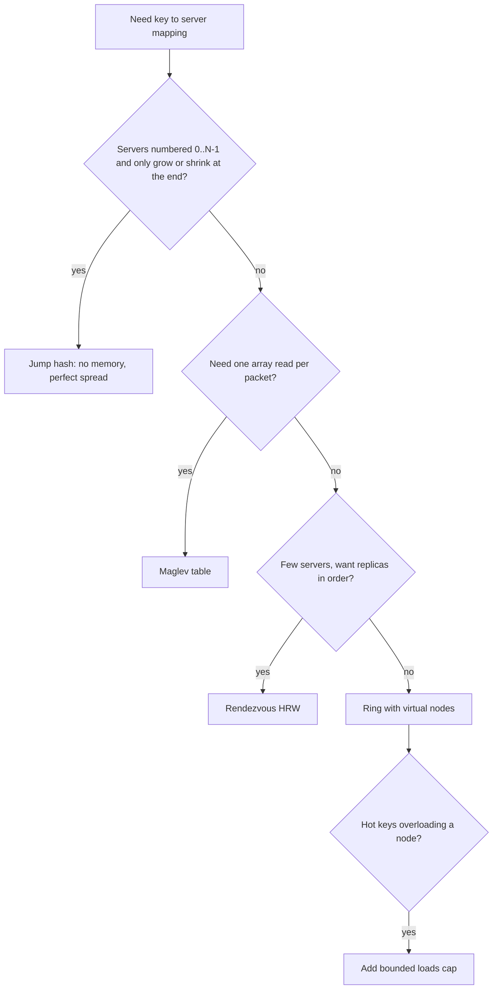

**Comparison (N servers, V vnodes each, table size M):**

| Property | Ring + vnodes | Jump hash | Rendezvous (HRW) | Maglev | Bounded loads |
|---|---|---|---|---|---|
| Lookup time | O(log(N·V)) binary search | O(ln N) | O(N) | O(1) array read | Ring lookup plus a short walk |
| Memory | O(N·V) points | O(1) | O(N) server list | O(M), e.g. 65,537 slots | Ring plus live load counts |
| Keys moved on change | ≈1/N | Exactly the minimum | Exactly the minimum | Minimum plus a little | More than the ring, bounded by ε |
| Balance | Good with many vnodes | Perfect | Good | Near perfect | Hard cap of (1+ε)× average |
| Remove an arbitrary server | Yes | No, only the last | Yes | Yes | Yes |
| Weights | More vnodes | Not natively | Weighted score | More table slots | Weighted caps |
| Typical home | Dynamo, Cassandra, memcached clients | Sharded storage, Guava library | Small caches, CDNs, replica placement | L4 load balancers, Envoy | Cache tiers with hot keys, HAProxy |

### Trade-offs

- **Jump**: fastest and smallest, but cannot drop a middle server, so needs a stable numbering layer.
- **Rendezvous**: simplest to reason about, ordered replicas for free, lookup linear in servers.
- **Maglev**: O(1) lookups and excellent balance for fixed memory per service and slightly more churn; bigger tables rebuild slower (1.8 ms at 65,537 entries vs 22.9 ms at 655,373).
- **Bounded loads**: the only one that looks at *actual load*, protecting against hot keys, but needs shared current load numbers and gives up some stickiness (an overflowing key may land elsewhere moment to moment).

### Real-world examples

- **Google Maglev** and **Envoy's Maglev load balancer** (default table size 65,537) for connection-level balancing.
- **Guava's `Hashing.consistentHash`** implements jump hash.
- **Rendezvous hashing** in caching proxies and object-placement schemes where replica order matters.
- **Vimeo with HAProxy** and **Google Cloud Pub/Sub**: bounded loads.

### In the interview

**Q:** L4 load balancer at millions of packets per second: ring hash or Maglev?

**A:** Maglev: one array read per packet, near-even split; the small extra movement on backend changes is covered by connection tracking that pins existing flows.

**Q:** Why not jump hash for a memcached fleet?

**A:** Any cache node can die and jump hash can only remove the highest bucket; removing node 3 of 10 remaps most keys without an indirection layer. A ring or rendezvous handles arbitrary removal.

**Q:** A celebrity key overloads its cache node. Do more virtual nodes help?

**A:** No: vnodes balance key counts, not heat. Bounded loads caps each node at (1+ε) × average and spills overflow clockwise; for one extremely hot key also replicate it or add a local cache.

**Q:** How does rendezvous give replicas?

**A:** Sort servers by score for the key and take the top R; if one dies the next steps up, and every client computes the same order without coordination.

### TL;DR

All schemes keep movement near the 1/N minimum. Jump: no memory, only the last bucket changes. Rendezvous: simple, ordered replicas, O(N) lookup. Maglev: one array read, near-perfect balance, slightly more churn. Bounded loads: a hard per-server load cap that absorbs hot keys.

**Sources**

- Lamping and Veach, "A Fast, Minimal Memory, Consistent Hash Algorithm" (2014): https://arxiv.org/abs/1406.2294
- Guava `Hashing.consistentHash` source: https://github.com/google/guava/blob/master/guava/src/com/google/common/hash/Hashing.java
- Thaler and Ravishankar, "Using Name-Based Mappings to Increase Hit Rates", IEEE/ACM ToN 1998: https://www.cs.ucr.edu/~ravi/Papers/Jrnl/HRW98.pdf
- Eisenbud et al., "Maglev: A Fast and Reliable Software Network Load Balancer", NSDI 2016: https://www.usenix.org/conference/nsdi16/technical-sessions/presentation/eisenbud
- Envoy load balancers (ring hash vs Maglev): https://www.envoyproxy.io/docs/envoy/latest/intro/arch_overview/upstream/load_balancing/load_balancers
- Mirrokni, Thorup, Zadimoghaddam, "Consistent Hashing with Bounded Loads": https://arxiv.org/abs/1608.01350
- Google Research blog on bounded loads (Vimeo, Pub/Sub): https://research.google/blog/consistent-hashing-with-bounded-loads/
- Vimeo engineering blog: https://medium.com/vimeo-engineering-blog/improving-load-balancing-with-a-new-consistent-hashing-algorithm-9f1bd75709ed

## HyperLogLog internals

### What it is

**HyperLogLog (HLL)** is a **sketch** (small fixed-size summary of a big stream) estimating **cardinality**, the number of *distinct* items (Flajolet, Fusy, Gandouet, Meunier, 2007). With m small counters (**registers**) its typical relative error is 1.04/√m. Redis uses m = 16,384 six-bit registers: about 12 KB counts billions of visitors with about 0.81% error. The intuition is in [Module 0 — Probabilistic data structures](../00-system-design-fundamentals/README.md#probabilistic-data-structures-and-merkle-trees); here are the internals.

### The problem it solves

Exact distinct counting remembers every item: 100 million 8-byte user IDs is 800 MB per counter, and you may want one per page per day. HLL uses kilobytes, and two HLLs **merge** into the union's distinct count, which plain counts cannot (users overlap).

### How it works

**Intuition.** In a random hash, k leading zeros occur about 1 in 2^k; a longest run of 10 suggests about 2^10 ≈ 1,000 distinct hashes. Duplicates hash identically, so they don't matter. One counter is noisy (one lucky hash ruins it), so HLL keeps many and averages.

**Steps (precision p, m = 2^p registers):**

1. Hash the item to 64 bits.
2. First p bits = **register index**.
3. In the remaining bits, ρ ("rho") = position of the first 1-bit (leading zeros + 1).
4. `register[index] = max(register[index], ρ)`; registers only grow.
5. Estimate with a **harmonic mean**: `E = α_m · m² / Σ 2^(−register[j])`; bias constant α_m ≈ 0.7213/(1 + 1.079/m) for m ≥ 128, 0.673 for m = 16.
6. **Small-range correction:** if E ≤ 2.5·m and some registers are 0, use **linear counting** `m · ln(m / V)` (V = zero registers), far more accurate when most registers are empty.

**Example 1 (update).** p = 2, 4 registers. Hash `10 0001 1...`: `10` selects register 2; `0001` gives ρ = 4; register 2 goes from 2 to max(2, 4) = 4. A hash `10 1...` has ρ = 1 and changes nothing.

**Example 2 (estimate).** m = 16, registers `3,2,4,1,2,5,3,2,1,3,2,4,2,3,1,2`: Σ 2^(−R) = 3.656, E = 0.673 × 16² / 3.656 ≈ 47 > 40 (2.5 × 16), so about 47 items. Error at m = 16 is 1.04/4 = 26%, hence real systems use thousands of registers.

**Example 3 (small range).** Registers `3,0,2,0,1,0,0,2,0,1,0,0,0,1,0,0`: raw 14.2 < 40, V = 10, so 16 × ln(16/10) ≈ 7.5, about 8 items.

**Why a harmonic mean?** Registers `2, 2, 2, 20` (one freak hash): the arithmetic mean of 2^R is (4 + 4 + 4 + 1,048,576)/4 ≈ 262,000, ruined; the harmonic mean 4 / (0.25 + 0.25 + 0.25 + 2^(−20)) ≈ 5.3 barely notices. It is dominated by small values, right when noise is occasional huge outliers.

**Error and size** (≈ 1.04/√m):

| p | m | Error | Dense size at 6 bits/register |
|---|---|---|---|
| 10 | 1,024 | 3.25% | 768 bytes |
| 14 | 16,384 | 0.81% | 12 KB |
| 16 | 65,536 | 0.41% | 48 KB |

4× memory halves the error. Six bits suffice because ρ never exceeds 64 for a 64-bit hash.

**Sparse representation.** A fresh 12 KB HLL that has seen 5 items is 99.9% zeros. **HyperLogLog++** (Heule, Nunkesser, Hall, Google, EDBT 2013) adds a 64-bit hash (no large-range correction needed), an empirical bias-correction table for the awkward middle range, and a **sparse mode** storing only non-zero (index, ρ) pairs as a sorted compressed list at higher precision (p′ = 25), converting to dense when the list would outgrow the array. Redis uses run-length opcodes: `XZERO:1000, VAL:2, ZERO:19, VAL:3 x2, XZERO:15362` encodes three non-zero registers in 7 bytes instead of 12 KB, switching to dense past `hll-sparse-max-bytes` (3,000 bytes default).

**Merging.** Same p and hash: `merged[j] = max(a[j], b[j])`, exactly the union stream's sketch. Keep one HLL per hour and merge 24 for a day, or one per shard merged at query time. Intersections only via |A ∩ B| = |A| + |B| − |A ∪ B|, where three estimates' errors add up: poor for small overlaps.

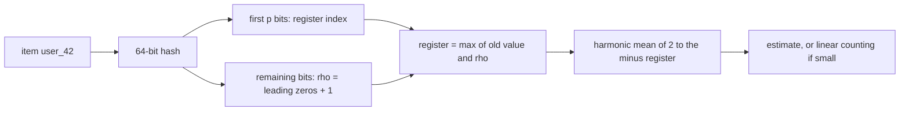

Complexity: O(1) per add (one hash, one max); O(m) per estimate (Redis caches the last estimate until a register changes); O(m) merge and memory.

### Trade-offs

- Relative error (about 0.8% at 12 KB), never zero: fine for dashboards, not billing.
- No deletions (registers only grow): for "last 7 days" keep daily HLLs and merge the window.
- Counts only; cannot list items.
- Merge needs identical p and hash function across producers.
- Intersections and small overlaps are inaccurate; Theta or KMV sketches handle set operations better.

### Real-world examples

- **Redis** `PFADD`, `PFCOUNT`, `PFMERGE`: up to 12 KB per key, 0.81% standard error.
- **Google** uses HLL++ internally and in BigQuery's approximate count functions.
- Druid, ClickHouse, Presto/Trino and Spark offer `approx_count_distinct`-style functions on HLL variants.

### In the interview

**Q:** Daily unique visitors per page for 10 million pages?

**A:** One HLL per page per day: up to 120 GB dense, but most pages stay sparse, so far less. Weekly and monthly uniques come from merging daily sketches.

**Q:** Why can you merge HLLs but not add distinct counts?

**A:** Adding double-counts users in both sets. A register holds the max ρ seen, and the max over a union is the max of the two maxes, so register-wise max is exactly the union's sketch.

**Q:** What does 1.04/√m mean in practice?

**A:** With 16,384 registers the estimate is typically within ±0.81% (one standard error) and within about ±2.4% roughly 99% of the time (three).

### TL;DR

HLL hashes items, uses p bits to pick a register and the leading-zero run of the rest as evidence of cardinality, keeps the max per register, and combines registers with a bias-corrected harmonic mean. 12 KB gives about 0.8% error; sketches merge by register-wise max; sparse encoding keeps small sketches tiny.

**Sources**

- Flajolet, Fusy, Gandouet, Meunier, "HyperLogLog: the analysis of a near-optimal cardinality estimation algorithm" (2007): https://dmtcs.episciences.org/3545/pdf
- Heule, Nunkesser, Hall, "HyperLogLog in Practice" (EDBT 2013): https://research.google/pubs/hyperloglog-in-practice-algorithmic-engineering-of-a-state-of-the-art-cardinality-estimation-algorithm/
- Redis HyperLogLog docs: https://redis.io/docs/latest/develop/data-types/probabilistic/hyperloglogs/
- Salvatore Sanfilippo, "Redis new data structure: the HyperLogLog": http://antirez.com/news/75
- Redis `hyperloglog.c` (sparse opcodes, 3,000-byte limit), Valkey copy: https://fossies.org/linux/valkey/src/hyperloglog.c

## Count-min sketch with conservative update

### What it is

A **count-min sketch (CMS)** (Cormode and Muthukrishnan, 2005) estimates *how many times* each item appeared in a stream using a small fixed grid of counters; estimates can be too high, never too low. **Conservative update** (from Estan and Varghese's 2002 traffic-measurement work) changes the update rule to shrink the over-estimates. Basics: [Module 0 — Probabilistic data structures](../00-system-design-fundamentals/README.md#probabilistic-data-structures-and-merkle-trees).

### The problem it solves

Per-key frequencies over a huge key space (requests per IP for rate limiting, clicks per URL, queries per term). A hash map needs memory per distinct key (maybe hundreds of millions); a CMS has a fixed size chosen from the accuracy needed, and merges across machines by adding grids.

### How it works

**Structure:** d rows × w columns of counters, one independent hash per row.

**Sizing:** for estimate ≤ true + ε·N (N = total of all counts) with probability ≥ 1 − δ: `w = ceil(e / ε)`, `d = ceil(ln(1/δ))`, e ≈ 2.718. ε = 0.001, δ = 0.01 gives w = 2,719, d = 5: 13,595 counters, about 54 KB at 4 bytes, regardless of distinct keys. (Some implementations use w = 2/ε; Redis `CMS.INITBYPROB` with error 0.001 builds a 2,000-wide sketch.)

**Update** `add(x, c)`: for each row i, `table[i][h_i(x)] += c`. **Query** `estimate(x)`: `min over i of table[i][h_i(x)]`. Each counter holds x's count plus colliding counts; collisions only add, so the smallest is the least polluted.

**Worked example.** w = 5, d = 3:

| Item | row 1 | row 2 | row 3 |
|---|---|---|---|
| dog | 3 | 4 | 0 |
| cat | 1 | 4 | 2 |
| fox | 1 | 0 | 3 |
| owl (never seen) | 1 | 4 | 0 |

Stream: dog ×5, cat ×3, fox ×2. Standard update:

```text
row 1: [0, 5, 0, 5, 0]    cat 3 + fox 2 collide in column 1
row 2: [2, 0, 0, 0, 8]    dog 5 + cat 3 collide in column 4
row 3: [5, 0, 3, 2, 0]
```

cat = min(5, 8, 3) = 3, dog = min(5, 8, 5) = 5, fox = min(5, 2, 2) = 2 (all exact). owl, never seen = min(5, 8, 5) = **5**: a false over-estimate from collisions in every row.

**Conservative update.** Before adding c to x, compute `e = min of x's counters`; the true count is now at most e + c, so raise each of x's counters to `max(counter, e + c)` and no further.

```text
function add_conservative(x, c):
    e = min(table[i][h_i(x)] for i in 1..d)
    for i in 1..d:
        table[i][h_i(x)] = max(table[i][h_i(x)], e + c)
```

Same stream, one unit at a time:

- dog ×5: counters rise together to 5 (row 1 col 3, row 2 col 4, row 3 col 0).
- cat ×3: counters (0, 5, 0), estimate 0 → after three cats (3, 5, 3); row 2 col 4 **stays 5**, not 8.
- fox ×2: counters (3, 0, 0), estimate 0 → (3, 2, 2); row 1 col 1 **stays 3**, not 5.

owl = min(3, 5, 5) = **3** instead of 5. Real items are still never under-estimated; Estan and Varghese reported about an order of magnitude better accuracy on real traffic from this kind of optimisation.

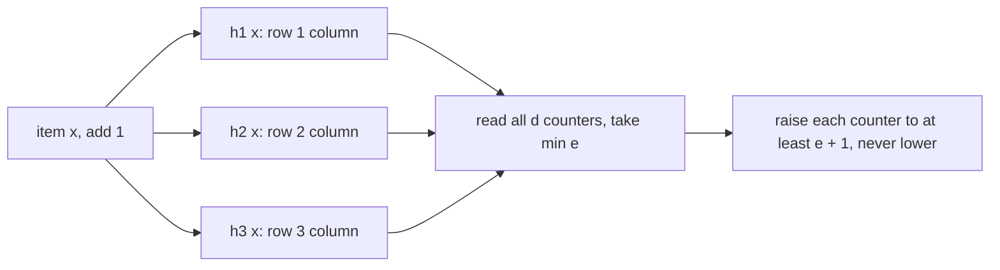

Complexity: O(d) per update and query (d usually 4–8), O(w·d) memory.

### Trade-offs

- **Error is relative to stream total N**, not the item: ε = 0.001, N = 10 million allows over-estimates up to 10,000. Excellent for heavy items, useless for rare ones; Redis says treat estimates below ε·N as noise.
- **Conservative update loses mergeability and deletes.** Standard sketches merge by cell-wise addition and allow negative updates; conservatively-updated sketches added together still over-estimate but lose the formal bound, and decrements are not allowed.
- **No item list**: a CMS cannot say *which* items are heavy; pair it with a heap (next section).
- **Aging**: counts grow forever; use time-bucketed sketches (one per minute) or periodically halve every counter.

### Real-world examples

- **Redis** `CMS.INITBYPROB`, `CMS.INCRBY`, `CMS.QUERY`, `CMS.MERGE`.
- Router and switch traffic monitoring and DDoS detection (Estan and Varghese's motivation).
- **TinyLFU** cache admission (Caffeine, Java) uses a count-min-style sketch with periodic halving to decide whether a new key deserves a slot.
- Flink and Spark provide CMS helpers for approximate frequencies.

### In the interview

**Q:** Can a CMS under-count?

**A:** Not with non-negative updates: each counter is the true count plus collisions, so the minimum is still ≥ true.

**Q:** Size it for "error at most 0.1% of traffic with 99% confidence".

**A:** ε = 0.001 → w = 2,719; δ = 0.01 → d = ceil(ln 100) = 5; about 13,600 counters, about 54 KB at 32 bits.

**Q:** What does conservative update buy and cost?

**A:** It raises only counters below the new lower-bound estimate, so collisions inflate far less, often many times smaller errors; you lose clean merging and deletions.

### TL;DR

A CMS is a d × w counter grid: add increments one counter per row, estimate is the minimum, never too low, too high by at most ε·N with probability 1 − δ. Conservative update raises only counters below min + c, sharply cutting over-counting at the cost of mergeability and deletes.

**Sources**

- Cormode and Muthukrishnan, "An Improved Data Stream Summary: The Count-Min Sketch and its Applications": https://www.cs.tufts.edu/~nr/cs257/archive/graham-cormode/count-min.pdf (J. Algorithms 55(1), 2005)
- Estan and Varghese, "New Directions in Traffic Measurement and Accounting", SIGCOMM 2002: https://conferences2.sigcomm.org/sigcomm/2002/papers/account.html
- Redis count-min sketch docs: https://redis.io/docs/latest/develop/data-types/probabilistic/count-min-sketch/

## Heavy hitters: Misra-Gries, Space-Saving and streaming top-k

### What it is

**Heavy hitters** make up a large share of a stream (e.g. every search term above 1% of queries); **top-k** asks for the k most frequent. Two classic algorithms use k counters and keep the *items themselves*, which a CMS cannot: **Misra-Gries** (1982; when full, decrement everyone) and **Space-Saving** (Metwally, Agrawal, El Abbadi, 2005; when full, evict the smallest and let the newcomer inherit its count).

### The problem it solves

"Top 10 hashtags now?", "which 100 IPs send the most traffic?" Exact answers need a counter per distinct item (maybe hundreds of millions). These keep k entries and guarantee every truly heavy item is among them, with bounded count error.

### How it works

Stream (n = 10): `A B A C D A B A E A`; true A = 5, B = 2, C = D = E = 1; **k = 3**.

**Misra-Gries.** If x has a counter, increment; else if a slot is free, add x:1; else decrement **every** counter and drop zeros (x is not stored).

| Arrival | Counters after |
|---|---|
| A, B, A, C | A:2, B:1, C:1 |
| D (full) | decrement all: A:1 (B, C dropped) |
| A | A:2 |
| B | A:2, B:1 |
| A | A:3, B:1 |
| E | A:3, B:1, E:1 |
| A | A:4, B:1, E:1 |

Guarantee: stored counts **under-estimate** by at most n/(k+1) = 2.5 (A reported 4, true 5), and any item above n/(k+1) is in the table. Each decrement discards k+1 occurrences (k counters plus the arrival), so it happens at most n/(k+1) times.

**Space-Saving.** If tracked, increment; else if free, add with count 1, error 0; else replace the **minimum** item (count `min`) with x, count = min + 1, error = min.

| Arrival | Counters after (count, error) |
|---|---|
| A, B, A, C | A:2, B:1, C:1 |
| D | evict B (min 1): A:2, C:1, D:2(err 1) |
| A | A:3, C:1, D:2 |
| B | evict C (min 1): A:3, D:2, B:2(err 1) |
| A | A:4, D:2, B:2 |
| E | evict D (min 2): A:4, B:2, E:3(err 2) |
| A | A:5, B:2, E:3 |

Counts **over-estimate** by at most n/k, and `count − error` is a guaranteed lower bound (E: true count between 1 and 3; A exact at 5). Space-Saving is usually more accurate than Misra-Gries for the same k, especially on skewed (Zipf-like) data. Updates are O(1) with a "stream summary" (linked buckets of equal counts) or O(log k) with a min-heap.

```text
function space_saving(x):
    if x in counters: counters[x].count += 1
    elif len(counters) < k: counters[x] = (count=1, error=0)
    else:
        y = item with smallest count     # min-heap or stream-summary
        m = counters[y].count
        delete counters[y]
        counters[x] = (count=m+1, error=m)
```

**Sketch plus heap.** Common in practice: a CMS for frequencies plus a size-k min-heap; on each arrival update the CMS and, if x's estimate beats the heap minimum (or x is in the heap), update the heap. Redis `TOPK` uses **HeavyKeeper** (Gong et al., USENIX ATC 2018): a sketch-like table plus heap that *decays* counters of colliding small items so large flows keep their place.

**Distributed top-k.** Merging each of 50 shards' top 10 is wrong: an item 11th everywhere can be 1st globally. Options: (1) send Misra-Gries or Space-Saving summaries, designed to merge (add counts, trim to k); (2) send a larger top-k′ (e.g. 10×k) and accept small error; (3) partition by item (hash the hashtag to a shard) so each item is counted in one place and local lists merge exactly.

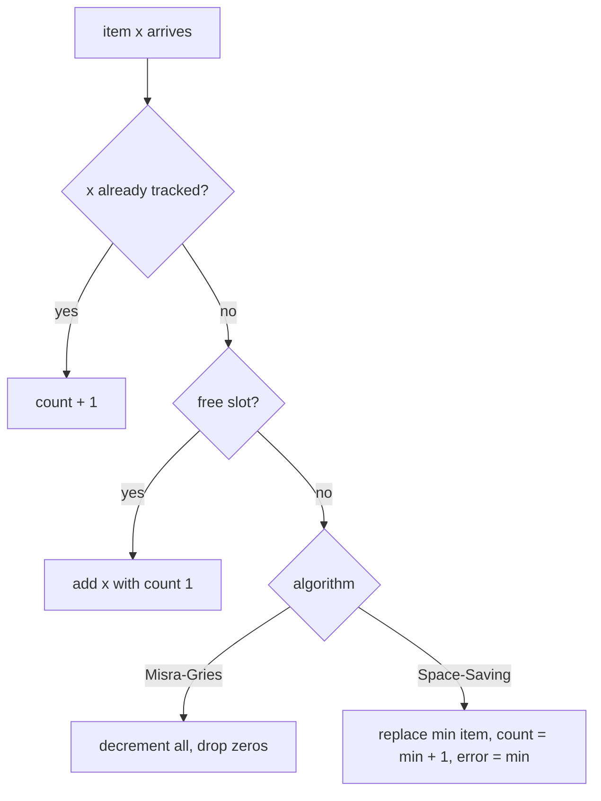

Complexity: O(k) memory; Misra-Gries O(1) amortised per item with the right structure (O(k) naively); Space-Saving O(1) or O(log k).

### Trade-offs

- **Misra-Gries**: under-counts; simple and mergeable, counts less useful as numbers.
- **Space-Saving**: over-counts but tracks per-entry error, usually more accurate; the bottom of its ranking is noisy because evicted items re-enter with inflated counts.
- **CMS + heap**: estimates for *any* item, more memory, CMS error relative to N.
- All count since the start; for "top right now" use windows (one summary per minute, merged) or decay (see trending below).

### Real-world examples

- **Redis** `TOPK.ADD` / `TOPK.LIST` (HeavyKeeper).
- **Apache DataSketches** "frequent items" sketch (Druid and others), Misra-Gries-style reduction.
- Network gear and CDNs finding "elephant flows" and abusive clients.
- Trending hashtags, top queries, most-viewed products dashboards.

### In the interview

**Q:** Top 100 search queries in the last hour at 100,000 queries/s.

**A:** Hash each query to one of P aggregator partitions so it is counted in one place. Each keeps a Space-Saving summary per minute (say 10,000 entries for top-100 accuracy), merges its last 60 every few seconds and publishes its top 100; a coordinator merges the P lists, exactly, since partitions are disjoint.

**Q:** Why not merge every server's top 10?

**A:** A query just below the cut everywhere can be largest overall. Partition by key, or send much larger lists or mergeable summaries.

**Q:** Misra-Gries says A = 4, truth is 5. Bug?

**A:** No: it under-counts by at most n/(k+1) and promises every item above that is present. For exact winner counts, do a second pass or keep exact counters for candidates.

### TL;DR

Misra-Gries and Space-Saving find frequent items with k counters: Misra-Gries decrements all when full and under-counts by ≤ n/(k+1); Space-Saving evicts the minimum, inherits its count, records error, and over-counts by ≤ n/k. For distributed top-k, partition by item or merge proper summaries, never local top-k lists.

**Sources**

- Misra and Gries, "Finding Repeated Elements", Science of Computer Programming, 1982: https://users.cs.utah.edu/~pandey/courses/cs6968/spring23/papers/mg.pdf
- Metwally, Agrawal, El Abbadi, "Efficient Computation of Frequent and Top-k Elements in Data Streams" (ICDT 2005; UCSB TR 2005-23): https://old.cs.ucsb.edu/research/tech_reports/reports/2005-23.pdf
- Gong et al., "HeavyKeeper", USENIX ATC 2018: https://www.usenix.org/conference/atc18/presentation/gong
- Redis `TOPK.ADD`: https://redis.io/commands/topk.add

## Reservoir sampling: Algorithm R and the weighted variant

### What it is

**Reservoir sampling** keeps a uniform random sample of exactly k items (the **reservoir**) from a stream of unknown length, in one pass and O(k) memory. **Algorithm R** is the classic version (analysed in Vitter's 1985 "Random Sampling with a Reservoir"); **weighted reservoir sampling** (Efraimidis and Spirakis, 2006) favours heavier items.

### The problem it solves

"Keep 1,000 representative log lines from today", "100 random requests for debugging", "sample 1% of traces but cap at 10,000 per minute". You can't store the stream and don't know its length; "keep each with probability p" gives a random-size sample that blows up on busy days.

### How it works

**Algorithm R:** put the first k items in the reservoir; for item i > k (counting from 1) draw j uniformly in 1..i; if j ≤ k, replace slot j with item i, else discard it.

```text
function reservoir(stream, k):
    R = []
    for i, x in enumerate(stream, start=1):
        if i <= k: R.append(x)
        else:
            j = random_int(1, i)
            if j <= k: R[j] = x
    return R
```

**Worked example**, k = 2, stream `a b c d e`: `[a, b]`; c (i = 3) draws j = 1 → `[c, b]`; d draws 4 > 2, discard; e draws 2 → `[c, e]`.

**Why it is fair.** Each item should end with probability k/n = 2/5. Item c enters with 2/3; survives d unless d is kept (2/4) and hits c's slot (1/2): 3/4; survives e with 1 − (2/5)(1/2) = 4/5. Total 2/3 × 3/4 × 4/5 = 2/5. The product telescopes for every position.

Complexity: O(1) per item, O(k) memory. Skip-ahead variants (Vitter's Algorithm Z, Algorithm L) compute how many items to skip before the next replacement, drawing far fewer random numbers on long streams.

**Weighted variant (A-Res).** For each item with weight w > 0 draw u in (0, 1), key = `u^(1/w)`, and keep the k **largest** keys in a size-k min-heap. Higher weight pushes the key toward 1, but luck still plays a part. k = 2:

| Item | weight w | u | key = u^(1/w) |
|---|---|---|---|
| A | 1 | 0.50 | 0.500 |
| B | 4 | 0.30 | 0.740 |
| C | 2 | 0.80 | 0.894 |
| D | 1 | 0.90 | 0.900 |

Sample {D, C}: B had the highest weight but drew a small u, which happens with the right probability. Use `log(u) / w` as the key (same order, numerically safer) for large weights.

**Distributed sampling.** "Random key, keep top k" is **mergeable**: each shard keeps its top-k keys, the coordinator keeps the top k of the union, exactly a sample of the whole stream. Uniform sampling is the case w = 1 (key = u).

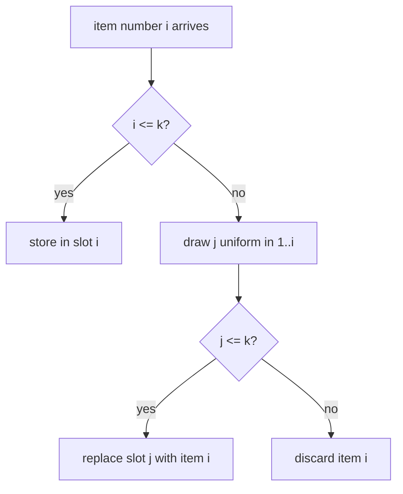

### Trade-offs

- Exactly k items regardless of volume (bounded memory and storage), but the effective rate drops as volume grows: record n to scale counts back up.
- Uniform samples miss rare important events (errors, slow requests): use weights or an always-keep rule for errors.
- Algorithm R draws one random number per item; skip-based versions are faster on huge streams.
- A sample is not a sketch: it cannot reliably answer "how many distinct" or "how often" for rare X.

### Real-world examples

- **Dropwizard Metrics** (Java): reservoir-based histograms (uniform and exponentially decaying) for latency samples.
- Tail-based trace samplers and log samplers capping traces per minute.
- Database `TABLESAMPLE` and approximate query engines building statistics.

### In the interview

**Q:** One random line from a file of unknown length, one pass, O(1) memory?

**A:** Reservoir with k = 1: keep line 1, replace with line i with probability 1/i; every line is chosen with probability 1/n.

**Q:** Uniform sample across 100 shards?

**A:** Random key u per item, top k per shard, top k of the union at the coordinator; for weights use u^(1/w).

**Q:** Why not keep each request with probability 1%?

**A:** Sample size grows with traffic and is unbounded in spikes; a reservoir guarantees exactly k per window.

### TL;DR

Algorithm R keeps the first k items, then item i with probability k/i in a random slot, so each item is sampled with probability k/n in one pass and O(k) memory. Weighted sampling keys each item u^(1/w) and keeps the top k, which also merges across shards.

**Sources**

- Vitter, "Random Sampling with a Reservoir", ACM TOMS 11(1), 1985: https://doi.org/10.1145/3147.3165
- Efraimidis and Spirakis, "Weighted random sampling with a reservoir", Information Processing Letters 97(5), 2006: https://doi.org/10.1016/j.ipl.2005.11.003

## t-digest and percentile estimation

### What it is

A **percentile** (**quantile**) is the value q% of observations fall below; p99 latency is the value 99% of requests beat. A **t-digest** (Ted Dunning, refined with Otmar Ertl, 2019 paper) is a small distribution summary that answers any percentile approximately, is very accurate at the extremes (p99, p99.9), and **merges** across machines without losing accuracy. Why averages and percentiles matter: [Module 0 — Percentiles, tail latency](../00-system-design-fundamentals/README.md#percentiles-tail-latency-and-why-averages-lie).

### The problem it solves

Exact percentiles need every value sorted, impractical for a billion requests a day across 500 servers, so each server keeps a summary. **Averaging percentiles** is wrong:

- Server A: 9,900 requests, 9,800 at 20 ms and 100 at 50 ms; p99 (9,801st value) = 50 ms.
- Server B: 100 requests at 1,000 ms; p99 = 1,000 ms.
- Average of p99s: **525 ms**. True p99 of all 10,000: the 9,900th value, **50 ms** (the 1,000 ms requests are exactly the slowest 1% and appear in p99.5).

10× off. Percentiles can't be averaged or added: merge mergeable summaries, *then* query.

### How it works

**Centroids.** A t-digest is a sorted list of **centroids**, (mean, count) pairs standing for clusters of nearby values. Rule: **centroids near the middle may be large, near the tails tiny**, so the tails (where p99 lives) keep nearly every point and the middle is summarised coarsely.

**Size limit.** A **scale function** k(q), steep near q = 0 and 1 and flat in the middle, sets how wide a centroid may be: one covering q_left to q_right is allowed only if `k(q_right) − k(q_left) ≤ 1`. A **compression** parameter δ (often 100) controls total centroids. The original paper's simpler bound: a centroid at q holds about `4 · N · q · (1 − q) / δ` points. N = 10,000, δ = 100:

| Quantile q | Max points per centroid |
|---|---|
| 0.5 (median) | 4 × 10,000 × 0.25 / 100 = 100 |
| 0.1 | 4 × 10,000 × 0.09 / 100 = 36 |
| 0.01 | 4 × 10,000 × 0.0099 / 100 ≈ 4 |
| 0.001 | ≈ 0.4, so single points |

**Adding points (merging variant):** buffer values; when full, sort buffer and centroids together by mean; walk left to right greedily merging each item into the current centroid if the limit at that quantile allows, else start a new one (weighted mean, summed count).

**Querying p99:** target rank 0.99 × N; walk centroids accumulating counts past it; **interpolate** between neighbouring centroid means. Exact min and max are kept for the ends.

**Merging digests**: concatenate all centroids, sort, run the same greedy merge. The size rule depends only on quantile position, so the merged digest keeps the same accuracy guarantees, which averaged percentiles lack.

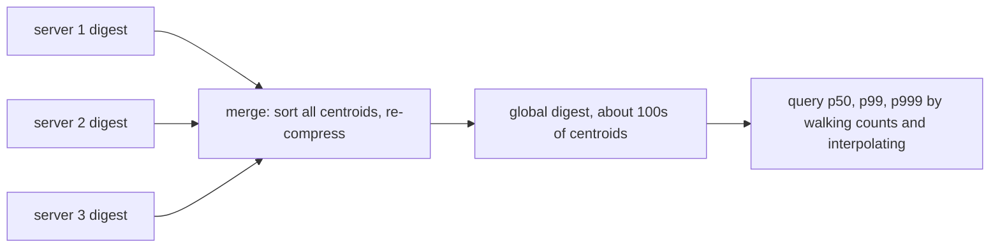

Complexity: amortised O(log δ) or better per insert with buffering; O(δ) centroids (Elasticsearch caps at 20 × compression nodes, about 64 KB worst case at the default 100); merge O(total centroids × log).

**Alternatives:**

- **HDR Histogram**: fixed log-scale buckets with chosen significant digits; fast, mergeable by adding buckets, bounded relative error, needs a known value range. Very common for latency.
- **DDSketch** (Datadog): log-scale buckets with guaranteed relative error, fully mergeable.
- **KLL** and other rank-error sketches (Apache DataSketches): proven worst-case rank error bounds.

### Trade-offs

- t-digest is small and very accurate at the tails, but its error bounds are mostly empirical and results can depend slightly on insertion order.
- Middle percentiles are less precise than tails: usually the right trade for latency.
- HDR or DDSketch are simpler with hard relative-error guarantees, but need a range (HDR) or more memory for wide ranges.
- Any sketch beats averaging per-host percentiles.

### Real-world examples

- **Elasticsearch / OpenSearch** `percentiles` aggregation: t-digest by default (compression 100), HDR optional.
- Many metrics libraries and stream processors offer t-digest. Prometheus **histograms** (fixed buckets, mergeable) are the bucket alternative; Prometheus **summaries** compute per-process quantiles that cannot be aggregated across instances, for the reason above.
- Datadog uses DDSketch for distribution metrics.

### In the interview

**Q:** Your dashboard averages p99 across 200 hosts. What's wrong?

**A:** Percentiles don't average: a host with few slow requests drags the average far off, or a busy host's tail is diluted. Ship mergeable sketches (t-digest, HDR, DDSketch) or bucketed histograms, merge, then compute p99 once.

**Q:** Why is t-digest more accurate at p99.9 than p50?

**A:** The scale function forces tail centroids to hold very few points, often single values, while median centroids hold many: precision is spent where tail questions are asked.

**Q:** Weekly p99 from daily p99s?

**A:** No. Merge seven daily digests, then query.

### TL;DR

Never average percentiles. A t-digest keeps sorted (mean, count) centroids, tiny at the tails and larger in the middle, answers percentiles by walking counts and interpolating, and merges across hosts and windows without losing accuracy. HDR Histogram and DDSketch are bucket-based alternatives with hard relative-error bounds.

**Sources**

- Dunning and Ertl, "Computing Extremely Accurate Quantiles Using t-Digests" (2019): https://arxiv.org/abs/1902.04023
- t-digest reference implementation: https://github.com/tdunning/t-digest
- Elasticsearch percentiles aggregation: https://www.elastic.co/docs/reference/aggregations/search-aggregations-metrics-percentile-aggregation
- Prometheus histograms and summaries: https://prometheus.io/docs/practices/histograms/

## Trending detection with decayed counts and z-scores

### What it is

**Trending detection** finds items whose activity is *unusually high for them*, not simply the most popular. "#WorldCup" at a steady 50,000 mentions an hour is popular; a small band jumping from 20 to 2,000 an hour is trending. Building blocks: **exponentially decayed counts** (recent events weigh more, old ones fade smoothly) and **z-scores** (how many standard deviations the current rate is above the usual).

### The problem it solves

Raw counts always rank the same giants. Fixed windows ("last hour") are expensive (old events must expire) and jumpy (a burst falls off a cliff 60 minutes later). Wanted: (1) react within minutes to a real surge; (2) ignore big-but-steady items; (3) O(1) state and work per item per event; (4) no firing on tiny-count noise (2 to 6 mentions is "3×" but meaningless).

### How it works

**1. Exponentially decayed count.** Per item keep c and t_last; on an event at t:

```text
c = c * 2^(-(t - t_last) / H) + 1     # H = half-life
t_last = t
```

With H = 10 min, 1,000 mentions around 12:00 give c ≈ 1,000; with no new mentions c = 500 at 12:10, 250 at 12:20, 125 at 12:30. No window bookkeeping. Keep two half-lives, e.g. 5 minutes (short-term rate) and 24 hours (baseline): a high short/long ratio means "much hotter than usual".

**2. EWMA baseline.** Count per item in fixed buckets (per minute, x_t) and track an **exponentially weighted moving average (EWMA)** mean μ and variance σ² with smoothing λ (NIST suggests 0.2–0.3 for control charts; trending systems often go smaller for longer memory):

```text
diff  = x - mu
z     = diff / sqrt(var)            # score BEFORE updating the baseline
mu    = mu + lam * diff
var   = (1 - lam) * (var + lam * diff * diff)
```

**3. z-score threshold.** z = (x − μ)/σ says how unusual this minute is for *this item*; flag when z exceeds a threshold (e.g. 3) and volume passes a minimum.

**Worked example**, λ = 0.2:

- Small topic: μ = 100/min, σ² = 400 (σ = 20), x = 180 → z = **4.0**, trending. Update: μ = 116, σ² = 0.8 × (400 + 0.2 × 80²) = 1,344, σ ≈ 36.7. Next minute x = 260 → z ≈ **3.9**, still trending. The baseline catches up, so a surge lasting hours eventually stops trending, as intended.
- Giant topic: μ = 10,000, σ = 1,000, x = 10,500: higher raw count, z = 0.5, **not trending**.

**4. Small-number guards.** μ = 2, σ = 1, jump to 6 gives z = 4. Require a minimum count (x ≥ 50), add a variance prior (`z = diff / sqrt(var + c)`), or score a smoothed ratio `(x + β) / (μ + β)` with β around 10–50.

**5. At scale.** Find candidates with a heavy-hitter front end (Space-Saving or CMS + heap on decayed counts), keep μ and σ² only for candidates plus a tail of recently seen items, and partition by item hash across workers; each emits top trending scores every few seconds to a merging coordinator. Then product filters: de-duplicate near-identical terms, remove spam and bot bursts, localise by region.


Complexity: O(1) time and state per tracked item per event; total memory bounded by the heavy-hitter front end.

### Trade-offs

- **Half-life / λ**: short reacts fast but flags noise; long is stable but late. Many systems run two or three timescales.
- **z-scores assume roughly normal noise**, but counts are bursty with daily cycles: compare with the same hour last week or model seasonality, so "every morning" isn't a trend.
- **Small-count bias** needs explicit guards.
- **Manipulation**: coordinated accounts manufacture spikes; count distinct users (HLL per item), weight by account trust.
- Front-end sketches trade a little accuracy for large memory savings.

### Real-world examples

- **Twitter / X trends** compare a topic's volume with its own past rather than raw popularity; the company rebuilt the trends back end on stream processing (Storm) to do this in real time.
- **EWMA control charts**: decades-old industrial quality control (NIST handbook); the same math drives monitoring anomaly alerts.
- News, e-commerce "trending now" and music charts use decayed scores so yesterday's hits fade smoothly.

### In the interview

**Q:** Design trending hashtags.

**A:** Stream posts to workers partitioned by hashtag. Per tracked hashtag keep per-minute counts, a short-half-life decayed count and EWMA mean and variance, with a Space-Saving front end bounding what is tracked. Score by z with a minimum-volume floor, counting distinct authors to resist spam. Every 30 s publish each worker's top N per region and merge at a coordinator into the cache the app reads.

**Q:** Why not rank by last-hour count?

**A:** That shows always-popular topics. Trending means unusual for this item, so normalise against its own baseline.

**Q:** Why exponential decay instead of a sliding window?

**A:** One number and timestamp, O(1) update, no per-event storage or expiry, and smooth fading instead of a cliff when a burst leaves the window.

### TL;DR

Trending = much higher than the item's own normal. Keep decayed counts (one number per item with a half-life) and EWMA mean and variance, score each interval with z = (x − μ)/σ, guard against small counts and spam, and bound tracked items with a heavy-hitter sketch partitioned by item.

**Sources**

- NIST/SEMATECH e-Handbook, EWMA control charts: https://www.itl.nist.gov/div898/handbook/pmc/section3/pmc324.htm
- Finch, "Incremental calculation of weighted mean and variance" (2009): https://fanf2.user.srcf.net/hermes/doc/antiforgery/stats.pdf
- Coverage of Twitter's trends back-end rebuild (Storm): https://www.smartcompany.com.au/technology/twitter-overhauls-trending-topics-adds-more-contextual-information/
- Nikolov and Shah, trend detection research with Twitter data (MIT, 2012), summary: https://flowingdata.com/2013/06/19/twitter-trend-detection-algorithm/

## LSM trees in depth

### What it is
An **LSM tree** (log-structured merge tree; O'Neil et al., 1996) stores sorted key-value data by turning every write into a fast sequential append and sorting later in the background. It powers LevelDB, RocksDB, Cassandra, ScyllaDB and HBase. Parts:

- **Memtable:** in-memory sorted structure (RocksDB default: a skip list) receiving every write.
- **SSTable** (sorted string table): an immutable on-disk file of key-sorted pairs plus a small index and filter; never edited, changes go to newer files.
- **Compaction:** background merging of SSTables into new ones, dropping overwritten values and deleted keys.
- **Write-ahead log (WAL):** append-only file recording each write first so the memtable can be rebuilt after a crash ([Module 3 — Write-Ahead Log](../03-storing-data/README.md#write-ahead-log)).

### The problem it solves
A B-tree updates in place: changing a 100-byte row may rewrite a 16 KB page at a random disk location. Random writes are slow on spinning disks and wear SSDs. Write-heavy workloads (logging, metrics, messaging, time series) are better served by batching writes in memory and flushing large sequential files, absorbing much higher write rates on the same hardware.

### How it works
**Write path**

1. Append (`put user:42 = "Ana"`) to the WAL and `fsync` it (force to physical disk), or batch several writes per `fsync`.
2. Insert into the memtable and acknowledge: one sequential append plus an O(log n) in-memory insert.
3. At its size limit (RocksDB default 64 MB) the memtable becomes **immutable** and a fresh one takes writes.
4. A background **flush** writes it out in key order as a new SSTable; the matching WAL segment can then be deleted.
5. A **delete** is a write of a **tombstone** marker ("gone as of now"); the old value disappears only when compaction merges the tombstone with it.

**Read path (point lookup)**

1. Check the active memtable, then immutable memtables; newest wins.
2. Check SSTables newest to oldest; first ask each file's **Bloom filter** ("definitely not here" / "maybe here") and skip on "definitely not".
3. On "maybe", use the index block to find the ~4 KB data block, read it, binary search.
4. Stop at the first file holding the key (or its tombstone).

**Bloom filter per SSTable**, built when the file is written: about 10 bits per key gives about 1% false positives (RocksDB measures about 0.95% for its cache-friendly variant). A missing-key lookup across 8 SSTables would read 8 blocks; with 1% filters it reads 8 × 0.01 = 0.08 on average, which keeps LSM point reads fast despite many files.

**Compaction strategies** (where LSM designs differ most):

- **Size-tiered** (Cassandra's STCS, RocksDB's "universal"): when enough similar-sized SSTables pile up (Cassandra `min_threshold` default 4), merge them into one bigger file: four 64 MB flushes → one ~256 MB file; four of those → ~1 GB.
- **Leveled** (LevelDB, RocksDB default): L0 holds raw flushes with overlapping key ranges; from L1 down each level is one sorted run with non-overlapping files, so a key is in at most one file per level. Each level's target is about 10× the previous (`max_bytes_for_level_multiplier`). When a level exceeds target, pick a file, merge it with the overlapping files in the next level, and write the result there.

Leveled sizing with L1 = 256 MB, multiplier 10: L2 = 2.56 GB, L3 = 25.6 GB, L4 = 256 GB. The last level holds about 90% of data, so upper-level copies add only about 1/9 = 11% overhead.

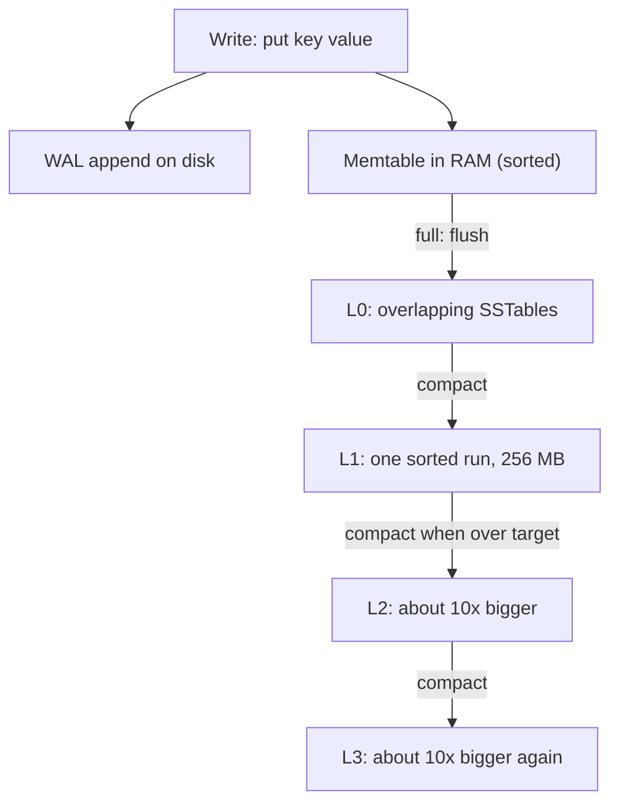

**The three amplifications** (vocabulary for comparing engines):

- **Write amplification** = disk bytes written / user bytes written. Leveled: moving one file down can rewrite ~10 overlapping files, so up to about the fanout (10) per level, tens across 4 to 5 levels. Size-tiered rewrites each byte roughly once per tier: much lower.
- **Read amplification** = disk reads per query. Leveled: at most one file per level plus L0 files. Size-tiered: possibly many overlapping files per tier; range scans suffer most.
- **Space amplification** = disk bytes / live data bytes. Leveled: about 1.1. Size-tiered: old and new copies coexist across tiers, and a big merge needs room for inputs and outputs at once; RocksDB universal compaction allows up to 200% extra by default (100 bytes of data may need 300 bytes of disk).

**Complexity.** Writes O(log m) in memory (m = memtable entries) plus amortised compaction I/O; point reads O(levels) filter checks, usually one disk read; space as above.

### Trade-offs
- Excellent write throughput and compression (sorted immutable files compress well), paid for by background compaction stealing disk bandwidth and CPU, with latency spikes when it falls behind.
- Leveled favours reads and space; size-tiered favours writes; hybrids exist (Cassandra's time-window compaction for time series).
- Deletes are not instant: tombstones linger until compaction, and scans over many tombstones are slow.
- Range scans must merge the memtable and every level, so they cost more than in a B-tree.

### Real-world examples
- **RocksDB** (Meta) underpins MyRocks, Kafka Streams state stores, CockroachDB's earlier storage and more; defaults: skip-list memtable, leveled compaction, per-file Bloom filters.
- **Cassandra** defaults to size-tiered, with leveled and time-window per table.
- **Bigtable/HBase** use the same memtable-plus-immutable-files idea.

### In the interview
**Q:** Why are LSM trees faster for writes than B-trees?

**A:** Writes hit a sequential log and an in-memory table and are flushed in big sorted batches; a B-tree rewrites a page at a random location per update.

**Q:** How does an LSM tree avoid checking every SSTable on a read?

**A:** Per-SSTable Bloom filters (10 bits per key skip about 99% of non-holding files without disk reads), and leveled compaction guarantees at most one candidate file per level below L0.

**Q:** Leveled or size-tiered for a write-heavy metrics store?

**A:** Size-tiered (or time-window): lower write amplification for append-mostly data read in recent ranges. Leveled suits read-heavy or space-constrained workloads.

### TL;DR
An LSM tree writes to a log and an in-memory sorted table, flushes immutable sorted files, and merges them in the background; Bloom filters keep reads cheap. Leveled compaction: low read and space amplification, higher write cost; size-tiered: the opposite.

**Sources**
- O'Neil, Cheng, Gawlick, O'Neil, "The Log-Structured Merge-Tree (LSM-Tree)", Acta Informatica 33, 1996: https://www.cs.umb.edu/~poneil/lsmtree.pdf
- RocksDB wiki, MemTable: https://github.com/facebook/rocksdb/wiki/MemTable
- RocksDB wiki, Leveled Compaction: https://github.com/facebook/rocksdb/wiki/Leveled-Compaction
- RocksDB wiki, Compaction (amplification, universal compaction): https://github.com/facebook/rocksdb/wiki/Compaction
- RocksDB wiki, Bloom Filter: https://github.com/facebook/rocksdb/wiki/RocksDB-Bloom-Filter
- Apache Cassandra docs, Size Tiered Compaction Strategy: https://cassandra.apache.org/doc/latest/cassandra/managing/operating/compaction/stcs.html

## B+-trees

### What it is
A **B+-tree** is a balanced search tree for storage read in fixed-size **pages** (InnoDB default 16 KB, PostgreSQL 8 KB). Each node is one page holding many keys, so the tree is wide and shallow. All records (or pointers) live in the **leaf** nodes, linked left to right; **internal** nodes hold only separator keys that steer the search. Balanced: every leaf is at the same depth.

### The problem it solves
Storage reads whole pages, each expensive compared with memory work. A one-key-per-node binary tree needs about 30 page reads to find one row among a billion; a B+-tree with hundreds of keys per node needs 3 or 4, with the top levels almost always cached. Linked leaves make range queries (`WHERE created_at BETWEEN ...`) and `ORDER BY` cheap: find the start, walk sideways.

### How it works
**Fan-out arithmetic.** An internal entry of an 8-byte key plus 6-byte child page number (~14 bytes) gives a 16 KB page about 16,384 / 14 ≈ 1,170 children. With leaves of about 15 rows of 1 KB: height 2 ≈ 17,500 rows; height 3 ≈ 1,170² × 15 ≈ 20 million; height 4 ≈ 24 billion. Any row is 3 to 4 page reads away, usually with only the leaf missing the cache.

**Search:** from the root, binary search each page's keys for the child whose range holds the target, down to a leaf, then binary search the leaf. Cost O(log_B n) page reads (B = fan-out), O(log n) comparisons.

**Insert with page split** (max 4 keys per leaf):

1. Find the leaf: A = [10, 20, 30, 40]; insert 25.
2. With room, insert in order and finish; here A is full.
3. **Split:** new leaf B; A keeps [10, 20], B gets [25, 30, 40].
4. Fix sibling links: A → B, B → A's old right neighbour.
5. Insert separator 25 (B's first key) and a pointer to B into the parent.
6. A full parent splits too, pushing a separator up; a root split creates a new root, the only way the tree grows taller, so all leaves stay at the same depth.

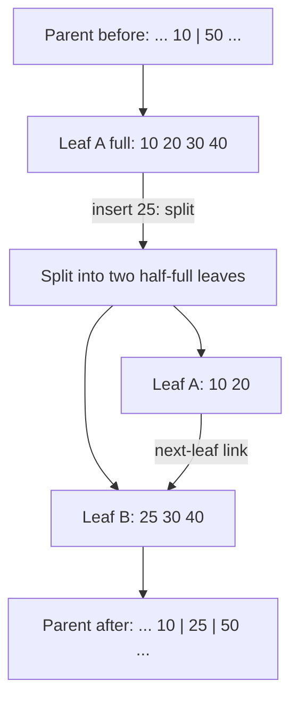

**Delete** mirrors it: remove the key; a page below threshold borrows from or merges with a sibling. InnoDB tries to merge below 50% full (`MERGE_THRESHOLD` default); many systems lazily leave half-empty pages.

**Fill factor** = how full pages are packed on index build or append; free space lets future mid-range inserts land without splits.

- PostgreSQL B-tree indexes default to fill factor 90 (leaf pages packed to 90% on build and when appending new largest keys).
- InnoDB leaves 1/16 of each clustered-index page free: sequential inserts give pages about 15/16 full; random inserts give 1/2 to 15/16, because splits leave two half-full pages.

So a random UUID primary key in InnoDB causes more splits, partly-empty pages and a bigger index than an auto-increment key that always appends at the right edge.

**Complexity.** Search, insert, delete O(log_B n) page I/Os; range scan of k results O(log_B n + k/B); space O(n) at roughly 50% to 100% page utilisation.

### Trade-offs
- Great reads and range scans; predictable latency (no background compaction).
- Every update rewrites a whole page in place, after first writing the WAL, so write amplification is high for small random updates.
- Random-key inserts cause splits and fragmentation; periodic rebuilds (`REINDEX`, `OPTIMIZE TABLE`) may be needed.
- In-tree concurrency control (latching pages during splits) is subtle; engines use latch crabbing or B-link trees.

### Real-world examples
- **InnoDB** (MySQL): the table is a B+-tree keyed by primary key (a **clustered index**, rows in the leaves); secondary indexes are separate B+-trees whose leaves hold the primary key.
- **PostgreSQL**: tables are unordered heaps; B-tree indexes point into the heap.
- **SQLite**, Oracle, SQL Server, and file systems NTFS, XFS and Btrfs use B-tree variants.

### In the interview
**Q:** Why B+-trees rather than binary trees or hash tables?

**A:** Pages are the I/O unit and a B+-tree packs hundreds of keys per page: 3 to 4 page reads for billions of rows. Unlike a hash table it keeps keys sorted, so ranges and ordering are cheap.

**Q:** Why is a random UUID a poor InnoDB primary key?

**A:** Inserts hit random leaves: page splits, half-full pages, more cache misses, larger index. A monotonic key (auto-increment or time-ordered UUIDv7) appends at the right edge.

**Q:** B+-tree or LSM tree?

**A:** B+-tree for read-heavy, range-heavy, latency-sensitive OLTP (online transaction processing); LSM for write-heavy workloads tolerating some read and compaction cost.

### TL;DR
A B+-tree is a short, wide, balanced tree of pages with all data in linked leaves: lookups are a handful of page reads, ranges a sideways walk, inserts split full pages and push separators up; fill factor postpones splits.

**Sources**
- Bayer and McCreight, "Organization and Maintenance of Large Ordered Indexes", Acta Informatica, 1972, and Comer, "The Ubiquitous B-Tree", ACM Computing Surveys, 1979 (background).
- MySQL 8.0 Reference Manual, The Physical Structure of an InnoDB Index: https://dev.mysql.com/doc/refman/8.0/en/innodb-physical-structure.html
- PostgreSQL docs, CREATE INDEX (fillfactor): https://www.postgresql.org/docs/current/sql-createindex.html

## MVCC step by step

### What it is
**MVCC** (multi-version concurrency control) keeps several versions of a row so readers see a consistent **snapshot** (frozen view of committed data as of a moment) while writers create new versions: readers never block writers and vice versa. Used by PostgreSQL, MySQL InnoDB, Oracle, SQL Server (with snapshot isolation), CockroachDB and many others.

### The problem it solves
With plain locking, a long report reading a million rows holds shared locks that stall every update to them (or updates block the report). MVCC lets the report read old versions while updates write new ones. It underlies **snapshot isolation** (every read in a transaction sees the same snapshot; see [Module 0 — Isolation levels](../00-system-design-fundamentals/README.md#isolation-levels-and-anomalies)).

### How it works
**Core ideas:** each transaction gets an increasing **transaction ID** (XID); each row version records its creator and, if replaced or deleted, its deleter; a snapshot records which transactions had committed when taken; a **visibility rule** decides which versions it sees; versions no snapshot can see are garbage-collected (PostgreSQL **vacuum**, InnoDB **purge**).

**PostgreSQL: new versions in the table.** Each version (**tuple**) has hidden `xmin` (inserting XID) and `xmax` (deleting/updating XID, or empty). `UPDATE` sets `xmax` on the old tuple and inserts a new one with `xmin` = updater's XID; the version chain lives in the heap.

Worked example. `account 7, balance 100` inserted by XID 90, long committed.

1. T100 starts; snapshot: "committed XIDs below 100 visible, T100 in progress".
2. T101 sets balance = 80: old tuple xmin 90, xmax 101; new tuple xmin 101. T101 commits.
3. T100 reads: old tuple created by 90 (visible), deleted by 101 (after T100's snapshot, so invisible) → visible, balance 100; new tuple invisible. T100 consistently sees 100.
4. T102, starting after T101 committed, sees 80.

**Visibility rule** (simplified): visible to snapshot S if the creator committed before S (or is S's own transaction) and the deleter is empty, aborted, or not committed as of S.

**InnoDB: newest version in place, older ones rebuilt from undo.** Rows are updated in place in the clustered index. Each carries a hidden 6-byte `DB_TRX_ID` (last modifier) and 7-byte `DB_ROLL_PTR` (roll pointer) to an **undo log** record describing the previous version; following roll pointers gives the **version chain**. A consistent read creates a **read view** (transactions active at that moment plus ID bounds); if a row's `DB_TRX_ID` is not visible, InnoDB applies undo records back to a visible version. REPEATABLE READ (InnoDB default) creates the read view at the transaction's first consistent read; READ COMMITTED takes a fresh one per statement.

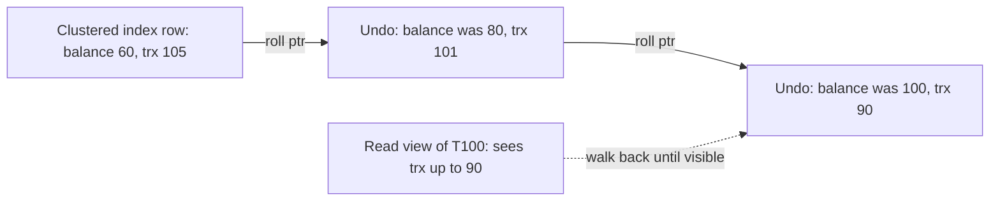

**Garbage collection.**

- **PostgreSQL VACUUM:** finds tuples whose `xmax` committed before the oldest running snapshot, marks space reusable, removes index entries pointing to them. It also **freezes** old tuples: XIDs are 32-bit and compared in a circle, so after about 2 billion transactions an old XID would look "in the future"; freezing marks a tuple visible to everyone forever. Autovacuum forces an anti-wraparound vacuum when a table's oldest unfrozen XID is 200 million transactions old (`autovacuum_freeze_max_age` default).
- **HOT updates** (heap-only tuples): if no indexed column changes and the page has room, the new version goes on the same page with no new index entries; a lower table fill factor makes this likelier.
- **InnoDB purge:** insert-undo is dropped at commit; update-undo stays until no read view needs it, then a purge thread removes it and physically removes delete-marked rows.

**Complexity.** Recent version O(1) extra; under a long-running snapshot O(version-chain length); space proportional to live old versions.

### Trade-offs
- **PostgreSQL style** (append versions): instant rollback (new tuple ignored), but tables and indexes bloat until vacuum, and every non-HOT update writes new index entries.
- **InnoDB style** (in place plus undo): compact table and fast current reads, but old snapshots walk undo, and long transactions grow the undo log (the "history list length" problem).
- In both, one forgotten long transaction blocks cleanup for everyone.
- Snapshot isolation still allows **write skew** (next section), so it is not full serializability.

### Real-world examples
- PostgreSQL: heap versions, `xmin`/`xmax`, VACUUM and autovacuum.
- MySQL InnoDB, Oracle: undo-based versions.
- CockroachDB and Spanner: versions keyed by timestamp in a key-value store, garbage-collected after a configurable time.

### In the interview
**Q:** How do PostgreSQL readers avoid blocking writers?

**A:** An update writes a new tuple and stamps the old one with its XID; readers pick the visible version from their snapshot and never wait.

**Q:** Why can a long-running transaction hurt an otherwise idle database?

**A:** Its snapshot pins every old version created since it started: PostgreSQL can't vacuum them, InnoDB can't purge undo, so tables and undo logs grow and reads slow.

**Q:** What is transaction ID wraparound?

**A:** PostgreSQL XIDs are 32-bit, compared modulo 2^32; without freezing, after about 2 billion transactions old rows would appear created in the future and vanish. Vacuum freezing prevents it.

### TL;DR
MVCC keeps row versions tagged with transaction IDs; each transaction reads through a snapshot via visibility rules. PostgreSQL stores versions in the table and needs VACUUM; InnoDB updates in place, keeps old versions in undo logs and purges later.

**Sources**
- PostgreSQL docs, Routine Vacuuming: https://www.postgresql.org/docs/current/routine-vacuuming.html
- PostgreSQL docs, Heap-Only Tuples: https://www.postgresql.org/docs/current/storage-hot.html
- MySQL 8.0 Reference Manual, InnoDB Multi-Versioning: https://dev.mysql.com/doc/refman/8.0/en/innodb-multi-versioning.html
- MySQL 8.0 Reference Manual, Consistent Nonlocking Reads: https://dev.mysql.com/doc/refman/8.0/en/innodb-consistent-read.html

## Two-phase locking and Serializable Snapshot Isolation

### What it is
Both give **serializability**: concurrent transactions produce the same result as some one-at-a-time order.

- **Two-phase locking (2PL)**: classic, pessimistic; transactions lock data and wait for each other.
- **Serializable Snapshot Isolation (SSI)**: optimistic, on MVCC snapshots; transactions never block, and the database aborts one when it detects a pattern that could break serializability (Cahill, Röhm, Fekete, SIGMOD 2008; PostgreSQL's SERIALIZABLE since 9.1).

### The problem it solves
Snapshot isolation permits **write skew**: two transactions read overlapping data, decide based on it, and each write a *different* row, so no write-write conflict is detected. Example: at least one doctor must be on call; Alice and Bob both are. Each simultaneously sees 2 on call and takes themselves off. Both commit under snapshot isolation; nobody is on call, a result no serial order could produce.

### How it works
**2PL.**

1. **Shared lock** before reading (many holders), **exclusive lock** before writing (one holder, no readers).
2. **Growing phase:** acquire, never release. **Shrinking phase:** after the first release, acquire nothing more.
3. **Strict 2PL** (what databases do): hold all locks until commit or abort, so nobody reads uncommitted data.
4. Stop **phantoms** (new rows matching a query's condition) by locking ranges: **predicate locks** or, in InnoDB, **next-key/gap locks** on index ranges.
5. **Deadlock**: T1 waits for T2 and vice versa; the database finds the cycle in its wait-for graph (or times out) and aborts one.

Doctors under 2PL: both take shared locks on the rows they read. Alice's update needs an exclusive lock on her row, which Bob holds shared: wait. Bob's update waits on Alice. Deadlock detected, one aborted, the other proceeds: correct, but blocking.

**SSI.**

1. Every transaction reads from an MVCC snapshot as in snapshot isolation; no read blocks.
2. Reads leave non-blocking **SIREAD locks** (`SIReadLock` in PostgreSQL's `pg_locks`) on rows, pages or relations read.
3. A write to something a concurrent transaction read records a **rw-antidependency** (edge reader → writer: the reader didn't see the change, so must come first serially).
4. Cahill's theorem: every snapshot-isolation anomaly contains a **dangerous structure**, two consecutive rw edges T1 → T2 → T3 among concurrent transactions (T1 and T3 may be the same); T2 is the **pivot**.
5. On such a structure, abort one transaction with a serialization failure (SQLSTATE `40001`); the application retries.

Doctors under SSI: Alice reads Bob's row and Bob writes it (Alice → Bob); Bob reads Alice's row and Alice writes it (Bob → Alice). Two rw edges: one is aborted at commit, and neither ever waited.

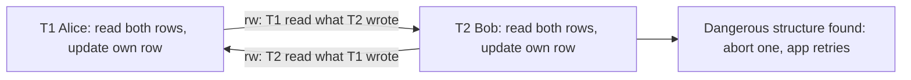

**False positives.** SSI tracks a sufficient condition, not the exact cycle, and may coarsen tuple locks to page or table locks to save memory, so it sometimes aborts safe transactions. PostgreSQL warns that sequential scans take relation-level predicate locks and raise the failure rate.

**Complexity.** 2PL: O(1) per lock, waits depend on contention. SSI: O(1) bookkeeping per read/write, memory proportional to concurrent read sets; a retry costs a whole transaction.

### Trade-offs
- **2PL:** simple guarantee and no anomaly retries, but readers block writers, throughput collapses under contention, deadlocks need handling.
- **SSI:** read-only and low-conflict workloads run near snapshot-isolation speed, but applications *must* retry on `40001`, aborts waste work under contention, and some are false positives.
- Neither replaces good design: short transactions, rows touched in a consistent order.

### Real-world examples
- **PostgreSQL** SERIALIZABLE = SSI (since 9.1); REPEATABLE READ = plain snapshot isolation.
- **MySQL InnoDB** SERIALIZABLE is lock-based: plain `SELECT`s become locking reads with next-key locks against phantoms.
- **SQL Server** offers lock-based SERIALIZABLE and a separate SNAPSHOT level.

### In the interview
**Q:** What is write skew and which level prevents it?

**A:** Two transactions read the same data, then each update a different row based on it, breaking an invariant. Snapshot isolation allows it; serializable (2PL or SSI) prevents it. Under weaker levels, `SELECT ... FOR UPDATE` the rows the decision depends on.

**Q:** Why is SSI "optimistic"?

**A:** It runs transactions without blocking and only aborts at the end on a dangerous pattern; 2PL blocks up front in case of conflict.

**Q:** What must the application do differently under SSI?

**A:** Treat SQLSTATE 40001 as normal: retry the whole transaction, discarding anything computed in the failed attempt.

### TL;DR
2PL gets serializability by locking (grow, hold until commit, break deadlocks); SSI runs on MVCC snapshots without blocking, tracks rw dependencies, and aborts when two consecutive rw edges form a dangerous structure. 2PL pays in waiting, SSI in retries.

**Sources**
- Cahill, Röhm, Fekete, "Serializable Isolation for Snapshot Databases", SIGMOD 2008: https://courses.cs.washington.edu/courses/csep544/09sp/resources/fekete-sigmod2008.pdf
- PostgreSQL docs, Transaction Isolation: https://www.postgresql.org/docs/current/transaction-iso.html
- PostgreSQL wiki, SSI: https://wiki.postgresql.org/wiki/SSI

## Skip lists

### What it is
A **skip list** (William Pugh, 1990, a simpler alternative to balanced trees) is a sorted linked list with randomly built "express lanes": the bottom level links every element; each element is randomly promoted upward, so with promotion probability 1/4 level 1 links about every 4th element, level 2 every 16th. Search starts in the top lane and drops down before overshooting.

### The problem it solves
A sorted linked list searches in O(n). Balanced trees (red-black, AVL) give O(log n) but need rotations, fiddly to code and hard to make concurrent. A skip list gets expected O(log n) search, insert and delete from coin flips and pointer updates, and its bottom level is already ordered, so range scans are trivial.

### How it works
**Structure.** Each node has a key (and value) and one forward pointer per level it belongs to; a head node has every level. Height is chosen at insert: start at 1, add a level with probability p (Redis: 1/4) up to a maximum (Redis: 32).

**Search for 70.** Keys 10, 25, 40, 55, 70, 85; 40 and 85 reached level 1, and 40 reached level 2.

1. Head, level 2: next is 40 < 70, move to 40.
2. 40, level 2: nothing next, drop to level 1.
3. Level 1: next is 85 > 70, drop to level 0.
4. Level 0: 55 < 70, move; next is 70: found. Touched 40, 55, 70 instead of walking from 10.

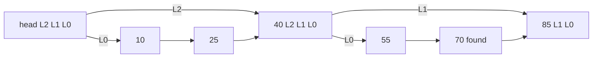

**Insert:** search, remembering at each level the last node before dropping (the `update` array); pick a random height h; splice the node in after `update[level]` for levels 0 to h−1. **Delete** uses the same `update` array to unsplice at each level.

```
insert(key):
  x = head
  for lvl from top down to 0:
    while x.next[lvl] and x.next[lvl].key < key:
      x = x.next[lvl]
    update[lvl] = x
  h = 1
  while random() < p and h < MAX: h += 1
  node = new Node(key, h)
  for lvl in 0..h-1:
    node.next[lvl] = update[lvl].next[lvl]
    update[lvl].next[lvl] = node
```

**Complexity.** Expected O(log n) search, insert, delete; expected levels log base 1/p of n (p = 1/4, one million items: log4(10^6) ≈ 10). Space: on average 1/(1 − p) pointers per node, 1.33 at p = 1/4 (vs 2 at p = 1/2, and 2 for a binary tree). Worst case O(n), astronomically unlikely and independent of input order (it depends only on the random generator).

**Rank queries.** Store on each forward pointer a **span** (bottom-level nodes jumped); summing spans along the search path gives rank in O(log n). Redis does exactly this.

### Trade-offs
- Simple code, no rotations, ordered iteration for free.
- Expected, not guaranteed, O(log n); fine in practice.
- Pointer-chasing across random memory is less cache-friendly than a B-tree's packed arrays; on disk, B-trees win.
- Lock-free concurrent versions are comparatively easy (Java's `ConcurrentSkipListMap`), since inserts touch few local pointers.

### Real-world examples
- **Redis sorted sets** (`ZADD`, `ZRANGE`, `ZRANK`, leaderboards). Beyond 128 entries or any member over 64 bytes (`zset-max-listpack-entries` / `zset-max-listpack-value` defaults), a sorted set becomes a skip list plus a hash table: the hash maps member to score for O(1) `ZSCORE`, the skip list orders by score for ranges and ranks, and each node has a `backward` pointer for reverse iteration. Small sets use a compact flat listpack.
- **Why Redis chose a skip list** (per its author): comparable memory (tunable via p), range iteration at least as cache-friendly as trees, and much simpler code, which made O(log n) `ZRANK` via spans a small change.
- **LevelDB and RocksDB memtables** default to skip lists.
- Java's `ConcurrentSkipListMap` and `ConcurrentSkipListSet`.

### In the interview
**Q:** Real-time leaderboard with "top 10" and "my rank"?

**A:** A Redis sorted set: `ZADD` to update, `ZREVRANGE 0 9` for top 10, `ZREVRANK` for rank, all O(log n) via the skip list with spans. Shard by game or region if a set grows too large.

**Q:** Why not a balanced binary tree?

**A:** Same asymptotic cost, but simpler to implement and extend (rank via spans), no rebalancing, and ordered range scans along the bottom level.

**Q:** Expected height?

**A:** About log base 1/p of n: around 10 levels for p = 1/4 and a million entries.

### TL;DR
A skip list is a sorted linked list with random express lanes: expected O(log n) operations without rebalancing. Redis sorted sets pair one (with spans, for ranges and ranks) with a hash table (for score lookup).

**Sources**
- Pugh, "Skip Lists: A Probabilistic Alternative to Balanced Trees", CACM 33(6), 1990: https://homepage.cs.uiowa.edu/~ghosh/skip.pdf
- Redis source, `server.h` (ZSKIPLIST_MAXLEVEL, ZSKIPLIST_P, zskiplistNode): https://github.com/redis/redis/blob/unstable/src/server.h
- Redis default configuration, `redis.conf` (zset-max-listpack-*): https://github.com/redis/redis/blob/unstable/redis.conf
- Redis docs, Sorted sets: https://redis.io/docs/latest/develop/data-types/sorted-sets/
- antirez on why Redis uses skip lists (Hacker News): https://news.ycombinator.com/item?id=1171423

## Cache eviction beyond LRU

### What it is
An **eviction policy** picks what to throw out when a cache is full; **LRU** (least recently used) evicts the item untouched longest (basics: [Module 0 — Eviction policies](../00-system-design-fundamentals/README.md#eviction-policies)). Three better-behaved families: **CLOCK** (a cheap LRU approximation), **ARC** (Adaptive Replacement Cache: balances recency and frequency, self-tuning) and **TinyLFU / W-TinyLFU** (an admission filter on approximate frequency counts, used by the Java library Caffeine). **Recency** = how recently used, **frequency** = how often, **hit ratio** = fraction of requests served from cache.

### The problem it solves
LRU's weaknesses: (1) **cost**: every hit moves the item to the list front, needing a lock and touching shared memory on every read; (2) **scan pollution**: one big sequential scan (backup, report) reads many items once and pushes out the popular ones, because LRU knows recency, not frequency.

### How it works
**CLOCK.** Slots in a circle, each with a **reference bit**, and a "hand" pointer.

1. On a hit, set the bit to 1; nothing moves, so hits are nearly free.
2. To evict, look under the hand: bit 1 → clear to 0 and advance (a "second chance"); bit 0 → evict.

Slots A(1) B(0) C(1) D(1), hand at A: clear A, move; B is 0, evict B. A cleared bit means "unused since the hand last passed". PostgreSQL's shared buffer cache uses a "clock sweep" with small usage counters instead of one bit.

**ARC** (Megiddo and Modha, IBM, FAST 2003). For a cache of c pages it keeps **T1** (pages seen once recently: recency), **T2** (seen at least twice: frequency), **ghost lists B1, B2** (keys only, no data, of pages recently evicted from T1 and T2), and an adaptive target size **p** for T1.

1. Hit in T1 or T2: move to the front of T2.
2. Miss found in B1: a recency page was evicted too early, so increase p, then load into T2.
3. Miss found in B2: a frequency page was evicted too early, so decrease p.
4. Complete miss: put in T1.
5. Evict from T1 if it exceeds p, else from T2, recording the key in the matching ghost list.

A one-off scan only touches T1, so it can't flush T2. In the paper's SPC1-like benchmark with a 4 GB cache, LRU hit 9.19% and ARC 20%. ARC was patented by IBM; PostgreSQL used it briefly in 8.0 and replaced it (2Q in 8.0.2, clock sweep in 8.1) partly to avoid the patent.

**TinyLFU and W-TinyLFU** (Einziger, Friedman and Manes). TinyLFU is an **admission policy**: when the cache is full, does the newcomer deserve to replace the eviction victim at all?

1. Every access increments the item in a **count-min sketch** (see [Count-min sketch](#count-min-sketch-with-conservative-update); overcounts slightly, never undercounts). Caffeine uses 4-bit counters.
2. **Aging (reset):** after W accesses (Caffeine: W = 10 × cache size) halve every counter so old popularity fades.
3. A **doorkeeper** (small Bloom filter) absorbs first-time items so one-hit wonders don't consume sketch counters.
4. **Admission:** admit the candidate only if its estimated frequency beats the victim's.

Plain TinyLFU rejects items about to become popular with no history (sudden bursts). **W-TinyLFU** adds a **window**:

1. New items enter a small LRU window (1% of capacity in the paper).
2. Items evicted from the window are candidates for the **main cache** (99%), a **segmented LRU** (SLRU): 20% probation, 80% protected; a hit in probation promotes to protected.
3. When main is full, TinyLFU compares the window's candidate with probation's victim; the more frequent stays.
4. Caffeine resizes the window by **hill climbing**: nudge it bigger or smaller and keep the change if hit ratio improves.

Example: 100-item cache (window 1, probation 20, protected 79). A backup reads 10,000 cold keys; each passes through the window as a candidate with estimated frequency about 1 against a probation victim of, say, 6. All are rejected; the hot set survives.

```mermaid
flowchart LR
    N["New item"] --> WIN["Window LRU (1 percent)"]
    WIN -->|"evicted candidate"| F{"TinyLFU: candidate more frequent than victim?"}
    PROB["Main SLRU probation (20 percent)"] -->|"victim"| F
    F -->|"yes: admit"| PROB
    F -->|"no: drop candidate"| D["Discarded"]
    PROB -->|"hit: promote"| PROT["Main SLRU protected (80 percent)"]
```

**Complexity.** CLOCK: O(1) hit, amortised O(1) eviction, 1 bit per entry. ARC: O(1) per request plus ghost metadata for up to c extra keys. W-TinyLFU: O(1) per request plus a sketch of a few bytes per entry (Caffeine cites about 8 bytes per entry for the 4-bit sketch).

### Trade-offs
- CLOCK: very cheap and concurrency-friendly, but only approximates LRU and is not scan-resistant on its own.
- ARC: self-tuning and scan-resistant, but ghost lists add complexity; patent history limited adoption.
- W-TinyLFU: near-optimal hit ratios across many traces with tiny metadata, but approximate frequencies and more knobs (window size, sample size).
- Fancy policies pay off only with skew; under uniform random access all perform about the same.

### Real-world examples
- **PostgreSQL** shared buffers: clock sweep with usage counts.
- **ZFS** uses an ARC-derived cache (also called the ARC).
- **Caffeine** (W-TinyLFU): Cassandra, Kafka, HBase, Solr, Neo4j, Druid, Spring Cache, Quarkus.

### In the interview
**Q:** Why is LRU vulnerable to scans, and the fix?

**A:** It treats one access like many, so a one-time scan evicts popular items. Use frequency: ARC's T1/T2 lists, SLRU segments, or a TinyLFU admission filter refusing cold items.

**Q:** What does TinyLFU use instead of exact counters?

**A:** A count-min sketch of small, periodically halved counters: frequency for far more keys than the cache holds, in a few bytes per entry.

**Q:** Why does CLOCK scale better than LRU under concurrency?

**A:** A hit just sets a bit; no list reordering, so readers don't contend on a shared lock.

### TL;DR
CLOCK makes LRU cheap with a reference bit and a sweeping hand. ARC keeps recency and frequency lists plus ghosts and adapts the split. W-TinyLFU puts a small LRU window before an SLRU main cache and admits only items a count-min sketch rates more popular than the victim, beating LRU on skewed and scan-heavy workloads.

**Sources**
- Megiddo and Modha, "ARC: A Self-Tuning, Low Overhead Replacement Cache", USENIX FAST 2003: https://www.usenix.org/conference/fast-03/arc-self-tuning-low-overhead-replacement-cache
- Einziger, Friedman, Manes, "TinyLFU: A Highly Efficient Cache Admission Policy" (arXiv 1512.00727): https://arxiv.org/abs/1512.00727
- Caffeine wiki, Efficiency: https://github.com/ben-manes/caffeine/wiki/Efficiency
- Caffeine README (users and integrations): https://github.com/ben-manes/caffeine
- Ben Manes, "Design of a Modern Cache", High Scalability: https://highscalability.com/design-of-a-modern-cache/
- PostgreSQL 8.0.2 release notes (2Q replaces ARC): https://www.postgresql.org/docs/release/8.0.2/
- PostgreSQL 8.1 release notes (clock sweep): https://www.postgresql.org/docs/release/8.1.0/

## Hierarchical timing wheels

### What it is
A **timing wheel** manages huge numbers of timers (timeouts, retries, scheduled tasks) cheaply: a clock face of slots, each holding a list of timers due in that interval, with a pointer advancing one slot per **tick** (fixed time unit, e.g. 1 ms). A **hierarchical** timing wheel stacks wheels with coarser ticks, like a clock's seconds, minutes and hours hands (Varghese and Lauck, 1987).

### The problem it solves
Servers track enormous numbers of timers (idle timeout per connection, deadline per request, back-off per retry), most cancelled before firing. A **priority queue** (heap by deadline) costs O(log n) per add and cancel; a timing wheel makes both O(1) and fires timers in batches.

### How it works
**Single wheel.** n slots, tick u; a timer due in d < n ticks goes in slot `(current + d) mod n`. Each tick, advance and fire the new slot. Cancel removes it from the slot's doubly linked list in O(1). It covers only n × u of time.

**Hashed wheel.** For longer delays, use slot `(current + d) mod n` and store the number of full rotations to wait; each pass decrements it and fires at zero. Simple, but long timers are visited every lap.

**Hierarchical wheels** (modelled on Kafka: 1 ms tick, 20 slots per wheel): level 0 = 20 × 1 ms (20 ms); level 1 = 20 × 20 ms (400 ms); level 2 = 20 × 400 ms (8 s). Kafka creates higher "overflow" wheels on demand. A timer due in 350 ms (at time 0):

1. Too far for level 0, fits level 1: slot 350 / 20 = 17 (340 to 359 ms).
2. At t = 340 the level-1 bucket comes due; its timers are **re-inserted** with remaining time, so ours (10 ms left) lands in level 0 slot 10 (relative).
3. At t = 350 it fires.

Each timer moves down at most once per level: add O(m) for m levels (tiny), cancel O(1), per-tick work proportional only to timers coming due.

**Avoiding wasted ticks.** Ticking every millisecond when nothing is due wastes CPU. Kafka keeps the *buckets* (not timers) in a Java `DelayQueue` ordered by expiry, so the timer thread sleeps until the next non-empty bucket.

```
add(timer):
  if timer.deadline < currentTime + tick: run(timer) and return
  if timer.deadline < currentTime + tick * slots:
    bucket = buckets[(timer.deadline / tick) mod slots]
    bucket.append(timer)
    if bucket expiry changed: delayQueue.offer(bucket)
  else:
    overflowWheel().add(timer)   # coarser wheel, created lazily

advanceTo(t):  # called when delayQueue hands back a due bucket
  currentTime = t rounded down to tick
  for each timer in bucket: add(timer)   # re-insert lower or run
```

```mermaid
flowchart TD
    A["Add timer due in 350 ms"] --> Q0{"Fits level 0 (20 ms)?"}
    Q0 -->|"no"| L1["Level 1 slot 17 (340 to 359 ms)"]
    L1 -->|"at 340 ms: bucket due"| R["Re-insert with 10 ms left"]
    R --> L0["Level 0 slot for 350 ms"]
    L0 -->|"at 350 ms"| F["Fire callback"]
    Q0 -->|"yes"| L0
```

**Complexity.** Add O(m) (O(1) single wheel); cancel O(1); per tick O(1) plus expiring or cascading timers; space O(slots + timers).

### Trade-offs
- Precision limited to the tick (coarser on upper levels if they fire in place): good for timeouts, wrong for high-precision scheduling.
- Cascading timers down from upper wheels costs bursts of work; the Linux kernel's 2015 rework lets coarse-level timers fire in place, slightly late, to avoid cascading.
- A heap is simpler and exact; it wins with few timers or precise firing.
- Slot-array memory is fixed even when idle.

### Real-world examples
- **Apache Kafka** "purgatory" (requests awaiting acks or data) moved to hierarchical timing wheels; in Confluent's high-timeout benchmark the old design saturated at about 25,000 requests/s, the new one about 105,000.
- **Netty** `HashedWheelTimer`: default 100 ms tick, 512-slot wheel, for I/O timeouts that need not be exact.
- **Linux kernel** timer wheel for low-resolution timeouts (network, I/O).
- Job schedulers and delay queues on Redis or in-process.

### In the interview
**Q:** Ten million connection idle timeouts, mostly reset. Data structure?

**A:** A hashed or hierarchical timing wheel: O(1) add and cancel, batch firing per tick; a heap pays O(log n) per reset and cancel.

**Q:** What do you give up versus a priority queue?

**A:** Precision (tick granularity) and some cascade work moving timers from coarse to fine wheels.

**Q:** How do you avoid ticking every millisecond?

**A:** Wake only when a non-empty bucket is due, e.g. buckets in a delay queue as Kafka does.

### TL;DR
A timing wheel is a circular array of time slots with a moving pointer; timers drop into their deadline's slot. Stacked coarser wheels cover long delays with O(1) cancel and near-O(1) add, which is why Kafka, Netty and Linux use them for huge numbers of mostly-cancelled timeouts.

**Sources**
- Varghese and Lauck, "Hashed and Hierarchical Timing Wheels", SOSP 1987: http://www.cs.columbia.edu/~nahum/w6998/papers/sosp87-timing-wheels.pdf
- Confluent blog, "Apache Kafka, Purgatory, and Hierarchical Timing Wheels": https://www.confluent.io/blog/apache-kafka-purgatory-hierarchical-timing-wheels/
- Netty API, HashedWheelTimer: https://netty.io/4.1/api/io/netty/util/HashedWheelTimer.html
- LWN, "Reinventing the timer wheel" (2015): https://lwn.net/Articles/646950/

## Distributed snapshots: Chandy-Lamport and Flink checkpoint barriers

### What it is
A **distributed snapshot** records every process's state plus messages in flight so that together they form a **consistent cut**: a moment that *could* have happened, where no message is recorded as received but not sent. The **Chandy-Lamport algorithm** (1985) takes one without stopping the system; Apache Flink's **checkpoint barriers** are a variant for streaming dataflows.

### The problem it solves
With no global clock you can't say "everyone record at 12:00:00.000", and independent recording can be inconsistent: branches P and Q each hold $100; P sends $10 to Q; if P records after sending ($90) and Q before receiving ($100), $10 vanishes ($190). Consistent snapshots are needed for checkpointing (restart after a crash), deadlock or termination detection, and debugging.

### How it works
**Assumptions.** Reliable FIFO channels (messages arrive in the order sent), and a special **marker** message separating "before" from "after".

**Chandy-Lamport.**

1. The **initiator** records its state, then sends a marker on every outgoing channel before anything else.
2. On a process's first marker (on channel C): record own state, record C as empty, send markers on all outgoing channels, start recording messages on each *other* incoming channel.
3. On a later marker on channel C: stop recording C; messages recorded on C between the process's snapshot and this marker are C's in-flight state.
4. Done when every process has received a marker on every incoming channel.

Bank example, P initiates:

1. P sends $10 to Q (P = 90), records "P = 90", sends a marker. Meanwhile Q sends $5 to P (Q = 95).
2. Q receives the $10 (Q = 105), then the marker (FIFO guarantees order); records "Q = 105", channel P→Q empty, sends a marker to P.
3. P receives Q's $5 after its own snapshot but before Q's marker: in flight on Q→P.
4. P receives Q's marker: P = 90, Q = 105, in flight Q→P = 5. Total 200: consistent.

```mermaid
sequenceDiagram
    participant P as "P (initiator)"
    participant Q as "Q"
    P->>Q: "transfer 10"
    Note over P: "record P = 90"
    P->>Q: "marker"
    Q->>P: "transfer 5 (sent before Q saw marker)"
    Note over Q: "on marker: record Q = 105"
    Q->>P: "marker"
    Note over P: "5 arrived between own record and Q marker: in flight"
```

**Flink checkpoint barriers** (inspired by Chandy-Lamport; Carbone et al., "Lightweight Asynchronous Snapshots for Distributed Dataflows", 2015). A Flink job is a parallel graph of sources, operators and sinks.

1. The **checkpoint coordinator** (in the JobManager) tells every source to start checkpoint n.
2. Each source records its position (e.g. Kafka partition offsets) and injects **barrier n** into its output; barriers flow in line with records and never overtake them.
3. A single-input operator, on barrier n, snapshots its state (asynchronously to durable storage such as S3) and forwards the barrier.
4. A multi-input operator performs **alignment**: after barrier n arrives on one input, it buffers that input's further records until barrier n arrives on all inputs, then snapshots and forwards. This keeps the cut consistent: exactly-once state.
5. Sinks acknowledge when they have barrier n on all inputs; all acks complete checkpoint n.
6. On failure, every operator restores from the latest complete checkpoint and sources rewind to the recorded offsets.

No channel state is needed because the graph is acyclic and sources replayable: aligned barriers leave no record "between" operators at the cut (cyclic graphs do need recorded channel state, as in the original).

**Unaligned checkpoints** (Flink 1.11, 2020): under backpressure alignment can stall for a long time, so the operator forwards the barrier on its first arrival and stores the overtaken in-flight buffers in the checkpoint, closer to classic Chandy-Lamport: fast checkpoints regardless of throughput, more I/O.

**At-least-once mode** skips alignment: records after the barrier may be processed before the snapshot, so after recovery they replay and may appear twice.

**Complexity.** One marker per channel, O(E) messages for E channels; storage = process state plus in-flight messages (zero in aligned Flink); time ≈ markers crossing the longest path plus persisting state.

### Trade-offs
- No global pause, but snapshots cost bandwidth and storage; frequent checkpoints shorten replay but add overhead.
- Aligned: no channel state, but alignment adds latency and stalls under backpressure.
- Unaligned: fast under backpressure, larger checkpoints and more I/O.
- End-to-end exactly-once also needs a replayable source and a transactional or idempotent sink (e.g. Flink's two-phase-commit Kafka sink); the snapshot covers only internal state ([Module 10 — Exactly-Once Semantics](../10-batch-and-streaming/README.md#exactly-once-semantics)).

### Real-world examples
- **Apache Flink**: barriers, aligned and unaligned checkpoints, savepoints (always aligned).
- Distributed debuggers and deadlock or termination detectors (the 1985 paper's motivation).
- Marker-based ideas in other stream processors and consistent backups of sharded systems.

### In the interview
**Q:** Why can't each node snapshot its own state at 12:00?

**A:** Clocks drift and messages are in flight, so a message can be recorded as received but not sent, or lost. Markers (or barriers) give a consistent cut.

**Q:** How does Flink achieve exactly-once state?

**A:** Sources inject barriers and record offsets, operators align barriers across inputs and snapshot, and on failure everything rolls back to the last complete checkpoint with sources replaying from stored offsets.

**Q:** What do unaligned checkpoints solve?

**A:** Under backpressure aligned barriers queue behind slow data and checkpoints take very long or time out; unaligned ones let the barrier overtake buffered data and save that data in the snapshot.

### TL;DR
Chandy-Lamport snapshots without stopping: record local state, flood markers, record messages arriving on a channel before its marker. Flink injects barriers at sources and aligns them at multi-input operators, with replayable sources, for exactly-once state; unaligned checkpoints trade larger snapshots for speed under backpressure.

**Sources**
- Chandy and Lamport, "Distributed Snapshots: Determining Global States of Distributed Systems", ACM TOCS 3(1), 1985: https://www.microsoft.com/en-us/research/publication/distributed-snapshots-determining-global-states-distributed-system/
- Carbone et al., "Lightweight Asynchronous Snapshots for Distributed Dataflows" (arXiv 1506.08603): https://arxiv.org/abs/1506.08603
- Apache Flink docs, Stateful Stream Processing: https://nightlies.apache.org/flink/flink-docs-stable/docs/concepts/stateful-stream-processing/
- Apache Flink 1.11.0 release announcement (unaligned checkpoints): https://flink.apache.org/2020/07/06/apache-flink-1.11.0-release-announcement/

## Inverted index

### What it is
An **inverted index**, behind almost every search box, maps each word to the documents containing it (a forward index maps document to words), like a textbook's back-of-book index.

- **Term**: one searchable unit, usually a lower-cased cleaned word.
- **Dictionary** (term dictionary): sorted list of distinct terms.
- **Posting**: "this term appears in document N" (optionally with frequency and positions).
- **Posting list**: all postings for a term, sorted by document ID.

### The problem it solves
Scanning 1 billion 10 KB documents (10 TB) at 1 GB/s takes almost 3 hours per query. An inverted index touches only the posting lists of the query's terms, and turns "apple AND pie" into intersecting two sorted integer lists.

### How it works
**1. Analyse.** An **analyser** tokenises, lower-cases, optionally drops "stop words" (the, a, of) and applies **stemming** ("apples" → "apple").

**2. Build postings.** Emit (term, docID) pairs, sort by term then docID, group:

| Doc ID | Text |
|---|---|
| 1 | Red apple pie |
| 2 | Green apple |
| 3 | Red car |

| Term | Posting list |
|---|---|
| apple | 1, 2 |
| car | 3 |
| green | 2 |
| pie | 1 |
| red | 1, 3 |

"red AND apple" intersects [1, 3] and [1, 2] with two pointers: [1]. Sorted lists make intersection O(|A| + |B|); **skip pointers** (stored jumps such as "the 128th entry is doc 9,412") leap over long runs.

**3. Immutable segments.** Lucene (under Elasticsearch, OpenSearch and Solr) buffers new documents in memory; on fill or refresh timer the buffer becomes a small complete **immutable segment** (a mini inverted index never changed after writing). Searches query every segment and merge. A delete marks the document dead in a small "live documents" bitmap; an update is delete plus add.

**4. Merge segments.** Thousands of tiny segments slow every query (one lookup each) and keep dead documents forever, so a background **merge policy** combines them, dropping deletions. Lucene's default `TieredMergePolicy` groups similar sizes into tiers; Solr documents about 10 segments per tier, merging 10 at once, capped at about 5 GB per merged segment. With 10 MB flushes: ten merge into 100 MB, ten of those into 1 GB, stopping near 5 GB. Each document is rewritten about log10(5,000/10) = log10(500) ≈ 2.7, so about 3 times: the **write amplification** price of append-only segments.

**5. Compress posting lists** (a popular term may be in hundreds of millions of documents):

- **Delta (gap) encoding**: store the difference from the previous doc ID; sorted IDs give small positive gaps.
- **Varint** (variable-length integer, **VByte**): 7 bits of the number per byte, top bit 1 = "more bytes follow", 0 = last. Below 128: 1 byte; below 16,384: 2 bytes.

Posting list [3, 7, 150, 152, 1000] → gaps 3, 4, 143, 2, 848. 3, 4, 2 take 1 byte each. 143 = 1 × 128 + 15 → bytes 15 + 128 = 143 (0x8F), then 1 (0x01). 848 = 6 × 128 + 80 → 208 (0xD0), then 6 (0x06). Total 7 bytes vs 20 as 32-bit integers, almost 3× smaller; dense terms compress far better.

```text
encode_varint(n):
    out = []
    while n >= 128:
        out.append((n % 128) + 128)   # low 7 bits, continuation bit set
        n = n // 128
    out.append(n)                     # last byte, top bit clear
    return out
```

Modern Lucene packs gaps in blocks of 128 integers at the smallest bit width fitting the block's largest gap, with varints only for the leftover tail; block packing decodes much faster on modern CPUs than byte-at-a-time varints.

**6. Partition across machines.**

- **Document-partitioned (local index):** each shard has a full inverted index for a subset of documents; a query goes to every shard (**scatter-gather**), each returns its local top 10, a coordinator merges.
- **Term-partitioned (global index):** each shard owns whole posting lists for some terms ("apple" on shard 7); a query visits only its terms' shards.

1 billion documents on 100 shards: document-partitioned, a two-word query fans out to all 100, each scanning lists for its 10 million documents and returning 10 hits, the coordinator merging 1,000 into a top 10; load is even, but every query touches every shard and the slowest sets response time. Term-partitioned, it touches 2 shards, but if "apple" is in 50 million documents that shard ships (or intersects) a 50-million-entry list; popular terms make **hot spots**, and indexing one document updates many shards.

```mermaid
flowchart TD
    D["New documents"] --> A["Analyser: tokenise, lower-case, stem"]
    A --> B["In-memory buffer"]
    B -->|"refresh or full"| S1["Small immutable segment"]
    S1 --> M["Background tiered merge, drops deleted docs"]
    M --> S2["Larger segment, delta plus block-packed postings"]
    S2 --> Q["Query: look up terms, intersect posting lists, score"]
```

**Complexity:** build is dominated by sorting (term, doc) pairs, O(P log P) for P postings; a query costs roughly the posting-list lengths read (less with skip pointers); space roughly proportional to P after compression, often a fraction of the raw text.

### Trade-offs
- **Freshness vs throughput:** refresh every second for near-real-time search but many small segments and more merging; every 30 s is cheaper but staler.
- **Compression vs CPU:** tighter encodings save disk and memory but cost decode time per query; block packing is the usual sweet spot.
- **Document vs term partitioning:** document partitioning is simpler, balances load and keeps indexing local, at the cost of fan-out; term partitioning cuts fan-out but suffers hot terms and expensive multi-term queries. Nearly all production systems partition by document.
- **Merging vs I/O (input/output):** aggressive merging keeps queries fast but burns disk bandwidth and can starve indexing.

### Real-world examples
- **Lucene, Elasticsearch, OpenSearch, Solr:** immutable segments, tiered merging, delta plus block-packed postings, document-partitioned shards.
- **Google (Barroso, Dean, Holzle, 2003):** the index was sharded by document so one query ran in parallel across many machines, each shard replicated for throughput.
- **Database full-text indexes** such as PostgreSQL's GIN (generalised inverted index) use the same term-to-rows idea.

### In the interview
**Q:** Why are Lucene segments immutable?

**A:** No reader locks, aggressive OS file caching, compression tuned once at write time. Cost: deletes become tombstones and background merges reclaim space.

**Q:** How do you split a 10 TB index?

**A:** By document, into shards that fit comfortably on a node (tens of GB), each replicated for read throughput and failover; queries scatter to all shards and a coordinator merges top results. Mention term partitioning only to explain why hot terms make it a poor default.

**Q:** Why delta-encode before varint?

**A:** Varint saves space only for small numbers; raw doc IDs reach millions, but gaps between sorted IDs are small (especially for common terms), so most fit in one byte.

### TL;DR
An inverted index maps each term to a sorted doc-ID list. Engines write immutable segments, merge them in the background, compress postings with delta plus varint or block packing, and shard by document so queries scatter to all shards and gather a merged top-k.

**Sources**
- Lucene 9.12 postings format, block size and VInt tail: https://lucene.apache.org/core/9_12_2/core/org/apache/lucene/codecs/lucene912/Lucene912PostingsFormat.html
- Solr guide, index segments and merging (TieredMergePolicy defaults): https://solr.apache.org/guide/solr/9_9/configuration-guide/index-segments-merging.html
- Barroso, Dean, Holzle, "Web Search for a Planet: The Google Cluster Architecture", IEEE Micro 2003: https://research.google/pubs/web-search-for-a-planet-the-google-cluster-architecture/
- Manning, Raghavan, Schutze, *Introduction to Information Retrieval*, chapters 1, 4 and 5 (index construction and compression): https://nlp.stanford.edu/IR-book/

## Ranking with TF-IDF and BM25

### What it is
After the inverted index finds matches, **ranking** orders them. Two classic formulas dominate keyword search:

- **TF-IDF** (term frequency × inverse document frequency): higher when the query word appears often in the document (TF) and is rare across the collection (IDF).
- **BM25** ("Best Matching 25", from the Okapi system): a refined TF-IDF that stops rewarding repetition after a while and adjusts for document length; the default in Lucene, Elasticsearch and OpenSearch.

Notation: **N** = documents in the collection; **df** (document frequency) = documents containing a term; **tf** (term frequency) = occurrences in one document; **dl** = document length in words; **avgdl** = average length.

### The problem it solves
"apple pie" may match millions of pages and users look at the first few, so order is the product; plain matching gives no order. TF-IDF and BM25 are cheap, need no training data, and give a sensible order out of the box; modern systems use them as the first stage, with a learned model re-ranking the top few hundred.

### How it works
**Three ideas:** (1) five mentions of "apple" suggest more about apples than one (term frequency); (2) a match on a rare word tells more than on "the" (inverse document frequency); (3) long documents mention everything more often just by being long, so discount them (length normalisation, BM25 only).

**Collection** (N = 4), query "apple pie":

| Doc | Text | Length dl |
|---|---|---|
| D1 | apple pie recipe apple | 4 |
| D2 | apple phone review | 3 |
| D3 | cherry pie | 2 |
| D4 | best pie shop in town today | 6 |

df(apple) = 2, df(pie) = 3, avgdl = 15 / 4 = 3.75.

**TF-IDF** with idf = log10(N / df), score = Σ tf × idf: idf(apple) = 0.301, idf(pie) = 0.125. D1 = 2 × 0.301 + 0.125 = **0.727**; D2 = **0.301**; D3 = **0.125**; D4 = **0.125**. Problems: D3 (two words, squarely about pie) ties D4 (six words, passing mention), and if D1 said "apple" 50 times its score would grow 25-fold, rewarding spam.

**BM25**, per query term in a document:

```text
idf(t)  = ln(1 + (N - df + 0.5) / (df + 0.5))           # Lucene's variant, never negative
norm(d) = 1 - b + b * dl / avgdl                         # 1.0 for an average-length doc
score(t, d) = idf(t) * tf * (k1 + 1) / (tf + k1 * norm(d))
score(q, d) = sum of score(t, d) over query terms t
```

**k1** controls how fast repeated terms saturate (default 1.2); **b** how strongly length matters (default 0.75; 0 ignores length, 1 fully normalises).

- IDFs: apple = ln(1 + 2.5/2.5) = ln 2 = 0.693; pie = ln(1 + 1.5/3.5) = ln 1.4286 = 0.357.
- k1 × norm: D1 norm = 0.25 + 0.75 × 4/3.75 = 1.05 → 1.26; D2 0.85 → 1.02; D3 0.65 → 0.78; D4 1.45 → 1.74.
- Scores (k1 + 1 = 2.2): D1 apple = 0.693 × (2 × 2.2)/(2 + 1.26) = 0.936, pie = 0.357 × 2.2/(1 + 1.26) = 0.347, total **1.28**; D2 = 0.693 × 2.2/2.02 = **0.755**; D3 = 0.357 × 2.2/1.78 = **0.441**; D4 = 0.357 × 2.2/2.74 = **0.286**.

Ranking D1 > D2 > D3 > D4: the tie breaks for the short, focused document. **Saturation:** with D1's length factor, tf × 2.2 / (tf + 1.26) gives 0.97 at tf = 1, 1.35 at 2, 1.95 at 10, and never exceeds k1 + 1 = 2.2: keyword stuffing stops paying.

```mermaid
flowchart LR
    Q["Query: apple pie"] --> L["Look up posting lists"]
    L --> T["Per term: tf, df, doc length"]
    T --> S["BM25 per term, saturating tf and length norm"]
    S --> A["Sum over terms"]
    A --> K["Top-k heap"]
    K --> R["Optional ML re-ranker on top 100 to 1000"]
```

**Complexity:** O(total postings read) with a size-k heap (O(log k) per insert). **WAND** and **block-max WAND** skip documents whose best possible score cannot enter the current top k.

### Trade-offs
- **No semantics:** exact (analysed) words only; "car" won't match "automobile" without synonyms or vector search ("hybrid search").
- **Tuning:** k1 and b are rarely tuned, but short fields (titles) and long ones (bodies) often want different b; Elastic says defaults are a reasonable start and any change must be measured on real queries.
- **Per-shard statistics:** each shard computes df and avgdl locally, so a document can score slightly differently per shard; Elasticsearch's "DFS" mode gathers global statistics first at the cost of an extra round trip.
- **Cheap and explainable:** no training data, scores break down term by term for debugging.

### Real-world examples
- Lucene switched its default similarity from classic TF-IDF to BM25 in version 6 (2016); Elasticsearch and OpenSearch inherit it.
- Retrieval-augmented generation (RAG) systems commonly run BM25 alongside embedding search and fuse the lists, since BM25 handles rare identifiers, product codes and names well.
- Web search engines historically used BM25-style features as one input among hundreds to a learned ranker.

### In the interview
**Q:** Why does BM25 beat raw TF-IDF?

**A:** Term frequency saturates (the tenth mention adds much less than the second) and length normalisation stops long documents winning by size; k1 and b control both.

**Q:** Where does BM25 sit in a modern stack?

**A:** The cheap first stage: top few hundred candidates in milliseconds, then a learned re-ranker (gradient-boosted trees or a cross-encoder) reorders them with many more features.

**Q:** What does b = 0 do?

**A:** Ignores length, favouring long documents; right for roughly fixed-length fields such as titles or tags.

### TL;DR
TF-IDF scores by how often a document contains query terms, weighted by their rarity. BM25 adds saturation (k1, default 1.2) and length normalisation (b, default 0.75), robust enough to be Lucene's default first-stage ranker.

**Sources**
- Elastic, "Practical BM25, Part 2: The BM25 algorithm and its variables": https://www.elastic.co/blog/practical-bm25-part-2-the-bm25-algorithm-and-its-variables
- Elastic, "Practical BM25, Part 3: Considerations for picking b and k1": https://www.elastic.co/blog/practical-bm25-part-3-considerations-for-picking-b-and-k1-in-elasticsearch
- Robertson and Zaragoza, "The Probabilistic Relevance Framework: BM25 and Beyond", Foundations and Trends in IR, 2009: https://www.staff.city.ac.uk/~sbrp622/papers/foundations_bm25_review.pdf
- Manning, Raghavan, Schutze, *Introduction to Information Retrieval*, chapter 6 (tf-idf) and 11 (BM25): https://nlp.stanford.edu/IR-book/

## Near-duplicate detection with SimHash, MinHash and LSH

### What it is
**Near-duplicate detection** finds items that are almost the same (a news article with different adverts, a listing reposted with one changed word, one page under two URLs). Exact duplicates just need a cryptographic hash such as SHA-256; near-duplicates need hashes where similar inputs give similar outputs:

- **SimHash**: a short bit string (often 64 bits) where similar documents differ in few positions, measured by **Hamming distance** (number of differing positions).
- **MinHash**: a short list of numbers (**signature**) whose fraction of matches estimates **Jaccard similarity** (overlap size / union size of two sets).
- **LSH (locality-sensitive hashing)**: buckets signatures so similar items share a bucket, so you compare only within buckets instead of every pair.

### The problem it solves
All pairs of 1 billion pages is about 5 × 10^17 comparisons. Crawlers must decide "seen this page?" in milliseconds, and pipelines (e.g. de-duplicating large-language-model (LLM) training data) cluster billions of documents. Both need a compact fingerprint plus an index that finds close ones without scanning everything.

### How it works
**1. Features.** Usually **shingles**, overlapping k-word or k-character sequences: "the cat sat on" with 2-word shingles = {the cat, cat sat, sat on}. Similar documents share most shingles.

**2a. SimHash** (Charikar 2002; used at Google by Manku, Jain and Das Sarma). Toy 8-bit version:

| Feature | Weight | 8-bit hash |
|---|---|---|
| apple | 2 | 10110010 |
| pie | 1 | 01110100 |
| recipe | 1 | 10011001 |

Keep one counter per bit; for each feature add its weight where its bit is 1, subtract where 0. Sums: +2, −2, +2, +4, −2, −2, 0, −2. Output 1 where positive: **10110000**. Document B swaps "recipe" for "easy" (00011101, weight 1): sums 0, −2, +2, +4, −2, 0, 0, −2 → **00110000**, Hamming distance 1. Unrelated documents differ in about half the bits (4 of 8, 32 of 64).

**Finding close SimHashes.** Manku et al. found 64-bit SimHashes with threshold k = 3 differing bits worked well for about 8 billion pages. Pigeonhole lookup: split 64 bits into 4 blocks of 16; fingerprints differing in ≤ 3 bits match exactly in at least one block. Keep 4 tables keyed by one block each, look up the new fingerprint's 4 blocks, and check full Hamming distance only on the hits.

**2b. MinHash** (Broder 1997, for AltaVista). Shingle sets A = {a, b, c, d}, B = {b, c, d, e}: true Jaccard = 3/5 = **0.6**. Per hash function, a document's MinHash is its smallest shingle hash; the probability two sets share the minimum equals their Jaccard similarity.

| Hash | a | b | c | d | e | min of A | min of B | Match? |
|---|---|---|---|---|---|---|---|---|
| h1 | 3 | 7 | 1 | 9 | 5 | 1 (c) | 1 (c) | yes |
| h2 | 2 | 8 | 6 | 4 | 1 | 2 (a) | 1 (e) | no |
| h3 | 9 | 2 | 5 | 7 | 3 | 2 (b) | 2 (b) | yes |
| h4 | 4 | 6 | 8 | 3 | 9 | 3 (d) | 3 (d) | yes |

Estimate 3/4 = 0.75 vs true 0.6: noisy with 4 hashes. Standard error ≈ sqrt(J(1 − J)/n); 100 hashes give sqrt(0.6 × 0.4 / 100) ≈ 0.05. A 100-number signature (400 bytes) summarises a document of any size.

**3. LSH banding.** Split each 100-number signature into **b = 20 bands of r = 5 rows**, hash each band to a bucket; documents sharing any bucket are a **candidate pair**. For Jaccard s: P(band matches) = s^r; P(candidate) = 1 − (1 − s^r)^b.

| Similarity s | s^5 | P(candidate) with b = 20 |
|---|---|---|
| 0.3 | 0.0024 | 0.047 |
| 0.5 | 0.031 | 0.47 |
| 0.8 | 0.328 | 0.9996 |

An S-curve with its steep part near (1/b)^(1/r) = (1/20)^(1/5) ≈ 0.55: pairs above 0.8 are almost always caught, below 0.3 rarely compared. More rows per band raises the threshold (fewer false positives); more bands lowers it (fewer misses).

```text
for doc in docs:
    sig = [min(h_i(s) for s in shingles(doc)) for i in 1..100]
    for band in 0..19:
        key = hash(band, sig[band*5 : band*5+5])
        for other in buckets[key]: candidates.add((doc, other))
        buckets[key].append(doc)
verify each candidate pair with exact Jaccard (or signature agreement)
```

```mermaid
flowchart TD
    D["Document"] --> S["Shingles: overlapping word n-grams"]
    S --> M["MinHash signature: 100 minimums"]
    S --> H["SimHash: 64-bit fingerprint"]
    M --> B["LSH: 20 bands x 5 rows, bucket per band"]
    H --> T["4 tables keyed by 16-bit blocks"]
    B --> C["Candidate pairs only"]
    T --> C
    C --> V["Verify true similarity, then cluster or drop"]
```

**Complexity:** MinHash O(n × shingles) per document for n hashes, O(n) space; LSH O(b) bucket operations per document, so the job is near-linear instead of quadratic; SimHash O(features × 64) per document, 8 bytes stored.

### Trade-offs
- **SimHash vs MinHash:** SimHash is tiny (8 bytes) and good for "almost identical" pages with weighted features; MinHash estimates Jaccard directly, behaves predictably at moderate similarity (0.5 to 0.8) and tunes easily with banding.
- **Banding:** b and r trade false positives (wasted verification) against false negatives (missed duplicates); choose from the target threshold.
- **Shingle size:** too small makes unrelated documents look similar; too large lets one changed word break many shingles. Word 5-grams or character 5- to 9-grams are common starts.
- **Memory:** LSH tables for billions of documents are large, so it often runs as a batch job (Spark, MapReduce) rather than an online index.

### Real-world examples
- **AltaVista:** Broder's shingling and MinHash clustered the whole crawl to remove near-duplicates.
- **Google crawling:** 64-bit SimHash with k = 3 over roughly 8 billion pages (Manku paper).
- **LLM data pipelines** de-duplicate web text with MinHash plus LSH before training, since repeats waste compute and encourage memorisation.
- **Plagiarism checkers and news aggregators** group syndicated copies of a story.

### In the interview
**Q:** How does a crawler avoid storing the same page under many URLs?

**A:** 64-bit SimHash of each page's text, stored in a few tables keyed by fixed bit blocks; look up each block of a new page and check full Hamming distance on hits. Within 3 bits: duplicate, skip or canonicalise.

**Q:** Why not compare MinHash signatures pairwise?

**A:** Still quadratic in documents; LSH banding puts likely-similar documents in shared buckets, making the job near-linear.

**Q:** How do you pick b and r?

**A:** Fix n = b × r, set the threshold (1/b)^(1/r) just below the similarity you care about, and check false-positive and false-negative rates with 1 − (1 − s^r)^b.

### TL;DR
Hash so similar documents collide. SimHash: a 64-bit fingerprint compared by Hamming distance. MinHash: a signature whose agreement rate estimates Jaccard. LSH banding finds candidate pairs without all-pairs comparison, turning quadratic into near-linear.

**Sources**
- Manku, Jain, Das Sarma, "Detecting Near-Duplicates for Web Crawling", WWW 2007: https://www.www2007.cpsc.ucalgary.ca/papers/paper215.pdf
- Broder, "On the Resemblance and Containment of Documents", 1997: https://www.cs.princeton.edu/courses/archive/spring13/cos598C/broder97resemblance.pdf
- Broder et al., "Syntactic Clustering of the Web", WWW6 1997: https://archives.iw3c2.org/www6/proceedings/Technical/Paper205/Paper205.html
- Leskovec, Rajaraman, Ullman, *Mining of Massive Datasets*, chapter 3 (MinHash and LSH banding): http://www.mmds.org/

## Vector search with HNSW, IVF and product quantization

### What it is
**Vector search** finds items whose **embeddings** (a **vector** of numbers, e.g. 768 long, produced by an ML model so similar meaning gives nearby vectors) are closest to the query's, by Euclidean (L2) distance, inner product or cosine similarity. **Approximate nearest neighbour (ANN)** search accepts missing a few true neighbours for huge speed-ups; quality is **recall@k** (fraction of the true k nearest returned; recall@10 = 0.95 means 9.5 of the true top 10 on average). Building blocks: **HNSW** (Hierarchical Navigable Small World, a layered graph walked greedily), **IVF** (inverted file index: search only the clusters nearest the query) and **PQ** (product quantization: compress each vector to a few bytes). Sharding vector stores: [Module 11 — Vector Database Sharding](../11-ai-era-systems/README.md#vector-database-sharding).

### The problem it solves
100 million × 768 dimensions × 4 bytes = **307 GB** of floats, and a brute-force query is about 77 billion multiply-adds. Semantic search, RAG, recommendations and image search need tens of milliseconds over up to billions of vectors; ANN indexes trade a little recall for orders of magnitude less latency and memory.

### How it works
**1. Brute force baseline:** distance to every vector, top k in a heap, O(N × d) per query. Use it below roughly 100,000 vectors and as ground truth for recall.

**2. IVF.**

1. **Train:** k-means (finds nlist cluster centres) on a sample; with N = 1,000,000, nlist ≈ sqrt(N) = 1,000 is a common start.
2. **Assign:** each vector to its nearest centre's list (an inverted index whose "terms" are clusters), about 1,000 vectors per list.
3. **Query:** compare with the 1,000 centres, scan the nearest **nprobe** lists (say 10): 10,000 vectors plus 1,000 centres, about **1% of brute-force work**.
4. **Tune:** recall and latency rise roughly linearly with nprobe; a neighbour just across a cluster boundary is missed if its cluster isn't probed, which is why nprobe = 1 has poor recall.

**3. PQ.** Split each vector into m sub-vectors, run k-means per sub-space with 256 centres, and store each sub-vector's centre number (1 byte). Toy example, 4 dimensions, m = 2, 4 centres (2 bits) each: x = [0.1, 0.9, 0.4, 0.3] → [0.1, 0.9] and [0.4, 0.3]. Codebook 1 (c0 = [0,0], c1 = [0,1], c2 = [1,0], c3 = [1,1]): nearest c1 (squared distance 0.02). Codebook 2 (c0 = [0.5,0.5], c1 = [0,0], c2 = [1,0], c3 = [0.5,0]): nearest c0 (0.05 vs 0.10 for c3). Code (1, 0): 16 bytes became 4 bits.

**Asymmetric distance computation (ADC):** at query time compute each query sub-vector's distance to every centre once (an m × 256 table); distance to any stored vector is then m table lookups summed, with no floating-point vector maths.

Real numbers: 768 dimensions, m = 96 sub-vectors of 8 dimensions at 8 bits = **96 bytes per vector** instead of 3,072 (32×); 100 million vectors shrink from 307 GB to about **9.6 GB**, fitting one server's memory. **IVF-PQ** clusters with IVF, stores residuals with PQ, and optionally **re-ranks** the top few hundred with full vectors kept on SSD.

**4. HNSW.**

1. Each inserted vector becomes a node linked to about **M** of its nearest existing nodes (commonly 16; the bottom layer allows 2M).
2. Each node gets a random top layer, exponentially fewer nodes higher up, like a skip list's express lanes.
3. **Search:** from the top-layer entry point, greedily hop to whichever neighbour is closer to the query until none is, drop a layer, repeat. On the bottom layer keep a candidate list of size **efSearch** (e.g. 64), explore until it stops improving, return the best k.
4. **efConstruction** (candidate list size while inserting) sets build quality: higher means better graphs, slower indexing.

Search cost grows roughly with log N, and HNSW typically gives the best recall for a given latency in RAM. With M = 16 the bottom layer stores 32 neighbour IDs × 4 bytes = 128 bytes per vector: about 13 GB of links plus 307 GB of vectors for 100 million 768-dimension vectors.

```mermaid
flowchart TD
    Q["Query embedding"] --> C{"Index type"}
    C -->|"HNSW"| H1["Top layer: greedy hop to closest node"]
    H1 --> H2["Drop layers, keep efSearch candidates"]
    C -->|"IVF-PQ"| I1["Compare with nlist centroids"]
    I1 --> I2["Scan nprobe lists with PQ table lookups"]
    H2 --> R["Top-k by distance"]
    I2 --> RR["Re-rank shortlist with full vectors"]
    RR --> R
```

**Complexity** (N vectors, d dimensions):

| Method | Query time | Memory per vector | Notes |
|---|---|---|---|
| Brute force | O(N d) | 4d bytes | 100% recall |
| IVF (flat lists) | O(nlist d + nprobe (N/nlist) d) | 4d bytes | recall set by nprobe |
| IVF-PQ | same scan, but m lookups per vector | m bytes plus IDs | lowest memory, lower recall |
| HNSW | roughly O(log N) hops x M x d | 4d + about 8M bytes | best recall/latency in RAM, slow build |

### Trade-offs
- **Recall vs latency:** a dial per method (nprobe, efSearch); plot recall@10 against p99 latency and choose a point, e.g. 0.95 at 10 ms.
- **Memory vs recall:** PQ cuts memory 10 to 60× but loses precision; re-ranking a shortlist with full vectors recovers much of it.
- **Updates and deletes:** HNSW inserts are cheap-ish but deletes awkward (tombstones, periodic rebuild); IVF needs retraining when the distribution drifts.
- **Filtering** ("nearest products in stock under 20 dollars") fits ANN badly: post-filtering can return too few results; filtering during graph traversal can disconnect the graph.
- **Build time:** HNSW builds are CPU-heavy; IVF-PQ needs a training pass but builds quickly.

### Real-world examples
- **FAISS** (Meta): flat, IVF, PQ, IVF-PQ and HNSW indexes, plus GPU versions.
- **pgvector, Elasticsearch, OpenSearch, Redis, Qdrant, Weaviate and Milvus** offer HNSW; several also IVF or quantised variants.
- **RAG** stores chunk embeddings and retrieves the top 5 to 50 chunks per question.
- **Recommendation candidate generation** retrieves items near the user's embedding (see [Feed ranking](#feed-ranking)).

### In the interview
**Q:** 1 billion 768-dimension embeddings: which index?

**A:** Raw floats are about 3 TB, so not HNSW on full vectors in RAM. IVF-PQ: tens of thousands of clusters, 64 to 96 byte codes (64 to 96 GB, sharded across a few machines), probe a few dozen lists, re-rank the top few hundred with full vectors from SSD.

**Q:** What do efSearch and nprobe control?

**A:** Query-time recall vs latency: candidates kept on HNSW's bottom layer, and IVF clusters scanned. Neither needs a rebuild.

**Q:** How do you know the ANN index is good enough?

**A:** Brute-force exact top-k for a sample of real queries, then recall@k and latency percentiles of the ANN index on them, plus end-to-end quality, since 0.9 recall may be fine with a strong re-ranker.

### TL;DR
HNSW walks a layered graph (best recall for latency in memory); IVF searches only the closest clusters; PQ compresses vectors to tens of bytes with per-subspace codebooks. Real systems combine them and tune nprobe or efSearch for recall vs latency vs memory.

**Sources**
- Malkov and Yashunin, "Efficient and robust approximate nearest neighbor search using Hierarchical Navigable Small World graphs", IEEE TPAMI 2018: https://arxiv.org/abs/1603.09320
- Jegou, Douze, Schmid, "Product Quantization for Nearest Neighbor Search", IEEE TPAMI 2011: https://doi.org/10.1109/TPAMI.2010.57
- FAISS wiki, "Faster search" and index guidelines: https://github.com/facebookresearch/faiss/wiki/Faster-search
- Johnson, Douze, Jegou, "Billion-scale similarity search with GPUs" (FAISS paper), 2017: https://arxiv.org/abs/1702.08734

## Shortest paths for maps: Dijkstra, A* and contraction hierarchies

### What it is
A road map is a **graph**: **nodes** are intersections, **edges** road segments with a **weight** (metres or, more usefully, seconds). The **shortest path** problem asks for the route with the smallest total weight.

- **Dijkstra's algorithm** grows outward from the start in distance order, settling one node at a time; exact for non-negative weights.
- **A\*** (A-star) is Dijkstra plus a **heuristic** (estimate of remaining distance) steering the search towards the target.
- **Contraction hierarchies (CH)** precompute **shortcut** edges once so each query explores only a few hundred nodes even on a continental map.

### The problem it solves
A continental network has tens of millions of nodes; plain Dijkstra London to Rome settles millions (seconds). Navigation at thousands of requests per second, plus distance matrices (ETAs from 100 drivers to 100 riders = 10,000 routes), needs milliseconds. Road hierarchy (motorways matter more than cul-de-sacs) can be exploited by preprocessing.

### How it works
**Worked graph** (undirected, minutes), A to E:

```mermaid
flowchart LR
    A(("A")) ---|"4"| B(("B"))
    A ---|"2"| C(("C"))
    C ---|"1"| B
    B ---|"5"| D(("D"))
    C ---|"8"| D
    C ---|"10"| E(("E"))
    D ---|"2"| E
```

**1. Dijkstra.** Tentative distances (infinity at first) and a **priority queue** (min-heap). Repeatedly pop the closest unsettled node and **relax** its edges (update a neighbour if going through it is shorter).

```text
dist[s] = 0, all others infinity, push (0, s)
while queue not empty:
    (d, u) = pop_min(queue)
    if u settled: continue
    mark u settled, if u == target: stop
    for (v, w) in edges(u):
        if d + w < dist[v]:
            dist[v] = d + w, prev[v] = u, push (dist[v], v)
```

| Pop | Settled distance | Updates |
|---|---|---|
| A | 0 | B = 4, C = 2 |
| C | 2 | B = 3 (via C beats 4), D = 10, E = 12 |
| B | 3 | D = 8 (3 + 5 beats 10) |
| D | 8 | E = 10 (8 + 2 beats 12) |
| E | 10 | done |

Answer **A-C-B-D-E, 10 minutes** (follow `prev` back from E); the direct A-B road (4) lost to the detour via C (3). Binary heap: O((V + E) log V) time, O(V) space.

**2. A\*.** Pop by f = g + h (g = distance so far, h = heuristic to goal); on maps h is usually straight-line distance / maximum road speed. **Admissible** = never overestimates the true remaining distance, so A\* stays optimal. **Consistent** (monotone) = h(u) ≤ w(u, v) + h(v) for every edge, so each node is settled once, like Dijkstra.

h(A) = 7, h(B) = 6, h(C) = 7, h(D) = 2, h(E) = 0; true remaining distances A 10, B 7, C 8, D 2, so admissible, and every edge checks consistent (e.g. C to B: 7 ≤ 1 + 6).

| Pop (f) | g | Pushes (g, f) |
|---|---|---|
| A (7) | 0 | B (4, 10), C (2, 9) |
| C (9) | 2 | B (3, 9), D (10, 12), E (12, 12) |
| B (9) | 3 | D (8, 10) |
| D (10) | 8 | E (10, 10) |
| E (10) | 10 | done |

Same answer; no saving on a tiny graph, but on a real map Dijkstra explores a disc around the start while A\* explores an ellipse stretched towards the goal. h = 0 turns A\* back into Dijkstra; an overestimating h is faster but can return a worse route.

**3. Contraction hierarchies.**

*Preprocessing (once; minutes to hours for a continent):* order nodes by **importance** (heuristics such as how many shortcuts removing it would add; motorway junctions important, dead ends not), then **contract** from least to most important: removing v, for each pair of remaining neighbours u, w whose shortest path goes through v, add shortcut u-w with that weight, unless a **witness path** (equally short, avoiding v) exists.

Order C (1), A (2), B (3), D (4), E (5). Contract C (neighbours A, B, D, E): A-B via C = 3 < direct 4, no witness → **shortcut A-B = 3 (via C)**. A-D via C = 10, witness A-B-D = 9, skip. A-E via C = 12, witness A-B-D-E = 11, skip. B-D via C = 9 > 5, skip. B-E via C = 11, witness B-D-E = 7, skip. D-E via C = 18, skip. Contracting A, B, D leaves single higher neighbours: no pairs, no shortcuts.

*Query:* bidirectional Dijkstra where both searches follow only edges **upward** to higher-ranked nodes. Forward from A: shortcut A-B (3), B-D (8), D-E (10). Backward from E: E is top, nothing higher. Best meeting node E: **10**. Unpack A-B into A-C-B: A-C-B-D-E.

Every shortest path goes "up then down" in rank, so the restricted search stays exact. On continental networks the CH authors report queries visiting a few hundred nodes in well under a millisecond, vs millions settled by plain Dijkstra.

```mermaid
flowchart TD
    P1["Order nodes by importance"] --> P2["Contract least important node"]
    P2 --> P3["Add shortcut if no witness path"]
    P3 -->|"repeat for all nodes"| P2
    P3 --> Q1["Query: bidirectional upward-only Dijkstra"]
    Q1 --> Q2["Best meeting node gives distance"]
    Q2 --> Q3["Unpack shortcuts into real roads"]
```

### Trade-offs
- **Dijkstra:** no preprocessing, handles any change instantly, slow on big graphs.
- **A\*:** easy speed-up with good geometry; benefit shrinks for travel-time weights on fast motorways (straight-line over top speed is a weak estimate).
- **CH:** fastest queries, excellent for distance matrices, but rebuilt when weights change. Live traffic pushes systems towards **customisable** techniques such as multi-level Dijkstra (MLD) or customisable CH, separating the slow metric-independent step from fast reweighting.
- **Memory:** shortcuts roughly double the edge count; acceptable in practice.

### Real-world examples
- **OSRM** (Open Source Routing Machine, OpenStreetMap data) ships CH and MLD pipelines; its wiki recommends MLD for most uses (frequent traffic updates) and CH where raw speed for very large distance matrices matters most.
- **GraphHopper** offers CH, A\* and landmark-based A\*.
- Commercial map providers combine hierarchical preprocessing with live traffic layers; ride-hailing ETA systems run millions of shortest-path queries per minute for dispatch.

### In the interview
**Q:** Why not run Dijkstra per route request?

**A:** It settles millions of nodes per continental query (seconds of CPU); CH lets each query touch a few hundred nodes, under a millisecond.

**Q:** What makes an A\* heuristic admissible, and why does it matter?

**A:** It never overestimates remaining cost, guaranteeing the goal's distance is optimal when first popped. Straight-line distance / maximum speed is the standard choice for travel-time maps.

**Q:** Live traffic with CH?

**A:** Full re-contraction every minute is too slow. Use a customisable variant (precompute node order or partition once, recompute only weights: OSRM's MLD or customisable CH), and fall back to A\* on small regions for very fresh incidents.

### TL;DR
Dijkstra settles nodes in distance order: exact but slow on huge graphs. A\* aims the search with an admissible heuristic. CH precomputes shortcuts by contracting unimportant nodes so a bidirectional upward-only search answers continental queries in under a millisecond, at the cost of rebuilding (or customising) when weights change.

**Sources**
- Geisberger, Sanders, Schultes, Delling, "Contraction Hierarchies: Faster and Simpler Hierarchical Routing in Road Networks", WEA 2008: https://ae.iti.kit.edu/1129.php
- Geisberger, Sanders, Schultes, Vetter, "Exact Routing in Large Road Networks Using Contraction Hierarchies", Transportation Science 2012: https://ideas.repec.org/a/inm/ortrsc/v46y2012i3p388-404.html
- OSRM wiki, "Running OSRM" (CH vs MLD guidance): https://github.com/Project-OSRM/osrm-backend/wiki/Running-OSRM
- Hart, Nilsson, Raphael, "A Formal Basis for the Heuristic Determination of Minimum Cost Paths", IEEE 1968 (original A\*): https://doi.org/10.1109/TSSC.1968.300136
- Dijkstra, "A note on two problems in connexion with graphs", Numerische Mathematik 1959: https://doi.org/10.1007/BF01386390

## Feed ranking

### What it is
**Feed ranking** chooses which eligible posts appear in a user's home feed and in what order. A **chronological feed** shows newest first; a **ranked feed** scores each post by how likely the user finds it valuable.

- **Candidate generation (retrieval):** quickly picking a few hundred to a few thousand plausible posts from millions.
- **Ranking (scoring):** a heavier model predicting engagement such as P(like), P(comment), P(share).
- **Re-ranking:** adjusting for goals the model misses: diversity, freshness, policy, ads.
- **In-network** posts come from followed accounts; **out-of-network** from others.

### The problem it solves
Following 500 accounts can mean thousands of unseen posts, and out-of-network recommendation means hundreds of millions, while a user scrolls maybe 20 to 50 items. Chronological order buries a close friend's post under prolific accounts. A big neural model can't score every post in a 200 ms budget, so work is split into stages, each cheaper per item and handling more items than the next.

### How it works
**1. EdgeRank, the classic intuition.** Facebook's early News Feed (around 2010) was publicly described as summing, over a story's interactions ("edges"), **affinity** (u: viewer-author closeness from past interactions, one-directional), **weight** (w: value of the edge type; a comment beats a like, photos beat text) and **time decay** (d: older edges count less). Score = Σ u × w × d. With d = 1 / (1 + hours old):

- Post P, close friend (u = 0.9), one comment (w = 4), 1 hour old (d = 0.5): **1.8**.
- Post Q, acquaintance (u = 0.2), three likes (w = 1), 1 hour old: 3 × 0.1 = **0.3**.

P wins despite less raw engagement. Learned models replaced the hand-tuned formula, but relationship, content value and recency remain features.

**2. Candidate generation.** Several cheap **sources** return a few hundred items each: recent posts from followed accounts (a precomputed timeline cache or fan-out store); posts liked by similar people (collaborative filtering); **embedding retrieval** via a **two-tower model** that learns user and post embeddings whose dot product predicts engagement, with post embeddings in an ANN index ([Vector search](#vector-search-with-hnsw-ivf-and-product-quantization)); trending or topic posts. Twitter's open-sourced 2023 pipeline gathered around 1,500 candidates per request from hundreds of millions, roughly half in-network.

**3. Light ranking (optional).** A small model (logistic regression or a tiny network) trims 1,500 to about 500 on cheap features.

**4. Heavy ranking.** A large model predicts several probabilities per candidate from hundreds of **features** (affinity, post age, media type, viewer history, early engagement), combined with business-chosen weights. Illustrative: score = 1 × P(like) + 5 × P(comment) + 10 × P(share) − 50 × P(hide).

| Post | P(like) | P(comment) | P(share) | P(hide) | Score |
|---|---|---|---|---|---|
| Friend's photo | 0.30 | 0.05 | 0.01 | 0.001 | 0.30 + 0.25 + 0.10 - 0.05 = **0.60** |
| Viral meme | 0.40 | 0.02 | 0.03 | 0.005 | 0.40 + 0.10 + 0.30 - 0.25 = **0.55** |
| Brand ad-like post | 0.10 | 0.01 | 0.00 | 0.002 | 0.10 + 0.05 + 0 - 0.10 = **0.05** |

The meme has the highest P(like) but the photo wins (comments weigh more, the meme is likelier hidden). The weights decide what the platform optimises: a product decision, not just engineering.

**5. Re-ranking.** Score order can show five posts from one prolific author in a row. Fixes: **author caps** (e.g. no more than 2 consecutive: A1 (0.9), A2 (0.85), A3 (0.8), B1 (0.7), C1 (0.6) becomes A1, A2, B1, A3, C1); **maximal marginal relevance (MMR)**, picking the next item maximising λ × score − (1 − λ) × similarity to items already chosen; freshness boosts, **filters** (blocked users, already seen, policy violations) and **ad insertion** at fixed slots.

```mermaid
flowchart TD
    U["User opens app"] --> CG["Candidate generation: follows, two-tower ANN, trending"]
    CG -->|"about 1500"| LR["Light ranker"]
    LR -->|"about 500"| HR["Heavy ranker: predict like, comment, share, hide"]
    HR --> VS["Weighted value score"]
    VS --> RR["Re-rank: author caps, diversity, filters, ads"]
    RR -->|"top 50"| F["Feed page served and cached"]
    F --> L["Impressions and actions logged as training data"]
```

```text
def build_feed(user):
    cands = union(follow_source(user, 500), ann_source(user_emb(user), 800), trending(200))
    cands = dedupe_and_filter(cands, user)                # blocked, seen, policy
    cands = top_n(cands, light_model.score, 500)
    for c in cands: c.p = heavy_model.predict(user, c)     # several probabilities
    for c in cands: c.value = dot(WEIGHTS, c.p)
    return rerank_with_diversity(sort_desc(cands, "value"))[:50]
```

**Budget:** each stage handles fewer items with a costlier model, e.g. 20 to 40 ms retrieval, 50 to 100 ms heavy ranking on GPU or CPU batches, a few ms re-ranking, inside a 200 to 300 ms request.

### Trade-offs
- **Engagement vs well-being:** optimising clicks can promote outrage or clickbait; negative signals (hide, report) and "was this worth your time?" survey labels counteract it.
- **Freshness vs quality:** new posts have no history (cold start); ranking must explore or they never get a chance.
- **Precompute vs on demand:** request-time ranking uses the freshest signals but costs compute per open; precomputed feeds are cheaper but stale.
- **Feedback loops:** trained on what it chose to show, the model reinforces its biases; random exploration and position-bias correction help.
- **Explainability:** a weighted sum of predicted actions is easier to reason about than one opaque score.

### Real-world examples
- **YouTube** (Covington, Adams, Sargin, 2016): the canonical two-stage design, deep candidate generation (millions to hundreds) then a deep ranking network.
- **Twitter/X** open-sourced "For You" in 2023: candidate sources, light ranker, heavy neural ranker, heuristics and filters.
- **Facebook News Feed** evolved from EdgeRank to multi-task neural models whose predicted actions combine into a value score.
- **Instagram, TikTok and LinkedIn** describe multi-stage retrieve-then-rank systems.

### In the interview
**Q:** Why split feed ranking into stages?

**A:** Cost: the heavy model may take a millisecond or more per item, so millions per request is impossible. Cheap retrieval narrows to about a thousand, a light model to a few hundred, and only those get the expensive model, keeping the request within a couple of hundred milliseconds.

**Q:** Stop one popular creator dominating?

**A:** A re-ranking pass: per-author caps in a window or MMR penalising similarity to chosen items, with a diversity metric tracked in A/B tests.

**Q:** What would you log, and why?

**A:** Every impression with position, candidate source, model scores and subsequent actions (or none): training data for the next model, position-bias correction, and per-source contribution.

### TL;DR
Feeds are a funnel: candidate generation pulls about a thousand posts from follows, embedding retrieval and trends; a light ranker trims; a heavy multi-task model predicts actions combined into a weighted value score; re-ranking adds diversity, filters and ads. EdgeRank's affinity × weight × time decay lives on as features.

**Sources**
- Covington, Adams, Sargin, "Deep Neural Networks for YouTube Recommendations", RecSys 2016: https://research.google/pubs/pub45530/
- Twitter Engineering, "Twitter's Recommendation Algorithm" (2023) and code: https://blog.x.com/engineering/en_us/topics/open-source/2023/twitter-recommendation-algorithm and https://github.com/twitter/the-algorithm
- Carbonell and Goldstein, "The Use of MMR, Diversity-Based Reranking for Reordering Documents and Producing Summaries", SIGIR 1998: https://doi.org/10.1145/290941.291025
- Yi et al., "Sampling-Bias-Corrected Neural Modeling for Large Corpus Item Recommendations" (two-tower retrieval at YouTube), RecSys 2019: https://research.google/pubs/pub48840/
