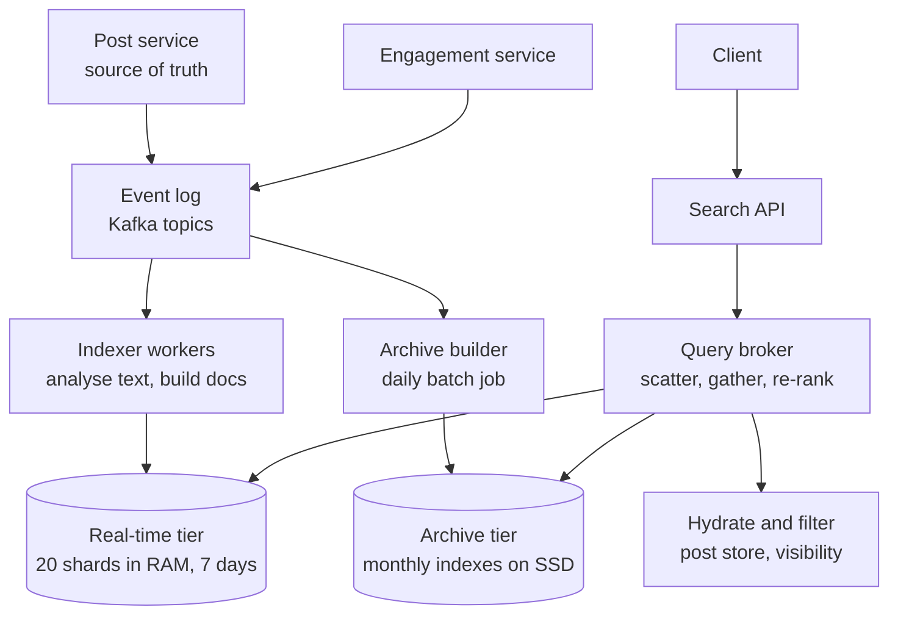
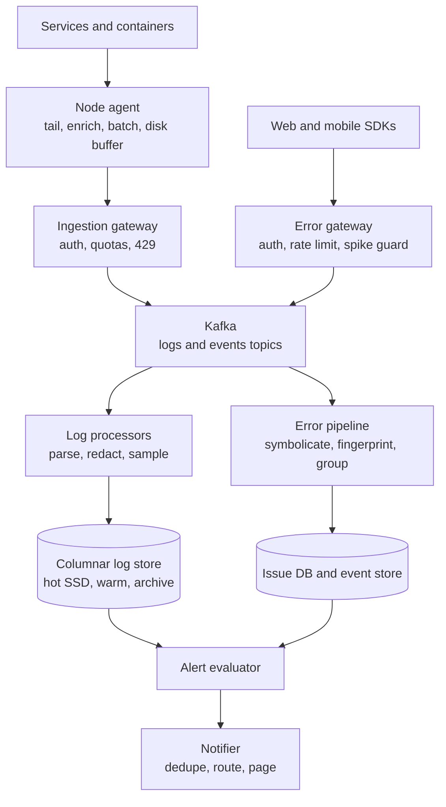
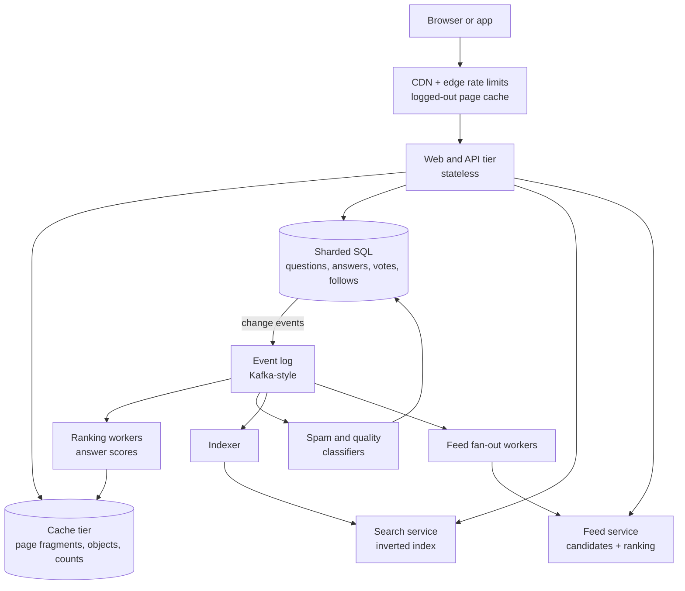
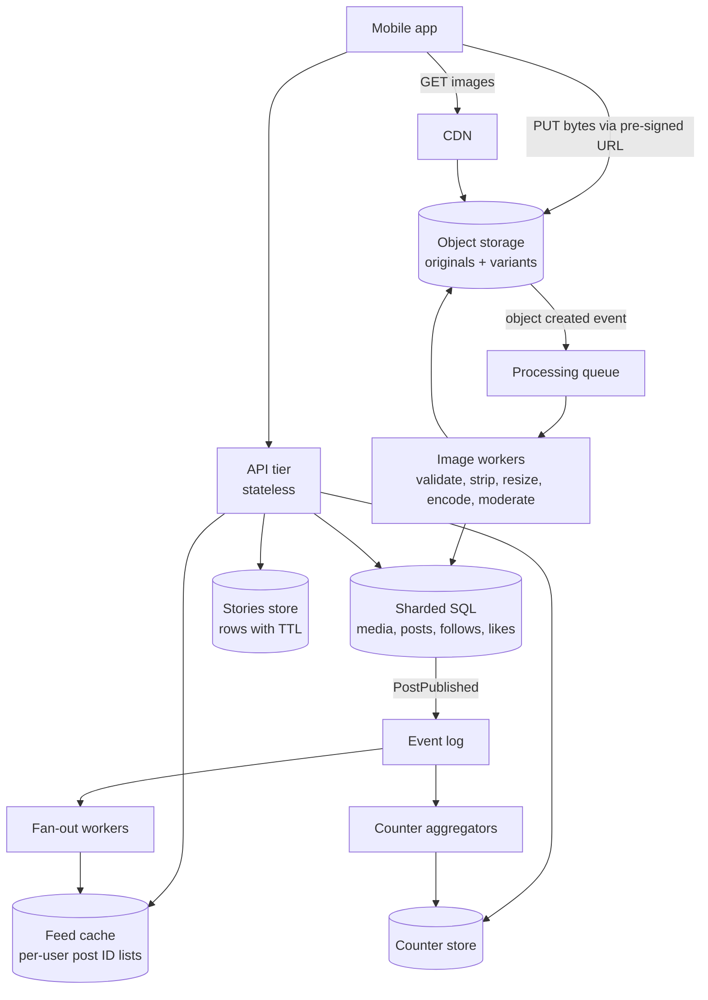
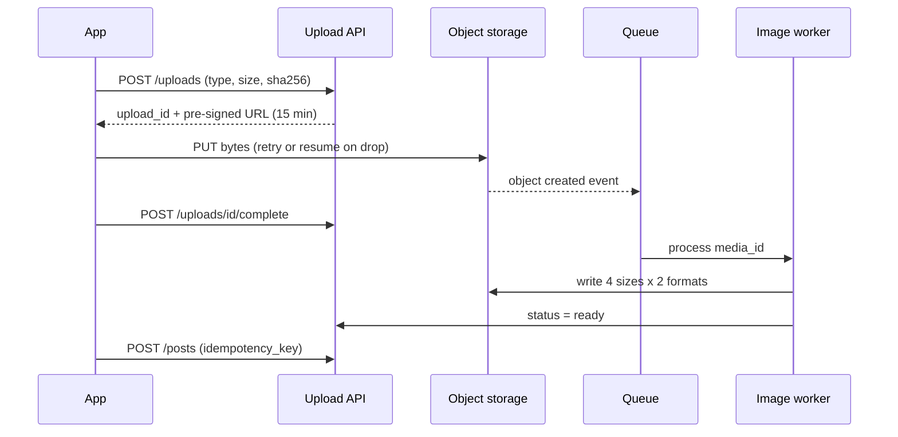
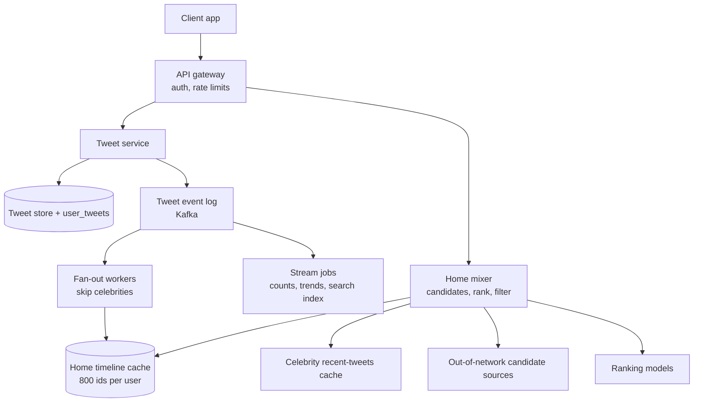
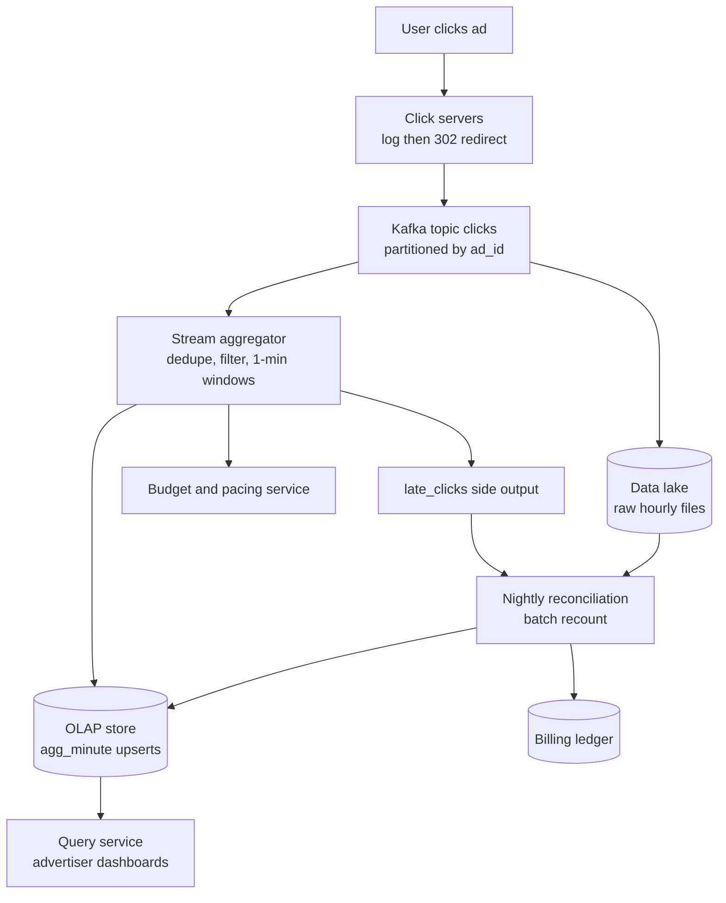

# Module 20 — Case Studies: Content, Search and Platforms

## Module Introduction

Six more end-to-end designs in the format of Modules 13–17 (requirements and numbers → five-questions pass → API → data model → annotated architecture → deep dives → failure walk → trade-offs → follow-ups → pattern manifest), covering the content and platform systems interviewers ask about most and earlier modules only touched. The algorithms they rely on are explained step by step in [Module 19](../19-algorithms-deep-dive/README.md).

| Case | Centre of gravity |
|---|---|
| 1 — Distributed Search | Near-real-time indexing, sharding by document vs term, scatter-gather and ranking |
| 2 — Distributed Logging and Error Monitoring | High-volume ingestion, storage choices, retention tiers, sampling, crash reporting and alerting |
| 3 — Q&A Platform (Quora-like) | Read-heavy caching, answer ranking, follow graph and feed, spam |
| 4 — Photo Sharing (Instagram-like) | Upload pipeline, media processing, CDN, hybrid feed, hot counters, expiring stories |
| 5 — Microblogging (Twitter/X-like) | Hybrid fan-out, ranked timeline, trending topics |
| 6 — Ad-Click Aggregation | Exactly-once-ish counting, windows and watermarks, late events, reconciliation |

## Case 1 — Distributed Search (Twitter/Elasticsearch-style)

**The prompt (in short).** The search box of a large social network: "world cup final" returns matching public posts as **Latest** (newest first) or **Top** (most relevant), and a post written two seconds ago is already findable. The engine should be general enough for other teams to use like Elasticsearch: put documents in, ask keyword queries, get ranked results.

**What makes it hard.** (1) **Freshness:** posts must be searchable within seconds during live events, yet the fastest search structures are built once and never changed. (2) **Fan-out:** the index spans many machines, so each query is only as fast as the slowest. (3) **Ranking:** "the best 20 of 4 million matches, in 200 ms" is the product.

### 1. Requirements and numbers

**Functional:** keyword search over public posts with AND/OR/NOT and quoted phrases, filters (language, author, has media, date range), Latest and Top, pagination, removal of deleted or hidden posts within seconds. Secondary: hashtag search, author search, approximate result counts.

**Non-functional:** new post searchable in **p50 < 2 s, p99 < 10 s**; query **p99 < 200 ms** at the API; high availability (an outage during a live event is very visible); results may be **slightly stale or incomplete** but never show a deleted post for long. Strong consistency is *not* required.

**Numbers (assumptions):**
- **500M posts/day** ≈ **5.8K posts/s average, ~17K/s peak** (3× for live events).
- Engagement updates (likes, reposts, replies that change ranking), about 10 per post per day: **5B/day ≈ 58K/s**, more frequent than posts (Deep dive 4).
- Index cost: ~300 bytes of text, plus posting entries per word, a few stored fields (post ID, author ID, time) and per-field sort values: **~1 KB per post** → **500 GB/day**.
- **Real-time tier** (last 7 days, where most queries land): **3.5 TB** per copy. **Archive tier** (~5 years at lower historic volume): **~600 TB** per copy on SSD (solid-state disk), not RAM.
- **Queries:** **1B/day ≈ 11.6K/s average, ~35K/s peak**; ~10% also need the archive.
- **Sharding the real-time tier:** 3.5 TB ÷ 175 GB ≈ **20 in-memory shards**. With document sharding every query visits all 20 → **700K shard-queries/s at peak**; at ~1,000 shard-queries/s per copy that is 700 copies → **35 copies of each shard**. **Replicas exist mainly for read throughput.**

**What the numbers say:** writes are moderate, engagement updates heavier, and query fan-out dominates machine count. Keep the hot index small and in memory; push old data to a cheaper tier.

### 2. The five-questions pass
- **Flow:** indexing is **asynchronous**: the post service commits to its own database and emits an event the indexer consumes later, so search is never on the posting path ([Event-Driven Architecture](../02-moving-data/README.md#event-driven-architecture)). Queries are request-response.
- **Storage:** the **post store is the source of truth**; the search index is a **derived view**, rebuildable and shaped for one query type ([CQRS](../03-storing-data/README.md#cqrs)). A lost shard is rebuilt, never "restored".
- **Speed:** the hot query is "last 7 days, top 20": keep that tier in RAM, have each shard return only its local top-K, and cache very popular queries for a few seconds.
- **Failure:** a slow or dead shard degrades results ("partial results") instead of failing the query; indexer lag must be visible, since stale search is a silent failure.
- **Growth:** the real-time tier is a fixed sliding window while the archive grows; query volume grows with users, so add replicas, not shards.
- *Skeleton:* event log → indexers → time-tiered, document-sharded, replicated index → query broker (scatter, gather, re-rank) → hydration (fetch full post content) and visibility filter.

### 3. API

| Caller | Endpoint / message | Purpose |
|---|---|---|
| Client → API | `GET /search?q=world+cup&sort=top\|latest&lang=en&cursor=…&limit=20` | Returns post IDs plus hydrated posts. `cursor` is an opaque token encoding where the last page ended ([Cursor-Based Pagination](../08-api-and-edge/README.md#cursor-based-pagination)) |
| Post service → log | `PostCreated {post_id, author_id, text, lang, media_flags, created_at}` | New document to index |
| Engagement service → log | `EngagementDelta {post_id, likes:+12, reposts:+3}` | Partial update of ranking signals only |
| Moderation / post service → log | `PostHidden {post_id, reason}` / `PostDeleted {post_id}` | Must hide the post from all results quickly |
| Admin | `PUT /indexes/{name}` with mapping (field types and text analysers); `POST /aliases` | Create a new index version and switch the alias (a stable name pointing at one index version) atomically |

Latest's cursor is "post IDs older than X", since IDs are time-ordered (Snowflake-style, [Module 13 Case 1](../13-case-studies-building-blocks/README.md#case-1--design-a-unique-id-generator)). Top's cursor encodes the last result's score and ID plus a snapshot time, so page 2 doesn't repeat page 1 as new posts arrive.

### 4. Data model

> **Key term — inverted index, posting list, term, analyser:** an **analyser** turns raw text into **terms** (tokenise, lowercase, remove accents, optionally stem: "Running" → "run"); an **inverted index** maps each term to its **posting list** of sorted document IDs, often with positions for phrase matching. Step by step in [Module 19 — Inverted index](../19-algorithms-deep-dive/README.md#inverted-index); see also DDIA's [full-text search and fuzzy indexes](../../../ddia/chapters/03-storage-and-retrieval/README.md#full-text-search-and-fuzzy-indexes).

- **Document:** `post_id (64-bit, time-ordered), author_id, created_at, lang, text terms, hashtags, mentions, has_media, likes, reposts, replies, author_quality_score`.
- **Per shard, per segment:**
  - *Term dictionary:* term → posting list pointer. `cup → [9012, 8877, 8410, …]`, `world → [9012, 8990, 8877, …]`; "world AND cup" intersects to `[9012, 8877, …]`.
  - *Posting lists:* doc IDs (plus positions), compressed as gaps between sorted IDs.
  - *Stored fields:* usually just `post_id`; text and media come from the post store at hydration.
  - *Doc values* (one column per field, one value per document, for sorting and scoring): `created_at`, `likes`, `reposts`, `author_quality_score`. As separate columns, engagement can change without rewriting the text index.
  - *Deletion bitmap:* one bit per document; set = skip.
- **Shard map** (small, strongly consistent, in ZooKeeper/etcd): `index_version → tier → shard_id → [replica hosts]`.
- **Shard key:** real-time tier `hash(post_id) mod 20`; archive split by **time range first** (one index per month), then hash within the month.

### 5. The architecture, annotated

1. The **post service** writes the post, then publishes `PostCreated` to the **event log** (Kafka; [Inside Kafka](../10-batch-and-streaming/README.md#inside-kafka)), which lets indexers fall behind in a spike and catch up without loss.
2. **Indexer workers** consume in parallel ([Partitioned Consumption](../10-batch-and-streaming/README.md#partitioned-consumption)), run the per-language analyser, and send each document to the **one** real-time shard owning `hash(post_id)`; all its replicas apply it.
3. Each **real-time shard** appends to its in-memory "active" segment, searchable at the next refresh (about once a second; Deep dive 1). Posts leave the 7-day window by dropping whole segments, far cheaper than per-document deletes.
4. The **archive builder**, a daily [MapReduce](../10-batch-and-streaming/README.md#mapreduce)-style job, builds compact read-only monthly indexes from the log or post store, using heavier compression and sort orders a live index can't afford.
5. The **search API** parses the query (`world cup` → phrase or AND, language filter) and checks a **short-lived result cache** (5–10 s TTL) for the hottest queries.
6. The **query broker** (Twitter's front end is called "Blender") **scatters** to one replica of every real-time shard (archive only if needed), **gathers** each shard's top-K, merges and re-ranks (Deep dives 3 and 4).
7. **Hydrate and filter:** batch-fetch the final 20 posts from the post store behind a cache ([Cache-Aside](../04-caching/README.md#cache-aside)) and drop anything deleted, hidden or blocked for this viewer since indexing: the safety net that lets the index be eventually consistent.

### 6. Deep dives

**Deep dive 1 — near-real-time indexing: immutable segments plus a refresh.**
- *The tension:* compressed sorted posting lists are fast to read but expensive to change.
- *Lucene's trick* (inside Elasticsearch and Solr): never modify; new documents buffer in memory and a **refresh** turns the buffer into a new immutable **segment** opened for search; queries search all segments and merge; background **merges** combine segments and drop deleted documents ([Module 19 — Inverted index](../19-algorithms-deep-dive/README.md#inverted-index); the same idea as LSM-tree SSTables, [DDIA](../../../ddia/chapters/03-storage-and-retrieval/README.md#sstables-and-lsm-trees)).
- *Durability:* a refresh makes data searchable, not durable. Elasticsearch appends every operation to a per-shard **translog**, doing a [write-ahead log](../03-storing-data/README.md#write-ahead-log)'s job; here the Kafka log does too: a restarted shard replays from its last saved offset.
- *Real numbers:* Elasticsearch refreshes every **1 s** by default, but only on shards searched in the last **30 s**. So "near real time" ≈ one second; raising the interval (say 30 s) makes bulk loads much cheaper.
- *Twitter's version:* the Earlybird paper (ICDE 2012) describes one writable "active" segment per server plus read-only optimised segments (12 segments of about 8.4M tweets, 2^23, at the time), a **single-writer, multiple-reader** design so indexing never locks out queries, posting lists traversed **newest first**, and a 10 s searchability target. Twitter's 2020 post reports cutting indexing latency from about **15 s to about 1 s**, partly by indexing late-arriving fields (such as resolved URLs) separately.

**Deep dive 2 — sharding by document vs by term.**

> **Key term — document-partitioned vs term-partitioned index:** a **document-partitioned** (*local*) index gives each shard a full inverted index for its own documents; a **term-partitioned** (*global*) index gives each shard complete posting lists for a subset of terms (e.g. a–f). See [Module 19](../19-algorithms-deep-dive/README.md#inverted-index) and DDIA on partitioning secondary indexes [by document](../../../ddia/chapters/06-partitioning/README.md#partitioning-secondary-indexes-by-document) and [by term](../../../ddia/chapters/06-partitioning/README.md#partitioning-secondary-indexes-by-term).

`world AND cup` on 20 shards:

| | Document-partitioned | Term-partitioned |
|---|---|---|
| Write of one 25-word post | Touches **1 shard** | Touches up to **25 shards** (one per term), so a write is a distributed operation |
| Query `world AND cup` | All **20 shards**, each intersects locally and returns its top-K | **2 shards**, but the `world` list may hold tens of millions of IDs that must be shipped across the network to intersect |
| Hot spots | Even, because hashing post IDs spreads load | A trending term (`#worldcup`) makes one shard the bottleneck for all of its reads and writes |
| Ranking | Each shard scores fully with all fields locally | Scoring needs doc fields that live elsewhere |

*Decision:* **document partitioning**, as in essentially every production engine (Elasticsearch, Solr, Earlybird), paying with fan-out made affordable by replicas, a small hot tier and tail-latency control.

*Time is the second dimension:* split by **time first, hash second**. Latest starts at the newest tier and stops at 20 results; Top over 7 days never touches the archive. This tiering is the biggest single saving.

*Shard count is a commitment:* Elasticsearch fixes primary shards at index creation (changing means split/shrink or reindex). Time-based indexes make it painless: next month's index gets a different count. Rebalancing follows DDIA's [fixed number of partitions](../../../ddia/chapters/06-partitioning/README.md#fixed-number-of-partitions): more shards than machines, move whole shards.

**Deep dive 3 — scatter-gather and the tail-latency tax.**
- *The maths:* if each shard meets 50 ms 99% of the time, P(at least one of 20 is slower) = 1 − 0.99^20 ≈ **18%**; the broker waits for the slowest, so about one query in five sees a shard's p99, worse with more shards ([Percentiles and tail latency](../00-system-design-fundamentals/README.md#percentiles-tail-latency-and-why-averages-lie)).
- *Mitigations:*
  - **Fastest replica, not round-robin:** Elasticsearch's adaptive replica selection (default since 7.0) ranks copies by recent response time and queue length, so a node in a long GC pause stops getting traffic.
  - **Hedged requests:** no answer by the shard's p95 → send to a second replica, take the first reply; a few percent extra load.
  - **Per-shard deadline + partial results:** at ~150 ms merge what has arrived and mark `partial=true`; missing 1 of 20 shards loses 5% of candidates, rarely noticed in Top ([Timeout](../05-reliability/README.md#timeout), [Graceful Degradation](../05-reliability/README.md#graceful-degradation)).
  - **Early termination:** Latest walks posting lists newest first, so a shard stops after its first K matches.
- *Two-phase fetch* (Elasticsearch's **query then fetch**): shards return only `(post_id, score)` for their top K; the broker keeps the global top 20 and only then fetches content. 20 × 1,000 IDs is cheap; 20,000 full posts would not be.
- *Deep pagination trap:* page 50 at 20 per page makes every shard return 1,000 and the broker discards 980 × 20. Cap pages (a few hundred results) and use "search after this score and ID" cursors.

**Deep dive 4 — ranking in two stages.**
- *Stage 1, per shard (cheap, many candidates):* text relevance plus a few doc-value signals. The text score is **BM25** (saturating term frequency `k1`, rarer terms count more, length normalisation `b`; Elasticsearch defaults `k1 = 1.2`, `b = 0.75`; worked example in [Module 19 — BM25](../19-algorithms-deep-dive/README.md#ranking-with-tf-idf-and-bm25)). Short posts make length matter less, so recency and engagement weigh more, e.g. `0.5·bm25 + 0.3·recency_decay + 0.2·log(1 + likes + 2·reposts)`.
- *Stage 2, at the broker (expensive, few candidates):* the merged top ~500 go to an ML ranking model with viewer features (language, follows, past clicks). Scoring 500 instead of millions keeps p99 under 200 ms.
- *Fresh engagement without reindexing:* 58K likes/s are stored as **doc values** updated in place (or a side table keyed by post ID read at scoring), batched per shard every second or so, so engagement never re-analyses text: the "separate fast-changing fields" idea from Twitter's 2020 post.

**Deep dive 5 — deletes, edits and reindexing.**
- A delete sets a bit in the **deletion bitmap**: gone at the next refresh, physically removed at the next merge. An edit is delete + insert.
- Deletes are urgent (legal takedowns, user deletes), so the hydration visibility check (step 7) is a second line of defence even when a shard lags.
- **Schema change or new analyser** (e.g. a new language): build a **new index version** beside the old from the archive plus log replay, compare results, switch the **alias** atomically: a [blue-green](../09-operating-in-production/README.md#blue-green-deployment) swap for indexes. A derived index can always be rebuilt; it just costs hours of compute.

### 7. The failure walk
1. **One shard replica dies:** health checks and failures mark it down; the other 34 copies absorb about 3% more each. The cluster manager copies shard files from a healthy replica to a new machine and replays the log from the snapshot's offset.
2. **Every replica of one shard unhealthy** (bad deploy to that group): **partial results** from 19 of 20 shards, not errors. Stop and roll back ([Canary Deployment](../09-operating-in-production/README.md#canary-deployment)); spread a shard's replicas across racks and zones.
3. **Indexers fall behind** (live event, 3× posts): Kafka absorbs the backlog with no loss, but freshness slips from 1 s to maybe 30 s. Make **indexing lag** (newest indexed post time vs now) a top-level SLO, scale indexers up to the partition count, and raise refresh intervals slightly ([Backpressure](../10-batch-and-streaming/README.md#backpressure)).
4. **Query storm on one term** (celebrity news): the short-TTL **result cache** collapses 10K identical queries/s into one per shard every few seconds ([Cache Stampede Prevention](../04-caching/README.md#cache-stampede-prevention)).
5. **Broker tier overloaded:** shed the most expensive work first: no archive for Top, smaller stage-2 candidate set, Latest only; rate-limit scrapers ([Rate Limiting](../08-api-and-edge/README.md#rate-limiting)).
6. **Event log outage:** posting keeps working; search freezes at the last indexed moment. Indexers resume from saved offsets; if a gap is suspected, a reconciliation job compares post-store IDs with the index and re-sends missing ones.
7. **Corrupted shard:** discard and rebuild from archive snapshot + log replay; the worst case is a slow rebuild, never data loss.

### 8. Trade-offs

| Decision | Chosen | Alternative | Why |
|---|---|---|---|
| Index partitioning | By document (hash of post ID) | By term | One-shard writes, even load, local scoring; pay with fan-out |
| Layout | Time tiers (7-day RAM tier + monthly archive) | One big index | Most queries are recent; tiers cap the hot set and allow cheap expiry |
| Freshness | ~1 s refresh, immutable segments | Instant per-document visibility | Immutable segments are much faster to search; 1 s is enough for users |
| Replicas | Many (≈35 per hot shard) | 1–2 for safety | Fan-out × QPS needs throughput; replicas also absorb failures |
| Ranking | Cheap BM25 + signals per shard, ML re-rank of top ~500 at broker | Full ML score on every match | Model cost is per candidate; two stages keep p99 low |
| Consistency | Eventually consistent index + visibility check on hydrate | Index updated in the write transaction | Keeps search off the posting path; the check hides deletes |
| Engagement signals | Doc values / side table updated in batches | Reindex the whole document | 58K updates/s would rewrite text segments constantly |

### 9. The follow-up questions
- **"Autocomplete?"** A different index: a prefix structure (trie or n-gram index) over popular *queries*, updated from query logs ([Module 13 Case 6](../13-case-studies-building-blocks/README.md#case-6--design-search-autocomplete)). *Trap:* a prefix query against the full post index on every keystroke.
- **"'About 4.2M results'?"** Count exactly up to a threshold (Elasticsearch: 10,000 hits by default) and estimate beyond, or show "4M+"; nobody verifies it.
- **"Semantic search?"** Add a per-shard vector index of embeddings, run it beside the keyword query and fuse the lists (e.g. reciprocal rank fusion: sum 1/(60 + rank) from each list); sharding and fan-out stay the same ([Vector Database Sharding](../11-ai-era-systems/README.md#vector-database-sharding)).
- **"Reshard when the hot tier outgrows 20 shards?"** Not in place: write *new* time segments with 30 shards; within 7 days the old layout ages out.
- **"Personalise?"** Keep the index viewer-independent (cacheable, shareable); personal features only in stage-2 re-ranking and filtering (blocked/muted accounts).

### Pattern manifest

| Pattern | Where it served | Taught in |
|---|---|---|
| Event-Driven Architecture | Post service emits events; search indexes asynchronously | [Module 02](../02-moving-data/README.md#event-driven-architecture) |
| CQRS (derived read model) | Search index as a rebuildable view of the post store | [Module 03](../03-storing-data/README.md#cqrs) |
| Sharding | Document-partitioned shards, time-first then hash | [Module 03](../03-storing-data/README.md#sharding) |
| Primary-Replica | 35 copies per hot shard for throughput and failover | [Module 03](../03-storing-data/README.md#primary-replica) |
| Write-Ahead Log | Translog / Kafka replay protects unrefreshed documents | [Module 03](../03-storing-data/README.md#write-ahead-log) |
| Partitioned Consumption | Parallel indexer workers per log partition | [Module 10](../10-batch-and-streaming/README.md#partitioned-consumption) |
| MapReduce (batch) | Offline build of monthly archive indexes | [Module 10](../10-batch-and-streaming/README.md#mapreduce) |
| Timeout + Graceful Degradation | Per-shard deadlines, partial results, shedding archive queries | [Module 05](../05-reliability/README.md#graceful-degradation) |
| Cache-Aside + stampede control | Hydration cache; short-TTL cache for hot queries | [Module 04](../04-caching/README.md#cache-stampede-prevention) |
| Cursor-Based Pagination | Search-after cursors for Latest and Top | [Module 08](../08-api-and-edge/README.md#cursor-based-pagination) |
| Blue-Green Deployment | New index version behind an alias | [Module 09](../09-operating-in-production/README.md#blue-green-deployment) |

**Interview one-liner:** "Index asynchronously from an event log into time-tiered, document-partitioned shards of immutable segments refreshed every second; scatter each query to one replica per shard with deadlines and hedging, merge each shard's top-K, re-rank the best few hundred with a model, then hydrate and drop anything deleted since indexing."

### TL;DR
- **Problem:** seconds-fresh keyword search over billions of posts, p99 under 200 ms, with ranking.
- **Mechanism:** Kafka → indexers → document-sharded inverted index (immutable segments + 1 s refresh) in a 7-day RAM tier and monthly SSD archive; broker does scatter-gather, two-stage ranking, hydration and visibility filtering.
- **Hard parts:** freshness vs immutability (segments, refresh, merge), fan-out tail latency (replica selection, hedging, partial results), fast-changing ranking signals (doc values), deletes (bitmap + hydrate-time check).
- **Price:** many replicas for fan-out throughput, a derived index to monitor for lag, occasional full rebuilds.

**Sources**
- Busch, Gade, Larson, Lok, Luckenbill, Lin, *Earlybird: Real-Time Search at Twitter*, ICDE 2012: https://cs.uwaterloo.ca/~jimmylin/publications/Busch_etal_ICDE2012.pdf
- Twitter/X Engineering, *Reducing search indexing latency to one second* (2020): https://blog.x.com/engineering/en_us/topics/infrastructure/2020/reducing-search-indexing-latency-to-one-second
- Elasticsearch Reference, *Near real-time search*: https://www.elastic.co/guide/en/elasticsearch/reference/current/near-real-time.html
- Elasticsearch Reference, *Index modules* (shard count fixed at creation, refresh and search-idle defaults): https://www.elastic.co/guide/en/elasticsearch/reference/current/index-modules.html
- Elastic blog, *Improving response latency in Elasticsearch with adaptive replica selection*: https://www.elastic.co/blog/improving-response-latency-in-elasticsearch-with-adaptive-replica-selection
- Elasticsearch Reference, *Track total hits* (accurate count up to 10,000 by default): https://www.elastic.co/guide/en/elasticsearch/reference/7.0/search-request-track-total-hits.html
- Elastic blog, *Practical BM25 Part 2: the BM25 algorithm and its variables*: https://www.elastic.co/blog/practical-bm25-part-2-the-bm25-algorithm-and-its-variables

---

## Case 2 — Distributed Logging and Error Monitoring

**The prompt (in short).** The company-wide system that collects every service's log lines (timestamped text or structured records such as `level=ERROR service=checkout msg="card declined" order=81`), makes them searchable during incidents, keeps them for a set time at sensible cost, and alerts on error spikes. Plus a Sentry/Crashlytics-style **error monitoring** product: capture web and mobile crashes with stack traces, group identical crashes into one "issue", and notify the owning team.

**What makes it hard.** (1) **Volume with low value per byte:** 99% of lines are never read, but nobody knows which 1% will matter. (2) **Needed most when everything is broken:** outages cause log storms exactly as engineers start querying. (3) **Client errors come from devices you don't control:** minified or compiled, late (after the crash), bursty, and must be grouped or one bug becomes 100,000 alerts.

Unlike [Metrics Monitoring & Alerting](../16-case-studies-infrastructure/README.md#design-2--metrics-monitoring--alerting) (small numeric samples, few shapes), logs are large semi-structured events with unbounded text, queried with needle-in-a-haystack searches ("every line for request 7f3a") rather than sums.

### 1. Requirements and numbers

**Functional:**
- *Logs:* collect from servers, containers and managed services; parse into fields; full-text and field search over a time range; live tail; aggregations ("ERROR count by service per minute"); saved queries and log alerts; per-team access control; personal-data deletion on request.
- *Error monitoring:* SDKs for web, iOS, Android and backend capturing exceptions and crashes with stack traces, breadcrumbs (last few events before the crash, such as taps and network calls), device and release info; **symbolicate** (map machine addresses or minified names back to file, function, line); group into issues; first/last seen, counts, affected users, crash-free session rate per release; alerts on new issues, regressions and spikes.

**Non-functional:** ingestion **never slows or crashes the producing app** (fire-and-forget); searchable within **p99 < 30 s**; last-hour queries **< 2 s**, week-long **< 30 s**; **no loss of ERROR logs or crash events** normally, while debug/info may be sampled or shed under pressure; retention 7 days hot, 30 warm, 1 year archive (audits); alerting survives big incidents.

**Numbers (assumptions):**
- **2M lines/s average, 5M/s peak** (Uber reported "millions of logs per second"). 500-byte lines → **1 GB/s ≈ 86 TB/day raw**.
- **Compression:** repetitive structured logs, **~10×** in a columnar store → **~8.6 TB/day**, ×2 replicas **~17 TB/day**.
- **Retention:** hot 7 days ≈ **120 TB on SSD**; warm days 8–30 ≈ **200 TB** (one copy on cheaper disks, object storage for durability); archive to 1 year ≈ **2.9 PB** in object storage (S3-style; the provider keeps copies). Archive is ~90% of bytes at the lowest price, hence tiering.
- **Indexing every word instead** (inverted index on all text) often makes the index as big as the compressed data, roughly doubling the hot tier and multiplying RAM: this drives Deep dive 2.
- **Queries:** a few hundred interactive/s plus **~20K alert rules** every minute ≈ **330 rule queries/s**, almost all over the last 5–15 minutes.
- **Error events:** 50M daily app users; **~2K events/s** normally, **~30K/s** in a bad release; ~**20 KB** each (stack, breadcrumbs, context) → **600 MB/s peak**. Distinct *issues* are thousands per day.

**What the numbers say:** bytes and retention decide cost; ingest must buffer and shed gracefully; error events are low-volume but bursty with heavy per-event processing (symbolication, grouping).

### 2. The five-questions pass
- **Flow:** **asynchronous and one-way**: apps write to stdout or a file and an agent ships it; SDKs queue and send in the background. No user request waits on logging.
- **Storage:** the **ingestion buffer** (Kafka) is the short-term source of truth (days, replayable); the log store and issue database derive from it; raw archives in object storage are the long-term record.
- **Speed:** most queries hit the **last hour**: keep it on SSD with fast filters on `service`, `level`, `timestamp`, `trace_id`.
- **Failure:** losing some debug lines is acceptable; losing alerting or crash events is not. Every stage **buffers, then sheds lowest-value data first** ([Graceful Degradation](../05-reliability/README.md#graceful-degradation)).
- **Growth:** volume grows with services, traffic and careless `log.debug`; per-team quotas and cost reports are part of the design.
- *Skeleton:* agents → ingestion gateway → Kafka → processors (parse, redact, sample, route) → tiered columnar log store; SDK → error gateway → Kafka → symbolicate and group → issue store + event store; alert evaluators over both.

### 3. API

| Caller | Endpoint | Purpose |
|---|---|---|
| Agent → gateway | `POST /v1/logs` (OTLP: the OpenTelemetry protocol, an open standard for sending logs, metrics and traces), gzip-compressed batches | Ship batches of records; response tells the agent to slow down (HTTP 429) if needed |
| Client SDK → error gateway | `POST /api/{project_id}/envelope` with a public project key (DSN) | One envelope carries an error event, session updates and attachments |
| CI (build system) → symbol service | `POST /projects/{id}/releases/{version}/symbols` | Upload source maps (JS), dSYM files (iOS), ProGuard/R8 mapping files (Android) at build time |
| Engineer → query | `POST /logs/query {query:'service:checkout AND level:ERROR AND "card declined"', from, to, limit}` | Search; returns rows plus a cursor |
| Engineer → query | `GET /logs/tail?query=…` (Server-Sent Events) | Live tail of matching lines ([Server-Sent Events](../02-moving-data/README.md#server-sent-events)) |
| Engineer → issues | `GET /issues?project=ios&release=5.2.0&sort=users` ; `PATCH /issues/{id} {status: resolved}` | Triage and resolve |
| Rules | `POST /alerts {query, window:5m, condition:'count > 100', route:'#payments-oncall'}` | Log-based and issue-based alerts |

### 4. Data model
- **Log record** (OpenTelemetry log data model in spirit): `timestamp, observed_timestamp (when the agent saw it), service, env, host, pod, level, trace_id, span_id, message, attributes (key → value map)`.
- **Log table in a columnar store** (ClickHouse-style: each field's values stored together, so reading 3 of 30 fields reads 10% of bytes and similar values compress well; [Column-Oriented Storage](../../../ddia/chapters/03-storage-and-retrieval/README.md#column-oriented-storage)):
  - partitioned by `(tenant, day)` so expiry drops whole partitions;
  - sorted by `(service, level, timestamp)` so "checkout errors in the last hour" reads one narrow range;
  - popular attributes promoted to typed columns, the rest in key-value map columns;
  - **skip indexes** on `message` and `trace_id`: per-block summaries (min/max, or a Bloom filter answering "definitely not in this block" or "maybe") that skip most blocks without an inverted index.
- **Error event:** `event_id, project, release, environment, timestamp, platform, exception{type, value, frames[]}, breadcrumbs[], user_hash, device{os, model}, tags`; raw body in object storage, searchable fields in a columnar event table.
- **Issue:** `issue_id, project, fingerprint (hash), title, culprit (top in-app frame), first_seen, last_seen, first_release, status (unresolved/resolved/ignored), assignee`; counters (`events, users`) updated asynchronously per time bucket. Small and relational (SQL), because people edit it.
- **Symbol files:** keyed by `(project, release, debug_id)` in object storage; a debug ID baked into each build lets an event find its exact symbol file.

### 5. The architecture, annotated

1. **Services** write to stdout or files and never call the backend directly, so a backend outage can't block a request.
2. A **node agent** per host (Fluent Bit, Vector or an OpenTelemetry Collector) tails files, adds metadata (service, pod, region, version), batches about 1 MB or 1 s, compresses and sends, with a **bounded disk buffer** so minutes of backend trouble lose nothing.
3. The **ingestion gateway** authenticates the tenant, enforces per-team quotas ([Rate Limiting](../08-api-and-edge/README.md#rate-limiting)) and answers **429 / retry-after** under Kafka pressure so agents back off.
4. **Kafka** is the shock absorber: 3 days' retention, partitioned by `(tenant, service)`; store writers, live tail, archive writer and security analytics each consume at their own pace ([Publish-Subscribe](../02-moving-data/README.md#publish-subscribe)).
5. **Log processors** parse lines into fields, **redact secrets and personal data** (card numbers, emails, tokens) *before* storage, apply sampling (Deep dive 3), and write large sorted batches (thousands of rows per insert) to the **columnar store**.
6. The **error pipeline**: SDK envelope → **rate-limiting edge** (Sentry's is "Relay") → Kafka → workers that **symbolicate**, compute a **fingerprint**, find or create the **issue**, and store the event (Sentry's docs show events reaching ClickHouse through its Snuba service).
7. The **alert evaluator** runs log queries and issue rules on a schedule; the **notifier** groups, deduplicates and routes to chat, email or pager. `trace_id` links one error to every log line and span of its request ([Distributed Tracing](../09-operating-in-production/README.md#distributed-tracing)).

### 6. Deep dives

**Deep dive 1 — agents and the ingestion buffer: never block, never explode.**
- *Agent, not an in-app library calling the backend:* a library shares the app's threads and memory, so a slow backend slows the app; stdout costs microseconds and the agent takes the risk.
- *Buffering chain:* stdout → agent memory (seconds) → agent disk buffer (minutes, capped at say 1 GB) → Kafka (days). Each stage is bounded and drops **debug, then info, never error** when full: [backpressure](../10-batch-and-streaming/README.md#backpressure) with priorities.
- *Kafka sizing:* 1 GB/s raw, compressed about 4× by agents → ~250 MB/s on the wire; 3 days ≈ 65 TB × 3 replicas ≈ **195 TB** of broker disk. Partitions follow consumer parallelism (e.g. 600); very loud services get their own topic so they can't delay quiet ones ([Bulkhead](../05-reliability/README.md#bulkhead)).
- *Delivery:* agents retry, so the pipeline is **at-least-once**; per-batch IDs and per-line sequence numbers let the writer drop duplicate batches ([Idempotency](../05-reliability/README.md#idempotency)). Exactly-once for logs is rarely worth it.
- *Timestamps:* display the event's own timestamp but also store `observed_timestamp`, or a host with a wrong clock writes "2019" logs no time-range query finds ([Event time versus processing time](../../../ddia/chapters/11-stream-processing/README.md#event-time-versus-processing-time)).

**Deep dive 2 — indexing everything vs columnar storage.**

| | Inverted index on all text (classic ELK: Elasticsearch, Logstash, Kibana) | Columnar store with skip indexes (ClickHouse-style) | Index labels only (Grafana Loki-style) |
|---|---|---|---|
| Write cost | High: every term updates posting lists, segments merge constantly | Low: append sorted, compressed column blocks | Lowest: compress chunks, index a few labels |
| Storage | Index can be as big as the data | ~10× compression typical on structured logs | Chunks in cheap object storage |
| "Find this rare word" over a week | Fast (posting-list lookup) | Scan of the message column, sped up by bloom-filter skips | Brute-force scan of the chunks for the selected labels |
| Aggregations (count by service per minute) | Possible, heavier | Very fast, the columnar sweet spot | Possible, via scans |
| Best for | Smaller volumes, heavy free-text search | Large volumes, field filters plus aggregations | Cheapest storage, queries that always filter by labels first |

- *Real-world:* Uber's 2021 post describes moving its logging platform (on ELK since 2014) to a **ClickHouse**-based schema-agnostic design to cut cost at millions of logs per second and several petabytes. Loki's docs: it indexes only a label set per stream and stores compressed lines in object-storage chunks.
- *Our choice:* **columnar** for the bulk, plus a lightweight token Bloom filter per block on `message` and exact-match indexes on `trace_id` and `request_id`. Real queries filter on service, level and time first; week-long full-text needles are rare and may take 20 s.
- *Schema-agnostic attributes:* unknown keys go into typed map columns (`attr_string`, `attr_number`), and hot keys are promoted to real columns automatically, so new fields need no migration.

**Deep dive 3 — retention tiers, sampling and the cost lever.**
- **Tiers** (numbers from section 1): *hot* 0–7 days, SSD, two replicas, all indexes, ~120 TB, 95% of queries; *warm* 8–30 days, cheaper disks or object storage with a local cache, one copy, ~200 TB, queries take seconds to tens of seconds; *archive* 31–365 days, compressed object-storage files restored on request for audits, ~2.9 PB at the lowest price; *delete* whole day partitions, never row by row. Elasticsearch's index lifecycle management (ILM) expresses the same as hot → warm → cold → frozen → delete, with **rollover** (new write index at a size, document count or age).
- **Sampling** (deliberately keeping a fraction):
  - *Never sample* ERROR/FATAL, audit or security logs.
  - *Head sampling:* decide at creation ("keep 10% of INFO in cart"), cheap, in the agent or SDK.
  - *Tail sampling:* decide after the whole request; keep every log and span of errored or slow requests, sample boring successes. The OpenTelemetry collector's tail-sampling processor has policies like "keep status = ERROR"; it buffers each trace a few seconds and needs all its parts on one collector, so route by `trace_id`.
  - *Dynamic sampling:* a service over quota gets a higher INFO sample rate automatically, recorded on kept lines (`sample_rate=10`) so counts can be scaled back up.
- **Showback:** a daily bytes-per-team report is in practice the most effective cost control; most volume comes from a handful of noisy statements.

**Deep dive 4 — client-side crash and error reporting.**
- *Capturing:* a global handler (`window.onerror`, `unhandledrejection` in browsers; uncaught-exception and signal handlers on iOS/Android). On a **native crash** the process is dying, so the SDK writes a minimal report to disk and **sends it on next launch**. Events carry `release`, `environment`, device info and the last ~100 breadcrumbs.
- *Client-side protection:* the SDK samples (`sampleRate`), self-rate-limits, deduplicates errors fired in a tight loop, scrubs personal data, and sends in the background on Wi-Fi-friendly schedules ([Observability on the client](../18-client-and-mobile-system-design/README.md#9-observability-on-the-client)).
- *Symbolication:* CI uploads source maps or debug symbols keyed by release and debug ID at build time; the pipeline maps `a.js:1:48213` to `checkout/Cart.tsx:88 in applyCoupon`. Without it, grouping and reading errors are nearly useless.
- *Grouping into issues* by **fingerprint**, in Sentry's documented order: developer's custom fingerprint; else the **stack trace** using only in-app frames; else exception type and value; else the message. Line numbers are excluded so shifted code doesn't create a new issue. 40,000 `TypeError: cannot read 'price' of undefined` events from `applyCoupon` become **one issue** with 40,000 events and 12,000 users.
- *Release health:* SDKs send lightweight **session** start/end updates; crash-free sessions = 1 − crashed ÷ all; 99.8% → 98.9% on a release is a rollback signal ([Canary Deployment](../09-operating-in-production/README.md#canary-deployment)).
- *Spike protection:* a crash loop can send 30K events/s; the edge counts every event (accurate issue counts) but **stores only a sample of full events** per issue (e.g. first 100, then 1 per second) and enforces per-project quotas.

**Deep dive 5 — alerting that people trust.**
- *Log alerts:* query + window + condition, every minute: `count(service:payments AND level:ERROR) over 5m > 200`. Better: alert on **error ratio** (errors ÷ requests), immune to traffic doubling. Turn hot log queries into **metrics at ingest** (a processor increments `payments_errors_total`) and alert on those: cheaper, and working even if the log store is slow.
- *Issue alerts:* new issue in production; resolved issue regressed in a new release; issue affecting > 1% of users in 1 hour.
- *Noise control:* group by service and fingerprint, deduplicate within a window, silence during maintenance, route by ownership (`service → team → on-call`). 300 pages for one outage teaches on-call to stop reading.
- *Independence:* the evaluator reads recent data from a **dedicated path** (hot tier plus Kafka-fed counters), runs in a separate failure domain, and has a **dead-man's switch** (a heartbeat alert that fires if alerting goes quiet). Full pipeline: [metrics case](../16-case-studies-infrastructure/README.md#design-2--metrics-monitoring--alerting).

### 7. The failure walk
1. **Log storm from one service** (a retry loop logging 200K errors/s): its quota triggers, the gateway returns 429, agents drop debug and info first and keep **one representative error with a count** ("repeated 199,843 times"). Other teams are unaffected: the service is limited at the edge and has its own partitions.
2. **Log store behind or a node dies:** writers resume from Kafka offsets (3 days held); replicas serve reads; a banner says "data delayed by 4 min". Ingest-time metric alerts keep working.
3. **Kafka unavailable:** agents spill to disk buffers; the gateway refuses low-priority tenants first. Past the buffers, debug/info are lost and errors kept as long as possible, and the pipeline reports exactly what was dropped ("dropped 1.2B debug lines between 10:02 and 10:19"): silent loss is the real failure.
4. **Bad release crashes on launch for 5M users:** 30K events/s; spike protection samples full events while counting all, and the "new issue + crash-free drop" alert fires within a minute. Because reports send on *next* launch, a crash-on-launch loop still reports: the SDK sends before initialising the rest of the app.
5. **Missing symbol files:** store events raw and **re-symbolicate** when symbols arrive; CI warns when a release ships without them.
6. **Secrets or personal data found in logs:** update processor redaction rules; for stored data, a delete job rewrites affected partitions (slow; columnar stores rewrite whole parts), handled as a security incident. Prevention at the agent is cheapest.
7. **Monitoring down during an incident:** the dead-man's switch pages a human; critical services keep a local log ring buffer and expose recent errors on an admin endpoint ([Health Check Endpoint](../09-operating-in-production/README.md#health-check-endpoint)).

### 8. Trade-offs

| Decision | Chosen | Alternative | Why |
|---|---|---|---|
| Shipping | Agent on each node + Kafka buffer | App libraries posting straight to the store | Apps never block; a buffer absorbs storms and allows replay |
| Storage | Columnar store + skip indexes | Full inverted index on every word | ~10× compression, fast aggregations, cheaper writes; slower rare-word search over long ranges |
| Retention | Hot 7 d / warm 30 d / archive 1 y | Everything hot for a year | Archive is ~90% of bytes at the lowest price; queries cluster in recent data |
| Sampling | Keep all errors, head-sample info/debug, tail-sample traces | Keep everything | Most bytes are never read; errors and slow requests are what investigations need |
| Delivery | At-least-once + batch dedupe | Exactly-once end to end | Cost and complexity far exceed the value for logs |
| Grouping | Fingerprint from in-app stack frames (+ custom overrides) | Group by error message text | Messages contain IDs and vary; stack shape identifies the bug |
| Alerting | Ingest-time metrics + log queries, separate failure domain | Alerts only as queries on the log store | Alerts must survive log-store trouble and be cheap to evaluate every minute |

### 9. The follow-up questions
- **"Search across regions?"** Keep logs in their region (data residency, egress cost) and run a **federated query**: scatter to each region's store and merge, as in Case 1. Don't centralise by default.
- **"Multi-tenant fairness?"** Per-tenant ingest quotas, Kafka and storage partitions, and query concurrency limits, so one engineer's year-long regex can't starve an incident responder ([Bulkhead](../05-reliability/README.md#bulkhead)).
- **"Logs, metrics and traces together?"** Same agent and pipeline, different stores; shared `trace_id` and service labels link a latency graph to a trace to its log lines; OpenTelemetry standardises formats.
- **"Why not use the metrics system for errors?"** Metrics say *that* errors rose; logs and error events say *which* request, user, stack and release. Ingest-time metric extraction bridges them.

### Pattern manifest

| Pattern | Where it served | Taught in |
|---|---|---|
| Message Queue / partitioned log | Kafka as the ingestion buffer with replay | [Module 02](../02-moving-data/README.md#message-queue), [Module 10](../10-batch-and-streaming/README.md#inside-kafka) |
| Publish-Subscribe | Store writer, live tail, archive and alerting each consume the same topics | [Module 02](../02-moving-data/README.md#publish-subscribe) |
| Backpressure | Agent buffers, 429 from the gateway, priority-based shedding | [Module 10](../10-batch-and-streaming/README.md#backpressure) |
| Rate Limiting | Per-team quotas, SDK and edge rate limits, spike protection | [Module 08](../08-api-and-edge/README.md#rate-limiting) |
| Bulkhead | Separate topics, partitions and query limits per noisy service or tenant | [Module 05](../05-reliability/README.md#bulkhead) |
| Idempotency | Batch IDs to drop duplicate retried batches | [Module 05](../05-reliability/README.md#idempotency) |
| Graceful Degradation | Drop debug before info before errors; delayed-data banner | [Module 05](../05-reliability/README.md#graceful-degradation) |
| Sharding (time + tenant) | Day partitions per tenant; expiry by dropping partitions | [Module 03](../03-storing-data/README.md#sharding) |
| Stream Processing | Parse, redact, sample, derive metrics in flight | [Module 10](../10-batch-and-streaming/README.md#stream-processing) |
| Distributed Tracing | `trace_id` links logs, errors and spans; tail sampling | [Module 09](../09-operating-in-production/README.md#distributed-tracing) |
| Canary Deployment | Crash-free rate per release gates rollouts | [Module 09](../09-operating-in-production/README.md#canary-deployment) |
| Server-Sent Events | Live tail of matching log lines | [Module 02](../02-moving-data/README.md#server-sent-events) |

**Interview one-liner:** "Apps write to stdout; a per-node agent batches into Kafka through a quota-enforcing gateway; processors parse, redact and sample into a hot/warm/archive columnar store; crash SDKs send through a rate-limited edge to a pipeline that symbolicates and groups by stack fingerprint into issues; alerts run on ingest-time metrics and recent data in a separate failure domain."

### TL;DR
- **Problem:** millions of log lines per second plus bursty crash reports; searchable in seconds, affordable for a year, usable during the outage that floods them.
- **Mechanism:** agent → gateway → Kafka → processors → time-tiered columnar store; SDK → edge → symbolicate → fingerprint → issues; alert evaluator + notifier.
- **Hard parts:** never blocking producers (buffers, backpressure, priority shedding), storage cost (columnar vs indexing everything, tiers, sampling), grouping millions of events into a few issues, trustworthy alerts.
- **Price:** deliberate loss of low-value logs, slower rare-term searches over long ranges, symbol-upload discipline in every build.

**Sources**
- Uber Engineering, *Fast and Reliable Schema-Agnostic Log Analytics Platform* (2021): https://www.uber.com/blog/logging/
- Grafana Loki documentation, *Loki overview*: https://grafana.com/docs/loki/latest/get-started/overview/
- Sentry developer docs, *Application architecture overview* (Relay, Kafka, Snuba, ClickHouse, Symbolicator): https://develop.sentry.dev/application-architecture/overview/
- Sentry docs, *Issue grouping*: https://docs.sentry.io/concepts/data-management/event-grouping/
- Elasticsearch Reference, *Index lifecycle management*: https://www.elastic.co/guide/en/elasticsearch/reference/current/index-lifecycle-management.html
- OpenTelemetry Collector contrib, *Tail sampling processor*: https://github.com/open-telemetry/opentelemetry-collector-contrib/tree/main/processor/tailsamplingprocessor
- OpenTelemetry specification, *Logs data model*: https://opentelemetry.io/docs/specs/otel/logs/data-model/

## Case 3 — Q&A Platform (Quora-like)

**The prompt (in short).** A Quora or general Stack Exchange-style site: anyone asks or answers, readers upvote and downvote, the best answers rise, every user gets a personalised home feed from the people, topics and questions they follow, people can search existing questions, and the site stays readable while spammers try to fill it with junk.

**What makes it hard.** No request is expensive; the difficulty is (1) traffic is **overwhelmingly reads**, mostly logged-out search-engine visitors, so caching decides the cost; (2) "best answer" is a **ranking problem** (a three-hour-old answer with 9 upvotes may beat a three-year-old one with 300); (3) the **follow graph** mixes people, topics and questions, some topics with tens of millions of followers; (4) a public, writeable, search-indexed site attracts **spam**, and every bad answer that ranks well reaches millions.

### 1. Requirements and numbers
**Functional:** ask (title, optional details, topic tags); answer (rich text, images); up/downvote (one changeable vote per user per answer); comment; follow users, topics and questions; personalised feed; question page with ranked answers; full-text search plus "similar questions" while typing; notifications ("someone answered a question you follow"); reporting and moderation tools.

**Non-functional:** question page **p99 < 200 ms** at the server for logged-out readers; feed **p99 < 400 ms**; very high read availability (pages render even when writes are degraded); **eventual consistency** for counts, rankings and feeds, but **read-your-writes** for a user's own answers and votes; no acknowledged answer lost.

**Numbers (assumptions):**
- **300M MAU, 100M DAU**, 20 page views each per day → **2B/day ≈ 23K/s average, ~70K/s peak**.
- Writes/day: **1M questions** (~12/s), **5M answers** (~60/s), **100M votes** (~1,200/s, ~3,600/s peak), **20M follow/unfollows** (~230/s), **10M comments** (~120/s).
- Read:write ≈ **15:1 by request**, but each page fans out to 10–30 internal lookups (question, answers, authors, vote state, related questions), so storage sees **~200:1**: "cache first, shard second".
- Storage: answers average **2 KB** → **10 GB/day ≈ 3.7 TB/year**; ~30-byte vote rows → **3 GB/day ≈ 1.1 TB/year**. Ten years is tens of terabytes before 3× replication, too much for one server. Answer images live in object storage.
- Hot set: views follow a power law; **10M hot question pages** carry 80% of views at ~50 KB per rendered fragment → **~500 GB** of cache, a dozen 64 GB nodes with headroom.

**What the numbers say:** a few thousand writes/s at peak fit a sharded relational database; reads are large and skewed, so a **cache tier with >95% hit ratio** is the main design object. **Answer ranking** and **feed assembly** should run **off the request path**.

### 2. The five-questions pass
- **Flow:** synchronous reads; writes (answer, vote, follow) acknowledged once the primary record is stored, with scores, counters, feeds, search index and notifications updated **asynchronously** from an event stream ([Five Questions](../01-thinking-in-patterns/README.md#the-five-questions), [Event-Driven Architecture](../02-moving-data/README.md#event-driven-architecture)).
- **Storage:** sharded MySQL/PostgreSQL is the **source of truth** (users, questions, answers, votes, follow edges); scores, counts, feeds and search are **derived** read models ([CQRS](../03-storing-data/README.md#cqrs)).
- **Speed:** the hottest path, "render Q for a logged-out reader", comes from cache in one or two lookups with no joins.
- **Failure:** a lagging vote pipeline or ranker means slightly stale order, acceptable; a slow database still leaves logged-out reads working from cache while writes queue or fail politely ([Graceful Degradation](../05-reliability/README.md#graceful-degradation)).
- **Growth:** reads grow with search traffic; storage grows forever (answers are read for years); hot spots are viral questions and huge topics.
- *Skeleton:* stateless web/API tier, big cache tier, sharded SQL, an event log feeding ranking, counter, feed, search and spam workers, a search cluster, a follow-graph service.

### 3. API

| Method and path | Purpose |
|---|---|
| `POST /questions {title, details, topic_ids[], idempotency_key}` | Ask. The **idempotency key** is a client-generated ID reused on retries so a double-tap creates one question, not two ([Idempotency](../05-reliability/README.md#idempotency)) |
| `GET /questions/{qid}?cursor=…&limit=10` | Question + first page of ranked answers. **Cursor** = an opaque marker of where the last page stopped ([Cursor-Based Pagination](../08-api-and-edge/README.md#cursor-based-pagination)) |
| `POST /questions/{qid}/answers {body, idempotency_key}` | Write an answer |
| `PUT /answers/{aid}/vote {value: +1 / -1 / 0}` | Set (not add) the caller's vote. `PUT` with a final value is naturally idempotent: sending it twice leaves the same state |
| `POST /answers/{aid}/comments {body}` | Comment |
| `PUT /follows/{type}/{id}` / `DELETE /follows/{type}/{id}` | Follow or unfollow a user, topic or question |
| `GET /feed?cursor=…` | Personalised home feed, one page at a time |
| `GET /search?q=…&type=question` and `GET /questions/similar?title=…` | Full-text search and "has this been asked?" |
| `POST /reports {target_type, target_id, reason}` | Flag content for moderation |

Every write endpoint sits behind per-user and per-IP edge rate limits, tighter for new accounts ([Rate Limiting](../08-api-and-edge/README.md#rate-limiting)).

### 4. Data model
- **`users`** — `user_id (PK), name, created_at, reputation, trust_level, status`.
- **`questions`** — `qid (PK), author_id, title, details, topic_ids, created_at, answer_count, follower_count, canonical_qid (for merged duplicates), status`.
- **`answers`** — `aid (PK), qid, author_id, body_ref, created_at, edited_at, status (visible / collapsed / removed)`; index `(qid, aid)` makes a question's answers one range read on one shard.
- **`votes`** — PK `(aid, voter_id)`, `value (+1/-1), updated_at`. The composite key makes "one vote per user per answer" a database guarantee; a second index `(voter_id, aid)` serves "my votes on this page".
- **`answer_scores`** (derived) — `aid → up, down, rank_score, computed_at`, written only by the ranking worker.
- **`follows`** — stored **twice**: `out_edges (follower_id, target_type, target_id, created_at)` sharded by follower ("whom do I follow?") and `in_edges (target_type, target_id, follower_id)` sharded by target ("who follows this topic?"); each a single-shard range scan, at the price of two writes.
- **`feed_items`** (derived, key-value store) — `user_id → [(item_id, reason, ts)]`, capped at a few hundred.
- **IDs** — 64-bit, time-ordered, no central counter (timestamp + shard + sequence), so they sort by creation and embed the shard ([Unique ID Generator](../13-case-studies-building-blocks/README.md#case-1--design-a-unique-id-generator)).

**Shard key.** Questions, answers and votes by **`qid`**, so a question page reads one shard; user-centric data (profile, out-edges, "my answers") by `user_id` (Deep dive 4).

### 5. The architecture, annotated

1. **Edge.** The [CDN](../08-api-and-edge/README.md#cdn) serves question pages to **logged-out readers** for a short time (e.g. 60 s) and applies coarse rate limits; since search-engine traffic is mostly logged-out, this absorbs a large share of views.
2. **Web/API tier.** Stateless servers assemble pages from cached **fragments** (question header, ranked answer list, answer bodies, author cards); logged-in readers get a small per-user overlay (my votes, follow buttons).
3. **Cache tier.** Memcached/Redis with [cache-aside](../04-caching/README.md#cache-aside). Quora's engineers have described adding Memcache and Redis for read load before sharding MySQL for write load and size.
4. **Sharded SQL.** Source of truth; each shard a primary with read replicas ([Primary-Replica](../03-storing-data/README.md#primary-replica)).
5. **Event log.** Every write emits `AnswerCreated`, `VoteSet`, `FollowAdded` via [Change Data Capture](../10-batch-and-streaming/README.md#change-data-capture) or an outbox table; consumers are independent, so one slow consumer blocks no other ([Partitioned Consumption](../10-batch-and-streaming/README.md#partitioned-consumption)).
6. **Ranking workers** recompute `rank_score` for answers whose votes changed and refresh the cached "ranked answer IDs for Q".
7. **Spam/quality classifiers** score new content and can collapse or hold an answer via its `status`.
8. **Indexer** writes titles, bodies and top answers to the search index.
9. **Feed fan-out workers** push new items into small audiences' feed lists; the **feed service** merges those with items pulled from big topics and ranks at read time.

### 6. Deep dives

**Deep dive 1 — ranking answers (why not just sort by votes).**
- *The problem:* net votes (`up − down`) favour old answers; average rating (`up / total`) favours tiny samples (1 up, 0 down scores 100% and beats 500 up, 100 down).
- *Statistical baseline:* the **Wilson score lower bound**, the lowest value the true upvote fraction likely has given the votes so far, at 95% confidence (z = 1.96); few votes means a wide band and a low bound. With `n` votes and upvote fraction `p`:
  `lower = (p + z²/2n − z·sqrt(p(1−p)/n + z²/4n²)) / (1 + z²/n)`
- *Worked example:* A 9 up/1 down (`n=10, p=0.90`) → **0.596**; B 90/20 (`n=110, p=0.818`) → **0.736**; C 1/0 → **0.207**; D 500/100 → **0.801**. Order D, B, A, C: B beats A despite a lower raw fraction because it is more certain (Evan Miller's note on sorting by rating makes the same argument).
- *Beyond votes:* production uses a **learned model** predicting helpfulness from votes, **who** voted (a topic expert's upvote counts more than a fresh account's), author credibility on the topic, length and formatting, reading time, and downvote/report signals; Quora has called answer ranking one of its core ML problems. Interview line: "Wilson baseline, learned model as the upgrade, both computed offline."
- *Freshness:* a new answer has no votes, so it would never be seen (cold-start loop); give it a **bounded exploration slot**, e.g. position 3 for its first N impressions.
- *Where it runs:* each `VoteSet` marks the answer dirty; a worker batches dirty answers per question every few seconds and writes `qid → [aid…]` to cache. A viral question at 1,000 votes/s triggers one recompute every few seconds, not 1,000.

**Deep dive 2 — the follow graph and the home feed.**
- *Three edge types* in the same `out_edges/in_edges` tables via `target_type`: a **user** (their answers and questions), a **topic** (good new answers tagged with it), a **question** (new answers, plus a notification).
- *Fan-out:* pushing a new answer's ID into every follower's feed (**fan-out on write**) is cheap for an author with 500 followers but ruinous for "Technology" with tens of millions. So **push for users and questions with small audiences; pull for big topics and very popular users**: at read time the feed service merges the pushed list with cached "best recent items for topic T" lists of the 20–50 big topics the user follows. This is the hybrid from the [News Feed capstone](../12-capstones/README.md#design-1--the-news-feed).
- *Ranking the feed:* a few hundred candidates go through a model (predicted upvote, long read, follow) and diversity rules (at most two items from one topic in a row, nothing already seen); the result is cached per user for a few minutes so scrolling uses a cursor over a stable list.

**Deep dive 3 — read-heavy caching that stays correct enough.**
- *Layers:* (1) CDN for logged-out HTML; (2) **fragment cache** keyed by object ID and version (`answer:{aid}:v{n}`); (3) **object cache** (`question:{qid}`, `user:{uid}`); (4) **list cache** (`ranked_answers:{qid}`, `topic_top:{tid}`). Editing one answer invalidates one fragment, not every page containing it.
- *Invalidation:* write the database first; the CDC event then **deletes** affected keys (not overwrite, so a slow event can't restore an older value). Versioned keys make most invalidation unnecessary: an edit bumps the version and the old key ages out.
- *Counts* are refreshed from the counter store every few seconds, not invalidated per vote; "1.2K upvotes" 3 seconds behind is fine.
- *Read-your-writes:* the client keeps the user's change locally and the server reads **their own** overlay (votes, new answer) from the primary for a short window, while everyone else sees cache.
- *Stampedes:* when a viral question's ranked list expires, use **request coalescing** (one request recomputes, others wait) and **early probabilistic refresh** ([Cache Stampede Prevention](../04-caching/README.md#cache-stampede-prevention)).

**Deep dive 4 — sharding the store.**
- *Quora's real path:* its engineering blog describes first splitting MySQL **by table** (whole tables to separate primary/replica groups, the table-to-partition map in ZooKeeper), then, when single tables outgrew a machine, splitting large tables **horizontally by key range**, since many queries are range scans.
- *Keys here:* the dominant read is "everything about Q", so `qid` shards questions, answers, comments and votes, keeping `(qid, aid)` range scans on one shard. "All answers by user U" becomes a **secondary index sharded by `author_id`**, maintained asynchronously from events: a deliberate copy, not a cross-shard query ([Sharding](../03-storing-data/README.md#sharding)).
- *Logical shards:* many more logical shards (say 4,096) than servers (say 64), with a small logical-to-physical map; moving a shard is a copy plus a map update, no re-hashing ([Consistent Hashing](../03-storing-data/README.md#consistent-hashing) is the other common way).
- *Hot keys:* cache absorbs a viral question's reads; the vote service writes vote rows directly but updates the **aggregate counter** through a sharded counter ([Distributed Counter](../16-case-studies-infrastructure/README.md#design-4--distributed-counter-likes-and-views-at-scale)).

**Deep dive 5 — search, duplicates and spam.**
- *Search:* an [inverted index](../19-algorithms-deep-dive/README.md#inverted-index) over titles, details and top answers, built by the indexer from the event log ([Stream Processing](../10-batch-and-streaming/README.md#stream-processing)); ranking mixes [BM25](../19-algorithms-deep-dive/README.md#ranking-with-tf-idf-and-bm25) text relevance with popularity and answer quality; **document-partitioned**, so queries fan out to all shards and merge top results. Search-box typeahead reuses the trie design in [Search Autocomplete](../13-case-studies-building-blocks/README.md#case-6--design-search-autocomplete).
- *Duplicate questions:* while the user types, `/questions/similar` finds near matches by text search plus **embedding similarity** (vectors representing meaning, so "How do I learn Python fast?" and "Quickest way to learn Python?" land close), nudging them to follow the existing one. Confirmed duplicates are **merged**: one `canonical_qid`, answers moved, the old URL redirects, giving better answers per question and less index bloat.
- *Spam in layers:* (1) **rate limits and friction** for new accounts (fewer posts per hour, links held until trust is earned); (2) async **content classifiers** on every question, answer and comment (link spam, promotion, hate, low effort), scored within seconds; (3) **behavioural signals**: vote rings (accounts always upvoting each other), many accounts per device or IP, sudden bursts; (4) **user reports** into a moderator queue; (5) **graduated actions**: collapse (visible on click), remove, **shadow-limit** (content not distributed while the account believes it posts normally), ban. Votes from accounts later found fraudulent are **retracted** and scores recomputed: an event-log replay, not a forensic project.

### 7. The failure walk
1. **Cache node dies:** its keys (~8% with 12+ nodes) fall through to replicas; stampede protection limits the burst, and consistent hashing keeps other keys in place.
2. **A shard primary dies:** a replica is promoted in seconds; writes to that shard fail retryably and clients retry with the same idempotency key (no duplicate answers); reads continue from cache and replicas.
3. **Consumer lag (ranking or feed workers):** scores and feeds stale by minutes, nothing lost (durable log, consumers resume from their offsets). Alert on lag; add partitions and workers ([Backpressure](../10-batch-and-streaming/README.md#backpressure)).
4. **Search degraded:** partial results from shards answering within the timeout ("showing top results"); question pages don't depend on search.
5. **Viral question (news-site front page):** CDN serves logged-out views, the ranked list is coalesced, votes batched, and a [Circuit Breaker](../05-reliability/README.md#circuit-breaker) protects the vote service if its shard slows.

### 8. Trade-offs

| Decision | Chosen | Alternative | Why |
|---|---|---|---|
| Source of truth | Sharded relational DB | Graph DB or document store | Clear schema, transactions for a vote + counter, well-known tooling; the graph is simple (one hop) |
| Answer order | Wilson baseline → learned model, computed offline | Sort by net votes at read time | Fair to new answers, robust to few votes, and no work on the read path |
| Shard key | `qid` for Q&A content | `user_id` | The hot read is per question; per-user views become async secondary indexes |
| Feed | Hybrid push (small audiences) + pull (big topics) | Pure push or pure pull | Push cost explodes on big topics; pure pull is slow for users following hundreds of sources |
| Counts | Async, a few seconds stale | Exact on every read | Exact counts would serialise hot rows; nobody can tell 1,203 from 1,207 |
| Cache invalidation | Delete on CDC event + versioned keys | Write-through everywhere | Deletes are simpler and safe against out-of-order events |
| Spam handling | Layered, mostly async, graduated actions | Block synchronously on every post | Async keeps writes fast; graduated actions reduce damage from false positives |

### 9. The follow-up questions
- **"Stop a user voting twice?"** The `(aid, voter_id)` PK forbids a second row and `PUT` with a final value makes retries harmless; counters update from the vote row's change event (old → new value), so a flip from +1 to −1 stays correct.
- **"Paginate 5,000 answers?"** Cache the ranked list as IDs and page by cursor (`rank position` + `list version`); a recompute mid-scroll keeps the reader on the old version until reload, so nothing is skipped or repeated.
- **"Edits and history?"** Answer bodies **append-only by version** (`aid, version → body`), the row pointing at the current one; edits bump the fragment key version; moderators can view or roll back ([Event Sourcing](../03-storing-data/README.md#event-sourcing) thinking).
- **"Notify on 'someone answered your followed question'?"** An `AnswerCreated` consumer reads the question's followers from `in_edges` and enqueues batched, per-user rate-limited notifications ([Notification capstone](../02-moving-data/README.md#capstone---designing-a-notification-system)); for 1M followers, in-app badges only, no push.

### Pattern manifest

| Pattern | Where used | Taught in |
|---|---|---|
| Cache-Aside | Fragment, object and list caches in front of SQL | [Module 04](../04-caching/README.md#cache-aside) |
| Cache Stampede Prevention | Coalesced refresh of viral question pages | [Module 04](../04-caching/README.md#cache-stampede-prevention) |
| CDN | Logged-out question pages at the edge | [Module 08](../08-api-and-edge/README.md#cdn) |
| Sharding (by `qid`) + logical shards | Questions, answers, votes on one shard per question | [Module 03](../03-storing-data/README.md#sharding) |
| Primary-Replica | Each shard; replicas for reads and failover | [Module 03](../03-storing-data/README.md#primary-replica) |
| CQRS | Scores, counts, feeds, search as derived read models | [Module 03](../03-storing-data/README.md#cqrs) |
| Change Data Capture | Events that drive ranking, invalidation, indexing | [Module 10](../10-batch-and-streaming/README.md#change-data-capture) |
| Hybrid fan-out feed | Push for small audiences, pull for big topics | [Module 12](../12-capstones/README.md#design-1--the-news-feed) |
| Distributed Counter | Vote and view counts on hot answers | [Module 16](../16-case-studies-infrastructure/README.md#design-4--distributed-counter-likes-and-views-at-scale) |
| Idempotency | Question/answer creation keys, `PUT` votes | [Module 05](../05-reliability/README.md#idempotency) |
| Rate Limiting | Edge and per-account write limits against spam | [Module 08](../08-api-and-edge/README.md#rate-limiting) |
| Cursor-Based Pagination | Answers and feed scrolling | [Module 08](../08-api-and-edge/README.md#cursor-based-pagination) |
| Search Autocomplete | Typeahead on the search box | [Module 13](../13-case-studies-building-blocks/README.md#case-6--design-search-autocomplete) |
| Graceful Degradation | Stale scores, partial search, reads without writes | [Module 05](../05-reliability/README.md#graceful-degradation) |

**Interview one-liner:** "A read-heavy site: CDN and fragment caches in front of a relational store sharded by question ID; every write becomes an event that asynchronously updates answer rankings (Wilson baseline, learned model on top), counters, feeds, the search index and spam scores; the feed is push for small audiences and pull for big topics."

### TL;DR
- **Problem:** ~200:1 reads to writes, fair answer ranking, a follow graph with giant topics, constant spam.
- **Mechanism:** CDN + layered caches; SQL sharded by `qid` with logical shards; an event log feeding ranking, counters, feed fan-out, indexer and classifiers.
- **Hard parts:** ranking with few votes (Wilson, then ML), hybrid fan-out, invalidation without stampedes, layered spam defence.
- **Price:** many derived copies lagging by seconds, and a never-finished classifier and moderation operation.

**Sources**
- Quora Engineering, "MySQL sharding at Quora" (Vamsi Ponnekanti): https://quoraengineering.quora.com/MySQL-sharding-at-Quora (summary used for verification: https://quastor.substack.com/p/how-quora-shards-their-mysql-database)
- Nikhil Dandekar (Quora), "ML for Question and Answer Understanding @Quora", QCon SF 2016: https://archive.qconsf.com/node/69988
- Xavier Amatriain (Quora), "Machine Learning for Q&A Sites", WWW 2016 companion: https://archives.iw3c2.org/www2016/WWW2016-Proceedings/companion/p665.pdf
- Evan Miller, "How Not To Sort By Average Rating": https://www.evanmiller.org/how-not-to-sort-by-average-rating.html
- Bronson et al., "TAO: Facebook's Distributed Data Store for the Social Graph", USENIX ATC 2013 (objects and associations as a follow-graph model): https://www.usenix.org/system/files/conference/atc13/atc13-bronson.pdf

---

## Case 4 — Photo Sharing (Instagram-like)

**The prompt (in short).** An Instagram-like app: upload photos with captions, follow users, scroll a home feed of followed accounts, like and comment, and post **stories** that disappear after 24 hours; on phones over flaky mobile networks, worldwide.

**What makes it hard.** Three workloads in one product: (1) a **media pipeline** taking big uploads from phones, producing several sizes and formats, and serving billions of image requests a day; (2) a **feed** for hundreds of millions, some authors having hundreds of millions of followers; (3) **social counters** taking hundreds of thousands of increments per second, a few posts getting a huge share. Stories add **time-based expiry**.

### 1. Requirements and numbers
**Functional:** upload a photo or carousel with caption, tags and location; client-side crop and filter; follow/unfollow; ranked home feed; profile grid; like/unlike; comments; stories expiring 24 hours after posting with per-viewer "seen" state; notifications.

**Non-functional:** feed open **p99 < 300 ms** at the server, first image in **< 1 s** on a decent connection; uploads **survive network drops** and never post twice; a photo shown as "posted" is **never lost**; high availability for feed and media reads; counts and feed order **eventually consistent** (seconds); stories **stop showing** at 24 hours.

**Numbers (assumptions):**
- **500M DAU**; **100M uploads/day ≈ 1,160/s, ~3,500/s peak**.
- The phone resizes first (Instagram's help centre: stored up to **1080 pixels wide**), so **~1 MB per upload** → **1.2 GB/s ≈ 9 Gbps average, ~28 Gbps peak**.
- Derivatives: 1080, 640, 320 px plus a ~150 px thumbnail, each in JPEG (compatibility) and WebP/AVIF (size) → ~**0.5 MB** extra. Total **~1.5 MB/photo → 150 TB/day → ~55 PB/year**; with erasure coding at ~1.5× overhead (data split into pieces plus parity, cheaper than three full copies) **~80 PB/year**. Storage cost dominates, not compute.
- Feed opens: 10/day → **5B/day ≈ 58K/s, ~175K/s peak**; ~10 images per page → **~50B image fetches/day ≈ 580K/s**; at ~100 KB each **~58 GB/s ≈ 460 Gbps** of egress, which only a **CDN** carries economically.
- Likes: 20/user/day → **10B/day ≈ 116K/s, ~350K/s peak**; a celebrity post can get **1M likes in its first hour ≈ 280/s on one key**.
- Stories: **200M/day**, live set only the last 24 hours (~300 TB of hot media).
- Post metadata: ~500 bytes → **50 GB/day**, small next to media.

**What the numbers say:** media bytes **bypass the app servers** (upload to object storage, download from the CDN); metadata is modest and shards by user; the hard spots are **celebrity fan-out** and **hot counters**.

### 2. The five-questions pass
- **Flow:** upload is **asynchronous in two phases** (bytes to object storage via a pre-signed URL, then a small "publish" call), with processing in the background from a queue ([Message Queue](../02-moving-data/README.md#message-queue)). Feed reads synchronous; fan-out and counters async.
- **Storage:** **object storage** is the truth for bytes ([S3-like Object Storage](../16-case-studies-infrastructure/README.md#design-1--s3-like-object-storage)); a sharded database for users, posts, follows, likes, comments; per-user **feed lists** and **counters** are derived.
- **Speed:** feed = one read of a precomputed post-ID list + a batched cached metadata lookup + images from CDN.
- **Failure:** uploads resume; processing retries and dead-letters ([Dead Letter Queue](../05-reliability/README.md#dead-letter-queue)); a slow feed service falls back to the cached feed.
- **Growth:** ~80 PB/year forever; reads grow with users and time-on-app; hot spots are celebrity posts and global events.
- *Skeleton:* upload service issuing pre-signed URLs, object store + CDN, queue-driven processing workers, post service on sharded SQL, graph service, feed fan-out + feed cache, counter service, TTL stories service.

### 3. API

| Method and path | Purpose |
|---|---|
| `POST /uploads {content_type, size, sha256}` | Start an upload. Returns `upload_id` and a **pre-signed URL** (a temporary link, signed by the server, that lets the client write one specific object directly to storage without holding storage credentials) |
| `PUT <pre-signed URL>` (to object storage, not to our API) | Send the bytes. Large files (video) use multipart: separately uploaded parts, each retryable |
| `POST /uploads/{upload_id}/complete` | Tell the server the bytes are there; triggers processing |
| `POST /posts {upload_ids[], caption, location?, idempotency_key}` | Publish a post once media is ready (or mark it "publish when ready") |
| `GET /feed?cursor=…` | Home feed page: post IDs, metadata, image URLs per size |
| `GET /users/{id}/posts?cursor=…` | Profile grid |
| `PUT /posts/{pid}/like` / `DELETE /posts/{pid}/like` | Like/unlike, idempotent by design |
| `POST /posts/{pid}/comments {body, idempotency_key}` / `GET /posts/{pid}/comments?cursor=…` | Comments |
| `POST /stories {upload_id}` / `GET /stories/tray` / `PUT /stories/{sid}/seen` | Post a story, get the row of story circles, mark seen |

Image URLs point at the CDN with size and content hash (`cdn.example.com/m/{media_id}/{hash}_640.webp`); since the URL changes with the content, the CDN caches it **forever** (immutable URLs need no invalidation).

### 4. Data model
- **`users`** — `user_id (PK), handle, profile, follower_count, following_count, is_celebrity (derived: followers > threshold)`.
- **`media`** — `media_id (PK), owner_id, status (uploading / processing / ready / failed / rejected), original_key, variants {640_webp: key, …}, width, height, blurhash, created_at`. A **blurhash** is a ~30-character code for a blurry placeholder painted before the real image arrives.
- **`posts`** — `post_id (PK), author_id, media_ids[], caption, created_at, status`, sharded by **`author_id`** (a profile grid is one range scan; `post_id` embeds the shard).
- **`follows`** — `out` sharded by follower, `in` sharded by followee, as in Case 3.
- **`likes`** — PK `(post_id, user_id)`, `created_at`, sharded by `post_id`; the key makes a like idempotent.
- **`comments`** — `(post_id, comment_id) → author_id, body, created_at`, sharded by `post_id`, newest-first range reads.
- **`counters`** (derived) — `post_id → likes, comments` in Redis or a wide-column table.
- **`feed:{user_id}`** (derived, in-memory) — capped list of the latest ~500 post IDs from fan-out.
- **`stories`** — partition `author_id`, rows `(story_id, media_id, created_at, expires_at)` written with a **TTL** (the database deletes the row after the given time); `story_seen (viewer_id, author_id) → last_seen_story_id`.

**IDs.** Instagram generates 64-bit IDs inside PostgreSQL: **41 bits of milliseconds since a custom epoch, 13 bits of logical shard ID, 10 bits of per-shard sequence**, across thousands of logical shards on fewer physical servers (`user_id % N` picks the logical shard), so IDs sort by time and say where they live ([Unique ID Generator](../13-case-studies-building-blocks/README.md#case-1--design-a-unique-id-generator)).

### 5. The architecture, annotated

1. **Start upload.** `POST /uploads` checks quota and rate limits, creates a `media` row (`uploading`) and returns a **pre-signed PUT URL** valid for minutes and bound to one key, content type and size (an S3 Signature Version 4 pre-signed URL lasts at most 7 days and never beyond its signing credentials; we use ~15 minutes).
2. **Bytes go direct** to object storage (or a regional upload edge); API servers never touch the megabytes.
3. **Completion.** Storage emits "object created" and the app calls `/complete`; whichever arrives first wins, both idempotent; a job goes onto the **processing queue**.
4. **Processing.** Workers produce variants, run safety checks, write variants back and set `media.status = ready` (Deep dive 1).
5. **Publish.** `POST /posts` writes the post in the author's shard and emits `PostPublished`.
6. **Fan-out** pushes the post ID into followers' feed lists (Deep dive 2).
7. **Read.** `GET /feed` reads the user's list, merges celebrity posts, ranks, batch-fetches metadata from cache and returns CDN URLs; the CDN fetches from storage only on a miss ([CDN](../08-api-and-edge/README.md#cdn)).
8. **Engagement.** Likes and comments write SQL rows and log events; **counter aggregators** fold them into the counter store (Deep dive 3).
9. **Stories** use their own TTL store and tray endpoint (Deep dive 4).

### 6. Deep dives

**Deep dive 1 — the upload and processing pipeline.**

- *Client first:* the phone crops, filters and downscales to 1080 px (fewer bytes, less server CPU) and computes a SHA-256 so the server detects repeated uploads.
- *Pre-signed URL constraints:* one key (`uploads/{user_id}/{upload_id}`), a maximum size, a content type, a short expiry; a stolen URL can write one small object once, for minutes.
- *Resumability:* photos use a single retried `PUT`; videos and carousels use **multipart upload** (S3: parts of 5 MiB to 5 GiB, up to 10,000 parts), so a drop repeats one part. A lifecycle rule cleans unfinished multipart uploads.
- *Validation is mandatory* (the client is untrusted): check magic bytes (the leading bytes identifying the real file type), fully decode with a hardened library in a sandbox, reject oversized dimensions ("decompression bombs": tiny files that expand to gigantic images), and **strip metadata** such as EXIF GPS coordinates unless the user shares location.
- *Variants:* each display width in WebP or AVIF plus JPEG fallback, plus the blurhash and a **perceptual hash** (a fingerprint that survives resizing and recompression, matching known abusive images and near-duplicates). Facebook's Haystack paper describes **four sizes** per photo, the same idea.
- *Eager vs lazy:* sizes every feed needs **eagerly**; rare ones (a new device size) **lazily** at the CDN or an image proxy on first request, then cached.
- *Moderation:* a classifier in the pipeline marks clear violations `rejected`; borderline content goes to review, visible only to its author meanwhile.
- *Idempotency end to end:* job ID = `media_id`, so a redelivered message rewrites identical keys; `POST /posts` carries an idempotency key ([Idempotency](../05-reliability/README.md#idempotency)).

**Deep dive 2 — feed generation.**
- *Fan-out on write:* when Alice (800 followers) posts, a worker pages through her `in` edges and appends `post_id` to each `feed:{uid}` (capped at ~500): 800 small background writes, then a feed read is one list read.
- *The celebrity problem:* 300M followers would mean 300M writes per post, slow and cache-flooding. Accounts above a threshold (say 1M followers) are **not** fanned out; at read time the feed service merges in the recent posts of the celebrities this user follows (each a hot, heavily cached key): **hybrid fan-out** from the [News Feed capstone](../12-capstones/README.md#design-1--the-news-feed).
- *Skip the inactive:* no push to users absent for, say, 30 days; rebuild by pull when they return.
- *Ranking:* Instagram announced in March 2016 it would order the feed by predicted interest instead of time. Candidate generation (the merged list, a few hundred) → features (relationship strength, post age, predicted like/comment/save) → scoring model → rules (no two posts from one author in a row, seen posts removed); cache the result for the session and page with a cursor (step-by-step funnel: [Module 19 — Feed ranking](../19-algorithms-deep-dive/README.md#feed-ranking)).
- *Feed list storage:* Redis-style lists sharded by `user_id`; a lost list is rebuilt by pull (slower once, never wrong). Instagram began using Cassandra in 2012 for use cases including Feed and later replaced its storage engine (Rocksandra) to cut tail latency; a wide-column store is a reasonable durable backing.
- *Deletes and unfollows:* **filter at read time** (deleted posts, blocked or unfollowed authors) instead of editing millions of lists, which age out.

**Deep dive 3 — likes and comment counters.**
- *Truth vs display:* the `likes` table (PK `(post_id, user_id)`) is the truth and answers "did I like this?" exactly; the displayed number is a **derived counter** that may lag seconds.
- *Why not `UPDATE posts SET likes = likes + 1`?* At ~280 likes/s on one post every like locks the same row: row-lock contention makes that shard the bottleneck.
- *Sharded counters:* N sub-counters (`likes:{pid}:{0..N-1}`), increment a random one, sum (cached) on read; N = 1 normally, 64 for a celebrity post.
- *Or aggregate in the stream:* like events partitioned by `post_id` are summed over 1–5 s windows and applied as **one** `+k` per window per post (280/s becomes one write per second, [Stream Processing](../10-batch-and-streaming/README.md#stream-processing)); idempotent apply (last applied offset per partition) keeps counts exact despite retries ([Exactly-Once Semantics](../10-batch-and-streaming/README.md#exactly-once-semantics)). Worked through in [Distributed Counter](../16-case-studies-infrastructure/README.md#design-4--distributed-counter-likes-and-views-at-scale).
- *Unlike:* deleting the like row emits a `−1`; the PK means a double unlike emits nothing.
- *Comments:* per post, newest first, cursor-paged; hot posts show an async-ranked "top comments" slice (like Case 3's answer ranking) and load the rest on demand; spam uses Case 3's classifier and rate-limit layers.
- *Stampede on hot post metadata:* Instagram caches a **promise** (placeholder for a value being computed) so concurrent misses wait on one fetch ([Cache Stampede Prevention](../04-caching/README.md#cache-stampede-prevention)).

**Deep dive 4 — stories and expiry.**
- *The rule:* Instagram's help centre says stories disappear after 24 hours unless added to a highlight: `expires_at = created_at + 24h`.
- *Correctness lives on the read path:* every story query filters `expires_at > now()`; deletion only reclaims space. Cleanup is never on time: Cassandra-style TTLs remove data lazily during compaction, and S3 lifecycle rules run once a day, rounding expiry to the next midnight UTC, so stories would linger for hours otherwise.
- *Storage:* wide-column rows, partition `author_id`, clustering `created_at`, TTL a little over 24 h; media in a separate bucket/prefix with a lifecycle rule (delete or move to cheaper storage after a few days), plus a copy into the author's durable, author-only **private archive** if archiving is on.
- *The tray* (circles at the top): one per followed account with live stories, unseen first, ordered by relationship strength. A cached per-author "latest story at" value makes it a batched multi-get over the user's followees; for users following many accounts, a push-style "who I follow posted a story recently" list (same hybrid as the feed) avoids scanning.
- *Seen state:* per viewer and author only `last_seen_story_id` (story IDs are time-ordered), not one row per view; the author's "viewers" list is a separate append-only per-story log with TTL, and view counts are counters as in Deep dive 3.
- *CDN:* story media is extremely hot for hours, then dead: cache with a TTL matching remaining life, with signed short-lived URLs so a saved URL stops working after expiry.

### 7. The failure walk
1. **Upload drops halfway:** retry the `PUT` (or failed part) with backoff ([Retry with Exponential Backoff](../05-reliability/README.md#retry-with-exponential-backoff)); an expired URL is re-issued for the same `upload_id`. Nothing was published, so no partial post.
2. **Image worker crashes mid-job:** the queue redelivers after the visibility timeout (how long a taken message stays hidden); the job is idempotent by `media_id`. A poison image (crashes the decoder every time) goes to the dead letter queue after N attempts and media becomes `failed`, prompting a retry.
3. **Processing backlog:** workers auto-scale on queue depth ([Auto-Scaling](../06-scaling/README.md#auto-scaling)); uploads still succeed (bytes are safe), posts appear later; prioritise the 640 px variant feeds show.
4. **Object storage region degraded:** cached reads from the CDN, misses from a replica region; uploads routed to another region's endpoint (pre-signed URLs are per region).
5. **Feed cache node lost:** affected lists are rebuilt by pull on next open, with capped rebuild concurrency so a mass loss doesn't overload the post store ([Bulkhead](../05-reliability/README.md#bulkhead)).
6. **Celebrity posts during a global event:** pull path, "recent posts" key replicated across cache nodes, many like sub-counters, CDN absorbs images.
7. **Counter aggregator lag:** stale counts, truth table intact, convergence on catch-up. Under load shed non-essentials first (view counts, "seen by" lists, ranking features) before likes or posts ([Graceful Degradation](../05-reliability/README.md#graceful-degradation)).

### 8. Trade-offs

| Decision | Chosen | Alternative | Why |
|---|---|---|---|
| Upload path | Pre-signed URL direct to object storage | Stream through API servers | Keeps ~10–30 Gbps of uploads off the app tier; storage handles retries and multipart |
| Variants | Eager for common sizes, lazy for rare | All eager or all on-the-fly | Eager makes feeds fast; lazy avoids storing sizes nobody requests |
| Bytes storage | Object store + erasure coding + CDN | Files on app servers or a DB | Petabytes, immutable objects, cheapest per byte, CDN-friendly |
| Feed | Hybrid push/pull with celebrity threshold | Pure push or pure pull | Push gives fast reads for most; pull avoids 100M-write fan-outs |
| Like counts | Truth table + async/sharded counter | Single counter row | Removes hot-row contention; exact truth still available |
| Metadata shard key | `author_id` for posts, `post_id` for likes/comments | One key for everything | Each hot query (profile grid, post's likes) stays on one shard |
| Story expiry | Read-time filter + lazy TTL cleanup | Exact deletion job | Deletion is never on time; correctness must not depend on it |

### 9. The follow-up questions
- **"Video?"** Same upload pattern with resumable multipart parts; processing becomes transcoding into several bitrates and short segments for adaptive streaming ([Video Platform case](../14-case-studies-messaging-and-media/README.md#case-3--video-platform-youtube-like)).
- **"Hotlinking or leaking private accounts' photos?"** Private images get **short-expiry signed URLs** checked by the CDN; public ones long-lived immutable URLs. Removing a follower stops new signed URLs for them.
- **"Account deletion?"** Mark account and posts deleted (read paths filter immediately), then an async job deletes media, variants and CDN copies (purge), likes and comments within the legal deadline; feed lists drop IDs on read.
- **"Fresh feed right after posting?"** The author's own recent posts are merged at read time from their recent-posts list, never waiting for fan-out (read-your-writes).

### Pattern manifest

| Pattern | Where used | Taught in |
|---|---|---|
| Object storage | Originals, variants, story media | [Module 16](../16-case-studies-infrastructure/README.md#design-1--s3-like-object-storage) |
| CDN with immutable URLs | All image delivery | [Module 08](../08-api-and-edge/README.md#cdn) |
| Message Queue | Image processing jobs | [Module 02](../02-moving-data/README.md#message-queue) |
| Dead Letter Queue | Images that fail processing repeatedly | [Module 05](../05-reliability/README.md#dead-letter-queue) |
| Idempotency | Upload completion, processing jobs, publish, likes | [Module 05](../05-reliability/README.md#idempotency) |
| Retry with Exponential Backoff | Resumable uploads over mobile networks | [Module 05](../05-reliability/README.md#retry-with-exponential-backoff) |
| Hybrid fan-out feed | Push for most authors, pull for celebrities | [Module 12](../12-capstones/README.md#design-1--the-news-feed) |
| Sharding + unique IDs | Posts by author, likes/comments by post, shard-in-ID | [Module 03](../03-storing-data/README.md#sharding), [Module 13](../13-case-studies-building-blocks/README.md#case-1--design-a-unique-id-generator) |
| Distributed Counter | Likes, comments, story views | [Module 16](../16-case-studies-infrastructure/README.md#design-4--distributed-counter-likes-and-views-at-scale) |
| Stream Processing | Windowed like aggregation | [Module 10](../10-batch-and-streaming/README.md#stream-processing) |
| Cache Stampede Prevention | Hot post metadata, celebrity post lists | [Module 04](../04-caching/README.md#cache-stampede-prevention) |
| Auto-Scaling | Image workers on queue depth | [Module 06](../06-scaling/README.md#auto-scaling) |
| Graceful Degradation | Shed views and seen-lists before likes and posts | [Module 05](../05-reliability/README.md#graceful-degradation) |

**Interview one-liner:** "Bytes never touch the app tier: phones upload through short-lived pre-signed URLs to object storage, a queue drives idempotent workers that validate, strip and resize into a few sizes and formats, and a CDN serves immutable URLs; metadata is sharded by author with time-sortable IDs; the feed is hybrid push/pull with a celebrity cutoff; likes are a truth table plus an aggregated or sharded counter; stories expire by a read-time filter, with TTL cleanup behind it."

### TL;DR
- **Problem:** ~10 Gbps of uploads, hundreds of Gbps of image reads, feeds for 500M people including celebrities, hot counters, 24-hour stories.
- **Mechanism:** pre-signed direct uploads → queue → image workers → object storage + CDN; sharded SQL with Snowflake-style IDs; hybrid fan-out feed cache; async counters; TTL stories store.
- **Hard parts:** untrusted uploads (sandboxed validation, EXIF stripping), celebrity fan-out (pull), hot like counters (shard or aggregate), on-time expiry (read-time filter).
- **Price:** ~80 PB/year growing forever, many derived copies to keep in step, CDN egress as the largest bill.

**Sources**
- Mike Krieger (Instagram), "Sharding @ Instagram", SFPUG April 2012 (41/13/10-bit IDs, thousands of logical shards as PostgreSQL schemas): https://media.postgresql.org/sfpug/instagram_sfpug.pdf
- Instagram Engineering, "Sharding & IDs at Instagram": https://instagram-engineering.com/sharding-ids-at-instagram-1cf5a71e5a5c
- Instagram Engineering, "Open-sourcing a 10x reduction in Apache Cassandra tail latency" (Cassandra since 2012 for Feed, Direct, fraud detection): https://instagram-engineering.com/open-sourcing-a-10x-reduction-in-apache-cassandra-tail-latency-d64f86b43589
- Instagram Engineering, "Thundering Herds & Promises" (2019): https://instagram-engineering.com/thundering-herds-promises-82191c8af57d
- Instagram Help Centre, photo resolution (up to 1080 px wide): https://help.instagram.com/1631821640426723
- Instagram Help Centre, when stories disappear (24 hours): https://help.instagram.com/1729008150678239
- AWS, S3 pre-signed URLs with Signature Version 4 (max 7 days): https://docs.aws.amazon.com/AmazonS3/latest/API/sigv4-query-string-auth.html
- AWS, S3 multipart upload limits (5 MiB to 5 GiB parts, 10,000 parts): https://docs.aws.amazon.com/AmazonS3/latest/userguide/qfacts.html
- AWS, troubleshooting S3 Lifecycle (runs once a day, rounds to next midnight UTC): https://docs.aws.amazon.com/AmazonS3/latest/userguide/troubleshoot-lifecycle.html
- Instagram's March 2016 feed-ranking announcement, as reported by Tubefilter: https://tubefilter.com/2016/03/16/instagram-will-ditch-reverse-chronological-feeds-for-algorithm/
- Beaver et al., "Finding a Needle in Haystack: Facebook's Photo Storage", OSDI 2010 (four sizes per photo): https://www.usenix.org/conference/osdi10/finding-needle-haystack-facebooks-photo-storage

## Case 5 — Microblogging (Twitter/X-like)

**The prompt (in short).** A Twitter/X-like service: post short public messages ("tweets", a few hundred characters plus optional media), follow users, read a **home timeline** (tweets from followed accounts plus some recommended ones), like, reply, retweet (re-share), see **trending topics**, and search.

**What makes it hard.** [Module 12's News Feed](../12-capstones/README.md#design-1--the-news-feed) solved the chronological feed with hybrid fan-out. Here: (1) the follow graph is **wildly lopsided** (most accounts have a few hundred followers, a handful over 100 million), so one tweet costs one write or a hundred million; (2) the home timeline is **ranked**, so each refresh runs a small recommender within a few hundred milliseconds; (3) **real-time aggregates** (trends, counts) must react within minutes to bursts 25× normal traffic.

### 1. Requirements and numbers
**Functional:** post (text, media, reply-to, quote); follow/unfollow; home timeline (ranked "For You" and reverse-time "Following"); user timeline; like, retweet and reply counts; trending topics per country; search (see [Case 1](#case-1--distributed-search-twitterelasticsearch-style)); notifications out of scope.

**Non-functional:** home timeline **p99 < 400 ms**; a tweet visible to most followers within **~5 s**; no acknowledged tweet lost; **availability over consistency** for reads (missing a tweet for seconds is fine, an error page is not); trends fresh within **~5 minutes**.

**Numbers (assumptions, rounded):**
- **300M DAU**, **500M tweets/day ≈ 5,800/s**. Twitter reported about 5,700/s on 500M+ tweets/day in 2013, with a one-second record of **143,199 tweets/s** (about 25× normal) during a TV broadcast in Japan. So **design for ~30K/s sustained peak and absorb short 25× spikes in a queue.**
- Timeline reads: 20 refreshes/user/day → **6B/day ≈ 70K/s, ~200K/s peak**, ~35:1 over writes (the same Twitter talk cited about 300K read QPS across home and search timelines).
- **Fan-out writes:** median 200 followers once celebrities are excluded → **100B inserts/day ≈ 1.2M/s**, routine for an in-memory store; without the exclusion, one 100M-follower account posting 10 times a day adds 1B inserts alone.
- **Tweet storage:** ~300 bytes → **150 GB/day ≈ 55 TB/year**, ×3 ≈ **165 TB/year**: small. Media is the bulk: 10% of tweets with 500 KB average → **25 TB/day** in blob storage behind a CDN.
- **Timeline cache:** newest **800** entries per active user (Twitter's published cap) × 16 bytes (8-byte tweet ID + 8-byte author ID/flags) = 12.8 KB × 300M ≈ **3.8 TB**, ×3 ≈ **11.5 TB of RAM**, about 180 nodes at 64 GB usable.
- **Ranking cost:** ~**1,500 candidates** per refresh (Twitter's 2023 figure) × 200K/s = **300M scorings/s** at peak, forcing a cheap first-pass filter and cached rankings.

**What the numbers say:** storage is easy; **fan-out volume**, **celebrity skew** and **ranking compute** decide the design.

### 2. The five-questions pass
- **Flow:** request-response until "tweet stored", then **asynchronous fan-out** through a queue; reads hit precomputed data plus a ranking step ([Five Questions](../01-thinking-in-patterns/README.md#the-five-questions)).
- **Storage:** the **tweet store** and **follow graph** are truth; home timelines, counters, trends and search are **derived** and rebuildable ([CQRS](../03-storing-data/README.md#cqrs)).
- **Speed:** a timeline read touches one precomputed list, not 200 authors; ranking fits ~200 ms.
- **Failure:** stale or partly ranked beats an error; fan-out lag is fine, losing an acked tweet is not.
- **Growth:** writes grow with tweets × followers; hot spots are celebrities (writes) and viral tweets (reads, counters).
- *Skeleton:* tweet service + durable log; fan-out workers into an in-memory timeline cache for ordinary authors; read-time merge for celebrities; a home mixer that gathers, ranks and filters candidates; stream jobs for counters and trends.

### 3. API

| Endpoint | Purpose |
|---|---|
| `POST /tweets {client_tweet_id, text, media_ids[], reply_to?, quote_of?}` → `{tweet_id, created_at}` | `client_tweet_id` is an **idempotency key** (a client-made unique ID reused on retries so a retry does not create a second tweet) |
| `POST /media` → pre-signed upload URL | Upload media straight to blob storage first, then reference its `media_id` in the tweet |
| `GET /timeline/home?mode=for_you\|following&cursor=…&limit=40` | Home timeline; `cursor` is an opaque token for the next page ([Cursor-Based Pagination](../08-api-and-edge/README.md#cursor-based-pagination)) |
| `GET /users/{id}/tweets?cursor=…` | User timeline |
| `POST /tweets/{id}/like`, `POST /tweets/{id}/retweet` | Engagement; idempotent per (user, tweet) |
| `PUT /follows/{target_id}` / `DELETE /follows/{target_id}` | Follow / unfollow; `PUT` so repeats are harmless |
| `GET /trends?country=JP` | Top trending topics for a place |
| `GET /search?q=…` | Search (Case 1) |

### 4. Data model
- **`tweets`** — key `tweet_id`, a 64-bit time-ordered **Snowflake-style ID** (timestamp + machine + counter, sortable without a central counter; [Module 13 Case 1](../13-case-studies-building-blocks/README.md#case-1--design-a-unique-id-generator)); `author_id, text, media_ids, reply_to, quote_of, created_at, visibility, lang`. Sharded by `tweet_id` for even spread ([Sharding](../03-storing-data/README.md#sharding)); written once (edits and deletes are new events).
- **`user_tweets`** — partition `author_id`, clustering `tweet_id` descending: the user timeline is one range read, and the source for celebrity merges.
- **`follows`** — each edge twice: `followers(user_id → follower_id…)` for fan-out, `following(user_id → followee_id…)` for read-time merges, plus `follower_count` for celebrity routing. Hundreds of billions of edges sharded by `user_id`; huge follower lists split into pages.
- **`home_timeline`** (in-memory Redis lists or sorted sets) — `user_id` → up to 800 `(tweet_id, author_id, flags)`, newest first; a **cache** rebuildable from `following` + `user_tweets`.
- **`engagement_counts`** — `tweet_id → likes, retweets, replies, views` from a counter pipeline ([Distributed Counter](../16-case-studies-infrastructure/README.md#design-4--distributed-counter-likes-and-views-at-scale)); `likes(user_id, tweet_id)` is the truth for "did I like this?".
- **Feature store** — per-user and per-tweet ranking features (author affinity, topic embeddings, recent engagement rates) ([Feature Store](../11-ai-era-systems/README.md#feature-store)).
- **`trends`** — `(place, window) → ranked (topic, score, sample tweet_ids)`, rewritten every minute.

### 5. The architecture, annotated

1. The client uploads media, then calls `POST /tweets`; the **API gateway** authenticates and rate-limits ([Rate Limiting](../08-api-and-edge/README.md#rate-limiting)), which also slows spam bots.
2. The **tweet service** checks `client_tweet_id` for a repeat, assigns a Snowflake `tweet_id`, writes the tweet and `user_tweets` row, and appends `TweetCreated` to the Kafka **event log** via an **outbox** (a table written in the same transaction and relayed to Kafka, so the two can't disagree; [Change Data Capture](../10-batch-and-streaming/README.md#change-data-capture)), then acks. Durable before ack.
3. **Fan-out workers** page through a non-celebrity author's `followers` and append the ID to each **active** follower's list, trimming to 800; inactive users (no login in 30 days) are rebuilt on their next visit.
4. A celebrity's tweet gets **no fan-out**: it lands only in the **celebrity recent-tweets cache** that readers pull from.
5. **Stream jobs** read the same log for counters, trend counts and the search index ([Stream Processing](../10-batch-and-streaming/README.md#stream-processing)).
6. On `GET /timeline/home` the **home mixer** (Twitter's open-sourced service of that name) gathers the precomputed list, followed celebrities' recent tweets and **out-of-network** candidates (from unfollowed accounts, found by similarity models), fetches features, scores with the **ranking models**, filters (blocked/muted, deleted, safety labels), mixes in ads and returns a page.
7. "Following" skips ranking: the merged list in `tweet_id` order, which Snowflake IDs make creation-time order.

### 6. Deep dives

**Deep dive 1 — hybrid fan-out and the celebrity threshold.**
- *Push* (fan-out on write) makes reads one fetch at one insert per follower; *pull* (fan-out on read) is free at write time but every read gathers from every followee. Twitter's "Timelines at Scale" talk (QCon 2012, widely summarised in 2013) reported about 3.5 s median to deliver a tweet to 1M followers, up to about 5 minutes for an account with ~31M followers, and that merging the largest accounts at read time saved tens of percent of compute.
- *Rule:* push below a **threshold** (start near 100K followers, tune by measurement), pull above. A reader follows only a handful of celebrities, so the merge is a few lookups against a small, very hot cache, widely replicated so no node takes all celebrity traffic ([Cache Stampede Prevention](../04-caching/README.md#cache-stampede-prevention)).
- *Edge cases:* (a) an account crossing the threshold: old tweets age out of followers' lists, new ones go via pull; (b) a viral tweet from a medium account doesn't change category: fan-out cost depends on follower count, virality is a *read* and *counter* problem; (c) decide per author **and per follower activity**: fanning out only to followers active in 30 days often more than halves real fan-out.
- *Partitioned work:* split big follower lists into pages of, say, 5,000, each its own task ([Partitioned Consumption](../10-batch-and-streaming/README.md#partitioned-consumption)); inserts are **idempotent** (an existing ID is a no-op), so retries after a crash are safe ([Idempotency](../05-reliability/README.md#idempotency)).

**Deep dive 2 — the ranked home timeline: candidate generation, then scoring.** Ranking every tweet is impossible, so stages shrink the set (a **funnel**; generic version in [Module 19 — Feed ranking](../19-algorithms-deep-dive/README.md#feed-ranking)):
1. **Candidate generation** (retrieval): about 1,500 candidates from cheap sources. *In-network*: the precomputed list plus celebrity tweets. *Out-of-network*: tweets liked by people you engage with (graph walks) and tweets near your interests in an **embedding** space (Twitter's published **SimClusters** groups users into about 145,000 interest communities). Twitter reported "For You" averages roughly half in-network, half out.
2. **Light ranking** (optional): a cheap model (e.g. logistic regression) trims 1,500 to a few hundred.
3. **Heavy ranking:** a neural network (Twitter's published model has about **48M parameters**) predicts like, reply, retweet, dwell and negative-feedback probabilities; the final score is a **weighted sum** with product-chosen weights, negative signals (report, "show less") strongly negative.
4. **Heuristics and filters:** author diversity (at most two consecutive tweets from one author), in/out-of-network balance, reply threading, removing blocked, muted, deleted or unsafe content, injecting ads and "who to follow".
- *Latency budget (example):* parallel candidate fetch 50 ms, features 50 ms, heavy ranking 80 ms (batched on GPUs or optimised CPUs, [Model Serving](../11-ai-era-systems/README.md#model-serving-and-batching)), filters and hydration 40 ms → ~220 ms.
- *Cost control:* the 300M scorings/s shrink by (a) caching ranked results a few minutes and scoring only **new** candidates next refresh; (b) 5× fewer candidates after light ranking; (c) the cheap chronological path for inactive or bot-like sessions. Under overload **degrade** to chronological ([Graceful Degradation](../05-reliability/README.md#graceful-degradation)).
- *Feedback loop:* impressions and engagements stream back into features within minutes and become training data; log the **serving-time features** with each impression so training sees what the model saw (avoids training/serving skew).

**Deep dive 3 — trending topics with decayed counts.** A trend is not "most mentioned" (always the same everyday words) but "mentioned **much more than usual, right now**" (algorithms in [Module 19 — Trending detection](../19-algorithms-deep-dive/README.md#trending-detection-with-decayed-counts-and-z-scores)).
- *Extract:* a stream job pulls hashtags, named entities and frequent phrases per tweet, tagged with the author's country, counting **distinct authors**, so one spammer posting 1,000 times counts once.
- *Count cheaply:* terms per minute are huge and long-tailed: a [Count-Min Sketch](../19-algorithms-deep-dive/README.md#count-min-sketch-with-conservative-update) counts all terms in fixed memory (may over-count, never under-count), a heavy-hitters structure such as [Space-Saving](../19-algorithms-deep-dive/README.md#heavy-hitters-misra-gries-space-saving-and-streaming-top-k) tracks the top ~10K candidates, and distinct authors use [HyperLogLog](../00-system-design-fundamentals/README.md#hyperloglog).
- *Decay:* per term `score = score × 2^(−Δt / half_life) + new_mentions`; with a 30-minute half-life, a mention an hour old counts a quarter as much as one now; one number per term, O(1) updates, no window buffers. A second slow-decaying count (half-life ~7 days) is the **baseline**.
- *Score:* `trend_score = (fast − expected) / sqrt(expected + k)`, `expected` = baseline scaled to the same span, `k` damps tiny terms. "#eclipse": baseline 20/hour, now 2,000/hour → (2,000 − 20)/√(20 + 100) ≈ 181. "#monday": 50,000/hour vs 48,000 → 2,000/√48,100 ≈ 9. The eclipse trends.
- *Publish:* every minute per country, take the top ~50, filter spam and safety (coordinated bursts from new accounts, banned terms), write to `trends`, served from cache. Trends tolerate approximation and never touch the tweet write path.

**Deep dive 4 — engagement counts on viral tweets.** 100K likes per minute on one key: write likes to the `likes` truth table (sharded by user) and **aggregate in a stream job** per tweet over a few seconds before updating `engagement_counts` (one write per few seconds, not per like). The displayed number is **eventually consistent**. Details: [Distributed Counter](../16-case-studies-infrastructure/README.md#design-4--distributed-counter-likes-and-views-at-scale).

**Search (reference).** Tweets reach the index through the same log within seconds; design (time sharding, in-memory recent segments, scatter-gather) is [Case 1](#case-1--distributed-search-twitterelasticsearch-style). Twitter's **Earlybird** keeps recent tweets in RAM across shards and queries all. Autocomplete: [Module 13 Case 6](../13-case-studies-building-blocks/README.md#case-6--design-search-autocomplete).

### 7. The failure walk
1. **25× tweet burst** (a match final): the tweet service only writes the tweet and log event, which scales; fan-out queues up and timelines run seconds to minutes behind. Autoscale fan-out on **queue backlog age** ([Auto-Scaling](../06-scaling/README.md#auto-scaling)); prioritise followers online now.
2. **Timeline-cache node dies:** a replica (of 3) takes over. If all copies are lost, a user's first read **rebuilds** from `following` + `user_tweets` (hundreds of ms), with **single-flight** (one rebuild per user at a time) so refresh storms don't multiply work.
3. **Ranking slow or down:** a [circuit breaker](../05-reliability/README.md#circuit-breaker) trips and the mixer returns in-network candidates in time order: worse, but working.
4. **Out-of-network sources down:** in-network only; each source has its own [timeout](../05-reliability/README.md#timeout) and the mixer ranks whatever arrived.
5. **Fan-out worker crashes mid-list:** the offset wasn't committed, so the page is retried; inserts are idempotent.
6. **Tweet deleted after fan-out:** don't chase 800-entry lists; a deletion event lets the mixer drop the ID at **hydration** (IDs → full tweets) while lists age out; search and counters consume the same event.
7. **Trend job lagging:** serve the last published list with its timestamp; 10-minute-old trends are still useful.

### 8. Trade-offs

| Decision | Chosen | Alternative | Why |
|---|---|---|---|
| Timeline build | Hybrid: push below threshold, pull for celebrities | Pure push or pure pull | Pure push melts on 100M-follower accounts; pure pull makes 200K reads/s each gather from hundreds of authors |
| Fan-out targets | Active followers only | All followers | Cuts insert volume sharply; inactive users rebuild on return |
| Timeline storage | In-memory list of IDs, 800 cap, rebuildable | Durable per-user timeline table | Reads are hot and recent; a cache that can be rebuilt is cheaper than durable storage |
| Ranking | Multi-stage funnel (retrieve, light rank, heavy rank, filter) | One big model over everything | Compute: scoring millions of tweets per request is impossible |
| Trend counting | Sketches + decayed counts, per country | Exact counts per term per window | Memory and cost; trends tolerate small errors |
| Counts | Stream-aggregated, eventually consistent | Synchronous increment per like | Hot keys on viral tweets |
| IDs | Snowflake-style time-ordered IDs | Database auto-increment | No central bottleneck; IDs sort by time for the Following tab and pagination |

### 9. The follow-up questions
- **"Choosing the celebrity threshold?"** Measure fan-out time against the freshness goal: the follower count above which p99 fan-out exceeds ~5 s is the threshold, weighed against read cost (more pulled authors, more merges per read). Expect a few hundred thousand followers, changing over time.
- **"Cache the fully ranked timeline per user?"** For a few minutes, making back-to-back refreshes nearly free; but rankings depend on fresh engagement and stale fast, so cache briefly and re-score only new candidates.
- **"Stop the ranker showing only outrage?"** Multiple objectives, strongly negative weights on mute, block, "not interested" and report, diversity rules, and evaluation on long-term retention, not clicks: product policy expressed as weights.
- **"Edit tweet?"** Each edit is a new version pointing at the original; the timeline keeps the same ID and hydration fetches the latest; counts stay on the original.
- **"Multi-region?"** Each region holds full timeline caches for its homed users; the tweet log replicates across regions and fan-out runs in each; a tweet appears abroad after replication lag (hundreds of ms) ([Multi-Region and Cell-Based Architecture](../06-scaling/README.md#multi-region-and-cell-based-architecture)).
- **"How would trends resist manipulation?"** Count distinct, aged, trustworthy accounts (weight by account reputation; Twitter's open-sourced code includes a PageRank-style reputation score called TweepCred), discount coordinated bursts from accounts created together, and keep a human-reviewed block list.

### Client-side load balancing at Twitter (Finagle, aperture)
Every arrow in the architecture above is a call from many instances of one service to many of another. Twitter routes them through **Finagle**, its open-source JVM RPC library, which puts a **load balancer inside every client** (**client-side load balancing**: each caller picks a server from the service-discovery list). That removes a hop and a central bottleneck, but thousands of independent balancers must still spread load evenly. Twitter's answer evolved in three steps:

| Step | How a client picks a server | What went right | What went wrong |
|---|---|---|---|
| 1. **P2C over all servers** (power of two choices) | For each request, pick two servers at random and send to the less loaded (fewest outstanding requests, or a latency-weighted variant called peak EWMA) | Even request load: with two choices the most loaded server is far closer to the average than with one random pick (Mitzenmacher) | **Full mesh:** every client instance holds a session to every server instance. 1,000 clients × 1,000 servers = 1M connections, each carrying so few requests that "fewest outstanding" says little, and every client separately discovers each bad server |
| 2. **Random aperture** | Each client uses only a random **subset** of servers (the *aperture*), sized by a feedback controller to keep a few requests outstanding per server, and runs P2C inside it | Far fewer connections; richer load signal per connection | **Banding:** random subsets overlap unevenly, so some servers are chosen by many more clients than others |
| 3. **Deterministic aperture** | Clients and servers are placed on two rings; each client takes an evenly spaced slice of the server ring | Even load *and* few connections, with no central coordinator | Each instance must know its own index and the total count |

*Why random subsets are unfair.* If each of 1,000 clients picks 10 servers from 500 at random, there are 10,000 picks and each server expects 10,000 ÷ 500 = 20 clients. The count per server follows a **binomial distribution** with a standard deviation of about √20 ≈ 4.5, so among 500 servers several get 30 or more clients: about 50% more load than average, and the fleet must be sized for them. Only an aperture covering every server removes the spread, which brings back the full mesh.

*How the deterministic version works.*
1. **Peer ring.** Every client instance knows its own instance number `i` and the number of instances `N` (from the scheduler), and places itself at coordinate `i / N` on a ring from 0 to 1.
2. **Destination ring.** Every client builds the same ring of servers from service discovery, in the same pseudo-random order (shuffled so different client services don't all pile onto the same first servers).
3. **Slices.** Each client takes the slice of the server ring starting at its own coordinate, wide enough to cover its aperture (Finagle's documentation gives 12 servers as the minimum for redundancy and concurrency). Because client coordinates are evenly spaced, the slices tile the ring evenly and every server is covered by the same number of clients.
4. **Fractional edges.** A slice rarely starts or ends exactly on a server, so the ring is treated as continuous: P2C picks two random *points* inside the client's slice and maps them to servers, which automatically gives a partly covered edge server a proportionally smaller share.

*Results Twitter reported* (SREcon Asia 2019, moving production services from random to deterministic aperture):

| Metric | Change |
|---|---|
| Aggregate connections | ~280K → ~25K (−91%) |
| Spread of request rate across servers (relative standard deviation) | −78% |
| CPU used | 20–25% less |
| Total garbage-collection time | Halved |
| Request failures | 75% fewer |
| p99.9 latency | ~20% lower |

*Limits.* Instances need unique, contiguous indexes starting at 0, and redeploys briefly break that (a new instance may count itself before the total updates), so Finagle buffers and merges ring updates. Clients with very unequal traffic, or sudden bursts, still unbalance servers, because the scheme assumes every client sends a similar, smooth load. Google's SRE book describes the same idea under the name **deterministic subsetting**.

*Retries live in the same client.* Finagle also caps retries with a **retry budget** (by default about 20% of requests plus a small fixed rate per second), so a struggling server isn't flooded by a retry storm ([Retry with Backoff](../05-reliability/README.md#retry-with-exponential-backoff)).

**Interview takeaway:** "With client-side balancing, P2C gives fair load but a full mesh of connections; random subsets cut connections but unbalance servers; deterministic subsetting gives each client an evenly spaced slice of a shuffled server ring, which got Twitter both."

*Sources:* R. Oanta and B. Anderson, "Aperture: A Non-Cooperative, Client-Side Load Balancing Algorithm", SREcon19 Asia/Pacific (slides, usenix.org); Twitter Engineering, "Deterministic Aperture: A distributed, load balancing algorithm" (2019); Finagle documentation, "Clients" and "Aperture Load Balancers" (twitter.github.io/finagle); M. Mitzenmacher, "The Power of Two Choices in Randomized Load Balancing", *IEEE TPDS* 12(10), 2001; B. Beyer et al., *Site Reliability Engineering*, ch. 20 "Load Balancing in the Datacenter" (2016).

### Pattern manifest

| Pattern | Where it served | Module |
|---|---|---|
| CQRS / read models | Home timelines, counts, trends, search index derived from the tweet log | [Module 03](../03-storing-data/README.md#cqrs) |
| Hybrid push/pull fan-out | Ordinary authors pushed, celebrities pulled | [Module 12](../12-capstones/README.md#design-1--the-news-feed) |
| Change Data Capture / outbox | Tweet write to event log without dual-write | [Module 10](../10-batch-and-streaming/README.md#change-data-capture) |
| Partitioned Consumption | Fan-out pages spread over many workers | [Module 10](../10-batch-and-streaming/README.md#partitioned-consumption) |
| Idempotency | `client_tweet_id`, idempotent timeline inserts, likes per (user, tweet) | [Module 05](../05-reliability/README.md#idempotency) |
| Sharding | Tweets by ID, user_tweets and graph by user | [Module 03](../03-storing-data/README.md#sharding) |
| Consistent Hashing | Timeline cache spread across nodes | [Module 03](../03-storing-data/README.md#consistent-hashing) |
| Cache Stampede Prevention | Celebrity cache, single-flight timeline rebuilds | [Module 04](../04-caching/README.md#cache-stampede-prevention) |
| Feature Store + Model Serving | Ranking features and the heavy ranker | [Module 11](../11-ai-era-systems/README.md#feature-store) |
| Stream Processing | Counters, trends, index updates | [Module 10](../10-batch-and-streaming/README.md#stream-processing) |
| Circuit Breaker + Graceful Degradation | Fall back to chronological, in-network only | [Module 05](../05-reliability/README.md#graceful-degradation) |
| Rate Limiting | Posting and API abuse | [Module 08](../08-api-and-edge/README.md#rate-limiting) |
| Unique ID generation | Snowflake-style tweet IDs | [Module 13](../13-case-studies-building-blocks/README.md#case-1--design-a-unique-id-generator) |

**Interview one-liner:** "Tweets are written once to a durable store and an event log; fan-out workers push IDs into in-memory timelines for ordinary authors while celebrities are pulled at read time; a home mixer gathers about 1,500 in-network and out-of-network candidates, ranks them in stages and filters them, falling back to chronological order under pressure; trends come from decayed counts compared against a baseline."

### TL;DR
- **Problem:** ~6K tweets/s (25× spikes), ~200K timeline reads/s, followers skewed from 200 to 100M+, a ranked feed under ~400 ms.
- **Mechanism:** outbox → log → fan-out to active followers' 800-entry in-memory lists; celebrity tweets merged at read time; home mixer = candidate generation → light/heavy ranking → filters; stream jobs for counts and trends.
- **Hard parts:** the celebrity threshold, ranking compute, hot counters on viral tweets, trends meaning "unusual now" not "popular".
- **Price:** terabytes of RAM for rebuildable timelines, an ML serving stack on the read path, eventually consistent counts.

**Sources**
- Twitter Engineering, "New Tweets per second record, and how!" (Raffi Krikorian, 2013): https://blog.twitter.com/engineering/en_us/a/2013/new-tweets-per-second-record-and-how
- Raffi Krikorian, "Timelines at Scale" (QCon SF 2012 talk, on InfoQ 2013): https://www.infoq.com/presentations/Twitter-Timeline-Scalability/ and the High Scalability summary (fan-out timings, read-time merging): https://highscalability.com/the-architecture-twitter-uses-to-deal-with-150m-active-users/
- Twitter, "the-algorithm" open-source repository (home-mixer, SimClusters, RealGraph, TweepCred, heavy ranker): https://github.com/twitter/the-algorithm
- InfoQ, "Twitter Open-Sources Recommendation Algorithm" (2023; 1,500 candidates, 48M-parameter ranker, 145K communities): https://www.infoq.com/news/2023/04/twitter-algorithm/
- G. Cormode and S. Muthukrishnan, "An Improved Data Stream Summary: The Count-Min Sketch and its Applications", Journal of Algorithms, 2005.
- A. Metwally, D. Agrawal, A. El Abbadi, "Efficient Computation of Frequent and Top-k Elements in Data Streams" (Space-Saving), ICDT 2005.

---

## Case 6 — Ad-Click Aggregation

**The prompt (in short).** An ad platform records every click. Turn the raw click stream into **counts per ad per minute** (and per campaign, country, device), shown to advertisers within a minute or two, used to **stop campaigns that have spent their budget**, and used daily to **bill advertisers**.

**What makes it hard.** Clicks are money: 1% too high overcharges advertisers, 1% too low loses revenue. Yet the input is late (phones offline), duplicated (retries), partly bots, and the counting machines crash. The design must be **"exactly-once-ish"** (each valid click counts once in the final number though no network hop is exactly-once) while staying fast enough for budget control.

### 1. Requirements and numbers
**Functional:** ingest clicks; filter invalid ones (bots, duplicates); aggregate per `ad_id` per **1-minute window** with roll-ups by campaign, advertiser, country, device; query "clicks for ad X over the last N minutes/hours/days" and "top 100 ads in campaign Y in the last hour"; feed near-real-time totals to the **budget/pacing service**; produce daily billing totals that match the raw data.

**Non-functional:** dashboard freshness **≤ 2 minutes**; billing counts must match a recount of the raw log exactly; no accepted event lost; tolerate events **a few hours late** in reconciliation (later via restatement); dashboard query p99 **< 1 s**.

**Numbers (assumptions):**
- **1B clicks/day ≈ 11.6K/s**, plan for **~60K/s peak** (5×). Impressions (ad *views*) are typically 50–100× more on the same pipeline: the main scaling follow-up.
- Raw event ~**200 bytes** (click_id, ad_id, campaign_id, user/device hash, IP prefix, timestamp, country, device, signature) → **200 GB/day**, ~73 TB/year; ×3 in the log for its retention and one compressed copy in the data lake (cheap file storage such as S3 holding raw history).
- **Active ads:** 5M; rows only for (ad, minute) pairs with clicks, realistically ~**300M rows/day** × ~60 bytes ≈ **18 GB/day**. Roll up to hourly after 7 days and daily after 90.
- **Queries:** 1M advertisers, a few dashboard loads a day plus API polling → ~**2K/s peak**, mostly time-range scans of one advertiser's ads.
- **Kafka:** 60K/s × 200 B = 12 MB/s, trivial; partition count is set by **consumer parallelism** (64–128).

**What the numbers say:** throughput is moderate; **correctness under retries, crashes and late data**, and the split between a **fast approximate path** and an **exact final path**, decide the design.

### 2. The five-questions pass
- **Flow:** the click is a fast request-response redirect; everything after is **asynchronous streaming** ([Five Questions](../01-thinking-in-patterns/README.md#the-five-questions)).
- **Storage:** the **raw click log** is truth; aggregates are derived and **recomputable**, which enables reconciliation ([Event Sourcing](../03-storing-data/README.md#event-sourcing) thinking).
- **Speed:** advertisers read pre-aggregated rows, never raw events; budget control needs counts within a minute.
- **Failure:** at-least-once delivery everywhere, made safe by **click-ID dedupe** and **idempotent aggregate writes**.
- **Growth:** with clicks and impressions; skew from a few huge ads (a Super Bowl campaign).
- *Skeleton:* click servers → durable log → stream aggregator (dedupe, filter, event-time windows) → idempotent upsert into an analytics store; a nightly batch recount over the raw log corrects and finalises.

### 3. API

| Endpoint | Purpose |
|---|---|
| `GET /c?ad=…&imp=…&sig=…` → `302 Location: advertiser_url` | Click redirect. `imp` is the impression ID; `sig` is a server-made signature over (impression, ad, time), so forged or replayed click URLs are detected |
| *(internal)* `ClickEvent {click_id, ad_id, campaign_id, ts_event, ts_received, user_key, ip_prefix, country, device, sig_valid}` | Event on the log. `click_id` is deterministic: a hash of `imp` + ad, so a double-click or a client retry produces the **same ID** |
| `GET /v1/ads/{ad_id}/clicks?from=…&to=…&granularity=minute\|hour\|day&filter=country:JP` | Time series of counts |
| `GET /v1/campaigns/{id}/top-ads?window=1h&limit=100` | Top-N ads by clicks |
| `GET /v1/advertisers/{id}/report?date=…` | Finalized (reconciled) daily numbers with a `status: provisional\|final` flag |

The `status` flag is the honest API: numbers under a day old are **provisional** and may still change slightly.

### 4. Data model
- **Raw click log** — Kafka topic `clicks`, partitioned by `ad_id` (all of an ad's clicks reach one aggregator instance, [Partitioned Consumption](../10-batch-and-streaming/README.md#partitioned-consumption)), retained 7 days; also written to the **data lake** as hourly files partitioned by `event_date/hour`, kept for years as the audit trail.
- **Dedupe state** — in the stream processor, keyed by `click_id`, held for the dedupe horizon (e.g. 24 h): ~1B IDs × ~20 bytes ≈ 20 GB across the cluster in an on-disk key-value store (RocksDB) that the processor snapshots ([Exactly-Once Semantics](../10-batch-and-streaming/README.md#exactly-once-semantics)).
- **`agg_minute`** in the OLAP store (analytics database for fast scans and group-bys, e.g. Apache Pinot, Druid, ClickHouse) — key `(ad_id, window_start, country, device)` → `clicks, invalid_clicks, version, source (stream|batch)`; upserts **replace** the row.
- **`agg_hour` / `agg_day`** — roll-ups plus `campaign_id`, `advertiser_id` for top-N queries.
- **`late_clicks`** — events arriving after their window was finalised in the stream path, for reconciliation.
- **`billing_ledger`** — per advertiser per day, written **only** from reconciled totals, append-only with corrections as new entries.

### 5. The architecture, annotated

1. The **click server** verifies the signature, computes `click_id`, writes to Kafka **with `acks=all`** (acknowledged only when all in-sync replicas have it), then returns the **302**. If Kafka is slow it appends to a **local disk buffer** and redirects anyway: the user never waits on analytics.
2. **Kafka** holds the click durably by `ad_id`; a separate consumer copies every event untouched into the **data lake**.
3. The **stream aggregator** (e.g. Apache Flink, with event-time windows and snapshotted state) drops repeats by `click_id`, marks invalid clicks (bot user agents, impossible per-user click rates, failed signature, click too soon after impression), assigns each click to its **event-time** minute and keeps running counts.
4. When the **watermark** passes a window's end (Deep dive 2), it emits `(ad_id, minute, country, device) → count` with a deterministic key; the sink **upserts** into the OLAP store and the totals go to the **budget service**.
5. Clicks too late for the stream path go to **`late_clicks`**.
6. **Nightly reconciliation** recounts each day from raw lake files, compares, overwrites differing rows with `source=batch`, and writes final daily numbers to the **billing ledger**.
7. The **query service** merges minute rows for recent hours with hour/day roll-ups for older ranges, behind a short cache.

### 6. Deep dives

**Deep dive 1 — exactly-once-ish: what "count once" really requires.** No hop is exactly-once, so the guarantee is assembled from three parts:
- *(a) No loss at the source:* `acks=all` and replication 3 across zones, or the disk buffer. Kafka's **idempotent producer** (per-producer, per-partition sequence numbers let the broker drop a retried batch it already wrote) prevents producer-retry duplicates.
- *(b) Dedupe of real duplicates:* double-clicks, browser retries and buffer replays all carry the same `click_id`, and the aggregator keeps a 24 h "seen" set: **business-level** dedupe no transport guarantee provides ([Idempotency](../05-reliability/README.md#idempotency)).
- *(c) Crash safety in the aggregator:* Flink's periodic **checkpoint** snapshots all operator state (counts, seen-IDs) *together with* the Kafka offsets read ([Module 19 — Distributed snapshots](../19-algorithms-deep-dive/README.md#distributed-snapshots-chandy-lamport-and-flink-checkpoint-barriers)); after a crash it restores and re-reads from those offsets, so outputs since the last checkpoint are emitted **again**. Make that harmless with:
  - **Transactional sink:** write to Kafka in a transaction committed only when the checkpoint completes (two-phase commit), with downstream consumers using `isolation.level=read_committed`. Uber's published ad-event pipeline does this, checkpointing every 2 minutes.
  - **Idempotent upsert:** emit **absolute** values keyed by `(ad_id, window_start, …)`, never "+5": writing "ad 42, 10:03 → 517" twice leaves 517; "+517" twice leaves 1,034. **Upsert absolutes, never send increments**, the most common interview miss.
- Use both: transactions keep internal Kafka hops clean, keyed upserts make the final store replay-proof. Google's Photon paper (joining ad clicks with search queries) promises the same shape: no output duplicates at any time, nearly all events joined in real time, exactly-once **eventually**.

**Deep dive 2 — windows and watermarks.**
- A **window** groups the endless stream into finite buckets: here **tumbling** 1-minute windows (fixed, back to back, non-overlapping) by **event time** (when the click happened, stamped by the click server), not **processing time** (when the aggregator saw it). Processing time would turn a 10-minute outage plus burst into a fake drop and spike and bill clicks to the wrong minutes ([Stream Processing](../10-batch-and-streaming/README.md#stream-processing)).
- A **watermark** is the claim "I have probably seen every event with event time ≤ T"; commonly (largest event time seen) − (allowed out-of-orderness, e.g. 60 s). When it passes 10:04:00, the 10:03 window fires.
- *Worked example:* event times arrive 10:03:10, 10:03:50, 10:04:20, 10:03:40, 10:05:05. Max reaches 10:05:05 → watermark 10:04:05 → [10:03, 10:04) fires with **3** clicks (10:03:10, 10:03:50, 10:03:40); the out-of-order 10:03:40 was within the 60 s bound.
- *Idle partitions:* a silent partition stops its watermark, and the job's watermark is the **minimum** across partitions, so everything stalls; mark partitions idle after a timeout.
- *The bound:* larger = more complete but later. 60 s keeps dashboards inside 2 minutes; reconciliation fixes the rest.

**Deep dive 3 — late events: three tiers.**
1. **Within the watermark bound** (≤ 60 s late): counted normally.
2. **Within allowed lateness** (e.g. 10 minutes after firing): Flink keeps window state and **re-fires** with the updated count ("late firing"); the absolute upsert changes the row from 517 to 518.
3. **Beyond allowed lateness:** a **side output** (`late_clicks`) for reconciliation, never a silent drop. A jump in the late rate means a broken client or stuck region.
- *Hard cut-off:* event times older than e.g. 3 days, or beyond small clock skew into the future, are invalid; the signed click URL includes its time, so old URLs can't be replayed to inflate counts.

**Deep dive 4 — reconciliation: the batch recount that makes numbers final.** The stream path can be slightly wrong (a bug, dedupe state lost in a bad deploy, a lateness tier exceeded), so a **Lambda-style** batch recount from the raw log is the referee ([Lambda and Kappa](../10-batch-and-streaming/README.md#lambda-and-kappa)).
- Nightly (and again at D+3 for very late events), a Spark-style job reads the day's raw files, applies **the same** dedupe and invalid-click rules (shared code or rules library, so stream and batch don't drift) and produces exact `(ad, minute)` counts.
- It **diffs** against OLAP rows: differences above a tiny threshold alert (they reveal stream bugs), differing rows are overwritten with `source=batch, version+1`, daily totals go to the **billing ledger**, and the API flips the day to `status=final`.
- Day-context fraud analysis (click farms, coordinated bots) also runs here; refunds are **ledger corrections**, never history edits.
- **Kappa** alternative: **replay** the raw log through the same stream job with a long watermark, with fewer code paths but long log retention and spare replay capacity. Either way, **aggregates are disposable, the raw log is not.**

**Deep dive 5 — the query store and hot ads.**
- *Store:* an OLAP database with **pre-aggregation** (rows summed per minute, columnar so scans read only requested columns), indexed on `ad_id`/`advertiser_id` and time. Google's **Mesa** stores ad measurement data at petabyte scale, takes millions of row updates per second and answers billions of queries a day, with versioned batch updates so queries always see a consistent version (our `version` column). Pinot-like systems support primary-key **upserts**, which the idempotent sink needs.
- *Top-N per campaign:* a second stream aggregation keeping a top-100 heap per campaign per window, not a query-time sort of millions of rows.
- *Hot ad (skew):* one viral ad at 10% of clicks overloads its single aggregator. **Two-stage aggregation:** key by `(ad_id, salt)` with salt 0–15 to spread and pre-sum, then sum the 16 partials per ad. Dedupe (by `click_id`) happens before salting so a duplicate can't land in two salts.
- *Freshness vs cost:* dashboards poll every 30–60 s; cache responses ~30 s per (advertiser, query) so a team watching one campaign doesn't multiply load.

### 7. The failure walk
1. **Aggregator crash:** restore the last checkpoint (≤ 2 min old), re-read Kafka from saved offsets, re-emit windows; upserts hide the replay. Dashboards pause a minute or two.
2. **Kafka broker loss:** replication 3 with `min.insync.replicas=2` keeps writes going; if the cluster stops accepting writes, click servers buffer to disk and redirects never block ([Inside Kafka](../10-batch-and-streaming/README.md#inside-kafka)).
3. **Aggregator falls behind:** **backpressure** (a slow stage slows upstream instead of dropping data) lets Kafka absorb the backlog ([Backpressure](../10-batch-and-streaming/README.md#backpressure)); watch consumer lag and scale by partition. With stale counts the budget service **pauses delivery of campaigns near their limit** rather than risk overspend: the safe direction.
4. **Bad deploy loses dedupe state:** duplicates inflate stream counts until reconciliation overwrites them by morning; restart from a savepoint taken before the deploy.
5. **OLAP store down:** the job's output sits in a Kafka topic, so the sink resumes without loss; dashboards show "data delayed" ([Graceful Degradation](../05-reliability/README.md#graceful-degradation)).
6. **A region goes dark:** other regions' click servers keep serving and their raw logs reach the shared lake. Uber runs the pipeline in two regions and unions their outputs into one topic so both agree; the alternative is one active aggregation region plus a standby.
7. **Bot-farm click flood:** per-IP-prefix and per-user-key rate limits at the click server ([Rate Limiting](../08-api-and-edge/README.md#rate-limiting)), invalid-click marking in the stream, day-level fraud analysis in reconciliation. Invalid clicks are **counted separately**, not deleted, for audit and refunds.

### 8. Trade-offs

| Decision | Chosen | Alternative | Why |
|---|---|---|---|
| Time basis | Event time + watermarks | Processing time | Bills clicks to when they happened; outages don't create fake spikes |
| Delivery semantics | At-least-once + `click_id` dedupe + idempotent upserts (+ Kafka transactions) | Trusting "exactly-once" from one tool | Business duplicates (double-clicks) exist outside any transport guarantee |
| Sink writes | Absolute values keyed by window | Increments | Replays after crashes are harmless |
| Correctness model | Fast provisional stream + nightly batch referee | Stream only (Kappa) | Billing needs an independent recount; Kappa replay is the leaner option if log retention allows |
| Late data | Watermark 60 s, allowed lateness 10 min, side output, reconciliation | Drop late events | Dropped clicks are lost revenue and audit gaps |
| Query store | Pre-aggregated OLAP with roll-ups | Query raw events | 1B events/day cannot be scanned per dashboard view |
| Hot keys | Salted two-stage aggregation | One key per ad | One viral ad would overload a single worker |
| Click path | Log asynchronously, redirect immediately | Synchronous write to the database before redirect | The user's page load must not depend on analytics |

### 9. The follow-up questions
- **"Why not `UPDATE count = count + 1` per click?"** 60K writes/s on hot rows, no dedupe, no replay, no event-time vs arrival-time separation: fine at 100 clicks/s, fails here and can't be audited.
- **"Exactly-once end to end?"** Inside Kafka plus Flink, yes for state and internal topics (transactions + checkpoints); at the edges (browser, external store) no. Deterministic source IDs plus idempotent sink upserts give the same visible result: say "effectively once" and name the three parts.
- **"Impressions too (50× volume)?"** Same pipeline, separate topic, more partitions. 50B/day dedupe state is too large to hold exactly: time-bucketed exact sets for a short horizon plus **Bloom filters** ("definitely not seen" / "probably seen") for longer ones, with reconciliation exact.
- **"How fast can budget stop a campaign?"** Window + watermark + checkpoint interval: roughly 2–4 minutes. Pacing predicts spend and throttles near the cap; a small overspend allowance is usually in advertiser terms.
- **"How do you know the stream path is right?"** Continuous **reconciliation metrics**: hourly stream vs batch vs raw counts, alerting above e.g. 0.1%; canary-compare a new job version against the old on the same input before switching.
- **"Unique users per ad?"** HyperLogLog per (ad, window) in the stream; sketches merge, so hourly and daily uniques are unions of minute sketches ([HyperLogLog](../00-system-design-fundamentals/README.md#hyperloglog)).

### Pattern manifest

| Pattern | Where it served | Module |
|---|---|---|
| Stream Processing (event time, windows, watermarks) | 1-minute tumbling windows, late tiers | [Module 10](../10-batch-and-streaming/README.md#stream-processing) |
| Exactly-Once Semantics | Checkpoints + transactional sinks + dedupe | [Module 10](../10-batch-and-streaming/README.md#exactly-once-semantics) |
| Idempotency | Deterministic `click_id`; absolute-value upserts | [Module 05](../05-reliability/README.md#idempotency) |
| Lambda and Kappa | Nightly batch recount as referee | [Module 10](../10-batch-and-streaming/README.md#lambda-and-kappa) |
| Partitioned Consumption | Kafka partitions by `ad_id`, one owner per key | [Module 10](../10-batch-and-streaming/README.md#partitioned-consumption) |
| Backpressure | Lagging aggregator, Kafka as buffer | [Module 10](../10-batch-and-streaming/README.md#backpressure) |
| Event Sourcing (raw log as truth) | Aggregates rebuildable from raw clicks | [Module 03](../03-storing-data/README.md#event-sourcing) |
| CQRS | OLAP read models separate from the click log | [Module 03](../03-storing-data/README.md#cqrs) |
| Rate Limiting | Bot floods at the click server | [Module 08](../08-api-and-edge/README.md#rate-limiting) |
| Graceful Degradation | Click redirect never waits; "data delayed" banners | [Module 05](../05-reliability/README.md#graceful-degradation) |
| Clickstream pipeline (capstone) | Same overall shape | [Module 10](../10-batch-and-streaming/README.md#capstone---clickstream-to-dashboard) |
| Metrics pipeline | Time-series roll-ups and retention tiers | [Module 16](../16-case-studies-infrastructure/README.md#design-2--metrics-monitoring--alerting) |

**Interview one-liner:** "Click servers log a deterministic click ID to Kafka and redirect immediately; a Flink job dedupes, filters invalid clicks and counts per ad in one-minute event-time windows with a watermark, re-firing for late events and side-outputting very late ones; it upserts absolute counts so replays are harmless; a nightly batch recount from the raw log is the referee that makes numbers final for billing."

### TL;DR
- **Problem:** ~12K clicks/s average (60K peak), money on every event, late and duplicate input, crashing processors.
- **Mechanism:** click server → Kafka (by `ad_id`) → stream aggregator (`click_id` dedupe, invalid-click filter, 1-minute tumbling event-time windows, 60 s watermark, 10-minute allowed lateness, side output) → idempotent upserts into a pre-aggregated OLAP store → nightly reconciliation → billing ledger.
- **Hard parts:** exactly-once-ish from three parts (no loss, business dedupe, checkpoint + idempotent sink), watermarks, late-data tiers, hot ads.
- **Price:** two code paths (stream + batch) sharing rules, provisional numbers for up to a day, raw-log storage as the audit trail.

**Sources**
- R. Ananthanarayanan et al., "Photon: Fault-tolerant and Scalable Joining of Continuous Data Streams", SIGMOD 2013: https://research.google/pubs/photon-fault-tolerant-and-scalable-joining-of-continuous-data-streams/
- A. Gupta et al., "Mesa: Geo-Replicated, Near Real-Time, Scalable Data Warehousing", VLDB 2014: https://research.google/pubs/mesa-geo-replicated-near-real-time-scalable-data-warehousing/
- Uber Engineering, "Real-Time Exactly-Once Ad Event Processing with Apache Flink, Kafka, and Pinot": https://www.uber.com/blog/real-time-exactly-once-ad-event-processing/
- Apache Flink documentation, "Windows" (allowed lateness, side output for late data): https://nightlies.apache.org/flink/flink-docs-stable/docs/dev/datastream/operators/windows/
- T. Akidau et al., "The Dataflow Model", VLDB 2015 (event time, watermarks, triggers): https://research.google/pubs/the-dataflow-model-a-practical-approach-to-balancing-correctness-latency-and-cost-in-massive-scale-unbounded-out-of-order-data-processing/
- Apache Kafka, KIP-98 "Exactly Once Delivery and Transactional Messaging": https://cwiki.apache.org/confluence/display/KAFKA/KIP-98+-+Exactly+Once+Delivery+and+Transactional+Messaging
