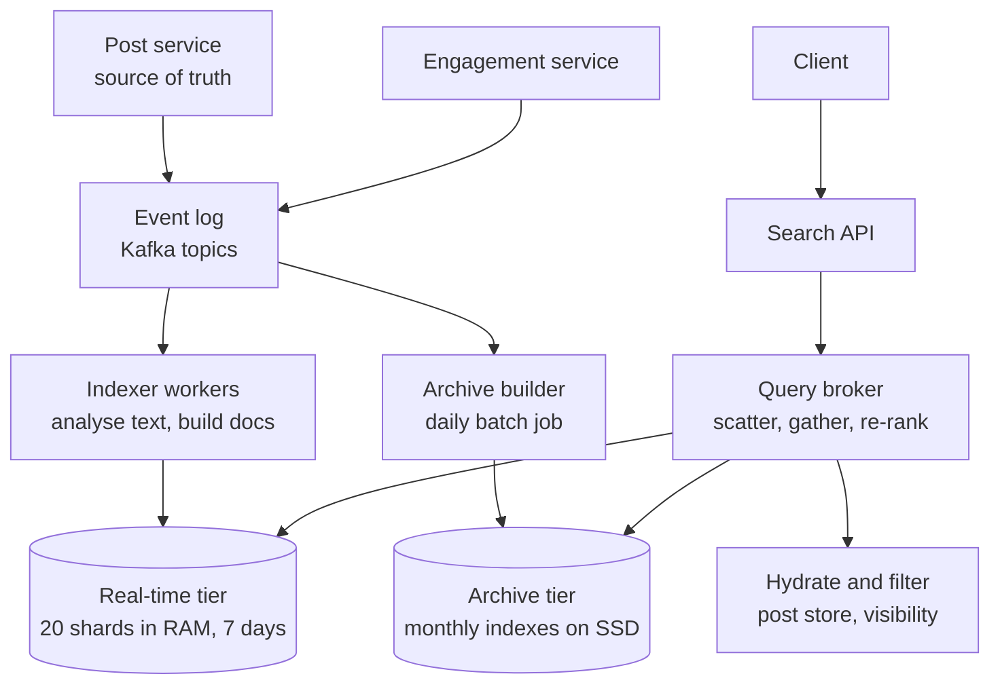
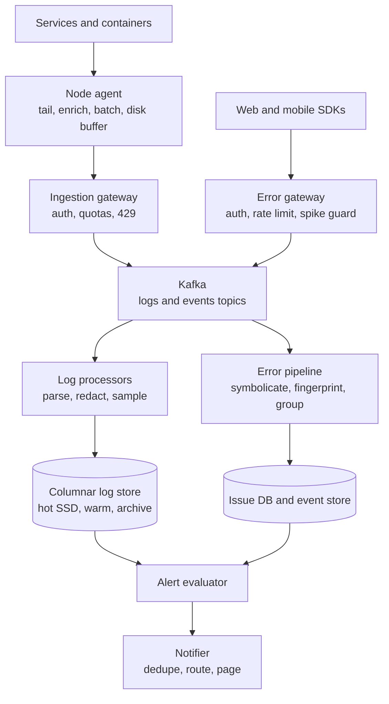
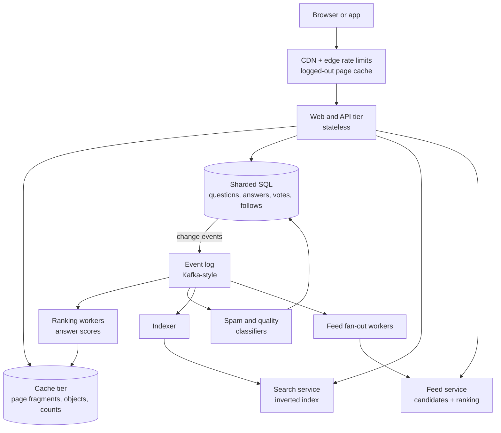
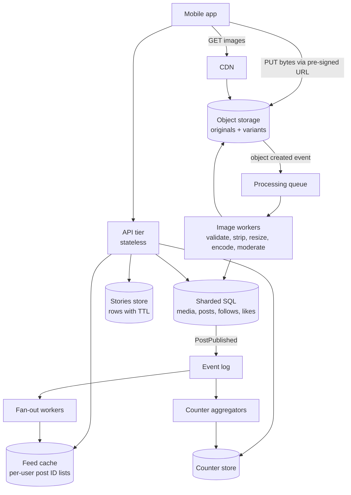
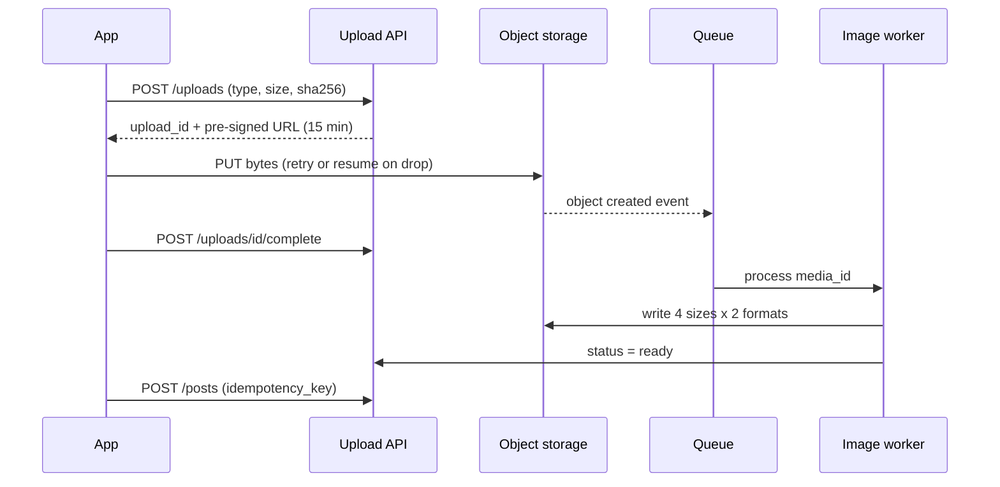
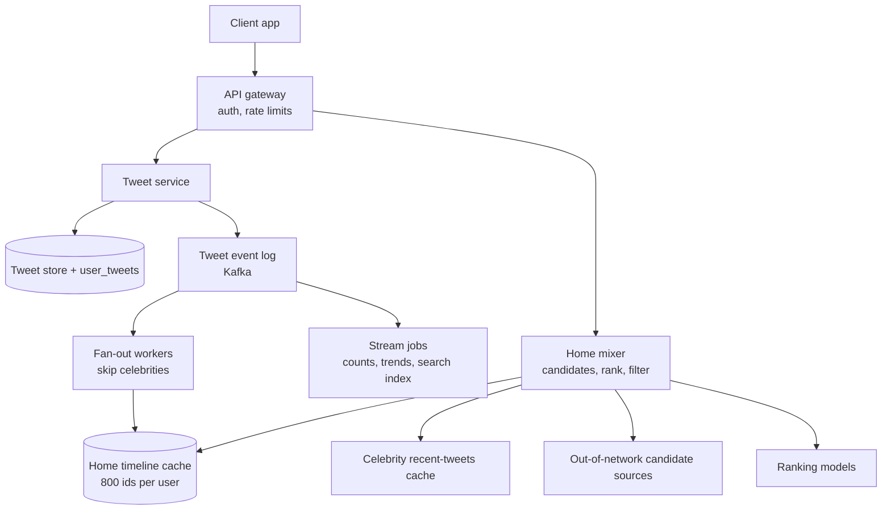
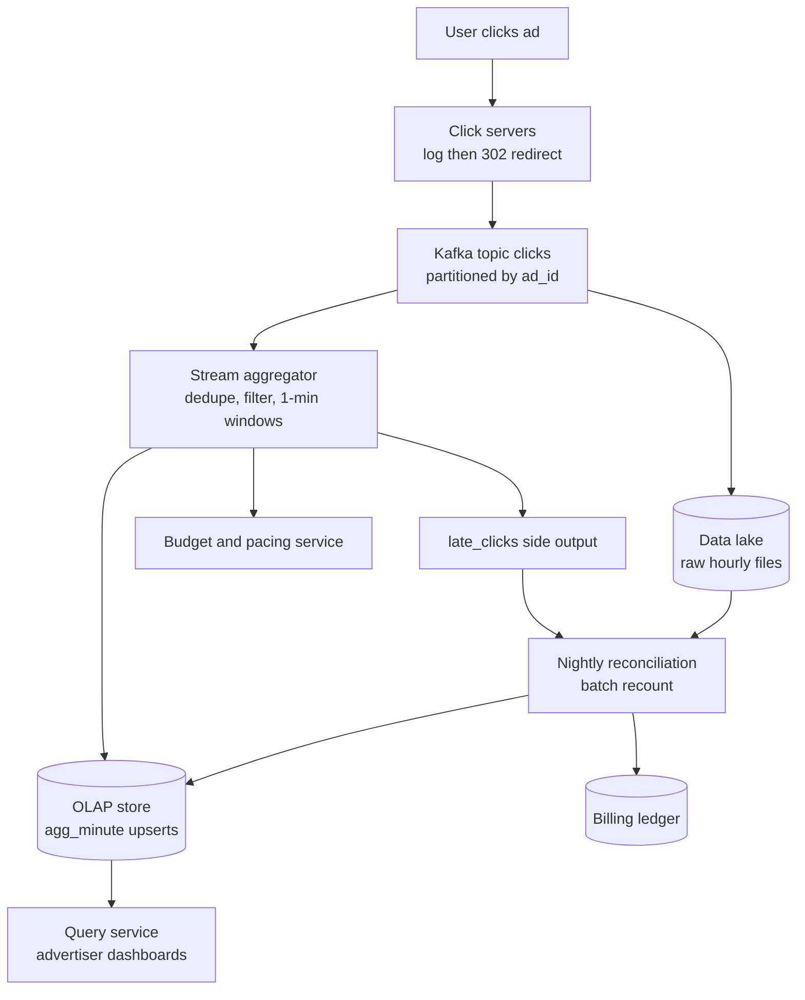

# Module 20 — Case Studies: Content, Search and Platforms

## Module Introduction

**What this module is.** Six more end-to-end designs in the same format as Modules 13–17 (requirements and numbers → five-questions pass → API → data model → annotated architecture → deep dives → failure walk → trade-offs → follow-ups → pattern manifest). They cover the content and platform systems interviewers ask about most often and that the earlier modules only touched: search, logging, a Q&A site, photo sharing, a microblog and ad-click counting. The algorithms they rely on are explained step by step in [Module 19](../19-algorithms-deep-dive/README.md).

| Case | Centre of gravity |
|---|---|
| 1 — Distributed Search | Near-real-time indexing, sharding by document vs term, scatter-gather and ranking |
| 2 — Distributed Logging and Error Monitoring | High-volume ingestion, storage choices, retention tiers, sampling, crash reporting and alerting |
| 3 — Q&A Platform (Quora-like) | Read-heavy caching, answer ranking, follow graph and feed, spam |
| 4 — Photo Sharing (Instagram-like) | Upload pipeline, media processing, CDN, hybrid feed, hot counters, expiring stories |
| 5 — Microblogging (Twitter/X-like) | Hybrid fan-out, ranked timeline, trending topics |
| 6 — Ad-Click Aggregation | Exactly-once-ish counting, windows and watermarks, late events, reconciliation |

## Case 1 — Distributed Search (Twitter/Elasticsearch-style)

**The prompt (in short).** Build the search box of a large social network: a user types "world cup final" and gets matching public posts, either **Latest** (newest first) or **Top** (most relevant first), and a post written two seconds ago should already be findable. The same engine should be general enough that other teams could use it the way companies use Elasticsearch: put documents in, ask keyword queries, get ranked results back.

**What makes it hard.** Three forces pull against each other. (1) **Freshness:** people search during live events, so a post must become searchable within seconds, yet the fastest search structures are the ones you build once and never change. (2) **Fan-out:** the index is far too big for one machine, so every query is split across many machines and the answer is only as fast as the slowest one. (3) **Ranking:** "matches the words" is easy; "the best 20 of 4 million matches, in 200 ms" is the actual product.

### 1. Requirements and numbers

**Functional:** keyword search over public posts with AND/OR/NOT and quoted phrases ("world cup"), filters (language, from a user, has media, date range), two sort orders (Latest, Top), pagination, and removal of deleted or hidden posts from results within seconds. Secondary: hashtag search, search by author, result counts that may be approximate.

**Non-functional:** a new post searchable in **p50 < 2 s, p99 < 10 s** (p50 = the median, half are faster; p99 = 99 out of 100 are faster); query latency **p99 < 200 ms** at the API; high availability (search being down during a big live event is very visible); results may be **slightly stale or slightly incomplete** but never show a deleted post for long. Strong consistency is *not* required: two users seeing results that differ by one post for one second is fine.

**Numbers (assumptions):**
- **500M new posts/day** → 500,000,000 ÷ 86,400 s ≈ **5.8K posts/s average, ~17K/s peak** (3× average for live events).
- Engagement updates (likes, reposts, replies that change ranking): about 10 per post per day → **5B/day ≈ 58K updates/s**. These are *more* frequent than new posts and shape the design (Deep dive 4).
- Index cost per post: the post text is ~300 bytes, but the index stores posting entries for each word, a few stored fields (post ID, author ID, time) and per-field values used for sorting. Assume **~1 KB per post on disk** → 500M × 1 KB = **500 GB/day**.
- **Real-time tier** (last 7 days, where most queries land): 7 × 500 GB = **3.5 TB** per copy. **Archive tier** (everything older, ~5 years at lower historic volume): assume **~600 TB** per copy, kept on SSD (solid-state disk), not in memory.
- **Queries:** **1B searches/day** → 1,000,000,000 ÷ 86,400 ≈ **11.6K queries/s average, ~35K/s peak**. Assume ~10% also need the archive tier ("older results", explicit date range).
- **Sharding the real-time tier:** pick shards small enough to sit in memory: 3.5 TB ÷ 175 GB ≈ **20 shards**. With document sharding (Deep dive 2) every query visits all 20 → 35K × 20 = **700K shard-queries/s at peak**. If one shard copy serves ~1,000 shard-queries/s, we need 700 copies → **35 copies of each shard**. The lesson: **replicas exist here mainly for read throughput**, not only for safety.

**What the numbers say:** writes are moderate (17K/s), engagement updates are heavier, and the query fan-out (700K shard-queries/s) dominates the machine count. Keep the hot index small and in memory, and push old data to a cheaper tier.

### 2. The five-questions pass
- **Flow:** indexing is **asynchronous**. The post service commits the post to its own database first and emits an event; the search indexer consumes it later. Search never sits on the write path of posting ([Event-Driven Architecture](../02-moving-data/README.md#event-driven-architecture)). Queries are plain request-response.
- **Storage:** the **post store is the source of truth** (the copy that wins any disagreement). The search index is a **derived view** (a copy computed from the source and rebuildable from it) shaped for one query type ([CQRS](../03-storing-data/README.md#cqrs)). If an index shard is lost, we rebuild it; we never "restore" search as if it were primary data.
- **Speed:** the hot query is "last 7 days, top 20". Keep that tier in RAM, keep each shard's answer to its own local top-K (K = how many results each shard returns), and cache very popular queries for a few seconds.
- **Failure:** a slow or dead shard should degrade results ("partial results"), not fail the query. Indexer lag must be measured and visible, because "search is stale" is a silent failure.
- **Growth:** posts grow linearly with time; the real-time tier stays the same size (it is a sliding 7-day window) while the archive grows. Query volume grows with users, so add replicas, not shards.
- *Skeleton:* event log → indexers → time-tiered, document-sharded, replicated index → query broker that scatters, gathers and re-ranks → hydration (fetching full post content) and visibility filter.

### 3. API

| Caller | Endpoint / message | Purpose |
|---|---|---|
| Client → API | `GET /search?q=world+cup&sort=top\|latest&lang=en&cursor=…&limit=20` | Returns post IDs plus hydrated posts. `cursor` is an opaque token encoding where the last page ended ([Cursor-Based Pagination](../08-api-and-edge/README.md#cursor-based-pagination)) |
| Post service → log | `PostCreated {post_id, author_id, text, lang, media_flags, created_at}` | New document to index |
| Engagement service → log | `EngagementDelta {post_id, likes:+12, reposts:+3}` | Partial update of ranking signals only |
| Moderation / post service → log | `PostHidden {post_id, reason}` / `PostDeleted {post_id}` | Must hide the post from all results quickly |
| Admin | `PUT /indexes/{name}` with mapping (field types and text analysers); `POST /aliases` | Create a new index version and switch the alias (a stable name pointing at one index version) atomically |

For Latest, the cursor is simply "post IDs older than X" because IDs are time-ordered (Snowflake-style IDs, see [Module 13 Case 1](../13-case-studies-building-blocks/README.md#case-1--design-a-unique-id-generator)). For Top, the cursor encodes the score and ID of the last result plus a snapshot time, so page 2 does not repeat page 1 while new posts keep arriving.

### 4. Data model

> **Key term — inverted index, posting list, term, analyser:** A **term** is one normalised word as the index stores it ("Running" → "run"). The **analyser** is the pipeline that turns raw text into terms: split into tokens, lowercase, remove accents, optionally stem (cut words to a root). An **inverted index** maps each term to its **posting list**: the sorted list of document IDs that contain it, often with positions so phrases can be matched. "Inverted" because a normal table maps document → words; this maps word → documents. See DDIA's [full-text search and fuzzy indexes](../../../ddia/chapters/03-storage-and-retrieval/README.md#full-text-search-and-fuzzy-indexes).

- **Document (what the indexer builds):** `post_id (64-bit, time-ordered), author_id, created_at, lang, text terms, hashtags, mentions, has_media, likes, reposts, replies, author_quality_score`.
- **Per shard, per segment:**
  - *Term dictionary:* term → pointer to its posting list. Example: `cup → [9012, 8877, 8410, …]`, `world → [9012, 8990, 8877, …]`. A query "world AND cup" intersects the two lists: `[9012, 8877, …]`.
  - *Posting lists:* doc IDs (plus positions for phrases), compressed as small gaps between sorted IDs.
  - *Stored fields:* the minimum needed to return a hit, usually just `post_id`. Full text and media come from the post store at hydration time.
  - *Doc values* (a column per field, one value per document, used for sorting and scoring): `created_at`, `likes`, `reposts`, `author_quality_score`. Keeping them as separate columns lets engagement counts change without rewriting the text index.
  - *Deletion bitmap:* one bit per document; set = "skip this doc".
- **Shard map** (small, strongly consistent, in a coordination service such as ZooKeeper/etcd): `index_version → tier → shard_id → [replica hosts]`.
- **Shard key:** real-time tier documents are routed by `hash(post_id) mod 20`; the archive tier is split by **time range first** (one index per month) and then by hash inside each month.

### 5. The architecture, annotated

1. The **post service** writes the post to its own database, then publishes `PostCreated` to the **event log** (Kafka: a durable, partitioned, replayable log; [Inside Kafka](../10-batch-and-streaming/README.md#inside-kafka)). The log is the buffer that lets indexers fall behind during a spike and catch up later without losing anything.
2. **Indexer workers** consume the log in parallel ([Partitioned Consumption](../10-batch-and-streaming/README.md#partitioned-consumption)), run the analyser per language, and send each document to the **one** real-time shard that owns `hash(post_id)`; all replicas of that shard apply it.
3. Each **real-time shard** appends the document to its small in-memory "active" segment and makes it searchable at the next refresh (about once a second; Deep dive 1). Older posts slide out of the 7-day window by dropping whole segments, which is far cheaper than deleting documents one by one.
4. The **archive builder** is a daily batch job ([MapReduce](../10-batch-and-streaming/README.md#mapreduce)-style) that builds compact, read-only monthly indexes from the log or the post store and publishes them to the **archive tier**. Building offline lets it use heavier compression and sort orders that a live index cannot afford.
5. A query reaches the **search API**, which parses it (`world cup` → phrase or AND, language filter) and checks a **short-lived result cache** (5–10 s TTL, time to live) for the hottest queries.
6. The **query broker** (Twitter calls this front end a "Blender") **scatters** the query to one replica of every real-time shard, and to the archive only if needed, then **gathers** each shard's top-K, merges them and re-ranks (Deep dives 3 and 4).
7. **Hydrate and filter:** the broker fetches the final 20 posts from the post store (in a batch, with a cache in front, [Cache-Aside](../04-caching/README.md#cache-aside)) and drops anything deleted, hidden or blocked for this viewer since it was indexed. This last check is the safety net that lets the index be eventually consistent (it catches up later).

### 6. Deep dives

**Deep dive 1 — near-real-time indexing: immutable segments plus a refresh.**
- *The tension:* compressed, sorted posting lists are fast to read but expensive to change. Inserting one document into the middle of a big compressed list means rewriting it.
- *The trick used by Lucene (the library inside Elasticsearch and Solr):* never modify; **add new small segments**. A **segment** is a self-contained mini inverted index. New documents collect in an in-memory buffer; a **refresh** turns the buffer into a new segment and opens it for search. A query searches every segment and merges results. A background **merge** combines small segments into bigger ones and physically drops deleted documents. This is the same idea as an LSM-tree's sorted files ([SSTables and LSM-Trees](../../../ddia/chapters/03-storage-and-retrieval/README.md#sstables-and-lsm-trees)).
- *Durability:* a refresh makes data searchable but not necessarily safe on disk. Elasticsearch also appends every operation to a per-shard **translog** (transaction log), the same job a [write-ahead log](../03-storing-data/README.md#write-ahead-log) does, so a crash between refreshes loses nothing. In our design the Kafka log plays this role too: a restarted shard replays from its last saved offset (position in the log).
- *Real numbers:* Elasticsearch refreshes every **1 s** by default, but only on shards that have had a search in the last **30 s**; idle shards skip refreshes to save work. So "near real time" means about one second, not instantly. Raising the refresh interval (say to 30 s) during a bulk load makes indexing much cheaper.
- *Twitter's version:* the Earlybird paper (ICDE 2012) describes one writable "active" segment per server plus read-only optimised segments (12 segments of about 8.4M tweets, 2^23, at the time), a **single-writer, multiple-reader** design so the indexing thread never locks out query threads, posting lists traversed **newest first**, and a target of tweets searchable within **10 s**. Twitter's 2020 engineering post reports cutting indexing latency from about **15 s to about 1 s**, partly by indexing fields that arrive late (such as resolved URLs) separately instead of waiting for all fields.

**Deep dive 2 — sharding by document vs by term.**

> **Key term — document-partitioned vs term-partitioned index:** In a **document-partitioned** (also called *local*) index, each shard holds a full inverted index for *its own subset of documents*. In a **term-partitioned** (*global*) index, each shard holds the *complete* posting lists for a subset of *terms* (for example, terms a–f on shard 1). DDIA covers both in [partitioning secondary indexes by document](../../../ddia/chapters/06-partitioning/README.md#partitioning-secondary-indexes-by-document) and [by term](../../../ddia/chapters/06-partitioning/README.md#partitioning-secondary-indexes-by-term).

Worked example, query `world AND cup`, 20 shards:

| | Document-partitioned | Term-partitioned |
|---|---|---|
| Write of one 25-word post | Touches **1 shard** | Touches up to **25 shards** (one per term), so a write is a distributed operation |
| Query `world AND cup` | All **20 shards**, each intersects locally and returns its top-K | **2 shards**, but the `world` list may hold tens of millions of IDs that must be shipped across the network to intersect |
| Hot spots | Even, because hashing post IDs spreads load | A trending term (`#worldcup`) makes one shard the bottleneck for all of its reads and writes |
| Ranking | Each shard scores fully with all fields locally | Scoring needs doc fields that live elsewhere |

*Decision:* **document partitioning**, the choice of essentially every production engine (Elasticsearch, Solr, Earlybird). We pay for it with fan-out, which replicas, a small hot tier and good tail-latency control (Deep dive 3) make affordable.

*Time is the second dimension.* Most queries want recent posts, so split by **time first, hash second**. A Latest query can start at the newest tier and stop as soon as it has 20 results; a Top query over the last 7 days never touches the archive. This "tiered" layout is the biggest single saving in the design.

*Shard count is a commitment.* In Elasticsearch the number of primary shards is fixed when an index is created (changing it means a split/shrink operation or a full reindex). Time-based indexes make this painless: next month's index simply gets a different shard count. Rebalancing is DDIA's [fixed number of partitions](../../../ddia/chapters/06-partitioning/README.md#fixed-number-of-partitions) approach: create more shards than machines and move whole shards.

**Deep dive 3 — scatter-gather and the tail-latency tax.**
- *The maths:* if each shard answers within 50 ms 99% of the time, the chance that **at least one of 20** is slower is 1 − 0.99^20 ≈ **18%**. The broker waits for the slowest, so about one query in five sees a shard's p99 latency. More shards make this worse ([Percentiles and tail latency](../00-system-design-fundamentals/README.md#percentiles-tail-latency-and-why-averages-lie)).
- *Mitigations:*
  - **Pick the fastest replica, not round-robin.** Elasticsearch's adaptive replica selection (on by default since 7.0) ranks shard copies by recent response time and queue length, so a node in a long garbage-collection pause stops receiving traffic.
  - **Hedged requests:** if a shard has not answered after its p95 time, send the same request to a second replica and take whichever replies first. Costs a few percent extra load.
  - **Per-shard deadline + partial results:** at ~150 ms the broker merges what it has and marks the response `partial=true`. Missing one of 20 shards loses 5% of candidates, which a user rarely notices in a Top query ([Timeout](../05-reliability/README.md#timeout), [Graceful Degradation](../05-reliability/README.md#graceful-degradation)).
  - **Early termination:** Latest results walk posting lists newest first, so a shard can stop after its first K matches instead of scoring all of them.
- *Two-phase fetch:* each shard returns only `(post_id, score)` for its top K (query phase); the broker merges 20 × K small tuples, keeps the global top 20, and only then fetches content (fetch phase). Elasticsearch calls this **query then fetch**. Shipping 20 × 1,000 IDs is cheap; shipping 20,000 full posts would not be.
- *Deep pagination trap:* page 50 at 20 per page means every shard returns its top 1,000 and the broker throws 980 × 20 away. Cap pages (most products stop after a few hundred results) and use cursors ("search after this score and ID").

**Deep dive 4 — ranking in two stages.**
- *Stage 1, at each shard (cheap, over many candidates):* a text relevance score plus a few signals stored in doc values. The common text score is **BM25**: it grows with how often the query term appears in the post (but with diminishing returns, controlled by `k1`), shrinks for very common terms (a word in every post says little), and normalises for document length (controlled by `b`). Elasticsearch uses BM25 by default with `k1 = 1.2` and `b = 0.75`. Short posts make length normalisation less important, so recency and engagement carry more weight. Example combined score: `0.5·bm25 + 0.3·recency_decay + 0.2·log(1 + likes + 2·reposts)`.
- *Stage 2, at the broker (expensive, over few candidates):* the merged top ~500 go to a machine-learned ranking model that also uses viewer features (language, who they follow, past clicks). Running the big model on 500 candidates instead of millions is what keeps p99 under 200 ms.
- *Fresh engagement without reindexing:* likes change constantly (58K updates/s). Store them as **doc values** updated in place (or in a side table keyed by post ID that the shard reads at scoring time), so an engagement update never re-analyses text. Batch them per shard every second or so. This is the same "separate fast-changing fields" idea Twitter describes in its 2020 post.

**Deep dive 5 — deletes, edits and reindexing.**
- Segments are immutable, so a delete sets a bit in the **deletion bitmap**; the document disappears from results at the next refresh and is physically removed at the next merge. An edit is delete + insert.
- Deletes are urgent (legal takedowns, user deletes), so the visibility check at hydration (step 7) is a second line of defence: even if a shard is lagging, the post store says "deleted" and the broker drops the hit.
- **Schema change or new analyser** (for example adding a language): build a **new index version** alongside the old one from the archive plus a log replay, compare results, then switch the **alias** atomically: a [blue-green](../09-operating-in-production/README.md#blue-green-deployment) swap for indexes. Because the index is derived, rebuilding is always possible; it just costs hours of compute.

### 7. The failure walk
1. **One replica of a shard dies:** the broker stops routing to it (health checks and failed requests mark it down) and the other 34 copies absorb its share, about 3% more each. The cluster manager starts a new copy on another machine by copying the shard files from a healthy replica, then replaying the log from the snapshot's offset.
2. **Every replica of one shard is unhealthy** (bad deploy to that group): queries return **partial results** from 19 of 20 shards rather than errors. Stop the rollout ([Canary Deployment](../09-operating-in-production/README.md#canary-deployment)) and roll back. Spread replicas of a shard across racks and zones so one failure domain never holds all of them.
3. **Indexers fall behind** (live event, 3× posts): the Kafka log absorbs the backlog, nothing is lost, but freshness slips from 1 s to maybe 30 s. Monitor **indexing lag** (newest indexed post time vs now) as a top-level SLO (service level objective). Scale indexer workers up to the number of log partitions, and raise refresh intervals slightly to trade freshness for throughput ([Backpressure](../10-batch-and-streaming/README.md#backpressure)).
4. **Query storm on one term** (a celebrity news story; everyone searches the same name): the short-TTL **result cache** in front of the broker turns 10K identical queries per second into one query per shard per few seconds ([Cache Stampede Prevention](../04-caching/README.md#cache-stampede-prevention): collapse identical in-flight requests into one).
5. **Broker tier overloaded:** shed the most expensive work first: disable the archive tier for "Top" queries, shrink the stage-2 candidate set, return Latest-only. Rate-limit API scrapers ([Rate Limiting](../08-api-and-edge/README.md#rate-limiting)).
6. **Event log outage:** posting keeps working (the post service owns its data), search freezes at the last indexed moment. After recovery, indexers resume from saved offsets. If a gap is suspected, a reconciliation job compares post-store IDs for the window with the index and re-sends missing ones.
7. **A shard's data is corrupted:** discard it and rebuild from the archive snapshot + log replay. Because the index is derived, the worst outcome is a slow rebuild, never data loss.

### 8. Trade-offs

| Decision | Chosen | Alternative | Why |
|---|---|---|---|
| Index partitioning | By document (hash of post ID) | By term | One-shard writes, even load, local scoring; pay with fan-out |
| Layout | Time tiers (7-day RAM tier + monthly archive) | One big index | Most queries are recent; tiers cap the hot set and allow cheap expiry |
| Freshness | ~1 s refresh, immutable segments | Instant per-document visibility | Immutable segments are much faster to search; 1 s is enough for users |
| Replicas | Many (≈35 per hot shard) | 1–2 for safety | Fan-out × QPS needs throughput; replicas also absorb failures |
| Ranking | Cheap BM25 + signals per shard, ML re-rank of top ~500 at broker | Full ML score on every match | Model cost is per candidate; two stages keep p99 low |
| Consistency | Eventually consistent index + visibility check on hydrate | Index updated in the write transaction | Keeps search off the posting path; the check hides deletes |
| Engagement signals | Doc values / side table updated in batches | Reindex the whole document | 58K updates/s would rewrite text segments constantly |

### 9. The follow-up questions
- **"How would you add autocomplete?"** It is a different index: a prefix structure (trie or n-gram index) over popular *queries*, not posts, updated from query logs. See [Module 13 Case 6](../13-case-studies-building-blocks/README.md#case-6--design-search-autocomplete). *Trap:* running a prefix query against the full post index on every keystroke.
- **"How do you show 'about 4.2M results'?"** Exact counts need every shard to count every match. Count exactly up to a threshold (Elasticsearch counts up to 10,000 hits by default) and estimate beyond it, or show "4M+". Users never verify the number.
- **"How would you add semantic (meaning-based) search?"** Add a vector index (embeddings, numeric fingerprints of meaning) per shard and run it alongside the keyword query, then fuse the two lists (for example reciprocal rank fusion: sum 1/(60 + rank) from each list). Sharding and fan-out stay the same ([Vector Database Sharding](../11-ai-era-systems/README.md#vector-database-sharding)).
- **"How do you reshard when the hot tier outgrows 20 shards?"** Do not reshard in place. Because the hot tier is a sliding window, start writing *new* time segments with 30 shards; within 7 days the old 20-shard layout has aged out.
- **"How do you personalise results?"** Keep the index viewer-independent (cacheable, shareable). Apply personal features only in stage-2 re-ranking and in filtering (blocked/muted accounts).

### Pattern manifest

| Pattern | Where it served | Taught in |
|---|---|---|
| Event-Driven Architecture | Post service emits events; search indexes asynchronously | [Module 02](../02-moving-data/README.md#event-driven-architecture) |
| CQRS (derived read model) | Search index as a rebuildable view of the post store | [Module 03](../03-storing-data/README.md#cqrs) |
| Sharding | Document-partitioned shards, time-first then hash | [Module 03](../03-storing-data/README.md#sharding) |
| Primary-Replica | 35 copies per hot shard for throughput and failover | [Module 03](../03-storing-data/README.md#primary-replica) |
| Write-Ahead Log | Translog / Kafka replay protects unrefreshed documents | [Module 03](../03-storing-data/README.md#write-ahead-log) |
| Partitioned Consumption | Parallel indexer workers per log partition | [Module 10](../10-batch-and-streaming/README.md#partitioned-consumption) |
| MapReduce (batch) | Offline build of monthly archive indexes | [Module 10](../10-batch-and-streaming/README.md#mapreduce) |
| Timeout + Graceful Degradation | Per-shard deadlines, partial results, shedding archive queries | [Module 05](../05-reliability/README.md#graceful-degradation) |
| Cache-Aside + stampede control | Hydration cache; short-TTL cache for hot queries | [Module 04](../04-caching/README.md#cache-stampede-prevention) |
| Cursor-Based Pagination | Search-after cursors for Latest and Top | [Module 08](../08-api-and-edge/README.md#cursor-based-pagination) |
| Blue-Green Deployment | New index version behind an alias | [Module 09](../09-operating-in-production/README.md#blue-green-deployment) |

**Interview one-liner:** "Index asynchronously from an event log into time-tiered, document-partitioned shards made of immutable segments that refresh every second; scatter each query to one replica per shard with deadlines and hedging, merge each shard's top-K, re-rank the best few hundred with a model, then hydrate and drop anything deleted since indexing."

### TL;DR
- **Problem:** seconds-fresh keyword search over billions of posts, p99 under 200 ms, with ranking.
- **Mechanism:** Kafka → indexers → document-sharded inverted index (immutable segments + 1 s refresh) in a 7-day RAM tier and a monthly SSD archive; broker does scatter-gather, two-stage ranking, hydration and visibility filtering.
- **Hard parts:** freshness vs immutability (segments + refresh + merge), fan-out tail latency (replica selection, hedging, partial results), fast-changing ranking signals (doc values, not reindexing), deletes (bitmap + hydrate-time check).
- **Price:** many replicas for fan-out throughput, a derived index that must be monitored for lag, and occasional full rebuilds.

**Sources**
- Busch, Gade, Larson, Lok, Luckenbill, Lin, *Earlybird: Real-Time Search at Twitter*, ICDE 2012: https://cs.uwaterloo.ca/~jimmylin/publications/Busch_etal_ICDE2012.pdf
- Twitter/X Engineering, *Reducing search indexing latency to one second* (2020): https://blog.x.com/engineering/en_us/topics/infrastructure/2020/reducing-search-indexing-latency-to-one-second
- Elasticsearch Reference, *Near real-time search*: https://www.elastic.co/guide/en/elasticsearch/reference/current/near-real-time.html
- Elasticsearch Reference, *Index modules* (shard count fixed at creation, refresh and search-idle defaults): https://www.elastic.co/guide/en/elasticsearch/reference/current/index-modules.html
- Elastic blog, *Improving response latency in Elasticsearch with adaptive replica selection*: https://www.elastic.co/blog/improving-response-latency-in-elasticsearch-with-adaptive-replica-selection
- Elasticsearch Reference, *Track total hits* (accurate count up to 10,000 by default): https://www.elastic.co/guide/en/elasticsearch/reference/7.0/search-request-track-total-hits.html
- Elastic blog, *Practical BM25 Part 2: the BM25 algorithm and its variables*: https://www.elastic.co/blog/practical-bm25-part-2-the-bm25-algorithm-and-its-variables

---

## Case 2 — Distributed Logging and Error Monitoring

**The prompt (in short).** Build the company-wide system that collects every service's log lines (a log line is a timestamped text or structured record such as `level=ERROR service=checkout msg="card declined" order=81`), lets engineers search them during an incident, keeps them for a set time at a sensible cost, and alerts when errors spike. Add a Sentry/Crashlytics-style **error monitoring** product: when a web page or mobile app crashes on a user's device, capture the error with its stack trace, group identical crashes into one "issue", and tell the owning team.

**What makes it hard.** (1) **Volume with low value per byte:** logs are the biggest telemetry stream and 99% of lines are never read, yet nobody knows in advance which 1% will matter. (2) **The system is needed most when everything else is broken:** an outage causes a log storm exactly when engineers start querying. (3) **Client errors arrive from devices you don't control:** they are minified or compiled, arrive late (after the crash), in bursts, and must be grouped smartly or a single bug becomes 100,000 alerts.

How this differs from [Metrics Monitoring & Alerting](../16-case-studies-infrastructure/README.md#design-2--metrics-monitoring--alerting): metrics are small numeric samples with few distinct shapes; logs are large, semi-structured events with unbounded text, and the questions asked of them ("show me every line for request 7f3a") are needle-in-a-haystack searches rather than sums.

### 1. Requirements and numbers

**Functional:**
- *Logs:* collect from servers, containers and managed services; parse into structured fields; full-text and field search over a time range; live tail (stream new matching lines); aggregations ("count of ERROR by service, per minute"); saved queries and log-based alerts; per-team access control; deletion of personal data on request.
- *Error monitoring:* SDKs (libraries embedded in apps) for web, iOS, Android and backend; capture exceptions and crashes with stack traces, breadcrumbs (the last few events before the crash, such as taps and network calls), device and release info; **symbolicate** (turn machine addresses or minified names back into file, function and line); group events into issues; show first seen, last seen, counts, affected users, crash-free session rate per release; alert on new issues, regressions and spikes.

**Non-functional:** ingestion must **never slow or crash the producing app** (logging is fire-and-forget); a log line searchable within **p99 < 30 s**; interactive queries over the last hour in **< 2 s**, over a week in **< 30 s**; **no loss of ERROR-level logs or crash events** under normal operation, while debug/info may be sampled or shed under pressure; retention of 7 days hot, 30 days warm, 1 year archive (for audits); the alerting path keeps working during big incidents.

**Numbers (assumptions):**
- **2M log lines/s average, 5M/s peak** (thousands of services; Uber reported "millions of logs per second" for its own platform). Average line **500 bytes** → 2M × 500 B = **1 GB/s ≈ 86 TB/day raw**.
- **Compression:** structured logs are very repetitive (same field names, same services, similar messages). Assume **~10×** in a columnar store → **~8.6 TB/day stored**, ×2 replicas = **~17 TB/day**.
- **Retention cost:** hot 7 days ≈ 7 × 17 ≈ **120 TB on SSD**; warm days 8–30 ≈ 23 × 8.6 ≈ **200 TB** (single copy on cheaper disks, object storage for durability); archive to 1 year ≈ 335 × 8.6 ≈ **2.9 PB** in object storage (S3-style storage, where the provider keeps copies for you). Archive is ~90% of the bytes and the cheapest per byte, which is why tiering matters.
- **If we indexed every word instead** (inverted index on all text), index size often approaches or exceeds the compressed data, roughly doubling the hot tier and multiplying the RAM needed. That single comparison drives Deep dive 2.
- **Queries:** a few hundred interactive queries/s plus **~20K log alert rules** evaluated every minute ≈ **330 rule queries/s**, almost all over the last 5–15 minutes.
- **Error events:** 50M daily app users; normal **~2K error events/s**, **~30K/s** during a bad release. Each event ~**20 KB** (stack trace, breadcrumbs, device context) → **600 MB/s at peak**. Distinct *issues* are far fewer: thousands per day, because one bug produces many identical events.

**What the numbers say:** bytes and their retention decide the cost; the ingest path must buffer and shed gracefully; error events are low-volume but bursty and need heavy per-event processing (symbolication, grouping).

### 2. The five-questions pass
- **Flow:** everything is **asynchronous and one-way**. Apps write to stdout or a local file; an agent ships it. Client SDKs queue events and send them in the background. Nothing on a user request waits for logging.
- **Storage:** the **ingestion buffer** (Kafka) is the short-term source of truth (a few days, replayable). The log store and the issue database are derived from it. Raw archives in object storage are the long-term record.
- **Speed:** most queries hit the **last hour**; keep that on SSD with fast filters on `service`, `level`, `timestamp`, `trace_id`. Week-long searches may scan more slowly.
- **Failure:** losing some debug lines is acceptable; losing the alerting path or crash events is not. Design every stage to **buffer, then shed lowest-value data first** ([Graceful Degradation](../05-reliability/README.md#graceful-degradation)).
- **Growth:** volume grows with services, traffic and careless `log.debug` calls. Per-team quotas and cost reports are part of the design, not an afterthought.
- *Skeleton:* agents → ingestion gateway → Kafka → processors (parse, redact, sample, route) → columnar log store with tiers; SDK → error gateway → Kafka → symbolicate and group → issue store + event store; alert evaluators over both.

### 3. API

| Caller | Endpoint | Purpose |
|---|---|---|
| Agent → gateway | `POST /v1/logs` (OTLP: the OpenTelemetry protocol, an open standard for sending logs, metrics and traces), gzip-compressed batches | Ship batches of records; response tells the agent to slow down (HTTP 429) if needed |
| Client SDK → error gateway | `POST /api/{project_id}/envelope` with a public project key (DSN) | One envelope carries an error event, session updates and attachments |
| CI (build system) → symbol service | `POST /projects/{id}/releases/{version}/symbols` | Upload source maps (JS), dSYM files (iOS), ProGuard/R8 mapping files (Android) at build time |
| Engineer → query | `POST /logs/query {query:'service:checkout AND level:ERROR AND "card declined"', from, to, limit}` | Search; returns rows plus a cursor |
| Engineer → query | `GET /logs/tail?query=…` (Server-Sent Events) | Live tail of matching lines ([Server-Sent Events](../02-moving-data/README.md#server-sent-events)) |
| Engineer → issues | `GET /issues?project=ios&release=5.2.0&sort=users` ; `PATCH /issues/{id} {status: resolved}` | Triage and resolve |
| Rules | `POST /alerts {query, window:5m, condition:'count > 100', route:'#payments-oncall'}` | Log-based and issue-based alerts |

### 4. Data model
- **Log record** (follows the OpenTelemetry log data model in spirit): `timestamp, observed_timestamp (when the agent saw it), service, env, host, pod, level, trace_id, span_id, message, attributes (map of key → value)`.
- **Log table in a columnar store** (ClickHouse-style; a **columnar store** keeps each field's values together on disk, so a query reading 3 of 30 fields reads 10% of the bytes, and similar values compress very well; see [Column-Oriented Storage](../../../ddia/chapters/03-storage-and-retrieval/README.md#column-oriented-storage)):
  - partitioned by `(tenant, day)` so expiry drops whole partitions;
  - sorted by `(service, level, timestamp)` so "checkout errors in the last hour" reads one narrow contiguous range;
  - frequently used attributes promoted to typed columns; the rest in key-value map columns;
  - **skip indexes** on `message` and `trace_id`: small per-block summaries (min/max, or a bloom filter, a compact bit array that answers "definitely not in this block" or "maybe") that let a search skip most blocks without an inverted index.
- **Error event:** `event_id, project, release, environment, timestamp, platform, exception{type, value, frames[]}, breadcrumbs[], user_hash, device{os, model}, tags`. Raw event body in object storage; searchable fields in the columnar event table.
- **Issue:** `issue_id, project, fingerprint (hash), title, culprit (top in-app frame), first_seen, last_seen, first_release, status (unresolved/resolved/ignored), assignee`. Counters (`events, users`) are updated asynchronously and per time bucket. Small and relational (SQL), because people edit it.
- **Symbol files:** keyed by `(project, release, debug_id)` in object storage. A debug ID is a unique ID baked into each build so an event can find the exact symbol file.

### 5. The architecture, annotated

1. **Services** write logs to stdout or files. They never call the logging backend directly, so a backend outage can never block a request.
2. A **node agent** on every host (Fluent Bit, Vector or an OpenTelemetry Collector are typical) tails the files, adds metadata (service, pod, region, version), batches about 1 MB or 1 s, compresses, and sends. It keeps a **bounded disk buffer** so a few minutes of backend trouble lose nothing.
3. The **ingestion gateway** authenticates the tenant, enforces per-team quotas ([Rate Limiting](../08-api-and-edge/README.md#rate-limiting)) and answers **429 / retry-after** when Kafka is under pressure, which makes agents back off instead of piling on.
4. **Kafka** is the shock absorber: 3 days of retention, partitioned by `(tenant, service)`. Every consumer (store writers, live tail, archive writer, security analytics) reads it independently at its own pace ([Publish-Subscribe](../02-moving-data/README.md#publish-subscribe)).
5. **Log processors** parse unstructured lines into fields, **redact secrets and personal data** (card numbers, emails, tokens) *before* storage, apply sampling rules (Deep dive 3), and write large sorted batches to the **columnar store**. Large batches matter: columnar stores prefer thousands of rows per insert.
6. The **error pipeline** is the Sentry-style path: the SDK envelope goes through a **rate-limiting edge** (Sentry calls its own "Relay"), into Kafka, then workers that **symbolicate** the stack trace, compute a **fingerprint**, find or create the **issue**, and store the event (Sentry's own docs show events flowing to ClickHouse through its Snuba service).
7. The **alert evaluator** runs log queries and issue rules on a schedule, and the **notifier** groups, deduplicates and routes alerts to chat, email or pager. Correlation is via `trace_id`: one click from an error to every log line and span of that request ([Distributed Tracing](../09-operating-in-production/README.md#distributed-tracing)).

### 6. Deep dives

**Deep dive 1 — agents and the ingestion buffer: never block, never explode.**
- *Why an agent instead of a library that calls the backend?* A library call inside the app shares its threads and memory; if the backend slows down, the app slows down. Writing to stdout costs microseconds; the agent takes the risk.
- *The buffering chain:* app stdout → agent memory (seconds) → agent disk buffer (minutes, capped at say 1 GB) → Kafka (days). Each stage is bounded, and each knows what to drop first when full: **debug, then info, never error**. That is [backpressure](../10-batch-and-streaming/README.md#backpressure) with priorities.
- *Kafka sizing:* 1 GB/s of raw logs, compressed about 4× by the agents, is about 250 MB/s on the wire; 3 days ≈ 65 TB × 3 replicas ≈ **195 TB** of broker disk. Partition count follows consumer parallelism (for example 600 partitions), and very loud services get their own topic so they cannot delay quiet ones ([Bulkhead](../05-reliability/README.md#bulkhead)).
- *Delivery semantics:* agents retry, so the pipeline is **at-least-once**. Attach a per-batch ID and per-line sequence number so the store writer can drop duplicate batches ([Idempotency](../05-reliability/README.md#idempotency)). Exact-once for logs is rarely worth paying for; dropping duplicate *batches* gets most of the benefit.
- *Timestamps:* trust the event's own timestamp for display, but also store `observed_timestamp`. A host with a wrong clock otherwise writes "2019" logs that no time-range query finds ([Event time versus processing time](../../../ddia/chapters/11-stream-processing/README.md#event-time-versus-processing-time)).

**Deep dive 2 — indexing everything vs columnar storage.**

| | Inverted index on all text (classic ELK: Elasticsearch, Logstash, Kibana) | Columnar store with skip indexes (ClickHouse-style) | Index labels only (Grafana Loki-style) |
|---|---|---|---|
| Write cost | High: every term updates posting lists, segments merge constantly | Low: append sorted, compressed column blocks | Lowest: compress chunks, index a few labels |
| Storage | Index can be as big as the data | ~10× compression typical on structured logs | Chunks in cheap object storage |
| "Find this rare word" over a week | Fast (posting-list lookup) | Scan of the message column, sped up by bloom-filter skips | Brute-force scan of the chunks for the selected labels |
| Aggregations (count by service per minute) | Possible, heavier | Very fast, the columnar sweet spot | Possible, via scans |
| Best for | Smaller volumes, heavy free-text search | Large volumes, field filters plus aggregations | Cheapest storage, queries that always filter by labels first |

- *Real-world:* Uber's 2021 engineering post describes moving its logging platform, which started on ELK in 2014, to a **ClickHouse**-based, schema-agnostic design to cut cost while handling millions of logs per second and several petabytes. Grafana's Loki docs state that Loki indexes only a set of labels per stream and stores the compressed log lines in chunks in object storage.
- *Our choice:* **columnar** for the bulk, with a lightweight token bloom filter per block on `message` and exact-match indexes on `trace_id` and `request_id`. Most real queries filter on service, level and time first; full-text needles over a week are rare and can take 20 seconds.
- *Schema-agnostic attributes:* teams add new fields constantly. Store unknown keys in typed map columns (`attr_string`, `attr_number`) and promote hot keys to real columns automatically when they become popular, so nobody needs a schema migration to log a new field.

**Deep dive 3 — retention tiers, sampling and the cost lever.**
- **Tiers (with the numbers from section 1):**
  - *Hot (0–7 days):* SSD, two replicas, all indexes: ~120 TB. This is where 95% of queries go.
  - *Warm (8–30 days):* parts moved to cheaper disks or object storage with a local cache, single copy: ~200 TB. Queries take seconds to tens of seconds.
  - *Archive (31–365 days):* compressed files in object storage, not queryable directly; restored on request for audits. ~2.9 PB at the lowest price per byte.
  - *Delete:* drop whole day partitions after retention. Never delete row by row.
  - Elasticsearch's index lifecycle management (ILM) expresses the same idea as hot → warm → cold → frozen → delete phases, with **rollover** (start a new write index when the current one reaches a size, document count or age).
- **Sampling** (keeping only a fraction of data, on purpose):
  - *Never sample* ERROR/FATAL logs, audit logs or security logs.
  - *Head sampling* (decide at creation time, for example "keep 10% of INFO in the cart service") is cheap and done in the agent or SDK.
  - *Tail sampling* (decide after seeing the whole request) keeps every log and span of requests that errored or were slow, and samples the boring successes. OpenTelemetry's collector has a tail-sampling processor with policies such as "keep status = ERROR". It must buffer each trace for a few seconds and see all of its parts on the same collector instance, so route by `trace_id`.
  - *Dynamic sampling:* when a service exceeds its quota, raise its sample rate for INFO automatically and record the rate on each kept line (`sample_rate=10`) so counts can be multiplied back up.
- **Showback:** a daily report of bytes ingested per team. In practice this is the most effective cost control: most volume comes from a handful of noisy log statements.

**Deep dive 4 — client-side crash and error reporting.**
- *Capturing:* the SDK installs a global handler (`window.onerror` and `unhandledrejection` in browsers; uncaught-exception and signal handlers on iOS/Android). On a **native crash** the process is dying, so the SDK writes a minimal report to local disk and **sends it on the next app launch**. Events carry `release`, `environment`, device info and the last ~100 breadcrumbs.
- *Client-side protection:* the SDK samples (`sampleRate`), rate-limits itself, deduplicates identical errors fired in a tight loop, scrubs personal data, and sends in the background on Wi-Fi-friendly schedules ([Observability on the client](../18-client-and-mobile-system-design/README.md#9-observability-on-the-client)).
- *Symbolication:* production code is minified (JS) or compiled without names (native). At build time CI uploads source maps or debug symbols keyed by release and debug ID. The pipeline maps `a.js:1:48213` back to `checkout/Cart.tsx:88 in applyCoupon`. Without this step, grouping and reading the error are both nearly useless.
- *Grouping into issues:* compute a **fingerprint** for each event. Sentry's documented order is: a custom fingerprint if the developer set one; otherwise the **stack trace**, using only the app's own frames, not library internals; otherwise the exception type and value; otherwise the message. Same fingerprint → same issue. Line numbers are left out of the hash so a release that shifts code by three lines does not create a new issue. Example: 40,000 `TypeError: cannot read 'price' of undefined` events from `applyCoupon` become **one issue** with 40,000 events and 12,000 users.
- *Release health:* the SDK also sends lightweight **session** start/end updates. Crash-free sessions = 1 − crashed sessions ÷ all sessions; a release dropping from 99.8% to 98.9% is a rollback signal ([Canary Deployment](../09-operating-in-production/README.md#canary-deployment)).
- *Spike protection:* a crash loop in a popular app can send 30K events/s. The edge keeps counting every event (for accurate issue counts) but **stores only a sample of full events** per issue (for example the first 100, then 1 per second), and enforces per-project quotas.

**Deep dive 5 — alerting that people trust.**
- *Log alerts:* a rule is a query plus a window plus a condition, evaluated every minute: `count(service:payments AND level:ERROR) over 5m > 200`. Better: alert on **error ratio** (errors ÷ requests), which does not fire just because traffic doubled. Where possible, turn hot log queries into **metrics at ingest time** (a processor increments `payments_errors_total`) and alert on the metric. That is cheaper and keeps working even if the log store is slow.
- *Issue alerts:* "new issue in production", "resolved issue regressed in a new release", "issue affecting > 1% of users in 1 hour".
- *Noise control:* group alerts by service and fingerprint, deduplicate repeats within a window, silence during planned maintenance, and route by ownership metadata (`service → team → on-call`). An on-call engineer who gets 300 pages for one outage stops reading pages.
- *Independence:* the alert evaluator reads the **most recent data from a dedicated path** (the hot tier plus Kafka-fed counters), runs in a separate failure domain, and has a **dead-man's switch**: a heartbeat alert that fires if the alerting system itself goes quiet. The full alerting pipeline is covered in the [metrics case](../16-case-studies-infrastructure/README.md#design-2--metrics-monitoring--alerting).

### 7. The failure walk
1. **Log storm from one service** (a retry loop logging the same error 200K times/s): its per-service quota triggers. The gateway returns 429 to that service's agents; agents drop its debug and info lines first and keep **one representative error with a count** ("repeated 199,843 times"). Other teams' logs flow normally because that service is limited at the edge and has its own Kafka partitions.
2. **The log store falls behind or a node dies:** Kafka holds 3 days, so writers resume from their offsets; replicas serve reads; search freshness slips and a banner says "data delayed by 4 min". Alerts based on ingest-time metrics keep working.
3. **Kafka cluster unavailable:** agents spill to their disk buffers (minutes); the gateway stops accepting low-priority tenants first. If the outage exceeds the buffers, debug/info is lost and errors are kept as long as possible. The pipeline reports exactly what was dropped ("dropped 1.2B debug lines between 10:02 and 10:19"); silent loss is the real failure.
4. **Bad release crashes on launch for 5M users:** 30K events/s hit the error gateway. Spike protection samples full events, counts all of them, and the "new issue + crash-free rate drop" alert fires within a minute. Because crash reports are sent on the *next* launch, a crash-on-launch loop still reports: the SDK sends before initialising the rest of the app.
5. **Missing symbol files:** events arrive unreadable. Store them raw and **re-symbolicate** when symbols are uploaded later; warn the team in CI when a release ships without symbols.
6. **Secret or personal data found in logs:** redaction rules are updated at the processors; for data already stored, use a delete job that rewrites affected partitions (columnar stores rewrite whole parts, so this is slow and should be rare), and treat it as a security incident. The cheapest fix is preventing it at the agent.
7. **The monitoring system is down during an incident:** the dead-man's switch pages a human; critical services keep a small local log ring buffer and expose recent errors via an admin endpoint, so investigation is still possible ([Health Check Endpoint](../09-operating-in-production/README.md#health-check-endpoint)).

### 8. Trade-offs

| Decision | Chosen | Alternative | Why |
|---|---|---|---|
| Shipping | Agent on each node + Kafka buffer | App libraries posting straight to the store | Apps never block; a buffer absorbs storms and allows replay |
| Storage | Columnar store + skip indexes | Full inverted index on every word | ~10× compression, fast aggregations, cheaper writes; slower rare-word search over long ranges |
| Retention | Hot 7 d / warm 30 d / archive 1 y | Everything hot for a year | Archive is ~90% of bytes at the lowest price; queries cluster in recent data |
| Sampling | Keep all errors, head-sample info/debug, tail-sample traces | Keep everything | Most bytes are never read; errors and slow requests are what investigations need |
| Delivery | At-least-once + batch dedupe | Exactly-once end to end | Cost and complexity far exceed the value for logs |
| Grouping | Fingerprint from in-app stack frames (+ custom overrides) | Group by error message text | Messages contain IDs and vary; stack shape identifies the bug |
| Alerting | Ingest-time metrics + log queries, separate failure domain | Alerts only as queries on the log store | Alerts must survive log-store trouble and be cheap to evaluate every minute |

### 9. The follow-up questions
- **"How do you search across regions?"** Keep logs in the region where they were produced (data residency laws, egress cost) and run a **federated query**: send the query to each region's store and merge results, the same scatter-gather as in Case 1. Never ship all logs to one central region by default.
- **"Multi-tenant fairness?"** Per-tenant quotas at ingest, per-tenant partitions in Kafka and storage, and per-tenant query concurrency limits so one engineer's year-long regex scan can't starve an incident responder ([Bulkhead](../05-reliability/README.md#bulkhead)).
- **"How do logs, metrics and traces fit together?"** Same agent, same pipeline, different stores. The shared `trace_id` and service labels link them so one click goes from a latency graph to a trace to its log lines. OpenTelemetry standardises the formats.
- **"Why not just use the metrics system for errors?"** Metrics tell you *that* errors rose; logs and error events tell you *which* request, user, stack and release. You need both; extracting metrics from logs at ingest is the bridge.

### Pattern manifest

| Pattern | Where it served | Taught in |
|---|---|---|
| Message Queue / partitioned log | Kafka as the ingestion buffer with replay | [Module 02](../02-moving-data/README.md#message-queue), [Module 10](../10-batch-and-streaming/README.md#inside-kafka) |
| Publish-Subscribe | Store writer, live tail, archive and alerting each consume the same topics | [Module 02](../02-moving-data/README.md#publish-subscribe) |
| Backpressure | Agent buffers, 429 from the gateway, priority-based shedding | [Module 10](../10-batch-and-streaming/README.md#backpressure) |
| Rate Limiting | Per-team quotas, SDK and edge rate limits, spike protection | [Module 08](../08-api-and-edge/README.md#rate-limiting) |
| Bulkhead | Separate topics, partitions and query limits per noisy service or tenant | [Module 05](../05-reliability/README.md#bulkhead) |
| Idempotency | Batch IDs to drop duplicate retried batches | [Module 05](../05-reliability/README.md#idempotency) |
| Graceful Degradation | Drop debug before info before errors; delayed-data banner | [Module 05](../05-reliability/README.md#graceful-degradation) |
| Sharding (time + tenant) | Day partitions per tenant; expiry by dropping partitions | [Module 03](../03-storing-data/README.md#sharding) |
| Stream Processing | Parse, redact, sample, derive metrics in flight | [Module 10](../10-batch-and-streaming/README.md#stream-processing) |
| Distributed Tracing | `trace_id` links logs, errors and spans; tail sampling | [Module 09](../09-operating-in-production/README.md#distributed-tracing) |
| Canary Deployment | Crash-free rate per release gates rollouts | [Module 09](../09-operating-in-production/README.md#canary-deployment) |
| Server-Sent Events | Live tail of matching log lines | [Module 02](../02-moving-data/README.md#server-sent-events) |

**Interview one-liner:** "Apps write to stdout; a per-node agent batches into Kafka through a quota-enforcing gateway; processors parse, redact and sample, then write to a columnar store tiered hot, warm and archive; crash SDKs send events through a rate-limited edge to a pipeline that symbolicates and groups by stack fingerprint into issues; alerts run on ingest-time metrics and recent data in a separate failure domain."

### TL;DR
- **Problem:** millions of log lines per second plus bursty client crash reports; searchable within seconds, affordable for a year, useful during the very outage that floods them.
- **Mechanism:** agent → gateway → Kafka → processors → columnar store with time tiers; SDK → edge → symbolicate → fingerprint → issues; alert evaluator + notifier.
- **Hard parts:** never blocking producers (buffers, backpressure, priority shedding), storage cost (columnar vs indexing everything, tiers, sampling), grouping millions of events into a handful of issues, alerts people trust.
- **Price:** deliberate data loss for low-value logs, slower rare-term searches over long ranges, symbol-upload discipline in every build.

**Sources**
- Uber Engineering, *Fast and Reliable Schema-Agnostic Log Analytics Platform* (2021): https://www.uber.com/blog/logging/
- Grafana Loki documentation, *Loki overview*: https://grafana.com/docs/loki/latest/get-started/overview/
- Sentry developer docs, *Application architecture overview* (Relay, Kafka, Snuba, ClickHouse, Symbolicator): https://develop.sentry.dev/application-architecture/overview/
- Sentry docs, *Issue grouping*: https://docs.sentry.io/concepts/data-management/event-grouping/
- Elasticsearch Reference, *Index lifecycle management*: https://www.elastic.co/guide/en/elasticsearch/reference/current/index-lifecycle-management.html
- OpenTelemetry Collector contrib, *Tail sampling processor*: https://github.com/open-telemetry/opentelemetry-collector-contrib/tree/main/processor/tailsamplingprocessor
- OpenTelemetry specification, *Logs data model*: https://opentelemetry.io/docs/specs/otel/logs/data-model/

## Case 3 — Q&A Platform (Quora-like)

**The prompt (in short).** Build a question-and-answer site like Quora or a general-purpose Stack Exchange: anyone can ask a question, anyone can write an answer, readers upvote and downvote, the best answers float to the top, and every user gets a personalised home feed built from the people, topics and questions they follow. People must be able to search for existing questions, and the site has to stay readable while spammers try to fill it with junk.

**What makes it hard.** No single request is expensive. The difficulty is in four places: (1) the traffic is **overwhelmingly reads**, mostly from people who arrived from a search engine and will never write anything, so caching decides the cost of the whole system; (2) "the best answer" is a **ranking problem**, not a sort by vote count, because a three-hour-old answer with 9 upvotes may be better than a three-year-old one with 300; (3) the **follow graph** mixes three kinds of things you can follow (people, topics, questions), and some topics have tens of millions of followers; (4) a public, writeable, search-indexed site is a magnet for **spam**, and every bad answer that ranks well is shown to millions.

### 1. Requirements and numbers
**Functional:** ask a question (title, optional details, topic tags); answer a question (rich text, images); upvote/downvote answers (one vote per user per answer, changeable); comment on answers; follow users, topics and questions; a personalised home feed; question page showing answers in ranked order; full-text search plus "similar questions" while typing a new question; notifications ("someone answered a question you follow"); report content; moderation tools.

**Non-functional:** question page **p99 < 200 ms** at the server for logged-out readers (p99 = the 99th percentile, the time that 99 of 100 requests beat); feed **p99 < 400 ms**; very high availability for reads (the site must render even when writes are degraded); **eventual consistency** is fine for counts, rankings and feeds (a vote may take a few seconds to show up elsewhere), but a user must see **their own** answer and vote immediately (read-your-writes: after you write something, your next read reflects it); no lost answers once acknowledged.

**Numbers (assumptions):**
- **300M monthly active users, 100M daily active users (DAU)**. Each DAU views **20 pages/day** (question pages + feed loads) → **2B page views/day ≈ 23K/s average, ~70K/s peak** (3× average). (M = million, B = billion, K = thousand, "/s" = per second.)
- Writes per day: **1M questions** (~12/s), **5M answers** (~60/s), **100M votes** (~1,200/s average, ~3,600/s peak), **20M follow/unfollow** actions (~230/s), **10M comments** (~120/s).
- Read-to-write ratio: 2B page views vs ~136M writes ≈ **15:1 by request**, but one page view fans out to 10–30 internal lookups (question, answers, authors, vote state, related questions), so the storage layer sees **~200:1 reads to writes**. This is the number that says "cache first, shard second".
- Storage: an answer averages **2 KB** of text (KB = kilobyte, 1,000 bytes) → 5M × 2 KB = **10 GB/day ≈ 3.7 TB/year** of answer text (GB = gigabyte, TB = terabyte = 1,000 GB). A vote row is ~30 bytes → 100M × 30 B = **3 GB/day ≈ 1.1 TB/year**. Ten years of the whole corpus is tens of terabytes before replication (keeping 3 copies on different machines), which is far more than one database server holds comfortably. Images inside answers live in object storage (a store for large files addressed by key, like S3), not the database.
- Hot set: views follow a power law (a few items get most of the traffic). Assume **10M "hot" question pages** carry 80% of views; a rendered page fragment is ~50 KB → **~500 GB** of cache, i.e. a dozen 64 GB cache nodes with headroom. That fits easily in memory.

**What the numbers say:** writes are small (a few thousand per second at peak), so a sharded relational database can take them. Reads are large and skewed, so a **cache tier with a very high hit ratio** (the share of reads answered from cache, here >95%) is the main design object. The two interesting computations are **answer ranking** and **feed assembly**, and both should run **off the request path** (in background jobs, not while a user waits).

### 2. The five-questions pass
- **Flow:** reads are synchronous request-response (the browser asks, the server answers). Writes (answer, vote, follow) are acknowledged as soon as the primary record is stored; everything they influence (scores, counters, feeds, search index, notifications) is updated **asynchronously** from an event stream ([Five Questions](../01-thinking-in-patterns/README.md#the-five-questions), [Event-Driven Architecture](../02-moving-data/README.md#event-driven-architecture)).
- **Storage:** a sharded relational store (MySQL/PostgreSQL) holds the **source of truth**: users, questions, answers, votes, follow edges. Answer scores, vote counts, feeds and the search index are **derived** read models (copies of data shaped for one query, rebuildable from the source) ([CQRS](../03-storing-data/README.md#cqrs)).
- **Speed:** the hottest path is "render question page Q for a logged-out reader". It must be served from cache in one or two lookups, with no joins (a join combines rows from several tables at query time).
- **Failure:** if the vote pipeline or ranking job lags, pages show slightly stale order, which is acceptable. If the database is slow, logged-out reads keep working from cache; writes queue or fail politely ([Graceful Degradation](../05-reliability/README.md#graceful-degradation)).
- **Growth:** reads grow with search-engine traffic; storage grows forever (answers are evergreen and are read for years); hot spots are viral questions and huge topics.
- *Skeleton:* stateless web/API tier, a big cache tier, a sharded SQL store, an event log feeding ranking, counters, feed, search and spam workers, an inverted-index search cluster, and a graph service for follows.

### 3. API

| Method and path | Purpose |
|---|---|
| `POST /questions {title, details, topic_ids[], idempotency_key}` | Ask. The **idempotency key** is a client-generated ID reused on retries so a double-tap creates one question, not two ([Idempotency](../05-reliability/README.md#idempotency)) |
| `GET /questions/{qid}?cursor=…&limit=10` | Question + first page of ranked answers. **Cursor** = an opaque marker of where the last page stopped ([Cursor-Based Pagination](../08-api-and-edge/README.md#cursor-based-pagination)) |
| `POST /questions/{qid}/answers {body, idempotency_key}` | Write an answer |
| `PUT /answers/{aid}/vote {value: +1 / -1 / 0}` | Set (not add) the caller's vote. `PUT` with a final value is naturally idempotent: sending it twice leaves the same state |
| `POST /answers/{aid}/comments {body}` | Comment |
| `PUT /follows/{type}/{id}` / `DELETE /follows/{type}/{id}` | Follow or unfollow a user, topic or question |
| `GET /feed?cursor=…` | Personalised home feed, one page at a time |
| `GET /search?q=…&type=question` and `GET /questions/similar?title=…` | Full-text search and "has this been asked?" |
| `POST /reports {target_type, target_id, reason}` | Flag content for moderation |

Every write endpoint is behind a per-user and per-IP **rate limit** (a cap on requests per time window) at the edge ([Rate Limiting](../08-api-and-edge/README.md#rate-limiting)); the limits are tighter for new accounts.

### 4. Data model
- **`users`** — `user_id (PK), name, created_at, reputation, trust_level, status`. **PK** = primary key, the column that uniquely identifies a row.
- **`questions`** — `qid (PK), author_id, title, details, topic_ids, created_at, answer_count, follower_count, canonical_qid (for merged duplicates), status`.
- **`answers`** — `aid (PK), qid, author_id, body_ref, created_at, edited_at, status (visible / collapsed / removed)`. Index on `(qid, aid)` so all answers of a question are one range read on one shard.
- **`votes`** — PK `(aid, voter_id)`, `value (+1/-1), updated_at`. The composite key makes "one vote per user per answer" a database guarantee, not application logic. A second index `(voter_id, aid)` answers "what did I vote on this page?" ("my votes" view).
- **`answer_scores`** (derived) — `aid → up, down, rank_score, computed_at`. Written only by the ranking worker.
- **`follows`** — edge table stored **twice**: `out_edges (follower_id, target_type, target_id, created_at)` sharded by follower, and `in_edges (target_type, target_id, follower_id)` sharded by target. One copy answers "whom do I follow?", the other "who follows this topic?"; each is a single-shard range scan. Writing two rows is the price.
- **`feed_items`** (derived, in a key-value store, i.e. a database that looks up a value by its key) — `user_id → [(item_id, reason, ts)]`, capped at a few hundred entries.
- **IDs** — 64-bit, roughly time-ordered, generated without a central counter (timestamp + shard + sequence), so IDs sort by creation time and embed the shard ([Unique ID Generator](../13-case-studies-building-blocks/README.md#case-1--design-a-unique-id-generator)).

**Shard key.** Questions and their answers are sharded by **`qid`**, so a question page reads one shard. Votes are sharded by **`aid`**'s question (`qid`) too, keeping a page's votes co-located. User-centric data (profile, out-edges, "my answers" index) is sharded by `user_id`. Deep dive 4 explains why.

### 5. The architecture, annotated

1. **Edge.** A CDN (content delivery network: servers near users that cache responses) serves question pages to **logged-out readers** for a short time (for example 60 s) and applies coarse rate limits ([CDN](../08-api-and-edge/README.md#cdn)). Search-engine traffic is mostly logged-out, so this alone absorbs a large share of page views.
2. **Web/API tier.** Stateless servers (they keep no data between requests, so any server can take any request) assemble pages from cached **fragments**: question header, ranked answer list, each answer body, author cards. Logged-in readers get the same fragments plus a small per-user overlay (my votes, follow buttons).
3. **Cache tier.** Memcached/Redis-style cache with **cache-aside** (the app checks the cache, and on a miss reads the database and fills the cache) ([Cache-Aside](../04-caching/README.md#cache-aside)). Quora's engineers have described adding Memcache and Redis for read load before sharding MySQL for write load and size.
4. **Sharded SQL.** The source of truth. Each shard is a primary with read replicas (copies that serve reads) ([Primary-Replica](../03-storing-data/README.md#primary-replica)).
5. **Event log.** Every write emits an event (`AnswerCreated`, `VoteSet`, `FollowAdded`) via [Change Data Capture](../10-batch-and-streaming/README.md#change-data-capture) (CDC: streaming every committed database change to other systems) or an outbox table. Consumers are independent; one slow consumer does not block another ([Partitioned Consumption](../10-batch-and-streaming/README.md#partitioned-consumption)).
6. **Ranking workers** recompute `rank_score` for answers whose votes changed and refresh the cached "ranked answer IDs for Q" list.
7. **Spam/quality classifiers** score new content; they can collapse or hold an answer by updating its `status` in the database.
8. **Indexer** writes question titles, bodies and top answers into the search index.
9. **Feed fan-out workers** push new items into followers' feed lists (for small audiences); the **feed service** merges those with items pulled from big topics and ranks them at read time.

### 6. Deep dives

**Deep dive 1 — ranking answers (why not just sort by votes).**
- *The problem:* raw net votes (`up − down`) favour old answers, which had years to collect votes. Average rating (`up / total`) favours tiny samples: one answer with 1 up and 0 down scores 100% and beats one with 500 up and 100 down.
- *A good statistical baseline:* rank by the **Wilson score lower bound** — the lowest value the "true" upvote fraction is likely to have, given the votes seen so far, at 95% confidence (z = 1.96). Few votes means a wide uncertainty band, so a low lower bound. The formula, with `n` votes and observed upvote fraction `p`:
  `lower = (p + z²/2n − z·sqrt(p(1−p)/n + z²/4n²)) / (1 + z²/n)`
- *Worked example:* Answer A: 9 up, 1 down (`n=10, p=0.90`) → lower bound **0.596**. Answer B: 90 up, 20 down (`n=110, p=0.818`) → **0.736**. Answer C: 1 up, 0 down → **0.207**. Answer D: 500 up, 100 down → **0.801**. Order: D, B, A, C. B beats A despite a lower raw fraction because we are more certain about it. Evan Miller's well-known note on sorting by rating makes the same argument.
- *Beyond votes:* a production ranker is a **learned model** (machine learning that predicts "how helpful will readers find this answer") using features such as the votes, **who** voted (an upvote from a topic expert counts more than one from a fresh account), author credibility on this topic, answer length and formatting, reading time, and downvote/report signals. Quora has publicly described answer ranking as one of its core machine-learning problems. In an interview, say: "Wilson as the baseline, a learned model as the upgrade, both computed offline."
- *Freshness:* a brand-new answer has no votes, so it would never be seen and never get votes (a cold-start loop). Give new answers a **bounded exploration slot**, for example position 3 for the first N impressions, then let the score decide.
- *Where it runs:* each `VoteSet` event marks the answer dirty; a ranking worker batches dirty answers per question every few seconds, recomputes, and writes the new ordered list `qid → [aid…]` to cache. A viral question taking 1,000 votes/s triggers one recompute every few seconds, not 1,000.

**Deep dive 2 — the follow graph and the home feed.**
- *Three edge types:* follow a **user** (their answers and questions appear), a **topic** (good new answers tagged with it), a **question** (new answers to it, and a notification). Store them in the same `out_edges/in_edges` tables with a `target_type` column.
- *Fan-out choice:* on a new answer, the system knows its author's followers, the question's followers and the topics' followers. **Fan-out on write** (push the item ID into every follower's feed list now) is cheap for an author with 500 followers. It is ruinous for a topic like "Technology" with tens of millions of followers: one answer would mean tens of millions of writes. So: **push for users and questions with small audiences; pull for big topics and very popular users**. At read time, the feed service takes the user's pushed list, adds the recent top items from the 20–50 big topics they follow (each one a cached "best recent items for topic T" list), and merges. This is the hybrid from the [News Feed capstone](../12-capstones/README.md#design-1--the-news-feed).
- *Ranking the feed:* the candidates (a few hundred) go through a scoring model (predicted probability of an upvote, a long read, a follow) and a set of diversity rules (no more than two items from the same topic in a row, no answer you already saw). The result is cached per user for a few minutes so that scrolling uses a cursor over a stable list.

**Deep dive 3 — read-heavy caching that stays correct enough.**
- *Layers:* (1) CDN for logged-out HTML; (2) **fragment cache** of rendered pieces keyed by object ID and version (`answer:{aid}:v{n}`); (3) **object cache** of rows (`question:{qid}`, `user:{uid}`); (4) **list cache** (`ranked_answers:{qid}`, `topic_top:{tid}`). Pages are assembled from fragments, so editing one answer invalidates one fragment, not every page it appears on.
- *Invalidation:* writes go to the database first; the CDC event then **deletes** the affected keys (delete rather than overwrite, so a slow event cannot put an older value back). Versioned keys make most invalidation unnecessary: an edit bumps the version, and the old key simply ages out.
- *Counts:* vote and view counts are not invalidated on every vote; the cached value is refreshed every few seconds from the counter store. "1.2K upvotes" being 3 seconds behind is fine.
- *Read-your-writes:* after you vote or answer, your client keeps the change locally and the server reads **your own** overlay (your votes, your new answer) from the primary for a short window, while everyone else sees cache. The page looks consistent to the writer without making the cache strongly consistent.
- *Stampedes:* when a viral question's ranked list expires, thousands of requests could miss at once and all hit the database. Use **request coalescing** (one request recomputes while others wait for its result) and **early probabilistic refresh** ([Cache Stampede Prevention](../04-caching/README.md#cache-stampede-prevention)).

**Deep dive 4 — sharding the store.**
- *Quora's real path:* Quora's engineering blog describes first splitting MySQL **by table** (moving whole tables to separate primary/replica groups, with the table-to-partition map in ZooKeeper, a coordination service), then, when single tables outgrew a machine, splitting large tables **horizontally by key range**, because many of its queries are range scans.
- *Choosing keys for this design:* the dominant read is "everything about question Q", so `qid` is the shard key for questions, answers, comments and votes. Range scans by `(qid, aid)` stay on one shard. User-centric queries ("all answers by user U", for the profile page) become a **secondary index sharded by `author_id`**, maintained asynchronously from events; that is a deliberate copy, not a cross-shard query ([Sharding](../03-storing-data/README.md#sharding)).
- *Logical shards:* create many more logical shards (say 4,096) than physical servers (say 64), and keep a small map from logical to physical. Moving a logical shard to a new server is a copy plus a map update; no keys are re-hashed ([Consistent Hashing](../03-storing-data/README.md#consistent-hashing) is the other common way to get the same property).
- *Hot keys:* one viral question puts all its traffic on one shard. Reads are absorbed by cache; writes (votes) are batched by the vote service, which writes vote rows directly but updates the **aggregate counter** through a sharded counter ([Distributed Counter](../16-case-studies-infrastructure/README.md#design-4--distributed-counter-likes-and-views-at-scale)).

**Deep dive 5 — search, duplicates and spam.**
- *Search:* an **inverted index** (a map from each word to the list of documents containing it, like the index at the back of a book) over question titles, details and the top answers, built by the indexer from the event log ([Stream Processing](../10-batch-and-streaming/README.md#stream-processing)). Ranking mixes text relevance (BM25, a standard formula that scores how well a document's words match the query) with popularity and answer quality. The index is **document-partitioned** (each index shard holds whole documents), so a query fans out to all shards and merges the top results. Typeahead suggestions on the search box reuse the trie-based design in [Search Autocomplete](../13-case-studies-building-blocks/README.md#case-6--design-search-autocomplete).
- *Duplicate questions:* as the user types a new question, call `/questions/similar`, which finds near matches by text search plus **embedding similarity** (an embedding is a list of numbers representing meaning, so "How do I learn Python fast?" and "Quickest way to learn Python?" land close together). Encourage the user to follow the existing question. Confirmed duplicates are **merged**: one `canonical_qid`, answers moved, the old URL redirects. Fewer duplicates means better answers per question and less index bloat.
- *Spam and abuse in layers:* (1) **rate limits and friction** for new accounts (fewer posts per hour, links held back until trust is earned); (2) **content classifiers** on every new question, answer and comment (link spam, promotional text, hate, low effort), run asynchronously so a score is available within seconds; (3) **behavioural signals**: vote rings (groups of accounts that always upvote each other), many accounts from one device or IP, sudden bursts; (4) **user reports** feeding a moderator queue; (5) **graduated actions**: collapse an answer (still visible on click), remove it, **shadow-limit** an account (its content is not distributed while it believes it is posting normally), ban. Votes from accounts later found to be fraudulent are **retracted** and scores recomputed; the event log makes that a replay, not a forensic project.

### 7. The failure walk
1. **Cache node dies:** its keys miss and fall through to replicas. With 12+ cache nodes, one loss is ~8% of keys. Stampede protection limits the burst; consistent hashing over cache nodes keeps the other keys in place.
2. **A database shard's primary dies:** a replica is promoted (seconds). During that window, writes to that shard's questions fail with a retryable error; the client retries with the same idempotency key, so no duplicate answers. Reads continue from cache and replicas.
3. **Event log consumer lag (ranking or feed workers fall behind):** scores and feeds are stale by minutes. Nothing is lost because the log is durable and consumers resume from their offset (their saved position in the log). Alert on lag, and scale consumers by adding partitions/workers ([Backpressure](../10-batch-and-streaming/README.md#backpressure)).
4. **Search cluster degraded:** search returns partial results from the shards that answered within the timeout; the page says "showing top results". Question pages do not depend on search.
5. **Viral question (front page of a news site):** the CDN serves logged-out views; the ranked list for that question is coalesced; vote writes are batched; a [Circuit Breaker](../05-reliability/README.md#circuit-breaker) protects the vote service if its shard slows down.

### 8. Trade-offs

| Decision | Chosen | Alternative | Why |
|---|---|---|---|
| Source of truth | Sharded relational DB | Graph DB or document store | Clear schema, transactions for a vote + counter, well-known tooling; the graph is simple (one hop) |
| Answer order | Wilson baseline → learned model, computed offline | Sort by net votes at read time | Fair to new answers, robust to few votes, and no work on the read path |
| Shard key | `qid` for Q&A content | `user_id` | The hot read is per question; per-user views become async secondary indexes |
| Feed | Hybrid push (small audiences) + pull (big topics) | Pure push or pure pull | Push cost explodes on big topics; pure pull is slow for users following hundreds of sources |
| Counts | Async, a few seconds stale | Exact on every read | Exact counts would serialise hot rows; nobody can tell 1,203 from 1,207 |
| Cache invalidation | Delete on CDC event + versioned keys | Write-through everywhere | Deletes are simpler and safe against out-of-order events |
| Spam handling | Layered, mostly async, graduated actions | Block synchronously on every post | Async keeps writes fast; graduated actions reduce damage from false positives |

### 9. The follow-up questions
- **"How do you stop a user voting twice?"** The `(aid, voter_id)` primary key makes a second row impossible; the endpoint is `PUT` with a final value, so retries and double clicks are harmless. Counter updates are driven from the vote row's change event (old value → new value), so the aggregate stays correct even when a user flips from +1 to −1.
- **"A question has 5,000 answers. How do you paginate?"** The ranked list is cached as IDs; pages are slices by cursor (`rank position` + `list version`). If the list is recomputed while someone scrolls, the cursor's version keeps them on the old order until they reload, so no answer is skipped or repeated.
- **"How would you support answer edits and history?"** Keep answer bodies **append-only by version** (`aid, version → body`); the answer row points to the current version. Edits bump the fragment key version, and moderators can view or roll back history ([Event Sourcing](../03-storing-data/README.md#event-sourcing) thinking).
- **"Notifications for 'someone answered your followed question'?"** A consumer of `AnswerCreated` looks up the question's followers via `in_edges` and enqueues notifications, batched and rate-limited per user ([Notification capstone](../02-moving-data/README.md#capstone---designing-a-notification-system)). For a question with 1M followers, send in-app badges only, not push messages.

### Pattern manifest

| Pattern | Where used | Taught in |
|---|---|---|
| Cache-Aside | Fragment, object and list caches in front of SQL | [Module 04](../04-caching/README.md#cache-aside) |
| Cache Stampede Prevention | Coalesced refresh of viral question pages | [Module 04](../04-caching/README.md#cache-stampede-prevention) |
| CDN | Logged-out question pages at the edge | [Module 08](../08-api-and-edge/README.md#cdn) |
| Sharding (by `qid`) + logical shards | Questions, answers, votes on one shard per question | [Module 03](../03-storing-data/README.md#sharding) |
| Primary-Replica | Each shard; replicas for reads and failover | [Module 03](../03-storing-data/README.md#primary-replica) |
| CQRS | Scores, counts, feeds, search as derived read models | [Module 03](../03-storing-data/README.md#cqrs) |
| Change Data Capture | Events that drive ranking, invalidation, indexing | [Module 10](../10-batch-and-streaming/README.md#change-data-capture) |
| Hybrid fan-out feed | Push for small audiences, pull for big topics | [Module 12](../12-capstones/README.md#design-1--the-news-feed) |
| Distributed Counter | Vote and view counts on hot answers | [Module 16](../16-case-studies-infrastructure/README.md#design-4--distributed-counter-likes-and-views-at-scale) |
| Idempotency | Question/answer creation keys, `PUT` votes | [Module 05](../05-reliability/README.md#idempotency) |
| Rate Limiting | Edge and per-account write limits against spam | [Module 08](../08-api-and-edge/README.md#rate-limiting) |
| Cursor-Based Pagination | Answers and feed scrolling | [Module 08](../08-api-and-edge/README.md#cursor-based-pagination) |
| Search Autocomplete | Typeahead on the search box | [Module 13](../13-case-studies-building-blocks/README.md#case-6--design-search-autocomplete) |
| Graceful Degradation | Stale scores, partial search, reads without writes | [Module 05](../05-reliability/README.md#graceful-degradation) |

**Interview one-liner:** "A read-heavy site: CDN and fragment caches in front of a relational store sharded by question ID; every write becomes an event that asynchronously updates answer rankings (Wilson baseline, learned model on top), counters, feeds, the search index and spam scores; the feed is push for small audiences and pull for big topics."

### TL;DR
- **Problem:** ~200:1 reads to writes, answers that must be ranked fairly, a follow graph with giant topics, and constant spam pressure.
- **Mechanism:** CDN + layered caches; SQL sharded by `qid` with logical shards; an event log feeding ranking workers, counters, feed fan-out, indexer and classifiers.
- **Hard parts:** ranking with few votes (Wilson lower bound, then ML), hybrid feed fan-out, cache invalidation without stampedes, spam in layers.
- **Price:** many derived copies that lag by seconds, and a classifier and moderation operation that never finishes.

**Sources**
- Quora Engineering, "MySQL sharding at Quora" (Vamsi Ponnekanti): https://quoraengineering.quora.com/MySQL-sharding-at-Quora (summary used for verification: https://quastor.substack.com/p/how-quora-shards-their-mysql-database)
- Nikhil Dandekar (Quora), "ML for Question and Answer Understanding @Quora", QCon SF 2016: https://archive.qconsf.com/node/69988
- Xavier Amatriain (Quora), "Machine Learning for Q&A Sites", WWW 2016 companion: https://archives.iw3c2.org/www2016/WWW2016-Proceedings/companion/p665.pdf
- Evan Miller, "How Not To Sort By Average Rating": https://www.evanmiller.org/how-not-to-sort-by-average-rating.html
- Bronson et al., "TAO: Facebook's Distributed Data Store for the Social Graph", USENIX ATC 2013 (objects and associations as a follow-graph model): https://www.usenix.org/system/files/conference/atc13/atc13-bronson.pdf

---

## Case 4 — Photo Sharing (Instagram-like)

**The prompt (in short).** Build a photo-sharing app like Instagram: users upload photos with a caption, follow other users, scroll a home feed of posts from accounts they follow, like and comment, and post **stories** (photos that disappear after 24 hours). It must work on phones over flaky mobile networks, worldwide.

**What makes it hard.** Three different workloads share one product: (1) a **media pipeline** that takes big binary uploads from phones, turns each into several sizes and formats, and serves billions of image requests a day; (2) a **feed** that must be assembled for hundreds of millions of people, where some authors have hundreds of millions of followers; (3) **social counters** (likes, comments, views) that take hundreds of thousands of increments per second, with a handful of posts receiving a huge share. Stories add **time-based expiry** on top.

### 1. Requirements and numbers
**Functional:** upload a photo (or a carousel of several) with caption, tags and location; client-side crop and filter; follow/unfollow; home feed (followed accounts, ranked); profile grid; like/unlike; comments; stories that expire 24 hours after posting, with a "seen" state per viewer; notifications.

**Non-functional:** feed open **p99 < 300 ms** at the server, first image visible in **< 1 s** on a decent connection; upload must **survive network drops** and never post twice; a photo, once the user sees "posted", is **never lost** (durability: stored data survives disk and machine failures); high availability for feed and media reads; counts and feed order may be **eventually consistent** (seconds); stories must **stop being shown** at 24 hours.

**Numbers (assumptions):**
- **500M DAU.** Uploads: **100M photos/day ≈ 1,160/s average, ~3,500/s peak**.
- Upload size: the phone resizes before sending (Instagram's help centre says photos are stored at up to **1080 pixels wide**), so assume **~1 MB per upload** (MB = megabyte). Upload bandwidth: 100M × 1 MB / 86,400 s ≈ **1.2 GB/s ≈ 9 Gbps average, ~28 Gbps peak** (Gbps = gigabits per second; 1 byte = 8 bits).
- Derivatives (resized copies): 1080, 640, 320 px widths plus a ~150 px thumbnail, each in two formats (JPEG for compatibility, WebP/AVIF for size) → ~**0.5 MB** extra per photo. Total ≈ **1.5 MB/photo → 150 TB/day → ~55 PB/year** before redundancy (PB = petabyte = 1,000 TB). With erasure coding at ~1.5× overhead (a way of splitting data into pieces plus parity pieces so lost pieces can be rebuilt, cheaper than three full copies): **~80 PB/year**. Storage cost, not compute, dominates.
- Feed opens: 500M × 10/day = **5B/day ≈ 58K/s average, ~175K/s peak**. Each feed page shows ~10 images → **~50B image fetches/day ≈ 580K/s**. At ~100 KB per displayed image that is **~58 GB/s ≈ 460 Gbps** of image egress (data sent out), which only a **CDN** can carry economically.
- Likes: 500M × 20/day = **10B/day ≈ 116K/s average, ~350K/s peak**. One celebrity post can get **1M likes in its first hour ≈ 280 likes/s on a single key**.
- Stories: assume **200M story items/day**; the live set is only the last 24 hours (~200M items × ~1.5 MB ≈ 300 TB of media, hot).
- Post metadata: ~500 bytes/post → 100M × 500 B = **50 GB/day**; small next to media.

**What the numbers say:** media bytes must **bypass the application servers entirely** (upload straight to object storage, download straight from the CDN). Metadata is modest and shards well by user. The two hard spots are **feed fan-out for celebrities** and **hot counters**.

### 2. The five-questions pass
- **Flow:** upload is **asynchronous in two phases**: bytes go to object storage via a pre-signed URL, then a small "publish" call creates the post; image processing happens in the background from a queue ([Message Queue](../02-moving-data/README.md#message-queue)). Feed reads are synchronous; fan-out and counters are async.
- **Storage:** **object storage** holds originals and derivatives (source of truth for bytes) ([S3-like Object Storage](../16-case-studies-infrastructure/README.md#design-1--s3-like-object-storage)); a sharded database holds users, posts, follows, likes, comments (source of truth for metadata); per-user **feed lists** and **counters** are derived.
- **Speed:** feed = one read of a precomputed list of post IDs + a batched lookup of post metadata from cache + images from CDN.
- **Failure:** uploads resume after drops; processing retries and dead-letters (moves to a side queue for inspection after repeated failure) ([Dead Letter Queue](../05-reliability/README.md#dead-letter-queue)); if the feed service is slow, show the cached feed.
- **Growth:** storage grows ~80 PB/year forever; reads grow with users and time-on-app; hot spots are celebrity posts and global events.
- *Skeleton:* upload service issuing pre-signed URLs, object store + CDN, processing workers on a queue, post service on sharded SQL, graph service, feed fan-out + feed cache, counter service, stories service with TTL.

### 3. API

| Method and path | Purpose |
|---|---|
| `POST /uploads {content_type, size, sha256}` | Start an upload. Returns `upload_id` and a **pre-signed URL** (a temporary link, signed by the server, that lets the client write one specific object directly to storage without holding storage credentials) |
| `PUT <pre-signed URL>` (to object storage, not to our API) | Send the bytes. Large files (video) use multipart: separately uploaded parts, each retryable |
| `POST /uploads/{upload_id}/complete` | Tell the server the bytes are there; triggers processing |
| `POST /posts {upload_ids[], caption, location?, idempotency_key}` | Publish a post once media is ready (or mark it "publish when ready") |
| `GET /feed?cursor=…` | Home feed page: post IDs, metadata, image URLs per size |
| `GET /users/{id}/posts?cursor=…` | Profile grid |
| `PUT /posts/{pid}/like` / `DELETE /posts/{pid}/like` | Like/unlike, idempotent by design |
| `POST /posts/{pid}/comments {body, idempotency_key}` / `GET /posts/{pid}/comments?cursor=…` | Comments |
| `POST /stories {upload_id}` / `GET /stories/tray` / `PUT /stories/{sid}/seen` | Post a story, get the row of story circles, mark seen |

Image URLs in responses point at the CDN and include the size and a content hash, for example `cdn.example.com/m/{media_id}/{hash}_640.webp`. Because the URL changes whenever the content changes, the CDN can cache it **forever** (immutable URLs need no invalidation).

### 4. Data model
- **`users`** — `user_id (PK), handle, profile, follower_count, following_count, is_celebrity (derived: followers > threshold)`.
- **`media`** — `media_id (PK), owner_id, status (uploading / processing / ready / failed / rejected), original_key, variants {640_webp: key, …}, width, height, blurhash, created_at`. A **blurhash** is a ~30-character code for a blurry placeholder the app can paint before the real image arrives.
- **`posts`** — `post_id (PK), author_id, media_ids[], caption, created_at, status`. Sharded by **`author_id`**, so a profile grid is one shard range scan; `post_id` embeds the shard.
- **`follows`** — `out (follower_id → followee_id)` sharded by follower, `in (followee_id → follower_id)` sharded by followee, as in the Q&A case.
- **`likes`** — PK `(post_id, user_id)`, `created_at`. Sharded by `post_id`. The key makes a like idempotent (liking twice is one row).
- **`comments`** — `(post_id, comment_id) → author_id, body, created_at`, sharded by `post_id`, newest-first range reads.
- **`counters`** (derived) — `post_id → likes, comments` in a counter store (Redis or a wide-column table).
- **`feed:{user_id}`** (derived, in-memory) — a capped list of the latest ~500 post IDs pushed by fan-out.
- **`stories`** — partition `author_id`, rows `(story_id, media_id, created_at, expires_at)`, written with a **TTL** (time to live: the database deletes the row automatically after the given time). `story_seen (viewer_id, author_id) → last_seen_story_id`.

**IDs.** Instagram's engineers have described generating 64-bit IDs inside PostgreSQL: **41 bits of milliseconds since a custom epoch, 13 bits of logical shard ID, 10 bits of a per-shard sequence**, across thousands of logical shards mapped onto fewer physical servers (`user_id % N` picks the logical shard). IDs therefore sort by time and say where they live ([Unique ID Generator](../13-case-studies-building-blocks/README.md#case-1--design-a-unique-id-generator)).

### 5. The architecture, annotated

1. **Start upload.** The app calls `POST /uploads`. The upload service checks quota and rate limits, creates a `media` row in state `uploading`, and returns a **pre-signed PUT URL** that is valid for minutes and bound to one object key, content type and size. (On S3, a Signature Version 4 pre-signed URL can be valid for at most 7 days, and never longer than the credentials that signed it; we use ~15 minutes.)
2. **Bytes go direct.** The app uploads straight to object storage (or a regional upload edge). Our API servers never touch the megabytes, so they stay small and cheap.
3. **Completion.** Object storage emits an "object created" event (and the app also calls `/complete`, whichever arrives first wins; both are idempotent). A job goes onto the **processing queue**.
4. **Processing.** Image workers produce variants, run safety checks, write variants back to object storage and flip `media.status` to `ready` (deep dive 1).
5. **Publish.** `POST /posts` writes the post row in the author's shard and emits `PostPublished` to the **event log**.
6. **Fan-out.** Fan-out workers push the post ID into followers' feed lists (deep dive 2).
7. **Read.** `GET /feed` reads the user's list, merges in celebrity posts, ranks, fetches post metadata from cache in one batch, and returns CDN URLs. The app downloads images from the **CDN**, which fetches from object storage only on a miss ([CDN](../08-api-and-edge/README.md#cdn)).
8. **Engagement.** Likes and comments write rows to SQL and events to the log; **counter aggregators** fold them into the counter store (deep dive 3).
9. **Stories** use their own TTL store and tray endpoint (deep dive 4).

### 6. Deep dives

**Deep dive 1 — the upload and processing pipeline.**

- *Client first:* the phone crops, applies filters and downscales to 1080 px before uploading, which cuts bytes and server CPU. It computes a SHA-256 hash (a fingerprint of the file) so the server can detect a repeated upload of the same bytes.
- *Pre-signed URL constraints:* bind the URL to one key (`uploads/{user_id}/{upload_id}`), a maximum size, and a content type, with a short expiry. A stolen URL can then write only one small object, once, for a few minutes.
- *Resumability:* photos are small enough for a single `PUT` with retries. Videos and carousels use **multipart upload** (on S3, parts of 5 MiB to 5 GiB, up to 10,000 parts), so a dropped connection repeats one part, not the file. Unfinished multipart uploads are cleaned by a lifecycle rule.
- *Validation is mandatory:* the client is untrusted. Workers check magic bytes (the first bytes that identify the real file type) and fully decode the image with a hardened library in a sandbox (an isolated process with limited permissions), reject oversized dimensions ("decompression bombs": tiny files that expand to gigantic images), and **strip metadata** such as GPS coordinates in EXIF (the metadata block cameras write into photos) unless the user chose to share location.
- *Variants:* produce each display width in a modern format (WebP or AVIF) and JPEG fallback, plus the blurhash and a **perceptual hash** (a fingerprint that stays similar when an image is resized or recompressed, used to match known abusive images and near-duplicates). Facebook's Haystack paper describes generating **four sizes** per uploaded photo, which is the same idea.
- *Eager vs lazy:* generate the sizes every feed needs **eagerly**; generate rare ones (for example a new device size) **lazily** at the CDN or an image proxy on first request, then cache.
- *Moderation:* an automatic classifier runs in the pipeline; clear violations become `rejected`, borderline content goes to review while the post stays visible only to its author.
- *Idempotency end to end:* job ID = `media_id`, so a re-delivered queue message re-produces the same keys (overwriting identical bytes); `POST /posts` carries an idempotency key so a retried publish does not create two posts ([Idempotency](../05-reliability/README.md#idempotency)).

**Deep dive 2 — feed generation.**
- *Fan-out on write* (push): when Alice (800 followers) posts, a worker reads her `in` edges in pages and appends `post_id` to each follower's `feed:{uid}` list (capped at ~500). Reading the feed is then one list read. Cost: 800 small writes, done in the background.
- *The celebrity problem:* an account with 300M followers would need 300M writes per post, taking a long time and flooding the cache. So accounts above a threshold (say 1M followers) are **not** fanned out. Instead, at read time the feed service fetches the recent posts of the celebrities **this user follows** (each celebrity's "recent posts" list is one hot, heavily cached key) and merges them with the pushed list. This is the **hybrid fan-out** from the [News Feed capstone](../12-capstones/README.md#design-1--the-news-feed).
- *Skip the inactive:* do not push to users who have not opened the app in, say, 30 days; rebuild their feed by pull when they return.
- *Ranking:* Instagram announced in March 2016 that it would order the feed by predicted interest instead of time. The structure: candidate generation (the merged list, a few hundred posts) → feature lookup (relationship strength, post age, predicted like/comment/save probability) → a scoring model → rules (no two posts from the same author in a row, already-seen posts removed). Rank a few hundred candidates, cache the result for the session, and page through it with a cursor.
- *Storage for feed lists:* in-memory (Redis-style) lists, sharded by `user_id`. If a list is lost, it is rebuilt by pull from followed authors' recent posts: slower once, never wrong. Instagram has written that it began using Cassandra in 2012 for use cases including Feed and later replaced its storage engine (Rocksandra) to cut tail latency; a wide-column store is a reasonable durable backing for feed lists.
- *Deletes and unfollows:* rather than removing an ID from millions of lists, **filter at read time** (drop posts that are deleted, from blocked or unfollowed authors) and let the capped lists age out.

**Deep dive 3 — likes and comment counters.**
- *Truth vs display:* the `likes` table (`(post_id, user_id)` PK) is the truth and answers "did I like this?" exactly. The number shown under the photo is a **derived counter** that may lag by seconds.
- *Why not `UPDATE posts SET likes = likes + 1`?* At ~280 likes/s on one celebrity post, every like would lock the same row: requests queue behind each other (row-lock contention) and the shard holding that post becomes the bottleneck.
- *Sharded counters:* split the counter into N sub-counters (`likes:{pid}:{0..N-1}`), increment a random one, sum on read (cache the sum). N grows with heat: 1 for normal posts, 64 for a celebrity post.
- *Or aggregate in the stream:* like events go to the log partitioned by `post_id`; an aggregator sums them over 1–5 s windows and applies **one** `+k` per window per post. 280 likes/s becomes one write per second ([Stream Processing](../10-batch-and-streaming/README.md#stream-processing)). Idempotent apply (track the last applied offset per partition) keeps counts exact despite retries ([Exactly-Once Semantics](../10-batch-and-streaming/README.md#exactly-once-semantics)). Module 16 works this through in detail: [Distributed Counter](../16-case-studies-infrastructure/README.md#design-4--distributed-counter-likes-and-views-at-scale).
- *Unlike:* a delete of the like row emits a `−1` event; because the truth table has the PK, a double unlike produces no second event.
- *Comments:* stored per post, newest-first, paged by cursor. Hot posts get thousands of comments per minute; show a ranked "top comments" slice (computed async, like answer ranking in Case 3) and load the rest on demand. Comment spam goes through the same classifier and rate-limit layers as Case 3.
- *Stampede on a hot post's metadata:* Instagram's engineering blog describes caching a **promise** (a placeholder for a value still being computed) so that concurrent misses wait on one fetch instead of all hitting the backend ([Cache Stampede Prevention](../04-caching/README.md#cache-stampede-prevention)).

**Deep dive 4 — stories and expiry.**
- *The rule:* Instagram's help centre says story photos and videos disappear after 24 hours unless added to a highlight. So `expires_at = created_at + 24h`.
- *Correctness lives on the read path:* every story query filters `expires_at > now()`. Background deletion is only for space. This matters because cleanup is never exactly on time: Cassandra-style TTLs remove data lazily during compaction (background merging of data files), and S3 lifecycle rules run once a day and round expiry to the next midnight UTC. If expiry relied on deletion, stories would linger for hours.
- *Storage:* story rows in a wide-column store, partition `author_id`, clustering `created_at`, written with a TTL a little longer than 24 h. Story media in a separate bucket/prefix with a lifecycle rule (delete or move to cheaper storage after a few days), plus a copy into the author's **private archive** if they have archiving turned on (the archive is a separate, durable, author-only copy).
- *The tray:* the row of circles at the top. For each followed account with live stories, show one circle, ordered by relationship strength and unseen first. Computing it: take the user's followees (often hundreds), check which have live stories. A precomputed per-author "latest story at" value in cache makes this a batched multi-get; for heavy followers, a push-style "who in my follow list posted a story recently" list (same hybrid as the feed) avoids scanning.
- *Seen state:* per viewer and author, store only `last_seen_story_id` (story IDs are time-ordered), not one row per story view. The author's "viewers" list is a separate append-only log per story with TTL, and the view count is a counter as in deep dive 3.
- *CDN:* story media is extremely hot for a few hours and then dead. Cache with a TTL matching the remaining life; URLs are signed and short-lived so an expired story's URL stops working even if someone saved it.

### 7. The failure walk
1. **Upload drops halfway:** the app retries the `PUT` (or the failed part) with backoff ([Retry with Exponential Backoff](../05-reliability/README.md#retry-with-exponential-backoff)); if the pre-signed URL expired, it asks for a new one for the same `upload_id`. Nothing was published, so no partial post exists.
2. **Image worker crashes mid-job:** the queue redelivers after the visibility timeout (the period a taken message stays hidden from other workers); the job is idempotent by `media_id`. A poison image (one that crashes the decoder every time) goes to the dead letter queue after N attempts and the media is marked `failed`, telling the user to retry.
3. **Processing backlog (an event spike):** queue depth grows; workers auto-scale on queue depth ([Auto-Scaling](../06-scaling/README.md#auto-scaling)). Uploads still succeed (bytes are safe in storage), posts just appear later. Prioritise the 640 px variant (what feeds show) over larger ones.
4. **Object storage region degraded:** reads come from the CDN for anything cached; misses go to a replica region. Uploads are routed to another region's upload endpoint (pre-signed URLs are per region).
5. **Feed cache node lost:** affected users' lists are rebuilt by pull on next open (slower first load). The feed service caps rebuild concurrency so a mass loss does not overload the post store ([Bulkhead](../05-reliability/README.md#bulkhead)).
6. **Celebrity posts during a global event:** no fan-out (pull path); their "recent posts" key is replicated across cache nodes; the like counter switches to many sub-counters; the CDN absorbs the image traffic.
7. **Counter aggregator lag:** counts shown are stale by minutes; the truth table is unaffected; when the aggregator catches up, counts converge. Under heavy load, shed (deliberately drop) non-essential work first: view counts, "seen by" lists, ranking features, before likes or posts ([Graceful Degradation](../05-reliability/README.md#graceful-degradation)).

### 8. Trade-offs

| Decision | Chosen | Alternative | Why |
|---|---|---|---|
| Upload path | Pre-signed URL direct to object storage | Stream through API servers | Keeps ~10–30 Gbps of uploads off the app tier; storage handles retries and multipart |
| Variants | Eager for common sizes, lazy for rare | All eager or all on-the-fly | Eager makes feeds fast; lazy avoids storing sizes nobody requests |
| Bytes storage | Object store + erasure coding + CDN | Files on app servers or a DB | Petabytes, immutable objects, cheapest per byte, CDN-friendly |
| Feed | Hybrid push/pull with celebrity threshold | Pure push or pure pull | Push gives fast reads for most; pull avoids 100M-write fan-outs |
| Like counts | Truth table + async/sharded counter | Single counter row | Removes hot-row contention; exact truth still available |
| Metadata shard key | `author_id` for posts, `post_id` for likes/comments | One key for everything | Each hot query (profile grid, post's likes) stays on one shard |
| Story expiry | Read-time filter + lazy TTL cleanup | Exact deletion job | Deletion is never on time; correctness must not depend on it |

### 9. The follow-up questions
- **"How do you handle video?"** Same upload pattern with multipart and resumable parts; processing becomes transcoding into several bitrates and short segments for adaptive streaming, which is the [Video Platform case](../14-case-studies-messaging-and-media/README.md#case-3--video-platform-youtube-like).
- **"How do you prevent hotlinking or leaking private accounts' photos?"** For private accounts, image URLs are **signed with a short expiry** and checked by the CDN; public images use long-lived immutable URLs. Removing a follower stops new signed URLs from being issued to them.
- **"A user deletes their account. What happens?"** Mark the account and posts deleted (read paths filter immediately), then an asynchronous job deletes media objects, variants and CDN copies (purge), likes and comments, within a legal deadline. Feed lists drop the IDs on read.
- **"How do you keep the feed fresh when someone posts and immediately opens the app?"** The author's own posts are merged in at read time from their own recent-posts list, so they never wait for fan-out (read-your-writes).

### Pattern manifest

| Pattern | Where used | Taught in |
|---|---|---|
| Object storage | Originals, variants, story media | [Module 16](../16-case-studies-infrastructure/README.md#design-1--s3-like-object-storage) |
| CDN with immutable URLs | All image delivery | [Module 08](../08-api-and-edge/README.md#cdn) |
| Message Queue | Image processing jobs | [Module 02](../02-moving-data/README.md#message-queue) |
| Dead Letter Queue | Images that fail processing repeatedly | [Module 05](../05-reliability/README.md#dead-letter-queue) |
| Idempotency | Upload completion, processing jobs, publish, likes | [Module 05](../05-reliability/README.md#idempotency) |
| Retry with Exponential Backoff | Resumable uploads over mobile networks | [Module 05](../05-reliability/README.md#retry-with-exponential-backoff) |
| Hybrid fan-out feed | Push for most authors, pull for celebrities | [Module 12](../12-capstones/README.md#design-1--the-news-feed) |
| Sharding + unique IDs | Posts by author, likes/comments by post, shard-in-ID | [Module 03](../03-storing-data/README.md#sharding), [Module 13](../13-case-studies-building-blocks/README.md#case-1--design-a-unique-id-generator) |
| Distributed Counter | Likes, comments, story views | [Module 16](../16-case-studies-infrastructure/README.md#design-4--distributed-counter-likes-and-views-at-scale) |
| Stream Processing | Windowed like aggregation | [Module 10](../10-batch-and-streaming/README.md#stream-processing) |
| Cache Stampede Prevention | Hot post metadata, celebrity post lists | [Module 04](../04-caching/README.md#cache-stampede-prevention) |
| Auto-Scaling | Image workers on queue depth | [Module 06](../06-scaling/README.md#auto-scaling) |
| Graceful Degradation | Shed views and seen-lists before likes and posts | [Module 05](../05-reliability/README.md#graceful-degradation) |

**Interview one-liner:** "Bytes never touch the app tier: phones upload through short-lived pre-signed URLs to object storage, a queue drives idempotent workers that validate, strip and resize into a few sizes and formats, and a CDN serves immutable URLs; metadata is sharded by author with time-sortable IDs; the feed is hybrid push/pull with a celebrity cutoff; likes are a truth table plus an aggregated or sharded counter; stories expire by a read-time filter, with TTL cleanup behind it."

### TL;DR
- **Problem:** ~10 Gbps of uploads, hundreds of Gbps of image reads, feeds for 500M people including celebrity authors, hot counters, and 24-hour stories.
- **Mechanism:** pre-signed direct uploads → queue → image workers → object storage + CDN; sharded SQL with Snowflake-style IDs; hybrid fan-out feed cache; async counters; TTL stories store.
- **Hard parts:** untrusted uploads (validate in a sandbox, strip EXIF), celebrity fan-out (pull), hot like counters (shard or aggregate), on-time expiry (filter on read).
- **Price:** ~80 PB/year of storage growing forever, many derived copies to keep in step, and CDN egress as the largest bill.

**Sources**
- Mike Krieger (Instagram), "Sharding @ Instagram", SFPUG April 2012 (41/13/10-bit IDs, thousands of logical shards as PostgreSQL schemas): https://media.postgresql.org/sfpug/instagram_sfpug.pdf
- Instagram Engineering, "Sharding & IDs at Instagram": https://instagram-engineering.com/sharding-ids-at-instagram-1cf5a71e5a5c
- Instagram Engineering, "Open-sourcing a 10x reduction in Apache Cassandra tail latency" (Cassandra since 2012 for Feed, Direct, fraud detection): https://instagram-engineering.com/open-sourcing-a-10x-reduction-in-apache-cassandra-tail-latency-d64f86b43589
- Instagram Engineering, "Thundering Herds & Promises" (2019): https://instagram-engineering.com/thundering-herds-promises-82191c8af57d
- Instagram Help Centre, photo resolution (up to 1080 px wide): https://help.instagram.com/1631821640426723
- Instagram Help Centre, when stories disappear (24 hours): https://help.instagram.com/1729008150678239
- AWS, S3 pre-signed URLs with Signature Version 4 (max 7 days): https://docs.aws.amazon.com/AmazonS3/latest/API/sigv4-query-string-auth.html
- AWS, S3 multipart upload limits (5 MiB to 5 GiB parts, 10,000 parts): https://docs.aws.amazon.com/AmazonS3/latest/userguide/qfacts.html
- AWS, troubleshooting S3 Lifecycle (runs once a day, rounds to next midnight UTC): https://docs.aws.amazon.com/AmazonS3/latest/userguide/troubleshoot-lifecycle.html
- Instagram's March 2016 feed-ranking announcement, as reported by Tubefilter: https://tubefilter.com/2016/03/16/instagram-will-ditch-reverse-chronological-feeds-for-algorithm/
- Beaver et al., "Finding a Needle in Haystack: Facebook's Photo Storage", OSDI 2010 (four sizes per photo): https://www.usenix.org/conference/osdi10/finding-needle-haystack-facebooks-photo-storage

## Case 5 — Microblogging (Twitter/X-like)

**The prompt (in short).** Build a microblogging service like Twitter/X: users post short public messages ("tweets", up to a few hundred characters plus optional photos or video), follow other users, read a **home timeline** (the feed of tweets from people they follow, plus some recommended tweets from people they don't), like, reply and retweet (re-share), see **trending topics**, and search.

**What makes it hard.** [Module 12's News Feed](../12-capstones/README.md#design-1--the-news-feed) already solved the chronological feed with hybrid fan-out. This case raises the bar in three ways: (1) the follow graph is **wildly lopsided** (most accounts have a few hundred followers, a handful have over 100 million), so one tweet can cost one write or a hundred million; (2) the modern home timeline is **ranked**, not chronological, so every refresh runs a small recommendation system under a latency budget of a few hundred milliseconds; and (3) the product has **real-time aggregate features** (trends, counts) that must react within minutes to bursts that are 25× normal traffic.

### 1. Requirements and numbers
**Functional:** post a tweet (text, media, reply-to, quote); follow/unfollow; home timeline (ranked "For You" and plain "Following" in reverse time order); user timeline (one user's own tweets); like, retweet, reply counts; trending topics per country; search (covered in [Case 1 of this module](#case-1--distributed-search-twitterelasticsearch-style) and only referenced here); notifications (out of scope).

**Non-functional:** home timeline **p99 < 400 ms** (p99 = 99 out of 100 requests are faster than this); a new tweet visible to most followers within **~5 s**; a posted tweet is never lost once acknowledged; **availability over consistency** for reads (a timeline missing a tweet for a few seconds is fine, an error page is not); trends fresh within **~5 minutes**.

**Numbers (assumptions, rounded for arithmetic):**
- **300M daily active users (DAU)**, **500M tweets/day** → 500M ÷ 86,400 s ≈ **5,800 tweets/s average**. Twitter reported this same average (about 5,700/s on 500M+ tweets/day) in 2013 alongside a one-second record of **143,199 tweets/s**, about 25× normal, during a TV broadcast in Japan. So: **design for ~30K/s sustained peak and absorb short 25× spikes in a queue.**
- Timeline reads: 300M users × 20 refreshes/day = **6B reads/day ≈ 70K/s average, ~200K/s peak**. Reads outnumber writes ~35:1, so reads must be cheap. (The same Twitter talk cited about 300K read QPS, queries per second, across home and search timelines.)
- **Fan-out writes** (copying a tweet ID into followers' timelines): assume a median of 200 followers per author once celebrities are excluded → 500M × 200 = **100B inserts/day ≈ 1.2M/s average**. Large but routine for an in-memory store; without the celebrity exclusion, one 100M-follower account posting 10 times a day would add 1B inserts on its own.
- **Tweet storage:** ~300 bytes (text + metadata) × 500M = **150 GB/day ≈ 55 TB/year**, ×3 replicas ≈ **165 TB/year**. Small. Media is the bulk: if 10% of tweets carry media averaging 500 KB → 50M × 0.5 MB = **25 TB/day** in blob storage (a store for large files, like S3) behind a CDN (content delivery network: caches near users).
- **Timeline cache:** keep the newest **800** entries per active user (Twitter's published cap) × 16 bytes (8-byte tweet ID + 8-byte author ID/flags) = 12.8 KB per user × 300M ≈ **3.8 TB**, ×3 replicas ≈ **11.5 TB of RAM**, roughly 180 nodes at 64 GB usable each.
- **Ranking cost:** if each ranked refresh scores **~1,500 candidates** (Twitter's 2023 published figure), 200K refreshes/s × 1,500 = **300M candidate scorings/s** at peak. That number alone forces a cheap first-pass filter and caching of ranked results.

**What the numbers say:** storage is easy; the **fan-out write volume**, the **celebrity skew** and the **ranking compute** decide the design.

### 2. The five-questions pass
- **Flow:** posting is request-response up to "tweet stored", then **asynchronous fan-out** through a queue. Reading is request-response against precomputed data plus a ranking step ([Five Questions](../01-thinking-in-patterns/README.md#the-five-questions)).
- **Storage:** the **tweet store** and the **follow graph** are sources of truth. Home timelines, counters, trends and the search index are all **derived** (computed from the sources and rebuildable) ([CQRS](../03-storing-data/README.md#cqrs): separate the model you write to from the models you read from).
- **Speed:** a timeline read must touch one precomputed list, not 200 authors. Ranking must fit in a budget of ~200 ms.
- **Failure:** prefer a stale or partially ranked timeline over an error. Fan-out lag is acceptable; losing an acked tweet is not.
- **Growth:** writes grow with tweets × followers; the hot spots are celebrities (write side) and viral tweets (read side and counters).
- *Skeleton:* tweet service + durable log; fan-out workers writing into an in-memory timeline cache for ordinary authors; read-time merge for celebrities; a home-mixer service that gathers candidates, ranks them and filters them; stream jobs for counters and trends.

### 3. API

| Endpoint | Purpose |
|---|---|
| `POST /tweets {client_tweet_id, text, media_ids[], reply_to?, quote_of?}` → `{tweet_id, created_at}` | `client_tweet_id` is an **idempotency key** (a client-made unique ID reused on retries so a retry does not create a second tweet) |
| `POST /media` → pre-signed upload URL | Upload media straight to blob storage first, then reference its `media_id` in the tweet |
| `GET /timeline/home?mode=for_you\|following&cursor=…&limit=40` | Home timeline; `cursor` is an opaque token for the next page ([Cursor-Based Pagination](../08-api-and-edge/README.md#cursor-based-pagination)) |
| `GET /users/{id}/tweets?cursor=…` | User timeline |
| `POST /tweets/{id}/like`, `POST /tweets/{id}/retweet` | Engagement; idempotent per (user, tweet) |
| `PUT /follows/{target_id}` / `DELETE /follows/{target_id}` | Follow / unfollow; `PUT` so repeats are harmless |
| `GET /trends?country=JP` | Top trending topics for a place |
| `GET /search?q=…` | Search (Case 1) |

### 4. Data model
- **`tweets`** — key `tweet_id` (a 64-bit, roughly time-ordered **Snowflake-style ID**: timestamp + machine number + counter, so IDs sort by creation time without a central counter; see [Module 13 Case 1](../13-case-studies-building-blocks/README.md#case-1--design-a-unique-id-generator)). Columns: `author_id, text, media_ids, reply_to, quote_of, created_at, visibility, lang`. Sharded by `tweet_id` for even spread ([Sharding](../03-storing-data/README.md#sharding)). Written once, rarely changed (edits and deletes are new events).
- **`user_tweets`** — partition `author_id`, clustering `tweet_id` descending: the user timeline is one range read. Also the source for celebrity read-time merges.
- **`follows`** — two copies of each edge: `followers(user_id → follower_id…)` for fan-out and `following(user_id → followee_id…)` for read-time merges. Plus `follower_count` per user to decide celebrity routing. A graph with hundreds of billions of edges, sharded by `user_id`; huge follower lists are split into pages.
- **`home_timeline`** (in-memory, e.g. Redis lists or sorted sets; Redis is an in-memory key-value server) — key `user_id`, value: up to 800 `(tweet_id, author_id, flags)` entries, newest first. A **cache**: it can be thrown away and rebuilt from `following` + `user_tweets`.
- **`engagement_counts`** — `tweet_id → likes, retweets, replies, views`, maintained by a counter pipeline (see [Distributed Counter](../16-case-studies-infrastructure/README.md#design-4--distributed-counter-likes-and-views-at-scale)). `likes(user_id, tweet_id)` is the truth for "did I like this?".
- **Feature store** — per-user and per-tweet features for ranking (author affinity scores, topic embeddings, recent engagement rates) ([Feature Store](../11-ai-era-systems/README.md#feature-store)).
- **`trends`** — `(place, window) → ranked list of (topic, score, sample tweet_ids)`, rewritten every minute.

### 5. The architecture, annotated

Walking a tweet in, and a timeline out:
1. The client uploads media first, then calls `POST /tweets`. The **API gateway** authenticates and rate-limits ([Rate Limiting](../08-api-and-edge/README.md#rate-limiting)), which also slows spam bots.
2. The **tweet service** checks `client_tweet_id` for a repeat, assigns a Snowflake `tweet_id`, writes the tweet and the `user_tweets` row, and appends a `TweetCreated` event to the **event log** (Kafka: a durable, replayable, partitioned log of events) in the same logical step, using an **outbox** (a table written in the same transaction as the tweet and copied to Kafka by a relay, so the two writes cannot disagree) ([Change Data Capture](../10-batch-and-streaming/README.md#change-data-capture)). Then it acks the client. Durable before ack.
3. **Fan-out workers** consume the log. For an author under the celebrity threshold, they page through `followers` and append the tweet ID to each **active** follower's home timeline list, trimming it to 800. Inactive users (no login in 30 days) are skipped: their timelines are rebuilt on their next visit.
4. For a celebrity author, workers do **no fan-out**. The tweet lands only in the **celebrity recent-tweets cache**, which every reader of that celebrity pulls from.
5. **Stream jobs** read the same log to update engagement counters, trend counts and the search index ([Stream Processing](../10-batch-and-streaming/README.md#stream-processing)).
6. On `GET /timeline/home`, the **home mixer** (Twitter's open-sourced service of that name plays this role) gathers candidates: the user's precomputed list, recent tweets from followed celebrities, and **out-of-network** candidates (tweets from accounts you do not follow, found by similarity models). It fetches features, scores candidates with the **ranking models**, applies filters (blocked/muted accounts, deleted tweets, safety labels), mixes in ads, and returns a page.
7. The "Following" tab skips ranking: it is the merged list in `tweet_id` order, which, thanks to Snowflake IDs, is creation-time order.

### 6. Deep dives

**Deep dive 1 — hybrid fan-out and the celebrity threshold.**
- *Push* (fan-out on write) makes reads one list fetch but costs one insert per follower. *Pull* (fan-out on read) costs nothing at write time but makes every read gather from every followee. Twitter's "Timelines at Scale" talk (QCon 2012, widely summarised in 2013) reported about 3.5 s at the median to deliver a tweet to 1M followers, up to about 5 minutes for an account with ~31M followers, and that merging the largest accounts at read time instead saved tens of percent of compute.
- *Rule:* push for authors under a **threshold** (start near 100K followers and tune by measurement), pull for authors above it. A reader follows on average only a handful of celebrities, so the read-time merge is a few extra lookups against a small, very hot cache, which is replicated widely so no single node takes all celebrity traffic ([Cache Stampede Prevention](../04-caching/README.md#cache-stampede-prevention)).
- *Edge cases:* (a) an account crossing the threshold mid-life: its old tweets stay in followers' lists and age out; new ones go via pull. (b) A medium account with a viral tweet does not change category: fan-out cost depends on follower count, not virality; virality is a *read* and *counter* problem. (c) Make the threshold per author **and per follower activity**: fanning out only to followers active in the last 30 days often cuts real fan-out by more than half.
- *Partitioned work:* split a large follower list into pages of, say, 5,000 and enqueue each page as its own task so many workers share one big fan-out ([Partitioned Consumption](../10-batch-and-streaming/README.md#partitioned-consumption)). Inserts are **idempotent** (adding a tweet ID already in the list is a no-op), so retries after a worker crash are safe ([Idempotency](../05-reliability/README.md#idempotency)).

**Deep dive 2 — the ranked home timeline: candidate generation, then scoring.** Ranking every tweet ever written is impossible, so ranked feeds run in stages that each shrink the set (a **funnel**):
1. **Candidate generation** (also called retrieval or candidate sourcing): gather about 1,500 candidates from cheap sources. *In-network*: the precomputed list plus celebrity tweets. *Out-of-network*: tweets liked by people you engage with (graph walks), and tweets close to your interests in an **embedding** space (an embedding is a list of numbers that places users and tweets so that similar ones sit close together; Twitter's published **SimClusters** model groups users into about 145,000 interest communities). Twitter reported its "For You" timeline averages roughly half in-network and half out-of-network.
2. **Light ranking** (optional): a cheap model (such as logistic regression, a simple weighted sum passed through a squashing function) trims 1,500 to a few hundred.
3. **Heavy ranking:** a neural network scores each remaining candidate. Twitter's published model has about **48M parameters** and predicts several probabilities per tweet (like, reply, retweet, dwell, negative feedback). The final score is a **weighted sum** of those probabilities, with weights set by product goals; negative signals (report, "show less") carry large negative weights.
4. **Heuristics and filters:** author diversity (no more than two consecutive tweets from one author), in/out-of-network balance, reply threading, removal of blocked, muted, deleted or unsafe content, and injection of ads and "who to follow" modules.
- *Latency budget (example):* candidate fetch 50 ms in parallel, feature fetch 50 ms, heavy ranking 80 ms (batched on GPUs or optimized CPUs, see [Model Serving](../11-ai-era-systems/README.md#model-serving-and-batching)), filters and hydration 40 ms → ~220 ms server time.
- *Cost control:* the 300M scorings/s from section 1 shrink if (a) ranked results are cached for a few minutes and the next refresh only scores **new** candidates; (b) light ranking cuts candidates by 5×; (c) inactive or bot-like sessions get the cheaper chronological path. Under overload, **degrade** to chronological order rather than fail ([Graceful Degradation](../05-reliability/README.md#graceful-degradation)).
- *Feedback loop:* impressions and engagements stream back into the log, update features within minutes and become training data for the next model. Log the **features used at serving time** with each impression, so training sees exactly what the model saw (avoids "training/serving skew").

**Deep dive 3 — trending topics with decayed counts.** A trend is not "most mentioned" (that would always be the same everyday words) but "mentioned **much more than usual, right now**".
- *Extract:* a stream job pulls hashtags, named entities and frequent phrases from each tweet, tagged with the author's country. Count **distinct authors**, not tweets, so one spammer posting 1,000 times counts once.
- *Count cheaply:* the number of distinct terms per minute is huge and long-tailed. Use a **Count-Min Sketch** (a small 2D array of counters, several hash functions per item; the estimate is the minimum of the item's counters, so it can over-count but never under-count, with error bounded by the sketch width) to count all terms in fixed memory, and a **heavy-hitters** structure such as **Space-Saving** (keeps only the top ~10K items with counts, replacing the smallest when a new item arrives) to track candidates. Distinct-author counts use **HyperLogLog** ([HyperLogLog](../00-system-design-fundamentals/README.md#hyperloglog)).
- *Decay:* keep an **exponentially decayed count** per term: `score = score × 2^(−Δt / half_life) + new_mentions`. With a half-life of 30 minutes, a mention from an hour ago counts one quarter as much as a mention now. One number per term, updated in O(1), no window buffers. Keep a second, slow-decaying count (half-life ~7 days) as the **baseline**.
- *Score:* `trend_score = (fast − expected) / sqrt(expected + k)`, where `expected` is the baseline scaled to the same time span and `k` damps tiny terms. Example: "#eclipse" has a baseline of 20 mentions/hour and suddenly 2,000/hour → (2,000 − 20)/√(20 + 100) ≈ 181. "#monday" at 50,000/hour against a baseline of 48,000 → 2,000/√48,100 ≈ 9. The eclipse trends, Monday doesn't.
- *Publish:* every minute, per country, take the top ~50 by score, run spam and safety filters (coordinated bursts from new accounts, banned terms), and write the list to the `trends` table, which the API reads from cache. Trends tolerate approximation; they never touch the write path of tweets.

**Deep dive 4 — engagement counts on viral tweets.** A viral tweet can get 100K likes per minute, all on one key. Write likes to the `likes` table (truth, sharded by user), and **aggregate counts in a stream job** that sums per tweet over a few seconds before updating `engagement_counts` (one write per tweet per few seconds instead of one per like). The displayed number is **eventually consistent** (it catches up within seconds), which users accept. Details are in [Distributed Counter](../16-case-studies-infrastructure/README.md#design-4--distributed-counter-likes-and-views-at-scale).

**Search (reference).** Tweets reach the search index through the same event log, within seconds. The index design (sharding by time, in-memory recent segments, scatter-gather queries) is [Case 1 of this module](#case-1--distributed-search-twitterelasticsearch-style); Twitter's own search engine, **Earlybird**, keeps recent tweets in RAM across shards and queries all of them. Autocomplete is [Module 13 Case 6](../13-case-studies-building-blocks/README.md#case-6--design-search-autocomplete).

### 7. The failure walk
1. **A burst of 25× normal tweets** (a match final): the tweet service only writes the tweet and the log event, which scales; fan-out backs up in the queue. Timelines run seconds to minutes behind, which is acceptable. Autoscale fan-out workers on **queue backlog age** ([Auto-Scaling](../06-scaling/README.md#auto-scaling)), and prioritize fan-out to followers who are online now.
2. **A timeline-cache node dies:** with 3 replicas, a replica takes over. If all copies are lost, affected users' first read finds no list and **rebuilds** it by pulling from `following` + `user_tweets` (slow, ~hundreds of ms), with **single-flight** (only one rebuild per user at a time) so a refresh storm doesn't multiply the work.
3. **Ranking service slow or down:** a [circuit breaker](../05-reliability/README.md#circuit-breaker) trips and the home mixer returns the in-network candidates in time order (the "Following" view). Users get a worse but working timeline.
4. **Out-of-network sources down:** serve in-network only. Each candidate source has its own timeout ([Timeout](../05-reliability/README.md#timeout)) and the mixer ranks whatever arrived in time.
5. **Fan-out worker crashes mid-list:** the log offset was not committed, so the page is retried; inserts are idempotent.
6. **Tweet deleted after fan-out:** don't chase 800-entry lists across millions of users. Write a deletion event; the home mixer drops deleted IDs at **hydration** (turning IDs into full tweets), and the IDs age out. The search index and counters consume the same event.
7. **Trend job lagging:** keep serving the last published list with its timestamp; trends that are 10 minutes old are still useful.

### 8. Trade-offs

| Decision | Chosen | Alternative | Why |
|---|---|---|---|
| Timeline build | Hybrid: push below threshold, pull for celebrities | Pure push or pure pull | Pure push melts on 100M-follower accounts; pure pull makes 200K reads/s each gather from hundreds of authors |
| Fan-out targets | Active followers only | All followers | Cuts insert volume sharply; inactive users rebuild on return |
| Timeline storage | In-memory list of IDs, 800 cap, rebuildable | Durable per-user timeline table | Reads are hot and recent; a cache that can be rebuilt is cheaper than durable storage |
| Ranking | Multi-stage funnel (retrieve, light rank, heavy rank, filter) | One big model over everything | Compute: scoring millions of tweets per request is impossible |
| Trend counting | Sketches + decayed counts, per country | Exact counts per term per window | Memory and cost; trends tolerate small errors |
| Counts | Stream-aggregated, eventually consistent | Synchronous increment per like | Hot keys on viral tweets |
| IDs | Snowflake-style time-ordered IDs | Database auto-increment | No central bottleneck; IDs sort by time for the Following tab and pagination |

### 9. The follow-up questions
- **"How do you choose the celebrity threshold?"** Measure fan-out time against the freshness goal. If p99 fan-out exceeds ~5 s above some follower count, that count is the threshold. Also weigh read cost: the more authors switched to pull, the more merges per read. Expect the answer to be a few hundred thousand followers and to change over time.
- **"Why not cache the fully ranked timeline per user?"** You can, for a few minutes: it makes back-to-back refreshes nearly free. But ranking depends on fresh engagement (a tweet blowing up right now), so cached rankings go stale fast. The usual compromise: cache the ranked page briefly and re-score only new candidates on the next refresh.
- **"How do you stop the ranker from showing only outrage?"** Train on several objectives, include negative signals (mute, block, "not interested", report) with large negative weights, add diversity rules, and evaluate with long-term retention, not just clicks. This is product policy expressed as weights.
- **"Edit tweet?"** Store each edit as a new version that points to the original; the timeline entry stays the same ID and hydration fetches the latest version. Counts stay attached to the original.
- **"Multi-region?"** Each region holds full timeline caches for users homed there; the tweet log is replicated across regions; fan-out runs in every region from the replicated log. A tweet appears abroad after replication lag (hundreds of ms) ([Multi-Region and Cell-Based Architecture](../06-scaling/README.md#multi-region-and-cell-based-architecture)).
- **"How would trends resist manipulation?"** Count distinct, aged, trustworthy accounts (weight by account reputation; Twitter's open-sourced code includes a PageRank-style reputation score called TweepCred), discount coordinated bursts from accounts created together, and keep a human-reviewed block list.

### Pattern manifest

| Pattern | Where it served | Module |
|---|---|---|
| CQRS / read models | Home timelines, counts, trends, search index derived from the tweet log | [Module 03](../03-storing-data/README.md#cqrs) |
| Hybrid push/pull fan-out | Ordinary authors pushed, celebrities pulled | [Module 12](../12-capstones/README.md#design-1--the-news-feed) |
| Change Data Capture / outbox | Tweet write to event log without dual-write | [Module 10](../10-batch-and-streaming/README.md#change-data-capture) |
| Partitioned Consumption | Fan-out pages spread over many workers | [Module 10](../10-batch-and-streaming/README.md#partitioned-consumption) |
| Idempotency | `client_tweet_id`, idempotent timeline inserts, likes per (user, tweet) | [Module 05](../05-reliability/README.md#idempotency) |
| Sharding | Tweets by ID, user_tweets and graph by user | [Module 03](../03-storing-data/README.md#sharding) |
| Consistent Hashing | Timeline cache spread across nodes | [Module 03](../03-storing-data/README.md#consistent-hashing) |
| Cache Stampede Prevention | Celebrity cache, single-flight timeline rebuilds | [Module 04](../04-caching/README.md#cache-stampede-prevention) |
| Feature Store + Model Serving | Ranking features and the heavy ranker | [Module 11](../11-ai-era-systems/README.md#feature-store) |
| Stream Processing | Counters, trends, index updates | [Module 10](../10-batch-and-streaming/README.md#stream-processing) |
| Circuit Breaker + Graceful Degradation | Fall back to chronological, in-network only | [Module 05](../05-reliability/README.md#graceful-degradation) |
| Rate Limiting | Posting and API abuse | [Module 08](../08-api-and-edge/README.md#rate-limiting) |
| Unique ID generation | Snowflake-style tweet IDs | [Module 13](../13-case-studies-building-blocks/README.md#case-1--design-a-unique-id-generator) |

**Interview one-liner:** "Tweets are written once to a durable store and an event log; fan-out workers push IDs into in-memory timelines for ordinary authors while celebrities are pulled at read time; a home mixer gathers about 1,500 candidates from in-network and out-of-network sources, ranks them in stages and filters them, falling back to chronological order under pressure; trends come from decayed counts compared against a baseline."

### TL;DR
- **Problem:** ~6K tweets/s (25× spikes), ~200K timeline reads/s, a follower graph skewed from 200 to 100M+, and a ranked feed under ~400 ms.
- **Mechanism:** outbox → log → fan-out to active followers' 800-entry in-memory lists; celebrity tweets merged at read time; home mixer = candidate generation → light/heavy ranking → filters; stream jobs for counts and trends.
- **Hard parts:** the celebrity threshold, ranking compute, hot counters on viral tweets, trends that mean "unusual now" rather than "popular".
- **Price:** terabytes of RAM for rebuildable timelines, a machine-learning serving stack on the read path, and eventually consistent counts.

**Sources**
- Twitter Engineering, "New Tweets per second record, and how!" (Raffi Krikorian, 2013): https://blog.twitter.com/engineering/en_us/a/2013/new-tweets-per-second-record-and-how
- Raffi Krikorian, "Timelines at Scale" (QCon SF 2012 talk, on InfoQ 2013): https://www.infoq.com/presentations/Twitter-Timeline-Scalability/ and the High Scalability summary (fan-out timings, read-time merging): https://highscalability.com/the-architecture-twitter-uses-to-deal-with-150m-active-users/
- Twitter, "the-algorithm" open-source repository (home-mixer, SimClusters, RealGraph, TweepCred, heavy ranker): https://github.com/twitter/the-algorithm
- InfoQ, "Twitter Open-Sources Recommendation Algorithm" (2023; 1,500 candidates, 48M-parameter ranker, 145K communities): https://www.infoq.com/news/2023/04/twitter-algorithm/
- G. Cormode and S. Muthukrishnan, "An Improved Data Stream Summary: The Count-Min Sketch and its Applications", Journal of Algorithms, 2005.
- A. Metwally, D. Agrawal, A. El Abbadi, "Efficient Computation of Frequent and Top-k Elements in Data Streams" (Space-Saving), ICDT 2005.

---

## Case 6 — Ad-Click Aggregation

**The prompt (in short).** An online ad platform shows ads and records every click. Build the system that turns the raw click stream into **counts per ad per minute** (and per campaign, country, device), shown to advertisers on a dashboard within a minute or two, used by the platform to **stop campaigns that have spent their budget**, and used at the end of the day to **bill advertisers**.

**What makes it hard.** Clicks are money. Advertisers pay per click, so a count that is 1% too high overcharges them and one that is 1% too low loses revenue. Yet the input is a huge, messy stream: events arrive late (phones offline), arrive twice (retries), arrive from bots, and the machines counting them crash. The design has to give **"exactly-once-ish"** results, meaning each valid click counts once in the final number even though no single network hop is exactly-once, while also answering fast enough for budget control.

### 1. Requirements and numbers
**Functional:** ingest click events; filter invalid clicks (bots, duplicates); aggregate clicks per `ad_id` per **1-minute window**, with roll-ups by campaign, advertiser, country, device; query "clicks for ad X over the last N minutes/hours/days" and "top 100 ads by clicks in campaign Y in the last hour"; feed near-real-time totals to the **budget/pacing service**; produce daily billing totals that match the raw data.

**Non-functional:** dashboard freshness **≤ 2 minutes**; **correctness**: final (billing) counts must match a recount of the raw log exactly; no event lost once the click server accepted it; tolerate events up to **a few hours late** in reconciliation (and later via restatement); query p99 **< 1 s** for advertiser dashboards.

**Numbers (assumptions):**
- **1B clicks/day** → 1B ÷ 86,400 ≈ **11.6K clicks/s average**, plan for **~60K/s peak** (5×). (Impressions, the ad *views*, are typically 50–100× more; the same pipeline handles them, which is the main scaling follow-up.)
- Raw event ~**200 bytes** (click_id, ad_id, campaign_id, user/device hash, IP prefix, timestamp, country, device, signature) → **200 GB/day**, ~73 TB/year; ×3 replicas in the log for its retention period and ×1 compressed copy in the data lake (cheap file storage such as S3 holding raw history).
- **Active ads:** 5M. Per-minute rows exist only for (ad, minute) pairs with at least one click; at most 1B/day, realistically ~**300M rows/day** × ~60 bytes ≈ **18 GB/day** of per-minute aggregates. Roll up to hourly after 7 days and to daily after 90 days to bound storage.
- **Query load:** 1M advertisers, a few dashboard loads each per day plus API polling → ~**2K queries/s peak**, mostly time-range scans on one advertiser's ads.
- **Kafka sizing:** 60K/s × 200 B = 12 MB/s at peak; trivial in bandwidth. Partition count is set by **consumer parallelism**, e.g. 64–128 partitions.

**What the numbers say:** throughput is moderate. The design is decided by **correctness under retries, crashes and late data**, and by the split between a **fast approximate path** and an **exact final path**.

### 2. The five-questions pass
- **Flow:** the click is a redirect (request-response, must be fast for the user); everything after is **asynchronous streaming** ([Five Questions](../01-thinking-in-patterns/README.md#the-five-questions)).
- **Storage:** the **raw click log** is the source of truth. Aggregates are derived and **recomputable** from it, which is what makes reconciliation possible ([Event Sourcing](../03-storing-data/README.md#event-sourcing) thinking).
- **Speed:** advertisers read pre-aggregated rows, never raw events. Budget control needs counts within a minute.
- **Failure:** at-least-once delivery everywhere, made safe by **dedupe on a click ID** and **idempotent writes** of aggregates.
- **Growth:** grows with clicks and impressions; skew comes from a few huge ads (a Super Bowl campaign).
- *Skeleton:* click servers → durable log → stream aggregator (dedupe, filter, event-time windows) → idempotent upsert into an analytics store; a nightly batch recount over the raw log that corrects and finalizes.

### 3. API

| Endpoint | Purpose |
|---|---|
| `GET /c?ad=…&imp=…&sig=…` → `302 Location: advertiser_url` | Click redirect. `imp` is the impression ID; `sig` is a server-made signature over (impression, ad, time), so forged or replayed click URLs are detected |
| *(internal)* `ClickEvent {click_id, ad_id, campaign_id, ts_event, ts_received, user_key, ip_prefix, country, device, sig_valid}` | Event on the log. `click_id` is deterministic: a hash of `imp` + ad, so a double-click or a client retry produces the **same ID** |
| `GET /v1/ads/{ad_id}/clicks?from=…&to=…&granularity=minute\|hour\|day&filter=country:JP` | Time series of counts |
| `GET /v1/campaigns/{id}/top-ads?window=1h&limit=100` | Top-N ads by clicks |
| `GET /v1/advertisers/{id}/report?date=…` | Finalized (reconciled) daily numbers with a `status: provisional\|final` flag |

The `status` flag is the honest API: numbers less than a day old are **provisional** and may still change slightly.

### 4. Data model
- **Raw click log** — Kafka topic `clicks`, partitioned by `ad_id` (so all clicks for an ad reach the same aggregator instance, see [Partitioned Consumption](../10-batch-and-streaming/README.md#partitioned-consumption)), retained 7 days; also written to the **data lake** in hourly files partitioned by `event_date/hour` (kept for years: it is the audit trail).
- **Dedupe state** — inside the stream processor, keyed by `click_id`, kept for the dedupe horizon (e.g. 24 h); ~1B IDs × ~20 bytes ≈ 20 GB of state across the cluster, held in an on-disk key-value store (RocksDB) that the processor snapshots ([Exactly-Once Semantics](../10-batch-and-streaming/README.md#exactly-once-semantics)).
- **`agg_minute`** (in the OLAP store: an analytics database built for fast scans and group-bys over many rows, e.g. Apache Pinot, Druid or ClickHouse) — primary key `(ad_id, window_start, country, device)` → `clicks, invalid_clicks, version, source (stream|batch)`. Upserts by key **replace** the row.
- **`agg_hour` / `agg_day`** — roll-ups of the same, plus `campaign_id`, `advertiser_id` dimensions for top-N queries.
- **`late_clicks`** — events that arrived after their window was finalized in the stream path; consumed by reconciliation.
- **`billing_ledger`** — per advertiser per day, written **only** from reconciled daily totals, append-only with corrections as new entries.

### 5. The architecture, annotated

Walking one click:
1. The user taps an ad. The **click server** verifies the signature, computes `click_id`, writes the event to Kafka **with `acks=all`** (the write is acknowledged only when all in-sync replicas have it) and then returns the **302 redirect** to the advertiser's site. If Kafka is slow, the server appends to a **local disk buffer** and redirects anyway: the user must never wait on analytics, and the buffer is shipped later.
2. **Kafka** holds the click durably, partitioned by `ad_id`. A separate consumer copies every event into the **data lake**, untouched.
3. The **stream aggregator** (e.g. Apache Flink: a stream processor with event-time windows and snapshotted state) reads each partition, drops repeats by `click_id`, marks invalid clicks (bot user agents, impossible click rates per user, failed signature, click too soon after impression), assigns each click to its **event-time** minute, and keeps running counts.
4. When the **watermark** passes a window's end (explained in Deep dive 2), the window emits `(ad_id, minute, country, device) → count` with a deterministic key. The sink **upserts** into the OLAP store; the same totals go to the **budget service**.
5. Clicks too late for the stream path go to **`late_clicks`**.
6. **Nightly reconciliation** recounts each day from the raw lake files (the full truth), compares with the stream totals, overwrites any differing rows with `source=batch`, and writes final daily numbers to the **billing ledger**.
7. The **query service** serves dashboards from the OLAP store, merging minute rows for recent hours with hour/day roll-ups for older ranges, with a short cache in front.

### 6. Deep dives

**Deep dive 1 — exactly-once-ish: what "count once" really requires.** No network hop is exactly-once, so the guarantee is assembled from three parts:
- *(a) No loss at the source:* the click server writes with `acks=all` and replication 3 across zones, or to its disk buffer. Kafka's **idempotent producer** (each producer and partition gets sequence numbers, so the broker drops a retried batch it has already written) prevents duplicates caused by producer retries.
- *(b) Dedupe of real duplicates:* the user double-clicks, the browser retries, the click server's buffer replays. All produce the same `click_id`, and the aggregator keeps a "seen" set per ID for 24 h. This is **business-level** dedupe that no transport guarantee can give you ([Idempotency](../05-reliability/README.md#idempotency)).
- *(c) Crash safety in the aggregator:* Flink periodically takes a **checkpoint**, a consistent snapshot of all operator state (counts, seen-IDs) *together with* the Kafka offsets it had read up to. After a crash it restores the snapshot and re-reads from those offsets, so state and input agree. Outputs since the last checkpoint will be emitted **again**. Two ways to make that harmless:
  - **Transactional sink:** write outputs to Kafka inside a transaction that commits only when the checkpoint completes (two-phase commit), and have downstream consumers read with `isolation.level=read_committed` so they never see uncommitted output. Uber's published ad-event pipeline does exactly this, with checkpoints every 2 minutes.
  - **Idempotent upsert:** emit **absolute** values keyed by `(ad_id, window_start, …)`, never "+5". Writing "ad 42, 10:03 → 517 clicks" twice leaves 517. Writing "+517" twice leaves 1,034. **Upsert absolutes, never send increments**: this single rule is the most common interview miss.
- In practice use both: transactions keep the internal Kafka hops clean, and keyed upserts make the final store tolerate any replay. Google's Photon paper (which joins ad clicks with search queries) gives the same shape of promise: no duplicates in output at any time, nearly all events joined in real time, and exactly-once **eventually**.

**Deep dive 2 — windows and watermarks.**
- A **window** groups an endless stream into finite buckets. Here: **tumbling** 1-minute windows (fixed, back to back, non-overlapping) by **event time** (when the click happened, stamped by the click server), not **processing time** (when the aggregator saw it). With processing time, a 10-minute network outage followed by a burst would show a fake drop and then a fake spike, and bill clicks to the wrong minutes ([Stream Processing](../10-batch-and-streaming/README.md#stream-processing)).
- A **watermark** is the processor's running claim "I have probably seen every event with event time ≤ T". A common rule: watermark = (largest event time seen) − (allowed out-of-orderness), e.g. − 60 s. When the watermark passes 10:04:00, the 10:03 window fires.
- *Worked example:* events arrive with event times 10:03:10, 10:03:50, 10:04:20, 10:03:40, 10:05:05. The max event time reaches 10:05:05, so the watermark reaches 10:04:05 → window [10:03, 10:04) fires with **3** clicks (10:03:10, 10:03:50, 10:03:40). The 10:03:40 event was out of order but within the 60 s bound, so it counted.
- *Idle partitions:* a partition with no traffic stops advancing its watermark, and since the job's watermark is the **minimum** across partitions, everything stalls. Mark partitions idle after a timeout so they don't hold the others back.
- *Choosing the bound:* larger bound = more complete, later results. 60 s keeps dashboards inside the 2-minute freshness goal; reconciliation fixes the rest.

**Deep dive 3 — late events: three tiers.**
1. **Within the watermark bound** (≤ 60 s late): counted normally.
2. **Within allowed lateness** (e.g. up to 10 minutes after the window fired): Flink keeps the window's state and **re-fires** it with the updated count ("late firing"). Because the sink upserts absolute values, the row simply changes from 517 to 518. The dashboard shows the corrected number on its next refresh.
3. **Beyond allowed lateness:** the event goes to a **side output** (`late_clicks`) instead of being dropped silently, and reconciliation counts it. Measure the late rate; a jump means a broken client or a stuck region, not normal lateness.
- *Hard cut-off:* clicks with event time older than e.g. 3 days, or in the future beyond small clock skew, are rejected as invalid; a click URL's signature includes its time so old URLs cannot be replayed to inflate counts.

**Deep dive 4 — reconciliation: the batch recount that makes numbers final.** The stream path is fast but can be wrong in small ways: a bug, a dedupe state lost in a bad deploy, a lateness tier exceeded. The fix is the **Lambda-style** split ([Lambda and Kappa](../10-batch-and-streaming/README.md#lambda-and-kappa)): a batch job that recomputes from the raw log is the referee.
- Every night (and again at D+3 for very late events), a batch job (Spark or similar) reads the day's raw lake files, applies **the same** dedupe and invalid-click rules (shared code or a shared rules library, so stream and batch don't drift), and produces exact `(ad, minute)` counts.
- It **diffs** against the OLAP rows. Differences above a tiny threshold raise an alert (they reveal stream bugs); all differing rows are overwritten with `source=batch, version+1`. Daily totals go to the **billing ledger**, and the API flips that day to `status=final`.
- Invalid-click analysis that needs a whole day of context (click farms, coordinated bot patterns) also runs here, and its refunds are **ledger corrections**, never edits of history.
- Alternative (**Kappa**): skip the separate batch code and **replay** the raw log through the same stream job with a long watermark to recompute a day. Fewer code paths, but you need the log retained long enough and spare capacity to replay. Either way, the principle is the same: **aggregates are disposable, the raw log is not.**

**Deep dive 5 — the query store and hot ads.**
- *Store:* an OLAP database with **pre-aggregation**: rows already summed per minute, stored in columns (each column stored together so a scan reads only the columns asked for), indexed on `ad_id`/`advertiser_id` and time. Google's **Mesa** warehouse stores ad measurement data at petabyte scale, takes millions of row updates per second and answers billions of queries a day, using versioned batch updates so queries always see a consistent version: the same idea as our `version` column. Systems like Pinot also support **upserts** by primary key, which our idempotent sink needs.
- *Top-N per campaign:* compute in the stream job as a second aggregation (per campaign per window, keep a top-100 heap) rather than sorting millions of rows at query time.
- *Hot ad (skew):* one viral ad can produce 10% of all clicks, overloading the one aggregator instance that owns its key. Use **two-stage aggregation**: first key by `(ad_id, salt)` where salt is 0–15 to spread the load and pre-sum; then a second stage sums the 16 partial counts per ad. Dedupe must happen before salting (keyed by `click_id`) so a duplicate cannot land in two salts.
- *Freshness vs cost:* dashboards poll every 30–60 s; cache responses for ~30 s per (advertiser, query) so a team of people watching the same campaign doesn't multiply load.

### 7. The failure walk
1. **Aggregator crash:** restore last checkpoint (≤ 2 min old), re-read Kafka from saved offsets, re-emit windows; upserts make the replay invisible. Dashboards pause for a minute or two.
2. **Kafka broker loss:** replication factor 3 with `min.insync.replicas=2` keeps writes going; click servers buffer to disk if the cluster stops accepting writes, and redirects never block ([Inside Kafka](../10-batch-and-streaming/README.md#inside-kafka)).
3. **Aggregator falls behind** (traffic spike, slow sink): **backpressure** (a slow stage makes upstream stages slow down instead of dropping data) lets Kafka absorb the backlog ([Backpressure](../10-batch-and-streaming/README.md#backpressure)). Watch **consumer lag**; scale out by partition. Budget service gets stale counts, so it **pauses delivery of campaigns close to their limit** rather than risking overspend: the safe direction.
4. **Bad deploy loses dedupe state:** duplicates inflate stream counts for a period. Reconciliation catches the difference by morning and overwrites. Restart the job from a known-good checkpoint (savepoint) taken before the deploy.
5. **OLAP store down:** the stream job's output is in a Kafka topic, so the sink resumes when the store returns, no loss. Dashboards show "data delayed" banners ([Graceful Degradation](../05-reliability/README.md#graceful-degradation)).
6. **A region goes dark:** click servers in other regions keep serving; their raw logs flow to the shared lake. Uber's design runs the pipeline in two regions and unions their outputs into one topic so both sides agree; the alternative is one active aggregation region with the other on standby.
7. **Click flood from a bot farm:** rate limits per IP prefix and per user key at the click server ([Rate Limiting](../08-api-and-edge/README.md#rate-limiting)), invalid-click marking in the stream, and day-level fraud analysis in reconciliation. Invalid clicks are **counted separately**, not deleted, so they can be audited and refunded.

### 8. Trade-offs

| Decision | Chosen | Alternative | Why |
|---|---|---|---|
| Time basis | Event time + watermarks | Processing time | Bills clicks to when they happened; outages don't create fake spikes |
| Delivery semantics | At-least-once + `click_id` dedupe + idempotent upserts (+ Kafka transactions) | Trusting "exactly-once" from one tool | Business duplicates (double-clicks) exist outside any transport guarantee |
| Sink writes | Absolute values keyed by window | Increments | Replays after crashes are harmless |
| Correctness model | Fast provisional stream + nightly batch referee | Stream only (Kappa) | Billing needs an independent recount; Kappa replay is the leaner option if log retention allows |
| Late data | Watermark 60 s, allowed lateness 10 min, side output, reconciliation | Drop late events | Dropped clicks are lost revenue and audit gaps |
| Query store | Pre-aggregated OLAP with roll-ups | Query raw events | 1B events/day cannot be scanned per dashboard view |
| Hot keys | Salted two-stage aggregation | One key per ad | One viral ad would overload a single worker |
| Click path | Log asynchronously, redirect immediately | Synchronous write to the database before redirect | The user's page load must not depend on analytics |

### 9. The follow-up questions
- **"Why not just use a database with `UPDATE count = count + 1` per click?"** 60K writes/s concentrated on hot rows, no dedupe, no replay, and no way to separate event time from arrival time. It works at 100 clicks/s; it fails here and is impossible to audit.
- **"Can you guarantee exactly-once end to end?"** Inside Kafka plus Flink, yes for state and internal topics (transactions + checkpoints). At the edges, no: the browser and the external store are outside that transaction. You get the same visible result by deterministic IDs at the source and idempotent upserts at the sink. Say "effectively once" and explain the three parts.
- **"How do you handle impressions too (50× volume)?"** Same pipeline, separate topic, more partitions. Impression dedupe state at 50B/day is too large to hold exactly; use time-bucketed exact sets for a short horizon plus probabilistic filters (a **Bloom filter**: a compact bit array that answers "definitely not seen" or "probably seen") for longer horizons, and let reconciliation be exact.
- **"How fast can the budget service stop a campaign?"** Bounded by the window size plus watermark plus checkpoint interval: roughly 2–4 minutes. To avoid overspend in that gap, pacing predicts spend and throttles campaigns as they approach the cap; a small overspend allowance is usually written into advertiser terms.
- **"How do you know the stream path is right?"** Continuous **reconciliation metrics**: per hour, stream total vs batch total vs raw event count, alerting on any difference above e.g. 0.1%. Also canary-compare a new job version against the old one on the same input before switching.
- **"How would you add unique users per ad?"** HyperLogLog per (ad, window) in the stream; HLL sketches can be merged, so hourly and daily uniques are unions of minute sketches ([HyperLogLog](../00-system-design-fundamentals/README.md#hyperloglog)).

### Pattern manifest

| Pattern | Where it served | Module |
|---|---|---|
| Stream Processing (event time, windows, watermarks) | 1-minute tumbling windows, late tiers | [Module 10](../10-batch-and-streaming/README.md#stream-processing) |
| Exactly-Once Semantics | Checkpoints + transactional sinks + dedupe | [Module 10](../10-batch-and-streaming/README.md#exactly-once-semantics) |
| Idempotency | Deterministic `click_id`; absolute-value upserts | [Module 05](../05-reliability/README.md#idempotency) |
| Lambda and Kappa | Nightly batch recount as referee | [Module 10](../10-batch-and-streaming/README.md#lambda-and-kappa) |
| Partitioned Consumption | Kafka partitions by `ad_id`, one owner per key | [Module 10](../10-batch-and-streaming/README.md#partitioned-consumption) |
| Backpressure | Lagging aggregator, Kafka as buffer | [Module 10](../10-batch-and-streaming/README.md#backpressure) |
| Event Sourcing (raw log as truth) | Aggregates rebuildable from raw clicks | [Module 03](../03-storing-data/README.md#event-sourcing) |
| CQRS | OLAP read models separate from the click log | [Module 03](../03-storing-data/README.md#cqrs) |
| Rate Limiting | Bot floods at the click server | [Module 08](../08-api-and-edge/README.md#rate-limiting) |
| Graceful Degradation | Click redirect never waits; "data delayed" banners | [Module 05](../05-reliability/README.md#graceful-degradation) |
| Clickstream pipeline (capstone) | Same overall shape | [Module 10](../10-batch-and-streaming/README.md#capstone---clickstream-to-dashboard) |
| Metrics pipeline | Time-series roll-ups and retention tiers | [Module 16](../16-case-studies-infrastructure/README.md#design-2--metrics-monitoring--alerting) |

**Interview one-liner:** "Click servers log a deterministic click ID to Kafka and redirect immediately; a Flink job dedupes, filters invalid clicks and counts per ad in one-minute event-time windows with a watermark, re-firing for late events and side-outputting very late ones; it upserts absolute counts so replays are harmless; a nightly batch recount from the raw log is the referee that makes numbers final for billing."

### TL;DR
- **Problem:** ~12K clicks/s average (60K peak), money on every event, late and duplicate input, crashing processors.
- **Mechanism:** click server → Kafka (by `ad_id`) → stream aggregator (dedupe by `click_id`, invalid-click filter, 1-minute tumbling event-time windows, 60 s watermark, 10-minute allowed lateness, side output) → idempotent upserts into a pre-aggregated OLAP store → nightly reconciliation → billing ledger.
- **Hard parts:** exactly-once-ish from three parts (no loss, business dedupe, checkpoint + idempotent sink), watermarks, late-data tiers, hot ads.
- **Price:** two code paths (stream + batch) that must share rules, provisional numbers for up to a day, and storage for the raw log as the audit trail.

**Sources**
- R. Ananthanarayanan et al., "Photon: Fault-tolerant and Scalable Joining of Continuous Data Streams", SIGMOD 2013: https://research.google/pubs/photon-fault-tolerant-and-scalable-joining-of-continuous-data-streams/
- A. Gupta et al., "Mesa: Geo-Replicated, Near Real-Time, Scalable Data Warehousing", VLDB 2014: https://research.google/pubs/mesa-geo-replicated-near-real-time-scalable-data-warehousing/
- Uber Engineering, "Real-Time Exactly-Once Ad Event Processing with Apache Flink, Kafka, and Pinot": https://www.uber.com/blog/real-time-exactly-once-ad-event-processing/
- Apache Flink documentation, "Windows" (allowed lateness, side output for late data): https://nightlies.apache.org/flink/flink-docs-stable/docs/dev/datastream/operators/windows/
- T. Akidau et al., "The Dataflow Model", VLDB 2015 (event time, watermarks, triggers): https://research.google/pubs/the-dataflow-model-a-practical-approach-to-balancing-correctness-latency-and-cost-in-massive-scale-unbounded-out-of-order-data-processing/
- Apache Kafka, KIP-98 "Exactly Once Delivery and Transactional Messaging": https://cwiki.apache.org/confluence/display/KAFKA/KIP-98+-+Exactly+Once+Delivery+and+Transactional+Messaging

