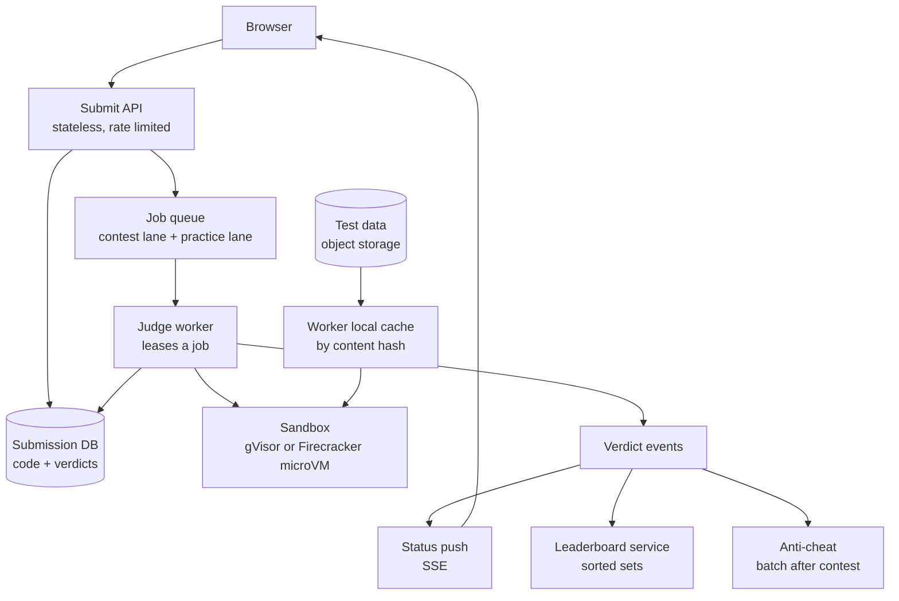
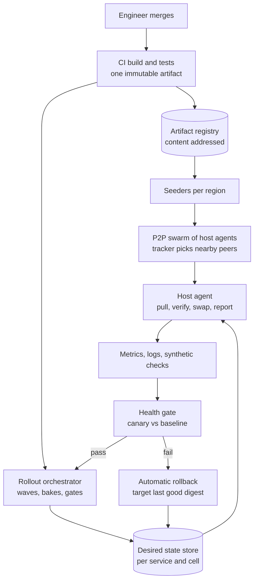
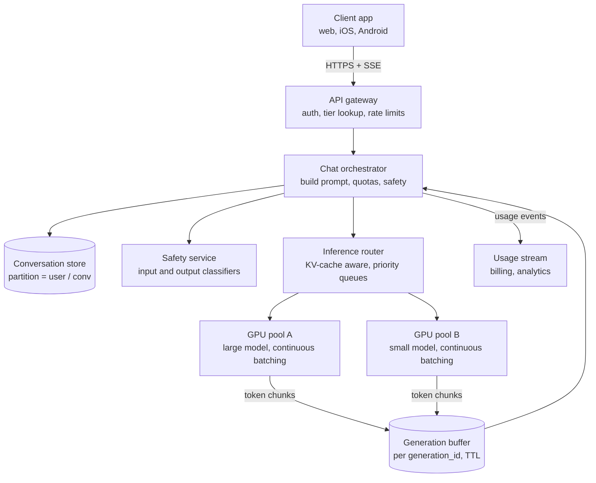
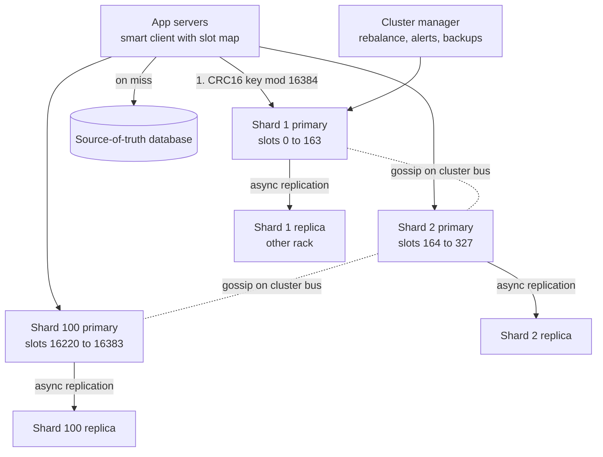

# Module 21 — Case Studies: Developer and AI Platforms

## Module Introduction

Four more end-to-end designs in the format of Modules 13–17 and 20, for platform systems common in modern interviews. The algorithms they rely on are explained step by step in [Module 19](../19-algorithms-deep-dive/README.md).

| Case | Centre of gravity |
|---|---|
| 1 — Online Judge (LeetCode-like) | Running untrusted code safely and fairly: sandboxes, resource limits, judge queues, contest leaderboards |
| 2 — Global Deployment System | Getting one build to many servers safely: artifact distribution, rollout waves, health gates, rollback |
| 3 — Conversational AI Service (ChatGPT-like) | Token streaming, GPU batching, KV-cache-aware routing, quotas and cost |
| 4 — Distributed Cache Cluster | Hash slots, replication and failover, hot keys, routing, eviction and resharding |

## Case 1 — Online Judge (LeetCode-like)

**The prompt (in short).** A LeetCode/Codeforces/HackerRank-style site: users write code in one of ~20 languages, press Submit, and within seconds see "Accepted", "Wrong Answer", "Time Limit Exceeded" and so on. Several times a week a timed **contest** (e.g. 90 minutes, same problems for everyone) runs with a live leaderboard.

**What makes it hard.** (1) It **runs code written by strangers**: any submission may try to read others' code, open connections, fork a million processes or fill the disk, so every submission is assumed hostile. (2) Load is **extremely spiky**: tens of thousands crowd into the same 90 minutes, bunching at the start and end. (3) Results must be **fair and repeatable**: same code, same verdict and roughly the same time on any machine, or the leaderboard is meaningless.

### 1. Requirements and numbers
**Functional:** browse problems; submit in a chosen language; compile, run against hidden tests and return a **verdict** (Accepted, Wrong Answer, Time Limit Exceeded, Memory Limit Exceeded, Runtime Error, Compile Error) with runtime and memory; a "Run" button on the user's own sample input; submission history; contests with registration, start/end, live leaderboard and final ratings; post-contest plagiarism checks.

**Non-functional:** **security first** (no sandbox escape, no other users' data, no network); verdict **p95 < 5 s** outside contests and **< 15 s** at contest peak; **determinism** (same verdict, time within a few percent); **no lost submissions** (after "Pending", a verdict always appears); fairness (contest submissions judged in arrival order, never starved by practice traffic).

**Numbers (assumptions, rounded):**
- **20M registered, 2M daily active**; **1M practice submissions/day ≈ 12/s**, ~40/s at the daily peak.
- **Contest:** 50K participants × 4 problems × ~2.5 attempts = **500K submissions in 90 min ≈ 93/s**; first and last 10 minutes ~5× → **~500/s peak**.
- **One submission:** ~1 s CPU compile + ~50 tests × ~60 ms ≈ **~4 CPU-seconds**. Peak 500/s × 4 = **2,000 cores busy**; one dedicated core per sandbox (Deep dive 2) and 30% headroom → **~2,600 cores ≈ 80 32-core workers**. Off-contest 40/s × 4 = 160 cores, so the fleet **scales down ~10×** between contests.
- **Code:** 3 KB average → **3–5 GB/day ≈ 1.5 TB/year**: tiny.
- **Test data:** 3,000 problems × 50 tests × ~1 MB (some 100 MB) ≈ **150 GB**; any worker may need any problem, but a contest touches 4 problems (~200 MB), which fits in RAM.
- **Leaderboard:** participants plus spectators refreshing every 10–30 s → **~5K reads/s** of a ranking changing ~100 times/s.

**What the numbers say:** storage is trivial; **CPU for untrusted execution**, the **10× contest spike** and the **isolation boundary** decide the architecture.

### 2. The five-questions pass
- **Flow:** **asynchronous**: the API stores the code, enqueues a job and returns a `submission_id` at once; the browser waits via Server-Sent Events or polling ([Message Queue](../02-moving-data/README.md#message-queue), [Server-Sent Events](../02-moving-data/README.md#server-sent-events)). No HTTP connection is held open while a compiler runs.
- **Storage:** the **submission record** (code + final verdict) in a relational database is the truth; test cases are immutable versioned files in object storage; the leaderboard is **derived** and rebuildable ([CQRS](../03-storing-data/README.md#cqrs)).
- **Speed:** execution dominates, so keep compilers warm in pre-built images, cache test data on local disk, and exit at the first failing test.
- **Failure:** workers crash, hang or are killed by user code. Jobs are **leased**, not consumed (unreported jobs return to the queue), and judging is **idempotent** ([Idempotency](../05-reliability/README.md#idempotency)).
- **Growth:** with contest size, not users; pre-scale before every scheduled contest ([Auto-Scaling](../06-scaling/README.md#auto-scaling)).
- *Skeleton:* stateless submit API → durable priority queue → judge workers running each submission in a locked-down sandbox → verdict store → result push + leaderboard service.

### 3. API

| Method and path | Purpose |
|---|---|
| `POST /submissions {problem_id, language, code, contest_id?}` | Returns `202 Accepted {submission_id}` at once. Requires an `Idempotency-Key` header so a double-click does not judge twice |
| `GET /submissions/{id}` | Status (`queued`, `compiling`, `running 17/50`, final verdict), time and memory |
| `GET /submissions/{id}/events` (SSE) | Server pushes status changes until the final verdict |
| `POST /run {problem_id, language, code, stdin}` | "Run code" on custom input. Same sandbox, lower priority queue, no verdict stored |
| `GET /contests/{id}/leaderboard?cursor=…&limit=50` | Paged ranking ([Cursor-Based Pagination](../08-api-and-edge/README.md#cursor-based-pagination)) |
| `GET /contests/{id}/leaderboard/me` | My rank and the rows around me |
| Internal: `lease(job)`, `report(submission_id, attempt, verdict)` | Worker ↔ queue and worker ↔ verdict store |

[Rate limits](../08-api-and-edge/README.md#rate-limiting), e.g. 1 submission per 5 s per user per problem plus a `/run` cap, stop scripts flooding the judge.

### 4. Data model
- **`problems`** — `problem_id, title, statement_ref, time_limit_ms, memory_limit_mb, checker_type (exact / token / float tolerance / custom), testset_version`. The **checker** decides whether output is correct: "exact" compares bytes, "float tolerance" accepts 1e-6 differences, "custom" handles problems with many valid answers.
- **`testsets`** — `(problem_id, version) → manifest` of each test file's name, size and **SHA-256**. Files sit at content-addressed paths (the path *is* the hash), so a cached file can never be stale: a new version gets new paths.
- **`submissions`** — `submission_id (time-ordered 64-bit), user_id, problem_id, contest_id?, language, code_ref, created_at, status, verdict, time_ms, memory_kb, failed_test_index, judge_attempt, testset_version`; partitioned by `user_id` ([Sharding](../03-storing-data/README.md#sharding)), secondary index `(contest_id, created_at)`.
- **`contest_scores`** (in-memory sorted set + durable copy) — per contest `user_id → (solved_count, penalty_minutes, last_ac_time)` plus per-problem `(attempts, first_ac_time)`.
- **`language_images`** — `language → container image digest, compile command, run command, time multiplier`. The image is a frozen file system with compiler and runtime; its **digest** (content hash) guarantees every worker runs byte-for-byte the same toolchain.

### 5. The architecture, annotated

1. The **Submit API** checks contest registration and timing, writes the code to the **submission DB** as `queued`, enqueues `{submission_id}` on the **contest lane**, and returns `202` in ~50 ms.
2. **Separate lanes** (priority classes) keep 50K contest users from waiting behind practice traffic without starving practice: workers take, say, 9 contest jobs per practice job ([Bulkhead](../05-reliability/README.md#bulkhead)); FIFO within a lane.
3. A **judge worker** leases the job (invisible to others for, say, 120 s), loads the code, picks the language image, and fetches any missing test files by hash into its **local cache**.
4. It compiles in one sandbox with a compile-time limit, then runs each test in a fresh locked-down sandbox with CPU, memory, process and output limits (Deep dives 1 and 2); the **checker** compares output, stopping at the first failure.
5. A **conditional update** (`only if status != final`) stores the verdict, then a **verdict event** goes to the status-push service (to the browser) and the **leaderboard service** ([Event-Driven Architecture](../02-moving-data/README.md#event-driven-architecture)).
6. After the contest, **anti-cheat** jobs compare all accepted submissions (Deep dive 4); ratings publish only after that pass.

### 6. Deep dives

**Deep dive 1 — the sandbox: containers, gVisor or Firecracker.**
The sandbox is the product; a plain process is unsafe, so the question is how thick the wall is.
- **Plain Linux container** (Docker-style): **namespaces** (a private view of process IDs, mounts, network and users), **cgroups** (control groups: kernel caps on CPU, memory and process count), **seccomp** (a filter on which **system calls**, a program's requests to the kernel such as "open file" or "create socket", are allowed) and all privileges dropped. The IOI's open-source **isolate** sandbox does this, with no measurable overhead per its authors, and handles multi-threaded programs. *Weakness:* the code still talks to the **real host kernel**; one reachable kernel bug is a full escape to a worker holding other people's code.
- **gVisor** (Google): a user-space "application kernel" whose **Sentry** intercepts system calls and implements them itself, with file access via a separate **Gofer** process; plugs in as an OCI runtime (`runsc`) behind Docker or Kubernetes; used under App Engine, Cloud Run and Cloud Functions. *Cost:* syscall-heavy programs slow down, skewing time limits on I/O-heavy problems.
- **Firecracker microVM** (AWS, built for Lambda): a tiny **virtual machine** (guest OS on emulated hardware, isolated by CPU virtualisation) booting in under 125 ms with under 5 MiB overhead, up to 150 created per second per host. The guest has its own kernel, so a kernel bug inside doesn't reach the host.
- **Choice:** a **Firecracker microVM (or gVisor) as the outer wall**, **isolate-style cgroups + seccomp inside** for precise per-test limits: two independent layers must both fail. Keep a **pool of pre-booted microVMs** per language so boot time is off the critical path, and destroy each VM after one submission (never reuse a sandbox between users).
- **Network:** none, no interface at all. **File system:** read-only image plus a size-capped `tmpfs` (memory-backed scratch). **Workers** sit in an isolated segment reaching only the queue, the DB writer and object storage.

**Deep dive 2 — resource limits and fair timing.**
- **Time:** **CPU time** (actually running on a core) from cgroup counters decides TLE (Time Limit Exceeded); a **wall-clock limit** (real elapsed time, e.g. 3× the CPU limit) kills programs that sleep or block on input.
- **Memory:** a cgroup cap; the out-of-memory killer firing inside the cgroup means MLE.
- **Processes:** `pids.max` of, say, 64 stops a **fork bomb** (a program copying itself endlessly).
- **Output:** cap stdout at e.g. 64 MB; endless printing gets "Output Limit Exceeded".
- **Fairness:** pin each sandbox to **one dedicated physical core** (no hyper-threading sibling), disable CPU frequency boost, never run more sandboxes than cores, calibrate each worker class with a fixed benchmark and reject drifting machines, and automatically **re-run** borderline TLEs (within ~5% of the limit) on another worker, keeping the better time.
- **Language fairness:** a published **time multiplier** per language in `language_images` (e.g. Python 3× the C++ limit).

**Deep dive 3 — the queue at contest time.**
- If workers run short at 500/s the queue and the "Pending" spinner grow; acceptable if bounded, and showing queue position ("your submission is #1,240") turns anxiety into patience.
- **Pre-scale** 30 minutes before start from registrations (registrations × expected submissions × 4 CPU-s) and hold 30 minutes after the end for rejudges: the spike arrives in seconds, faster than reactive scaling.
- **Lease and retry:** a dead worker's job is redelivered at lease expiry; each judging has an `attempt` number and the conditional final write means two workers can't both win (visibility timeouts: [Module 13 Case 4](../13-case-studies-building-blocks/README.md#case-4--design-a-distributed-message-queue)).
- **Poison submissions** that crash the *worker* (not just the sandbox) three times go to a [dead letter queue](../05-reliability/README.md#dead-letter-queue) with "System Error — under review".
- **Rejudge:** wrong tests mid-contest → admins publish a new `testset_version` and enqueue affected submissions on a **rejudge lane** below live submissions.

**Deep dive 4 — leaderboard and anti-cheat.**
- **Ranking rule (ICPC-style):** problems solved (more is better), then **penalty time** (less is better): per solved problem, minutes from start to first accept plus a fixed penalty per earlier rejected attempt (ICPC: 20 minutes; LeetCode and others publish their own). Encode as one **sorted-set** score (e.g. Redis ZSET): `score = solved × 10^7 − penalty_minutes × 10 − tiebreak`, so one `ZADD` per accepted verdict keeps order and "rank of X" or "rows 1–50" are O(log N) ([Skip lists](../19-algorithms-deep-dive/README.md#skip-lists); sorted sets in depth: [Module 15 Design 4](../15-case-studies-location-and-realtime/README.md#design-4--real-time-gaming-leaderboard)).
- **Only verdict events change scores**, idempotent per `(user, problem)` (a second Accepted does nothing); `contest_scores` rebuilds the sorted set after cache loss.
- **Freeze:** many contests hide the last hour's changes; the service keeps a public (frozen) view and the true view, serving the public one until reveal.
- **Anti-cheat signals:** (1) **code similarity** with MOSS-style **winnowing**: strip comments, whitespace and identifiers, cut the token stream into overlapping k-grams, hash them, keep a sample of fingerprints, flag pairs sharing many; an inverted index (fingerprint → submissions) avoids comparing all 25K² pairs on a popular problem. (2) **Behaviour:** many accounts per device or IP, a hard problem solved 40 s after a friend, sudden rating jumps, large pastes (the editor can record paste events). (3) **Leaked-solution matching** against code posted publicly during the contest.
- Flags go to **human review**, never straight to a ban: short standard algorithms look alike and fingerprint tools over-flag them. Ratings finalise after review and roll back for confirmed cheaters.

### 7. The failure walk
1. **Worker dies mid-judging:** leases expire, jobs are redelivered, the conditional write keeps one result; users wait ~2 minutes longer.
2. **Sandbox escape discovered** (kernel or gVisor CVE): the worst case, but one failed layer isn't yet a breach. Workers are **cattle** (identical, disposable): rebuild every image with the patch, drain and replace the fleet, rotate credentials. Workers hold only the current job and can write only verdicts, limiting blast radius.
3. **Test-data store slow or down:** workers use their hash-addressed cache, and contest test sets are **pre-warmed** to every worker before start.
4. **Queue backlog at peak:** show queue position, **pause the practice lane** and `/run` ([Graceful Degradation](../05-reliability/README.md#graceful-degradation)), extend the contest past a published delay threshold; never drop a queued contest submission.
5. **Leaderboard sorted set lost:** rebuild from `contest_scores` (50K rows) in seconds; verdicts live in the DB.
6. **Bad compiler image** (every C++ submission gets Compile Error): pin images by digest per contest, canary new images on a worker slice outside contest hours, watch the verdict mix per language ([Canary Deployment](../09-operating-in-production/README.md#canary-deployment)), rejudge affected submissions.
7. **A program hogs I/O or memory bandwidth**, slowing neighbours: cgroup I/O limits, one core per sandbox and borderline re-runs keep verdicts fair.

### 8. Trade-offs

| Decision | Chosen | Alternative | Why |
|---|---|---|---|
| Isolation | MicroVM or gVisor outside + cgroups/seccomp inside | Plain containers only | Code is hostile by definition; one shared-kernel bug should not be game over |
| Submission flow | Async queue + SSE push | Synchronous HTTP | Judging takes seconds and spikes 10×; a queue absorbs the burst |
| Queue | Separate contest, practice, rejudge lanes | One FIFO | Contest fairness and protection from bulk rejudges |
| Timing | CPU time on a dedicated core, re-run if borderline | Wall-clock on shared cores | Repeatable verdicts are the product |
| Test data | Content-addressed files + local cache, pre-warmed | Read from shared storage per run | Hundreds of reads/s of the same files; no stale caches |
| Leaderboard | Sorted set derived from verdict events | SQL `ORDER BY` per request | 5K reads/s on a constantly changing ranking |
| Anti-cheat | Offline fingerprinting + human review | Real-time automatic bans | False positives on short standard code are common |
| Fleet | Scheduled pre-scaling around contests | Reactive autoscaling only | The spike arrives faster than machines boot |

### 9. The follow-up questions
- **"Why not just Docker?"** Docker shares the host kernel, so isolation depends on every allowed system call being bug-free; hostile code needs a second boundary with its own kernel (microVM) or syscall implementation (gVisor). *Trap:* "containers are secure because of namespaces" without mentioning the shared kernel.
- **"Interactive problems** (the program converses with a judge program)?" Two sandboxes joined by pipes, the interactor deciding the verdict; time both, and a deadlock becomes TLE via the wall-clock limit.
- **"New language?"** Build an image, run every problem's reference solutions to set its time multiplier, publish the digest, enable it; workers are image-driven, so nothing else changes.
- **"Serverless judging?"** Fine for practice (each Lambda invocation already runs in a Firecracker microVM), but timing noise and cold starts make contest timing less fair; dedicated calibrated workers are safer for rated contests.
- **"AI-cheating detection?"** One more advisory signal: compare against popular code models' outputs for the problem plus behaviour (one large paste, no edits), with human review; prefer resistant contest design (proctored or in-person finals).

### Pattern manifest

| Pattern | Where used | Taught in |
|---|---|---|
| Message Queue (with leases) | Submission jobs, contest/practice/rejudge lanes | [Module 02](../02-moving-data/README.md#message-queue) |
| Server-Sent Events | Pushing status and verdict to the browser | [Module 02](../02-moving-data/README.md#server-sent-events) |
| Idempotency | `Idempotency-Key` on submit; conditional verdict write; one AC per problem | [Module 05](../05-reliability/README.md#idempotency) |
| Bulkhead | Separate lanes and worker shares for contest vs practice | [Module 05](../05-reliability/README.md#bulkhead) |
| Dead Letter Queue | Submissions that crash workers repeatedly | [Module 05](../05-reliability/README.md#dead-letter-queue) |
| Graceful Degradation | Pause practice and `/run` at contest peak | [Module 05](../05-reliability/README.md#graceful-degradation) |
| Auto-Scaling (scheduled) | Worker fleet before each contest | [Module 06](../06-scaling/README.md#auto-scaling) |
| Rate Limiting | Per-user submit and run caps | [Module 08](../08-api-and-edge/README.md#rate-limiting) |
| Containers and sandboxing | Language images, microVM/gVisor sandboxes | [Module 09](../09-operating-in-production/README.md#containers-and-kubernetes) |
| CQRS | Leaderboard as a derived read model | [Module 03](../03-storing-data/README.md#cqrs) |
| Sorted-set leaderboard | Contest ranking | [Module 15](../15-case-studies-location-and-realtime/README.md#design-4--real-time-gaming-leaderboard) |

**Interview one-liner:** "Submit is asynchronous: store the code, enqueue a job, return an ID. Calibrated workers lease jobs and run each submission in a throwaway microVM or gVisor sandbox with no network, cgroup limits on CPU, memory, processes and output, and content-hashed test data cached locally. Verdict events feed the browser and a sorted-set leaderboard; contests get their own queue lane and pre-scaled capacity; plagiarism is a fingerprinting batch job plus human review."

### TL;DR
- **Problem:** run hostile code from millions of users fairly and repeatably, with a 10× contest spike.
- **Mechanism:** async submit → leased priority queue → judge workers → per-submission microVM/gVisor sandbox with cgroup and seccomp limits → verdict events → SSE + sorted-set leaderboard.
- **Hard parts:** isolation (two layers, no network, never reuse), fair timing (dedicated cores, CPU time, borderline re-runs), contest bursts (lanes, pre-scaling, pre-warmed tests), anti-cheat (winnowing + humans).
- **Price:** a large mostly idle fleet between contests and constant sandbox patching.

**Sources**
- Mareš, M. and Blackham, B., "A New Contest Sandbox", *Olympiads in Informatics* 6 (2012): https://ioinformatics.org/journal/INFOL094.pdf and the isolate project: https://github.com/ioi/isolate
- gVisor documentation (Sentry, Gofer, runsc): https://gvisor.dev/docs/
- Google Cloud blog, "How gVisor protects Google Cloud services from CVE-2020-14386": https://cloud.google.com/blog/products/containers-kubernetes/how-gvisor-protects-google-cloud-services-from-cve-2020-14386
- Firecracker project site (boot time, overhead, creation rate): https://firecracker-microvm.github.io/
- ICPC scoring rules (20-minute penalty per rejected run on a solved problem), e.g. ECNA regional rules: https://icpc-ecna.ysu.edu/rules.html
- Schleimer, Wilkerson and Aiken, "Winnowing: Local Algorithms for Document Fingerprinting", SIGMOD 2003 (the algorithm behind MOSS): https://theory.stanford.edu/~aiken/publications/papers/sigmod03.pdf

---

## Case 2 — Global Deployment System

**The prompt (in short).** The internal system a large company ships software with: an engineer merges, and within hours the build runs safely on hundreds of thousands of servers in dozens of regions (think Facebook's continuous web-tier push, Amazon's pipelines to every AWS region, Google's rollout tooling).

**What makes it hard.** Google's SRE book observes that roughly 70% of outages come from changes to a live system, so deployment is both the biggest risk and the main defence. Hard parts: (1) **moving gigabytes to 200K machines** without melting the network or artifact store; (2) **gradual exposure** so a bad build hurts 0.1% of users, not 100%; (3) **automatically judging** stage health and rolling back without a human; (4) treating **configuration changes**, which spread in seconds and cause many outages, as carefully as code.

### 1. Requirements and numbers
**Functional:** build a versioned immutable artifact per commit; store and distribute it; roll out in staged waves across regions; check health per stage and promote or roll back automatically; a big red **stop button**; deploy **config** separately from code; audit who shipped what, where, when; deployment windows and blockers (no deploys during an active incident).

**Non-functional:** **safety beats speed** (catch bad changes while exposure is small); **rollback in minutes** anywhere; usable during an outage (it ships the fix); fully **automated and repeatable**; thousands of services, tens of deploys per service per week.

**Numbers (assumptions):**
- **200K servers** in **20 regions** (~10K each over 3 **availability zones**, AZ = one or more data centres with independent power and network inside a region).
- **2,000 services** deploying about daily → **~2,000 rollouts/day** plus **~5,000 config changes/day**.
- **Artifacts:** a big monolith binary or image ~**1 GB**; a typical microservice image ~200 MB, with only changed layers moving (often ~50 MB).
- **Naive fan-out** of 1 GB to 200K hosts = **200 TB**; a central store of 20 servers × 10 Gbps = 25 GB/s → 8,000 s ≈ **2.2 hours** with the store saturated and other deploys blocked. **Peer-to-peer** (Deep dive 1) makes every host that holds a piece upload it, so capacity grows with hosts; at ~50% of a 10 Gbps NIC, time is about one host's download (~2 s per GB) plus a few relay hops: **well under a minute** (Uber reports 20K blobs of 100 MB–1 GB in under 30 s).
- **Rollout duration** is dominated by **bake time** (running under real traffic before promotion): five waves with 1–12 h bakes → **multi-day** global rollouts for risky backends (Amazon's published zonal-and-regional wave pipeline takes days), a few hours for front-ends with fast signals (Facebook's web tier pushes several times a day).

**What the numbers say:** P2P solves the bytes; the design is about **exposure control and fast, automatic judgement**.

### 2. The five-questions pass
- **Flow:** asynchronous and long-running: a rollout is a durable **workflow** run by a pipeline orchestrator, not a laptop script. Hosts **pull** their target from a desired-state store; the orchestrator only changes desired state (the reconcile loop of [Containers and Kubernetes](../09-operating-in-production/README.md#containers-and-kubernetes)).
- **Storage:** the **artifact** (immutable, content-addressed: named by its bytes' hash) in blob storage; **desired state** per (service, cell), e.g. "cell 7 of region X runs build b-4812 with config v-991", in a strongly consistent etcd/ZooKeeper-style store; history and audit in a relational DB.
- **Speed:** P2P plus pre-staging (download before switching) make the switch a seconds-long restart; the long part is deliberate waiting.
- **Failure:** the main failure is **a bad change**; health gates, automatic rollback and small blast radii defend. The deploy system's own outage must never block an emergency fix (a minimal "break glass" path).
- **Growth:** services × hosts × change rate; distribution must be sub-linear in hosts (P2P) and control hierarchical (region → cell → host).
- *Skeleton:* CI build → artifact registry → P2P distribution → per-host agent → rollout orchestrator with waves and gates → health/canary analysis → automatic rollback; a separate fast lane for config.

### 3. API

| Method and path | Purpose |
|---|---|
| `POST /artifacts {service, commit, digest, sbom_ref, signature}` | Register a build (CI calls this). **Immutable**: same digest, same bytes, forever |
| `POST /rollouts {service, artifact_digest, plan_id}` | Start a rollout using a named plan (waves, bakes, gates). Returns `rollout_id` |
| `GET /rollouts/{id}` | Current wave, per-cell state, gate results, ETA |
| `POST /rollouts/{id}:pause` / `:resume` / `:rollback` | Human controls; rollback re-targets the last good digest |
| `POST /config-changes {key, new_value, canary_spec}` | Propose a config change; goes through review, validation and its own canary |
| `POST /freeze {scope, reason, until}` | Org-wide or service-level deploy blocker during incidents and holidays |
| Agent ↔ control plane: `GET /desired?host=…` (long poll), `POST /report {host, running_digest, health}` | Pull model; the agent reports what is actually running |

### 4. Data model
- **`artifacts`** — `digest (SHA-256) → service, commit, build_time, size, layers[], signature, provenance` (who built it, from what source, on which builder); bytes stored as layers/chunks keyed by their own hashes, so identical layers are stored and sent once.
- **`rollout_plans`** — `plan_id → waves[]`, each `{targets (cells/regions), batch_size %, bake_time, gates[]}`; plans are reviewed like code.
- **`rollouts`** — `rollout_id, service, from_digest, to_digest, plan_id, state (running / paused / rolling_back / done), current_wave, started_by, started_at`.
- **`desired_state`** — `(service, cell) → {artifact_digest, config_version, generation}`; the increasing **generation** stops an agent applying an older instruction after a newer one (ordered durable changes, [Write-Ahead Log](../03-storing-data/README.md#write-ahead-log) thinking).
- **`actual_state`** — `(host) → running_digest, config_version, healthy, last_report_at`, expiring if the host stops reporting.
- **`gate_results`** — `(rollout_id, wave, gate) → pass / fail / inconclusive, metrics snapshot, decided_at`.
- **`config_store`** — versioned key → value with schema, owner and history (in Git, mirrored to a distribution tree).

### 5. The architecture, annotated

1. The merge triggers **CI**, which produces **one** signed artifact with a digest and recorded provenance. **Build once, promote everywhere**: the bytes that passed tests go to every stage ([CI/CD Pipelines and Deployment Strategies](../09-operating-in-production/README.md#cicd-pipelines-and-deployment-strategies)).
2. The artifact goes to the **registry**; the **orchestrator** starts the service's plan: pre-production stages, then production **wave 1**.
3. Per target cell, agents first **pre-stage** (download and verify); regional **seeders** hold the first copy and the **P2P swarm** spreads it (Deep dive 1).
4. The orchestrator bumps the wave's **desired state**. Each **host agent** sees the new generation, verifies signature and hash, **drains** the local service (no new requests, finish in-flight ones), swaps versions, runs local health checks and reports `actual_state` ([Health Check Endpoint](../09-operating-in-production/README.md#health-check-endpoint)); hosts switch in batches (e.g. ≤ 10%) so capacity holds.
5. The **health gate** compares new hosts with old over the **bake time** (Deep dive 3): pass → next wave; fail → **automatic rollback** to the last good digest, still cached on every host, so rollback is a restart, not a download.

### 6. Deep dives

**Deep dive 1 — moving the bytes: registry, P2P and pre-staging.**
- **Content addressing:** chunks or layers named by hash; hosts skip chunks they hold, so a build changing 3% of a 1 GB binary moves ~30 MB, and the recomputed hash rejects corrupt or tampered chunks.
- **Why P2P:** a central server's fixed upload capacity makes time linear in hosts. In a **BitTorrent-style swarm** the file is cut into **pieces** (BitTorrent's spec: most commonly 256 KB, each with its own SHA-1 hash), each host downloads from several peers and **uploads pieces it has**, so capacity grows with the swarm and 200K hosts take about as long as 2,000.
- **History:** Facebook pushed its front-end binary with internal BitTorrent around 2010–2012, with a custom tracker preferring same-rack peers; Twitter's "Murder" did the same; Uber's open-source **Kraken** is a P2P Docker registry (a **tracker** says which peers have which pieces; **origin** servers seed from backing storage such as S3), reporting 20K blobs of 100 MB–1 GB in under 30 s at peak at > 50% of each host's max download speed.
- **Topology awareness:** the tracker hands out peers in the **same rack, then cluster, then region**, so most bytes stay off expensive links; per-region seeders mean one copy crosses an ocean.
- **Pre-staging:** separates the slow, failure-prone network part from the risky restart, so a 10K-host switch takes seconds; keep the **previous N versions** on disk so rollback needs no network.
- **Guard rails:** cap per-host P2P upload (e.g. 30% of NIC) so production traffic isn't starved; heavily loaded hosts opt out of seeding.

**Deep dive 2 — staged rollout waves and blast radius.**
- **Blast radius** = share of users hurt if this step is bad; every wave caps it.
- **Typical plan** (the shape Amazon publishes):
  1. Pre-production: integration tests, then a **gamma** stage mirroring production config.
  2. **One-box** in one AZ of a low-traffic region (one host or a small traffic slice), bake ≥ 1 h.
  3. Wave 1: the rest of that AZ, then that region's other AZs **one at a time**; bake ~12 h after the first full region to catch daily-cycle bugs (overnight batch jobs, memory leaks, certificate rotations).
  4. Wave 2: one high-traffic region, AZ by AZ.
  5. Waves 3–5: 3, then ~12, then all remaining regions, with 2–4 h bakes.
- **Never two AZs of a region at once**, never two regions at once early: a failure stays inside a **cell** (a self-contained stack serving a slice of users) ([Multi-Region and Cell-Based Architecture](../06-scaling/README.md#multi-region-and-cell-based-architecture)).
- **Front-end variant:** Facebook's web tier goes to **employees**, then **~2% of production**, then 100%, over a few hours, several times a day; enormous traffic gives strong signals fast.
- **Windows and blockers:** production waves start only in the owning team's working hours (not nights, weekends, late Fridays); **blockers** halt new waves automatically during related high-severity alarms or org-wide incidents.
- **Within a cell:** **rolling** batches (≤ 10–33% of hosts) or **blue-green** where instant switch-back matters ([Blue-Green Deployment](../09-operating-in-production/README.md#blue-green-deployment)).

**Deep dive 3 — health gates and automatic rollback.**
- **Watched signals:** 5xx rate, latency p50/p90/p99, CPU, memory, crash/restart count, log error rate, failed health checks, **business metrics** (checkouts per minute, messages sent), and **synthetic canaries** (scripted fake users calling the API every minute from outside).
- **Compare like with like:** absolute thresholds miss subtle regressions and misfire at traffic peaks, so compare **canary vs baseline hosts** (old version, same cell, window and host count). Netflix and Google's open-source **Kayenta** runs a **Mann-Whitney U test** per metric (do two sets of numbers come from different distributions, without assuming a bell curve), flagging only at ~98% confidence of a meaningful difference, and rolls results into a pass/fail/ask-a-human score ([Canary Deployment](../09-operating-in-production/README.md#canary-deployment)).
- **Outcomes:** `pass` → promote after the bake; `fail` → rollback; `inconclusive` (too little traffic) → extend the bake, never promote silently.
- **Fast tripwires** roll back immediately: request count to zero, fault-rate spike, health checks failing on > N% of new hosts.
- **Automatic rollback:** desired state back to the **last digest that passed all gates** in the cell; agents restart into the cached version. On a team-level aggregate alarm, roll back **every in-flight deployment** of that team in the region (the culprit is unknown). Rollback needs neither the failing service healthy nor CI to rebuild.
- **Rollback needs backward compatibility:** schema changes go **expand → migrate → contract** (add column, deploy code writing both, backfill, drop the old column later) so N−1 runs against data N wrote ([Capstone - The Zero-Downtime Migration](../09-operating-in-production/README.md#capstone---the-zero-downtime-migration)); irreversible changes (data deletions, protocol bumps) go behind **feature flags**.

**Deep dive 4 — config deploys vs code deploys.**
- **Why separate:** code needs a new binary everywhere (hours of waves); many changes are just *values* (a timeout, a rate limit, which 5% see a feature) that as config reach the fleet and undo in **seconds**.
- **The danger is that speed:** a bad value hits every server at once with no rollout to slow it; many well-known global outages were config pushes.
- **Facebook's model** (SOSP 2015, "Holistic Configuration Management at Facebook"): configs in Git, often **generated by code** with validators, every change reviewed; an automated **canary spec** applies it to ~20 servers, then a cluster, comparing health (~10 minutes for a full canary); distribution via **Zeus** (a ZooKeeper fork) through a high fan-out tree of observers and per-server proxies, reaching hundreds of thousands of servers in seconds; large blobs via a separate P2P path. Each proxy's **on-disk cache** lets apps read the last good config if the config system is down.
- **Design rules:** schema-validate every value (types, ranges); **stage config like code** (one-box → cell → region, shorter bakes); full history with **one-click, seconds-long revert**; apps **reject unparseable config and keep the last good one**; separate **feature flags** (per-user exposure, [Feature Flags](../09-operating-in-production/README.md#feature-flags)) from **operational config** (timeouts, pool sizes) so each gets the right review rules.

### 7. The failure walk
1. **Bad build passes tests** (a leak showing after 6 h): one-box and wave-1 bakes catch daily-cycle problems; the memory alarm trips on the one-box and rollback restores 1 host: ~0.01% of traffic.
2. **Bad build fails fast** (crash on start): hosts fail local health checks before joining the load balancer and the agent stops after the first batch: zero user impact.
3. **Gates are blind** (an unwatched feature breaks): it reaches more waves. Add business-metric gates and synthetic tests per critical journey; every escaped bug becomes a new gate.
4. **Orchestrator or desired-state store down:** hosts keep running their last known state (pull model) and no rollouts start, which is safe; a documented **break-glass** tool lets on-call push a pinned digest to a cell.
5. **Registry or seeders down:** pre-staged versions and peer copies continue; new builds wait; the registry is replicated per region ([Primary-Replica](../03-storing-data/README.md#primary-replica)).
6. **Rollback fails** because the new version wrote data the old can't read: hence backward-compatible schema rules and flags; otherwise **roll forward** a hotfix through an expedited plan (shorter bakes, still staged, never all at once).
7. **Bad config push:** the config canary catches most; escaped ones revert in seconds; apps keep the previous value on unparseable config.
8. **Compromised build machine** shipping malware: hosts accept only artifacts signed by the build system with provenance from reviewed source, verifying signature and digest before running.

### 8. Trade-offs

| Decision | Chosen | Alternative | Why |
|---|---|---|---|
| Distribution | P2P swarm with regional seeders, rack-aware peers | Central servers / CDN only | Total capacity grows with hosts; 200 TB per release is otherwise hours |
| Control | Desired state + host agents pull | Orchestrator pushes over SSH | Survives orchestrator outages, scales, self-heals drift |
| Exposure | One-box → AZ → region waves with bakes | Deploy everywhere at once | Caps blast radius; 70% of outages are changes |
| Gate logic | Canary vs baseline statistics + hard tripwires | Static thresholds | Adapts to traffic patterns, catches subtle regressions |
| Rollback | Automatic to last good, cached digest | Human decides | Machines notice in minutes, humans at 3 a.m. take longer |
| Speed | Days for backends, hours for web tier | Same plan for all | Match bake time to how fast signals arrive and how bad failure is |
| Config | Separate fast lane, but still canaried and staged | Treat config as code deploy | Seconds-level changes and undo, without global instant blast |

### 9. The follow-up questions
- **"Why not a CDN for artifacts?"** It helps seed the first copy per region, but inside a data centre all hosts pulling from one edge concentrate load; P2P uses every host's idle upload and keeps bytes in racks. Many systems combine them: CDN/object storage to seed, P2P to spread ([CDN](../08-api-and-edge/README.md#cdn)).
- **"Deploying a service 300 others depend on?"** Same waves, with **callers'** error rates in the gates and cell-aligned rollouts so callers and dependency change together; CI contract tests keep the API compatible ([API Versioning](../08-api-and-edge/README.md#api-versioning)).
- **"Mobile apps?"** No rollback on phones: staged store rollouts (a percentage of users), server-driven feature flags to switch behaviour off, server compatibility with old app versions for months.
- **"Did a deploy cause this incident?"** Dashboards overlay deploy and config events, the deploy system publishes to the incident tool, and triage starts with "what changed in the last hour, where?".
- **"2,000 rollouts a day without collisions?"** Per-cell locking (one rollout per service per cell), a per-service rollout queue that **batches** commits into one artifact (Facebook's push-from-master ships many diffs together), and blockers pausing a region when it is unhealthy.

### Pattern manifest

| Pattern | Where used | Taught in |
|---|---|---|
| CI/CD, build once, promote | One signed artifact through every stage | [Module 09](../09-operating-in-production/README.md#cicd-pipelines-and-deployment-strategies) |
| Canary Deployment | One-box and wave gates, canary vs baseline | [Module 09](../09-operating-in-production/README.md#canary-deployment) |
| Blue-Green Deployment | Instant switch-back within a cell | [Module 09](../09-operating-in-production/README.md#blue-green-deployment) |
| Feature Flags | Decouple risky behaviour from deploys; non-reversible changes | [Module 09](../09-operating-in-production/README.md#feature-flags) |
| Health Check Endpoint | Agent's local check before joining the load balancer | [Module 09](../09-operating-in-production/README.md#health-check-endpoint) |
| Containers and reconcile loops | Desired vs actual state, agents pull | [Module 09](../09-operating-in-production/README.md#containers-and-kubernetes) |
| Multi-Region and Cell-Based Architecture | Waves follow AZ and cell boundaries | [Module 06](../06-scaling/README.md#multi-region-and-cell-based-architecture) |
| Circuit-breaker-style blockers | Halt all deploys during alarms or incidents | [Module 05](../05-reliability/README.md#circuit-breaker) |
| Publish-Subscribe / fan-out tree | Config distribution through observers and proxies | [Module 02](../02-moving-data/README.md#publish-subscribe) |
| Zero-downtime migration | Expand-migrate-contract so rollback stays safe | [Module 09](../09-operating-in-production/README.md#capstone---the-zero-downtime-migration) |
| Distributed Job Scheduler | Long-running rollout workflows | [Module 16](../16-case-studies-infrastructure/README.md#design-3--distributed-job-scheduler) |

**Interview one-liner:** "Build one signed, content-addressed artifact; spread it with a rack-aware P2P swarm and pre-stage it; change only the desired state and let host agents pull; roll out in waves — one-box, one AZ, one region, then wider — with bake times and canary-vs-baseline gates; roll back automatically to the cached last-good digest; and push config through its own fast but still canaried lane."

### TL;DR
- **Problem:** ship thousands of changes a day to 200K servers without any one change taking everything down.
- **Mechanism:** CI → immutable artifact → P2P distribution with regional seeders → desired-state store + pulling host agents → staged waves with bakes → statistical health gates → automatic rollback; a separate canaried config pipeline.
- **Hard parts:** bytes at scale (P2P, content addressing, pre-staging), blast radius (cells, waves), automatic health judgement (canary vs baseline), keeping rollback possible (compatible data changes), config's dangerous speed.
- **Price:** slow global rollouts (days for backends), heavy telemetry plumbing, compatibility discipline.

**Sources**
- Liguori, C., "Automating safe, hands-off deployments", Amazon Builders' Library: https://aws.amazon.com/builders-library/automating-safe-hands-off-deployments/
- Facebook Engineering, "Rapid release at massive scale" (2017): https://engineering.fb.com/2017/08/31/web/rapid-release-at-massive-scale/
- Tang, C. et al., "Holistic Configuration Management at Facebook", SOSP 2015: https://doi.org/10.1145/2815400.2815401
- Uber Engineering, "Introducing Kraken, an Open Source Peer-to-Peer Docker Registry": https://www.uber.com/blog/introducing-kraken/ and https://github.com/uber/kraken
- BitTorrent protocol specification (BEP 3): https://www.bittorrent.org/beps/bep_0003.html
- Spinnaker docs, "How canary judgment works" (Kayenta, Mann-Whitney U): https://spinnaker.io/docs/guides/user/canary/judge
- Google Cloud blog, "Introducing Kayenta": https://cloud.google.com/blog/products/gcp/introducing-kayenta-an-open-automated-canary-analysis-tool-from-google-and-netflix
- Beyer, B. et al., *Site Reliability Engineering* (O'Reilly, 2016), on ~70% of outages coming from changes: https://sre.google/sre-book/introduction/
- TorrentFreak, "Facebook Uses BitTorrent, and They Love It" (2010, reporting a Velocity talk): https://torrentfreak.com/facebook-uses-bittorrent-and-they-love-it-100625/

## Case 3 — Conversational AI Service (ChatGPT-like)

**The prompt (in short).** A ChatGPT/Claude/Gemini-style assistant: users sign in, type a message and watch the answer appear word by word; conversations are saved and reopen on any device; free and paid tiers get different limits; harmful requests and answers are filtered.

**What makes it hard.** Sign-in and history are ordinary CRUD. The hard parts: (1) every answer comes from a **large language model (LLM)** generating one **token** (a word piece, roughly ¾ of an English word) at a time on **GPUs**, by far the largest cost; (2) answers take **seconds to tens of seconds**, so they must be **streamed**; (3) the GPU memory each in-flight conversation needs (its **KV cache**, Deep dive 2) caps users per GPU, so scheduling and routing are memory problems.

### 1. Requirements and numbers
**Functional:** create a conversation; send a message and receive a streamed answer; stop mid-way; regenerate or edit (creating a branch); list, rename, search, delete conversations; choose a model; per-tier quotas (free, paid, team). Attachments only "stored in blob storage".

**Non-functional:**
- **Time to first token (TTFT)** p95 < 1.5 s.
- **Time per output token (TPOT)** ≈ 20–30 ms (~35–50 tokens/s, faster than reading).
- **No lost answers:** finished answers are saved; a dropped connection can resume the stream.
- **Availability** 99.9% for chat; degrade (smaller model, queue) rather than hard-fail.

**Numbers (assumptions, rounded):**
- **100M DAU × 10 messages/day = 1B/day ≈ 11.6K/s, ~35K/s peak** (3×).
- Answers average **500 output tokens** at **50 tokens/s** → **~10 s** of GPU time each.
- Concurrent streams at peak by [Little's law](../00-system-design-fundamentals/README.md#littles-law): 35K/s × 10 s = **~350K open streams** → **17.5M output tokens/s**.
- Input per message (system prompt + history + new message) ≈ **3,000 tokens**; if 60% is a prefix already cached on the GPU (Deep dive 3), 1,200 new tokens each → **42M input tokens/s** of **prefill** (Deep dive 2).
- **KV cache per token**, 70B model shaped like Llama 3.1 70B (80 layers, 8 key/value heads, head size 128, 16-bit): 2 (key and value) × 80 × 8 × 128 × 2 bytes = **327,680 bytes ≈ 320 KB**; a 3,500-token conversation holds **~1.1 GB** while answered.
- **One replica** = 8 H100s × 80 GB = 640 GB; weights 70B × 2 bytes = 140 GB; after activations ~400 GB for KV → **~1.25M tokens** ≈ 350 conversations of 3,500 tokens at once.
- **Replica throughput (assumption, measure it):** ~6,000 output tokens/s at target TPOT → 17.5M ÷ 6,000 ≈ **2,900 replicas ≈ 23,000 GPUs**, +~30% for prefill and headroom → **~30,000 GPUs**.
- **Cost (assumption):** $2.50 per GPU-hour → **$1.8M/day ≈ $0.0018 per message**; a free user at 10 messages/day costs ~$0.55/month in GPU time, which drives quota design.
- **History:** ~2.5 KB per message → 2.5 TB/day ≈ **~0.9 PB/year** before replication, tiny next to the GPU bill.

**What the numbers say:** database and web tier are ordinary; **GPU memory and time** are the bottleneck and the bill. Judge every choice by "does it raise tokens per GPU-second, or cut tokens we must compute?"

### 2. The five-questions pass
- **Flow:** synchronous to a watching user but **streamed** token by token over one long HTTP response with [Server-Sent Events](../02-moving-data/README.md#server-sent-events) (SSE: the server writes small `data:` events into an open response); history, billing and analytics are **asynchronous** after the stream ([Five Questions](../01-thinking-in-patterns/README.md#the-five-questions)).
- **Storage:** the **conversation store** (messages as a tree, partitioned by user) is truth; a short-lived **generation buffer** holds in-flight tokens so a dropped client can resume; the GPU KV cache is a disposable performance cache.
- **Speed:** TTFT = queueing + prefill; TPOT = decode batching. The hot read, "this conversation's messages for the prompt", is one partition read.
- **Failure:** GPU servers fail more than web servers: retry a failed generation **on another replica**; a client disconnect must **not** waste the generation.
- **Growth:** with users and **context length** (KV memory grows linearly); hot spots are launches and each region's working-day start.
- *Skeleton:* API/edge tier (auth, rate limits), a chat orchestrator (prompt building, safety), a **KV-cache-aware inference router**, GPU pools with **continuous batching**, a stream relay to SSE gateways, a conversation store, an async usage pipeline.

### 3. API
| Method and path | Purpose |
|---|---|
| `POST /v1/conversations` → `{conversation_id}` | Start a conversation |
| `POST /v1/conversations/{id}/messages` body `{client_msg_id, parent_message_id, content, model}` → `200 text/event-stream` | Send a message and stream the answer. `client_msg_id` is an idempotency key (a client-made ID reused on retries so the server can spot repeats) ([Idempotency](../05-reliability/README.md#idempotency)) |
| SSE events: `message_start{message_id, generation_id}`, `delta{seq, text}`, `message_end{finish_reason, usage}`, `error{code}` | Each event carries an `id:` line equal to its `seq` (the token chunk's position) |
| `GET /v1/generations/{generation_id}/stream` with header `Last-Event-ID: 812` | Resume a dropped stream from chunk 813 (SSE clients send `Last-Event-ID` automatically on reconnect) |
| `POST /v1/generations/{generation_id}/cancel` | The "stop" button; frees the GPU slot |
| `GET /v1/conversations?cursor=…` | List conversations, newest first ([Cursor-Based Pagination](../08-api-and-edge/README.md#cursor-based-pagination)) |
| `GET /v1/conversations/{id}` | All messages (the tree) for rendering |
| `GET /v1/usage` | Remaining quota for the current window |

Rate limits return `429 Too Many Requests` with limit, remaining and reset headers (OpenAI's API returns `x-ratelimit-remaining-tokens` and similar). SSE beats WebSockets here: one-way traffic, plain HTTP that proxies understand, built-in resume via `Last-Event-ID`.

### 4. Data model
- **`conversations`** — partition `user_id`, clustering `updated_at` descending: `conv_id, title, model, created_at, archived`; listing chats is one range read.
- **`messages`** — partition `conv_id`, clustering `message_id` (time-ordered 64-bit): `parent_id, role (system/user/assistant/tool), content, content_ref (blob for large text or files), model, token_counts {input, cached_input, output}, status (streaming/complete/stopped/failed/blocked), safety_labels, created_at`. **Messages form a tree**: editing or regenerating adds a sibling under the same parent; the UI shows the selected branch, and a new turn's prompt walks from the new message up to the root.
- **`generation_buffer`** (in-memory with TTL, e.g. Redis Streams) — `generation_id` → ordered `(seq, text)` chunks, `status`, `replica_id`, TTL 15 minutes; decouples the GPU from the client connection.
- **`usage_ledger`** — `(user_id, window_start) → input_tokens, cached_tokens, output_tokens, cost_units`, hot counters in memory, settled totals durable. **`tiers`** — `tier → models, tokens per minute, messages per window, max context, priority`.
- **Router state** (in memory, rebuildable) — `prefix_block_hash → set of replicas` plus per-replica load (queue depth, free KV blocks).

A wide-column or key-value store (Cassandra/ScyllaDB/DynamoDB-style) fits both main tables: every query is by partition key, writes are append-mostly, data grows without bound ([Sharding](../03-storing-data/README.md#sharding)).

### 5. The architecture, annotated

1. `POST /messages` with `client_msg_id`: the **API gateway** checks the session, looks up the **tier** and applies per-user and per-organisation token-bucket request limits ([Rate Limiting](../08-api-and-edge/README.md#rate-limiting)); the SSE stream opens immediately.
2. The **orchestrator** dedupes on `client_msg_id`, saves the user message, **builds the prompt** (system prompt + branch history, truncated or summarised to fit + new message), counts tokens and checks the **token quota** (Deep dive 4).
3. The **safety service** classifies the input; blocked requests get a refusal and never reach a GPU (Deep dive 5).
4. The **inference router** picks a **pool** by model and tier, then a **replica** by prefix-cache hits and load (Deep dive 3); if all are full the request waits in a **priority queue** (paid before free).
5. The **inference server** joins the request to its running batch (**continuous batching**, Deep dive 2), runs prefill, and appends `(seq, text)` chunks to the **generation buffer**.
6. The orchestrator reads the buffer, runs the **streaming safety check** and writes `delta` events.
7. At the end it saves the assistant message with token counts, settles the quota, and emits a **usage event** ([Message Queue](../02-moving-data/README.md#message-queue)).

### 6. Deep dives

**Deep dive 1 — Token streaming: SSE, resume and cancellation.**
- *Wire format:* each event is a few lines (`id: 812`, `event: delta`, `data: {"text":" world"}`, blank line), parsed with a `fetch` stream reader (`EventSource` can't send a POST body). One event per token would be 17.5M events/s; ~4 tokens per event cuts that to ~4.4M/s.
- *Proxies:* no hop may **buffer**: disable buffering at load balancers and reverse proxies, send `Cache-Control: no-cache`, use HTTP/2 to multiplex streams over one TCP connection, and send a `: ping` comment every ~15 s while queued so idle timeouts don't fire.
- *Resume:* read the buffer from `Last-Event-ID + 1`, then follow the live tail ("cursor + replay + live" for one answer). Without the buffer, a phone switching from Wi-Fi to 5G kills an 80%-done generation.
- *Back-pressure:* the GPU never waits on a client; the gateway reads the buffer at the client's pace ([Backpressure](../10-batch-and-streaming/README.md#backpressure)).
- *Cancellation:* "stop" sets a flag checked between decode steps, freeing the sequence's KV blocks at once. A silent disconnect does *not* cancel (the user may reconnect), but a generation unread for 60 s is cancelled.

**Deep dive 2 — GPU inference: prefill, decode, continuous batching and KV-cache memory.**
- *Two phases.* **Prefill** processes all prompt tokens in parallel, compute-bound, producing the first token. **Decode** produces one token per step per sequence, reading all weights and every sequence's KV cache each step: **memory-bandwidth-bound** (3.35 TB/s on an H100 SXM).
- *KV cache.* In a transformer every token yields a **key** and **value** vector per layer; keeping them (320 KB/token here) avoids recomputing the prompt for each new token.
- *Why batching is everything.* A decode step reads 140 GB ÷ 8 = 17.5 GB per GPU → ≈ **5.2 ms** whether the batch is 1 or 256 sequences; 1 sequence is ~190 tokens/s per replica. With 256 sequences of 3,500 tokens the step also reads 256 × 3,500 × 320 KB ≈ 287 GB of KV (≈36 GB per GPU, ≈10.7 ms), so ~16 ms per step → ~60 tokens/s per sequence × 256 ≈ **15K tokens/s** theoretical ceiling; real systems reach perhaps half, hence the 6,000 planning figure.
- *Static vs continuous batching.* Static runs a fixed batch until its **longest** answer ends, so short answers and arrivals wait. **Continuous batching** (iteration-level scheduling, Orca, OSDI 2022) re-forms the batch **every decode step**: finished sequences leave, waiting ones join, utilisation stays high ([Model Serving (and Batching)](../11-ai-era-systems/README.md#model-serving-and-batching)).
- *PagedAttention.* Reserving contiguous KV for each sequence's *maximum* length wastes most of it. **PagedAttention** (vLLM, SOSP 2023) stores KV in fixed-size **blocks** (e.g. 16 tokens) allocated on demand via a block table, like OS virtual-memory pages; waste drops to the last partial block, and the paper reports 2–4× throughput at the same latency.
- *Prefill hurts decode.* A 30,000-token prefill can stall every decoding sequence for hundreds of milliseconds (a visible "hiccup"). Fixes: **chunked prefill** (split long prefills to share steps with decodes; the simple default) or **prefill/decode disaggregation** (separate pools per phase, shipping KV between them; for large fleets with long prompts).
- *Admission control.* Admit a sequence only if free KV blocks cover its prompt plus an output reserve; if memory runs out mid-generation, **preempt** the lowest-priority sequence (drop its KV, recompute later) rather than crash.

**Deep dive 3 — KV-cache-aware routing and prefix caching.**
- *The opportunity.* Turn 12 repeats turns 1–11 and every request shares the system prompt. If that **prefix**'s KV is still on a replica, prefill runs only on new tokens: a 60% hit rate turns 3,000 prefill tokens into 1,200, **2.5× less prefill** and much lower TTFT.
- *Finding a prefix.* vLLM's **automatic prefix caching** hashes each full KV block together with all tokens before it (so a block hash identifies the whole prefix); a new request is hashed block by block, matches reused, the rest computed; finished requests' blocks stay in an LRU pool. SGLang's **RadixAttention** uses a radix (prefix) tree.
- *The catch: the cache is per replica.* Round-robin over 3,000 replicas almost never sends turn 12 to turn 11's replica, so the **router** must be cache-aware:
  1. Compute the request's block hashes (or the hash of the first N tokens).
  2. Find replicas holding the longest matching prefix, **approximately** (remember where recent prefixes went) or **precisely** (servers publish "block stored/evicted" events into a `block_hash → replicas` index; the open-source llm-d scheduler offers both).
  3. Score `w1 × cached_fraction − w2 × queue_depth − w3 × KV_memory_used` and pick the best; load terms stop hot prefixes piling onto one replica.
- *Cheap version, session affinity:* [consistent hashing](../03-storing-data/README.md#consistent-hashing) on `conversation_id` picks a "home" replica, spilling to the least-loaded when home is busy; captures most multi-turn benefit.
- *Pricing follows:* public APIs charge less for cached input; OpenAI's prompt-caching guide describes routing on a hash of the prompt's first tokens. Report **cache hit rate** per pool beside GPU utilisation.
- *Not semantic caching:* prefix caching reuses **computation** and yields exactly the model's answer; [Semantic Caching](../11-ai-era-systems/README.md#semantic-caching) reuses a **previous answer** to a similar question, risky for open-ended chat.

**Deep dive 4 — Quotas, rate limits per tier, priority and cost.**
- *What to limit:* requests per minute protect API servers; **tokens per minute** protect GPUs (one 100K-token request costs as much as hundreds of short ones); product quotas ("N messages on the top model per few hours" for free users) protect the budget. Public LLM APIs use the same split per organisation and project.
- *Reserve, then settle:* output length is unknown, so **reserve** `input_tokens + max_output_tokens` from the user's token bucket and **refund** the unused part at the end; otherwise 50 parallel streams could each pass and overspend together.
- *Counters:* in memory, sharded by `user_id`, atomic check-and-decrement script. A few percent of over-use during failover is acceptable, so the limiter **fails open** for paid tiers and **closed** for anonymous traffic.
- *Priority and isolation:* paid traffic gets its own queues and large customers **reserved replicas**; free traffic uses the rest: a [bulkhead](../05-reliability/README.md#bulkhead) so a free-tier surge can't starve paying users.
- *Cost per message* = uncached prefill tokens × prefill cost + output tokens × decode cost. Levers, biggest first: route easy requests to a **smaller model**; raise **batch size** and **cache hit rate**; cap `max_output_tokens` per tier; **auto-scale** pools over the day and fill idle night GPUs with batch jobs ([GPU Auto-Scaling](../11-ai-era-systems/README.md#gpu-auto-scaling)). Loading 140 GB of weights takes minutes, so scaling follows a forecast.

**Deep dive 5 — Safety filters without killing latency.**
- *Input:* a small classifier (e.g. Meta's Llama Guard, a fine-tuned model labelling prompts and responses against a risk taxonomy) runs **in parallel** with prompt building and quota checks, adding little TTFT; blocked prompts never reach the large model.
- *Output, while streaming:* hold back a short window (say 20–50 tokens) and classify the text so far each time it fills; if flagged, end with `error{code: "content_filtered"}` and the client replaces the shown text. A slightly later first token buys never showing a full harmful answer; provider docs warn partial output is harder to moderate, hence the window.
- *Failure policy:* safety down → **fail closed** for free and anonymous traffic and alert; on the critical path, it gets its own capacity and a [circuit breaker](../05-reliability/README.md#circuit-breaker). Account-level abuse detection runs offline on the usage stream.

### 7. The failure walk
1. **Replica crashes mid-generation:** its KV is gone; the orchestrator **re-submits prompt plus tokens so far** to another replica, which prefills and continues. A 1–2 s pause, `seq` numbers continue (no duplicates); after three failures the partial answer is saved as `failed`.
2. **Client connection drops:** the GPU keeps writing to the buffer; the client reconnects with `Last-Event-ID` to any gateway and resumes.
3. **Router restarts, losing its prefix index:** correctness unaffected (a cache of a cache); hit rate and TTFT suffer for minutes while it refills.
4. **Launch-day 5× spike:** admission control caps per-tier queue length; beyond it free users get "at capacity" or the smaller model ([Graceful Degradation](../05-reliability/README.md#graceful-degradation)); paid traffic keeps reserved replicas; pre-scale before announced launches.
5. **Conversation store slow or down:** generation proceeds from the history the client already shows; writes go to a durable retry queue; listing old chats shows an error banner.
6. **Pathological prompt** (a 200K-token paste, or one built to make the model loop): per-tier context limits, `max_output_tokens` and a per-request time budget bound it; tokens-per-minute limits stop repeats.
7. **A region loses its GPUs:** stateless orchestrators send new and retried generations to another region within data-residency rules ([Multi-Region and Cell-Based Architecture](../06-scaling/README.md#multi-region-and-cell-based-architecture)).

### 8. Trade-offs

| Decision | Chosen | Alternative | Why |
|---|---|---|---|
| Streaming transport | SSE over HTTP/2 | WebSockets | One-way traffic, built-in resume, proxy-friendly |
| GPU to client coupling | Generation buffer with `seq` | Direct socket write | Survives disconnects, enables resume and remote stop |
| Batching | Continuous batching + paged KV | Static batches | Higher GPU use, short answers return early |
| Replica choice | Prefix-cache score + load | Round robin | Round robin destroys multi-turn cache hits |
| Long prompts | Chunked prefill | Disaggregated prefill/decode pools | Simpler; disaggregate later at larger scale |
| Quota accounting | Reserve max then settle | Charge after completion | Prevents parallel overspend |
| Output safety | Incremental check with small hold-back | Check after full answer | Harmful text never fully shown, small latency cost |

### 9. The follow-up questions
- **"Measuring and setting latency targets?"** Track **TTFT** (queueing + prefill) and **TPOT** separately per model and tier, plus tokens/s per GPU. Bigger batches raise throughput *and* TPOT, so cap batch size to keep TPOT under reading speed, then scale replicas for TTFT. *Trap:* reporting only average latency.
- **"1M-token contexts?"** At 320 KB/token that's ~320 GB, nearly a replica's free memory for one user: KV quantisation (8-bit or lower), offloading cold KV blocks to CPU memory or SSD, and a separate long-context pool with its own quota and price.
- **"Tools and web search?"** The model emits a tool call; the orchestrator pauses the stream (`event: tool_call`), runs the tool, appends the result and resumes; the prefix is unchanged, so the request returns to the same replica to reuse its KV.
- **"Rolling out a new model?"** A new pool, a canary traffic share, compare quality, safety and cost per message, then shift gradually ([Canary Deployment](../09-operating-in-production/README.md#canary-deployment)).

### Pattern manifest

| Pattern | Where it served | Module |
|---|---|---|
| Server-Sent Events | Token streaming, `Last-Event-ID` resume | [Module 02](../02-moving-data/README.md#server-sent-events) |
| Message Queue | Usage events to billing and analytics | [Module 02](../02-moving-data/README.md#message-queue) |
| Sharding | Conversations by user, messages by conversation | [Module 03](../03-storing-data/README.md#sharding) |
| Consistent Hashing | Home replica per conversation for cache affinity | [Module 03](../03-storing-data/README.md#consistent-hashing) |
| Idempotency | `client_msg_id` on send, `seq` on stream chunks | [Module 05](../05-reliability/README.md#idempotency) |
| Bulkhead | Separate queues and reserved capacity per tier | [Module 05](../05-reliability/README.md#bulkhead) |
| Circuit Breaker | Safety service and conversation store calls | [Module 05](../05-reliability/README.md#circuit-breaker) |
| Graceful Degradation | Smaller model or "at capacity" for free tier under load | [Module 05](../05-reliability/README.md#graceful-degradation) |
| Rate Limiting | Requests and tokens per minute per tier | [Module 08](../08-api-and-edge/README.md#rate-limiting) |
| Cursor-Based Pagination | Conversation list, stream resume cursor | [Module 08](../08-api-and-edge/README.md#cursor-based-pagination) |
| Backpressure | Slow clients read from the buffer, never block GPUs | [Module 10](../10-batch-and-streaming/README.md#backpressure) |
| Model Serving (and Batching) | Continuous batching, paged KV cache | [Module 11](../11-ai-era-systems/README.md#model-serving-and-batching) |
| GPU Auto-Scaling | Forecast-driven pool sizing over the day | [Module 11](../11-ai-era-systems/README.md#gpu-auto-scaling) |

**Interview one-liner:** "The web tier is ordinary; the GPUs are the system. Stream tokens over SSE from a resumable generation buffer, batch continuously with a paged KV cache, route each turn to the replica that already holds its prefix, meter tokens with reserve-then-settle quotas per tier, and check safety incrementally on the stream."

### TL;DR
- **Problem:** 350K concurrent streamed answers, each holding about 1 GB of GPU memory, at a cost that dominates the business.
- **Mechanism:** API gateway with tier limits → orchestrator (prompt, quota, safety) → KV-cache-aware router → GPU pools with continuous batching and PagedAttention → generation buffer → SSE.
- **Hard parts:** GPU memory (KV sizing, admission, preemption), cache-aware routing without hot spots, resumable streams, token quotas with unknown output length, safety on partial text.
- **Price:** a huge, slow-to-scale GPU fleet; routing tightly coupled to engine internals; per-tier policy complexity.

**Sources**

- Kwon et al., "Efficient Memory Management for Large Language Model Serving with PagedAttention", SOSP 2023 — https://arxiv.org/abs/2309.06180
- Yu et al., "Orca: A Distributed Serving System for Transformer-Based Generative Models", OSDI 2022 — https://www.usenix.org/conference/osdi22/presentation/yu
- Zheng et al., "SGLang: Efficient Execution of Structured Language Model Programs" (RadixAttention) — https://arxiv.org/abs/2312.07104
- vLLM docs, Automatic Prefix Caching — https://docs.vllm.ai/design/prefix_caching.html
- llm-d docs, precise prefix-cache-aware routing — https://llm-d.ai/docs/guides/precise-prefix-cache-aware
- OpenAI API docs: rate limits, streaming responses, prompt caching — https://developers.openai.com/api/docs/guides/rate-limits , https://developers.openai.com/api/docs/guides/streaming-responses , https://developers.openai.com/api/docs/guides/prompt-caching
- Meta Llama 3.1 70B model configuration (layers, KV heads, hidden size) — https://huggingface.co/unsloth/Meta-Llama-3.1-70B-Instruct/raw/main/config.json
- NVIDIA H100 product specifications (80 GB, 3.35 TB/s) — https://www.nvidia.com/en-us/data-center/h100/
- Inan et al., "Llama Guard: LLM-based Input-Output Safeguard for Human-AI Conversations" — https://arxiv.org/abs/2312.06674
- WHATWG HTML Standard, Server-sent events (`Last-Event-ID`) — https://html.spec.whatwg.org/multipage/server-sent-events.html

---

## Case 4 — Distributed Cache Cluster (Redis Cluster / Memcached-like)

**The prompt (in short).** The shared in-memory key-value cache a large company's services use: sub-millisecond `GET`/`SET`, terabytes across many machines, surviving machine failures, resizing without downtime (Redis Cluster, Memcached behind Facebook's mcrouter, ElastiCache, Memorystore).

**What makes it hard.** (1) **Spreading keys** over 100+ nodes so every client finds the right one without a central lookup; (2) **moving keys while traffic flows**; (3) **failover** with asynchronous replication, leaving a window where acknowledged writes are lost; (4) **skew**: one celebrity key can exceed any node's capacity, and one dead node can stampede misses onto the database.

### 1. Requirements and numbers
**Functional:** `GET`, `SET` with TTL, `DEL`, multi-key `MGET`, atomic `INCR`, compare-and-set; hashes and sorted sets for the Redis flavour; online node add and remove; per-tenant namespaces.

**Non-functional:** single-key p99 < 1 ms in a data centre; ≥ 99.95% availability; linear scaling; a node failure loses at most a few seconds of writes and recovers in seconds; a cache outage must not take down the database behind it.

**Numbers (assumptions):**
- **10M ops/s at peak**, 90% reads.
- **2B keys** × (1 KB value + ~100 bytes overhead: key string, pointers, TTL, eviction metadata) ≈ **2.2 TB**.
- **Planning throughput:** one single-threaded **shard** (process owning part of the key space) handles **~100K ops/s** with headroom (an assumption; measure with `redis-benchmark` or `memtier_benchmark`).
- Shards for throughput: **100 primaries**; for memory: 2.2 TB ÷ 48 GB ≈ 46. **Throughput decides**: 100 primaries of **22 GB** each.
- One **replica** per primary → **200 shard processes**, 4 per machine (32 cores, 256 GB RAM, leaving room for fork copy-on-write and buffers) → **50 machines**, each replica on a different machine and rack.
- Network: 10M × 1.1 KB ≈ 11 GB/s ≈ 88 Gbit/s ÷ 50 ≈ **1.8 Gbit/s per machine**, comfortable on 25 Gbit/s NICs, but one hot key can saturate a machine's link (Deep dive 4).
- Redis Cluster's **16,384 hash slots** ÷ 100 ≈ **164 slots per primary**.

**What the numbers say:** **per-shard CPU and per-machine network** limit us, not memory: spread *load*, not just *data*.

### 2. The five-questions pass
- **Flow:** synchronous, sub-millisecond, over long-lived pooled TCP connections with **pipelining** (several commands sent before reading replies) ([Five Questions](../01-thinking-in-patterns/README.md#the-five-questions)).
- **Storage:** RAM is the store; for cache-aside data the **database behind** is truth and the cache can always refill. When Redis is a primary store (sessions, counters, leaderboards), persistence and replication matter more (Deep dive 5).
- **Speed:** one round trip to the right node, never two, so the **routing table lives in the client or a proxy**.
- **Failure:** detect in seconds, promote a replica, accept a small loss window, protect the database from the miss storm.
- **Growth:** add nodes by **moving key slices**, never rehashing everything; hot spots are viral keys, big keys (a 50 MB list) and keys expiring together.
- *Skeleton:* primary shards with replicas, a key → slot → shard map in every client, a failure detector, a migration protocol, per-shard eviction and persistence.

### 3. API
| Command | Meaning |
|---|---|
| `GET k` / `MGET k1 k2 …` | Read; `MGET` across shards is split by the client and fanned out in parallel |
| `SET k v [EX seconds] [NX]` | Write with optional TTL; `NX` = only if absent (used for locks and leases) |
| `DEL k`, `EXPIRE k s` | Delete, set TTL |
| `INCR k` | Atomic counter on the owning shard |
| `gets k` → `(v, cas_token)` / `cas k v cas_token` | Memcached compare-and-set: the write succeeds only if nobody changed the value since the read |
| `WAIT numreplicas timeout` | Redis: block until this connection's earlier writes reach N replicas (narrows, not removes, the loss window) |
| `CLUSTER SLOTS` / `CLUSTER SHARDS` | Redis: return the slot → node map so a client can route directly |
| Admin: `add-node`, `reshard --from A --to B --slots 164`, `failover` | Operator or automation commands |

Routing errors: **`-MOVED 3999 10.0.0.7:6379`** ("this slot lives there now, update your map") and **`-ASK 3999 10.0.0.8:6379`** ("slot migrating, try there for this one request only").

### 4. Data model
- **Inside a shard:** a hash table `key → object` with the value (string, hash, list, set, sorted set), optional expiry, and a few bits of eviction metadata (Redis: an approximate last-access clock or a small logarithmic frequency counter).
- **Memcached memory layout:** 1 MB **pages** assigned to **slab classes**, each cutting pages into fixed chunks (80 B, 104 B, 136 B, …); an item takes the smallest fitting chunk and each class has its own LRU. This avoids `malloc` fragmentation but wastes the item-to-chunk gap.
- **Slot map:** `slot (0..16383) → {primary_node_id, replica_node_ids, config_epoch}`, held by every node and cached by clients. The **config epoch** increases on every failover or slot move, so the newest claim wins disagreements.
- **Node table:** `node_id → address, role, flags (ok / PFAIL / FAIL), last pong, slots`.
- **Key naming:** `tenant:entity:id` (`shop:user:42`), with a **hash tag** in braces (`shop:{user:42}:cart`) when keys must share a shard (Deep dive 1).

### 5. The architecture, annotated

1. At startup the **smart client** (a library that knows the cluster layout) calls `CLUSTER SHARDS` on any node and caches the 16,384-entry **slot map**.
2. For `GET user:42`: `slot = CRC16(key) mod 16384` (**CRC16**, a cheap 16-bit checksum used as a hash; Redis Cluster uses 14 of its bits), then the slot's primary on a pooled connection: **one hop**.
3. The shard answers from RAM; on a miss the app reads the database and writes back with a TTL ([Cache-Aside](../04-caching/README.md#cache-aside)).
4. Writes go to the primary, which replies immediately and **streams the write asynchronously** to its replica ([Primary-Replica](../03-storing-data/README.md#primary-replica)).
5. Nodes **gossip** on a separate **cluster bus** (by default data port + 10,000) about health and slot ownership; no coordinator on the request path.
6. The **cluster manager** (automation off the data path) watches load, moves slots, runs backups and pages humans.

**Memcached variant:** servers know nothing of each other; distribution lives in the client (consistent hashing) or a proxy such as Facebook's **mcrouter** or Twitter's **twemproxy**, which can also replicate by writing to several pools.

### 6. Deep dives

**Deep dive 1 — Sharding: hash slots vs consistent hashing, and hash tags.**
- *Plain modulo* (`hash(key) mod N`) moves almost every key when N goes from 100 to 101: a near-total cache wipe.
- **Consistent hashing** (the Memcached tradition, often **ketama**): servers at many **virtual node** points on a ring, a key owned by the first server clockwise; adding a server moves about 1/(N+1) of keys and needs no metadata beyond the server list, suiting stateless clients and proxies ([Consistent Hashing](../03-storing-data/README.md#consistent-hashing); other schemes in [Module 19](../19-algorithms-deep-dive/README.md#consistent-hashing-variants-jump-rendezvous-maglev-and-bounded-loads)).
- **Hash slots** (Redis Cluster) add indirection: keys hash to one of a **fixed** 16,384 slots and an **explicit table** maps slots to nodes. `CRC16("user:42")` = 0x3E08 = 15,880 → **slot 15,880**, on shard ⌊15,880 ÷ 163.84⌋ + 1 = **shard 97** (implementation check from the spec: CRC16("123456789") = 0x31C3). Adding a node **moves whole slots**, and operators can move slots off a hot node; the cost is a table every client must keep current.
- **Which:** slots for precise control and a versionable ownership record for failover; a ring for no shared metadata. Both move few keys on resize ([Sharding](../03-storing-data/README.md#sharding)).
- **Hash tags.** Multi-key operations (`MGET`, transactions, Lua) need all keys on one shard; with `{…}` only the first braces' content is hashed, so `{user:42}:profile` and `{user:42}:cart` both land in slot 15,880. Trap: over-tagging (`{tenant}` on a big tenant's keys) recreates a hot shard.
- **Resharding without downtime (Redis).** Moving slot 8 from A to B: mark B `IMPORTING 8` and A `MIGRATING 8`; repeatedly `MIGRATE` batches of slot-8 keys from A to B (each key atomically). A still answers keys it holds and replies `-ASK B` for moved ones, which the client sends to B prefixed with `ASKING`. When A's slot is empty both get `SETSLOT 8 NODE B`, the new owner bumps its config epoch, and A answers `-MOVED`, updating client maps. Moving 164 slots (22 GB) at a throttled 100 MB/s takes ~4 minutes per added node, with a small share of requests paying an extra hop.

**Deep dive 2 — Replication and failover.**
- *Asynchronous replication:* the primary acks before the replica has the write, so **an acknowledged write can be lost** if the primary dies first; the Redis Cluster spec states this window and calls its merge rule "last failover wins". `WAIT 1 100` blocks until one replica has the write, shrinking the window for important keys, but it is not consensus.
- *Failure detection:* nodes ping over the cluster bus; no answer within `cluster-node-timeout` (e.g. 5 s) → **PFAIL** (a local opinion); a **majority of primaries** reporting PFAIL/FAIL within twice the timeout → **FAIL**, broadcast cluster-wide (gossip-based detection: [Module 19 — Failure detection](../19-algorithms-deep-dive/README.md#failure-detection-heartbeats-phi-accrual-and-swim)).
- *Election:* the failed primary's replicas wait a delay ranked by how current their copy is (most current first), then request votes; a primary votes for at most one replica of a given failed primary within twice the timeout, so two can't both win. A replica with a **majority of primaries'** votes promotes itself with a new, higher config epoch and announces its slots; clients get `-MOVED` and refresh. Outage for those slots ≈ node timeout + 1–2 s.
- *Partitions:* a primary cut off with a minority keeps accepting writes until the node timeout, then **stops**; those are the writes that can be lost when the majority promotes a replica. A smaller timeout means less loss but more false failovers on GC-like pauses or network blips.
- *Placement:* never a primary and its replica on one machine or rack; **replica migration** moves a spare replica to a primary that lost its own, so a second failure doesn't leave slots uncovered.
- *Memcached tier:* no replication, so a dead node is a block of misses. Facebook's small **Gutter** pool (~1% of servers) takes retried failed gets with quickly expiring entries, shielding the database.

**Deep dive 3 — Routing: smart client vs proxy.**
- **Smart client:** holds the slot map or ring and connects to every shard. *Pros:* one hop, lowest latency, no extra servers. *Cons:* every language needs a correct client (MOVED/ASK, map refresh, pooling), and 5,000 app servers × 100 shards × 4 connections = **2M TCP connections**, each costing shard memory.
- **Proxy:** clients speak the plain protocol to a nearby proxy (mcrouter, twemproxy, Envoy's Redis proxy) that knows the topology. *Pros:* thin clients, **connection pooling and pipelining**, one place for prefix routing, replicated pools, shadow traffic and failover policy. *Cons:* an extra hop (~0.1–0.3 ms) and more machines. mcrouter's README cites almost 5 billion requests/s at peak across Facebook and Instagram.
- **Sidecar proxy** (one per app host on localhost) is the common middle: the hop is a local socket and connections drop to proxies × shards ([Sidecar](../08-api-and-edge/README.md#sidecar)).
- Facebook's NSDI 2013 hybrid: **gets go directly to memcached over UDP** (connectionless, lower latency; a lost packet counts as a miss), **sets and deletes via a local mcrouter over TCP** for reliability.

**Deep dive 4 — Hot keys, big keys and thundering herds.**
- *The problem:* a viral key at 500K reads/s vs one shard's ~100K ops/s budget, and 500K × 1 KB = 500 MB/s ≈ 4 Gbit/s on one link. Even keys don't mean even *traffic*.
- *Find them:* top-K counters on sampled commands at client or proxy (`redis-cli --hotkeys` under an LFU policy); alert on per-shard skew.
- *Fix 1, near cache:* clients keep the hottest few thousand keys in process for 1–5 s; 500K reads/s over 2,000 app servers is 250 each, fully absorbed. Staleness is bounded by the TTL or removed with Redis 6+ **client tracking** (invalidation messages when a read key changes).
- *Fix 2, key splitting:* N copies `post:9:#0 … post:9:#7` in different slots; readers pick one at random, writers update all eight; good for read-mostly data.
- *Fix 3, replica reads:* send hot-slot reads to replicas (`READONLY`), accepting slight staleness.
- *Thundering herd:* when a hot key expires thousands miss at once. **Leases** (Facebook's memcache paper): on a miss the server gives a lease token to **one** client, at most once every 10 seconds per key; others briefly wait and retry, and a set is accepted only with a valid token (also blocking stale sets after a delete). The paper reports a database peak falling from 17K/s to 1.3K/s for herd-prone keys ([Cache Stampede Prevention](../04-caching/README.md#cache-stampede-prevention)).
- *Synchronized expiry:* **jitter** TTLs (e.g. 3,600 s ± 10%).
- *Big keys:* a 50 MB list blocks a single-threaded shard while read or deleted; cap value size, bucket collections, delete with `UNLINK` (background free).

**Deep dive 5 — Eviction, memory and persistence.**
- *Eviction* at `maxmemory`, by `maxmemory-policy`: `allkeys-lru` (usual for a pure cache), `allkeys-lfu` (better when a stable key set is popular), `volatile-*` (only TTL keys), `allkeys-random`, `volatile-ttl` (soonest-expiring first), or `noeviction` (reject writes; right for a primary store). Redis approximates LRU by **sampling** a few keys (default 5) and evicting the oldest, far cheaper than a true LRU list; LFU uses a small decaying logarithmic counter per key (policy families: [Module 19 — Cache eviction](../19-algorithms-deep-dive/README.md#cache-eviction-beyond-lru)).
- *Headroom:* keep 20–30% free: replication and AOF buffers don't count toward `maxmemory`, and the persistence fork's **copy-on-write** (pages copied only when the parent modifies them) can nearly double memory under heavy writes.
- *Persistence (Redis):*
  - **None:** pure cache; restart = empty shard refilled from the database. Fastest, simplest.
  - **RDB snapshots:** a forked child writes a compact point-in-time file every few minutes: fast restarts, good backups, minutes of writes lost on crash.
  - **AOF (append-only file):** every write appended and fsynced per `appendfsync`: `always` (safest, slowest), `everysec` (default, lose at most about 1 s), `no` (OS decides); rewritten in the background to stay compact ([Write-Ahead Log](../03-storing-data/README.md#write-ahead-log)).
  - **RDB + AOF:** the Redis docs' recommendation for PostgreSQL-like safety; AOF is used on restart as the more complete.
- *Choice:* the shared cache tier runs **no persistence** on primaries and RDB on replicas for warm restarts; primary-store namespaces (sessions, rate-limit counters) get a separate cluster with AOF `everysec` and `noeviction`. Mixing "may evict" and "must keep" data on one cluster is the classic mistake.
- *Warm-up:* route reads to a new or restarted node gradually, or pre-fill it from a replica or snapshot, so its misses don't spike the database ([Graceful Degradation](../05-reliability/README.md#graceful-degradation)).

### 7. The failure walk
1. **Primary crashes:** its 164 slots time out; after the node timeout (5 s) plus election (~1–2 s) the replica is promoted and clients follow `-MOVED`. Writes acked in the last instant may be lost. Apps fall back to the database for those keys behind a [circuit breaker](../05-reliability/README.md#circuit-breaker) and request coalescing.
2. **A machine (4 shards) dies:** replicas elsewhere fail over in parallel; capacity drops 4% until a replacement resyncs.
3. **Partition isolates 10 primaries:** the minority side refuses writes after the node timeout and the majority promotes replicas; on healing, old primaries see a higher config epoch and become replicas, discarding divergent writes.
4. **Cache-wide cold start** (a deploy bug flushed everything): hit rate zero and 9M reads/s would hit the database. Leases or single-flight per key, per-app database concurrency caps (load shedding), stale or default data for non-critical features, gradual refill; never assume the database absorbs a full miss storm.
5. **Hot key overloads a shard** (p99 up, CPU 100%): client near-caches absorb reads; ops can move that slot alone to a less-loaded node.
6. **Resharding stalls mid-slot** (target dies): the slot stays `MIGRATING` and the source serves keys it still has; fix the target or migrate back. Each `MIGRATE` is atomic, so no key is in two places.
7. **Fork pause** during a snapshot: page-table copying stalls the process briefly, longer for bigger shards; keep shards small and snapshot on replicas.

### 8. Trade-offs

| Decision | Chosen | Alternative | Why |
|---|---|---|---|
| Key placement | 16,384 hash slots + slot map | Consistent hashing ring | Explicit ownership, targeted moves, works with failover epochs |
| Routing | Smart client (sidecar proxy where needed) | Central proxy tier | One hop; proxies only where clients are weak |
| Replication | Async, one replica per primary | Synchronous or consensus per write | Sub-ms writes; small loss window acceptable for a cache |
| Failure detection | Gossip + majority-of-primaries vote | External coordinator (Sentinel, ZooKeeper) | No extra system; slots and health in one protocol |
| Shard size | Many small shards (22 GB) | Few large shards | Faster failover and resync, shorter fork pauses, spreads CPU |
| Eviction | `allkeys-lru` for cache, `noeviction` for stores | One policy everywhere | Different data, different guarantees |
| Persistence | None on cache primaries, RDB on replicas | AOF everywhere | Cache is rebuildable; disk I/O costs latency |
| Hot keys | Near cache + key splitting + leases | Bigger machines | Skew beats any single machine |

### 9. The follow-up questions
- **"Consistent with the database?"** Not strictly: cache-aside with **delete on write**, short TTLs, and invalidation from the database's change log ([Change Data Capture](../10-batch-and-streaming/README.md#change-data-capture); Facebook's daemons tail the commit log to issue deletes); leases stop a slow reader writing an old value after a delete. *Trap:* claiming atomic cache-and-database updates without a distributed transaction.
- **"Why not just Memcached?"** Multithreaded and lean for plain strings, but no replication, persistence or data structures: right for a pure look-aside cache behind a router; Redis for structures, atomic ops or failover. (Since 2024 Redis has changed licences, and the Linux Foundation's **Valkey** fork continues the BSD-licensed codebase; managed caches offer either.)
- **"Across regions?"** One cluster per region caching its local database replica, invalidations following database replication ([Multi-Region and Cell-Based Architecture](../06-scaling/README.md#multi-region-and-cell-based-architecture)).
- **"Add 20% capacity at peak?"** Add 20 primaries with replicas; at 120 primaries each owns 16,384 ÷ 120 ≈ 137 slots, so every old primary gives up ~27 and every new one receives ~137, moved a few at a time watching p99, with ASK/MOVED keeping traffic flowing. Better: scale before the peak.
- **"Multi-tenancy?"** Separate clusters for noisy or critical tenants (a [bulkhead](../05-reliability/README.md#bulkhead)); prefixes plus per-tenant proxy quotas for small ones.

### Pattern manifest

| Pattern | Where it served | Module |
|---|---|---|
| Sharding | 16,384 slots spread over 100 primaries | [Module 03](../03-storing-data/README.md#sharding) |
| Consistent Hashing | Memcached clients and proxies (ketama ring) | [Module 03](../03-storing-data/README.md#consistent-hashing) |
| Primary-Replica | Async replica per shard, promotion on failure | [Module 03](../03-storing-data/README.md#primary-replica) |
| Write-Ahead Log | AOF persistence for store-mode clusters | [Module 03](../03-storing-data/README.md#write-ahead-log) |
| Cache-Aside | How applications fill and invalidate the cache | [Module 04](../04-caching/README.md#cache-aside) |
| Cache Stampede Prevention | Leases, single-flight, TTL jitter | [Module 04](../04-caching/README.md#cache-stampede-prevention) |
| Circuit Breaker | Database fallback during shard failover | [Module 05](../05-reliability/README.md#circuit-breaker) |
| Bulkhead | Separate clusters for cache vs store, noisy tenants | [Module 05](../05-reliability/README.md#bulkhead) |
| Graceful Degradation | Gradual warm-up, stale data on cold start | [Module 05](../05-reliability/README.md#graceful-degradation) |
| Sidecar | Local proxy for routing and connection pooling | [Module 08](../08-api-and-edge/README.md#sidecar) |
| Change Data Capture | Database-driven invalidation | [Module 10](../10-batch-and-streaming/README.md#change-data-capture) |

**Interview one-liner:** "Hash keys to 16,384 slots on many small primaries with async replicas on other racks; smart clients route in one hop and follow MOVED/ASK during migration; gossip detects failures and a majority vote promotes replicas; skew is the real enemy, fought with near caches, key splitting, leases and TTL jitter."

### TL;DR
- **Problem:** 10M ops/s at sub-millisecond latency over 2.2 TB, with online resizing and failover.
- **Mechanism:** hash slots (or a consistent-hash ring) → primary shards with async replicas → routing table in smart clients or proxies → gossip failure detection and replica promotion → per-shard eviction and optional persistence.
- **Hard parts:** moving keys under load (MIGRATING/IMPORTING with ASK), the async-replication loss window, hot and big keys, protecting the database from miss storms.
- **Price:** small windows of lost writes, client complexity or an extra proxy hop, capacity planned around CPU and network rather than memory.

**Sources**

- Redis Cluster specification (16,384 slots, CRC16, hash tags, MOVED/ASK, gossip, PFAIL/FAIL, elections, write-loss windows) — https://redis.io/docs/latest/operate/oss_and_stack/reference/cluster-spec/
- Redis docs, Key eviction (policies, sampled LRU, LFU) — https://redis.io/docs/latest/develop/reference/eviction/
- Redis docs, Persistence (RDB, AOF, `appendfsync`) — https://redis.io/docs/latest/operate/oss_and_stack/management/persistence/
- Redis docs, Client-side caching reference (tracking, invalidation) — https://redis.io/docs/latest/develop/reference/client-side-caching/
- Nishtala et al., "Scaling Memcache at Facebook", NSDI 2013 (leases, Gutter, UDP gets, mcrouter, mcsqueal) — https://www.usenix.org/system/files/conference/nsdi13/nsdi13-final170_update.pdf
- mcrouter wiki (features, scale) — https://github.com/facebook/mcrouter/wiki
- twemproxy README (memcached/Redis proxy, ketama, pipelining) — https://github.com/twitter/twemproxy
- memcached wiki, User Internals (pages, slab classes, per-class LRU) — https://github.com/memcached/memcached/wiki/UserInternals
- Linux Foundation launches Valkey (Phoronix report, March 2024) — https://www.phoronix.com/news/Linux-Foundation-Valkey
