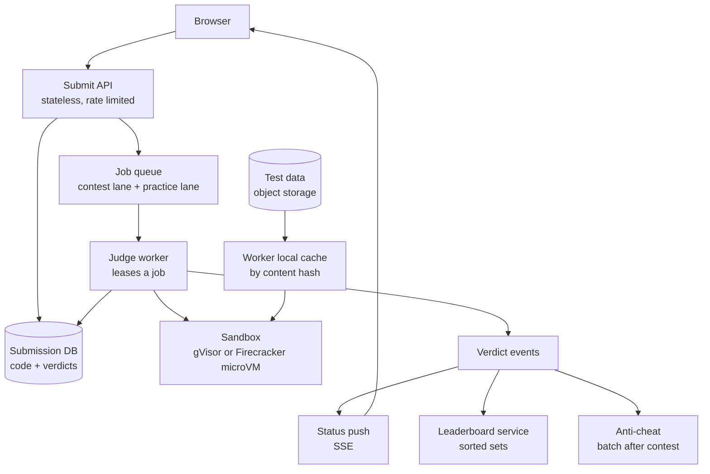
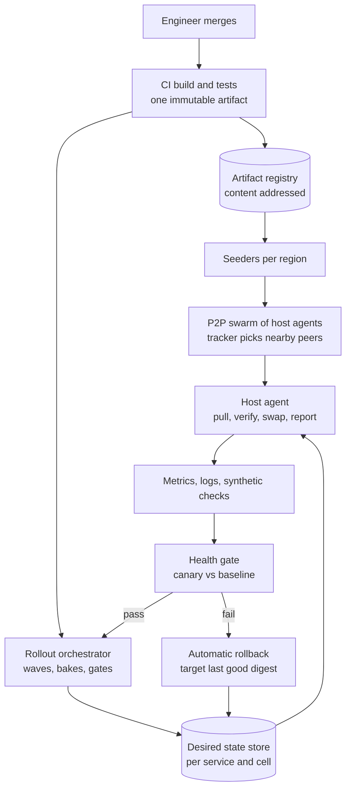
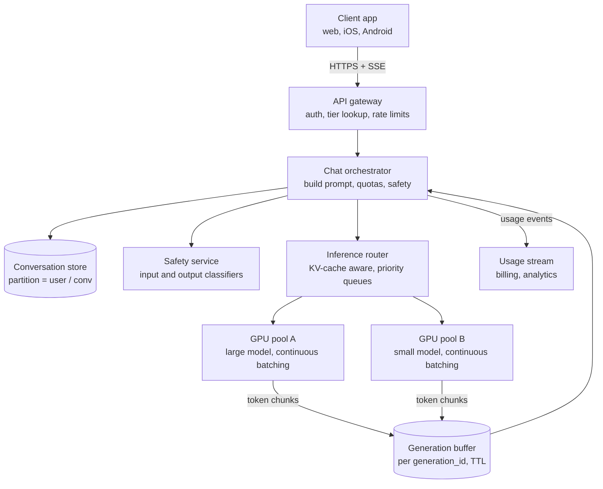
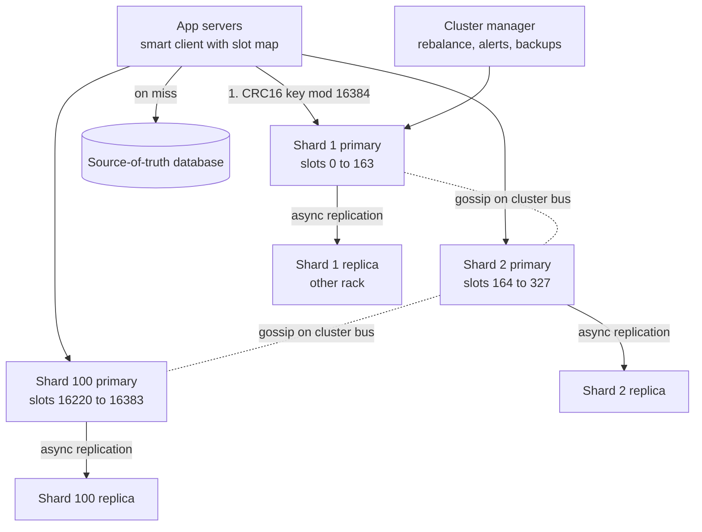

# Module 21 — Case Studies: Developer and AI Platforms

## Module Introduction

**What this module is.** Four more end-to-end designs in the same format as Modules 13–17 and 20, for the platform systems that show up in modern interviews: an online judge, a global deployment system, a ChatGPT-style AI service and a distributed cache cluster. The algorithms they rely on are explained step by step in [Module 19](../19-algorithms-deep-dive/README.md).

| Case | Centre of gravity |
|---|---|
| 1 — Online Judge (LeetCode-like) | Running untrusted code safely and fairly: sandboxes, resource limits, judge queues, contest leaderboards |
| 2 — Global Deployment System | Getting one build to many servers safely: artifact distribution, rollout waves, health gates, rollback |
| 3 — Conversational AI Service (ChatGPT-like) | Token streaming, GPU batching, KV-cache-aware routing, quotas and cost |
| 4 — Distributed Cache Cluster | Hash slots, replication and failover, hot keys, routing, eviction and resharding |

## Case 1 — Online Judge (LeetCode-like)

**The prompt (in short).** Build a coding-practice and contest site like LeetCode, Codeforces or HackerRank. Users read a problem, write code in one of ~20 languages, press Submit, and within a few seconds see "Accepted", "Wrong Answer", "Time Limit Exceeded" and so on. Several times a week the site runs a timed **contest** (a fixed window, e.g. 90 minutes, where everyone solves the same problems) with a live leaderboard (a ranking table everyone can watch).

**What makes it hard.** Three things. (1) The site **runs code written by strangers** on its own machines. Any submission might try to read other people's code, open network connections, fork a million processes or fill the disk; the system must assume every submission is hostile. (2) Load is **extremely spiky**: a contest pulls tens of thousands of people into the same 90 minutes, and submissions bunch up at the start and the final minutes. (3) Results must be **fair and repeatable**: the same code must get the same verdict and roughly the same running time no matter which machine judged it, or the leaderboard is meaningless.

### 1. Requirements and numbers
**Functional:** browse problems; submit code in a chosen language; compile, run against hidden test cases and return a **verdict** (the judge's result: Accepted, Wrong Answer, Time Limit Exceeded, Memory Limit Exceeded, Runtime Error, Compile Error) with runtime and memory used; a "Run" button that tests against the user's own sample input; submission history; contests with registration, a start/end time, a live leaderboard and final ratings; plagiarism checks after a contest.

**Non-functional:** **security first** (a submission can never escape its sandbox, see other users' data or reach the network); **verdict latency** p95 < 5 s outside contests and < 15 s at contest peak (**p95** = 95 out of 100 submissions are faster than this); **determinism** (the same code gets the same verdict; measured time varies by only a few percent); **no lost submissions** (once the user sees "Pending", a verdict will eventually appear); fairness (contest submissions are judged in arrival order and never starved by practice traffic).

**Numbers (assumptions, rounded):**
- **20M registered users, 2M daily active**, **1M practice submissions/day** → 1M / 86,400 s ≈ **12 submissions/s average**, ~40/s at the daily peak.
- **Contest:** 50K participants, 4 problems, ~2.5 attempts per problem attempted → 50K × 4 × 2.5 = **500K submissions in 90 min** ≈ 93/s average. The first 10 minutes and the last 10 minutes are ~5× average → **~500 submissions/s peak**.
- **Cost of one submission:** compile ~1 s of CPU, then run ~50 test cases at ~60 ms each ≈ 3 s → **~4 CPU-seconds per submission**. Peak: 500/s × 4 CPU-s = **2,000 CPU cores busy**. Each sandbox gets one dedicated core (see deep dive 2), and we keep 30% headroom → **~2,600 cores ≈ 80 worker machines with 32 cores**. Outside contests, 40/s × 4 = 160 cores, so the fleet should **scale down by ~10×** between contests.
- **Code storage:** average source 3 KB × (1M + contests) ≈ **3–5 GB/day ≈ 1.5 TB/year**. Tiny.
- **Test data:** 3,000 problems × 50 test cases × ~1 MB average (some inputs are 100 MB) ≈ **150 GB** total. Every worker needs fast access to any problem's tests, but a contest touches only 4 problems (~200 MB per contest), which fits in RAM.
- **Leaderboard reads:** 50K participants plus spectators refreshing every 10–30 s → **~5K reads/s** of a ranking that changes ~100 times/s.

**What the numbers say:** storage is trivial. The architecture is decided by **CPU for untrusted execution**, the **10× spike at contest time**, and the **isolation boundary** around every run.

### 2. The five-questions pass
- **Flow:** submission is **asynchronous**. The API accepts the code, stores it, puts a job on a queue and returns a `submission_id` at once; the browser then waits for the verdict over Server-Sent Events or by polling ([Message Queue](../02-moving-data/README.md#message-queue), [Server-Sent Events](../02-moving-data/README.md#server-sent-events)). Nobody holds an HTTP connection open while a compiler runs.
- **Storage:** the **submission record** (code + final verdict) in a relational database is the source of truth. Test cases are immutable versioned files in object storage (S3-style blob storage). The leaderboard is **derived** from verdicts and can be rebuilt ([CQRS](../03-storing-data/README.md#cqrs)).
- **Speed:** the slow part is execution, so the levers are: keep compilers warm in pre-built images, cache test data on the worker's local disk, and run test cases with early exit (stop at the first failing test).
- **Failure:** workers will crash, hang or be killed by the user code itself. Jobs are leased, not consumed: if a worker does not report in time, the job goes back on the queue. Judging must be **idempotent** (doing it twice gives the same stored result) ([Idempotency](../05-reliability/README.md#idempotency)).
- **Growth:** grows with contest size, not users. Pre-scale before every scheduled contest ([Auto-Scaling](../06-scaling/README.md#auto-scaling)).
- *Skeleton:* stateless submit API → durable priority queue → pool of judge workers, each running submissions inside a locked-down sandbox → verdict store → result push + leaderboard service.

### 3. API

| Method and path | Purpose |
|---|---|
| `POST /submissions {problem_id, language, code, contest_id?}` | Returns `202 Accepted {submission_id}` at once. Requires an `Idempotency-Key` header so a double-click does not judge twice |
| `GET /submissions/{id}` | Status (`queued`, `compiling`, `running 17/50`, final verdict), time and memory |
| `GET /submissions/{id}/events` (SSE) | Server pushes status changes until the final verdict |
| `POST /run {problem_id, language, code, stdin}` | "Run code" on custom input. Same sandbox, lower priority queue, no verdict stored |
| `GET /contests/{id}/leaderboard?cursor=…&limit=50` | Paged ranking ([Cursor-Based Pagination](../08-api-and-edge/README.md#cursor-based-pagination)) |
| `GET /contests/{id}/leaderboard/me` | My rank and the rows around me |
| Internal: `lease(job)`, `report(submission_id, attempt, verdict)` | Worker ↔ queue and worker ↔ verdict store |

Rate limits ([Rate Limiting](../08-api-and-edge/README.md#rate-limiting)): e.g. 1 submission per 5 s per user per problem, and a cap on `/run` calls, so a script cannot flood the judge.

### 4. Data model
- **`problems`** — `problem_id, title, statement_ref, time_limit_ms, memory_limit_mb, checker_type (exact / token / float tolerance / custom), testset_version`. A **checker** is the small program that decides whether the user's output is correct; "exact" compares bytes, "float tolerance" accepts 1e-6 differences, "custom" handles problems with many valid answers.
- **`testsets`** — `(problem_id, version) → manifest` listing each test file's name, size and **SHA-256 hash** (a fingerprint of the file's content). Files live in object storage under content-addressed paths (the path *is* the hash), so a cached file can never be stale: a new version gets new paths.
- **`submissions`** — `submission_id (time-ordered 64-bit ID), user_id, problem_id, contest_id?, language, code_ref, created_at, status, verdict, time_ms, memory_kb, failed_test_index, judge_attempt, testset_version`. Partitioned by `user_id` for "my submissions" ([Sharding](../03-storing-data/README.md#sharding)); a secondary index by `(contest_id, created_at)` for contest processing.
- **`contest_scores`** (in-memory sorted set + durable copy) — per contest: `user_id → (solved_count, penalty_minutes, last_ac_time)` plus per-problem cells `(attempts, first_ac_time)`.
- **`language_images`** — `language → container image digest, compile command, run command, time multiplier`. A **container image** is a frozen file system with the compiler and runtime; its **digest** is its content hash, so every worker runs byte-for-byte the same toolchain.

### 5. The architecture, annotated

Walking one contest submission:
1. The browser posts code to the **Submit API**. It checks the user is registered for the contest and that the contest is running, writes the code to the **submission DB** with status `queued`, and enqueues `{submission_id}` on the **contest lane** of the job queue. It returns `202` with the ID in ~50 ms.
2. The queue has **separate lanes** (priority classes) so 50K contest users are not stuck behind practice traffic, and practice is not starved forever either: workers take, say, 9 contest jobs for every 1 practice job ([Bulkhead](../05-reliability/README.md#bulkhead)). Inside the contest lane order is first-in-first-out.
3. A **judge worker** leases the job (the job becomes invisible to others for, say, 120 s). It loads the code, picks the language image, and checks its **local cache** for the problem's test files by hash, downloading any it lacks from object storage.
4. It starts a **sandbox**: compile in one sandbox with a compile-time limit, then run the binary once per test case in a fresh, locked-down sandbox with CPU, memory, process and output limits (deep dives 1 and 2). The **checker** compares output, and the worker stops at the first failing test.
5. The worker writes the verdict to the DB with a **conditional update** (`only if status != final`), then emits a **verdict event**. The status-push service streams it to the browser; the **leaderboard service** updates the user's row ([Event-Driven Architecture](../02-moving-data/README.md#event-driven-architecture)).
6. After the contest, **anti-cheat** jobs read all accepted submissions and compare them (deep dive 4). Ratings are published only after that pass.

### 6. Deep dives

**Deep dive 1 — the sandbox: containers, gVisor or Firecracker.**
The sandbox is the whole product. A plain process on the worker is unsafe; the choice is how thick to make the wall.
- **Plain Linux container** (Docker-style). The kernel features that make a container are **namespaces** (give the process its own private view of process IDs, mounts, network and users, so it cannot see the host's) and **cgroups** (control groups: kernel counters and caps on CPU, memory and number of processes). Add **seccomp** (a kernel filter listing which **system calls** — requests from a program to the kernel, like "open file" or "create socket" — the process may make) and drop all privileges. This is what the IOI's open-source **isolate** sandbox does; its authors report it has no measurable overhead and handles multi-threaded programs. *Weakness:* the code still talks to the **real host kernel**. One kernel bug reachable through an allowed system call is a full escape to the worker, which holds other people's code.
- **gVisor** (Google). A user-space "application kernel": its **Sentry** component intercepts the program's system calls and implements them itself, so the host kernel never sees them directly; file access goes through a separate **Gofer** process. It plugs in as an OCI runtime (`runsc`) behind Docker or Kubernetes. Google runs it under App Engine, Cloud Run and Cloud Functions. *Cost:* system-call-heavy programs run slower, which skews time limits for I/O-heavy problems.
- **Firecracker microVM** (AWS, built for Lambda). A tiny **virtual machine** (a whole guest OS on emulated hardware, isolated by the CPU's virtualisation features) that boots in under 125 ms with under 5 MiB of memory overhead, and a host can create up to 150 per second. The guest has its own kernel, so a kernel bug inside does not reach the host.
- **Choice:** run each submission inside a **Firecracker microVM (or gVisor) as the outer wall**, and use **isolate-style cgroups + seccomp inside** for precise per-test limits. Defence in depth: two independent layers must both fail. Keep a **pool of pre-booted microVMs** per language so boot time is not on the critical path; destroy each VM after one submission (never reuse a sandbox between users).
- **Network:** none. The sandbox has no network interface at all. **File system:** read-only image plus a small `tmpfs` (memory-backed scratch folder) with a size cap. **Workers** themselves sit in an isolated network segment that can reach only the queue, the DB writer and object storage.

**Deep dive 2 — resource limits and fair timing.**
- **Time:** measure **CPU time** (time the program actually ran on a core) from cgroup counters, and also enforce a **wall-clock limit** (real elapsed time, e.g. 3× the CPU limit) to kill programs that sleep or block on input forever. Report TLE (Time Limit Exceeded) if CPU time > limit.
- **Memory:** cgroup memory cap; if the kernel's out-of-memory killer fires inside the cgroup, report MLE.
- **Processes:** `pids.max` (cgroup cap on processes) of, say, 64 stops a **fork bomb** (a program that copies itself endlessly to exhaust the machine).
- **Output:** cap stdout at e.g. 64 MB; a program printing forever is killed with "Output Limit Exceeded".
- **Fairness:** timing noise destroys trust. Pin each sandbox to **one dedicated physical core** (no hyper-threading sibling sharing), disable CPU frequency boost on workers, and never run more sandboxes than cores. Calibrate each worker class with a fixed benchmark and reject machines that drift. For borderline TLE (within ~5% of the limit), automatically **re-run** on another worker and keep the better time.
- **Language fairness:** slower languages get a **time multiplier** stored in `language_images` (e.g. Python 3× the C++ limit), published so users know the rules.

**Deep dive 3 — the queue at contest time.**
- 500/s at peak against ~2,600 cores: if a worker pool runs short, the queue grows and the "Pending" spinner grows with it. That is acceptable if bounded: show the queue position ("your submission is #1,240"), which turns anxiety into patience.
- **Pre-scale** the worker fleet 30 minutes before the contest start from the registration count (registrations × expected submissions per user × 4 CPU-s), and keep it up 30 minutes after the end for rejudges. A schedule beats reactive scaling because the spike arrives in seconds.
- **Lease and retry:** a job whose worker dies is redelivered after the lease expires. Each judging gets an `attempt` number; the final write is conditional, so two workers judging the same submission cannot both win ([Case 4 — Design a Distributed Message Queue](../13-case-studies-building-blocks/README.md#case-4--design-a-distributed-message-queue) covers visibility timeouts).
- **Poison submissions:** a submission that crashes the *worker* (not just its sandbox) three times goes to a **dead letter queue** ([Dead Letter Queue](../05-reliability/README.md#dead-letter-queue)) and gets "System Error — under review" instead of looping forever and taking workers down.
- **Rejudge:** when a problem's tests turn out to be wrong mid-contest, admins publish a new `testset_version` and enqueue all affected submissions on a **rejudge lane** with lower priority than live submissions.

**Deep dive 4 — leaderboard and anti-cheat.**
- **Ranking rule (ICPC-style):** sort by problems solved (more is better), then by **penalty time** (less is better): for each solved problem, minutes from contest start to the first accepted submission, plus a fixed penalty for each earlier rejected attempt on that problem (ICPC uses 20 minutes; LeetCode and others publish their own constants). Encode this as one number for a **sorted set** (a data structure kept ordered by score, like Redis ZSET): `score = solved × 10^7 − penalty_minutes × 10 − tiebreak`, so one `ZADD` per accepted verdict keeps the ranking ordered, and "rank of user X" or "rows 1–50" are O(log N) ([Design 4 — Real-Time Gaming Leaderboard](../15-case-studies-location-and-realtime/README.md#design-4--real-time-gaming-leaderboard) covers sorted sets in depth).
- **Only verdict events change scores**, and they are idempotent per `(user, problem)`: a second "Accepted" on the same problem does nothing. The durable `contest_scores` table can rebuild the sorted set after a cache loss.
- **Freeze:** many contests hide changes in the last hour ("frozen scoreboard"). The leaderboard service keeps two views: public (frozen) and true; the API serves the public one until results are revealed.
- **Anti-cheat signals:** (1) **code similarity** across all accepted submissions of a problem using MOSS-style **winnowing**: strip comments, whitespace and identifier names, cut the token stream into overlapping k-grams (runs of k tokens), hash them, and keep a sample of fingerprints; pairs sharing many fingerprints are flagged. Comparing fingerprints in an inverted index (fingerprint → submissions containing it) avoids comparing every pair, which would be 25K² for a popular problem. (2) **Behavioural signals:** many accounts from one device or IP, a user solving a hard problem 40 s after a friend, sudden jumps in rating, pasting large blocks of code at once (the editor can record paste events). (3) **Leaked-solution matching** against code that appeared on public sites during the contest.
- Flags go to **human review**, never straight to a ban: short standard algorithms look alike, and fingerprint tools are known to over-flag them. Ratings are finalised after review, and rolled back for confirmed cheaters.

### 7. The failure walk
1. **A worker machine dies mid-judging:** its leases expire, jobs are redelivered, and the conditional write keeps the result single. Users see "Judging" for ~2 minutes longer.
2. **A sandbox escape is discovered** (a kernel or gVisor CVE): this is the worst case. The two-layer design means one layer failing is not yet a breach. Workers are **cattle** (identical, disposable machines): rebuild every worker image with the patch, drain and replace the fleet, and rotate the worker's credentials. Workers hold no other user's data beyond the current job, and can write only verdicts, which limits the blast radius.
3. **Test-data store slow or down:** workers serve from their local hash-addressed cache. A contest's test sets are **pre-warmed** to every worker before the start, so the contest is unaffected.
4. **Queue backlog grows at contest peak:** show queue position; temporarily **pause the practice lane** and the `/run` endpoint ([Graceful Degradation](../05-reliability/README.md#graceful-degradation)); extend the contest if the delay exceeds a published threshold. Never drop a queued contest submission.
5. **Leaderboard cache (sorted set) lost:** rebuild from `contest_scores` in seconds (50K rows). The scoreboard is stale meanwhile, but no verdict is lost because verdicts live in the DB.
6. **A bad compiler image is rolled out** (every C++ submission gets Compile Error): pin images by digest per contest, roll new images out to a canary slice of workers outside contest hours, and watch the verdict mix per language ([Canary Deployment](../09-operating-in-production/README.md#canary-deployment)). Rejudge any affected submissions.
7. **A user submits a program that hogs I/O or memory bandwidth** and slows its neighbours on the same machine: cgroup I/O limits, one core per sandbox, and the re-run-on-borderline rule keep verdicts fair.

### 8. Trade-offs

| Decision | Chosen | Alternative | Why |
|---|---|---|---|
| Isolation | MicroVM or gVisor outside + cgroups/seccomp inside | Plain containers only | Code is hostile by definition; one shared-kernel bug should not be game over |
| Submission flow | Async queue + SSE push | Synchronous HTTP | Judging takes seconds and spikes 10×; a queue absorbs the burst |
| Queue | Separate contest, practice, rejudge lanes | One FIFO | Contest fairness and protection from bulk rejudges |
| Timing | CPU time on a dedicated core, re-run if borderline | Wall-clock on shared cores | Repeatable verdicts are the product |
| Test data | Content-addressed files + local cache, pre-warmed | Read from shared storage per run | Hundreds of reads/s of the same files; no stale caches |
| Leaderboard | Sorted set derived from verdict events | SQL `ORDER BY` per request | 5K reads/s on a constantly changing ranking |
| Anti-cheat | Offline fingerprinting + human review | Real-time automatic bans | False positives on short standard code are common |
| Fleet | Scheduled pre-scaling around contests | Reactive autoscaling only | The spike arrives faster than machines boot |

### 9. The follow-up questions
- **"Why not just run code in Docker?"** Docker shares the host kernel; isolation depends on every allowed system call being bug-free. For hostile code, add a second boundary with its own kernel (microVM) or its own syscall implementation (gVisor). *Trap:* saying "containers are secure because of namespaces" without mentioning the shared kernel.
- **"How do you support interactive problems** (where the program talks with a judge program in turns)?" Run the user's program and the interactor in two sandboxes connected by pipes; the interactor decides the verdict. Time both, and treat a deadlock as TLE via the wall-clock limit.
- **"How do you add a new language?"** Build a new image with the compiler, run the full reference-solution suite for every problem to set its time multiplier, publish the image digest, then enable it. Nothing else changes because workers are image-driven.
- **"Could you judge on serverless functions?"** Yes for practice traffic (each Lambda invocation already runs in a Firecracker microVM), but timing noise and per-invocation cold starts make contest timing less fair; dedicated, calibrated workers are safer for rated contests.
- **"How would you add AI-cheating detection?"** Treat it as one more signal: compare submissions against outputs from popular code models for the same problem, plus behaviour (large single paste, no edits). Keep it advisory with human review, and prefer contest design that is resistant (proctored or in-person finals).

### Pattern manifest

| Pattern | Where used | Taught in |
|---|---|---|
| Message Queue (with leases) | Submission jobs, contest/practice/rejudge lanes | [Module 02](../02-moving-data/README.md#message-queue) |
| Server-Sent Events | Pushing status and verdict to the browser | [Module 02](../02-moving-data/README.md#server-sent-events) |
| Idempotency | `Idempotency-Key` on submit; conditional verdict write; one AC per problem | [Module 05](../05-reliability/README.md#idempotency) |
| Bulkhead | Separate lanes and worker shares for contest vs practice | [Module 05](../05-reliability/README.md#bulkhead) |
| Dead Letter Queue | Submissions that crash workers repeatedly | [Module 05](../05-reliability/README.md#dead-letter-queue) |
| Graceful Degradation | Pause practice and `/run` at contest peak | [Module 05](../05-reliability/README.md#graceful-degradation) |
| Auto-Scaling (scheduled) | Worker fleet before each contest | [Module 06](../06-scaling/README.md#auto-scaling) |
| Rate Limiting | Per-user submit and run caps | [Module 08](../08-api-and-edge/README.md#rate-limiting) |
| Containers and sandboxing | Language images, microVM/gVisor sandboxes | [Module 09](../09-operating-in-production/README.md#containers-and-kubernetes) |
| CQRS | Leaderboard as a derived read model | [Module 03](../03-storing-data/README.md#cqrs) |
| Sorted-set leaderboard | Contest ranking | [Module 15](../15-case-studies-location-and-realtime/README.md#design-4--real-time-gaming-leaderboard) |

**Interview one-liner:** "Submit is asynchronous: store the code, enqueue a job, return an ID. Calibrated workers lease jobs and run each submission in a throwaway microVM or gVisor sandbox with no network, cgroup limits on CPU, memory, processes and output, and content-hashed test data cached locally. Verdict events feed the browser and a sorted-set leaderboard; contests get their own queue lane and pre-scaled capacity; plagiarism is a fingerprinting batch job plus human review."

### TL;DR
- **Problem:** run hostile code from millions of users, fairly and repeatably, with a 10× spike at contest time.
- **Mechanism:** async submit → priority queue with leases → judge workers → per-submission microVM/gVisor sandbox with cgroup and seccomp limits → verdict events → SSE + sorted-set leaderboard.
- **Hard parts:** the isolation boundary (two layers, no network, never reuse), fair timing (dedicated cores, CPU time, re-run borderline), contest bursts (lanes, pre-scaling, pre-warmed tests), anti-cheat (winnowing fingerprints + humans).
- **Price:** a large, mostly idle compute fleet between contests and constant patching of the sandbox stack.

**Sources**
- Mareš, M. and Blackham, B., "A New Contest Sandbox", *Olympiads in Informatics* 6 (2012): https://ioinformatics.org/journal/INFOL094.pdf and the isolate project: https://github.com/ioi/isolate
- gVisor documentation (Sentry, Gofer, runsc): https://gvisor.dev/docs/
- Google Cloud blog, "How gVisor protects Google Cloud services from CVE-2020-14386": https://cloud.google.com/blog/products/containers-kubernetes/how-gvisor-protects-google-cloud-services-from-cve-2020-14386
- Firecracker project site (boot time, overhead, creation rate): https://firecracker-microvm.github.io/
- ICPC scoring rules (20-minute penalty per rejected run on a solved problem), e.g. ECNA regional rules: https://icpc-ecna.ysu.edu/rules.html
- Schleimer, Wilkerson and Aiken, "Winnowing: Local Algorithms for Document Fingerprinting", SIGMOD 2003 (the algorithm behind MOSS): https://theory.stanford.edu/~aiken/publications/papers/sigmod03.pdf

---

## Case 2 — Global Deployment System

**The prompt (in short).** Build the internal system a large company uses to ship software: an engineer merges a change, and within hours the new build is running on hundreds of thousands of servers in dozens of regions — safely. Think of Facebook's continuous push of its web tier, Amazon's pipelines that deploy to every AWS region, or Google's rollout tooling.

**What makes it hard.** Google's SRE book observes that roughly 70% of outages are caused by changes to a live system. So the deployment system is the company's single biggest source of risk *and* its main defence against it. The hard parts: (1) **moving gigabytes to 200K machines** without melting the network or the artifact store; (2) **exposing a change gradually** so a bad build hurts 0.1% of users, not 100%; (3) **deciding automatically** whether a stage is healthy and rolling back without a human; and (4) treating **configuration changes** — which take seconds to spread and cause many outages — with the same care as code.

### 1. Requirements and numbers
**Functional:** build a versioned, immutable artifact from a commit; store and distribute it to target hosts; roll it out in stages (waves) across regions; check health after each stage and promote or roll back automatically; a big red **stop button**; deploy **config** separately from code; audit log of who shipped what, where and when; deployment windows and blockers (no deploys during an active incident).

**Non-functional:** **safety beats speed** (a bad change must be caught while exposure is small); **rollback in minutes** anywhere; the deploy system must stay usable during an outage (it is how you ship the fix); fully **automated and repeatable** (no hand-run steps); scale to thousands of services and tens of deploys per service per week.

**Numbers (assumptions):**
- **200K servers** in **20 regions** (~10K per region, spread over 3 availability zones each). An **availability zone (AZ)** is one or more data centres with independent power and network inside a region.
- **2,000 services**, each deploying ~once a day → **~2,000 rollouts/day**, plus **~5,000 config changes/day**.
- **Artifact size:** a big monolith binary or container image ~**1 GB**; a typical microservice image ~200 MB (only the changed layers move, often ~50 MB).
- **Naive fan-out of a 1 GB artifact to all 200K hosts:** 200K × 1 GB = **200 TB**. A central artifact store with 20 servers × 10 Gbps (1.25 GB/s) = 25 GB/s → 200 TB / 25 GB/s = 8,000 s ≈ **2.2 hours**, with the store's network saturated and every other deploy blocked. With **peer-to-peer** distribution (deep dive 1), every host that has a piece also uploads it, so total upload capacity grows with the number of hosts; at ~50% of a 10 Gbps NIC per host, the transfer is bounded by one host's download time (~2 s per GB) plus a few relay hops → **well under a minute** in practice (Uber reports 20K blobs of 100 MB–1 GB in under 30 s).
- **Rollout duration:** dominated not by copying but by **bake time** (time a stage runs under real traffic before promotion). Five waves with 1–12 h bakes → a **multi-day** global rollout for risky backend services (Amazon's published pipeline shape, with zonal and regional waves plus bakes, takes days rather than hours); a few hours for front-ends with fast signals (Facebook's web tier pushes several times a day).

**What the numbers say:** bytes are a solved problem with P2P; the design is really about **exposure control and fast, automatic judgement**.

### 2. The five-questions pass
- **Flow:** fully asynchronous and long-running. A rollout is a **workflow** (a durable, multi-step process that survives restarts) driven by a pipeline orchestrator, not a script on a laptop. Hosts **pull** their target version from a desired-state store; the orchestrator only changes the desired state ([Containers and Kubernetes](../09-operating-in-production/README.md#containers-and-kubernetes) uses the same reconcile loop).
- **Storage:** the **artifact** (immutable, content-addressed: its name is the hash of its bytes) in blob storage; the **desired state** per (service, cell) — "cell 7 of region X should run build b-4812 with config v-991" — in a strongly consistent store (etcd/ZooKeeper-style); rollout history and audit in a relational DB.
- **Speed:** P2P distribution and pre-staging (download before you switch) make the switch itself a seconds-long restart; the long part is deliberately waiting.
- **Failure:** the main failure is **a bad change**, not a bad deploy system. Health gates, automatic rollback and small blast radii are the defence. The deploy system's own outage must never block an emergency fix (it needs a minimal "break glass" path).
- **Growth:** grows with services × hosts × change rate; distribution must be sub-linear in hosts (P2P), and control must be hierarchical (region → cell → host).
- *Skeleton:* CI build → artifact registry → P2P distribution layer → per-host agent → rollout orchestrator with waves and gates → health/canary analysis → automatic rollback; a separate fast lane for config.

### 3. API

| Method and path | Purpose |
|---|---|
| `POST /artifacts {service, commit, digest, sbom_ref, signature}` | Register a build (CI calls this). **Immutable**: same digest, same bytes, forever |
| `POST /rollouts {service, artifact_digest, plan_id}` | Start a rollout using a named plan (waves, bakes, gates). Returns `rollout_id` |
| `GET /rollouts/{id}` | Current wave, per-cell state, gate results, ETA |
| `POST /rollouts/{id}:pause` / `:resume` / `:rollback` | Human controls; rollback re-targets the last good digest |
| `POST /config-changes {key, new_value, canary_spec}` | Propose a config change; goes through review, validation and its own canary |
| `POST /freeze {scope, reason, until}` | Org-wide or service-level deploy blocker during incidents and holidays |
| Agent ↔ control plane: `GET /desired?host=…` (long poll), `POST /report {host, running_digest, health}` | Pull model; the agent reports what is actually running |

### 4. Data model
- **`artifacts`** — `digest (SHA-256) → service, commit, build_time, size, layers[], signature, provenance` (who built it, from which source, on which builder). Bytes live in blob storage as layers/chunks keyed by their own hashes, so identical layers are stored and sent once.
- **`rollout_plans`** — `plan_id → waves[]`, each wave = `{targets (cells/regions), batch_size %, bake_time, gates[]}`. Plans are code, reviewed like code.
- **`rollouts`** — `rollout_id, service, from_digest, to_digest, plan_id, state (running / paused / rolling_back / done), current_wave, started_by, started_at`.
- **`desired_state`** — `(service, cell) → {artifact_digest, config_version, generation}`. The **generation** number increases with each change, so an agent never applies an older instruction after a newer one ([Write-Ahead Log](../03-storing-data/README.md#write-ahead-log) thinking: ordered, durable changes).
- **`actual_state`** — `(host) → running_digest, config_version, healthy, last_report_at`. Expires if a host stops reporting.
- **`gate_results`** — `(rollout_id, wave, gate) → pass / fail / inconclusive, metrics snapshot, decided_at`.
- **`config_store`** — versioned key → value with schema, owner and history (in Git, mirrored to a distribution tree).

### 5. The architecture, annotated

Following one change:
1. The merge triggers **CI** (continuous integration: build and test on every change). It produces **one artifact** with a digest, signs it, and records its provenance. **Build once, promote everywhere**: the same bytes that passed tests go to every stage ([CI/CD Pipelines and Deployment Strategies](../09-operating-in-production/README.md#cicd-pipelines-and-deployment-strategies)).
2. The artifact goes to the **registry** (blob storage). The **orchestrator** starts a rollout with the service's plan: pre-production stages, then production **wave 1**.
3. For each target cell, the orchestrator first asks agents to **pre-stage** (download and verify) the artifact. Regional **seeders** hold the first copy; the **P2P swarm** spreads it host to host (deep dive 1).
4. The orchestrator then bumps the **desired state** for the wave's cells. Each **host agent** (a small daemon on every machine) sees the new generation, verifies the signature and hash, **drains** the local service (stop taking new requests, finish in-flight ones), swaps to the new version, runs local health checks, and reports `actual_state` ([Health Check Endpoint](../09-operating-in-production/README.md#health-check-endpoint)). Hosts in a cell switch in batches (e.g. ≤ 10% at a time) so capacity stays up.
5. The **health gate** compares the new hosts against the old ones over the **bake time** (deep dive 3). Pass → orchestrator moves to the next wave. Fail → **automatic rollback**: desired state goes back to the last good digest, which is still cached on every host, so rollback is a restart, not a download.

### 6. Deep dives

**Deep dive 1 — moving the bytes: registry, P2P and pre-staging.**
- **Content addressing.** Split each artifact into chunks or layers named by their hash. Hosts skip chunks they already have, so a new build that changed 3% of a 1 GB binary moves ~30 MB. The hash also *is* the integrity check: a host recomputes it on arrival, so a corrupt or tampered chunk is rejected.
- **Why P2P.** With a central server, total upload capacity is fixed, so time grows linearly with the number of hosts. In a **BitTorrent-style swarm**, the file is cut into **pieces** (BitTorrent's spec says most commonly 256 KB, each with its own SHA-1 hash), every host downloads pieces from several peers at once and **uploads the pieces it already has** to others. Capacity grows with the swarm, so 200K hosts take about as long as 2,000.
- **History:** Facebook described pushing its front-end binary with an internal BitTorrent setup around 2010–2012, with a custom tracker that preferred peers in the same rack; Twitter's "Murder" did the same; Uber's open-source **Kraken** is a P2P Docker registry (a **tracker** tells each agent which peers have which pieces; **origin** servers seed from backing storage such as S3) reporting 20K blobs of 100 MB–1 GB distributed in under 30 s at peak, at > 50% of each host's max download speed.
- **Topology awareness.** The tracker hands out peers **in the same rack first, then the same cluster, then the region**, so most bytes never cross expensive links (top-of-rack switches are cheap; inter-region links are not). Each region has its own seeders, so only one copy crosses an ocean.
- **Pre-staging.** Download everything before the switch: the slow, failure-prone part (network) is separated from the risky part (restart), and a "switch" wave of 10K hosts takes seconds. Keep the **previous N versions** on disk so rollback needs no network at all.
- **Guard rails.** Limit P2P upload bandwidth per host (e.g. 30% of NIC) so production traffic is never starved; a host under heavy load opts out of seeding.

**Deep dive 2 — staged rollout waves and blast radius.**
- **Blast radius** = the share of users hurt if this step is bad. Every wave is designed to cap it.
- **A typical plan** (modelled on the shape Amazon publishes):
  1. Pre-production (integration tests, then a **gamma** stage that mirrors production config).
  2. **One-box** in one AZ of a low-traffic region: one host or one small slice of traffic. Bake ≥ 1 h.
  3. Wave 1: rest of that AZ, then the other AZs of that region **one at a time**. Bake ~12 h after the first full region (catches daily-cycle bugs: overnight batch jobs, memory leaks, certificate rotations).
  4. Wave 2: one high-traffic region, AZ by AZ.
  5. Waves 3–5: widen to 3, then ~12, then all remaining regions, with 2–4 h bakes.
- **Never two AZs of one region at once**, never two regions at once early on: a failure stays inside a **cell** (a self-contained copy of the stack serving a slice of users) ([Multi-Region and Cell-Based Architecture](../06-scaling/README.md#multi-region-and-cell-based-architecture)).
- **Front-end variant (fast signals):** Facebook's web tier goes first to **employees**, then **~2% of production**, then 100%, over a few hours, several times a day. Employees and a small slice of real traffic give strong signals quickly because the traffic is enormous.
- **Deployment windows:** start production waves only in working hours of the owning team; avoid nights, weekends and late Fridays when responders are slow. **Blockers** automatically halt all new waves while any related high-severity alarm or an org-wide incident is active.
- **Within a cell:** **rolling** batches (≤ 10–33% of hosts at a time so capacity holds), or **blue-green** where instant switch-back matters ([Blue-Green Deployment](../09-operating-in-production/README.md#blue-green-deployment)).

**Deep dive 3 — health gates and automatic rollback.**
- **What is watched:** error rate (5xx), latency p50/p90/p99, CPU, memory, crash/restart count, log error rate, failed health checks, and **business metrics** (checkouts per minute, messages sent). Also **synthetic canaries**: scripted fake users calling the API every minute from outside.
- **Compare like with like.** Absolute thresholds miss subtle regressions and fire falsely during traffic peaks. Instead compare **canary hosts vs baseline hosts** (old version, same cell, same time window, same number of hosts). Netflix and Google's open-source **Kayenta** does this: for each metric it runs a **Mann-Whitney U test** (a statistical test that asks "do these two sets of numbers come from different distributions?" without assuming a bell curve) and flags a metric only when it is ~98% confident of a meaningful difference; the per-metric results roll up into a score that passes, fails or asks a human ([Canary Deployment](../09-operating-in-production/README.md#canary-deployment)).
- **Gate outcomes:** `pass` → promote after the bake time; `fail` → rollback; `inconclusive` (too little traffic) → extend the bake, never promote silently.
- **Fast tripwires:** besides the comparison, hard alarms roll back immediately: request count drops to zero, fault rate spikes, health checks fail on > N% of new hosts.
- **Automatic rollback:** set desired state back to the **last digest that passed all gates** in this cell; agents restart into the cached old version. For a team-level aggregate alarm, roll back **every in-flight deployment** of that team in that region (you don't know which change is guilty). Rollback must not need the failing service to be healthy, nor the CI system to rebuild anything.
- **Rollback is only safe if changes are backward compatible.** Database schema changes follow **expand → migrate → contract** (add the new column, deploy code that writes both, backfill, then remove the old column in a later release), so version N−1 can still run against the data version N wrote ([Capstone - The Zero-Downtime Migration](../09-operating-in-production/README.md#capstone---the-zero-downtime-migration)). Changes that cannot be undone (data deletions, protocol bumps) go behind **feature flags** instead.

**Deep dive 4 — config deploys vs code deploys.**
- **Why separate them?** Code changes need a new binary on every host: hours of waves. Many changes are just *values* — a timeout, a rate limit, which 5% of users see a feature. Pushing those as config makes them reach the fleet in **seconds** and undo in seconds.
- **The danger is the same speed.** A bad config value reaches every server at once, with no binary rollout to slow it down. Many well-known global outages have been config pushes, not code.
- **Facebook's model** (SOSP 2015, "Holistic Configuration Management at Facebook"): configs live in Git and are often **generated by code** with validators; every change gets code review; an automated **canary spec** applies it first to ~20 servers, then a full cluster, comparing health (a full canary takes ~10 minutes); distribution goes through **Zeus** (a ZooKeeper fork) in a high fan-out tree of observers and per-server proxies, reaching hundreds of thousands of servers in seconds; large config blobs use a separate P2P path. Each server's proxy keeps an **on-disk cache**, so apps still read the last good config if the config system is down.
- **Design rules:** schema-validate every value (types, ranges); **stage config like code** (one-box → cell → region, just with shorter bakes); keep the full history and make **"revert to previous version" a one-click, seconds-long action**; apps must **reject a config they cannot parse and keep the last good one** (never crash on bad config); separate **feature flags** (per-user exposure decisions, [Feature Flags](../09-operating-in-production/README.md#feature-flags)) from **operational config** (timeouts, pool sizes) so each has the right review rules.

### 7. The failure walk
1. **A bad build passes tests** (memory leak that shows after 6 h): the one-box and wave-1 bakes are long enough to catch daily-cycle problems; the leak trips the memory alarm on the one-box; automatic rollback restores 1 host. Blast radius: ~0.01% of traffic.
2. **A bad build fails fast** (crash on start): hosts fail local health checks before joining the load balancer; the agent refuses to proceed past the first batch; zero user impact.
3. **Gates are blind** (the bug breaks a feature no metric watches): it reaches more waves. Mitigation: business-metric gates and synthetic tests per critical user journey; after the incident, add the missing signal (every escaped bug becomes a new gate).
4. **The orchestrator or desired-state store is down:** hosts keep running what they have (pull model, last known state). No rollouts can start, which is safe. A documented **break-glass** path lets on-call push a pinned digest to a cell through a minimal tool if a fix is urgent.
5. **Artifact registry or seeders unavailable:** pre-staged versions and peer copies continue; new builds wait. Registry is replicated per region ([Primary-Replica](../03-storing-data/README.md#primary-replica)).
6. **Rollback itself fails** because the new version already wrote data the old one cannot read: this is why backward-compatible schema rules and flags exist; the fallback is **roll forward** with a hotfix through an expedited plan (shorter bakes, still staged, never "all at once").
7. **A bad config push**: the config canary catches most; if it escapes, revert is seconds; apps that receive unparseable config keep the previous value instead of crashing.
8. **A compromised build machine** tries to ship malware: hosts accept only artifacts signed by the build system with provenance from reviewed source; the agent verifies signature and digest before running anything.

### 8. Trade-offs

| Decision | Chosen | Alternative | Why |
|---|---|---|---|
| Distribution | P2P swarm with regional seeders, rack-aware peers | Central servers / CDN only | Total capacity grows with hosts; 200 TB per release is otherwise hours |
| Control | Desired state + host agents pull | Orchestrator pushes over SSH | Survives orchestrator outages, scales, self-heals drift |
| Exposure | One-box → AZ → region waves with bakes | Deploy everywhere at once | Caps blast radius; 70% of outages are changes |
| Gate logic | Canary vs baseline statistics + hard tripwires | Static thresholds | Adapts to traffic patterns, catches subtle regressions |
| Rollback | Automatic to last good, cached digest | Human decides | Machines notice in minutes, humans at 3 a.m. take longer |
| Speed | Days for backends, hours for web tier | Same plan for all | Match bake time to how fast signals arrive and how bad failure is |
| Config | Separate fast lane, but still canaried and staged | Treat config as code deploy | Seconds-level changes and undo, without global instant blast |

### 9. The follow-up questions
- **"Why not just use a CDN to distribute artifacts?"** A CDN helps for the first copy per region, but inside a data centre every host pulling from the same edge still concentrates load; P2P uses the idle upload of every host and keeps bytes inside racks. Many systems combine them: CDN/object storage to seed, P2P to spread ([CDN](../08-api-and-edge/README.md#cdn)).
- **"How do you deploy a service that 300 others depend on?"** Same waves, but gates include the **callers'** error rates, and the rollout is cell-aligned so a caller and its dependency in one cell change together. Contract tests in CI check the API stays compatible ([API Versioning](../08-api-and-edge/README.md#api-versioning)).
- **"What about mobile apps?"** You cannot roll back an app on a phone. Use staged store rollouts (a percentage of users), server-driven feature flags to switch off the new behaviour, and keep the server compatible with old app versions for months.
- **"How do you know a deploy caused an incident?"** Every metric dashboard overlays deploy and config-change events; the deploy system publishes events to the incident tool, and the first question in triage is "what changed in the last hour, where?".
- **"How would you make 2,000 rollouts a day not collide?"** Per-cell locking (one rollout per service per cell at a time), a queue of rollouts per service that **batches** several commits into one artifact (Facebook's push-from-master ships many diffs together), and blockers that pause everyone in a region when that region is unhealthy.

### Pattern manifest

| Pattern | Where used | Taught in |
|---|---|---|
| CI/CD, build once, promote | One signed artifact through every stage | [Module 09](../09-operating-in-production/README.md#cicd-pipelines-and-deployment-strategies) |
| Canary Deployment | One-box and wave gates, canary vs baseline | [Module 09](../09-operating-in-production/README.md#canary-deployment) |
| Blue-Green Deployment | Instant switch-back within a cell | [Module 09](../09-operating-in-production/README.md#blue-green-deployment) |
| Feature Flags | Decouple risky behaviour from deploys; non-reversible changes | [Module 09](../09-operating-in-production/README.md#feature-flags) |
| Health Check Endpoint | Agent's local check before joining the load balancer | [Module 09](../09-operating-in-production/README.md#health-check-endpoint) |
| Containers and reconcile loops | Desired vs actual state, agents pull | [Module 09](../09-operating-in-production/README.md#containers-and-kubernetes) |
| Multi-Region and Cell-Based Architecture | Waves follow AZ and cell boundaries | [Module 06](../06-scaling/README.md#multi-region-and-cell-based-architecture) |
| Circuit-breaker-style blockers | Halt all deploys during alarms or incidents | [Module 05](../05-reliability/README.md#circuit-breaker) |
| Publish-Subscribe / fan-out tree | Config distribution through observers and proxies | [Module 02](../02-moving-data/README.md#publish-subscribe) |
| Zero-downtime migration | Expand-migrate-contract so rollback stays safe | [Module 09](../09-operating-in-production/README.md#capstone---the-zero-downtime-migration) |
| Distributed Job Scheduler | Long-running rollout workflows | [Module 16](../16-case-studies-infrastructure/README.md#design-3--distributed-job-scheduler) |

**Interview one-liner:** "Build one signed, content-addressed artifact; spread it with a rack-aware P2P swarm and pre-stage it; change only the desired state and let host agents pull; roll out in waves — one-box, one AZ, one region, then wider — with bake times and canary-vs-baseline gates; roll back automatically to the cached last-good digest; and push config through its own fast but still canaried lane."

### TL;DR
- **Problem:** ship thousands of changes a day to 200K servers without letting any one change take everything down.
- **Mechanism:** CI → immutable artifact → P2P distribution with regional seeders → desired-state store + host agents → staged waves with bakes → statistical health gates → automatic rollback; separate config pipeline with its own canary.
- **Hard parts:** bytes at scale (P2P, content addressing, pre-staging), blast radius (cells and waves), deciding "healthy" automatically (canary vs baseline), keeping rollback possible (backward-compatible data changes), config's dangerous speed.
- **Price:** slow global rollouts (days for backends), lots of telemetry plumbing, and discipline about compatibility.

**Sources**
- Liguori, C., "Automating safe, hands-off deployments", Amazon Builders' Library: https://aws.amazon.com/builders-library/automating-safe-hands-off-deployments/
- Facebook Engineering, "Rapid release at massive scale" (2017): https://engineering.fb.com/2017/08/31/web/rapid-release-at-massive-scale/
- Tang, C. et al., "Holistic Configuration Management at Facebook", SOSP 2015: https://doi.org/10.1145/2815400.2815401
- Uber Engineering, "Introducing Kraken, an Open Source Peer-to-Peer Docker Registry": https://www.uber.com/blog/introducing-kraken/ and https://github.com/uber/kraken
- BitTorrent protocol specification (BEP 3): https://www.bittorrent.org/beps/bep_0003.html
- Spinnaker docs, "How canary judgment works" (Kayenta, Mann-Whitney U): https://spinnaker.io/docs/guides/user/canary/judge
- Google Cloud blog, "Introducing Kayenta": https://cloud.google.com/blog/products/gcp/introducing-kayenta-an-open-automated-canary-analysis-tool-from-google-and-netflix
- Beyer, B. et al., *Site Reliability Engineering* (O'Reilly, 2016), on ~70% of outages coming from changes: https://sre.google/sre-book/introduction/
- TorrentFreak, "Facebook Uses BitTorrent, and They Love It" (2010, reporting a Velocity talk): https://torrentfreak.com/facebook-uses-bittorrent-and-they-love-it-100625/

## Case 3 — Conversational AI Service (ChatGPT-like)

**The prompt (in short).** Build a chat assistant like ChatGPT, Claude or Gemini: users sign in, start conversations, type a message and watch the answer appear word by word; every conversation is saved and can be reopened on any device; free and paid tiers get different limits; harmful requests and answers are filtered.

**What makes it hard.** Sign-in and history are an ordinary CRUD app. The hard parts: (1) every answer is produced by a **large language model (LLM)** (a neural network that generates text one **token** at a time; a token is a word piece, roughly ¾ of an English word) running on **GPUs** (graphics processors, the expensive accelerators that do the maths), and GPU time is by far the largest cost; (2) an answer takes **seconds to tens of seconds** to generate, so it must be **streamed**; and (3) the GPU memory each in-flight conversation needs (the **KV cache**, defined below) decides how many users a GPU can serve, so scheduling and routing are memory problems.

### 1. Requirements and numbers
**Functional:** create a conversation; send a message and receive a streamed answer; stop a generation mid-way; regenerate or edit a message (which creates a branch); list, rename, search and delete conversations; choose a model; per-tier quotas (free, paid, team). Attachments are out of scope beyond "stored in blob storage".

**Non-functional:**
- **Time to first token (TTFT)** p95 < 1.5 s (the user sees the answer start quickly; p95 = 95 out of 100 requests are at least this fast).
- **Time per output token (TPOT)** ≈ 20–30 ms, i.e. a streaming speed of roughly 35–50 tokens/s, faster than people read.
- **No lost answers:** a finished answer is saved; a dropped connection can resume the stream.
- **Availability** 99.9% for the chat path; graceful degradation (a smaller model, a queue) is preferred to a hard error.

**Numbers (assumptions, rounded for easy arithmetic):**
- **100M DAU** (daily active users), **10 messages/day** each → **1B messages/day** → 1B ÷ 86,400 s ≈ **11.6K messages/s average, ~35K/s peak** (3×).
- Average answer **500 output tokens**, streamed at **50 tokens/s** → each answer occupies the GPU for **~10 s**.
- Concurrent streams at peak (**Little's law**: items in the system = arrival rate × time each spends there): 35K/s × 10 s = **~350K open streams**.
- Output tokens at peak: 350K streams × 50 tokens/s = **17.5M output tokens/s**.
- Input per message: the system prompt + conversation history + new message ≈ **3,000 tokens**. If 60% of that is a prefix already cached on the GPU (Deep dive 3), only 1,200 new tokens/message must be processed: 35K × 1,200 = **42M input tokens/s** of **prefill** (the phase that reads the prompt, explained in Deep dive 2).
- **KV cache per token** for a 70B-parameter model shaped like Llama 3.1 70B (80 layers, 8 key/value heads, head size 128, 16-bit numbers): 2 (key and value) × 80 × 8 × 128 × 2 bytes = **327,680 bytes ≈ 320 KB per token**. A 3,500-token conversation therefore holds **~1.1 GB** of GPU memory while it is being answered.
- **One replica** (one copy of the model) = 8 H100 GPUs × 80 GB = 640 GB. Weights: 70B × 2 bytes = 140 GB. Leaving room for activations, ~400 GB is free for KV cache → 400 GB ÷ 320 KB ≈ **1.25M tokens** → ~350 conversations of 3,500 tokens in memory at once.
- **Replica throughput (assumption, measure it):** ~6,000 output tokens/s at the target TPOT. Fleet: 17.5M ÷ 6,000 ≈ **2,900 replicas ≈ 23,000 GPUs**, plus ~30% for prefill and headroom → **~30,000 GPUs**.
- **Cost (assumption):** at $2.50 per GPU-hour, 30,000 × $2.50 × 24 h = **$1.8M/day** → $1.8M ÷ 1B ≈ **$0.0018 per message**. A free user sending 10 messages/day costs ~$0.55/month in GPU time; this number drives the quota design.
- **History storage:** ~2.5 KB per message (user text + answer + metadata) → 2.5 TB/day → **~0.9 PB/year** before replication. Tiny next to the GPU bill.

**What the numbers say:** the database and web tier are ordinary; **GPU memory and GPU time** are the bottleneck and the bill. Every choice is judged by "does it raise tokens per GPU-second, or cut tokens we must compute?"

### 2. The five-questions pass
- **Flow:** synchronous to the user (they are watching), but **streamed**: the request is accepted, the answer is pushed token by token over one long HTTP response using **Server-Sent Events (SSE)** (a standard where the server keeps an HTTP response open and writes small `data:` events into it) ([Server-Sent Events](../02-moving-data/README.md#server-sent-events)). Saving history, billing and analytics happen **asynchronously** after the stream ends ([Five Questions](../01-thinking-in-patterns/README.md#the-five-questions)).
- **Storage:** the **conversation store** (messages as a tree, partitioned by user) is the source of truth. A short-lived **generation buffer** holds tokens of in-flight answers so a dropped client can resume. The KV cache on GPUs is a disposable performance cache, never a source of truth.
- **Speed:** TTFT is dominated by queueing + prefill; TPOT by decode batching. The hot read is "load this conversation's messages to build the prompt", one partition read.
- **Failure:** GPU servers fail more often than web servers. A failed generation is **retried on another replica**; a client disconnect must **not** waste the generation.
- **Growth:** load grows with users and with **context length**, which grows KV memory linearly. Hot spots: launches and each region's working-day start.
- *Skeleton:* an API/edge tier (auth, rate limits), a chat orchestrator that builds prompts and runs safety checks, a **KV-cache-aware inference router**, pools of GPU inference servers doing **continuous batching**, a stream relay to the SSE gateways, a conversation store, and an async usage pipeline.

### 3. API
| Method and path | Purpose |
|---|---|
| `POST /v1/conversations` → `{conversation_id}` | Start a conversation |
| `POST /v1/conversations/{id}/messages` body `{client_msg_id, parent_message_id, content, model}` → `200 text/event-stream` | Send a message and stream the answer. `client_msg_id` is an idempotency key (a client-made ID reused on retries so the server can spot repeats) ([Idempotency](../05-reliability/README.md#idempotency)) |
| SSE events: `message_start{message_id, generation_id}`, `delta{seq, text}`, `message_end{finish_reason, usage}`, `error{code}` | Each event carries an `id:` line equal to its `seq` (the token chunk's position) |
| `GET /v1/generations/{generation_id}/stream` with header `Last-Event-ID: 812` | Resume a dropped stream from chunk 813 (SSE clients send `Last-Event-ID` automatically on reconnect) |
| `POST /v1/generations/{generation_id}/cancel` | The "stop" button; frees the GPU slot |
| `GET /v1/conversations?cursor=…` | List conversations, newest first ([Cursor-Based Pagination](../08-api-and-edge/README.md#cursor-based-pagination)) |
| `GET /v1/conversations/{id}` | All messages (the tree) for rendering |
| `GET /v1/usage` | Remaining quota for the current window |

Rate-limit responses are `429 Too Many Requests` with headers for the limit, remaining amount and reset time (OpenAI's API, for example, returns `x-ratelimit-remaining-tokens` and similar). SSE beats WebSockets here: traffic is one-way, SSE is plain HTTP that proxies understand, and resume via `Last-Event-ID` is built in.

### 4. Data model
- **`conversations`** — partition key `user_id`, clustering `updated_at` descending: `conv_id, title, model, created_at, archived`. Listing chats is one partition range read.
- **`messages`** — partition `conv_id`, clustering `message_id` (time-ordered 64-bit ID): `parent_id, role (system/user/assistant/tool), content, content_ref (blob for large text or files), model, token_counts {input, cached_input, output}, status (streaming/complete/stopped/failed/blocked), safety_labels, created_at`. **Messages form a tree**: editing a question or pressing "regenerate" adds a sibling under the same parent; the UI shows the currently selected branch. The prompt for a new turn is "walk from the new message up to the root".
- **`generation_buffer`** (in-memory with TTL, e.g. Redis Streams) — key `generation_id`: ordered chunks `(seq, text)`, `status`, `replica_id`, TTL 15 minutes. It decouples the GPU from the client connection.
- **`usage_ledger`** — `(user_id, window_start) → input_tokens, cached_tokens, output_tokens, cost_units`; hot counters in memory, settled totals durable. **`tiers`** — `tier → models, tokens per minute, messages per window, max context, priority`.
- **Router state** (in memory, rebuildable) — `prefix_block_hash → set of replicas` plus per-replica load (queue depth, free KV blocks).

A wide-column or key-value store (Cassandra/ScyllaDB/DynamoDB-style) fits both main tables: every query is by partition key, writes are append-mostly, and data grows without bound ([Sharding](../03-storing-data/README.md#sharding)).

### 5. The architecture, annotated

Walking one message:
1. The client sends `POST /messages` with `client_msg_id`. The **API gateway** checks the session token, looks up the user's **tier**, and applies **request-rate limits** (a token bucket per user and per organisation) ([Rate Limiting](../08-api-and-edge/README.md#rate-limiting)). The response is opened as an SSE stream immediately.
2. The **chat orchestrator** dedupes on `client_msg_id`, saves the user message, and **builds the prompt**: system prompt + branch history (truncated or summarised to fit the context limit) + new message. It counts tokens and checks the **token quota** (Deep dive 4).
3. The **safety service** classifies the input; blocked requests get a refusal and never reach a GPU (Deep dive 5).
4. The **inference router** picks a **pool** by model and tier, then a **replica** by a score combining **prefix-cache hits** and **load** (Deep dive 3). If all replicas are full, the request waits in a **priority queue** (paid before free).
5. The **inference server** adds the request to its running batch (**continuous batching**, Deep dive 2), runs prefill, then appends token chunks `(seq, text)` to the **generation buffer**.
6. The orchestrator reads the buffer, runs the **streaming safety check**, and writes `delta` events to the SSE stream.
7. At the end it saves the assistant message with token counts, settles the quota, and emits a **usage event** for billing and analytics ([Message Queue](../02-moving-data/README.md#message-queue)).

### 6. Deep dives

**Deep dive 1 — Token streaming: SSE, resume and cancellation.**
- *Wire format:* each event is a few text lines (`id: 812`, `event: delta`, `data: {"text":" world"}`, blank line). Clients parse it with a `fetch` stream reader (`EventSource` cannot send a POST body). One event per token would be 50 × 350K = 17.5M events/s; grouping ~4 tokens per event cuts that to ~4.4M/s.
- *Proxies:* no hop may **buffer** the response: disable buffering at load balancers and reverse proxies, send `Cache-Control: no-cache`, use HTTP/2 so one TCP connection carries many streams, and send a `: ping` comment every ~15 s while queued so idle timeouts do not fire.
- *Resume:* reconnect = read the buffer from `Last-Event-ID + 1`, then follow the live tail: the chat-sync "cursor + replay + live" recipe applied to one answer. Without the buffer, a phone switching from Wi-Fi to 5G would kill a generation that is 80% done.
- *Back-pressure:* the GPU never waits on a client; the gateway reads the buffer at the client's pace ([Backpressure](../10-batch-and-streaming/README.md#backpressure)).
- *Cancellation:* "stop" sets a cancel flag that the inference server checks between decode steps, freeing the sequence's KV blocks at once. A silent disconnect does *not* cancel (the user may reconnect), but a generation nobody has read for 60 s is cancelled.

**Deep dive 2 — GPU inference: prefill, decode, continuous batching and KV-cache memory.**
- *Two phases.* **Prefill** processes all prompt tokens at once in parallel; it is compute-bound (limited by the GPU's arithmetic speed) and produces the first token. **Decode** produces one token per step for every sequence in the batch; each step must read all model weights and every sequence's KV cache from GPU memory, so it is **memory-bandwidth-bound** (limited by how fast bytes move from memory, 3.35 TB/s on an H100 SXM).
- *KV cache.* In a transformer (the network design LLMs use), every token produces a **key** and a **value** vector in each layer. Keeping them (the **KV cache**, 320 KB/token here) avoids recomputing the whole prompt for every new token.
- *Why batching is everything.* One decode step on our 8-GPU replica reads 140 GB of weights ÷ 8 GPUs = 17.5 GB per GPU → 17.5 GB ÷ 3.35 TB/s ≈ **5.2 ms**, whether the batch has 1 sequence or 256. With 1 sequence that is ~190 tokens/s for the whole replica. With 256 sequences of 3,500 tokens, the step also reads 256 × 3,500 × 320 KB ≈ 287 GB of KV (≈36 GB per GPU, ≈10.7 ms), so a step takes ~16 ms → ~60 tokens/s per sequence × 256 ≈ **15K tokens/s** as a theoretical ceiling. Real systems reach perhaps half, hence the conservative 6,000 tokens/s planning number.
- *Static vs continuous batching.* Static batching runs a fixed batch until its **longest** answer finishes, so short answers and new arrivals wait. **Continuous batching** (iteration-level scheduling, introduced by the Orca paper, OSDI 2022) re-forms the batch **every decode step**: finished sequences leave immediately, waiting ones join. GPU utilisation stays high and short answers return early ([Model Serving (and Batching)](../11-ai-era-systems/README.md#model-serving-and-batching)).
- *Memory fragmentation and PagedAttention.* Reserving a contiguous KV region for each sequence's *maximum* length wastes most of it. **PagedAttention** (the vLLM paper, SOSP 2023) stores KV in fixed-size **blocks** (for example 16 tokens) allocated on demand through a block table, like virtual-memory pages in an operating system. Waste drops to the last partly-filled block, and the paper reports 2–4× throughput over earlier serving systems at the same latency.
- *Prefill hurts decode.* A 30,000-token prompt's prefill can stall every decoding sequence in the batch for hundreds of milliseconds (users see the stream "hiccup"). Fixes: **chunked prefill** (split long prefills into pieces that share steps with decodes; the simple default) or **prefill/decode disaggregation** (separate GPU pools per phase, shipping the KV cache between them; for large fleets with long prompts).
- *Admission control.* A replica admits a new sequence only if free KV blocks cover its prompt plus a reserve for output. If memory runs out mid-generation, the scheduler **preempts** the lowest-priority sequence (drops its KV and recomputes later) rather than crashing.

**Deep dive 3 — KV-cache-aware routing and prefix caching.**
- *The opportunity.* Turn 12 of a conversation repeats turns 1–11, and every request starts with the same system prompt. If the KV for that **prefix** is still in some replica's GPU memory, prefill only runs on the new tokens. With our numbers, a 60% hit rate turns 3,000 prefill tokens into 1,200: **2.5× less prefill compute** and a much lower TTFT.
- *How the engine finds a prefix.* vLLM's **automatic prefix caching** hashes each full KV block together with all tokens before it (so a block hash identifies the entire prefix up to that point). A new request is hashed block by block; matching blocks are reused, unmatched ones computed. Finished requests leave their blocks in an LRU pool (least recently used evicted first). SGLang's **RadixAttention** does the same with a radix (prefix) tree.
- *The catch: the cache is per replica.* With round-robin load balancing across 3,000 replicas, turn 12 almost never lands on the replica holding turn 11's KV, and the hit rate collapses. So the **router** must be cache-aware:
  1. Compute the request's block hashes (or at least the hash of the first N tokens).
  2. Look up which replicas hold the longest matching prefix. Either **approximately** (the router remembers where it sent recent prefixes) or **precisely** (inference servers publish "block stored/evicted" events and the router keeps a `block_hash → replicas` index; the open-source llm-d scheduler offers both modes).
  3. Score each candidate: `score = w1 × cached_fraction − w2 × queue_depth − w3 × KV_memory_used`. Pick the best. A pure cache-affinity rule would pile hot prefixes onto one replica; the load terms stop that.
- *Session affinity as the cheap version:* use [consistent hashing](../03-storing-data/README.md#consistent-hashing) on `conversation_id` to pick a "home" replica, with spill-over to the least-loaded replica when home is busy. Simple, and captures most of the multi-turn benefit.
- *Pricing follows.* Public APIs charge less for cached input tokens; OpenAI's prompt-caching guide describes routing on a hash of the prompt's first tokens. Report **cache hit rate** per pool next to GPU utilisation.
- *Not semantic caching.* Prefix caching reuses **computation** and yields exactly the answer the model would have produced. [Semantic Caching](../11-ai-era-systems/README.md#semantic-caching) reuses a **previous answer** to a similar question, which is risky for open-ended chat.

**Deep dive 4 — Quotas, rate limits per tier, priority and cost.**
- *What to limit.* Requests per minute protect API servers; **tokens per minute** protect GPUs, because one 100K-token request costs as much as hundreds of short ones; product quotas ("N messages on the top model per few hours" for free users) protect the budget. Public LLM APIs use the same split, applied per organisation and project.
- *Reserve, then settle.* Output length is unknown at the start. The orchestrator **reserves** `input_tokens + max_output_tokens` from the user's token bucket (a counter that refills at a fixed rate), then **refunds** the unused part at the end. Otherwise 50 parallel streams could each pass the check and overspend together.
- *Where the counters live.* In-memory, sharded by `user_id`, updated by an atomic check-and-decrement script. A few percent of over-use during a failover is acceptable, so the limiter **fails open** for paid tiers and **fails closed** (deny) for anonymous traffic.
- *Priority and isolation.* Paid traffic gets its own queues and large customers get **reserved replicas**; free traffic uses what is left. A [bulkhead](../05-reliability/README.md#bulkhead): a free-tier surge cannot starve paying users.
- *Cost per message* = uncached prefill tokens × prefill cost + output tokens × decode cost. Levers, biggest first: send easy requests to a **smaller model**; raise **batch size** and **cache hit rate**; cap `max_output_tokens` per tier; **auto-scale** pools over the daily cycle and fill idle night-time GPUs with batch jobs ([GPU Auto-Scaling](../11-ai-era-systems/README.md#gpu-auto-scaling)). Loading 140 GB of weights takes minutes, so scaling follows a forecast.

**Deep dive 5 — Safety filters without killing latency.**
- *Input side.* A small classifier (for example Meta's Llama Guard, a fine-tuned model that labels prompts and responses against a risk taxonomy) checks the prompt, **in parallel** with prompt building and quota checks, so it adds little to TTFT. Blocked prompts never reach the large model.
- *Output side, while streaming.* The orchestrator holds back a short window (say 20–50 tokens) and classifies the text so far each time it fills. If flagged, the stream ends with `error{code: "content_filtered"}` and the client replaces the shown text. Cost: a slightly later first token in exchange for never showing a full harmful answer. Provider docs warn that partial output is harder to moderate, which is why the window exists.
- *Failure policy:* if the safety service is down, **fail closed** for free and anonymous traffic and alert. It is on the critical path, so it gets its own capacity and a [circuit breaker](../05-reliability/README.md#circuit-breaker). Account-level abuse detection runs offline on the usage stream.

### 7. The failure walk
1. **An inference replica crashes mid-generation:** its KV cache is gone. The orchestrator **re-submits the prompt plus the tokens already generated** to another replica, which prefills them and continues. The user sees a 1–2 s pause; `seq` numbers continue, so no duplicates. After three failures the partial answer is saved with status `failed`.
2. **The client's connection drops:** the GPU keeps writing to the buffer; the client reconnects with `Last-Event-ID` (to any gateway) and resumes.
3. **Router restarts and loses its prefix index:** correctness is unaffected (it is a cache of a cache). Hit rate and TTFT suffer for a few minutes while the index refills.
4. **Launch-day spike, 5× traffic:** admission control caps queue length per tier; beyond it, free users get "at capacity" or the smaller model ([Graceful Degradation](../05-reliability/README.md#graceful-degradation)). Paid traffic keeps its reserved replicas. Pre-scale before announced launches.
5. **Conversation store is slow or down:** generation can proceed from the history the client already shows; writes go to a durable retry queue. Listing old chats shows an error banner.
6. **A pathological prompt** (a 200K-token paste, or one designed to make the model loop): per-tier context limits, `max_output_tokens` and a per-request time budget bound it; tokens-per-minute limits stop repeats.
7. **A region loses its GPUs:** stateless orchestrators send new and retried generations to another region, within data-residency rules ([Multi-Region and Cell-Based Architecture](../06-scaling/README.md#multi-region-and-cell-based-architecture)).

### 8. Trade-offs

| Decision | Chosen | Alternative | Why |
|---|---|---|---|
| Streaming transport | SSE over HTTP/2 | WebSockets | One-way traffic, built-in resume, proxy-friendly |
| GPU to client coupling | Generation buffer with `seq` | Direct socket write | Survives disconnects, enables resume and remote stop |
| Batching | Continuous batching + paged KV | Static batches | Higher GPU use, short answers return early |
| Replica choice | Prefix-cache score + load | Round robin | Round robin destroys multi-turn cache hits |
| Long prompts | Chunked prefill | Disaggregated prefill/decode pools | Simpler; disaggregate later at larger scale |
| Quota accounting | Reserve max then settle | Charge after completion | Prevents parallel overspend |
| Output safety | Incremental check with small hold-back | Check after full answer | Harmful text never fully shown, small latency cost |

### 9. The follow-up questions
- **"How do you measure and set latency targets?"** Track **TTFT** (queueing + prefill) and **TPOT** separately per model and tier, plus tokens/s per GPU. They pull in opposite directions: bigger batches raise throughput *and* TPOT. Cap batch size so TPOT stays under reading speed, then scale replicas for TTFT. *Trap:* reporting only average latency.
- **"How would you support 1M-token contexts?"** At 320 KB/token, 1M tokens is ~320 GB, nearly a whole replica's free memory for one user. Options: KV quantisation (8-bit or lower), offloading cold KV blocks to CPU memory or SSD, and a separate long-context pool with its own quota and price.
- **"How do tools and web search fit in?"** The model emits a tool call; the orchestrator pauses the stream (`event: tool_call`), runs the tool, appends the result and resumes. The prefix is unchanged, so the resumed request goes back to the same replica to reuse its KV cache.
- **"How do you roll out a new model?"** A new pool, a canary share of traffic, compare quality, safety and cost per message, then shift gradually ([Canary Deployment](../09-operating-in-production/README.md#canary-deployment)).

### Pattern manifest

| Pattern | Where it served | Module |
|---|---|---|
| Server-Sent Events | Token streaming, `Last-Event-ID` resume | [Module 02](../02-moving-data/README.md#server-sent-events) |
| Message Queue | Usage events to billing and analytics | [Module 02](../02-moving-data/README.md#message-queue) |
| Sharding | Conversations by user, messages by conversation | [Module 03](../03-storing-data/README.md#sharding) |
| Consistent Hashing | Home replica per conversation for cache affinity | [Module 03](../03-storing-data/README.md#consistent-hashing) |
| Idempotency | `client_msg_id` on send, `seq` on stream chunks | [Module 05](../05-reliability/README.md#idempotency) |
| Bulkhead | Separate queues and reserved capacity per tier | [Module 05](../05-reliability/README.md#bulkhead) |
| Circuit Breaker | Safety service and conversation store calls | [Module 05](../05-reliability/README.md#circuit-breaker) |
| Graceful Degradation | Smaller model or "at capacity" for free tier under load | [Module 05](../05-reliability/README.md#graceful-degradation) |
| Rate Limiting | Requests and tokens per minute per tier | [Module 08](../08-api-and-edge/README.md#rate-limiting) |
| Cursor-Based Pagination | Conversation list, stream resume cursor | [Module 08](../08-api-and-edge/README.md#cursor-based-pagination) |
| Backpressure | Slow clients read from the buffer, never block GPUs | [Module 10](../10-batch-and-streaming/README.md#backpressure) |
| Model Serving (and Batching) | Continuous batching, paged KV cache | [Module 11](../11-ai-era-systems/README.md#model-serving-and-batching) |
| GPU Auto-Scaling | Forecast-driven pool sizing over the day | [Module 11](../11-ai-era-systems/README.md#gpu-auto-scaling) |

**Interview one-liner:** "The web tier is ordinary; the GPUs are the system. Stream tokens over SSE from a resumable generation buffer, batch continuously with a paged KV cache, route each turn to the replica that already holds its prefix, meter tokens with reserve-then-settle quotas per tier, and check safety incrementally on the stream."

### TL;DR
- **Problem:** 350K concurrent streamed answers, each holding about 1 GB of GPU memory, at a cost that dominates the business.
- **Mechanism:** API gateway with tier limits → orchestrator (prompt, quota, safety) → KV-cache-aware router → GPU pools with continuous batching and PagedAttention → generation buffer → SSE.
- **Hard parts:** GPU memory (KV cache sizing, admission, preemption), cache-aware routing without hot spots, resumable streams, token quotas with unknown output length, safety on partial text.
- **Price:** a huge, slow-to-scale GPU fleet; tight coupling between routing and engine internals; per-tier policy complexity.

**Sources**

- Kwon et al., "Efficient Memory Management for Large Language Model Serving with PagedAttention", SOSP 2023 — https://arxiv.org/abs/2309.06180
- Yu et al., "Orca: A Distributed Serving System for Transformer-Based Generative Models", OSDI 2022 — https://www.usenix.org/conference/osdi22/presentation/yu
- Zheng et al., "SGLang: Efficient Execution of Structured Language Model Programs" (RadixAttention) — https://arxiv.org/abs/2312.07104
- vLLM docs, Automatic Prefix Caching — https://docs.vllm.ai/design/prefix_caching.html
- llm-d docs, precise prefix-cache-aware routing — https://llm-d.ai/docs/guides/precise-prefix-cache-aware
- OpenAI API docs: rate limits, streaming responses, prompt caching — https://developers.openai.com/api/docs/guides/rate-limits , https://developers.openai.com/api/docs/guides/streaming-responses , https://developers.openai.com/api/docs/guides/prompt-caching
- Meta Llama 3.1 70B model configuration (layers, KV heads, hidden size) — https://huggingface.co/unsloth/Meta-Llama-3.1-70B-Instruct/raw/main/config.json
- NVIDIA H100 product specifications (80 GB, 3.35 TB/s) — https://www.nvidia.com/en-us/data-center/h100/
- Inan et al., "Llama Guard: LLM-based Input-Output Safeguard for Human-AI Conversations" — https://arxiv.org/abs/2312.06674
- WHATWG HTML Standard, Server-sent events (`Last-Event-ID`) — https://html.spec.whatwg.org/multipage/server-sent-events.html

---

## Case 4 — Distributed Cache Cluster (Redis Cluster / Memcached-like)

**The prompt (in short).** Build the shared in-memory key-value cache a large company's services use: sub-millisecond `GET`/`SET`, terabytes across many machines, survives machine failures, grows or shrinks without downtime. Think Redis Cluster, Memcached behind Facebook's mcrouter, or a managed service like ElastiCache or Memorystore.

**What makes it hard.** One machine is easy. The hard parts: (1) **spreading keys** over 100+ nodes so every client finds the right one without asking a central service; (2) **moving keys while traffic flows** when nodes are added; (3) **failover** with asynchronous replication, which leaves a small window where acknowledged writes are lost; and (4) **skew**: one celebrity key can receive more traffic than any single node can serve, and one dead node can push a stampede of misses onto the database behind it.

### 1. Requirements and numbers
**Functional:** `GET`, `SET` with TTL (time to live: the key deletes itself after that many seconds), `DEL`, multi-key `MGET`, atomic `INCR`, compare-and-set; richer data types (hashes, sorted sets) for the Redis flavour; add and remove nodes online; per-tenant namespaces.

**Non-functional:** p99 latency < 1 ms inside a data centre for single-key ops; ≥ 99.95% availability; linear scaling by adding nodes; a node failure must not lose more than a few seconds of writes and must recover in seconds; a cache outage must not take down the database behind it.

**Numbers (assumptions):**
- **10M operations/s at peak**, 90% reads.
- **2B keys**, average value **1 KB**, plus ~100 bytes of per-key overhead (key string, pointers, TTL, eviction metadata) → 2B × 1.1 KB ≈ **2.2 TB** of data.
- **Planning number for throughput:** one single-threaded cache **shard** (one process owning a part of the key space) handles **~100K ops/s** with headroom (an assumption; measure with `redis-benchmark` or `memtier_benchmark` on your hardware).
- Shards needed for throughput: 10M ÷ 100K = **100 primary shards**. Shards needed for memory: 2.2 TB ÷ 48 GB usable per shard ≈ 46. **Throughput, not memory, decides the count** → 100 primaries, each holding 2.2 TB ÷ 100 = **22 GB**.
- One **replica** (a copy that follows the primary) per primary → **200 shard processes**. Pack 4 per machine (32 cores, 256 GB RAM, leaving room for fork copy-on-write and buffers) → **50 machines**, with each primary's replica on a different machine and rack.
- Network: 10M × 1.1 KB ≈ 11 GB/s ≈ 88 Gbit/s cluster-wide ÷ 50 machines ≈ **1.8 Gbit/s per machine**. Comfortable on 25 Gbit/s NICs, but a single hot key can saturate one machine's link (Deep dive 4).
- With Redis Cluster's **16,384 hash slots**: 16,384 ÷ 100 ≈ **164 slots per primary**.

**What the numbers say:** **per-shard CPU and per-machine network** limit us, not memory, so the design must spread *load*, not just *data*.

### 2. The five-questions pass
- **Flow:** synchronous request-response, sub-millisecond, usually over long-lived pooled TCP connections with **pipelining** (sending several commands before reading replies) ([Five Questions](../01-thinking-in-patterns/README.md#the-five-questions)).
- **Storage:** RAM is the store. The **database behind the cache** is the source of truth for cache-aside data; the cache can always be refilled. For Redis used as a primary store (sessions, counters, leaderboards), persistence and replication matter more (Deep dive 5).
- **Speed:** one network round trip to the right node, never two. That forbids a lookup service per request and pushes the **routing table into the client or a proxy**.
- **Failure:** nodes die, networks split. Detect in seconds, promote a replica, accept a small loss window; protect the database from the miss storm.
- **Growth:** add nodes by **moving slices of keys**, not rehashing everything. Hot spots: viral keys, big keys (a 50 MB list), and keys with the same TTL expiring at once.
- *Skeleton:* primary shards with replicas, a key → slot → shard map known to every client, a failure detector, a migration protocol, and per-shard eviction and persistence.

### 3. API
| Command | Meaning |
|---|---|
| `GET k` / `MGET k1 k2 …` | Read; `MGET` across shards is split by the client and fanned out in parallel |
| `SET k v [EX seconds] [NX]` | Write with optional TTL; `NX` = only if absent (used for locks and leases) |
| `DEL k`, `EXPIRE k s` | Delete, set TTL |
| `INCR k` | Atomic counter on the owning shard |
| `gets k` → `(v, cas_token)` / `cas k v cas_token` | Memcached compare-and-set: the write succeeds only if nobody changed the value since the read |
| `WAIT numreplicas timeout` | Redis: block until this connection's earlier writes reach N replicas (narrows, not removes, the loss window) |
| `CLUSTER SLOTS` / `CLUSTER SHARDS` | Redis: return the slot → node map so a client can route directly |
| Admin: `add-node`, `reshard --from A --to B --slots 164`, `failover` | Operator or automation commands |

Errors that matter for routing: **`-MOVED 3999 10.0.0.7:6379`** ("this slot lives on that node now, update your map") and **`-ASK 3999 10.0.0.8:6379`** ("this slot is migrating, try that node for this one request only").

### 4. Data model
- **Inside a shard:** a hash table `key → object`. Each object carries the value (string, hash, list, set or sorted set), an optional expiry time, and a few bits of eviction metadata (Redis keeps an approximate last-access clock or a small logarithmic frequency counter per key).
- **Memcached memory layout:** RAM is split into 1 MB **pages** assigned to **slab classes**; each class cuts pages into fixed-size chunks (80 B, 104 B, 136 B, …), an item goes into the smallest chunk that fits, and each class keeps its own LRU list. This avoids fragmentation from `malloc` but wastes the gap between item and chunk size.
- **Slot map** (cluster metadata): `slot (0..16383) → {primary_node_id, replica_node_ids, config_epoch}`. Every node holds a copy; clients cache it. The **config epoch** is a version number that increases on every failover or slot move, so the newest claim wins when two nodes disagree.
- **Node table:** `node_id → address, role, flags (ok / PFAIL / FAIL), last pong, slots`.
- **Key naming:** `tenant:entity:id` (for example `shop:user:42`), with a **hash tag** in braces, `shop:{user:42}:cart`, when several keys must be on the same shard (Deep dive 1).

### 5. The architecture, annotated

Walking one request:
1. At startup the **smart client** (a client library that knows the cluster layout) calls `CLUSTER SHARDS` on any node and caches the 16,384-entry **slot map**.
2. For `GET user:42` it computes `slot = CRC16(key) mod 16384`. **CRC16** is a cheap 16-bit checksum used here as a hash; Redis Cluster uses only 14 of its bits. The client looks up the slot's primary and sends the command on a pooled connection: **one hop**.
3. The shard answers from RAM. On a miss, the application reads the database and writes the value back with a TTL ([Cache-Aside](../04-caching/README.md#cache-aside)).
4. Writes go to the primary, which replies immediately and **streams the write asynchronously** to its replica ([Primary-Replica](../03-storing-data/README.md#primary-replica)).
5. Nodes **gossip** on a separate **cluster bus** (by default data port + 10,000), exchanging views of node health and slot ownership; no coordinator sits on the request path.
6. The **cluster manager** (automation outside the data path) watches load, moves slots, runs backups and pages humans.

**Memcached variant:** memcached servers know nothing about each other; distribution lives in the client (consistent hashing) or a proxy such as Facebook's **mcrouter** or Twitter's **twemproxy**, which can also replicate by writing to several pools.

### 6. Deep dives

**Deep dive 1 — Sharding: hash slots vs consistent hashing, and hash tags.**
- *Plain modulo* (`hash(key) mod N`) moves almost every key when N changes from 100 to 101: a near-total cache wipe. Not acceptable.
- **Consistent hashing** (the Memcached tradition, often the **ketama** algorithm) places each server at many points (**virtual nodes**) on a hash ring; a key belongs to the first server clockwise from its hash. Adding a server takes over only the arcs next to its points: about 1/(N+1) of keys move. No metadata beyond the server list is needed, which suits stateless clients and proxies ([Consistent Hashing](../03-storing-data/README.md#consistent-hashing)).
- **Hash slots** (Redis Cluster) add one level of indirection: keys hash to one of a **fixed** 16,384 slots, and an **explicit table** maps slots to nodes. Worked example: `CRC16("user:42")` = 0x3E08 = 15,880, and 15,880 mod 16,384 = **slot 15,880**; with ~164 slots per shard, that slot lives on shard ⌊15,880 ÷ 163.84⌋ + 1 = **shard 97**. (Sanity check for your own implementation: the spec gives CRC16("123456789") = 0x31C3.) Adding a node means **moving whole slots** to it, and an operator can deliberately move slots off a hot node. The cost: a table every client must keep current.
- **Which to pick:** slots for precise control and an ownership record that failover can version; a ring when you want no shared metadata. Both move only a small share of keys on resize ([Sharding](../03-storing-data/README.md#sharding)).
- **Hash tags.** Multi-key operations (`MGET`, transactions, Lua scripts) only work when all keys are on one shard. If a key contains `{…}`, only the part inside the first braces is hashed: `{user:42}:profile` and `{user:42}:cart` both hash `user:42` and land in slot 15,880. Trap: tagging too much (`{tenant}` on all of a big tenant's keys) recreates a hot shard.
- **Resharding without downtime (Redis).** To move slot 8 from node A to B: mark B `IMPORTING 8` and A `MIGRATING 8`; then repeatedly fetch a batch of keys from slot 8 on A and `MIGRATE` them to B (each key moves atomically). Meanwhile, A still answers for keys it has; for a key already moved it replies `-ASK B`, and the client sends that one request to B prefixed with `ASKING`. When the slot is empty on A, both nodes are told `SETSLOT 8 NODE B`, the new owner bumps its config epoch, and from then on A answers `-MOVED`, which makes clients update their maps. Moving 164 slots of 22 GB total at a throttled 100 MB/s takes ~4 minutes per node added, during which a small share of requests pay an extra hop.

**Deep dive 2 — Replication and failover.**
- *Replication is asynchronous:* the primary acks the client before the replica has the write. This keeps writes fast but means **an acknowledged write can be lost** if the primary dies before forwarding it. The Redis Cluster specification states this window directly and calls its merge rule "last failover wins". `WAIT 1 100` makes the client block until one replica has the write, shrinking the window for important keys, but it is still not a consensus protocol.
- *Failure detection:* every node pings others on the cluster bus. If a node does not answer within `cluster-node-timeout` (for example 5 s), the observer marks it **PFAIL** (possible failure, a local opinion). When a **majority of primaries** report PFAIL or FAIL for it within twice the node timeout, it becomes **FAIL**, and that verdict is broadcast.
- *Election:* the failed primary's replicas wait a short delay ranked by how up-to-date their copy is (the most current replica goes first), then ask all primaries for votes. A primary votes for at most one replica of a given failed primary within twice the node timeout, so two replicas cannot both win. A replica with votes from a **majority of primaries** promotes itself, takes a new, higher config epoch, and announces the slots it now serves. Clients get `-MOVED` from any node they ask and refresh their map. Total outage for those slots: about the node timeout plus 1–2 s.
- *Network partitions:* a primary cut off with a minority of the cluster keeps accepting writes until the node timeout passes, then **stops accepting writes**. Those writes are the ones that can be lost when the majority side promotes a replica. A smaller node timeout means less loss but more false failovers during GC-like pauses or network blips.
- *Placement:* never put a primary and its replica on the same machine or rack. **Replica migration** lets a spare replica move to a primary that lost its own, so a second failure does not leave slots uncovered.
- *Memcached tier:* no replication, so a dead node is a block of misses. Facebook's answer was a small **Gutter** pool (~1% of servers): clients retry failed gets there, entries expire quickly, and the database is shielded.

**Deep dive 3 — Routing: smart client vs proxy.**
- **Client-side routing (smart client):** the library holds the slot map or the ring and connects to every shard directly. *Pros:* one hop, lowest latency, no extra servers. *Cons:* every language needs a correct client (MOVED/ASK handling, map refresh, connection pooling); 5,000 app servers × 100 shards × 4 connections = **2M TCP connections** to the cache fleet, each costing memory on the shard.
- **Proxy routing:** clients talk to a local or nearby proxy (mcrouter, twemproxy, Envoy's Redis proxy) using the plain protocol; the proxy knows the topology. *Pros:* thin clients in any language, **connection pooling and pipelining**, one place for prefix routing, replicated pools, shadow traffic and failover policy. *Cons:* an extra hop (~0.1–0.3 ms) and more machines. mcrouter's README says it handles almost 5 billion requests/s at peak across Facebook and Instagram.
- **Sidecar proxy** (one proxy per app host, on localhost) is the common middle ground: the hop is a local socket, and connection counts drop to proxies × shards ([Sidecar](../08-api-and-edge/README.md#sidecar)).
- Facebook's NSDI 2013 paper shows a hybrid: **gets go directly to memcached over UDP** (connectionless, lower latency; a lost packet is treated as a miss), while **sets and deletes go through a local mcrouter over TCP** for reliability.

**Deep dive 4 — Hot keys, big keys and thundering herds.**
- *The problem:* a viral post's key gets 500K reads/s. One shard's budget is ~100K ops/s, and 500K × 1 KB = 500 MB/s ≈ 4 Gbit/s on one machine's link. Spreading keys evenly does not spread *traffic* evenly.
- *Find them:* top-K counters on sampled commands at the client or proxy (`redis-cli --hotkeys` works under an LFU policy); alert on per-shard skew.
- *Fix 1, a near cache:* the client keeps the hottest few thousand keys in process memory for 1–5 s. 500K reads/s spread over 2,000 app servers is 250 reads/s each, which a local cache absorbs completely. Staleness is bounded by the short TTL, or removed with server-assisted invalidation (Redis 6+ **client tracking** sends an invalidation message when a key a client read changes).
- *Fix 2, key splitting:* store N copies `post:9:#0 … post:9:#7` (they hash to different slots); readers pick one at random, writers update all eight. Good for read-mostly data.
- *Fix 3, read from replicas:* send reads for hot slots to replicas (`READONLY` in Redis Cluster), accepting slightly stale values.
- *Thundering herd on a miss:* when a hot key expires, thousands of requests miss at once and all hit the database. **Leases** (Facebook's memcache paper): on a miss the server hands out a lease token to **one** client, at most once every 10 seconds per key; others wait briefly and retry, and the set is accepted only with a valid token (which also blocks stale sets after a delete). The paper reports a database peak dropping from 17K/s to 1.3K/s for keys prone to herds ([Cache Stampede Prevention](../04-caching/README.md#cache-stampede-prevention)).
- *Synchronized expiry:* add **jitter** to TTLs (for example 3,600 s ± 10%) so keys written together do not expire together.
- *Big keys:* a 50 MB list blocks a single-threaded shard while it is read or deleted. Cap value size, split collections into buckets, and delete large keys with `UNLINK` (background free).

**Deep dive 5 — Eviction, memory and persistence.**
- *Eviction:* when used memory reaches `maxmemory`, the shard evicts according to `maxmemory-policy`: `allkeys-lru` (least recently used, the usual default for a pure cache), `allkeys-lfu` (least frequently used, better when a stable set of keys is popular), `volatile-*` (only keys with a TTL), `allkeys-random`, `volatile-ttl` (soonest-expiring first), or `noeviction` (reject writes, the right choice when Redis is a primary store). Redis approximates LRU by **sampling** a few keys (default 5) and evicting the oldest, far cheaper than a true LRU list; LFU uses a small decaying logarithmic counter per key.
- *Memory headroom:* leave 20–30% free. Replication and AOF buffers are not counted toward `maxmemory`, and a fork for persistence uses **copy-on-write** (pages are copied only when the parent modifies them), which can nearly double memory under heavy writes.
- *Persistence options (Redis):*
  - **None:** pure cache. Restart = empty shard, refilled from the database. Fastest, simplest.
  - **RDB snapshots:** a forked child writes a compact point-in-time file every few minutes. Fast restarts, good backups; lose minutes of writes on a crash.
  - **AOF (append-only file):** every write command is appended to a log, fsynced (forced to disk) per `appendfsync`: `always` (safest, slowest), `everysec` (default, lose at most about 1 s), `no` (the OS decides). The log is rewritten in the background to stay compact ([Write-Ahead Log](../03-storing-data/README.md#write-ahead-log)).
  - **RDB + AOF:** the Redis docs' recommendation when you need PostgreSQL-like safety; AOF is used on restart because it is more complete.
- *Choice:* the shared cache tier runs **no persistence** on primaries and RDB on replicas for warm restarts; namespaces used as a primary store (sessions, rate-limit counters) run on a separate cluster with AOF `everysec` and `noeviction`. Mixing "may evict" and "must keep" data on one cluster is the classic mistake.
- *Warm-up:* a new or restarted node has an empty cache; route a share of reads to it gradually, or pre-fill it from a replica or snapshot, so its miss rate does not spike database load ([Graceful Degradation](../05-reliability/README.md#graceful-degradation)).

### 7. The failure walk
1. **A primary shard crashes:** clients see timeouts for its 164 slots. After the node timeout (5 s) plus election (~1–2 s) its replica is promoted; clients get `-MOVED` and refresh their maps. Writes acknowledged in the last instant before the crash may be lost. Apps fall back to the database for those keys during the gap, protected by a [circuit breaker](../05-reliability/README.md#circuit-breaker) and request coalescing.
2. **A whole machine dies (4 shards):** their replicas live elsewhere, so four failovers run in parallel; capacity drops 4% until a replacement resyncs.
3. **Network partition isolates 10 primaries:** the minority side refuses writes after the node timeout; the majority promotes their replicas. When the partition heals, the old primaries see a higher config epoch and become replicas, discarding their divergent writes.
4. **Cache-wide cold start** (deploy bug flushed everything): hit rate goes to zero and the database would receive 9M reads/s. Defences: leases or single-flight per key, a cap on database concurrency per app (load shedding), serving stale or default data for non-critical features, and refilling gradually. Never assume the database can absorb a full miss storm.
5. **Hot key overloads one shard:** that shard's p99 rises and its CPU hits 100%. Near-cache in clients absorbs reads; ops can move the hot slot alone to a less-loaded node.
6. **Resharding stalls mid-slot** (target node dies): the slot stays `MIGRATING` on the source, which keeps serving keys it still has. The operator fixes the target or migrates the slot back; no key is ever in two places because each `MIGRATE` is atomic.
7. **Fork pause** during a snapshot: copying page tables stalls the process briefly, longer for bigger shards, so keep shards small and snapshot on replicas.

### 8. Trade-offs

| Decision | Chosen | Alternative | Why |
|---|---|---|---|
| Key placement | 16,384 hash slots + slot map | Consistent hashing ring | Explicit ownership, targeted moves, works with failover epochs |
| Routing | Smart client (sidecar proxy where needed) | Central proxy tier | One hop; proxies only where clients are weak |
| Replication | Async, one replica per primary | Synchronous or consensus per write | Sub-ms writes; small loss window acceptable for a cache |
| Failure detection | Gossip + majority-of-primaries vote | External coordinator (Sentinel, ZooKeeper) | No extra system; slots and health in one protocol |
| Shard size | Many small shards (22 GB) | Few large shards | Faster failover and resync, shorter fork pauses, spreads CPU |
| Eviction | `allkeys-lru` for cache, `noeviction` for stores | One policy everywhere | Different data, different guarantees |
| Persistence | None on cache primaries, RDB on replicas | AOF everywhere | Cache is rebuildable; disk I/O costs latency |
| Hot keys | Near cache + key splitting + leases | Bigger machines | Skew beats any single machine |

### 9. The follow-up questions
- **"Is this cache consistent with the database?"** Not strictly. Use cache-aside with **delete on write** (not update), short TTLs, and invalidation driven by the database's change log ([Change Data Capture](../10-batch-and-streaming/README.md#change-data-capture)); Facebook's paper describes daemons tailing the commit log to issue deletes. Leases stop a slow reader from writing an old value after a delete. *Trap:* claiming you can make cache and database update atomically without a distributed transaction.
- **"Why not just use Memcached?"** Memcached is multithreaded and lean for plain strings but has no replication, persistence or data structures; pick it for a pure look-aside cache behind a router, and Redis when you need structures, atomic ops or failover. (Since 2024 Redis has changed licences, and the Linux Foundation's **Valkey** fork continues the BSD-licensed codebase; managed cloud caches offer either.)
- **"How do you run it across regions?"** One cluster per region caching its local database replica, with invalidations following database replication ([Multi-Region and Cell-Based Architecture](../06-scaling/README.md#multi-region-and-cell-based-architecture)).
- **"How would you add 20% capacity during peak?"** Add 20 primaries with replicas; with 120 primaries each should own 16,384 ÷ 120 ≈ 137 slots, so every old primary gives up ~27 slots and every new one receives ~137, moved a few at a time while watching p99. ASK/MOVED keeps traffic flowing. Better: scale before the peak.
- **"Multi-tenancy?"** Separate clusters for noisy or critical tenants (a [bulkhead](../05-reliability/README.md#bulkhead)); prefixes plus per-tenant quotas at the proxy for small ones.

### Pattern manifest

| Pattern | Where it served | Module |
|---|---|---|
| Sharding | 16,384 slots spread over 100 primaries | [Module 03](../03-storing-data/README.md#sharding) |
| Consistent Hashing | Memcached clients and proxies (ketama ring) | [Module 03](../03-storing-data/README.md#consistent-hashing) |
| Primary-Replica | Async replica per shard, promotion on failure | [Module 03](../03-storing-data/README.md#primary-replica) |
| Write-Ahead Log | AOF persistence for store-mode clusters | [Module 03](../03-storing-data/README.md#write-ahead-log) |
| Cache-Aside | How applications fill and invalidate the cache | [Module 04](../04-caching/README.md#cache-aside) |
| Cache Stampede Prevention | Leases, single-flight, TTL jitter | [Module 04](../04-caching/README.md#cache-stampede-prevention) |
| Circuit Breaker | Database fallback during shard failover | [Module 05](../05-reliability/README.md#circuit-breaker) |
| Bulkhead | Separate clusters for cache vs store, noisy tenants | [Module 05](../05-reliability/README.md#bulkhead) |
| Graceful Degradation | Gradual warm-up, stale data on cold start | [Module 05](../05-reliability/README.md#graceful-degradation) |
| Sidecar | Local proxy for routing and connection pooling | [Module 08](../08-api-and-edge/README.md#sidecar) |
| Change Data Capture | Database-driven invalidation | [Module 10](../10-batch-and-streaming/README.md#change-data-capture) |

**Interview one-liner:** "Hash keys to 16,384 slots on many small primaries with async replicas on other racks; smart clients route in one hop and follow MOVED/ASK during migration; gossip detects failures and a majority vote promotes replicas; skew is the real enemy, fought with near caches, key splitting, leases and TTL jitter."

### TL;DR
- **Problem:** 10M ops/s at sub-millisecond latency over 2.2 TB, with online resizing and failover.
- **Mechanism:** hash slots (or a consistent-hash ring) → primary shards with async replicas → smart clients or proxies hold the routing table → gossip failure detection and replica promotion → per-shard eviction and optional persistence.
- **Hard parts:** moving keys under load (MIGRATING/IMPORTING with ASK), the async-replication loss window, hot keys and big keys, and protecting the database from miss storms.
- **Price:** small windows of lost writes, client complexity or an extra proxy hop, and capacity planned around CPU and network rather than memory.

**Sources**

- Redis Cluster specification (16,384 slots, CRC16, hash tags, MOVED/ASK, gossip, PFAIL/FAIL, elections, write-loss windows) — https://redis.io/docs/latest/operate/oss_and_stack/reference/cluster-spec/
- Redis docs, Key eviction (policies, sampled LRU, LFU) — https://redis.io/docs/latest/develop/reference/eviction/
- Redis docs, Persistence (RDB, AOF, `appendfsync`) — https://redis.io/docs/latest/operate/oss_and_stack/management/persistence/
- Redis docs, Client-side caching reference (tracking, invalidation) — https://redis.io/docs/latest/develop/reference/client-side-caching/
- Nishtala et al., "Scaling Memcache at Facebook", NSDI 2013 (leases, Gutter, UDP gets, mcrouter, mcsqueal) — https://www.usenix.org/system/files/conference/nsdi13/nsdi13-final170_update.pdf
- mcrouter wiki (features, scale) — https://github.com/facebook/mcrouter/wiki
- twemproxy README (memcached/Redis proxy, ketama, pipelining) — https://github.com/twitter/twemproxy
- memcached wiki, User Internals (pages, slab classes, per-class LRU) — https://github.com/memcached/memcached/wiki/UserInternals
- Linux Foundation launches Valkey (Phoronix report, March 2024) — https://www.phoronix.com/news/Linux-Foundation-Valkey

