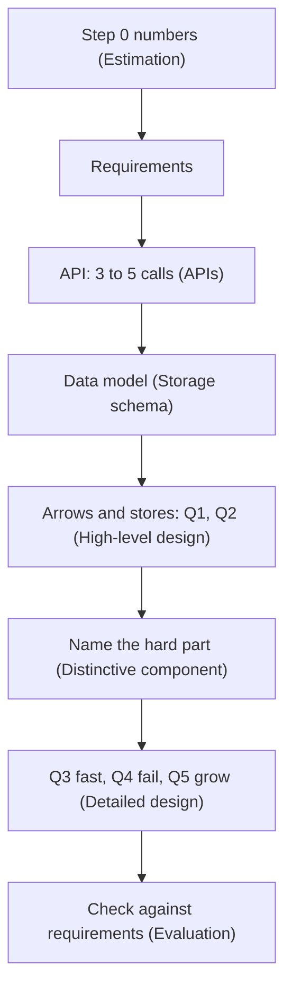
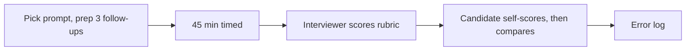
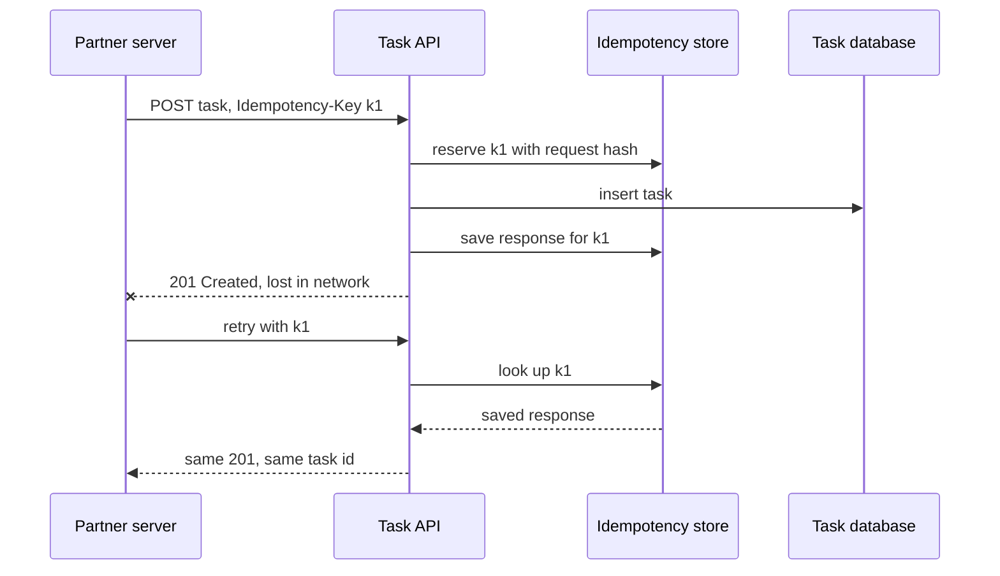

# Module 22 — Interview Question Bank

## How to use this bank

This module collects the system design questions that come up again and again in interviews, worded the way they usually appear on LeetCode Discuss interview-experience posts, in the big public GitHub lists and on popular question sites (see the sources at the end). Use it as a checklist so that nothing in the room surprises you.

- **★** marks a question that is asked very often. Do those first.
- **Part A** is the "Design X" prompts (URL shortener, news feed, Uber, Ticketmaster …). When this book has a full case study, the entry is a two-minute outline plus a link to the full design. When it doesn't, the entry is a longer outline that stands on its own, with links to the modules that teach each building block.
- **Part B** is the concept questions ("What is consistent hashing?", "SQL vs NoSQL?", "How does a circuit breaker work?"). Each has a short answer you can say out loud and a link to the full explanation. Part B ends with **More design prompts** (Q213–Q219), design questions added after the numbering was fixed.
- **Part C** is a minute-by-minute plan for a 45-minute system design round.
- **Part D** is how to prepare and practise: a 4/8/12-week plan, a mock-interview rubric, traps that sink candidates, API-design rounds and what each level is expected to show.

**How to drill:** read the question, cover the answer, say your answer out loud (or sketch the boxes), then compare. Mark the ones you stumbled on and come back to them the next day. For Part A, time yourself: two minutes for the outline, then pick one deep dive.

## Part A — "Design X" questions

These are the open-ended "Design X" prompts, worded the way candidates report them. ★ marks a question that shows up in three or more independent lists or again and again in interview-experience posts. *Asked at* lists companies only where a source reported them; those tags are self-reported, so treat them as hints, not facts.

Two kinds of answer follow. When this book already has a full design, you get a short outline you can say in two minutes, then a link to the full design. When the book has no dedicated design, you get a longer outline that stands on its own, with links to the modules that teach each building block. Each outline follows the same order you would use at the whiteboard: requirements, then components, then the decisions the interviewer is likely to push on, then scale.

## Building blocks

**Q1. ★ Design a URL Shortener (TinyURL / bit.ly)**

- **Requirements:** turn a long URL into a short one (about 7 characters), redirect fast, optional custom alias and expiry; reads outnumber writes by roughly 100 to 1.
- **Components:** write API, key generator, key-value store mapping short code to long URL, read cache (Redis), redirect service behind a CDN.
- **Probe 1, making the key:** base62-encode a unique counter or Snowflake ID (no collisions; 62^7 is about 3.5 trillion codes) versus hashing the URL and retrying on collision.
- **Probe 2, 301 or 302:** a 301 (permanent) lets browsers cache the redirect and cuts load; a 302 (temporary) sends every click to you, which you need for click analytics.
- **Probe 3:** the same long URL submitted twice: return the existing code (needs a reverse index) or mint a new one.
- **Scale:** the read path is a cache lookup; shard the store by short code; push click events to a queue for analytics.

→ *Full design:* [Module 13 — Case 2: Design a URL Shortener](../13-case-studies-building-blocks/README.md) · [Module 0 — Worked example: designing a URL shortener](../00-system-design-fundamentals/README.md)

**Q2. Design Pastebin**

- **Requirements:** upload a text blob, get a short link, read it back; optional expiry and private pastes; pastes can be up to a few MB.
- **Components:** the URL-shortener key path, plus object storage (S3-style) for the text body, a metadata table (key, owner, size, expiry, storage pointer), a CDN for popular pastes.
- **Probe 1:** keep large bodies out of the database; store a pointer to the object store.
- **Probe 2:** expiry: a lazy check at read time plus a background sweeper that deletes expired objects.
- **Scale:** read-heavy, so CDN and cache absorb most traffic; rate-limit anonymous uploads to stop abuse.

→ *Full design:* [Module 13 — Case 2, Variant: Pastebin](../13-case-studies-building-blocks/README.md)

**Q3. ★ Design an API Rate Limiter**

*Asked at:* Amazon, Atlassian, Uber, Microsoft, Stripe, Pinterest, Patreon

- **Requirements:** cap requests per user, API key or IP (for example 100 per minute); answer with HTTP 429 and a `Retry-After` header; add under a millisecond of latency; keep working when the limiter store is down.
- **Components:** limiter middleware in the API gateway, a shared counter store (Redis), a rules config service.
- **Probe 1, algorithm:** token bucket (allows short bursts and is cheap) versus sliding-window log (exact but memory-heavy) versus sliding-window counter (a good approximation).
- **Probe 2, races:** make check-and-increment atomic with a Redis Lua script or `INCR` plus expiry, so two gateway nodes cannot both let the last request through.
- **Probe 3, store outage:** fail open (allow traffic) or fail closed (block it). Most public APIs fail open and keep a local in-memory limit as a backstop.
- **Scale:** shard counters by key; for global limits across regions, accept slight overshoot or sync counts asynchronously.

→ *Full design:* [Module 23 — Case 2: Design a Rate Limiter](../23-case-studies-building-blocks-ii/README.md#case-2--design-a-rate-limiter) · [Module 8 — Rate Limiting](../08-api-and-edge/README.md) · [Module 0 — Rate limiting and throttling](../00-system-design-fundamentals/README.md)

**Q4. ★ Design a Unique ID Generator in distributed systems (Twitter Snowflake)**

- **Requirements:** 64-bit IDs that are unique, roughly sortable by time, and generated at over 10,000 per second per node with no coordination on the hot path.
- **Components:** an ID library or service on each node; a way to hand out worker IDs (ZooKeeper/etcd or config).
- **Probe 1, layout:** 1 sign bit, 41 bits of milliseconds since a custom epoch (about 69 years), 10 bits of worker ID, 12 bits of sequence (4,096 IDs per millisecond per worker).
- **Probe 2, clock going backwards:** refuse to issue IDs (or wait) until the clock passes the last timestamp used.
- **Probe 3, alternatives:** UUIDv4 (no coordination, but 128 bits and random, so it hurts B-tree index locality), UUIDv7 (time-ordered), a database ticket server (simple, but a bottleneck).
- **Scale:** each node is independent, so throughput grows linearly with nodes.

→ *Full design:* [Module 13 — Case 1: Design a Unique ID Generator](../13-case-studies-building-blocks/README.md)

**Q5. ★ Design a (Distributed) Key-Value Store**

*Asked at:* Apple, Google, Canva, Rubrik, Avalara, OpenDoor

- **Requirements:** `get(key)` / `put(key, value)`, small values, always writable, tunable consistency, horizontal scale, survive node and rack loss.
- **Components:** consistent-hash ring with virtual nodes, N replicas per key (N = 3), a coordinator node per request, an LSM-tree storage engine (write-ahead log, memtable, SSTables), gossip membership.
- **Probe 1, quorums:** choose R and W with R + W > N to read your latest write; lower them for speed when stale reads are fine.
- **Probe 2, conflicts:** last-write-wins (simple, can lose data) versus vector clocks with client-side merge.
- **Probe 3, failures:** hinted handoff for short outages, Merkle-tree anti-entropy to repair replicas after long ones.
- **Scale:** add nodes and let virtual nodes move small slices of data; a hot key needs caching or key splitting.

→ *Full design:* [Module 13 — Case 3: Design a Distributed Key-Value Store](../13-case-studies-building-blocks/README.md)

**Q6. ★ Design a Distributed Cache (Redis / Memcached)**

- **Requirements:** sub-millisecond get/set with TTL, eviction when memory is full, horizontal scale, survive node loss without a stampede on the database.
- **Components:** cache nodes holding in-memory hash tables, a partitioning scheme (client-side consistent hashing, or Redis Cluster's 16,384 hash slots), replicas, a cluster manager.
- **Probe 1, eviction:** LRU or LFU per node; the TTL choice sets how stale data can get.
- **Probe 2, hot keys:** replicate a hot key to many nodes, or keep a small local cache in the app.
- **Probe 3, consistency with the DB:** cache-aside with delete-on-write, and request coalescing so one miss does not become a thousand DB queries.
- **Scale:** resharding moves slots one at a time while clients follow redirects.

→ *Full design:* [Module 21 — Case 4: Distributed Cache Cluster](../21-case-studies-developer-and-ai-platforms/README.md)

**Q7. ★ Design a Web Crawler**

*Asked at:* Amazon

- **Requirements:** crawl billions of pages, stay polite (obey robots.txt, limit requests per host), skip duplicates, refresh pages that change, and be robust to traps and broken HTML.
- **Components:** seed URLs, URL frontier (priority queues plus one queue per host), DNS cache, fetchers, parser and link extractor, URL-seen filter (Bloom filter), content dedup (fingerprints), object storage for pages.
- **Probe 1, politeness:** map each host to one queue served by one worker, with a delay between hits.
- **Probe 2, dedup:** Bloom filter for URLs seen; a content hash or SimHash for near-duplicate pages.
- **Probe 3, traps:** cap depth, URL length and pages per host.
- **Scale:** partition the frontier by host hash across many machines; checkpoint the frontier so a crash does not restart the crawl.

→ *Full design:* [Module 13 — Case 5: Design a Web Crawler](../13-case-studies-building-blocks/README.md)

**Q8. ★ Design Search Autocomplete / Typeahead Suggestion**

- **Requirements:** top 5 to 10 suggestions for a prefix within about 100 ms, ranked by popularity, refreshed daily or hourly.
- **Components:** query-log collector, offline aggregator (counts per query), trie builder, trie servers with the top-k results cached at each node, browser and CDN caching.
- **Probe 1:** precompute top-k per prefix so a lookup costs O(prefix length), not a subtree scan.
- **Probe 2:** rebuild the trie offline and swap it in, instead of updating it on every keystroke.
- **Probe 3:** shard by prefix range (uneven: many words start with "s") or by hash with a lookup map; filter offensive terms.
- **Scale:** debounce in the client, cache short prefixes everywhere, add a small real-time layer for trending terms.

→ *Full design:* [Module 13 — Case 6: Design Search Autocomplete](../13-case-studies-building-blocks/README.md)

**Q9. ★ Design a Distributed Message Queue (Kafka / RabbitMQ)**

*Asked at:* Amazon, Microsoft, Apple, Instacart, Wise, Confluent

- **Requirements:** producers publish to topics, consumer groups read independently, ordering per partition, durable storage with retention, at-least-once delivery.
- **Components:** brokers storing partitioned append-only logs, a controller quorum (KRaft; ZooKeeper only in versions before Kafka 4.0) for metadata and leader election, replication with in-sync replicas (ISR), consumer group coordinator, offset storage.
- **Probe 1:** ordering exists only within a partition, so choose the partition key carefully.
- **Probe 2, durability:** `acks=all` plus a minimum ISR size, versus `acks=1` for speed.
- **Probe 3, delivery:** at-least-once (commit the offset after processing) plus idempotent consumers; exactly-once needs idempotent producers and transactions.
- **Scale:** add partitions and brokers; sequential disk writes and zero-copy reads keep throughput high.

→ *Full design:* [Module 13 — Case 4: Design a Distributed Message Queue](../13-case-studies-building-blocks/README.md) · [Module 10 — Inside Kafka](../10-batch-and-streaming/README.md)

**Q10. ★ Design a Notification Service (at scale)**

*Asked at:* Google, Pinterest, Amazon, Airbnb, Instacart, StubHub, OCI, Flipkart

- **Requirements:** send push, SMS, email and in-app messages, triggered by events or by campaigns; respect user preferences and quiet hours; no duplicates; millions per minute at peak.
- **Components:** notification API, preference and template services, a queue per channel, channel workers that call providers (APNs, FCM, SMS gateway, email provider), a delivery-status store, retry queue and dead-letter queue.
- **Probe 1:** dedup with an idempotency key per (user, event) so retries do not send twice.
- **Probe 2:** separate queues per channel and priority, so a slow SMS provider or a big marketing blast cannot delay OTPs.
- **Probe 3:** per-user rate limits and digesting, so you do not spam people.
- **Scale:** campaign fan-out runs as a batch job that feeds the queues at a controlled rate.

→ *Full design:* [Module 2 — Capstone: Designing a Notification System](../02-moving-data/README.md)

**Q11. Design a CDN**

- **Requirements:** serve static and cacheable content from close to users, absorb traffic spikes, protect the origin.
- **Components:** edge points of presence (PoPs) with cache servers, request routing (anycast or GeoDNS), a mid-tier "origin shield" cache, the origin, a purge/invalidation API, TLS at the edge.
- **Probe 1:** pull (fetch from origin on a miss) versus push (upload ahead of time, good for big releases).
- **Probe 2:** cache key design and TTLs; versioned file names beat purges.
- **Probe 3:** routing users to the nearest healthy PoP and failing over when one dies.
- **Scale:** the origin shield collapses many edge misses into one origin fetch.

→ *Full design:* [Module 23 — Case 1: Design a CDN](../23-case-studies-building-blocks-ii/README.md#case-1--design-a-cdn) · [Module 8 — CDN](../08-api-and-edge/README.md) · [Module 0 — CDNs and anycast](../00-system-design-fundamentals/README.md)

**Q12. Design a load balancer**

- **Requirements:** spread traffic over healthy backends, add little latency, have no single point of failure, support TLS and sticky sessions.
- **Components:** an L4 layer (routes by IP and port, very fast) in front of an L7 layer (reads HTTP, routes by path or header), health checker, config store, a redundant pair or anycast group.
- **Probe 1, algorithms:** round robin, least connections, consistent hashing (Maglev) for affinity.
- **Probe 2:** active versus passive health checks and connection draining during deploys.
- **Probe 3:** making the balancer itself redundant with a floating IP (VRRP) or anycast plus ECMP.
- **Scale:** L4 scales by spreading flows over many stateless nodes; L7 scales horizontally behind it.

→ *Full design:* [Module 6 — Load Balancing](../06-scaling/README.md) · [Module 0 — Load balancers](../00-system-design-fundamentals/README.md)

**Q13. Design a distributed locking service**

- **Requirements:** mutual exclusion across machines, locks that expire if the holder dies, safety even under process pauses and network delays.
- **Components:** a consensus-backed store (etcd, ZooKeeper or Consul), lock = key plus lease (a lock that expires unless renewed), a client library with renew and release.
- **Probe 1, fencing tokens:** every grant carries an increasing number; the protected resource rejects writes with an older number, so a paused old holder cannot do damage.
- **Probe 2:** Redis `SET NX PX` is fine for efficiency locks; for correctness use a consensus store. Redlock's safety is disputed.
- **Probe 3:** lease length trades fast recovery against false expiry.
- **Scale:** shard locks by name; avoid one hot global lock.

→ *Full design:* [Module 0 — Consensus, leader election and distributed locks](../00-system-design-fundamentals/README.md)

**Q14. Design an authentication / login system (OTP, OAuth, SSO)**

*Asked at:* Google, Visa, Gusto

- **Requirements:** sign up, log in with password, OTP or social login; sessions across devices; logout and revoke; MFA; resistance to brute force.
- **Components:** identity service, credential store (passwords hashed with bcrypt or Argon2), token service (short-lived access token plus refresh token), OTP service, OAuth 2.0 / OpenID Connect provider integration, rate limiter.
- **Probe 1:** server sessions (easy to revoke) versus JWTs (stateless, hard to revoke, so keep them short-lived).
- **Probe 2:** refresh-token rotation and detecting reuse of a stolen refresh token.
- **Probe 3:** lockouts and rate limits per account and per IP; MFA for risky logins.
- **Scale:** the token check is stateless at the gateway; only refresh and login hit the identity database.

→ *Full design:* [Module 8 — Authorization Service](../08-api-and-edge/README.md) · [Module 0 — OAuth 2.0, OpenID Connect, SSO and API keys](../00-system-design-fundamentals/README.md)

**Q15. Design a webhook dispatcher**

- **Requirements:** deliver events to customer URLs reliably, in order per subscription where possible, retry for up to days, let customers verify the sender.
- **Components:** event outbox in the producing service, a dispatch queue partitioned per endpoint, delivery workers, a retry scheduler with exponential backoff, dead-letter store, a delivery log the customer can see and replay.
- **Probe 1:** sign each payload with HMAC and a timestamp so the receiver can check it is real and fresh.
- **Probe 2:** isolation: one slow or dead endpoint must not block others (per-endpoint queues and concurrency caps, a circuit breaker per endpoint).
- **Probe 3:** at-least-once delivery, so include an event ID that receivers use to deduplicate.
- **Scale:** partition by endpoint; disable endpoints that keep failing and alert the owner.

→ *Full design:* [Module 2 — Webhooks](../02-moving-data/README.md)

**Q16. Design an SMS / OTP service**

- **Requirements:** send a one-time code within seconds, valid for about 5 minutes, limited attempts, high delivery rate, resistant to abuse.
- **Components:** OTP API, code generator (a random 6-digit code from a secure random source), store holding a hash of the code with TTL and attempt counter (Redis), SMS router choosing among several providers, delivery-receipt handler.
- **Probe 1:** never store the plain code; compare hashes; lock after 3 to 5 wrong tries.
- **Probe 2:** route by country and fail over to a second provider when delivery receipts show problems.
- **Probe 3:** stop "SMS pumping" fraud with per-number, per-IP and per-country limits and CAPTCHAs.
- **Scale:** OTPs get their own high-priority queue, separate from marketing messages.

→ *Full design:* [Module 2 — Capstone: Designing a Notification System](../02-moving-data/README.md) (the OTP pieces are the add-on) · [Module 25 — Case 6: Twilio-style platform](../25-case-studies-commerce-media-platforms/README.md#case-6--a-twilio-style-communications-api-platform) (per-sender queues, carrier limits)

**Q17. Design a key-value store / query cache for a search engine**

- **Requirements:** cache results for popular queries to cut search-backend load; keep latency low; drop stale entries when the index changes.
- **Components:** query normalizer (lowercase, trim, sort filters) to build the cache key, a sharded in-memory cache (hash of key picks the shard), LRU eviction, TTL.
- **Probe 1:** query popularity follows a long tail, so a small cache catches a large share of traffic.
- **Probe 2:** invalidation: short TTLs, or put an index version number in the key so a new index naturally misses.
- **Scale:** replicate hot shards; coalesce identical concurrent misses.

→ *Full design:* [Module 4 — Cache-Aside](../04-caching/README.md) · [Module 13 — Case 3: Design a Distributed Key-Value Store](../13-case-studies-building-blocks/README.md)

## Social and content

**Q18. ★ Design Facebook News Feed**

- **Requirements:** a home feed of posts from friends and pages, ranked, loaded in under 200 ms; posting is fast; feeds update within seconds.
- **Components:** post service, social graph service, fan-out workers, feed cache (a list of post IDs per user), ranking service, media on a CDN.
- **Probe 1, fan-out on write vs on read:** pushing post IDs into followers' feeds at write time makes reads cheap but is costly for celebrities; pulling at read time is the opposite. Use a hybrid: push for normal users, pull for accounts with millions of followers.
- **Probe 2:** ranking: candidates, then a scoring model, then diversity rules.
- **Probe 3:** cursor-based pagination and handling deleted or hidden posts.
- **Scale:** keep feed caches only for active users; rebuild inactive users' feeds on demand.

→ *Full design:* [Module 12 — Design 1: The News Feed](../12-capstones/README.md) · [Module 18 — App 1: News Feed App](../18-client-and-mobile-system-design/README.md)

**Q19. ★ Design Twitter (timeline + search)**

- **Requirements:** post short tweets, follow users, home and user timelines, likes and retweets, search, trends; heavily read-heavy.
- **Components:** tweet service and store (sharded by tweet ID), follow graph, fan-out service writing into per-user timeline caches (Redis lists), search indexer, trends pipeline.
- **Probe 1:** the hybrid fan-out for celebrity accounts (merge their tweets at read time).
- **Probe 2:** Snowflake IDs give a time order, so timelines sort by ID.
- **Probe 3:** search uses a real-time inverted index fed from the tweet stream.
- **Scale:** counters (likes, retweets) are sharded and updated asynchronously.

→ *Full design:* [Module 20 — Case 5: Microblogging (Twitter/X-like)](../20-case-studies-content-search-and-platforms/README.md)

**Q20. ★ Design Instagram / photo sharing (Flickr, Google Photos)**

*Asked at:* Google, DoorDash, Amazon, Uber, Facebook

- **Requirements:** upload photos and videos, follow users, feed, likes and comments; uploads are durable; images load fast worldwide.
- **Components:** upload service issuing pre-signed URLs (the client uploads straight to object storage), media pipeline (thumbnails, several resolutions, format conversion), metadata DB, feed service, CDN.
- **Probe 1:** keep big bytes out of your app servers; store metadata separately from blobs.
- **Probe 2:** feed generation, with the same fan-out trade-off as the news feed.
- **Probe 3:** sharding metadata by user ID and the hot-celebrity problem.
- **Scale:** the CDN serves most reads; process media asynchronously after upload.

→ *Full design:* [Module 20 — Case 4: Photo Sharing (Instagram-like)](../20-case-studies-content-search-and-platforms/README.md)

**Q21. Design TikTok / short-video feed**

- **Requirements:** upload short videos; an endless "For You" feed picked by a recommender, not by follows; next video starts in under ~200 ms; new uploads reach viewers within minutes.
- **Numbers:** 600M daily users × 100 views ≈ 700K views/s; ~140K feed requests/s at peak, each ranking ~1,000 candidates.
- **Components:** the video upload/transcode/CDN pipeline; a funnel of embedding retrieval → multi-task ranker → diversity re-ranker over precomputed candidate pools; an event log feeding real-time features.
- **Probe 1:** instant start: preload the first seconds of the next 2–3 videos, short segments, warm connections.
- **Probe 2:** learning in minutes: streamed features plus online training that pushes only updated embeddings.
- **Probe 3:** cold start by staged exposure; fall back to trending if the ranker fails.

→ *Full design:* [Module 25 — Case 1: TikTok-Style Short-Video Feed](../25-case-studies-commerce-media-platforms/README.md#case-1--tiktok-style-short-video-feed)

**Q22. Design Tinder**

**Requirements.** Functional: create a profile with photos, set preferences (age, distance, gender), see a stack of nearby candidates, swipe right (like) or left (pass), get a match when both people like each other, then chat. Non-functional: the swipe deck loads quickly, a match shows up instantly, and nobody sees the same profile twice in a short window.

**Estimates.** 75M monthly users and 10M daily; around 1B swipes a day, so about 12k swipes a second on average and 3 to 4 times that at evening peak. Photos dominate storage (about 6 per user at 200 KB each).

**API.** `GET /recs?count=20`, `POST /swipe {target_id, direction}` (returns `{match: true}` when it is mutual), `GET /matches`, plus the chat APIs.

**Data model.** Profiles in a document store with a geo index; swipes as `(swiper, target) -> direction`, sharded by swiper; matches as rows indexed for both users; a "seen" set per user (a Bloom filter or a recent-ID set).

**Architecture.** Profile service; location service (geohash cells updated when the app opens); recommendation service builds a deck by querying candidates in nearby cells that pass the preference filters, then ranks them; swipe service; match service; chat service over WebSockets; push notifications.

**Deep dives.**
1. *Match detection:* when A likes B, check whether B already liked A. Store likes keyed by `(target, swiper)` so the check is one key lookup; write the match atomically and notify both users.
2. *Deck generation:* precompute decks in the background and keep them in a cache, so a swipe pops the next profile locally. Exclude anyone already swiped.
3. *Ranking:* mix attractiveness or desirability signals, activity recency and distance; keep fairness so popular profiles do not get all the exposure.

**Failures and trade-offs.** Swipes can be accepted into a queue and processed a moment later, so the app never blocks; the match check must still be correct, so make it idempotent. Location is coarse on purpose (a geohash cell) for privacy.

→ *Building blocks:* [Module 15 — Design 1: Proximity Service](../15-case-studies-location-and-realtime/README.md) · [Module 14 — Case 1: Chat System](../14-case-studies-messaging-and-media/README.md) · [Module 3 — Sharding](../03-storing-data/README.md) · [Module 0 — Probabilistic data structures and Merkle trees](../00-system-design-fundamentals/README.md)

**Q23. Design Reddit / Quora (Q&A platform)**

- **Requirements:** post questions or links, answers and nested comments, up/down votes, ranked listings (hot, top, new), topics or subreddits, search.
- **Components:** post and comment service, vote service, ranking jobs, listing caches per topic, search index, notification fan-out.
- **Probe 1:** votes are very write-heavy, so aggregate counts asynchronously and store one row per (user, item) to stop double voting.
- **Probe 2:** "hot" ranking mixes score and age; recompute it for active items only.
- **Probe 3:** storing comment trees (a parent ID plus a path, or a materialized path) and loading the top branches first.
- **Scale:** cache listing pages; most traffic is anonymous reads.

→ *Full design:* [Module 20 — Case 3: Q&A Platform (Quora-like)](../20-case-studies-content-search-and-platforms/README.md)

**Q24. ★ Design a search engine / distributed search (Google, Elasticsearch)**

- **Requirements:** keyword search over billions of documents with results in under 200 ms, relevance ranking, near-real-time indexing of new documents.
- **Components:** ingestion and tokenizer, inverted index (term to list of documents), index shards plus replicas, a query broker doing scatter-gather, a ranker (BM25 plus signals), a result cache.
- **Probe 1, partitioning:** by document (each shard holds a full index for its documents; every query hits every shard) versus by term (a query touches fewer shards, but multi-term queries are hard). Most systems partition by document.
- **Probe 2:** tail latency in scatter-gather: hedge requests and return partial results.
- **Probe 3:** near-real-time updates using small new segments that merge later (LSM-like).
- **Scale:** add replicas for query load and shards for data size.

→ *Full design:* [Module 20 — Case 1: Distributed Search](../20-case-studies-content-search-and-platforms/README.md) · [Module 19 — Inverted index](../19-algorithms-deep-dive/README.md)

**Q25. Design Twitter search**

- **Requirements:** find tweets by keyword or hashtag within seconds of posting, newest and top results, very high ingest.
- **Components:** the tweet stream feeds indexers, a real-time index partitioned by time and then by tweet ID, an archive index for older tweets, a broker merging results.
- **Probe 1:** time partitioning lets most queries hit only the recent, in-memory partitions.
- **Probe 2:** ranking "top" results needs engagement signals that keep changing after indexing.
- **Scale:** the same scatter-gather as Q24, with an in-memory recent tier.

→ *Full design:* [Module 20 — Case 1: Distributed Search (Twitter/Elasticsearch-style)](../20-case-studies-content-search-and-platforms/README.md)

**Q26. Design the data structures for a social network / Facebook graph search**

**Requirements.** Functional: store people and friendships; answer "friends of X", "mutual friends of X and Y", "shortest path (degrees of separation) between X and Y", and graph-search queries such as "friends of mine who live in Pune and like hiking". Non-functional: friend lists in under 10 ms, 2-hop queries in under 100 ms, billions of edges.

**Estimates.** 2B users, about 300 friends each, so about 600B directed edges. At 16 bytes per edge that is around 10 TB, too big for one machine but small enough to spread across a few hundred.

**API.** `GET /users/{id}/friends`, `GET /users/{a}/mutual/{b}`, `GET /path?from=a&to=b`, `GET /search?q=...`.

**Data model.** Adjacency lists: `user_id -> sorted list of friend IDs`, sharded by user ID (this is what Facebook's TAO roughly does: objects plus typed edges, cached heavily). Attributes such as city and likes live in their own indexes (city -> users).

**Architecture.** A graph store sharded by user, a read-through cache tier in front (graph data is read far more than written), a person lookup service, and a search service that turns a graph query into set operations.

**Deep dives.**
1. *Mutual friends:* intersect two sorted friend lists (a linear merge, or bitmaps for big lists).
2. *Shortest path:* bidirectional breadth-first search from both ends, stopping when the frontiers meet. Each hop is a batch of cross-shard lookups, so cap the depth (3 is plenty) and the fan-out.
3. *Graph search:* compute "my friends" ∩ "people in Pune" ∩ "people who like hiking", starting with the smallest set; this is the same plan a query optimizer would pick.

**Failures and trade-offs.** Sharding by user means any multi-hop query crosses machines; some systems co-locate friend clusters to reduce that, at the cost of complex rebalancing. Store each friendship as two directed edges so each side reads locally, and accept brief inconsistency while both are written.

→ *Building blocks:* [Module 3 — Sharding](../03-storing-data/README.md) · [Module 4 — Read-Through](../04-caching/README.md) · [Module 20 — Case 1: Distributed Search](../20-case-studies-content-search-and-platforms/README.md)

**Q27. Design a tagging service (Atlassian-style: tag Jira / Confluence items)**

*Asked at:* Atlassian, PhonePe

**Requirements.** Functional: add and remove tags on items owned by many products (Jira issues, Confluence pages, Bitbucket PRs); list the tags of an item; list the items with a given tag across products; show popular tags; autocomplete tag names. Non-functional: multi-tenant (one customer never sees another's tags), reads under 50 ms, tag changes visible within seconds, products stay loosely coupled.

**Estimates.** 10M tenants, 10B tagged items, 3 tags per item on average, about 30B item-tag links. Writes are perhaps 5k per second; reads are 10 to 20 times that.

**API.** `PUT /tenants/{t}/items/{product}:{itemId}/tags/{tag}`, `DELETE` the same, `GET .../items/{id}/tags`, `GET /tenants/{t}/tags/{tag}/items?product=&cursor=`, `GET /tenants/{t}/tags?prefix=`.

**Data model.** Tag table: `(tenant, tag_id, name, usage_count)`. Two link tables, one per direction: `item -> tags` and `tag -> items`, both keyed with the tenant first so a tenant's data sits together. Items are referenced by a global ID (`product:id`) so the service does not need to understand any product's schema.

**Architecture.** The tagging API writes the `item -> tags` row (the source of truth) and publishes an event; a consumer updates the `tag -> items` index, the counts and a search index. Products call the API and also get events when tags change; when an item is deleted, the product sends an event so its links are removed.

**Deep dives.**
1. *Two indexes:* each query direction gets its own table; keep them in sync through the event stream or an outbox.
2. *Permissions:* the tag service does not know who may see a Jira issue, so it returns item IDs and the product filters them (or a permission service checks them in a batch).
3. *Hot tags:* a tag such as "bug" can have millions of items, so paginate with cursors and keep counts in sharded counters.

**Failures and trade-offs.** Eventual consistency between the two directions is acceptable for tags; tag names need normalising (case, spaces) to avoid near-duplicates.

→ *Building blocks:* [Module 3 — CQRS](../03-storing-data/README.md) · [Module 2 — Event-Driven Architecture](../02-moving-data/README.md) · [Module 8 — Cursor-Based Pagination](../08-api-and-edge/README.md) · [Module 16 — Design 4: Distributed Counter](../16-case-studies-infrastructure/README.md)

**Q28. Design "recently viewed items"**

**Requirements.** Functional: record each product or page a user views; show the last N (say 20) distinct items, newest first, on every device the user signs in from; let the user clear the list. Non-functional: recording must never slow the page (fire and forget); reads under 20 ms; losing the last view or two in a failure is acceptable.

**Estimates.** 50M daily users and 30 views each is 1.5B views a day (about 17k per second, 50k at peak). Storage is small: 20 IDs of about 16 bytes per user is about 1 KB with timestamps, so 100M users need about 100 GB.

**API.** `POST /users/{id}/views {item_id}` (asynchronous; 202 Accepted), `GET /users/{id}/recent?limit=20`, `DELETE /users/{id}/recent`.

**Data model.** One Redis sorted set per user (`member = item_id`, `score = timestamp`). Adding an item already present just updates its score, which gives you dedup for free; trim to the last N after each add. Back it with a key-value store (DynamoDB or Cassandra) holding the same list, for durability and for users whose data was evicted.

**Architecture.** The client or the web tier sends view events to a stream (Kafka); a consumer updates Redis and writes through to the durable store. The read API serves from Redis and falls back to the store on a miss. Anonymous users keep the list in local storage and merge it into the account at sign-in.

**Deep dives.**
1. *Write volume:* batch events per user in the consumer and apply one `ZADD` plus `ZREMRANGEBYRANK` per batch.
2. *Showing items:* the list holds only IDs; hydrate names, prices and stock in one batch call, and drop items that were deleted.
3. *Privacy:* honour "clear history" and retention limits; never use the list for ads without consent.

**Failures and trade-offs.** If Redis loses data, rebuild from the store; if the stream lags, the newest view shows up a few seconds late, which nobody notices.

→ *Building blocks:* [Module 4 — Write-Through](../04-caching/README.md) · [Module 2 — Event-Driven Architecture](../02-moving-data/README.md) · [Module 13 — Case 3: Design a Distributed Key-Value Store](../13-case-studies-building-blocks/README.md)

## Counting, ranking and analytics

**Q29. ★ Top K problem: most shared articles / heavy hitters (1 h / 24 h windows)**

*Asked at:* LinkedIn, Facebook, Twitter, Amazon, Bloomberg, Pinterest

- **Requirements:** top K items by count over sliding windows (last hour, last day), refreshed every minute, over millions of events per second.
- **Components:** event stream (Kafka) partitioned by item, stream processors keeping per-window counts, a merge step for the global top K, a results cache behind the API.
- **Probe 1, exact vs approximate:** a count-min sketch plus a small heap (or the Space-Saving algorithm) uses fixed memory and gives slightly high counts; exact counts need a hash map per window.
- **Probe 2, windows:** keep 1-minute buckets and sum the last 60 (tumbling buckets) instead of tracking every event.
- **Probe 3:** a fast approximate stream path plus a slower exact batch path (the Lambda pattern).
- **Scale:** each partition computes a local top K; merge them (take somewhat more than K per partition to stay accurate).

→ *Full design:* [Module 19 — Heavy hitters: Misra-Gries, Space-Saving and streaming top-k](../19-algorithms-deep-dive/README.md)

**Q30. Design a trending topics system (Twitter)**

- **Requirements:** find hashtags and phrases whose usage is rising unusually fast, per region, refreshed every few minutes.
- **Components:** tweet stream, tokenizer and entity extractor, windowed counters, a scorer comparing the current rate with a baseline, spam filters, a results cache.
- **Probe 1:** "trending" means growth, not volume: use exponentially decayed counts and a z-score against the usual rate, so "good morning" does not trend every day.
- **Probe 2:** filter bots and coordinated spam before counting.
- **Scale:** the same streaming top-K pipeline as Q29, keyed by (region, term).

→ *Full design:* [Module 19 — Trending detection with decayed counts and z-scores](../19-algorithms-deep-dive/README.md)

**Q31. Design Amazon's sales ranking by category**

- **Requirements:** rank products by recent sales within each category and parent category, updated hourly.
- **Components:** order events, a stream or hourly batch job computing sales per (category, product) over a decayed window, a rank table per category, a cache for product pages.
- **Probe 1:** a product sits in many categories: count once, then emit to each ancestor category.
- **Probe 2:** batch (MapReduce) versus streaming; hourly freshness makes batch enough.
- **Scale:** per-category top lists are small; only the counting job is large.

→ *Full design:* [Module 19 — Heavy hitters](../19-algorithms-deep-dive/README.md) · [Module 10 — MapReduce](../10-batch-and-streaming/README.md)

**Q32. Count Facebook likes / distributed counter (views, likes at scale)**

*Asked at:* Facebook, Amazon, Twitter, Coinbase

- **Requirements:** increment counts for likes and views at huge rates, show a close-enough count fast, and make sure each user's like counts once.
- **Components:** a like table `(user, item)` as the source of truth, an event stream, aggregators that batch increments, sharded counters (N sub-counters per hot item, summed on read), a cache.
- **Probe 1:** a hot item turns one counter row into a write hotspot: split it into sub-counters or pre-aggregate in the stream.
- **Probe 2:** exact (likes) versus approximate (unique views with HyperLogLog).
- **Scale:** batch writes every second or so; readers tolerate a slightly stale count.

→ *Full design:* [Module 16 — Design 4: Distributed Counter](../16-case-studies-infrastructure/README.md)

**Q33. Design "N users viewing this page"**

*Asked at:* Booking.com

- **Requirements:** show roughly how many people are viewing a page right now; the number may be a few seconds old.
- **Components:** clients send a heartbeat every 10 to 30 s; a presence store holds a per-page set with expiring entries (Redis sorted set scored by last-seen time); a reader counts entries newer than the cutoff.
- **Probe 1:** heartbeats versus WebSocket connect/disconnect (disconnects get lost, so expiry is still needed).
- **Probe 2:** for huge pages, use HyperLogLog per time bucket instead of exact sets.
- **Scale:** shard by page ID; cache the count for a few seconds.

→ *Full design:* [Module 16 — Design 4: Distributed Counter](../16-case-studies-infrastructure/README.md)

**Q34. Design Facebook likes with live updates**

*Asked at:* Facebook, Coinbase

- **Requirements:** like counts on a post update live for everyone currently viewing it.
- **Components:** the distributed counter from Q32, plus a subscription service: each viewer's connection (SSE or WebSocket) subscribes to the post IDs on screen; a pub/sub fan-out pushes new counts.
- **Probe 1:** throttle pushes (at most one update per post per second or two) and send totals, not each like.
- **Probe 2:** track subscriptions per gateway server so you only push to servers that have viewers of that post.
- **Scale:** viral posts get very large subscriber sets; batch and sample updates.

→ *Full design:* [Module 16 — Design 4: Distributed Counter](../16-case-studies-infrastructure/README.md) · [Module 2 — Server-Sent Events](../02-moving-data/README.md)

**Q35. Design ad click event aggregation**

- **Requirements:** count clicks per ad per minute for billing and dashboards, exactly-once for billing, results within minutes, queries by ad and time.
- **Components:** click log (Kafka), a stream aggregator with windowing, an OLAP store for results, a nightly reconciliation batch job, dedup by click ID.
- **Probe 1:** event time versus processing time, with watermarks for late events.
- **Probe 2:** exactly-once through checkpoints plus idempotent sinks.
- **Probe 3:** fraud filtering before counts reach billing.
- **Scale:** partition by ad ID; pre-aggregate hot ads.

→ *Full design:* [Module 20 — Case 6: Ad-Click Aggregation](../20-case-studies-content-search-and-platforms/README.md)

**Q36. Design an ads management and display system for a social feed**

*Asked at:* Facebook, Google, Amazon, Pinterest

- **Requirements:** advertisers create campaigns with budgets and targeting; the feed requests ads and gets an ad within about 50 ms; budgets are not overspent; impressions and clicks are counted.
- **Components:** campaign management (OLTP database), an ad index of active ads by targeting attributes, an ad server running a quick auction (bid times predicted click rate), pacing and budget service, event logging into the aggregation pipeline of Q35.
- **Probe 1:** budget pacing spreads spend over the day; budgets are enforced from near-real-time counters with a small safety margin.
- **Probe 2:** the auction ranks by expected value, not bid alone.
- **Scale:** replicate the ad index to every ad-server node; the counters are the only shared state.

→ *Full design:* [Module 20 — Case 6: Ad-Click Aggregation](../20-case-studies-content-search-and-platforms/README.md) (the serving side is the add-on)

**Q37. Design Google Analytics / an analytics platform (metrics & logging)**

*Asked at:* Microsoft, Facebook, Qualtrics, Google

- **Requirements:** a JavaScript tag collects page views and events from millions of sites; dashboards show sessions, funnels and breakdowns by any dimension; near-real-time views plus accurate daily reports.
- **Components:** collection endpoint (stateless, at the edge), Kafka, stream jobs for real-time counts, a data lake, batch jobs that build sessions, a columnar OLAP store (ClickHouse, Druid or BigQuery) for queries.
- **Probe 1:** pre-aggregated rollups versus querying raw events (flexible but costly); usually both.
- **Probe 2:** unique visitors with HyperLogLog; sampling for very large sites.
- **Scale:** partition by site ID; isolate huge tenants.

→ *Full design:* [Module 10 — Capstone: Clickstream to Dashboard](../10-batch-and-streaming/README.md)

## Messaging and real-time

**Q38. ★ Design a Chat System (WhatsApp / Facebook Messenger)**

- **Requirements:** one-to-one and group chat, online presence, delivered and read receipts, offline delivery, history on several devices, low latency.
- **Components:** WebSocket gateways (long-lived connections), a session registry (which user is on which gateway), chat service, message store (wide-column, keyed by conversation and time), presence service, push notifications for offline users.
- **Probe 1:** ordering: a per-conversation sequence number assigned by the server.
- **Probe 2:** delivery guarantees: client message IDs for dedup, acks, and resending on reconnect.
- **Probe 3:** group fan-out: write once per group and fan out at read time, or copy to each member's inbox for small groups.
- **Scale:** gateways scale on connection count; route messages through a pub/sub layer between gateways.

→ *Full design:* [Module 14 — Case 1: Chat System](../14-case-studies-messaging-and-media/README.md) · [Module 18 — App 2: Chat App](../18-client-and-mobile-system-design/README.md)

**Q39. Design an email service (Gmail)**

- **Requirements:** send and receive email over SMTP, store mail forever, search, labels and threads, spam filtering, attachments.
- **Components:** inbound SMTP servers, spam and virus filtering, a mailbox store (metadata in a database, bodies and attachments in object storage), a search index per user, outbound SMTP with queues and retries, web and IMAP front ends.
- **Probe 1:** shard everything by user; a mailbox is a natural unit.
- **Probe 2:** sender reputation and authentication (SPF, DKIM, DMARC) for deliverability.
- **Scale:** dedupe attachments sent to many recipients; move cold mail to cheaper storage.

→ *Full design:* [Module 14 — Case 2: Email Service](../14-case-studies-messaging-and-media/README.md)

**Q40. Design a live comments feature (Facebook Live)**

*Asked at:* Facebook

**Requirements.** Functional: viewers of a live video post comments; every viewer sees new comments within about 2 seconds; viewers who join late see recent comments; the streamer can moderate. Non-functional: a single stream may have millions of viewers, comments must not block the video, and dropping or sampling some comments on huge streams is fine.

**Estimates.** A big stream: 1M viewers and 5k comments per second. Sending every comment to every viewer would mean 5 billion deliveries a second, which is impossible and unreadable, so the design must sample.

**API.** `POST /streams/{id}/comments {text}`; a subscription over WebSocket or SSE: `SUBSCRIBE stream_id`; `GET /streams/{id}/comments?before=` for history.

**Data model.** Comments `(stream_id, comment_id, user_id, text, ts)` in a wide-column store partitioned by stream and time bucket; a short recent buffer per stream in Redis.

**Architecture.** The comment service validates, filters (spam, banned words) and stores the comment, then publishes it to a pub/sub topic for that stream. Edge gateway servers hold viewer connections; each gateway subscribes to the topics of the streams its viewers watch, so one message per gateway, not per viewer, crosses the network. The gateway then fans out to its local connections.

**Deep dives.**
1. *Two-level fan-out:* comment service, then pub/sub, then a few thousand gateways, then millions of sockets. The subscription registry maps a stream to the gateways that need it.
2. *Sampling and ranking:* above a threshold, send each viewer a sample (friends' comments first, then highly ranked ones) at a readable rate, for example 10 a second.
3. *Late joiners:* the recent buffer serves the last 50 comments at connect time.

**Failures and trade-offs.** If a gateway dies, clients reconnect to another one and fetch recent comments; brief gaps are acceptable. Ordering is per stream and approximate; exact global order is not worth the cost here.

→ *Building blocks:* [Module 14 — Case 5: Live Streaming](../14-case-studies-messaging-and-media/README.md) · [Module 2 — Publish-Subscribe](../02-moving-data/README.md) · [Module 2 — Server-Sent Events](../02-moving-data/README.md) · [Module 5 — Graceful Degradation](../05-reliability/README.md)

**Q41. Design Zoom / video conferencing**

**Requirements.** Functional: create and join meetings, audio and video for 2 to 1,000 people, screen sharing, chat, recording, waiting room. Non-functional: end-to-end delay under about 150 ms for natural conversation, adapt to bad networks, and drop a little quality rather than freeze.

**Estimates.** 300M daily meeting participants and 3M meetings at the same time at peak. Each participant sends about 1.5 Mbps of video and receives several streams, so the media servers carry multiple Tbps at peak; signalling traffic is tiny by comparison.

**API.** `POST /meetings` (returns an ID and join URL), `POST /meetings/{id}/join` (returns a token plus the media server address), and a signalling WebSocket for joining, leaving, muting and sharing events.

**Data model.** Meetings and participants in a relational database; live meeting state (who is in, who is speaking) in memory on the meeting's media server, with a copy in Redis; recordings in object storage.

**Architecture.** A signalling service handles login and session setup (WebRTC-style offer and answer). Media flows over UDP (RTP), because a late packet is useless and TCP retransmits would add delay. Use a Selective Forwarding Unit (SFU): each client sends its video once to a media server, which forwards it to the others without decoding it. NAT traversal uses STUN, with TURN relays as the fallback. Media servers sit in many regions; a meeting is placed near most of its participants, and servers can be chained (cascaded) across regions.

**Deep dives.**
1. *SFU versus MCU versus mesh:* mesh (everyone sends to everyone) breaks above about 4 people; an MCU mixes streams into one but costs a lot of CPU and adds delay; an SFU is the usual middle ground.
2. *Simulcast:* each sender uploads 2 or 3 resolutions; the SFU sends each receiver the one that fits its bandwidth and layout (thumbnail or full screen).
3. *Congestion control:* receivers report loss and delay; senders lower bitrate; audio gets priority over video.

**Failures and trade-offs.** If a media server fails, clients re-join through signalling within seconds. End-to-end encryption conflicts with server-side recording and transcription, which need the server to see the media.

→ *Building blocks:* [Module 0 — TCP, UDP and QUIC](../00-system-design-fundamentals/README.md) · [Module 2 — Bidirectional Streaming](../02-moving-data/README.md) · [Module 6 — Multi-Region and Cell-Based Architecture](../06-scaling/README.md) · [Module 14 — Case 5: Live Streaming](../14-case-studies-messaging-and-media/README.md)

**Q42. Design a real-time gaming leaderboard**

- **Requirements:** update a player's score and show top 10 and "my rank" instantly, for millions of players per game or season.
- **Components:** score service, Redis sorted sets (`ZINCRBY` to update, `ZRANGE ... REV` (formerly `ZREVRANGE`) for top N, `ZREVRANK` for my rank; each O(log n), plus the items returned), a durable score store for recovery, a scheduled reset per season.
- **Probe 1:** ties: break them by timestamp encoded into the score.
- **Probe 2:** beyond one Redis node: shard by score range, or keep exact ranks for the top and approximate percentiles for everyone else.
- **Scale:** rebuild the sorted set from the durable store after a failure.

→ *Full design:* [Module 15 — Design 4: Real-Time Gaming Leaderboard](../15-case-studies-location-and-realtime/README.md)

**Q43. Design an online multiplayer card game**

**Requirements.** Functional: players log in, join matchmaking or a private table, play turn-based card games (poker, rummy, bridge) with 2 to 8 players, see others' moves instantly, reconnect after a drop, and see their history. Non-functional: game state is server-authoritative (no client can cheat), dealing must be provably fair, moves show up in under about 200 ms, and no game is lost when a server dies.

**Estimates.** 1M concurrent players at about 5 per table is 200k live tables. A move every few seconds per table gives about 70k moves a second, and each move is a small message.

**API.** `POST /matchmaking {game, stakes}` (returns a table ID and server), a WebSocket on the game server with messages such as `JOIN`, `PLAY_CARD`, `BET` and `FOLD`, and server events `STATE`, `TURN` and `RESULT`.

**Data model.** In memory on the game server: table state (deck, hands, pot, turn, timer). Durably: an append-only move log per table (for recovery and audits), a players and wallet database, and game results.

**Architecture.** Matchmaking groups players by skill, stakes and region. A table lives on exactly one game server (its owner), which runs the game as a state machine and is the only one that changes it. A lobby service and a routing table map table IDs to servers. The wallet service holds chips; bets are ledger entries.

**Deep dives.**
1. *Server authority and hidden information:* the server shuffles with a secure random generator and sends each client only its own cards; clients send intentions, and the server validates every move.
2. *Turn timers and reconnects:* each turn has a timeout that auto-folds or auto-plays; a dropped player can reconnect and receive a full state snapshot.
3. *Crash recovery:* replay the move log onto a new server; snapshot periodically to shorten replay.

**Failures and trade-offs.** One owner per table keeps the logic simple but makes that server a failure point for its tables, which the move log covers. With real money, collusion detection and audits matter as much as latency.

→ *Building blocks:* [Module 2 — Bidirectional Streaming](../02-moving-data/README.md) · [Module 3 — Event Sourcing](../03-storing-data/README.md) · [Module 17 — Design a Digital Wallet](../17-case-studies-money-and-reservations/README.md) · [Module 15 — Design 4: Real-Time Gaming Leaderboard](../15-case-studies-location-and-realtime/README.md)

## Location

**Q44. ★ Design Uber / Lyft (ride sharing)**

*Asked at:* Facebook, Uber, Google, Microsoft

- **Requirements:** riders request rides, nearby drivers are matched within seconds, both see live location, pricing, trip state and payment.
- **Components:** location service (drivers send GPS every few seconds into an in-memory geo index), dispatch and matching service, trip service (a state machine), pricing service, payments, notifications.
- **Probe 1:** the geo index: geohash, quadtree or H3 cells, kept in memory and sharded by region.
- **Probe 2:** matching: nearest by ETA, not by straight-line distance; offer to one driver at a time with a timeout, or batch matching.
- **Probe 3:** never double-assign a driver: a lock or conditional update on the driver's state.
- **Scale:** location writes are the heaviest load; keep them in memory and write history asynchronously.

→ *Full design:* [Module 12 — Design 2: Ride-Sharing Dispatch](../12-capstones/README.md)

**Q45. Design an ETA service / location sharing between driver and rider**

*Asked at:* Uber

- **Requirements:** show the driver's live position to the rider and a continuously updated arrival time.
- **Components:** location ingest, a pub/sub channel per trip pushing positions to the rider over WebSocket, a routing engine on a road graph with live traffic weights, an ML correction on top of the route ETA.
- **Probe 1:** throttle and smooth GPS points; snap them to roads (map matching).
- **Probe 2:** precomputed routing (contraction hierarchies) to answer shortest-path queries in milliseconds.
- **Scale:** partition the road graph by region; cache ETAs for popular origin and destination cells.

→ *Full design:* [Module 15 — Design 2: Nearby Friends](../15-case-studies-location-and-realtime/README.md) · [Module 15 — Design 3: Maps & Navigation](../15-case-studies-location-and-realtime/README.md)

**Q46. Design surge pricing (Uber)**

*Asked at:* Uber, Lyft

- **Requirements:** raise prices in areas where demand exceeds supply, update every minute or two, explain the multiplier to riders, avoid wild swings.
- **Components:** demand events (app opens, requests) and supply events (free drivers) bucketed by hexagon cell; a stream job computing a demand/supply ratio per cell; a pricing model turning it into a multiplier; a per-cell price cache read by the quote service.
- **Probe 1:** smooth over time and across neighbouring cells to avoid flicker.
- **Probe 2:** lock the quoted price for a few minutes so the rider pays what was shown.
- **Scale:** cells are independent, so partition by city.

→ *Full design:* [Module 12 — Design 2: Ride-Sharing Dispatch](../12-capstones/README.md) (surge is part of it)

**Q47. ★ Design Yelp / proximity service (nearby places)**

- **Requirements:** find businesses within a radius, filtered and ranked; business data changes rarely; read-heavy.
- **Components:** search service with a geospatial index (geohash prefixes or a quadtree), business service and database, read replicas, cache by geohash cell.
- **Probe 1:** geohash (simple, fits a key-value or SQL index; check neighbouring cells at edges) versus quadtree (adapts to density).
- **Probe 2:** rebuild the index nightly versus updating it live, since data changes slowly.
- **Scale:** the index fits in memory; replicate it everywhere.

→ *Full design:* [Module 15 — Design 1: Proximity Service](../15-case-studies-location-and-realtime/README.md)

**Q48. Design Nearby Friends**

- **Requirements:** opted-in users see friends within a few km, updated every few seconds.
- **Components:** WebSocket servers, a location cache with TTL, a pub/sub channel per user; each user subscribes to friends' channels and filters by distance.
- **Probe 1:** the push model through per-user channels versus querying a geo index.
- **Probe 2:** inactive users expire automatically through the TTL.
- **Scale:** the pub/sub layer is the bottleneck; shard channels with consistent hashing.

→ *Full design:* [Module 15 — Design 2: Nearby Friends](../15-case-studies-location-and-realtime/README.md)

**Q49. ★ Design Google Maps**

- **Requirements:** render maps, search places, route between points with live traffic and ETA, turn-by-turn navigation.
- **Components:** map tiles pre-rendered per zoom level on a CDN (or vector tiles), geocoding service, routing service on a road graph, traffic service from aggregated phone locations, navigation session service.
- **Probe 1:** routing at continent scale: precomputed hierarchies (contraction hierarchies) instead of a plain Dijkstra search.
- **Probe 2:** live traffic turns into edge weights that change every few minutes.
- **Scale:** tiles are static and cached; routing is sharded by region.

→ *Full design:* [Module 15 — Design 3: Maps & Navigation](../15-case-studies-location-and-realtime/README.md)

**Q50. ★ Design a food delivery app (DoorDash / Swiggy / Zomato / Uber Eats)**

*Asked at:* Swiggy, Flipkart

- **Requirements:** browse nearby restaurants, order and pay, restaurant accepts, courier assigned, live tracking; no lost or double-charged orders; survive meal peaks.
- **Numbers:** 3M orders/day → ~125 orders/s at dinner peak; 300K couriers × GPS every 5 s = 60K location writes/s, the heaviest write load.
- **Components:** discovery by delivery-area cells, order service owning the state machine, payments (authorize, capture at delivery), merchant gateway, per-zone dispatch planner, location and tracking services.
- **Probe 1:** dispatch to the predicted food-ready time, not the order time.
- **Probe 2:** batch 2–3 orders per courier with a per-zone optimiser.
- **Probe 3:** the order as a saga with durable timers for silent restaurants; pickup is the point of no return.

→ *Full design:* [Module 25 — Case 2: Food Delivery](../25-case-studies-commerce-media-platforms/README.md#case-2--food-delivery-uber-eats--doordash-style)

**Q51. Design a heat map of delivery agents (Swiggy/Zomato)**

*Asked at:* Swiggy

- **Requirements:** show operations teams the density of free and busy agents and of open orders per area across a city, refreshed every 30 to 60 s.
- **Components:** the agent location stream, a stream job counting agents and orders per hexagon cell (H3) per time bucket, a store of cell counts, a map UI that draws colour-coded cells.
- **Probe 1:** fixed hexagon cells make counting a simple group-by and neighbours easy to find.
- **Probe 2:** zoom levels: roll small cells up into larger parent cells.
- **Scale:** partition the stream by city; the output is small.

→ *Full design:* [Module 15 — Design 1: Proximity Service](../15-case-studies-location-and-realtime/README.md) (geo cells) · [Module 10 — Stream Processing](../10-batch-and-streaming/README.md)

## Media

**Q52. ★ Design YouTube / video streaming**

- **Requirements:** upload videos, transcode them, stream them smoothly on any device and network, search, comments and views; huge storage and bandwidth.
- **Components:** resumable upload to object storage, a transcoding pipeline (a job graph that splits the video into chunks and encodes them in parallel into many bitrates), metadata database, CDN, adaptive bitrate player (HLS/DASH), view counter.
- **Probe 1:** adaptive bitrate: the player picks the next segment's quality based on its measured bandwidth.
- **Probe 2:** CDN cost: popular videos at the edge, the long tail served from origin or regional caches.
- **Probe 3:** parallel chunk transcoding with retries per chunk.
- **Scale:** storage and egress dominate cost; transcode rarely watched videos to fewer formats.

→ *Full design:* [Module 14 — Case 3: Video Platform (YouTube-like)](../14-case-studies-messaging-and-media/README.md) · [Module 18 — App 6: Video Streaming App](../18-client-and-mobile-system-design/README.md)

**Q53. Design Netflix**

- **Requirements:** a catalog of licensed titles, personalised home rows, playback start under 2 s, global audience with evening peaks.
- **Components:** control plane in the cloud (catalog, accounts, recommendations, playback authorisation and DRM licences) and a data plane of its own CDN appliances placed inside ISPs (Open Connect), filled overnight.
- **Probe 1:** the catalog is known in advance, so push content to caches before demand, unlike YouTube's pull model.
- **Probe 2:** per-title and per-scene encoding to save bandwidth.
- **Scale:** resilience practices (chaos testing, fallback rows when recommendations fail).

→ *Full design:* [Module 14 — Case 3: Video Platform](../14-case-studies-messaging-and-media/README.md) (Netflix is discussed in the body)

**Q54. Netflix: limit the number of screens each user can watch**

*Asked at:* "Some FAANG"

**Requirements.** Functional: each plan allows K streams at once (for example 1, 2 or 4); starting stream K+1 is refused with a clear message and an option to stop another device; a stream that stops (closed app, lost network) frees its slot quickly. Non-functional: the check runs on the playback-start path, so it must be fast (under 50 ms) and highly available; small, brief over-allowance is acceptable, while wrongly blocking a paying user is worse.

**Estimates.** 300M accounts and about 30M concurrent streams at peak. Heartbeats every 60 s give about 500k heartbeats a second, and starts are perhaps 10k a second.

**API.** `POST /playback/start {account, device, title}` returns a stream lease `{lease_id, ttl}` or `409 LIMIT_REACHED {active_devices}`; `POST /playback/heartbeat {lease_id}`; `POST /playback/stop {lease_id}`.

**Data model.** Per account, in Redis (or a strongly consistent key-value store): a hash or sorted set of active leases `lease_id -> expires_at`. The plan limit comes from the account service and is cached.

**Architecture.** The playback service calls a concurrency service before issuing the DRM licence. The concurrency service, in one atomic step (a Lua script or a conditional write), removes expired leases, counts the remaining ones, and adds the new lease if the count is below K. The player heartbeats while playing; licences are short-lived and renewed only with a valid lease, so a client that ignores the rule loses playback.

**Deep dives.**
1. *Leases, not counters:* a plain counter leaks when devices die without saying stop; leases with TTL (about 2 to 3 heartbeat intervals) clean themselves up.
2. *Atomicity:* two devices starting at the same moment must not both take the last slot, so check-and-add must be one atomic operation per account.
3. *Same device restarting:* reuse the lease when the device ID matches, so a quick restart does not count twice.

**Failures and trade-offs.** If the store is down, fail open (allow playback) and log it; enforcement resumes when it is back. Sharding by account keeps every check on a single shard.

→ *Building blocks:* [Module 0 — Consensus, leader election and distributed locks](../00-system-design-fundamentals/README.md) · [Module 8 — Rate Limiting](../08-api-and-edge/README.md) · [Module 5 — Graceful Degradation](../05-reliability/README.md)

**Q55. Design a live streaming platform (Twitch)**

- **Requirements:** a streamer broadcasts; thousands to millions watch with a few seconds of delay; live chat; recordings (VODs).
- **Components:** ingest servers (RTMP or SRT), real-time transcoding into a bitrate ladder, packaging into short HLS segments, CDN distribution, a chat service, recording to object storage.
- **Probe 1:** latency versus stability: shorter segments (or low-latency HLS) cut delay but raise request load and the risk of stalls.
- **Probe 2:** transcoding only popular channels at every bitrate to save cost.
- **Scale:** the CDN fan-out tree; chat is a separate pub/sub system.

→ *Full design:* [Module 14 — Case 5: Live Streaming](../14-case-studies-messaging-and-media/README.md)

**Q56. Design Spotify (music streaming)**

**Requirements.** Functional: search a catalog of about 100M tracks, stream with near-instant start, playlists (personal and shared), follow artists, offline downloads, personalised mixes, play across devices. Non-functional: playback starts in under 300 ms, no gaps between tracks, licensing rules per country, and royalties need accurate play counts.

**Estimates.** About 750M monthly users, about 100M listening at peak. At 160 kbps average that is roughly 16 Tbps of egress at peak. The catalog at several bitrates is a few PB. Play events run at about 1M a second at peak.

**API.** `GET /search?q=`, `GET /tracks/{id}/stream` (returns signed CDN URLs per bitrate), `GET/PUT /playlists/{id}`, `POST /events/plays` (batched), and a connect channel (WebSocket) for controlling playback across devices.

**Data model.** Catalog (tracks, albums, artists, rights per country) in a relational database plus a search index; playlists in a wide-column store keyed by playlist ID with versioning for collaborative edits; play events in Kafka and then a data lake; user taste vectors in a feature store.

**Architecture.** Audio files are encrypted and stored in object storage, served through a CDN (popular tracks stay at the edge). The client caches recently played tracks and prefetches the next track before the current one ends. A play-event pipeline feeds royalties (batch, exact) and recommendations (stream plus batch). Recommendation jobs generate weekly and daily playlists offline; home screens are assembled at request time.

**Deep dives.**
1. *Instant start and gapless play:* fetch the first chunk at low bitrate, then raise quality; prefetch the next track; cache aggressively on the device.
2. *Royalties:* count a play only after about 30 seconds of listening, dedupe events by ID, reconcile daily; this pipeline must be exact, unlike recommendations.
3. *Offline mode:* downloads are encrypted with a key that expires unless the device checks in (for example every 30 days).

**Failures and trade-offs.** If recommendations fail, show editorial playlists; playback must keep working when everything except auth and the CDN is down.

→ *Building blocks:* [Module 8 — CDN](../08-api-and-edge/README.md) · [Module 14 — Case 3: Video Platform](../14-case-studies-messaging-and-media/README.md) · [Module 10 — Stream Processing](../10-batch-and-streaming/README.md) · [Module 20 — Case 1: Distributed Search](../20-case-studies-content-search-and-platforms/README.md) · [Module 11 — Feature Store](../11-ai-era-systems/README.md)

**Q57. Design video upload over low bandwidth (resumable upload)**

- **Requirements:** upload large files over flaky mobile networks and continue where it stopped, even after an app restart.
- **Components:** an upload session API (create a session, get an ID and chunk size), chunked upload of 5 to 8 MB parts with a checksum each, a session store tracking received parts, then completion that assembles the object (S3 multipart upload works this way).
- **Probe 1:** the client asks "which parts do you have?" after reconnecting and sends only the missing ones.
- **Probe 2:** adapt chunk size to the network; compress or transcode on the device first to cut bytes.
- **Scale:** chunks go straight to object storage through pre-signed URLs; sessions expire after a day or so.

→ *Full design:* [Module 14 — Case 4: File Sync and Storage](../14-case-studies-messaging-and-media/README.md) (chunked upload)

## Files and collaboration

**Q58. ★ Design Dropbox / Google Drive (file sync)**

*Asked at:* Dropbox, Facebook, Google, Amazon, Microsoft, OCI

- **Requirements:** upload, download and sync files across devices, share with others, version history, work offline; files up to many GB.
- **Components:** a client sync engine, block service (files split into about 4 MB chunks addressed by their hash), object storage for blocks, metadata service (file tree, versions, block lists) on a strongly consistent database, a notification channel telling devices to pull changes.
- **Probe 1:** chunking plus content hashes give dedup and delta sync: only changed chunks upload.
- **Probe 2:** conflicts: two offline edits produce a "conflicted copy" rather than a silent overwrite.
- **Probe 3:** metadata needs strong consistency; blocks are immutable, so they cache easily.
- **Scale:** shard metadata by user or namespace; long polling or WebSockets for change notifications.

→ *Full design:* [Module 14 — Case 4: File Sync and Storage](../14-case-studies-messaging-and-media/README.md) · [Module 18 — App 5: File Sync App](../18-client-and-mobile-system-design/README.md)

**Q59. ★ Design Google Docs (collaborative editor)**

*Asked at:* Google, Flipkart, Notion, Amazon

- **Requirements:** many people edit the same document at once, see each other's cursors, edits appear within about 100 ms, offline edits merge, full history.
- **Components:** WebSocket collaboration servers, one session owner per document (it orders operations), an operation log plus periodic snapshots, a presence service, document storage.
- **Probe 1, OT versus CRDT:** operational transformation needs a central server to order and transform operations; CRDTs merge without one and suit offline and peer-to-peer use, at the cost of extra metadata.
- **Probe 2:** route all editors of a document to the same server (consistent hashing on document ID).
- **Scale:** snapshot plus log replay for loading; compact old operations.

→ *Full design:* [Module 16 — Design 5: Collaborative Document Editor](../16-case-studies-infrastructure/README.md)

**Q60. Design Google Calendar**

*Asked at:* Google, LinkedIn

**Requirements.** Functional: create, edit and delete events (one-off and recurring), invite attendees and track RSVPs, view day, week and month, see free/busy for others, reminders, time zones, shared calendars. Non-functional: views load in under 200 ms, edits sync to all devices and attendees within seconds, reminders are never missed and fire within a minute of their time, and recurrence must be correct across daylight-saving changes.

**Estimates.** 500M users, about 5 events a day each in views, and around 100M event writes a day (about 1.2k a second). Reminders run at about 50M a day, with sharp peaks on the hour and half hour.

**API.** `POST /calendars/{id}/events {title, start, end, tz, rrule, attendees}`, `GET /calendars/{id}/events?from=&to=`, `PATCH /events/{id}?scope=this|following|all`, `POST /events/{id}/rsvp`, `POST /freebusy {users, range}`.

**Data model.** Events table: `(event_id, calendar_id, start_utc, end_utc, tz, rrule, organizer, version)`. A recurring event is stored once with an RRULE (the iCalendar recurrence rule, for example "every Tuesday until June") plus exception rows for edited or cancelled instances. Attendees table `(event_id, user_id, rsvp)`. A per-user index of instances expanded for, say, the next year makes range queries fast.

**Architecture.** Event service on a relational database sharded by calendar or user; an expansion worker that turns RRULEs into concrete instances in the index; an invite service that copies the event to each attendee's calendar view and sends email (iTIP/iCalendar for external users); a free/busy service reading the instance index; a reminder scheduler; sync to devices through push notifications plus incremental sync tokens.

**Deep dives.**
1. *Recurrence:* store the rule in the event's own time zone, not UTC, so "9 am every Monday" stays at 9 am after daylight saving changes; expand lazily for far-future ranges.
2. *Editing "this and following":* split the series into two rules at that date, so history is untouched.
3. *Reminders:* a sharded delay queue or timing wheel by fire time, with at-least-once delivery and dedup by (event instance, reminder).

**Failures and trade-offs.** Concurrent edits use optimistic concurrency with the event version; a conflict asks the user. Attendee copies are eventually consistent.

→ *Building blocks:* [Module 16 — Design 3: Distributed Job Scheduler](../16-case-studies-infrastructure/README.md) · [Module 19 — Hierarchical timing wheels](../19-algorithms-deep-dive/README.md) · [Module 3 — Sharding](../03-storing-data/README.md) · [Module 2 — Capstone: Designing a Notification System](../02-moving-data/README.md)

**Q61. Design BitTorrent / P2P file transfer**

*Asked at:* Google, Atlassian, Twitch

**Requirements.** Functional: share a large file (or a set of files) with many people, where downloaders also upload pieces to each other; verify integrity; resume after interruption; find peers. Non-functional: total throughput grows with the number of peers, the original seeder's bandwidth is not a bottleneck, and it tolerates peers coming and going all the time. Internal variants (Facebook, and Twitter with its BitTorrent-based "Murder" tool, have used P2P to push large binaries to thousands of servers) add speed and trust.

**Estimates.** A 10 GB file sent to 10,000 machines is 100 TB of transfer. From a single server at 10 Gbps that takes about a day; with P2P, every machine also uploads, so it takes minutes.

**API / protocol.** A metadata file (`.torrent`) holds the piece size (for example 1 to 4 MB), the SHA-1 or SHA-256 hash of each piece, and tracker addresses. Tracker: `announce(info_hash, peer_id, port, downloaded, left)` returns a list of peers. Peer wire protocol: handshake, `bitfield` (which pieces I have), `have`, `interested`, `choke/unchoke`, `request(piece, offset, length)`, `piece`.

**Data model.** The tracker keeps `info_hash -> set of (peer, last_seen)` with TTL. Each peer keeps a bitmap of the pieces it holds and verifies every piece against its hash.

**Architecture.** Tracker (or a trackerless DHT based on Kademlia) for peer discovery; each peer connects to about 30 to 50 others, exchanges bitfields and downloads different pieces from different peers in parallel.

**Deep dives.**
1. *Rarest first:* request the pieces fewest peers have, so rare pieces spread before their only holder leaves.
2. *Tit-for-tat choking:* upload to the peers that give you the best download rate, plus one "optimistic unchoke" to discover better partners and help newcomers.
3. *Integrity:* per-piece hashes catch corrupt or malicious data; a bad piece is downloaded again from someone else.

**Failures and trade-offs.** The tracker is a single point of failure, so use several trackers or a DHT. Inside a data centre, add rack awareness so most traffic stays within a rack.

→ *Building blocks:* [Module 3 — Consistent Hashing](../03-storing-data/README.md) · [Module 0 — Probabilistic data structures and Merkle trees](../00-system-design-fundamentals/README.md) · [Module 0 — Heartbeats, gossip and failure detection](../00-system-design-fundamentals/README.md)

**Q62. Design a file downloader library**

*Asked at:* Facebook

**Requirements.** Functional: an API that apps call to download files by URL; parallel downloads, pause, resume and cancel; progress callbacks; retries; downloading one file in several ranges at once; optional checksum checks. Non-functional: limits on total connections and bandwidth, no corrupt files written, resume after an app restart, and low memory use for files larger than RAM.

**Estimates.** On a phone: maybe 3 to 6 concurrent downloads, files up to several GB. On a server: hundreds of concurrent downloads, so the design should not use one thread per download.

**API.**
```text
id = downloader.enqueue(url, destPath, options{priority, checksum, maxRetries, headers})
downloader.pause(id) / resume(id) / cancel(id)
downloader.onProgress(id, (bytesDone, total) -> ...)
downloader.onComplete(id, result) / onError(id, error)
```

**Data model.** A persistent task table (SQLite on a device): `id, url, dest, state (QUEUED, RUNNING, PAUSED, DONE, FAILED), total_size, etag, segments[{start, end, done}]`. Data is written to a `.part` file and renamed on success.

**Architecture.** A scheduler with a priority queue and a cap on concurrent tasks; a worker pool (or async I/O event loop) runs segments; each segment does an HTTP `GET` with a `Range: bytes=start-end` header and streams the body to disk at its offset; a progress aggregator throttles callbacks to a few per second; a retry policy with exponential backoff and jitter.

**Deep dives.**
1. *Resume:* store bytes done per segment; on resume send a Range request with `If-Range: <etag>`; if the server says the file changed (a full 200 response or a different ETag), restart from zero.
2. *Segmented download:* only when the server answers a `HEAD` request with `Accept-Ranges: bytes` and a content length; split into N parts, each written with positioned writes.
3. *Integrity and atomicity:* verify the checksum, then rename `.part` to the final name in one atomic step, so readers never see half a file.

**Failures and trade-offs.** More segments can mean more speed but also more load on the server; respect `Retry-After` on 429 and 503 responses. Keep the core independent of platform specifics (network, storage, threads) through interfaces, which also makes it testable.

→ *Building blocks:* [Module 5 — Retry with Exponential Backoff](../05-reliability/README.md) · [Module 5 — Timeout](../05-reliability/README.md) · [Module 14 — Case 4: File Sync and Storage](../14-case-studies-messaging-and-media/README.md)

## Commerce and payments

**Q63. ★ Design an e-commerce site (Amazon / BigBasket)**

- **Requirements:** catalog, search, product pages, cart, checkout, orders, returns, sellers; browsing always fast and available; checkout never wrong (no money without an order, no overselling deals); sale-day peaks at 10× normal.
- **Numbers:** 2B page views/day × ~30 backend calls per page ≈ 1.5M backend req/s; 5M orders/day ≈ 60/s, thousands/s at deal launches.
- **Components:** CDN and BFF page composition (critical vs optional widgets), always-writable cart, checkout saga (reserve → authorize → durable accept with outbox), inventory per (SKU, warehouse), search fed by CDC.
- **Probe 1:** hot deal stock: split into buckets, claim tokens, waiting room.
- **Probe 2:** a slow recommender must not break the page: deadlines, bulkheads, circuit breakers.
- **Probe 3:** peak-day readiness: forecast, load tests, game days, pre-provisioning, kill switches, change freeze.

→ *Full design:* [Module 25 — Case 3: E-Commerce Platform and Peak-Day Readiness](../25-case-studies-commerce-media-platforms/README.md#case-3--e-commerce-platform-and-peak-day-prime-day-readiness)

**Q64. Design Facebook Marketplace**

*Asked at:* Facebook, Roblox

**Requirements.** Functional: individuals list items (photos, price, category, location), buyers browse and search nearby listings with filters, message the seller, mark as sold; saved searches with alerts; reporting of scams. Non-functional: local search under 300 ms, new listings searchable within a minute, strong moderation, mostly reads.

**Estimates.** 1B monthly users, 50M new listings a day (about 600 a second), 5 photos each. Searches at about 50k a second at peak.

**API.** `POST /listings` (with pre-signed photo uploads), `GET /listings/search?q=&lat=&lng=&radius=&category=&price_max=`, `POST /listings/{id}/messages`, `PATCH /listings/{id} {status: sold}`, `POST /saved-searches`.

**Data model.** Listings in a sharded store (by listing ID) with status and TTL (auto-expire after 30 to 60 days); a search index with text, category, price and a geo field (geohash); photos in object storage behind a CDN; conversations reuse the messenger stack.

**Architecture.** Listing service, then a moderation pipeline (ML classifiers for banned items and scam patterns, plus human review), then an indexer (through CDC or events) into the geo-aware search cluster; a feed or browse service mixing nearby and personalised listings; saved-search matcher; messaging.

**Deep dives.**
1. *Geo plus text search:* filter by geohash cells covering the radius, then rank by text relevance, distance, freshness and seller rating. Shard the index by region so a query hits only local shards.
2. *Saved-search alerts:* run each new listing against stored queries (a percolator, or a "reverse search" index of saved queries by area and category) instead of re-running every saved query.
3. *Trust and safety:* hold risky listings for review, rate-limit new accounts, and use seller reputation in ranking.

**Failures and trade-offs.** Index lag means a just-sold item can still appear for a minute; the listing page checks the current status. Moderation before publishing slows sellers, after publishing exposes buyers; a risk score decides which path an item takes.

→ *Building blocks:* [Module 15 — Design 1: Proximity Service](../15-case-studies-location-and-realtime/README.md) · [Module 20 — Case 1: Distributed Search](../20-case-studies-content-search-and-platforms/README.md) · [Module 20 — Case 4: Photo Sharing](../20-case-studies-content-search-and-platforms/README.md) · [Module 14 — Case 1: Chat System](../14-case-studies-messaging-and-media/README.md)

**Q65. Design Shopify**

**Requirements.** Functional: merchants create stores (theme, custom domain, products, inventory), customers browse and check out, apps extend stores through APIs and webhooks, merchants see orders and analytics. Non-functional: many tenants on shared infrastructure, one merchant's flash sale must not hurt others, checkout is highly available and correct, and pages are fast worldwide.

**Estimates.** Millions of merchants; most are tiny, a few are huge. Black Friday peaks reach tens of thousands of checkouts a minute across the platform, with single merchants spiking 100 times their normal load.

**API.** Storefront API (product and cart reads), Checkout API, Admin API (products, orders, inventory; REST and GraphQL), webhooks to apps (`orders/create`, etc.), all rate-limited per app and per store.

**Data model.** Every table has a `shop_id`; shops are grouped into "pods" (cells), each with its own database cluster, cache and workers. A routing table maps shop to pod.

**Architecture.** Edge and CDN cache rendered storefront pages per shop; the request router finds the pod from the shop's domain; the pod runs the application (the same code everywhere), its own MySQL shards, Redis, and job queues. Checkout talks to payment gateways; webhooks go out through a dispatcher.

**Deep dives.**
1. *Multi-tenancy with pods:* a pod is a full, isolated copy of the stack for a subset of shops. A noisy shop affects only its pod, and a big shop can be moved to a quieter pod (online data migration).
2. *Flash sales:* queue checkouts with a throttle, keep inventory counters correct with conditional updates, and serve storefront pages from cache.
3. *Extensibility:* apps use public APIs with per-app rate limits (a leaky bucket); webhooks retry with backoff.

**Failures and trade-offs.** A pod outage hits only its shops. Shared pods are cheaper than one database per merchant, but moving a shop between pods is complex.

→ *Building blocks:* [Module 6 — Multi-Region and Cell-Based Architecture](../06-scaling/README.md) · [Module 3 — Sharding](../03-storing-data/README.md) · [Module 8 — Rate Limiting](../08-api-and-edge/README.md) · [Module 2 — Webhooks](../02-moving-data/README.md) · [Module 17 — Design an Event Ticketing and Flash-Sale System](../17-case-studies-money-and-reservations/README.md)

**Q66. Design a coupon / promo-code system**

**Requirements.** Functional: marketing creates campaigns with codes (one shared code like `DIWALI20`, or millions of unique single-use codes); rules for eligibility (new users, minimum cart value, categories, region, payment method), discount type (flat, percent with a cap, buy-X-get-Y), validity window, global budget and per-user limits; apply at checkout; best-offer suggestions. Non-functional: validation under 50 ms on the checkout path, never exceed usage limits even under a burst, and a full audit trail.

**Estimates.** 10k active campaigns, 100M unique codes; at sale peaks around 5k redemptions a second, with a single viral code taking most of them.

**API.** `POST /campaigns`, `POST /campaigns/{id}/codes:generate {count}`, `POST /coupons/validate {code, user, cart}` (returns the discount, read-only), `POST /coupons/redeem {code, user, order_id}` (idempotent), `POST /coupons/release {order_id}`.

**Data model.** `campaigns(id, rules_json, discount, starts, ends, total_limit, per_user_limit)`; `codes(code, campaign_id, status, max_uses, used)`; `redemptions(code, user_id, order_id, status, ts)` with a unique key on `order_id` and on `(campaign, user)` where the per-user limit is 1.

**Architecture.** Campaign admin service; a rules engine (evaluates eligibility conditions in order, returning the reason when a code fails); a redemption service; a cache of active campaigns and rules on every node; a counter store (Redis) for hot usage counts, reconciled with the database.

**Deep dives.**
1. *Limits under concurrency:* redeem with an atomic conditional decrement (`used < max_uses`, or Redis `DECR` checked against zero) plus a unique constraint on the per-user row. Reserve at order creation, then confirm on payment success or release on failure or timeout.
2. *Unique code generation:* random codes from an unambiguous alphabet (no O/0, I/1), long enough that guessing is hopeless, pre-generated in bulk and checked for collisions; or an HMAC-signed code that can be checked without a lookup.
3. *Stacking and best offer:* define the order (item discounts, then cart discounts) and stacking groups; to find the best offer, evaluate the eligible campaigns and pick the largest discount.

**Failures and trade-offs.** If the counter store fails, fail closed for limited campaigns (budget matters) and fail open only for unlimited ones. Abuse controls: per-device and per-payment-instrument limits, and rate-limited validation so codes cannot be brute-forced.

→ *Building blocks:* [Module 5 — Idempotency](../05-reliability/README.md) · [Module 17 — Design an Event Ticketing and Flash-Sale System](../17-case-studies-money-and-reservations/README.md) · [Module 7 — Saga](../07-consistency/README.md) · [Module 8 — Rate Limiting](../08-api-and-edge/README.md)

**Q67. Design a parts-compatibility feature for an e-commerce site**

*Asked at:* "Some FAANG"

**Requirements.** Functional: a customer saves their vehicle or device ("2019 Honda City VX", "Dell XPS 13 9310"); product pages show "Fits your vehicle" or "Does not fit"; search and browse can filter to compatible parts; sellers and data teams maintain the fitment data. Non-functional: the fit check adds under 20 ms to a page, the data is large but changes slowly, and wrong "fits" answers cost returns, so accuracy beats coverage.

**Estimates.** 50k vehicle configurations (make, model, year, trim, engine) and 20M parts, with an average part fitting 200 configurations: about 4B (part, config) pairs. Stored as compressed bitmaps (about 2 bytes per pair), that is roughly 10 to 20 GB for both directions.

**API.** `GET /garage` / `POST /garage {config}`, `GET /compat?part_id=&config_id=` (returns fits, does not fit or unknown, plus notes), `GET /search?q=&config_id=`.

**Data model.** A configuration taxonomy as a tree (make, model, year, trim); fitment rules stored at the most general level where they hold ("fits all 2018 to 2021 City trims"), with explicit exclusions; a precomputed index `config_id -> bitmap of part IDs` (Roaring bitmaps) and, the other way, `part_id -> list of config IDs`.

**Architecture.** Ingest of fitment data from manufacturer catalogs (in the US, the ACES/PIES standards) and seller input, then validation and conflict detection, then the rule store, then a batch job that expands rules into the bitmap index, published to the compatibility service and to the search index as a filterable field.

**Deep dives.**
1. *Expanding rules:* store compactly as ranges and hierarchy, serve fast from an expanded index; rebuild incrementally when a rule changes.
2. *Search filter:* intersect the query's results with the config's part bitmap, which is fast with bitmap intersection.
3. *Unknown is not "no":* show "check fitment" when no data exists, and learn from returns that cite "did not fit".

**Failures and trade-offs.** If the compatibility service is down, the page still renders without the badge. Data quality is the real challenge, so add confidence scores and human review for disputed entries.

→ *Building blocks:* [Module 20 — Case 1: Distributed Search](../20-case-studies-content-search-and-platforms/README.md) · [Module 10 — MapReduce](../10-batch-and-streaming/README.md) · [Module 4 — Cache-Aside](../04-caching/README.md)

**Q68. Design a flash sale system**

- **Requirements:** a limited stock (say 10k units) goes on sale at a fixed time to millions of users; never oversell; stay up; be fair.
- **Components:** a virtual waiting room (a queue with tokens to enter), static pages on the CDN, an inventory counter in Redis decremented atomically, an order queue processed asynchronously, payment with a hold expiry.
- **Probe 1:** reject early: once the counter hits zero, answer "sold out" at the edge.
- **Probe 2:** bots: CAPTCHA, per-account limits, signed and time-limited tokens.
- **Scale:** the hot path is one counter; shard it into buckets if one key is too hot.

→ *Full design:* [Module 17 — Design an Event Ticketing and Flash-Sale System](../17-case-studies-money-and-reservations/README.md)

**Q69. Design a backend to give away 6M free burgers in one hour**

*Asked at:* Google, Deliveroo

- **Requirements:** exactly 6M vouchers, at most one per person, a huge burst at the start, an hour-long window.
- **Components:** a waiting room at the edge, the claim service, a pre-sharded voucher pool (for example 600 shards of 10k vouchers each, an atomic decrement per shard), a uniqueness check per user (unique key), voucher delivery by email or push.
- **Probe 1:** pre-split the stock so no single counter is hot; route users to random shards and try another when one is empty.
- **Probe 2:** one per person: the identity check (account plus phone or card) matters more than the counter.
- **Scale:** about 1,700 claims a second on average, with 10 to 100 times that in the first minutes, so queue and smooth.

→ *Full design:* [Module 17 — Design an Event Ticketing and Flash-Sale System](../17-case-studies-money-and-reservations/README.md)

**Q70. ★ Design Ticketmaster / BookMyShow**

*Asked at:* Meta, Flipkart

- **Requirements:** browse events and shows, see a seat map, hold seats for a few minutes, pay, get a ticket; no double booking; survive huge on-sale spikes.
- **Components:** event and venue catalog, seat inventory service, a hold service (TTL holds), booking and payment service, waiting room, ticket delivery.
- **Probe 1:** holding seats: a conditional update `status = HELD WHERE status = AVAILABLE` (or a Redis key with TTL) so only one user wins each seat.
- **Probe 2:** hold expiry and release if payment fails; payment idempotency.
- **Probe 3:** the waiting room lets in only as many users as inventory can handle.
- **Scale:** shard by event; seat maps are cached and seat status is pushed or polled.

→ *Full design:* [Module 17 — Design an Event Ticketing and Flash-Sale System (Ticketmaster-like)](../17-case-studies-money-and-reservations/README.md)

**Q71. ★ Design a hotel booking system (Airbnb / Booking.com)**

*Asked at:* Amazon, Square, Booking.com

- **Requirements:** search availability by place and dates, book a room type, pay, cancel; no overbooking (or controlled overbooking).
- **Components:** search service (index plus availability cache), inventory table per (hotel, room type, date) with total and reserved counts, reservation service, payment.
- **Probe 1:** concurrency: optimistic locking with a version column, or a database constraint `reserved <= total`.
- **Probe 2:** idempotent reservation requests so a double click does not book twice.
- **Scale:** search is read-heavy and cacheable; bookings are low-volume but must be correct; shard by hotel.

→ *Full design:* [Module 17 — Design a Hotel Reservation System](../17-case-studies-money-and-reservations/README.md) · [Module 18 — App 4: Hotel Reservation App](../18-client-and-mobile-system-design/README.md)

**Q72. Design a flight booking system**

- **Requirements:** search flights (with connections) across airlines, hold a seat, pay, issue a ticket.
- **Components:** search over fares cached from global distribution systems (GDS) or airline APIs, an itinerary builder, a booking service that creates a reservation (PNR) with the airline, payment, ticketing.
- **Probe 1:** fares are volatile and expensive to query: cache searches briefly and re-price before payment.
- **Probe 2:** booking spans external systems, so run it as a saga (hold, then pay, then ticket, with cancellation as compensation).
- **Scale:** the search cache absorbs the "look-to-book" ratio (thousands of searches per booking).

→ *Full design:* [Module 17 — Design a Hotel Reservation System](../17-case-studies-money-and-reservations/README.md) (same reservation pattern)

**Q73. ★ Design a payment system / payment gateway (Stripe, Razorpay)**

*Asked at:* Stripe, Paytm, PayPal, Databricks, Capital One

- **Requirements:** accept payments by card, UPI or wallet, authorise and capture, refund; never charge twice; full audit; payouts to merchants.
- **Components:** payment API, payment state machine (created, authorised, captured, refunded, failed), PSP and card-network connectors, a double-entry ledger, risk and fraud service, reconciliation jobs, webhooks to merchants.
- **Probe 1:** idempotency keys on every request and on calls to PSPs.
- **Probe 2:** double-entry ledger: every movement is a debit and a credit that sum to zero; never update balances in place.
- **Probe 3:** reconciliation against PSP and bank settlement files to catch mismatches.
- **Scale:** shard by merchant; the outbox pattern for reliable events.

→ *Full design:* [Module 12 — Design 3: The Payment Platform](../12-capstones/README.md) · [Module 5 — Capstone: Hardening a Payment Flow](../05-reliability/README.md) · [Module 17 — How Money Moves (primer)](../17-case-studies-money-and-reservations/README.md)

**Q74. Design a digital wallet**

- **Requirements:** hold balances, top up, transfer between users, pay merchants, show history; balances must never be wrong.
- **Components:** wallet API, ledger (event-sourced account entries), balance projection, transfer orchestrator, top-up through payment gateways.
- **Probe 1:** transfers across shards: a saga (debit, then credit, with compensation) or a single-shard transaction when both accounts live together.
- **Probe 2:** event sourcing plus snapshots for auditability and rebuilding balances.
- **Scale:** partition by account; hot merchant accounts get sub-accounts.

→ *Full design:* [Module 17 — Design a Digital Wallet](../17-case-studies-money-and-reservations/README.md)

**Q75. Design UPI (Unified Payments Interface)**

- **Requirements:** instant bank-to-bank transfers by a virtual payment address (VPA, like `name@bank`), from any app, at very high volume.
- **Components:** payer app and its payment service provider (PSP) bank, the NPCI central switch, the payer's (issuer) bank and the payee's bank, VPA resolution by the PSP that owns the handle.
- **Probe 1:** the flow: the payer PSP sends the request to NPCI, which resolves the payee, asks the issuer bank to debit (the PIN is captured in a secure library and only the issuer bank can verify it), then asks the payee bank to credit.
- **Probe 2:** timeouts and "deemed" or pending states, resolved by status checks and reconciliation; an automatic reversal if the credit fails.
- **Scale:** the central switch plus idempotent transaction IDs end to end.

→ *Full design:* [Module 17 — How Money Moves (primer)](../17-case-studies-money-and-reservations/README.md)

**Q76. Design a wire transfer API**

*Asked at:* Google, Capital One, Revolut

- **Requirements:** a customer sends money to an external bank account; the API is idempotent; status updates over hours or days; compliance checks.
- **Components:** transfer API, a state machine (created, screened, funds held, submitted, settled, failed or returned), sanctions and fraud screening, a ledger hold on the source account, a connector to the payment rail (SWIFT, ACH, SEPA), webhooks for status.
- **Probe 1:** hold funds first, then release or post them when the rail confirms.
- **Probe 2:** the rail is slow and asynchronous: poll or receive files and messages, then reconcile.
- **Scale:** volume is modest; correctness and audit dominate.

→ *Full design:* [Module 17 — Design a Digital Wallet](../17-case-studies-money-and-reservations/README.md) (holds and ledger)

**Q77. Design Mint.com**

**Requirements.** Functional: users link bank and card accounts; the service imports transactions daily, categorises them (groceries, rent), shows budgets and trends, and alerts on overspending or unusual charges. Non-functional: bank credentials and data are highly sensitive, data is fresh within a day (hours preferred), imports run in bulk, reads are light and per user.

**Estimates.** 10M users with 4 linked accounts each is 40M accounts. 5 new transactions per account per day is 200M transactions a day to import and categorise, almost all in batch.

**API.** `POST /links` (starts an OAuth or aggregator flow), `GET /transactions?from=&category=`, `PATCH /transactions/{id} {category}`, `POST /budgets`, `GET /reports/monthly`.

**Data model.** `accounts(id, user, institution, token_ref, last_sync)`; `transactions(id, account, date, amount, merchant_raw, merchant_norm, category, source_id)` with a unique key on `(account, source_id)` so re-imports do not duplicate; `budgets(user, category, monthly_limit)`; monthly spend aggregates per (user, category).

**Architecture.** Link service (uses a data aggregator such as Plaid, or open-banking APIs, and stores tokens in a secrets vault, never passwords in the application database); a sync scheduler that spreads refreshes across the day per institution, with rate limits; import workers that write to a queue; a categorisation service (merchant normalisation, rules, then an ML classifier, plus user overrides that also train the model); an aggregation job; budget and alert evaluators; notifications.

**Deep dives.**
1. *Import idempotency:* banks re-send and amend transactions (pending, then posted); dedupe on source ID and update in place.
2. *Categorisation:* first normalise merchant strings ("AMZN Mktp IN*2X3" becomes Amazon), then apply user rules, then the model; a user's correction applies to their future transactions from that merchant.
3. *Aggregates:* precompute per-month, per-category sums, updated incrementally on import, so dashboards are cheap.

**Failures and trade-offs.** Bank APIs are flaky, so retry per institution with backoff and show "last updated" times. Security: encryption at rest, scoped read-only tokens, audit logging.

→ *Building blocks:* [Module 10 — MapReduce](../10-batch-and-streaming/README.md) · [Module 16 — Design 3: Distributed Job Scheduler](../16-case-studies-infrastructure/README.md) · [Module 5 — Idempotency](../05-reliability/README.md) · [Module 0 — Encryption, hashing, passwords and secrets](../00-system-design-fundamentals/README.md)

**Q78. ★ Design a stock exchange (NASDAQ / Binance)**

- **Requirements:** accept orders (limit, market, cancel), match them fairly with price-time priority, publish trades and market data, with microsecond-level latency and strict ordering.
- **Components:** gateway, risk checks, a sequencer that stamps every order with a global order, an in-memory single-threaded matching engine per symbol (order book), market data publisher, reporting and settlement.
- **Probe 1:** why single-threaded: deterministic and lock-free; replicas replay the same sequenced input for failover.
- **Probe 2:** the order book: price levels in a sorted map with a FIFO queue of orders at each level.
- **Probe 3:** market data fan-out over multicast or many gateways.
- **Scale:** partition by symbol; the event log enables recovery by replay.

→ *Full design:* [Module 17 — Design a Stock Exchange](../17-case-studies-money-and-reservations/README.md) · [Module 18 — App 3: Stock Trading App](../18-client-and-mobile-system-design/README.md)

**Q79. Design a price alert system (Amazon prices / stock prices)**

*Asked at:* Facebook, Bloomberg, Coinbase, Swyftx, Trade Republic

- **Requirements:** users set "notify me when X crosses Y"; alerts fire once, quickly, for millions of alerts.
- **Components:** alert store; per-symbol (or per-product) sorted structures of thresholds; a price stream; a matcher that, on each price tick, finds the crossed thresholds by range query; the notification service.
- **Probe 1:** index alerts by threshold so each tick is a range scan between the old and new price, not a scan of all alerts.
- **Probe 2:** exactly one notification: mark the alert as fired atomically before sending.
- **Scale:** partition by symbol; product prices change rarely, so they can be checked in batch.

→ *Full design:* [Module 18 — App 3: Stock Trading App](../18-client-and-mobile-system-design/README.md)

**Q80. Design a system to view the latest stock prices worldwide**

*Asked at:* Google, Bloomberg, Amazon

- **Requirements:** millions of viewers see live prices for the symbols they watch, with sub-second freshness in every region.
- **Components:** exchange feed handlers, normalisation, a global pub/sub backbone, regional edge servers holding WebSocket or SSE connections, a latest-price snapshot cache per symbol.
- **Probe 1:** conflation: send the newest price at most a few times a second per symbol instead of every tick.
- **Probe 2:** a new subscriber gets the snapshot first, then deltas.
- **Scale:** two-level fan-out (backbone to regions, then regions to clients), the same as live comments.

→ *Full design:* [Module 17 — Design a Stock Exchange](../17-case-studies-money-and-reservations/README.md) (market-data fan-out)

## Infrastructure

**Q81. ★ Design a system that scales to millions of users (on AWS)**

- **Requirements:** start from one server and grow step by step to millions of users, explaining what breaks at each stage.
- **Components, in order of adoption:** separate the database; a load balancer plus several stateless app servers; read replicas; a cache; a CDN; async work through queues; database sharding; multi-region.
- **Probe 1:** keep app servers stateless (sessions in Redis or tokens) so autoscaling works.
- **Probe 2:** the database is the usual bottleneck: replicas for reads, caching, then sharding by a well-chosen key.
- **Scale:** measure first, then fix the current bottleneck; do not jump straight to microservices.

→ *Full design:* [Module 6 — Capstone: From 100 to 1,000,000 Requests per Second](../06-scaling/README.md) · [Module 3 — Capstone: Scaling a Database to 100 Million Users](../03-storing-data/README.md)

**Q82. Design a system that serves data from multiple data centers**

- **Requirements:** low latency for users everywhere, survive the loss of a whole region, a clear consistency story.
- **Components:** GeoDNS or anycast routing, a full stack per region, data replication between regions, a global control plane.
- **Probe 1:** active-passive (simple, slower failover) versus active-active (needs conflict handling or partitioning by user's home region).
- **Probe 2:** synchronous cross-region writes cost about 100 ms or more each; most designs replicate asynchronously and accept a small loss window (RPO).
- **Scale:** cell-based architecture limits the blast radius of any failure.

→ *Full design:* [Module 6 — Multi-Region and Cell-Based Architecture](../06-scaling/README.md)

**Q83. Design S3-like object storage**

- **Requirements:** store and fetch immutable objects by bucket and key, from bytes to terabytes, with 11 nines of durability and cheap storage.
- **Components:** API front ends, a metadata service (bucket and key to object location, versions), data nodes storing chunks, a placement service, background repair and garbage collection.
- **Probe 1:** replication (3 copies, simple) versus erasure coding (for example 8 data plus 4 parity chunks: 1.5× storage instead of 3×, and it survives any 4 lost chunks instead of 2, but repairs read more data and cost more CPU).
- **Probe 2:** multipart upload for big objects; listing by prefix needs a sorted metadata index.
- **Scale:** metadata is the hard part: shard it by bucket and key range.

→ *Full design:* [Module 16 — Design 1: S3-like Object Storage](../16-case-studies-infrastructure/README.md)

**Q84. ★ Design metrics monitoring and alerting (collect metrics from thousands of servers)**

*Asked at:* Google, Datadog, Amazon, eBay, LinkedIn

- **Requirements:** collect time-series metrics, query dashboards, evaluate alert rules every minute, keep a year of history.
- **Components:** agents or exporters; collection (pull, Prometheus-style, or push through Kafka); a time-series database with compression; a query service; an alert evaluator; a notifier with dedup and routing.
- **Probe 1:** pull versus push (pull detects dead targets easily; push suits short-lived jobs).
- **Probe 2:** cardinality: each label combination is a new series; unbounded labels such as user ID blow up storage.
- **Probe 3:** downsampling old data (for example 1-minute, then 1-hour rollups).
- **Scale:** shard by series hash; the alerting path must not depend on the system it monitors.

→ *Full design:* [Module 16 — Design 2: Metrics Monitoring & Alerting](../16-case-studies-infrastructure/README.md)

**Q85. Design a system to monitor the health of a cluster**

*Asked at:* Uber, Lacework, Amazon, Google

- **Requirements:** detect failed or unhealthy nodes within seconds, avoid false alarms, show cluster status.
- **Components:** heartbeats or gossip between nodes, a failure detector (phi-accrual gives a suspicion level instead of a yes/no timeout), health-check endpoints, metric collection, an aggregator and a dashboard.
- **Probe 1:** central monitor (simple, but a single point of failure) versus gossip such as SWIM (scales, no single point).
- **Probe 2:** "dead" versus "slow" versus "partitioned": confirm from several observers before acting.
- **Scale:** hierarchical aggregation by rack and zone.

→ *Full design:* [Module 16 — Design 2: Metrics Monitoring & Alerting](../16-case-studies-infrastructure/README.md) · [Module 19 — Failure detection: heartbeats, phi-accrual and SWIM](../19-algorithms-deep-dive/README.md)

**Q86. Design an on-call escalation system (PagerDuty)**

*Asked at:* Uber

**Requirements.** Functional: receive alerts from monitoring tools; group duplicates into incidents; find who is on call from rotation schedules; notify by push, SMS, phone call and email; escalate to the next level if nobody acknowledges within N minutes; acknowledge and resolve; overrides and handoffs. Non-functional: extremely high availability (it must work during everyone else's outage), notification within seconds, never drop an alert, never page twice for the same incident.

**Estimates.** 50k customer organisations; normally about 1k alerts a second, but a large outage can produce 100 times that in a minute, most of them duplicates.

**API.** `POST /v1/events {routing_key, dedup_key, severity, summary, action: trigger|resolve}`; `POST /incidents/{id}/ack`; schedule and escalation-policy CRUD.

**Data model.** Services, each with an escalation policy (levels: who to notify and timeouts); schedules (rotation layers plus overrides) that resolve "who is on call at time T"; incidents `(id, service, dedup_key, state, level, next_escalation_at)` with a unique open incident per `(service, dedup_key)`; a notification log.

**Architecture.** A multi-region event intake that writes to a durable queue before answering; a dedup and grouping service; the incident state machine (triggered, acknowledged, resolved); an escalation scheduler (a durable delay queue keyed on `next_escalation_at`); a notification dispatcher with several SMS, voice and push providers; mobile apps for acknowledging.

**Deep dives.**
1. *Escalation timers:* every incident has a scheduled check; on firing, if it is still unacknowledged, notify the next level and schedule the next check. The update is conditional on state, so an ack that races the timer wins cleanly.
2. *Dedup:* the `dedup_key` folds alert storms into one incident; related incidents can be grouped further.
3. *Reliability:* active-active across regions; provider failover; the system's own monitoring runs on separate infrastructure.

**Failures and trade-offs.** Sending a duplicate page is better than missing one, so delivery is at-least-once with dedup at the incident level, never by dropping attempts.

→ *Building blocks:* [Module 16 — Design 3: Distributed Job Scheduler](../16-case-studies-infrastructure/README.md) · [Module 2 — Capstone: Designing a Notification System](../02-moving-data/README.md) · [Module 6 — Multi-Region and Cell-Based Architecture](../06-scaling/README.md) · [Module 0 — Dashboards, alerting, on-call and SLO-based alerts](../00-system-design-fundamentals/README.md)

**Q87. ★ Design a distributed logging system (Splunk-like)**

*Asked at:* Google, Facebook, Amazon, eBay, Datadog, Atlassian

- **Requirements:** collect logs from thousands of services, search recent logs within seconds, keep months of history cheaply, alert on patterns.
- **Components:** agents (tail files, batch, compress), Kafka as a buffer, parsers, an index tier (Elasticsearch-style) for hot data, object storage for cold data, a query service, alerting.
- **Probe 1:** index everything (fast, expensive) versus index only labels and scan the content (Loki-style, cheap).
- **Probe 2:** backpressure: the buffer absorbs spikes; sample or drop debug logs under load.
- **Scale:** hot, warm and cold tiers with retention per tier; partition by tenant and time.

→ *Full design:* [Module 20 — Case 2: Distributed Logging and Error Monitoring](../20-case-studies-content-search-and-platforms/README.md)

**Q88. Design a distributed tracing system (Zipkin)**

*Asked at:* Uber, Amazon

- **Requirements:** follow one request across many services and show where time was spent.
- **Components:** instrumentation libraries that propagate trace context (W3C `traceparent` header with trace ID and span ID), span reporting to collectors, storage keyed by trace ID, a UI showing the span tree as a timeline.
- **Probe 1:** sampling: head-based (decide at the start, cheap) versus tail-based (keep slow or failed traces, needs buffering).
- **Probe 2:** clock skew between hosts when drawing the timeline.
- **Scale:** collectors behind a queue; short retention for full traces.

→ *Full design:* [Module 9 — Distributed Tracing](../09-operating-in-production/README.md)

**Q89. ★ Design a distributed job scheduler**

*Asked at:* Google, Amazon, Microsoft, DoorDash, Netflix, Atlassian, Flipkart

- **Requirements:** schedule one-off and cron jobs, run each due job at least once (ideally once) on a worker fleet, retries, visibility into status.
- **Components:** job definition store, a scheduler that finds due jobs (partitioned by time bucket or job ID), a queue, workers that take leases on jobs, an execution-history store.
- **Probe 1:** avoiding double runs: a lease with a fencing token plus idempotent jobs; exactly-once is not realistic.
- **Probe 2:** finding due jobs efficiently: an index on next run time, or timing wheels.
- **Probe 3:** a worker dies mid-job: the lease expires and the job is retried.
- **Scale:** shard schedulers by job ID range, with leader election per shard.

→ *Full design:* [Module 16 — Design 3: Distributed Job Scheduler](../16-case-studies-infrastructure/README.md)

**Q90. Design a system for sorting large data sets**

*Asked at:* Google, Microsoft

- **Requirements:** sort data far larger than one machine's memory (terabytes to petabytes).
- **Components:** on one machine, an external merge sort (sort chunks that fit in memory, write sorted runs, then a k-way merge with a heap); across machines, a MapReduce-style sort: sample keys to choose range boundaries, shuffle each record to its range's reducer, sort locally, and concatenate the outputs in order.
- **Probe 1:** sampling avoids skewed partitions.
- **Probe 2:** stragglers and failures: speculative execution and re-running failed tasks.
- **Scale:** the network shuffle is the cost; compress and combine.

→ *Full design:* [Module 10 — MapReduce](../10-batch-and-streaming/README.md)

**Q91. Design a system to migrate large data to the cloud**

*Asked at:* Google, OCI

**Requirements.** Functional: move petabytes of files and database tables from an on-premises data centre to cloud storage and databases; keep the source live during the move; verify that nothing was lost or corrupted; cut over with minimal downtime. Non-functional: limited network bandwidth, resumable after failures, no impact on production performance, encryption in transit.

**Estimates.** 2 PB over a dedicated 10 Gbps link at 80 % use is about 2 × 10^15 × 8 / (8 × 10^9) = 2 × 10^6 s, roughly 23 days. If that is too slow, ship physical storage for the bulk (for example Google Transfer Appliance, or AWS Data Transfer Terminal now that Snowball is closed to new customers) and use the network only for changes.

**API.** A control-plane API: `POST /migrations {source, target, filters, bandwidth_cap}`, `GET /migrations/{id}/progress`, `POST /migrations/{id}/cutover`.

**Data model.** A manifest per migration: every object or table chunk with size, checksum, state (pending, copying, verified) and attempts. This makes the job resumable and auditable.

**Architecture.** A scanner builds the manifest; a scheduler hands chunks to many parallel transfer agents near the source; agents throttle to the bandwidth cap, upload in parts and record checksums; a verifier compares source and target checksums. For databases: an initial bulk copy, then change data capture (CDC) streams changes until the target catches up, then a short write freeze and cutover.

**Deep dives.**
1. *Bulk plus delta:* copy a snapshot, then repeatedly copy what changed (by modification time or CDC) until the remaining delta is small enough for a brief cutover window.
2. *Verification:* per-chunk checksums plus row counts and sample queries for databases.
3. *Cutover and rollback:* dual-write or reverse replication for a while, so you can go back if the cloud side misbehaves.

**Failures and trade-offs.** Agents retry chunks idempotently; the manifest prevents gaps and duplicates. More parallelism finishes sooner but can hurt production, so schedule heavy transfers off-peak.

→ *Building blocks:* [Module 9 — Capstone: The Zero-Downtime Migration](../09-operating-in-production/README.md) · [Module 10 — Change Data Capture](../10-batch-and-streaming/README.md) · [Module 10 — Backpressure](../10-batch-and-streaming/README.md) · [Module 5 — Idempotency](../05-reliability/README.md)

**Q92. Design a control plane for a distributed database**

*Asked at:* Netflix

**Requirements.** Functional: create and delete database clusters; add and remove nodes; rebalance shards; run rolling upgrades and config changes; detect failures and replace nodes; backups and restores; expose cluster state to clients (which node owns which shard). Non-functional: never lose data during operations, the data plane keeps serving even if the control plane is down, every change is auditable and can be paused, and it manages thousands of clusters.

**Estimates.** 1,000 clusters with 6 to 100 nodes each is about 30k nodes. Node failures happen several times a day across the fleet; operations take minutes to hours.

**API.** Declarative: `PUT /clusters/{id} {version, node_count, instance_type, replication_factor}`; read status with `GET /clusters/{id}`; operations are resources: `GET /operations/{id}`.

**Data model.** Desired state per cluster (what the user asked for), observed state (reported by node agents), the shard map with an epoch number, and an operation log with step-by-step progress.

**Architecture.** A consensus-backed metadata store (etcd or ZooKeeper) holds desired state and the shard map. Reconciler loops compare desired with observed and plan steps (the Kubernetes operator pattern). A workflow engine runs long, resumable operations. Node agents report health and perform local actions. Clients and routers watch the shard map.

**Deep dives.**
1. *Safe rolling changes:* one node or one availability zone at a time, check health and replication lag before moving on, stop automatically when error rates rise.
2. *Shard moves:* copy data to the new node, catch up through the log, then flip ownership by bumping the shard-map epoch; old owners reject requests carrying an older epoch (a fencing token).
3. *Failure replacement:* confirm a failure from several signals before acting, and rate-limit automated replacements so a network blip does not trigger mass rebuilds.

**Failures and trade-offs.** Keep the control plane off the data path, so its outage only pauses changes. Automation speeds recovery but can amplify mistakes, hence the rate limits and a pause switch.

→ *Building blocks:* [Module 0 — Consensus, leader election and distributed locks](../00-system-design-fundamentals/README.md) · [Module 9 — Containers and Kubernetes](../09-operating-in-production/README.md) · [Module 3 — Consistent Hashing](../03-storing-data/README.md) · [Module 19 — Leases and lease-based leader election](../19-algorithms-deep-dive/README.md)

**Q93. Design a configuration management system**

**Requirements.** Functional: store configuration per service and environment (dev, staging, prod) with optional per-region overrides; version every change; validate against a schema; review and approve changes; roll out gradually; roll back in one click; services receive changes without a restart. Non-functional: reads never block service startup (services must start with the last known config if the system is down), propagation within seconds, full audit.

**Estimates.** 5k services and 100k instances, each watching a few config keys; changes are rare (thousands a day) but every instance must see them quickly. Reads are served from local copies, so the total load is mostly watch connections.

**API.** `PUT /configs/{service}/{env} {data, schema_version}` (creates a new version, pending approval); `POST /configs/.../versions/{v}/rollout {stages}`; `POST .../rollback {to_version}`; a client SDK: `get(key)` and `onChange(key, callback)`.

**Data model.** Immutable versions `(service, env, version, data, author, approved_by, created_at)` and a "current pointer" per (service, env, rollout stage); secrets referenced by a pointer to a secret store, never stored inline.

**Architecture.** An admin UI and API with schema validation and approvals (often backed by Git as the source of truth); a consistent store for the current pointers (etcd or a database); a distribution layer that pushes changes (watch streams or long polling) to a sidecar or SDK on every instance; a local file cache on each host.

**Deep dives.**
1. *Safe rollout:* release to canary instances first, watch error metrics, then widen; roll back automatically if health drops.
2. *Push versus pull:* long-polling or watch streams for speed, plus periodic full syncs to repair missed updates.
3. *Static versus dynamic config:* some settings need a restart; mark them and handle them through deploys instead.

**Failures and trade-offs.** The SDK always serves the last good local copy, so a config outage cannot take services down. A bad config is a common outage cause, so validation and staged rollout matter more than propagation speed.

→ *Building blocks:* [Module 9 — Feature Flags](../09-operating-in-production/README.md) · [Module 9 — Canary Deployment](../09-operating-in-production/README.md) · [Module 8 — Sidecar](../08-api-and-edge/README.md) · [Module 0 — Consensus, leader election and distributed locks](../00-system-design-fundamentals/README.md)

**Q94. Design a garbage collection system**

This one is outside the book's scope (it is a language-runtime topic, not a distributed-systems one), so here is a short answer. It sometimes also means "distributed GC" of unreferenced data, which is covered at the end.

**Requirements.** Functional: automatically free heap memory that the program can no longer reach. Non-functional: short pauses (latency), high throughput (little CPU spent on GC), and low memory overhead; you can usually optimise two of these three at the expense of the third.

**Core ideas.**
- *Reachability:* start from roots (stack variables, globals, registers) and mark everything reachable; the rest is garbage. Reference counting frees objects immediately but cannot free cycles without extra help.
- *Mark-sweep* frees unmarked objects but leaves the heap fragmented; *mark-compact* slides live objects together; *copying* collectors move live objects into a fresh space (fast allocation, but only half the space is usable).
- *Generational hypothesis:* most objects die young. A small young generation is collected often and cheaply by copying; survivors are promoted to an old generation collected rarely. A write barrier records old-to-young pointers (a card table) so a young collection does not scan the old generation.
- *Concurrent and incremental collection:* mark while the program runs, using tri-colour marking (white, grey, black) and barriers so the program cannot hide a live object from the collector. Java's G1 splits the heap into regions; ZGC and Shenandoah also compact concurrently, keeping pauses to about a millisecond or less.

**Deep dives an interviewer may push on.** Why stop-the-world pauses exist and how to shorten them; how the collector finds roots safely (safepoints); how heap size trades memory for fewer collections.

**Distributed variant.** For "delete blobs nothing references" (object stores, Git, content-addressed storage), run a periodic mark phase over the metadata, then sweep after a grace period, so uploads in progress are not deleted.

→ *Building blocks:* [Module 16 — Design 1: S3-like Object Storage](../16-case-studies-infrastructure/README.md) (background garbage collection of chunks)

## Developer and AI platforms

**Q95. Design an online judge (LeetCode)**

*Asked at:* Flipkart

- **Requirements:** submit code in many languages, run it against hidden tests in a sandbox, return a verdict in seconds, run contests with a live leaderboard.
- **Components:** submission API, a queue (priority for contests), judge workers running each submission in an isolated sandbox (containers with seccomp and cgroups, or microVMs such as Firecracker), a test-data store, a results store, a leaderboard.
- **Probe 1:** security: no network, CPU, memory and process limits, read-only filesystem.
- **Probe 2:** fairness: pinned CPUs and repeatable timing.
- **Scale:** autoscale workers ahead of contest start; queue depth drives scaling.

→ *Full design:* [Module 21 — Case 1: Online Judge (LeetCode-like)](../21-case-studies-developer-and-ai-platforms/README.md)

**Q96. Design an online code editor / CodePair**

**Requirements.** Functional: an interviewer and a candidate share a code editor in the browser; both see each other's edits and cursors live; run code in 30+ languages and see output; chat or video; replay the session afterwards. Non-functional: edits appear within about 100 ms, running code is fully sandboxed, a session survives a page reload, and code from one session can never reach another.

**Estimates.** 50k concurrent sessions at peak with 2 to 4 people each; about 5 edit operations a second per active typist, so about 250k operations a second overall; code runs at about 1 per session per minute, roughly 1k a second at peak.

**API.** `POST /pads` (returns a pad ID and invite link), a WebSocket `/pads/{id}/collab` carrying operations and presence, `POST /pads/{id}/run {language, code, stdin}` (returns a run ID, output streamed back), `GET /pads/{id}/playback`.

**Data model.** Pad metadata (owner, language, participants); an operation log per pad (for replay and recovery) with periodic snapshots; run records (code hash, output, exit code, duration).

**Architecture.** The editor client runs an OT or CRDT engine. Collaboration servers own each pad (routed by consistent hashing on the pad ID) and order and broadcast operations. An execution service queues runs onto sandboxed workers (microVMs or gVisor containers with CPU, memory and time limits and no network), streaming stdout back over the socket. Optional language servers give autocomplete.

**Deep dives.**
1. *Real-time sync:* operational transformation with a server-side sequencer per pad, or a CRDT such as Yjs; presence (cursors, selections) is sent separately and is never stored.
2. *Sandboxed execution:* pre-warm a pool of sandboxes per language to cut start time to under a second; destroy each sandbox after the run.
3. *Playback:* the operation log with timestamps lets you replay the whole session keystroke by keystroke.

**Failures and trade-offs.** If a collaboration server dies, clients reconnect to the new owner, which rebuilds from snapshot plus log; unacknowledged local edits are re-sent. Execution is the costly part, so rate-limit runs per pad.

→ *Building blocks:* [Module 16 — Design 5: Collaborative Document Editor](../16-case-studies-infrastructure/README.md) · [Module 21 — Case 1: Online Judge](../21-case-studies-developer-and-ai-platforms/README.md) · [Module 2 — Bidirectional Streaming](../02-moving-data/README.md)

**Q97. Design a code deployment system**

- **Requirements:** build artifacts once and deploy them to thousands of machines across regions, safely, with fast rollback.
- **Components:** build service producing immutable, versioned artifacts; an artifact store with regional replicas (or P2P distribution); a deployment orchestrator; agents on hosts; health gates.
- **Probe 1:** rollout strategy: canary, then waves by zone and region, with automatic rollback on bad metrics.
- **Probe 2:** distributing large artifacts fast: regional caches or P2P.
- **Scale:** the orchestrator stores deployment state durably so it can resume after its own failure.

→ *Full design:* [Module 21 — Case 2: Global Deployment System](../21-case-studies-developer-and-ai-platforms/README.md) · [Module 9 — Canary Deployment](../09-operating-in-production/README.md)

**Q98. Design ChatGPT / a conversational AI service**

- **Requirements:** multi-turn chat with streamed answers, conversation history, file and tool use, fair sharing of scarce GPUs across users.
- **Components:** API gateway with per-user token-based rate limits, a conversation service and store, a prompt builder (history truncation or summarisation, retrieval), an LLM gateway routing to model-serving clusters, streaming over SSE, safety filters.
- **Probe 1:** GPU efficiency: continuous batching, KV-cache reuse (prompt caching), and routing by model and context length.
- **Probe 2:** streaming tokens back with SSE, and resuming a dropped stream.
- **Probe 3:** queuing and priority under overload: shed or degrade free-tier traffic first.
- **Scale:** GPU capacity is the limit; autoscale on queue depth and tokens per second.

→ *Full design:* [Module 21 — Case 3: Conversational AI Service (ChatGPT-like)](../21-case-studies-developer-and-ai-platforms/README.md) · [Module 11 — Capstone: A Production RAG Chatbot at Scale](../11-ai-era-systems/README.md)

**Q99. Design an A/B testing system (Optimizely)**

*Asked at:* Affirm

- **Requirements:** define experiments with variants and traffic splits, assign users consistently, log exposures, compute results with statistical significance.
- **Components:** experiment config service, an assignment SDK (hash of user ID plus experiment ID into buckets; deterministic, so no lookup is needed), exposure event logging, a metrics pipeline, a stats engine.
- **Probe 1:** consistent assignment without a database: hashing; layers keep concurrent experiments independent.
- **Probe 2:** log an exposure only when the user actually sees the variant; check that the observed split matches the planned one (sample-ratio mismatch).
- **Scale:** assignment is local in the SDK; the analytics pipeline does the heavy lifting.

→ *Full design:* [Module 9 — Feature Flags](../09-operating-in-production/README.md) (assignment and rollout; the stats pipeline is the add-on)

**Q100. Design a recommendation system**

**Requirements.** Functional: recommend items (products, videos, articles) on the home page, "because you watched X" rows and "similar items" rows, personalised for each user; react to recent behaviour; support new users and new items. Non-functional: under 100 ms to serve, millions of users and items, measurable impact through A/B tests.

**Estimates.** 100M users and 10M items. Ranking every item for every request is impossible (10M scores in 100 ms), so the design must narrow the candidates first.

**API.** `GET /recs?user=&surface=home&count=50` (returns item IDs with a reason), `GET /items/{id}/similar`, `POST /events` (views, clicks, purchases, dwell time).

**Data model.** An interaction log (user, item, event, time) in Kafka and the data lake; user and item embeddings; a feature store (online for serving, offline for training) with user features (recent categories, activity) and item features (popularity, freshness); precomputed "similar items" lists.

**Architecture.** A two-stage (or three-stage) funnel. 1) *Candidate generation:* several sources, each returning hundreds of items, such as approximate nearest-neighbour search on embeddings (HNSW), item-to-item co-occurrence ("people who bought X bought Y"), trending, and follows. 2) *Ranking:* a model (gradient-boosted trees or a neural network) scores about 1,000 candidates using features from the feature store and predicts click or watch probability. 3) *Re-ranking:* business rules, diversity, freshness and removing items already consumed. Training runs offline (daily) with near-real-time feature updates.

**Deep dives.**
1. *Cold start:* new users get popular and contextual (location, device) items and onboarding choices; new items use content features (text, image embeddings) until interactions build up.
2. *Training-serving skew:* compute features once in the feature store and use the same values for training and serving.
3. *Feedback loops:* the system only learns from what it showed, so reserve a little exploration traffic.

**Failures and trade-offs.** If the ranker times out, return candidates ordered by a simple score; keep a cached fallback list per user. Precomputing per-user lists is cheap to serve but stale; real-time ranking is fresh but costly.

→ *Building blocks:* [Module 11 — Feature Store](../11-ai-era-systems/README.md) · [Module 11 — Model Serving (and Batching)](../11-ai-era-systems/README.md) · [Module 19 — Vector search with HNSW, IVF and product quantization](../19-algorithms-deep-dive/README.md) · [Module 19 — Feed ranking](../19-algorithms-deep-dive/README.md) · [Module 10 — Lambda and Kappa](../10-batch-and-streaming/README.md)

**Q101. Design a dependency injection / IoC framework**

*Asked at:* ADP

- **Requirements:** register components, resolve their dependencies automatically, manage lifetimes (singleton, prototype, request), detect cycles.
- **Components:** a registry of bindings (interface to implementation or factory), a resolver that builds the dependency graph by reading constructor parameters through reflection or annotations, scope managers, lifecycle hooks (init and destroy).
- **Probe 1:** circular dependencies: detect with a "currently creating" set during a depth-first resolve; fail fast, or allow setter injection to break the cycle.
- **Probe 2:** resolve when the container starts (fail fast, slower startup) or lazily on first use.
- **Scale:** cache the resolved graph; compile-time DI (generated code) avoids runtime reflection.

→ *Full design:* [LLD book, Chapter 11 — 11.7.2 Dependency Injection (DI)](../../../lld/chapters/11-patterns-behavioral-2/README.md)

## Other

**Q102. Design a weather application**

*Asked at:* Amazon, Chime, Facebook, HubSpot, Uber, Klaviyo

**Requirements.** Functional: current conditions and hourly and 10-day forecasts for a location (GPS or search); weather maps (radar); severe-weather alerts pushed to users in affected areas; favourite locations. Non-functional: very read-heavy, fast (under 200 ms), data a few minutes old is fine, and alerts must arrive quickly.

**Estimates.** 50M daily users opening the app 3 times a day is 150M reads a day (about 2k a second, 10k+ at morning peaks). But the data space is small: global forecast models run on grids of roughly 10 km, so about 1.5M cells cover all land, with forecasts updated every 15 to 60 minutes.

**API.** `GET /weather?lat=&lng=` (rounded to the grid cell), `GET /forecast?cell=&days=10`, `GET /tiles/radar/{z}/{x}/{y}.png`, `POST /subscriptions {locations}` for alerts.

**Data model.** Weather per grid cell `(cell_id, valid_time, temp, precipitation, wind, ...)` in a key-value or time-series store; radar map tiles in object storage; alerts as polygons with severity and expiry; user subscriptions indexed by cell.

**Architecture.** Ingestion pulls from providers (national weather services, commercial APIs, and model outputs such as GFS or ECMWF) on their schedules; a processing step normalises units, interpolates onto the grid and renders map tiles; results go to the store and a cache. The read API rounds coordinates to a cell, so requests share cache entries, and the CDN caches responses by cell with a short TTL. An alert service matches incoming alert polygons against subscribed cells and calls the notification service.

**Deep dives.**
1. *Caching by cell:* rounding to a grid cell maps endless distinct coordinates onto at most about 1.5M keys, and far fewer are hot because people cluster in cities; the TTL matches the provider's update interval.
2. *Provider failures:* use several providers, fall back to the last good data, and show "updated X minutes ago".
3. *Alert fan-out:* polygon to cells to subscribers; dedupe updates to the same alert.

**Failures and trade-offs.** Stale data is far better than none, so serve from cache when ingestion fails. Rounding locations improves caching and privacy at a small cost in precision.

→ *Building blocks:* [Module 8 — CDN](../08-api-and-edge/README.md) · [Module 4 — Cache-Aside](../04-caching/README.md) · [Module 15 — Design 1: Proximity Service](../15-case-studies-location-and-realtime/README.md) · [Module 2 — Capstone: Designing a Notification System](../02-moving-data/README.md)

**Q103. Design a plagiarism checker**

- **Requirements:** compare a new document or code submission against a large corpus and earlier submissions, and flag near-duplicates with the matching passages.
- **Components:** normalisation (lowercase, strip formatting; for code, rename identifiers and drop comments), shingling (overlapping k-word or k-token chunks), fingerprinting (winnowing picks a subset of chunk hashes), MinHash signatures with locality-sensitive hashing (LSH) to find candidate matches quickly, then exact comparison of the candidates to highlight passages.
- **Probe 1:** LSH turns "compare against everything" into "compare against a few candidates".
- **Probe 2:** paraphrasing defeats shingles, so add embeddings for semantic similarity.
- **Scale:** index fingerprints in a sharded key-value store; batch checks after contests or deadlines.

→ *Full design:* [Module 19 — Near-duplicate detection with SimHash, MinHash and LSH](../19-algorithms-deep-dive/README.md)

**Q104. Design a URL / content safety filter (Amazon comments filtering)**

*Asked at:* Amazon

**Requirements.** Functional: check every new comment or review (text and links) for spam, abuse, hate speech, personal data and malicious URLs before or right after it is published; allow, block, or send to human review; let users report content; let moderators override. Non-functional: inline checks under about 100 ms, so posting stays snappy; high recall for dangerous content; few false positives (blocking honest reviews angers customers); rules can be updated within minutes when a new spam wave starts.

**Estimates.** 10M comments a day (about 120 a second, 1k a second at peak) and about 2M URLs to check. Human review capacity is limited (for example 50k items a day), so automation must settle more than 99.5 % on its own.

**API.** `POST /moderate {content_id, text, urls, author_id, context}` returns `{decision: allow|block|review, reasons}`; `POST /reports`; moderator APIs for queues and decisions.

**Data model.** Decision log per content item (scores, rule hits, final decision; used for training and appeals); a URL reputation store (domain and URL hash mapped to a verdict and expiry); a blocklist and pattern rules; author trust scores.

**Architecture.** A synchronous fast path: normalisation (Unicode tricks, leetspeak), cheap checks first (blocklists, regex rules, URL reputation lookup, rate and velocity per author), then an ML text classifier served with low latency. An asynchronous slow path: deeper models (large language model classifiers), crawling unknown URLs in a sandbox, and duplicate and spam-ring detection across accounts. Borderline cases go to a human review queue; decisions feed back into training data.

**Deep dives.**
1. *Tiered pipeline:* run cheap, precise checks before expensive ones; most content exits early.
2. *URLs:* expand shorteners, check the domain against reputation lists (for example, Google Safe Browsing), and cache verdicts with TTLs.
3. *Adversaries adapt:* add rules quickly through a hot-reloaded rule engine, retrain often, and score accounts as well as content.

**Failures and trade-offs.** If the classifier is down, fail to "publish then check asynchronously" for trusted authors and "hold for review" for new ones. The block-versus-review threshold trades user friction against moderator workload.

→ *Building blocks:* [Module 11 — Model Serving (and Batching)](../11-ai-era-systems/README.md) · [Module 2 — Message Queue](../02-moving-data/README.md) · [Module 19 — Near-duplicate detection with SimHash, MinHash and LSH](../19-algorithms-deep-dive/README.md) · [Module 8 — Rate Limiting](../08-api-and-edge/README.md)

## Part B — Concept questions

These are the "explain X" and "X vs Y" questions that come up on their own or in the middle of a design round. Each answer is short enough to say in about 30 seconds. Use it to start, then go deeper if the interviewer asks.

## Performance and scale

**Q105. ★ How do you approach a system design interview?**
Follow a fixed order so you always know what comes next. First clarify functional requirements (features) and non-functional requirements (scale, latency, availability, consistency), and agree on what is out of scope. Then make quick estimates, define the API and the data model, and draw a simple high-level design that works end to end. Use the remaining time for deep dives on the hardest parts. Finish by naming the trade-offs, the weak spots and what you would change at 10× scale.
→ *More:* [Module 00 — How to approach a system design interview](../00-system-design-fundamentals/README.md) · [Module 01 — The Five Questions](../01-thinking-in-patterns/README.md)

**Q106. ★ What is the difference between latency and throughput?**
Latency is how long one request takes from start to finish, for example 40 ms. Throughput is how many requests the system finishes per unit of time, for example 5,000 requests per second. They are related but separate: batching can raise throughput while making each request wait longer, and a fast system can still have low throughput if it handles only one request at a time. Bandwidth is the maximum data rate a link can carry, so it caps throughput but says nothing about latency.
→ *More:* [Module 00 — Latency, throughput and bandwidth](../00-system-design-fundamentals/README.md)

**Q107. ★ Why do we look at p99 latency instead of the average?**
A percentile such as p99 is the value that 99% of requests beat, so it shows what your slowest users actually experience. The average hides outliers: 99 requests at 10 ms and one at 5 seconds average to about 60 ms, which describes nobody. Tail latency also gets worse as you fan out, because a page that calls 100 backends in parallel hits at least one backend's p99 on about 63 % of requests (1 − 0.99^100). That is why SLOs are usually written on p95 or p99.
→ *More:* [Module 00 — Percentiles, tail latency and why averages lie](../00-system-design-fundamentals/README.md)

**Q108. ★ How do you do a back-of-the-envelope estimate (QPS, storage, bandwidth)?**
Start from daily active users and actions per user, then divide by about 100,000 seconds in a day to get average QPS (queries per second); multiply by 2–3 for peak. Storage is writes per day × bytes per write × days of retention × replication factor. Bandwidth is QPS × response size. Round hard (powers of ten are fine) and say what each number means for the design, for example "100:1 reads to writes, so a cache pays off."
→ *More:* [Module 01 — Back-of-Envelope Math](../01-thinking-in-patterns/README.md) · [Module 00 — Back-of-the-envelope estimation](../00-system-design-fundamentals/README.md)

**Q109. ★ What latency numbers should every engineer know?**
The rough ladder is: L1 cache about 1 ns, main memory about 100 ns, an SSD random read in the tens of microseconds, a round trip inside one data centre about 0.5 ms, a spinning-disk seek about 10 ms, and a round trip across a continent or ocean 50–150 ms. The lesson is the ratios: memory is several hundred times faster than an SSD read, and the network across regions dwarfs almost everything. That is why we cache in memory, keep chatty calls inside one region and avoid sequential cross-region round trips.
→ *More:* [Module 00 — Latency numbers every engineer should know](../00-system-design-fundamentals/README.md)

**Q110. What is Little's law and how is it useful?**
Little's law says L = λ × W: the average number of requests in a system equals the arrival rate times the average time each one spends inside. If a service gets 1,000 requests per second and each takes 200 ms, about 200 are in flight at any moment. That tells you how many threads, connections or workers you need. It also explains why a slow downstream dependency suddenly exhausts your thread pool.
→ *More:* [Module 00 — Little's law](../00-system-design-fundamentals/README.md)

**Q111. ★ Vertical vs horizontal scaling: what is the difference?**
Vertical scaling (scaling up) means a bigger machine with more CPU, RAM or faster disks. It is simple and needs no code changes, but it has a hard ceiling, gets expensive fast and leaves a single point of failure. Horizontal scaling (scaling out) means adding more machines behind a load balancer. It has almost no ceiling and gives redundancy, but the services must be stateless or the data must be partitioned. Most systems scale up first and scale out once they hit limits.
→ *More:* [Module 06 — Vertical Scaling](../06-scaling/README.md) · [Module 00 — Vertical and horizontal scaling](../00-system-design-fundamentals/README.md)

**Q112. What is the difference between performance and scalability?**
Performance is about speed: how quickly one request completes when the system is lightly loaded. Scalability is about growth: whether you can keep that speed as traffic rises by adding machines. A quick test: if a lone request is already slow, fix performance (a bad query, a missing index); if requests are quick at low traffic but degrade as traffic climbs, fix scalability (a shared bottleneck, a hot shard). In a scalable design, doubling the hardware roughly doubles the capacity.
→ *More:* [Module 00 — Performance vs scalability](../00-system-design-fundamentals/README.md)

**Q113. ★ Stateless vs stateful services: why does it matter? What are sticky sessions?**
A stateless service keeps nothing about the user between requests in its own memory, so any instance can serve any request. That makes scaling out, autoscaling and replacing failed instances easy. A stateful service (a database, a WebSocket server, a game server) holds data that ties a user to a particular machine. Sticky sessions make the load balancer send the same user to the same server, which works but spreads load unevenly and loses sessions when that server dies. The usual fix is to move session state into a shared store such as Redis.
→ *More:* [Module 00 — Stateless and stateful services](../00-system-design-fundamentals/README.md)

**Q114. ★ What does "five nines" availability mean?**
Availability is the fraction of time the system works, usually measured as successful requests over total requests. 99.9% allows about 8.8 hours of downtime a year, 99.99% about 53 minutes, and 99.999% about 5 minutes. Components in series multiply, so two 99.9% services that both must be up give about 99.8%. Redundant copies in parallel raise availability. Each extra nine costs much more in redundancy, automation and operational work.
→ *More:* [Module 00 — Availability and the nines](../00-system-design-fundamentals/README.md)

**Q115. ★ What is the difference between an SLA, an SLO and an SLI? What is an error budget?**
An SLI (service level indicator) is a measurement, for example the share of requests answered under 300 ms. An SLO (objective) is the internal target for that SLI, such as 99.9% over 30 days. An SLA (agreement) is a contract with customers that promises a looser level and states the penalty if you miss it. The error budget is 100% minus the SLO. While budget is left you can ship fast; when it runs out you slow releases and fix reliability.
→ *More:* [Module 00 — SLA, SLO, SLI and error budgets](../00-system-design-fundamentals/README.md)

**Q116. Reliability vs availability vs durability: how do they differ?**
Availability means the system answers when you call it. Reliability means it does the right thing over time, and is often measured by MTBF (mean time between failures). Durability means data, once acknowledged, is never lost, and is often expressed as eleven nines per year for object stores. A system can be available but unreliable (it answers with wrong data) or durable but unavailable (the data is safe but you cannot reach it). MTTR (mean time to recovery) is usually the cheapest number to improve.
→ *More:* [Module 00 — Reliability, availability and durability](../00-system-design-fundamentals/README.md) · [Module 00 — MTBF, MTTR and measuring failure](../00-system-design-fundamentals/README.md)

**Q117. ★ How would you scale a web application from one server to millions of users?**
Start with one server, then move the database to its own machine. Put several stateless app servers behind a load balancer and move sessions to a shared store. Add a cache for hot reads, a CDN for static files and read replicas for read-heavy traffic. Move slow work onto queues. When writes or data size outgrow one primary, shard the database, and finally go multi-region for latency and disaster recovery. At every step, measure first and fix the bottleneck you actually have.
→ *More:* [Module 06 — Capstone - From 100 to 1,000,000 Requests per Second](../06-scaling/README.md) · [Module 03 — Capstone - Scaling a Database to 100 Million Users](../03-storing-data/README.md)

## Networking and APIs

**Q118. ★ What happens when you type a URL into the browser and press Enter?**
The browser parses the URL and checks its caches. DNS then turns the host name into an IP address, going through the browser, OS and resolver caches to the root, TLD and authoritative servers. The browser opens a TCP connection (or QUIC for HTTP/3), runs a TLS handshake to set up encryption and check the certificate, and sends an HTTP request. The request usually goes through a CDN or load balancer to an app server, which may call caches and databases before returning the response. Finally the browser parses the HTML, fetches CSS, JavaScript and images, and renders the page.
→ *More:* [Module 00 — A request's journey](../00-system-design-fundamentals/README.md)

**Q119. ★ How does DNS work?**
DNS (Domain Name System) maps names like example.com to IP addresses. The client asks a recursive resolver, usually run by the ISP or a public provider. On a cache miss the resolver asks a root server, which points to the TLD server (.com), which points to the domain's authoritative name server, which gives the answer. Each answer carries a TTL (time to live), so caches at every level keep it for a while. Common record types are A/AAAA (address), CNAME (alias), MX (mail) and NS (name server). DNS can also do simple load balancing and geo-routing.
→ *More:* [Module 00 — DNS — the internet's phone book](../00-system-design-fundamentals/README.md)

**Q120. ★ TCP vs UDP: when would you use each? Where does QUIC fit?**
TCP gives a reliable, ordered byte stream with a connection handshake, retransmission, flow control and congestion control. Web APIs, databases and file transfer use it. UDP just sends datagrams with no guarantees and no handshake, so it has lower overhead. It suits live video, voice, games and DNS, where a late packet is useless anyway. QUIC is built on UDP and adds reliability, encryption and many independent streams, so one lost packet does not block the other streams. HTTP/3 runs on QUIC.
→ *More:* [Module 00 — TCP, UDP and QUIC](../00-system-design-fundamentals/README.md)

**Q121. ★ What changed between HTTP/1.1, HTTP/2 and HTTP/3?**
HTTP/1.1 sends one request at a time per connection, so browsers open several connections, and a slow response blocks the ones behind it (head-of-line blocking). HTTP/2 multiplexes many streams over a single TCP connection and compresses headers. But one lost TCP packet still stalls every stream. HTTP/3 moves to QUIC over UDP, so streams recover from loss independently, and the combined transport and TLS handshake makes setup faster.
→ *More:* [Module 00 — HTTP — the language of the web](../00-system-design-fundamentals/README.md)

**Q122. ★ How does HTTPS / TLS work?**
TLS (Transport Layer Security) adds encryption, integrity and server authentication on top of TCP. In the handshake the server sends its certificate, which is signed by a certificate authority the client trusts, to prove its identity. Both sides use a key exchange (ephemeral Diffie-Hellman in TLS 1.3) to agree on a shared secret without ever sending it. After that, all traffic is encrypted with fast symmetric ciphers such as AES-GCM. TLS 1.3 needs only one round trip for the handshake, and zero on resumption.
→ *More:* [Module 00 — HTTPS and TLS](../00-system-design-fundamentals/README.md)

**Q123. ★ REST vs gRPC vs GraphQL: when would you use which?**
REST models resources as URLs with HTTP verbs and JSON. It is simple, cache-friendly and universal, which makes it the default for public APIs. gRPC uses Protocol Buffers over HTTP/2 with a strict schema, generated clients and streaming. It is compact and fast, so it is a good fit for internal service-to-service calls. GraphQL lets clients ask for exactly the fields they need from one endpoint. That suits varied front ends, but HTTP caching gets harder and you must guard against expensive queries.
→ *More:* [Module 00 — API styles — REST, RPC and gRPC, GraphQL](../00-system-design-fundamentals/README.md)

**Q124. ★ Polling vs long polling vs WebSockets vs Server-Sent Events: how do you choose?**
Short polling asks "anything new?" every few seconds. It is simple but wasteful and adds delay. Long polling holds each request open until there is data or a timeout, which gives near-real-time updates over plain HTTP. Server-Sent Events (SSE) keep one HTTP response open and stream events from server to client only, with automatic reconnect, which is ideal for feeds and notifications. WebSockets give a full two-way channel, which you need for chat, games and collaborative editing, but they are stateful connections that are harder to scale.
→ *More:* [Module 00 — Real-time communication](../00-system-design-fundamentals/README.md) · [Module 02 — Server-Sent Events](../02-moving-data/README.md)

**Q125. How do you scale WebSocket connections to millions of users?**
Run a fleet of connection servers that only hold sockets. Each one can carry tens of thousands of connections, and they sit behind an L4 load balancer. Keep a mapping of user to connection server in a shared store such as Redis. When a message comes in, look up the server that holds the recipient and route the message there, often through pub/sub. Clients must reconnect with backoff and jitter, and resume from a last-seen message ID, because servers will restart. Drain connections gradually during deploys so millions of clients do not reconnect at once.
→ *More:* [Module 02 — Bidirectional Streaming](../02-moving-data/README.md)

**Q126. What is a webhook and how do you deliver webhooks reliably?**
A webhook is an HTTP callback: when an event happens, your system POSTs it to a URL the customer registered. To make delivery reliable, write the event to a durable queue first. Retry with exponential backoff for hours or days, and park repeated failures in a dead letter queue. Include an event ID so receivers can deduplicate. Sign each payload with an HMAC so receivers can check it is genuine. Do not assume events arrive in order.
→ *More:* [Module 02 — Webhooks](../02-moving-data/README.md)

**Q127. ★ What makes a good REST API? Which HTTP methods are idempotent?**
Use nouns for resources (`/orders/42`), HTTP verbs for actions, correct status codes (201 created, 400 bad input, 404 missing, 409 conflict, 429 too many requests, 5xx server fault), consistent errors, pagination and versioning. GET, PUT and DELETE are idempotent: repeating them leaves the same state. POST is not, so for operations like payments you add an idempotency key. PATCH is not guaranteed to be idempotent. GET must also be safe, meaning it has no side effects.
→ *More:* [Module 00 — API design basics](../00-system-design-fundamentals/README.md)

**Q128. ★ Offset vs cursor pagination: which is better?**
Offset pagination (`LIMIT 20 OFFSET 10000`) is easy and lets you jump to page N. But the database still scans and throws away every skipped row, and items shift when rows are inserted, so users see duplicates or miss items. Cursor (keyset) pagination returns an opaque token holding the last seen sort key, and the next query asks for `WHERE (created_at, id) < cursor`. It stays fast at any depth and is stable while data changes, so feeds and large lists use it. The cost is that you cannot jump to an arbitrary page.
→ *More:* [Module 08 — Cursor-Based Pagination](../08-api-and-edge/README.md)

**Q129. ★ How do you version an API?**
The common options are a version in the URL path (`/v2/orders`), in a header or media type, or in a query parameter. Path versioning is the most visible and the easiest to route and cache. The bigger rule is to avoid breaking changes: add optional fields and never remove or rename them in place. Run old and new versions side by side, publish a deprecation schedule, and watch traffic until clients have moved before you switch the old version off.
→ *More:* [Module 08 — API Versioning](../08-api-and-edge/README.md)

## Load balancing and caching

**Q130. ★ What is a load balancer? L4 vs L7? Which algorithms are used?**
A load balancer spreads incoming requests over many servers, removes unhealthy ones and gives clients one stable address. An L4 balancer works on TCP/UDP connections (IP and port only), so it is very fast but cannot see the content. An L7 balancer reads the HTTP request, so it can route by path, header or cookie, terminate TLS and retry. Common algorithms are round robin, weighted round robin, least connections, least response time, IP or consistent hashing for affinity, and "power of two random choices."
→ *More:* [Module 00 — Load balancers](../00-system-design-fundamentals/README.md) · [Module 06 — Load Balancing](../06-scaling/README.md)

**Q131. How does a load balancer know a server is healthy? Liveness vs readiness?**
The balancer calls a health-check endpoint on a schedule, and it removes a server after a few failures and adds it back after a few successes. A liveness check asks "is the process alive?", and a failure means restart it. A readiness check asks "can it serve traffic now?", covering things like a warmed cache and reachable dependencies, and a failure means stop sending traffic without restarting. Make the liveness check cheap and local. A liveness check that calls a shared database turns one brief database hiccup into a restart of the whole fleet at once.
→ *More:* [Module 09 — Health Check Endpoint](../09-operating-in-production/README.md)

**Q132. ★ What is the difference between a forward proxy and a reverse proxy?**
A forward proxy sits in front of clients and makes requests on their behalf. Companies use one for filtering, caching or hiding client IPs, and the server sees the proxy, not the user. A reverse proxy sits in front of servers and receives requests on their behalf. It handles TLS termination, load balancing, caching, compression and protection, and the client sees only the proxy. Nginx, Envoy and CDNs are reverse proxies.
→ *More:* [Module 08 — Reverse Proxy](../08-api-and-edge/README.md) · [Module 00 — Proxies and API gateways](../00-system-design-fundamentals/README.md)

**Q133. ★ What is an API gateway? What is a Backend for Frontend (BFF)?**
An API gateway is a single entry point in front of many microservices. It handles cross-cutting work in one place: routing, authentication, rate limiting, request shaping, TLS and logging. That keeps every service from re-implementing these. A BFF is a separate gateway layer per client type (web, iOS, TV). It shapes and combines data to fit that client's screens, so a mobile app makes one call instead of six. The risks are a gateway that becomes a bottleneck or a place where business logic piles up.
→ *More:* [Module 08 — API Gateway](../08-api-and-edge/README.md) · [Module 08 — Backend for Frontend](../08-api-and-edge/README.md)

**Q134. ★ What is a CDN and how does it work? Push vs pull?**
A CDN (content delivery network) is a set of edge servers around the world that cache content close to users. That cuts latency and takes load off your origin. DNS or anycast routes each user to a nearby edge. On a miss, a pull CDN fetches from the origin and caches the object for its TTL, which is easy and suits most sites. With a push CDN, you upload content ahead of time, which suits large, rarely changing files such as video releases. To invalidate, purge the object or use versioned file names (`app.3f9a.js`).
→ *More:* [Module 08 — CDN](../08-api-and-edge/README.md) · [Module 00 — CDNs and anycast](../00-system-design-fundamentals/README.md)

**Q135. ★ Explain cache-aside, read-through, write-through and write-behind.**
With cache-aside, the app checks the cache, reads the database on a miss and fills the cache. It is the most common pattern and only caches what is actually read. Read-through is the same idea, but the cache library loads from the database itself. Write-through writes to the cache and the database together, so the cache is fresh but writes are slower. Write-behind (write-back) writes to the cache and flushes to the database later. Writes are very fast, but you can lose data if the cache dies before the flush.
→ *More:* [Module 04 — Cache-Aside](../04-caching/README.md) · [Module 00 — Caching strategies](../00-system-design-fundamentals/README.md)

**Q136. ★ What cache eviction policies do you know?**
When the cache is full it must drop something. LRU (least recently used) drops what has gone unused longest. It is a good default and is built from a hash map plus a doubly linked list. LFU (least frequently used) keeps popular items even if they were not touched recently, but it adapts slowly. FIFO and random are simpler. TTL expiry removes entries after a fixed time no matter how full the cache is. Modern caches use smarter mixes such as W-TinyLFU, which resists one-off scans that would flush LRU.
→ *More:* [Module 00 — Eviction policies](../00-system-design-fundamentals/README.md) · [Module 19 — Cache eviction beyond LRU](../19-algorithms-deep-dive/README.md)

**Q137. ★ How do you handle cache invalidation and the thundering herd (cache stampede)?**
For invalidation, set a TTL as a safety net and delete the key whenever the source data changes. A stampede happens when a hot key expires and thousands of requests miss at once and hammer the database. The fixes are: a lock or "single flight" so only one request rebuilds the key while the others wait or get the stale value; early probabilistic refresh before expiry; serving stale data while revalidating; and random jitter on TTLs so keys do not all expire together.
→ *More:* [Module 04 — Cache Stampede Prevention](../04-caching/README.md) · [Module 00 — Cache invalidation, stale data and stampedes](../00-system-design-fundamentals/README.md)

**Q138. ★ Where can you put a cache in a system?**
Caches can sit at every layer: the browser or mobile app (HTTP cache headers), the CDN at the edge, the reverse proxy or gateway, in-process memory in each app server, a shared distributed cache such as Redis or Memcached, and the database's own buffer pool. The closer to the user, the faster the hit, but the harder it is to invalidate. Pick the layer by how stale each kind of data is allowed to be and how many readers share it.
→ *More:* [Module 00 — Where caches live](../00-system-design-fundamentals/README.md)

**Q139. Redis vs Memcached: which would you pick?**
Memcached is a simple, multi-threaded, in-memory key-value cache for strings. It is very fast and easy to run when all you need is plain caching. Redis offers rich data structures (lists, hashes, sets, sorted sets, streams, HyperLogLog), optional persistence, replication, Lua scripting and pub/sub. So it also serves as a rate limiter, leaderboard, session store or lightweight queue. Most new systems pick Redis (or a compatible fork such as Valkey) for that flexibility. Memcached still makes sense for huge, simple caches.
→ *More:* [Module 21 — Case 4 — Distributed Cache Cluster](../21-case-studies-developer-and-ai-platforms/README.md)

**Q140. How do you handle a hot key in a cache?**
A hot key is one entry, such as a celebrity profile or a viral product, that gets so many reads that the single cache node holding it maxes out. Options: add a small in-process cache with a short TTL in each app server; copy the key to several nodes under suffixed names (`key#1`…`key#N`) and read a random copy; or use read replicas of that cache shard. Detect hot keys with sampling or the cache's own tooling, so you can react before the node falls over.
→ *More:* [Module 21 — Case 4 — Distributed Cache Cluster](../21-case-studies-developer-and-ai-platforms/README.md)

**Q141. How do you keep a cache consistent with the database?**
Update the database first, then delete the cache key rather than overwrite it. A delete is safe to repeat and avoids two writers leaving an old value in the cache. A race can still put stale data back: a slow reader fills an old value just after the delete. A short TTL, a second delayed delete, or version checks shrink that window. For stronger guarantees, drive invalidation from the database's change stream (CDC), so every committed change evicts the key even if the app crashed mid-request. For data that must be exact, such as a balance at checkout, read the database.
→ *More:* [Module 04 — Write-Through](../04-caching/README.md) · [Module 10 — Change Data Capture](../10-batch-and-streaming/README.md)

## Databases and storage

**Q142. ★ SQL vs NoSQL: how do you choose?**
Choose SQL (relational) when data has clear relationships, you need joins, multi-row ACID transactions and flexible queries. Orders, payments and inventory are typical. Choose NoSQL when the access pattern is simple and known (lookup by key), the scale or write rate is huge, the schema changes often, or you need easy horizontal scaling and multi-region writes. Modern relational databases scale a long way, so the safe default is SQL unless a specific requirement pushes you elsewhere. Always give the reason, not just the product name.
→ *More:* [Module 00 — SQL vs NoSQL and BASE](../00-system-design-fundamentals/README.md) · [Module 00 — Choosing a database](../00-system-design-fundamentals/README.md)

**Q143. What are the main types of NoSQL databases?**
Key-value stores (Redis, DynamoDB) do fast lookups by key, for sessions, carts and caches. Document stores (MongoDB) hold JSON-like documents with nested fields, for catalogs and user profiles. Wide-column stores (Cassandra, HBase) are partitioned rows with many columns and are tuned for heavy writes and time-ordered data. Graph databases (Neo4j) store nodes and edges, for relationship queries such as "friends of friends." Search engines (Elasticsearch) and time-series databases are also often grouped here.
→ *More:* [Module 00 — NoSQL database families](../00-system-design-fundamentals/README.md)

**Q144. ★ What is ACID? How is it different from BASE?**
ACID describes transactions. Atomicity means all or nothing. Consistency means the rules and constraints still hold afterwards. Isolation means concurrent transactions do not see each other's half-done work. Durability means committed data survives crashes. BASE ("basically available, soft state, eventually consistent") describes many distributed NoSQL systems: they stay available and accept that replicas converge over time. ACID favours correctness, while BASE favours availability and scale.
→ *More:* [Module 00 — Transactions and ACID](../00-system-design-fundamentals/README.md)

**Q145. ★ What are the transaction isolation levels and the anomalies they prevent?**
Read uncommitted allows dirty reads, meaning you can see another transaction's uncommitted data. Read committed (the PostgreSQL default) stops dirty reads, but the same row can change between two reads (a non-repeatable read). Repeatable read or snapshot isolation (the MySQL InnoDB default is repeatable read) gives a stable view. Phantoms, which are new rows that match your query, may or may not be blocked depending on the engine. Write skew is still possible: two transactions each check a rule and then write different rows, breaking it together. Serializable prevents all of these, as if transactions ran one at a time, at the cost of more aborts or locking.
→ *More:* [Module 00 — Isolation levels and anomalies](../00-system-design-fundamentals/README.md)

**Q146. ★ What is a database index? B-tree vs LSM tree?**
An index is an extra sorted structure that finds rows without scanning the whole table. It speeds up reads but costs storage and slows every write. A B-tree (B+-tree) keeps sorted pages and updates them in place. Lookups and range scans are fast and predictable, which is why it is the default in PostgreSQL and MySQL. An LSM tree buffers writes in memory, flushes them as sorted files and merges those files in the background (compaction). Writes are very fast, but reads may check several files, helped by Bloom filters. Cassandra and RocksDB use LSM trees.
→ *More:* [Module 00 — Indexes](../00-system-design-fundamentals/README.md) · [Module 19 — LSM trees in depth](../19-algorithms-deep-dive/README.md)

**Q147. ★ Normalization vs denormalization: when would you denormalize?**
Normalization stores each fact exactly once, split across tables linked by keys. That avoids update anomalies and keeps writes simple and correct. Denormalization copies data, for example storing the author's name in every post, so that reads need fewer or no joins. Denormalize when reads vastly outnumber writes, when you are on a NoSQL store without joins, or when you build read models for a hot path. The price is that every copy must be updated when the source changes.
→ *More:* [Module 00 — Normalization and denormalization](../00-system-design-fundamentals/README.md)

**Q148. ★ Optimistic vs pessimistic locking: when do you use each?**
Pessimistic locking takes a lock before reading (`SELECT … FOR UPDATE`), so others wait. It is safe when conflicts are frequent, as with the last few seats in a hot event, but it lowers throughput and can deadlock. Optimistic locking reads freely and checks a version number at write time (`UPDATE … WHERE version = 7`). If someone else changed the row, the update affects zero rows and you retry. It is better when conflicts are rare, and it holds no locks across user think time.
→ *More:* [Module 17 — Design an Event Ticketing and Flash-Sale System](../17-case-studies-money-and-reservations/README.md) · [Module 19 — Two-phase locking and Serializable Snapshot Isolation](../19-algorithms-deep-dive/README.md)

**Q149. What is MVCC?**
MVCC (multi-version concurrency control) keeps several versions of each row instead of overwriting it in place. Each transaction (or, under read committed, each statement) reads a consistent snapshot taken when it started, so readers never block writers and writers never block readers. Old versions are cleaned up later, by VACUUM in PostgreSQL or the undo log purge in InnoDB. MVCC is how most databases provide snapshot and repeatable-read isolation.
→ *More:* [Module 19 — MVCC step by step](../19-algorithms-deep-dive/README.md)

**Q150. ★ Block vs file vs object storage: what is the difference?**
Block storage exposes raw fixed-size blocks to one machine, like a virtual disk (EBS). It is the fastest and is used for databases and OS volumes. File storage offers a shared hierarchical file system over the network (NFS, EFS), which many machines can mount. Object storage (S3) keeps whole immutable objects with metadata in a flat namespace, accessed by HTTP. It is cheap, nearly unlimited and very durable, and suits images, videos, backups and data lakes. You cannot edit part of an object in place.
→ *More:* [Module 00 — Storage types: block, file and object](../00-system-design-fundamentals/README.md)

**Q151. ★ OLTP vs OLAP; row vs column storage; data lake vs data warehouse?**
OLTP (online transaction processing) handles many small reads and writes on single rows, such as placing an order, and it uses row-oriented storage. OLAP (online analytical processing) runs large scans and aggregations over many rows but few columns. Columnar storage suits it because it reads only the needed columns and compresses well. A data warehouse stores cleaned, structured data for SQL analytics. A data lake stores raw files of any format cheaply in object storage. A "lakehouse" adds table formats such as Iceberg on top to get warehouse features.
→ *More:* [Module 00 — OLTP vs OLAP, row vs column storage, lakes and warehouses](../00-system-design-fundamentals/README.md)

**Q152. ★ What is a write-ahead log (WAL) and why does it matter?**
A WAL is an append-only file where the database records each change before applying it to the main data files. If the machine crashes, the database replays the log to restore every committed transaction, which gives durability. Sequential appends are much faster than random page writes, so the WAL also speeds up commits. The same log is reused for replication (replicas replay it) and for change data capture.
→ *More:* [Module 03 — Write-Ahead Log](../03-storing-data/README.md) · [Module 00 — Durability: WAL, fsync, backups and recovery](../00-system-design-fundamentals/README.md)

**Q153. What is connection pooling, and what is the N+1 query problem?**
Opening a database connection is expensive (TCP, TLS, auth), and databases support only a limited number. A pool keeps a fixed set of open connections that requests borrow and return. With many app instances you often add an external pooler such as PgBouncer. The N+1 problem is an ORM loading a list with one query and then running one more query per item to fetch related data, which means 101 queries instead of 2. Fix it with joins, batched `IN (…)` loading or eager fetching.
→ *More:* [Module 00 — Connection pooling, ORMs and N+1 queries](../00-system-design-fundamentals/README.md) · [Module 06 — Database Connection Pooling](../06-scaling/README.md)

## Replication and partitioning

**Q154. ★ Replication vs sharding: what is the difference?**
Replication keeps full copies of the same data on several machines. It adds read capacity and availability, but every copy still holds everything and every write goes everywhere. Sharding (partitioning) splits the data so each machine holds only a subset. It adds write capacity and storage, but queries across shards become hard. Large systems do both: data is sharded, and each shard is replicated.
→ *More:* [Module 00 — Replication](../00-system-design-fundamentals/README.md) · [Module 00 — Partitioning and sharding](../00-system-design-fundamentals/README.md)

**Q155. ★ Leader-follower vs multi-leader vs leaderless replication?**
In leader-follower (primary-replica) replication, all writes go to one leader, which streams changes to followers that serve reads. It is simple and has no write conflicts, but the leader is the write bottleneck and failover is needed. Multi-leader lets several nodes, often one per region, accept writes. That gives low local write latency, but concurrent writes to the same data conflict and must be resolved. Leaderless replication (Dynamo, Cassandra) sends writes and reads to several replicas and uses quorums, which gives high availability at the cost of weaker consistency.
→ *More:* [Module 03 — Primary-Replica](../03-storing-data/README.md) · [Module 00 — Replication](../00-system-design-fundamentals/README.md)

**Q156. ★ Synchronous vs asynchronous replication? What is replication lag?**
With synchronous replication the leader waits until a replica confirms before acknowledging a write. No acknowledged data is lost on failover, but every write is slower and a slow replica stalls everything. With asynchronous replication the leader acknowledges right away, so writes are fast, but recent writes can be lost if the leader dies. Replication lag is how far a replica is behind. It causes "I saved it but it is gone" moments. Fix it with read-your-writes, for example by reading your own recent data from the leader. Many systems compromise with semi-synchronous replication: one replica is synchronous and the rest are asynchronous.
→ *More:* [Module 00 — Replication](../00-system-design-fundamentals/README.md)

**Q157. How do multi-leader or leaderless systems resolve write conflicts?**
Last-write-wins (LWW) keeps the write with the highest timestamp. It is simple but silently drops data and depends on clocks. Version vectors detect true concurrency, so the system can keep both versions ("siblings") and let the app or user merge them. CRDTs (conflict-free replicated data types), such as counters, sets and text sequences, are designed so concurrent updates always merge to the same result automatically. Often the best fix is to avoid conflicts by routing all writes for one record to a single home region.
→ *More:* [Module 07 — Vector Clocks](../07-consistency/README.md) · [Module 19 — Version vectors vs vector clocks](../19-algorithms-deep-dive/README.md)

**Q158. ★ How do you choose a shard key? How do you handle hot partitions (the celebrity problem)?**
A good shard key spreads data and traffic evenly and keeps the most common queries on one shard. User ID suits user-centric apps, for example. Avoid keys that are monotonic, like timestamps, which send every new write to one shard, and keys with low cardinality, like country. Hot partitions still appear when one key is huge, such as a celebrity's posts. Fixes: add a random suffix to split that key over several shards and merge on read, give hot keys their own partitions, and put a cache in front.
→ *More:* [Module 03 — Sharding](../03-storing-data/README.md) · [Module 00 — Partitioning and sharding](../00-system-design-fundamentals/README.md)

**Q159. ★ How does consistent hashing work, and why use virtual nodes?**
Both nodes and keys are hashed onto a circle, and each key belongs to the first node clockwise from it. When a node joins or leaves, only the keys next to it move, roughly 1/N of the data, instead of nearly all keys as with `hash(key) mod N`. With few nodes the arcs are uneven, so each physical node is placed at many points as virtual nodes. That evens out load and spreads a failed node's keys across many survivors. Variants such as rendezvous and jump hashing solve the same problem differently.
→ *More:* [Module 03 — Consistent Hashing](../03-storing-data/README.md) · [Module 19 — Consistent hashing variants](../19-algorithms-deep-dive/README.md)

**Q160. How do you reshard or rebalance data without downtime?**
Plan for growth by creating many more logical partitions than machines at the start, so rebalancing just moves whole partitions between nodes. To move data, copy a snapshot to the new location, then stream ongoing changes (CDC) until it catches up. Next, switch reads, then writes, briefly double-writing or using a routing table with a version. Throttle the copy so it does not hurt live traffic, and verify with checksums before deleting the old copy.
→ *More:* [Module 03 — Sharding](../03-storing-data/README.md) · [Module 09 — Capstone - The Zero-Downtime Migration](../09-operating-in-production/README.md)

**Q161. How do you design a system that serves users from multiple data centers or regions?**
Use GeoDNS or anycast to send users to the nearest healthy region, and keep stateless services in every region. The hard part is data. One choice is a single write region with read replicas elsewhere, which is simple but adds latency to remote writes. Another is to partition users by home region, so writes stay local. A third is multi-leader or globally consistent databases, which bring conflict handling or higher write latency. Plan regional failover, and test it, so a whole region can go down. Cell-based designs also cap the blast radius of a failure.
→ *More:* [Module 06 — Multi-Region and Cell-Based Architecture](../06-scaling/README.md)

## Consistency and consensus

**Q162. ★ Explain the CAP theorem. What does PACELC add?**
CAP says that during a network partition, a distributed system must choose between consistency (every read sees the latest write) and availability (every request gets a non-error answer). Partitions cannot be ruled out, so the real choice is CP (refuse some requests) or AP (answer, possibly with stale data) while the partition lasts. PACELC adds the normal case: Else, when there is no partition, you trade latency against consistency. That explains why systems like Cassandra are tunable even when the network is healthy.
→ *More:* [Module 00 — CAP theorem and PACELC](../00-system-design-fundamentals/README.md)

**Q163. ★ Strong vs eventual consistency: what consistency models do you know?**
Strong consistency (linearizability) means every read sees the most recent completed write, as if there were one copy. Eventual consistency only promises that replicas converge once writes stop, so reads may be stale for a while. In between are session guarantees. Read-your-writes means you see your own updates. Monotonic reads means you never go back in time. Consistent prefix means you see writes in order. Causal consistency means effects never appear before their causes. Pick the weakest model each feature can tolerate, because stronger models cost latency and availability.
→ *More:* [Module 00 — Consistency models](../00-system-design-fundamentals/README.md)

**Q164. What is the difference between linearizability and serializability?**
Linearizability is about single objects and real time. Each read or write appears to take effect at one instant between its start and finish, so nobody reads an older value after a newer one was returned. Serializability is about transactions over many objects. The result equals some one-at-a-time order of the transactions, but that order need not match real time. "Strict serializability" combines both, and systems such as Spanner provide it.
→ *More:* [Module 00 — Consistency models](../00-system-design-fundamentals/README.md) · [Module 19 — Google TrueTime and commit-wait](../19-algorithms-deep-dive/README.md)

**Q165. ★ What are quorums (N, R, W)?**
N is the number of replicas, W is how many must confirm a write, and R is how many are asked on a read. If R + W > N, every read set overlaps every write set, so a read sees at least one copy of the latest write. N=3, W=2, R=2 is a common choice. W=1 makes writes fast and R=1 makes reads fast, at the cost of staleness. Quorums alone are not full linearizability, because of things like sloppy quorums and concurrent writes, but they are the core tuning knob in Dynamo-style stores.
→ *More:* [Module 07 — Quorum](../07-consistency/README.md) · [Module 00 — Quorums](../00-system-design-fundamentals/README.md)

**Q166. ★ Two-phase commit vs saga: how do you do a distributed transaction?**
Two-phase commit (2PC) uses a coordinator. In phase one it asks every participant to prepare and vote. In phase two it tells them all to commit or all to abort. That gives atomicity, but participants hold locks while waiting and block if the coordinator dies. A saga splits the work into a chain of local transactions, each with a compensating action (refund, release seat) to undo it if a later step fails. It is run by an orchestrator or by events (choreography). Microservices prefer sagas, accepting that intermediate states are visible.
→ *More:* [Module 07 — Two-Phase Commit](../07-consistency/README.md) · [Module 07 — Saga](../07-consistency/README.md)

**Q167. ★ What is the transactional outbox pattern?**
It solves the "dual write" problem: updating the database and publishing an event are two separate actions, so a crash between them leaves the two out of sync. Instead, in the same local database transaction, you write the business change and an event row into an "outbox" table. A separate relay process, a poller or CDC on the outbox table, reads new rows and publishes them to the broker, then marks them as sent. Delivery is at least once, so consumers must be idempotent.
→ *More:* [Module 10 — Change Data Capture](../10-batch-and-streaming/README.md) · [Module 07 — Capstone - Order Fulfillment, Built Twice](../07-consistency/README.md)

**Q168. ★ What is consensus? How do Raft and Paxos work, and how is a leader elected?**
Consensus is getting several nodes to agree on one value, or one ordered log, even if some crash. In Raft, nodes start as followers. If one stops hearing heartbeats from a leader, it becomes a candidate, bumps the term number and asks for votes, and a majority makes it leader. The leader appends entries to its log and replicates them, and an entry is committed once a majority has stored it. Paxos reaches the same guarantees with proposers and acceptors, using numbered proposals and majority promises. Both need a majority alive, so 5 nodes tolerate 2 failures. etcd and ZooKeeper provide these guarantees as a service.
→ *More:* [Module 00 — Consensus, leader election and distributed locks](../00-system-design-fundamentals/README.md) · [Module 19 — Paxos and Multi-Paxos](../19-algorithms-deep-dive/README.md)

**Q169. ★ How do distributed locks work? What is a fencing token?**
A distributed lock makes sure only one worker at a time does something, using a shared service such as ZooKeeper, etcd or Redis. Locks always have a lease (expiry) so a crashed holder does not block forever. The danger is that a holder pauses, for example on a long GC, its lease expires, someone else takes the lock, and then the first holder wakes up and writes anyway. A fencing token is a number that increases each time the lock is granted. The storage rejects writes carrying a token older than the newest one it has seen.
→ *More:* [Module 00 — Consensus, leader election and distributed locks](../00-system-design-fundamentals/README.md) · [Module 19 — Leases and lease-based leader election](../19-algorithms-deep-dive/README.md)

**Q170. ★ How do you order events in a distributed system? Lamport clocks, vector clocks, hybrid logical clocks?**
Machine clocks drift, so wall-clock timestamps cannot be trusted for ordering. A Lamport clock is a counter that each node increments and that is merged with `max+1` on every message. It gives an order consistent with causality but cannot tell when two events were concurrent. A vector clock keeps one counter per node, so it can detect "happened before" versus "concurrent." It grows with the number of nodes. A hybrid logical clock combines physical time with a logical counter, giving timestamps close to real time that still respect causality. CockroachDB uses them.
→ *More:* [Module 00 — Clocks and ordering](../00-system-design-fundamentals/README.md) · [Module 07 — Vector Clocks](../07-consistency/README.md) · [Module 19 — Hybrid logical clocks](../19-algorithms-deep-dive/README.md)

**Q171. ★ What is split brain and how do you prevent it?**
Split brain is when a network partition makes two nodes each believe they are the leader, so both accept writes and the data diverges. Prevent it by requiring a majority quorum to elect or keep a leader: only one side of a partition can hold a majority, so with an even cluster size you add a tie-breaker (witness) node. Add leases, so an old leader stops serving when its lease expires, and fencing tokens, so storage rejects the stale leader's writes. STONITH ("shoot the other node in the head") forcibly powers off the old leader.
→ *More:* [Module 00 — Consensus, leader election and distributed locks](../00-system-design-fundamentals/README.md)

**Q172. ★ How do nodes detect failures? Heartbeats, gossip, phi-accrual?**
With heartbeats, each node pings a monitor, or its peers, periodically, and is suspected dead after missing several. In a network you cannot tell a dead node from a slow one, so timeouts are a trade-off between fast detection and false alarms. A gossip protocol has each node share membership and health with a few random peers every round, so information spreads to all nodes in about log N rounds without a central point. Phi-accrual detectors (Cassandra) output a suspicion level based on recent heartbeat timing instead of a fixed timeout. SWIM adds indirect probes to cut false positives.
→ *More:* [Module 00 — Heartbeats, gossip and failure detection](../00-system-design-fundamentals/README.md) · [Module 19 — Failure detection](../19-algorithms-deep-dive/README.md)

## Messaging and streaming

**Q173. ★ Message queue vs publish-subscribe? Kafka vs RabbitMQ?**
A message queue delivers each message to one consumer out of a pool, which suits distributing jobs. Pub/sub delivers each message to every subscriber, which suits broadcasting events to many services. RabbitMQ is a traditional broker: it routes messages flexibly, tracks acks per message and deletes messages once they are consumed. It is good for task queues. Kafka is a distributed append-only log. Messages are kept for days, consumers track their own offsets and can replay, and throughput is very high. It is good for event streaming, analytics and feeding many independent consumers.
→ *More:* [Module 02 — Message Queue](../02-moving-data/README.md) · [Module 02 — Publish-Subscribe](../02-moving-data/README.md) · [Module 10 — Inside Kafka](../10-batch-and-streaming/README.md)

**Q174. ★ At-most-once vs at-least-once vs exactly-once delivery?**
At-most-once means you send or acknowledge before processing. Nothing is duplicated, but messages can be lost. At-least-once means you acknowledge after processing and retry on failure. Nothing is lost, but duplicates happen, and it is the usual default. True exactly-once delivery over a network is not possible. What systems provide is exactly-once *effect*: at-least-once delivery plus idempotent processing or deduplication, or transactions that commit the output and the consumer offset together, as Kafka transactions do.
→ *More:* [Module 00 — Delivery guarantees, idempotency and retries](../00-system-design-fundamentals/README.md) · [Module 10 — Exactly-Once Semantics](../10-batch-and-streaming/README.md)

**Q175. ★ What is idempotency, and how do you build an idempotent API?**
An operation is idempotent if doing it twice has the same effect as doing it once, so retries are safe. For a create or payment endpoint, the client sends a unique idempotency key, such as a UUID, with the request. The server stores the key with the result in the same transaction as the work. If the same key arrives again, it returns the stored result instead of acting again. Also use natural idempotency where possible: "set status = shipped" instead of "increment," and unique constraints.
→ *More:* [Module 05 — Idempotency](../05-reliability/README.md)

**Q176. How does Kafka guarantee ordering? What are partitions, consumer groups and offsets?**
A topic is split into partitions, and each partition is an ordered, append-only log. Kafka guarantees order only within a partition, so you key messages by entity (for example order ID) to keep each entity's events in order. A consumer group shares the partitions among its members, with each partition read by exactly one consumer in the group. The number of partitions therefore caps that group's parallelism. Each consumer commits an offset, its position in the partition, so it can resume after a restart or replay from an earlier point.
→ *More:* [Module 10 — Inside Kafka](../10-batch-and-streaming/README.md) · [Module 10 — Partitioned Consumption](../10-batch-and-streaming/README.md)

**Q177. ★ Batch vs stream processing? Lambda vs Kappa architecture?**
Batch processing runs over a large bounded dataset on a schedule, for example nightly. It is simple and easy to rerun, but results are hours old. Stream processing handles events continuously as they arrive, with results in seconds, but it must deal with windows, late events and state. Lambda architecture runs both a batch layer (accurate) and a speed layer (fresh) and merges them, which means two codebases. Kappa architecture uses only a stream processor and reprocesses history by replaying the log, so there is one codebase.
→ *More:* [Module 10 — Stream Processing](../10-batch-and-streaming/README.md) · [Module 10 — Lambda and Kappa](../10-batch-and-streaming/README.md)

**Q178. ★ What is MapReduce?**
MapReduce is a model for processing huge datasets in parallel on many machines. The map step turns each input record into key-value pairs, for example (word, 1). The framework then shuffles and sorts so that all values for the same key reach one reducer. The reduce step combines them, for example summing the counts. The framework handles splitting the input, scheduling, retrying failed tasks and moving computation to where the data lives. Spark later kept the idea but works in memory and is much faster for multi-step jobs.
→ *More:* [Module 10 — MapReduce](../10-batch-and-streaming/README.md)

**Q179. ★ What are event-driven architecture, event sourcing and CQRS?**
In event-driven architecture, services publish facts ("OrderPlaced") and others react, so producers do not need to know their consumers. Event sourcing stores the full sequence of events as the source of truth instead of only the current state, and current state is rebuilt by replaying them. That gives a complete audit trail and time travel. CQRS (command query responsibility segregation) uses one model for writes and separate, read-optimized models for queries, kept up to date from events. They are often combined, but each adds complexity and eventual consistency.
→ *More:* [Module 02 — Event-Driven Architecture](../02-moving-data/README.md) · [Module 03 — Event Sourcing](../03-storing-data/README.md) · [Module 03 — CQRS](../03-storing-data/README.md)

**Q180. ★ Synchronous vs asynchronous communication between services: when do you use each?**
Synchronous calls (HTTP or gRPC request-response) are simple and give an immediate answer. But they couple availability: if B is down or slow, A is too, and latencies add up along a chain. Asynchronous messaging through a queue or event stream decouples the services in time, absorbs bursts and lets each side scale and fail separately, but the result is eventual and harder to trace. Use synchronous calls when the user needs the answer now, for example showing a price. Use asynchronous messaging for follow-up work such as emails, fulfillment and analytics.
→ *More:* [Module 00 — Synchronous vs asynchronous communication](../00-system-design-fundamentals/README.md) · [Module 02 — Request-Response](../02-moving-data/README.md)

**Q181. ★ What is change data capture (CDC)?**
CDC streams every insert, update and delete from a database as events, usually by reading the database's own replication log (WAL or binlog), for example with Debezium. Other systems, such as search indexes, caches, data warehouses and other services, can then stay in sync without the application doing fragile dual writes. Because it reads the log, it captures every committed change in order and adds little load to the database. It is also the usual way to run the outbox relay.
→ *More:* [Module 10 — Change Data Capture](../10-batch-and-streaming/README.md)

**Q182. ★ What is a dead letter queue?**
A dead letter queue (DLQ) is a separate queue where messages go after they have failed processing a set number of times. Examples are malformed data or a bug that will never succeed ("poison messages"). Moving them aside stops one bad message from blocking the queue or burning resources in endless retries. You alert on DLQ growth, inspect the messages, fix the cause and then replay them to the main queue.
→ *More:* [Module 05 — Dead Letter Queue](../05-reliability/README.md)

**Q183. ★ Fan-out on write vs fan-out on read for a news feed?**
Fan-out on write (push) copies each new post into every follower's precomputed feed, for example a Redis list per user, when it is posted. Reads are instant, but a user with 50 million followers creates 50 million writes. Fan-out on read (pull) builds the feed at request time by fetching recent posts from everyone you follow. Writes are cheap, but reads are slow. The usual answer is a hybrid: push for normal users, and pull for celebrities, whose posts are merged in when the feed is read.
→ *More:* [Module 12 — Design 1 — The News Feed](../12-capstones/README.md) · [Module 19 — Feed ranking](../19-algorithms-deep-dive/README.md)

## Reliability and resilience

**Q184. ★ What is a single point of failure? Active-active vs active-passive failover?**
A single point of failure (SPOF) is any component whose failure takes the whole system down: one database, one load balancer, one region. Remove SPOFs with redundancy and automatic failover. In active-passive, a standby takes over only when the primary fails. It is simple, but the standby sits idle and failover takes time. In active-active, all copies serve traffic at once. You get better use of resources and instant failover, but you must handle shared state and conflicts, and each copy must be able to absorb the others' load.
→ *More:* [Module 00 — Redundancy, single points of failure and failover](../00-system-design-fundamentals/README.md)

**Q185. ★ How should you use timeouts and retries? Why exponential backoff with jitter?**
Every network call needs a timeout, or a hung dependency will hold your threads forever. Set it from the dependency's p99, not a guess. Retry only transient errors, only idempotent operations, and only a few times. Exponential backoff (wait 100 ms, 200, 400…) gives the struggling service room to recover. Jitter (random spread) stops thousands of clients from retrying in sync. Cap total retries with a budget and retry at one layer only, because retries at every layer multiply into a "retry storm."
→ *More:* [Module 05 — Timeout](../05-reliability/README.md) · [Module 05 — Retry with Exponential Backoff](../05-reliability/README.md)

**Q186. ★ What are the circuit breaker and bulkhead patterns?**
A circuit breaker wraps calls to a dependency and counts failures. When the failure rate crosses a threshold it "opens" and fails fast without calling, so the dependency gets time to recover and your threads are not wasted. After a cool-down it goes "half-open" and lets a few test calls through. A bulkhead isolates resources, such as a separate thread or connection pool per dependency or per tenant, so that one slow dependency cannot use up everything and sink the whole service. Pair both with a fallback, such as cached or default data.
→ *More:* [Module 05 — Circuit Breaker](../05-reliability/README.md) · [Module 05 — Bulkhead](../05-reliability/README.md)

**Q187. ★ What are backpressure, load shedding and graceful degradation?**
Backpressure means a slow consumer signals producers to slow down, through bounded queues, blocking or pull-based flow, instead of letting work pile up until memory runs out. Load shedding means deliberately rejecting some requests when overloaded, for example with fast 503s or by dropping low-priority traffic first, so the requests you do accept still succeed. Graceful degradation means turning off non-essential features under stress, such as recommendations or live counts, while the core path keeps working. Together they keep an overload from turning into a full outage.
→ *More:* [Module 10 — Backpressure](../10-batch-and-streaming/README.md) · [Module 05 — Graceful Degradation](../05-reliability/README.md) · [Module 00 — Load shedding and graceful degradation](../00-system-design-fundamentals/README.md)

**Q188. ★ What are RPO and RTO in disaster recovery?**
RPO (recovery point objective) is how much data you can afford to lose, measured in time. An RPO of 5 minutes means backups or replication must never be more than 5 minutes behind. RTO (recovery time objective) is how long you can be down before service is restored. The strategies, from cheap to expensive, are: backup and restore (hours), pilot light, warm standby, and multi-region active-active (near zero for both). Test restores and failovers regularly, because you only know a backup works once you have restored from it.
→ *More:* [Module 00 — Disaster recovery](../00-system-design-fundamentals/README.md)

**Q189. ★ What rate-limiting algorithms do you know?**
Token bucket adds tokens at a fixed rate up to a maximum, and each request spends one. It allows short bursts and is the most common. Leaky bucket processes requests at a fixed outflow rate and smooths traffic. Fixed window counts requests per clock minute. It is cheap, but it allows double bursts at window edges. Sliding window log stores timestamps, which is exact but memory-heavy. Sliding window counter adds a weighted share of the previous window's count to the current one; it is cheap and a close approximation, because it assumes the previous window's requests were evenly spread. In a cluster, keep counters in Redis with atomic operations, and return HTTP 429 with a `Retry-After` header.
→ *More:* [Module 08 — Rate Limiting](../08-api-and-edge/README.md) · [Module 00 — Rate limiting and throttling](../00-system-design-fundamentals/README.md)

## Security

**Q190. ★ Authentication vs authorization? Sessions vs JWT?**
Authentication checks who you are (login, MFA). Authorization decides what you may do (roles, permissions). With server-side sessions, the server stores session data and the client holds only a random ID in a cookie. Logout and revocation are easy, but every request needs a session-store lookup. A JWT (JSON Web Token) is a signed, self-contained token carrying the user's claims, so any service can verify it without a lookup. That scales well, but a JWT cannot easily be revoked before it expires. So keep access tokens short-lived, use refresh tokens, and remember the payload is only signed, not encrypted.
→ *More:* [Module 00 — Authentication and authorization](../00-system-design-fundamentals/README.md) · [Module 00 — Sessions, cookies, tokens and JWT](../00-system-design-fundamentals/README.md)

**Q191. ★ How do OAuth 2.0, OpenID Connect and SSO work?**
OAuth 2.0 is for delegated authorization. It lets an app get an access token to call an API on a user's behalf without seeing their password. The usual flow is the authorization code flow with PKCE: redirect to the identity provider, the user logs in and consents, the app gets a code and exchanges it for tokens. OpenID Connect adds authentication on top through an ID token, a JWT that says who the user is. SSO (single sign-on) uses OIDC or SAML so one login at a central identity provider works across many apps.
→ *More:* [Module 00 — OAuth 2.0, OpenID Connect, SSO and API keys](../00-system-design-fundamentals/README.md) · [Module 08 — Authorization Service](../08-api-and-edge/README.md)

**Q192. ★ Explain CORS, CSRF, XSS and SQL injection.**
CORS (cross-origin resource sharing) is a browser rule: a page from one origin cannot read responses from another origin unless that server allows it with headers. It relaxes a browser restriction and does not protect your server. CSRF (cross-site request forgery) tricks a logged-in user's browser into sending an unwanted request. Defend with SameSite cookies and anti-CSRF tokens. XSS (cross-site scripting) injects scripts into your pages. Defend by escaping output and using a Content Security Policy. SQL injection smuggles SQL through user input. Defend with parameterized queries, never string concatenation.
→ *More:* [Module 00 — Common web vulnerabilities: CORS, CSRF, XSS and SQL injection](../00-system-design-fundamentals/README.md)

**Q193. ★ How do you protect a system against DDoS attacks? What is a WAF?**
A DDoS (distributed denial of service) attack floods you with traffic from many sources. Network-level floods are absorbed by large edge networks: CDNs, anycast and cloud DDoS protection spread the load across many locations. Application-level floods, which look like real requests, need rate limiting, bot detection, challenges and autoscaling. A WAF (web application firewall) inspects HTTP traffic at the edge and blocks known attack patterns such as SQL injection, bad bots and abusive IPs. Also keep origin servers hidden so attackers cannot bypass the edge.
→ *More:* [Module 00 — Network security: firewalls, WAF and DDoS](../00-system-design-fundamentals/README.md)

**Q194. How do you store passwords and secrets? Encryption at rest vs in transit?**
Never store passwords in plain text or with fast hashes like SHA-256. Use a slow, salted password hash such as Argon2id, bcrypt or scrypt, so stolen hashes are expensive to crack. Encryption in transit (TLS everywhere, including inside the network) protects data on the wire. Encryption at rest protects disks and backups, with keys held in a KMS (key management service) and often rotated. Secrets such as API keys and database passwords belong in a secrets manager or vault and are injected at runtime, never committed to code.
→ *More:* [Module 00 — Encryption, hashing, passwords and secrets](../00-system-design-fundamentals/README.md)

**Q195. What are least privilege and zero trust?**
Least privilege means every user, service and key gets only the permissions it needs, and only for as long as it needs them, so a compromise does limited damage. Zero trust means you never trust a request just because it comes from inside your network. Every call is authenticated and authorized, for example with mTLS (mutual TLS) between services, short-lived credentials and per-request policy checks. Together they shrink the blast radius when, not if, something is breached.
→ *More:* [Module 00 — Least privilege and zero trust](../00-system-design-fundamentals/README.md)

## Operations

**Q196. ★ Monolith vs microservices: when do you choose which?**
A monolith is one deployable application. It is simple to build, test, debug and deploy, and calls are fast in-process function calls. Microservices split the system into independently deployable services that own their own data. Teams can ship and scale separately, but you take on network failures, distributed data, tracing and operational overhead. Start with a well-structured (modular) monolith and split services out when team size, deploy friction or very different scaling needs justify it. Splitting too early creates a "distributed monolith."
→ *More:* [Module 00 — Architectural styles](../00-system-design-fundamentals/README.md)

**Q197. ★ What are service discovery, a sidecar and a service mesh?**
Service discovery lets services find each other's current addresses as instances come and go. It works either through a registry such as Consul, etcd or Kubernetes DNS, or through a load balancer that does the lookup. A sidecar is a helper process deployed next to each service instance, handling things like proxying, TLS or log shipping, so the app does not have to. A service mesh (Istio, Linkerd) is a fleet of sidecar proxies plus a control plane. It gives every service-to-service call mTLS, retries, timeouts, traffic splitting and metrics without code changes, at the cost of extra latency and operational complexity.
→ *More:* [Module 08 — Sidecar](../08-api-and-edge/README.md) · [Module 08 — Service Mesh](../08-api-and-edge/README.md) · [Module 00 — Service discovery, sidecars and service mesh](../00-system-design-fundamentals/README.md)

**Q198. ★ Blue-green vs canary deployments? What are feature flags?**
Blue-green runs two identical environments. You deploy to the idle one, test it, then switch all traffic over. Rollback is instant by switching back, but you need double capacity for a while. A canary sends a small share of traffic, say 1% and then 10%, to the new version, compares error and latency metrics, and widens or rolls back. That limits the blast radius of a bad release. Feature flags separate deploying code from releasing a feature: you turn features on per user or percentage at runtime, and you can switch one off without a redeploy.
→ *More:* [Module 09 — Blue-Green Deployment](../09-operating-in-production/README.md) · [Module 09 — Canary Deployment](../09-operating-in-production/README.md) · [Module 09 — Feature Flags](../09-operating-in-production/README.md)

**Q199. ★ What is observability? Logs vs metrics vs traces?**
Observability is being able to explain what a system is doing from the outside, including problems you did not predict. Metrics are cheap numeric time series (request rate, errors, latency percentiles, saturation) for dashboards and alerts. Logs are detailed timestamped records of individual events, best kept structured (JSON) and searchable. Traces follow one request across all services as a tree of timed spans, showing where time went. Tie them together with a shared trace ID so you can jump from an alert to the exact traces and logs.
→ *More:* [Module 00 — Observability: logs, metrics and traces](../00-system-design-fundamentals/README.md)

**Q200. How does distributed tracing work?**
When a request enters the system it gets a trace ID. Every service creates a span (operation name, start, duration, tags) and passes the trace ID and its span ID to downstream calls in headers, using the W3C `traceparent` format via OpenTelemetry. Spans are sent to a collector, and a backend such as Jaeger or Zipkin stitches them into a timeline. Tracing every request is costly, so systems sample: either a fixed share at the start (head sampling) or after the fact, keeping slow and failed traces (tail sampling).
→ *More:* [Module 09 — Distributed Tracing](../09-operating-in-production/README.md)

**Q201. What should you alert on?**
Alert on symptoms users feel, not on every cause. Error rate, latency and availability measured against your SLOs are good examples. CPU at 80% on its own is not. Use SLO burn-rate alerts: page when the error budget is being used up fast, and open a ticket when it drains slowly. Every page should be urgent, actionable and linked to a runbook. Noisy alerts train people to ignore them. Dashboards per service usually follow the four golden signals: latency, traffic, errors and saturation.
→ *More:* [Module 00 — Dashboards, alerting, on-call and SLO-based alerts](../00-system-design-fundamentals/README.md)

**Q202. Virtual machines vs containers? What does Kubernetes do?**
A virtual machine virtualizes hardware and runs a full guest OS. It is strongly isolated but heavy and slow to boot. A container shares the host kernel and packages only the app and its dependencies, so it starts in seconds and many fit on one machine. The isolation is weaker. Kubernetes orchestrates containers across a cluster: it schedules pods onto nodes, restarts failed ones, scales them, rolls out new versions, and provides service discovery, configuration and secrets.
→ *More:* [Module 09 — Containers and Kubernetes](../09-operating-in-production/README.md) · [Module 00 — Virtual machines, containers and Docker](../00-system-design-fundamentals/README.md)

**Q203. How does autoscaling work and what can go wrong?**
Autoscaling adds or removes instances based on a metric, such as CPU, requests per instance or queue depth, or on a schedule for predictable peaks. Watch out for slow startup: new instances take minutes, so scale on leading signals and keep headroom. Avoid flapping by using cooldowns. Remember the database behind the app tier usually does not autoscale, so more app servers can just mean more connections. Always set a maximum, so a bug or attack cannot scale your bill without limit.
→ *More:* [Module 06 — Auto-Scaling](../06-scaling/README.md) · [Module 00 — Autoscaling](../00-system-design-fundamentals/README.md)

**Q204. How do you change a database schema or migrate data with zero downtime?**
Use the expand-and-contract pattern. First expand: add the new column or table so that old code still works. Deploy code that writes to both old and new, then backfill existing rows in small batches. Switch reads to the new structure and check that the results match. Only then contract: stop writing the old one and drop it. Each step can be rolled back on its own, and you never ship a change that breaks the version currently running.
→ *More:* [Module 09 — Capstone - The Zero-Downtime Migration](../09-operating-in-production/README.md)

## Algorithms and data structures

**Q205. ★ What are Bloom filters, HyperLogLog and count-min sketch used for?**
They are probabilistic structures that trade a little accuracy for huge memory savings. A Bloom filter answers "have I seen this?" with no false negatives but some false positives. It skips disk reads for absent keys in LSM stores and catches already-crawled URLs. HyperLogLog estimates the number of distinct items, such as unique visitors, in about 12 KB with roughly 1% error. A count-min sketch estimates how often each item appears, and it may overcount but never undercounts. It is used for heavy hitters and rate counts.
→ *More:* [Module 00 — Probabilistic data structures and Merkle trees](../00-system-design-fundamentals/README.md) · [Module 19 — HyperLogLog internals](../19-algorithms-deep-dive/README.md) · [Module 19 — Count-min sketch with conservative update](../19-algorithms-deep-dive/README.md)

**Q206. ★ What is a Merkle tree and what is anti-entropy?**
A Merkle tree is a tree of hashes: leaves hash data blocks, and each parent hashes its children, so the root summarizes everything. Two replicas compare root hashes, and if they differ they walk down only the branches that differ. That finds the out-of-sync keys while transferring very little data. Anti-entropy is the background repair process that uses this comparison to make replicas match again, in Dynamo and Cassandra for example. Git and blockchains use the same structure to verify content.
→ *More:* [Module 00 — Probabilistic data structures and Merkle trees](../00-system-design-fundamentals/README.md)

**Q207. ★ Geohash vs quadtree: how do you find nearby places?**
A geohash encodes latitude and longitude into a short string, where a longer shared prefix means a closer location. You can index it in any database and search by prefix. Points near a cell edge can be close but have different prefixes, so you also search the 8 neighbouring cells. A quadtree recursively splits a square into four whenever it holds too many points. It adapts to density, with small cells in cities and big ones in deserts, and it usually lives in memory. Other common choices are S2 (Google) and H3 (Uber hexagons).
→ *More:* [Module 00 — Geospatial indexing: geohash and quadtree](../00-system-design-fundamentals/README.md) · [Module 15 — Design 1 — Proximity Service](../15-case-studies-location-and-realtime/README.md)

**Q208. ★ How do you generate unique IDs in a distributed system? UUID vs Snowflake vs database sequence?**
A database auto-increment is simple, compact and ordered, but one database is a bottleneck and a single point of failure. You can ease that with ranges handed out in blocks. A random UUIDv4 needs no coordination, but at 128 bits it is large and random, which scatters B-tree inserts. UUIDv7 puts a time prefix first to fix the ordering. A Snowflake ID is 64 bits: a 41-bit millisecond timestamp, a 10-bit machine ID and a 12-bit sequence. That gives roughly time-sorted IDs, up to 4,096 per millisecond per machine, with no coordination, as long as clocks do not go backwards.
→ *More:* [Module 13 — Case 1 — Design a Unique ID Generator](../13-case-studies-building-blocks/README.md) · [Module 00 — Unique ID generation](../00-system-design-fundamentals/README.md)

**Q209. How do you find the top K most frequent items in a stream (heavy hitters)?**
For exact results at moderate scale, count with a hash map and keep a min-heap of size K, giving O(n log K). At very high scale, use a count-min sketch for approximate counts plus a heap, or the Space-Saving algorithm, which tracks only a fixed number of counters. Shard the counting by key, pre-aggregate in each window (per minute), and merge the partial top-K lists. For "last hour" or "last 24 hours" questions, use sliding windows in a stream processor, and run a batch job if exact numbers are needed later.
→ *More:* [Module 19 — Heavy hitters: Misra-Gries, Space-Saving and streaming top-k](../19-algorithms-deep-dive/README.md)

**Q210. What is an inverted index, and how does a search engine rank results?**
An inverted index maps each term to a posting list of the documents (and positions) that contain it, like the index at the back of a book. A query looks up each term's list and intersects or unions them. Ranking scores each match, classically with TF-IDF or BM25: a term counts more if it appears often in this document and rarely across all documents. Large search systems shard the index by document, query all shards in parallel and merge the top results.
→ *More:* [Module 19 — Inverted index](../19-algorithms-deep-dive/README.md) · [Module 19 — Ranking with TF-IDF and BM25](../19-algorithms-deep-dive/README.md)

**Q211. What is a skip list, and why does Redis use one for leaderboards?**
A skip list is a sorted linked list with extra "express lane" levels. Each node is promoted to higher levels at random, so search, insert and delete take O(log n) on average. Redis sorted sets combine a skip list, ordered by score, with a hash table, member to score. That makes "update score," "get rank" and "top 10" all fast, which is exactly what a real-time leaderboard needs. Skip lists are also easier to make concurrent than balanced trees, and LSM memtables often use them.
→ *More:* [Module 19 — Skip lists](../19-algorithms-deep-dive/README.md) · [Module 15 — Design 4 — Real-Time Gaming Leaderboard](../15-case-studies-location-and-realtime/README.md)

**Q212. How does vector search work (for embeddings / RAG)?**
Text or images are turned into embeddings, which are vectors where similar meaning gives nearby points. Search then means finding the nearest vectors to the query vector. Exact search compares against everything, which is too slow at millions of items. So systems use approximate nearest neighbour (ANN) indexes. HNSW builds a layered graph that is walked greedily. IVF clusters vectors and searches only the closest clusters. Product quantization compresses vectors to save memory. You trade a little recall for big speed gains, and you shard the index as it grows.
→ *More:* [Module 19 — Vector search with HNSW, IVF and product quantization](../19-algorithms-deep-dive/README.md) · [Module 11 — Vector Database Sharding](../11-ai-era-systems/README.md)

## More design prompts

Designs added to the book after Part A was numbered. Because numbering runs through Parts A and B, they continue after Q212 here instead of joining their topic group above.

**Q213. Design a pub-sub service (Google Cloud Pub/Sub / Amazon SNS)**

- **Core:** store each message once in a replicated per-topic log (ack after a majority write); each subscription is ack state over that log (floor, ranges, leases), so fan-out to thousands of subscriptions costs no copies.
- **Probes:** per-message redelivery and dead-lettering; push windows (AIMD) isolating slow endpoints; ordering keys; seek/replay. When to choose Kafka instead.

→ *Full design:* [Module 23 — Case 3: Design a Pub-Sub Service](../23-case-studies-building-blocks-ii/README.md#case-3--design-a-pub-sub-service)

**Q214. Design an online learning platform (Coursera / Udemy)**

- **Core:** CDN video behind entitlement-signed URLs; progress as monotonic merges (max, OR of a watched bitmap) so retries and devices never go backwards; server-side quizzes with pools, seeds and server clocks; async sandboxed code grading.
- **Probes:** the Sunday-deadline spike (pre-scale, deadline = upload time); an append-only grade ledger for regrades; verifiable certificates.

→ *Full design:* [Module 25 — Case 4: Online Education Platform](../25-case-studies-commerce-media-platforms/README.md#case-4--online-education-platform-coursera--udemy-style)

**Q215. Design Spotify Wrapped (a yearly personalised recap)**

- **Core:** batch over a year of immutable listening events with reusable yearly aggregates; one re-runnable job per story writing a row-per-user store; read-only launch-day service.
- **Probes:** shuffle cost, distribution checks before release, pre-scaling and load tests for the first hours, pre-rendered vs on-demand share images.

→ *Full design:* [Module 25 — Case 5: Spotify Wrapped](../25-case-studies-commerce-media-platforms/README.md#case-5--spotify-wrapped-a-yearly-batch-personalisation-pipeline)

**Q216. Design a communications API platform (Twilio)**

- **Core:** accept, durably log and return `queued`; drain millions of logical per-sender token-bucket queues to carriers with a fair scheduler; idempotency keys on every send.
- **Probes:** webhook delivery that isolates bad endpoints; billing that never acts on missing balance data; cells per account group.

→ *Full design:* [Module 25 — Case 6: Twilio-Style Communications API Platform](../25-case-studies-commerce-media-platforms/README.md#case-6--a-twilio-style-communications-api-platform)

**Q217. Design an AI code assistant (GitHub Copilot / Cursor)**

- **Core:** a ~250 ms keystroke-to-suggestion loop: debounce and cancel on the client, fill-in-the-middle prompts with stable context first for prefix-cache hits, a small regional model with speculative decoding.
- **Probes:** repository index kept fresh by Merkle sync; tenant isolation including caches; acceptance and retention telemetry gating every change.

→ *Full design:* [Module 24 — Case 1: AI-Powered Code Assistant](../24-case-studies-ai-systems/README.md#case-1--ai-powered-code-assistant)

**Q218. Design an LLM customer support bot**

- **Core:** RAG over versioned policies plus tools that act with the customer's delegated token; one-owner conversation state machine; warm handoff to human agents with the CRM as case of record.
- **Probes:** PII redaction before the model; promises only from tool results; resolution rate without repeat contact; LLM-judge plus human-audited evaluation loop.

→ *Full design:* [Module 24 — Case 2: LLM Customer Support Bot](../24-case-studies-ai-systems/README.md#case-2--llm-customer-support-bot)

**Q219. Design the data platform for ML training (lakehouse, labeling, loaders)**

- **Core:** lakehouse tables with atomic snapshot commits; datasets as manifests of snapshots, label sets and code (reproducible and deletable); large shards streamed with a two-level shuffle so GPUs never wait.
- **Probes:** labeling cost and quality; right-to-erasure vs immutable datasets; drift (PSI) and training/serving skew.

→ *Full design:* [Module 24 — Case 3: Data Infrastructure for AI/ML](../24-case-studies-ai-systems/README.md#case-3--data-infrastructure-for-aiml)

---

## Part C — How to answer a system design question in 45 minutes

A system design round is a structured conversation, not a quiz. The interviewer wants to see you turn a vague prompt into a working design, make trade-offs out loud and go deep where it matters. A fixed plan gets you through it, so you never wonder what to do next. Module 00's interview section walks through the steps in detail. Module 01's Five Questions give you a checklist for the design itself.

### The minute-by-minute plan

**Minutes 0–5: requirements.** Do not draw yet. Ask who the users are and which three or four features matter most, and write them down as functional requirements. Then ask about the qualities: how many users, read-to-write ratio, latency target, availability, and whether stale data is acceptable. Say what you will leave out. *Say:* "To keep this focused, I'll cover posting and the home timeline, and leave out search and ads. Does that match what you want?"

**Minutes 5–10: estimates.** Spend just a few minutes on rough QPS, peak QPS, storage per year and bandwidth. Then connect each number to a decision. *Say:* "That's about 50,000 reads a second against 500 writes, so the read path needs a cache, and one database primary can handle the writes."

**Minutes 10–15: API and data model.** List the three to five main endpoints with inputs and outputs. Name the core entities, their keys and how they are accessed, then choose a store that fits the access pattern and give the reason.

**Minutes 15–25: high-level design.** Draw the simplest design that meets every functional requirement: clients, load balancer, stateless services, cache, database, queue, object storage. Walk one write and one read through it end to end. Check it against the requirements before you add anything clever.

**Minutes 25–40: deep dives.** Choose the two or three hardest parts, or ask the interviewer which they care about. Typical ones are the shard key and hot keys, fan-out, consistency at the critical step, idempotent payments, and what happens when each dependency fails. Go through every arrow and ask "what if this is slow, fails once, or is down for ten minutes?" Give at least two options for each choice and say why you picked one.

**Minutes 40–45: wrap-up.** Summarize the design in a few sentences. Name its weak spots, what you would monitor, and what changes at 10× scale. Interviewers often remember this part best.

### Phrases that help

- "Let me check I've got the requirements right before I design anything."
- "There are two options here. A is simpler, B scales further. Given our numbers I'd pick A, and here's when I'd switch."
- "This box is a single point of failure. Here's how I'd make it redundant."
- "I'm assuming X. Let me know if that's wrong."

### Common mistakes

- Drawing boxes before agreeing on requirements and scale.
- Thinking in silence. The interviewer can only grade what you say.
- Naming products without reasons ("use Kafka"). Tie each choice to a requirement or a number.
- Over-engineering: microservices, three databases and a service mesh for 100 requests a second.
- Going deep on one component and never finishing the end-to-end design.
- Ignoring failure, consistency and the non-functional requirements, which usually decide the design.
- Ignoring hints. When the interviewer steers you, follow.
- Not going back to the requirements and estimates at the end to show the design meets them.

Practise with a timer. Take one prompt from Part A, say each phase out loud, and stop at 45 minutes. After a few rounds the plan becomes automatic, and your attention goes to the design itself.

→ *More:* [Module 00 — How to approach a system design interview](../00-system-design-fundamentals/README.md) · [Module 01 — The Five Questions](../01-thinking-in-patterns/README.md) · [Module 01 — Back-of-Envelope Math](../01-thinking-in-patterns/README.md)

## Part D — Preparing and practising

Part C covers the 45 minutes; this part covers everything around them, linking to Part C and [Module 01](../01-thinking-in-patterns/README.md) rather than repeating them. Two terms: a **signal** is evidence the interviewer writes down ("asked for the read:write ratio before choosing a store"); a **rubric** is the fixed list of qualities every candidate is scored on, so interviewers grade alike (Google's hiring guide calls this structured interviewing). You never see the rubric, so leave a signal on every likely line of it.

### Our method vs the RESHADED-style checklist

Courses often teach a lettered checklist, best known **RESHADED** from *Grokking the Modern System Design Interview* (only its step names are used here). Our method is Step 0 plus the five questions (move, live, fast, fail, grow) from [Module 01](../01-thinking-in-patterns/README.md) inside Part C's timed plan, and every case study (Modules 12–25) uses the same headings.

| Course step (name only) | What it means | Our equivalent | Case-study heading |
|---|---|---|---|
| Requirements | Features, qualities (scale, latency, availability, consistency), out of scope | Part C min 0–5 | `1. Requirements and numbers` |
| Estimation | Rough QPS, peak, storage, bandwidth, machines, each tied to a decision | Step 0, Module 01 "Back-of-Envelope Math" | `1. Requirements and numbers` |
| Storage schema (optional) | Entities, keys, access patterns, the store that fits | Five Questions Q2 (live) | `4. Data model` |
| High-level design | Simplest boxes and arrows meeting every feature | Q1 (move) gives the arrows | `5. The architecture, annotated` |
| APIs | The few client calls with inputs, outputs, key headers | Part C min 10–15 | `3. API` |
| Detailed design | Deep dives on the hardest parts, options compared | Q3 (fast), Q4 (fail), Q5 (grow) | `6. Deep dives`, `7. The failure walk` |
| Evaluation | Check the design against the agreed requirements, name weak spots | Part C wrap-up, "every pattern is a trade" | `8. Trade-offs` |
| Distinctive component | The one thing that makes this problem unlike a generic web app | Module 01 "find the problems" | Named in `2. The five-questions pass` |

**Where we differ, and why:**

- **API before the diagram.** Three to five calls take two minutes and pin down what the system does. If the interviewer prefers the other order, follow them; nothing depends on it.
- **Failure is its own step** (Q4 and the failure walk), not folded into "detailed design". It is the most-skipped step and the most-probed one.
- **Questions, not stages.** The five questions say *what to look for* and work inside any stage, so the method survives an interviewer who reorders the round.
- **Name the distinctive component early** (around minute 10, from the five-questions pass), not at the end, so deep-dive time goes to it.



*Figure — Our flow, with the course step names in brackets.*

### Do's and don'ts per phase

Part C's "Common mistakes" covers the general errors (silence, products without reasons, over-engineering, ignoring hints). This table adds the phase-specific ones and the signal each phase is meant to produce.

| Phase | Do | Don't | Signal collected |
|---|---|---|---|
| **Before the round** | Ask the recruiter the round type (product, infrastructure, API, client, ML) and the drawing tool. Practise twice in that tool. Prepare a 60-second story of a system you built, with one number and one trade-off. | Assume all design rounds are alike (client rounds: [Module 18](../18-client-and-mobile-system-design/README.md)). Cram a new topic the night before. | — |
| **Requirements** | Restate the prompt. Ask five to eight questions whose answers change the design (scale, staleness, money or safety involved). Propose assumptions for the rest. Write them where you can point to them later. | Ask questions that change nothing ("which language?"). Ask twenty questions. | Can you turn a vague prompt into a clear problem? |
| **Estimates** | One significant figure. Estimate peak (state the factor, often 2–5× average). End each number with a conclusion. | Spend ten minutes. Insist on estimates after the interviewer says skip them. | Feel for scale; numbers drive choices. |
| **API and data model** | Three to five calls with one key detail each (cursor, idempotency key). Name keys and the main access pattern, then choose the store from it. | Write every column. Say "SQL or NoSQL, both work". | Clean interfaces matched to access patterns. |
| **High-level design** | Label each arrow sync or async. Walk one read and one write. Say the distinctive component aloud. | Add a box no requirement or number asked for. | A complete, working, explainable system. |
| **Deep dives** | Offer the interviewer a menu of two or three hard parts. Reuse your numbers to size shards and caches. Time-box each dive to about 7 minutes. | Let one dive run 15 minutes without a decision. | Depth, trade-offs, design for failure. |
| **Wrap-up** | Name two real weak spots, what you would monitor, what breaks first at 10×. | Add a major component in the last two minutes. Claim there are no weaknesses. | Judgment and self-awareness. |

Check in every 8–10 minutes ("Is this the right level of detail?"), and when you do not know something, reason aloud instead of bluffing.

### Why engineers fail: trap patterns

Strong engineers rarely fail for lack of knowledge; they fall into one of these patterns:

| Trap | What the interviewer sees | Fix |
|---|---|---|
| **Early dive** | Partitioning a table in minute two. | Requirements and Step 0 first; breadth before depth. |
| **Memorised architecture** | A famous blog diagram that collapses when one requirement changes. | For every case you study, write which requirement caused each box; practise changed requirements. |
| **Happy path only** | Every call succeeds, nothing is slow. | Run Q4 on every arrow: slow, fails once, down ten minutes, what the user sees ([Module 05](../05-reliability/README.md)). |
| **Trade-off dodge** | "Either would work." | "A is simpler, B scales further; given our numbers, A, and I switch when X." |
| **Rabbit hole** | 25 minutes on the ID generator, no end-to-end design. | 7-minute dives; park items out loud. |
| **Hint deflection** | "That's handled," then moving on. | Every question points to a rubric line: stop and answer fully. |
| **Forgotten requirement** | "Never double-charge" agreed in minute 3, never mentioned again. | Read each requirement in the wrap-up and point to what meets it. |
| **Numbers that decide nothing** | A neat estimate followed by an unrelated design. | Every number ends in "so…". |
| **Level mismatch** | A staff candidate with no cost, migration or ownership view; a mid candidate who never finishes. | See "Level expectations" below. |
| **Stress collapse** | Good start, one hard question, then guessing. | Timed mocks with strangers; a recovery line: "Let me restate what we have, then answer." |

Candidates who pass drive the conversation, make every box and number earn its place, state each choice's cost with the choice, spend their depth on the distinctive component, and close by tying the design to the requirements.

### 4-, 8- and 12-week prep plans

**Pick a plan.** 12 weeks if you cannot yet explain, unaided, what a load balancer, cache, replica, shard and queue each do and cost. 8 weeks if you know the blocks but have done fewer than five full designs. 4 weeks if you have prepared before and need to sharpen.

All plans assume 8–10 hours a week and rest on two findings: **retrieval practice** (recalling before looking) beats re-reading for long-term memory (Roediger and Karpicke, 2006), and **deliberate practice** at the edge of your ability with quick feedback builds skill (Ericsson et al., 1993), which is what a scored mock is. So each week mixes reading with recall drills (Part B answered aloud first) and, from mid-plan, timed designs and scored mocks. "Q" numbers refer to Part A.

#### 4 weeks

| Week | Read | Practise | Checkpoint |
|---|---|---|---|
| 1 | [Module 01](../01-thinking-in-patterns/README.md); TL;DRs of [02](../02-moving-data/README.md)–[06](../06-scaling/README.md) | Part B: Performance, Load balancing and caching, Databases. Timed Q1 (vs [Module 13](../13-case-studies-building-blocks/README.md) Case 2), Q3 (vs [Module 08](../08-api-and-edge/README.md) Rate Limiting) | Five-questions pass on any prompt in under 3 min |
| 2 | [Module 12](../12-capstones/README.md) Designs 1–3; [Module 07](../07-consistency/README.md) Saga, Quorum | Part B: Replication, Consistency, Reliability. Timed Q18, Q44, Q73. One mock | Defend a shard key, a fan-out choice, an idempotent payment |
| 3 | By target company: [14](../14-case-studies-messaging-and-media/README.md), [17](../17-case-studies-money-and-reservations/README.md) or [21](../21-case-studies-developer-and-ai-platforms/README.md) | Q38, Q52, Q70 (or the company's ★ questions). Two scored mocks | No rubric line below 2 |
| 4 | Weakest rubric line; [Module 09](../09-operating-in-production/README.md) skim; level table below | Three mocks with different people; redo the worst prompt | Two mocks in a row at target level |

#### 8 weeks

| Week | Read | Practise | Checkpoint |
|---|---|---|---|
| 1 | [Module 01](../01-thinking-in-patterns/README.md); [Module 00](../00-system-design-fundamentals/README.md) Part 1 | Ten estimation drills on Part A prompts | Each under 3 min, each ending in a conclusion |
| 2 | [02](../02-moving-data/README.md), [03](../03-storing-data/README.md); Module 00 Part 3 | Part B: Databases, Replication. Untimed Q1, Q2 vs [13](../13-case-studies-building-blocks/README.md) Case 2 | When to replicate, when to shard, which key |
| 3 | [04](../04-caching/README.md), [05](../05-reliability/README.md) | Part B: Caching, Reliability. Timed Q6 (vs [21](../21-case-studies-developer-and-ai-platforms/README.md) Case 4) | Failure walk without being asked |
| 4 | [06](../06-scaling/README.md), [07](../07-consistency/README.md), [08](../08-api-and-edge/README.md) | Timed Q3, Q9 (vs 13 Case 4). First scored mock | Baseline rubric score |
| 5 | [12](../12-capstones/README.md) Designs 1–3; [14](../14-case-studies-messaging-and-media/README.md) Cases 1, 3 | Timed Q18, Q38, Q52. Scored mock | Distinctive component named by minute 10 |
| 6 | Two cases each from [15](../15-case-studies-location-and-realtime/README.md), [16](../16-case-studies-infrastructure/README.md), [17](../17-case-studies-money-and-reservations/README.md) | Timed Q47, Q84, Q70. Scored mock | No rubric line below 2 |
| 7 | [10](../10-batch-and-streaming/README.md), [11](../11-ai-era-systems/README.md) TL;DRs; [20](../20-case-studies-content-search-and-platforms/README.md) Cases 1, 5; 21 Case 3; API section below | Timed Q35, Q98, one API-design prompt. Two scored mocks | One data, one AI, one API prompt at target level |
| 8 | Two weakest areas; level table | Three mocks, different partners; redo two worst prompts | Two mocks in a row at target level |

#### 12 weeks

| Weeks | Read | Practise | Checkpoint |
|---|---|---|---|
| 1–2 | [Module 00](../00-system-design-fundamentals/README.md) Parts 1–2 | Part B: Performance, Networking and APIs, five a day aloud | Trace a request browser → database → back, naming every hop |
| 3 | Module 00 Parts 3–4; [Module 01](../01-thinking-in-patterns/README.md) | Part B: Databases. Ten estimation drills | Choose a store from an access pattern, with reasons |
| 4 | [02](../02-moving-data/README.md), [03](../03-storing-data/README.md) | Untimed Q1, Q2 vs [13](../13-case-studies-building-blocks/README.md) Case 2 | First complete end-to-end design |
| 5 | [04](../04-caching/README.md), [05](../05-reliability/README.md) | Untimed Q4 (vs 13 Case 1), Q6 | Failure walk on every arrow |
| 6 | [06](../06-scaling/README.md), [07](../07-consistency/README.md) | Timed Q5 (vs 13 Case 3). Part B: Replication, Consistency | Explain quorums and when a saga is needed |
| 7 | [08](../08-api-and-edge/README.md), [09](../09-operating-in-production/README.md) | Timed Q3, Q7, Q9. First scored mock | Baseline rubric score |
| 8 | [12](../12-capstones/README.md) all | Timed Q18, Q44, Q73. Scored mock | Defend fan-out, dispatch, payment choices |
| 9 | [14](../14-case-studies-messaging-and-media/README.md), [15](../15-case-studies-location-and-realtime/README.md) | Timed Q38, Q52, Q47, Q49. Scored mock | No rubric line below 2 |
| 10 | [16](../16-case-studies-infrastructure/README.md), [17](../17-case-studies-money-and-reservations/README.md); [19](../19-algorithms-deep-dive/README.md) algorithms your targets use | Timed Q83, Q89, Q70, Q78. Two scored mocks | Two levels deep on one algorithm |
| 11 | [10](../10-batch-and-streaming/README.md), [11](../11-ai-era-systems/README.md), [20](../20-case-studies-content-search-and-platforms/README.md), [21](../21-case-studies-developer-and-ai-platforms/README.md); [18](../18-client-and-mobile-system-design/README.md) if a client round is possible; API section below | Timed Q24, Q35, Q98, one API prompt. Two scored mocks | Data, AI and API prompts at target level |
| 12 | Weak areas; level table; Part C | Three or four mocks; redo three worst prompts; rest the last day | Two mocks in a row at target level |

**Tune to the company:** swap timed designs for its ★ and "asked at" questions in Part A. Payments companies lean on Module 17; social products on 12, 14, 20; infrastructure teams on 13, 16, 19; AI product teams on 11 and 21.

**Keep an error log:** one line per mistake after every design or mock (prompt, what went wrong, trap from the table above, fix). Read it before each mock; most people repeat the same three mistakes.

### Mock-interview protocol and self-scoring rubric

**Partners, best first:** someone who has interviewed candidates; a peer preparing for the same round (swap roles, since interviewing teaches what scores); a recording of yourself, scored the next day; an AI model as interviewer (good for follow-up drills at any hour, but its praise is not a reliable score, so still self-score).



*Figure — One 60-minute mock session.*

| Step | Interviewer | Candidate |
|---|---|---|
| Prepare (5 min) | Pick a Part A prompt unseen by the candidate; read its outline and full case. Prepare three follow-ups: 10× scale, a dependency down for ten minutes, one changed requirement. | — |
| Run (45 min) | Give a one-sentence prompt. Answer questions with sensible numbers, "your call" otherwise. Interrupt at least three times with the follow-ups. Note positive and negative signals with the minute. Stop at 45 even if unfinished. | Run the round with a visible timer. |
| Score (5 min) | Score the rubric, then give feedback: the one thing that helped most, the one that hurt most, the rest. | Score yourself *before* seeing their score; large gaps show where your self-image is off. |
| Log (5 min) | — | One error-log line per mistake. |

**Interviewer prompts for untrained partners:** "Why that rather than [alternative]?" (choice without a reason) · "What if [component] is down for ten minutes?" (arrow without failure story) · "What's the simplest thing that would work?" (stuck over a minute) · "Ten minutes left — where do you want to spend them?" (minute 35, no wrap-up) · "With another hour, what would you change?" (close).

**Rubric.** Score each line 1–4. No company publishes its full rubric; this one reflects commonly scored qualities and is a practice tool.

| Line | 1 | 2 | 3 | 4 |
|---|---|---|---|---|
| **Requirements** | Draws at once | Misses the deciding quality | Clear lists, scope agreed | Finds and confirms the requirement that decides the design |
| **Estimation** | None or unused | Errors, no conclusions | Quick, roughly right, each tied to a decision | Reused in deep dives to size shards, caches, machines |
| **High-level design** | Incomplete | Works, with unexplained boxes | Simple, complete, read and write walked | Minimal, sync/async labelled, hard part named |
| **API and data** | Store by habit, no API | Weakly tied to access patterns | Matches access patterns | Keys, indexes, pagination, idempotency chosen with reasons |
| **Depth** | Box level only | Deep on an unimportant part | Deep on the hard part, two options | Mechanisms explained, limits quantified |
| **Trade-offs** | No alternatives | Alternatives, no choice | Choice with reasons | Plus the condition that would change it |
| **Failure and operations** | Happy path | "Add redundancy" | Failure walk with user impact | Plus monitoring, rollout, recovery |
| **Communication** | Silent or chaotic | Hard to follow, ignores hints | Clear agenda, follows hints | Drives, adapts, ends on time with a summary |

**Reading the total (8–32), this book's guide, not any company's:** under 16, keep studying; 16–23, around mid-level if no line is 1; 24–28, senior; above 28 with depth, trade-offs and failure at 4, staff. The **lowest line** matters more than the total, because panels often reject for one clear weakness. Fix it first.

### How AI changed system design interviews and roles

**New prompts and priorities.** ChatGPT-like services, RAG bots, code assistants, support agents, recommendation systems and ML data platforms joined the standard list (Part A Q98, Q100; [Module 11](../11-ai-era-systems/README.md); [Module 21](../21-case-studies-developer-and-ai-platforms/README.md) Case 3). They shift the priorities:

| New priority | What to discuss | Where taught |
|---|---|---|
| Cost per request | GPU scarcity, batching, semantic caching, routing easy requests to small models, capacity in GPU-hours | Module 11: Model Serving, GPU Auto-Scaling, Semantic Caching |
| Latency shape | **Time to first token** (delay before text starts) and tokens per second; stream the response | Module 02 Server-Sent Events |
| Non-determinism | **Evaluation**: a fixed graded test set run before every model or prompt change, plus quality monitoring in production | Module 21 Case 3 |
| New failure modes | **Prompt injection** (text that tries to override instructions), private-data leaks, hallucination, provider limits and outages: guardrail filters, a gateway with fallbacks, circuit breakers | Module 11 LLM Gateway; [Module 05](../05-reliability/README.md) |
| Data pipelines | Fresh chunked embeddings for retrieval, versioned datasets for training | [Module 10](../10-batch-and-streaming/README.md), Module 11 RAG Pipeline, Feature Store |

Classic prompts remain, often with an AI feature added ("add smart replies to the chat app"). The method is unchanged: the AI part usually becomes the distinctive component.

**New interview formats.** Real-time AI help undermined remote rounds, and companies went different ways (as reported in 2025): Google said engineering candidates would again have at least one in-person interview; Meta was reported to be piloting coding rounds with a built-in AI assistant; Canva expects candidates in several engineering roles to use AI tools and assesses how; others ask candidates to declare they will not use AI. For design rounds this means:

- **Reasoning outweighs recall.** A model can draw a textbook architecture, so interviewers push on judgment: why this choice for these numbers, what breaks, what changes if one requirement does.
- **If AI is allowed,** use it for mechanical work (arithmetic, an API draft, a list of failure cases), then check its output aloud. Accepting a wrong suggestion unnoticed is a strong negative signal.
- **If AI is not allowed,** hidden use is misconduct. Ask the recruiter which format applies.

**New roles.** Loops for ML engineers, ML-infrastructure engineers and **AI engineers** (who build products on top of models) now include design rounds: classic systems, ML systems (training pipeline, feature store, serving), or LLM applications (retrieval, agents, evaluation, guardrails). A separate **ML system design** round adds problem framing (what to predict, how to measure it), training data, offline and online evaluation, and model monitoring. For these roles add Modules 10, 11 and 21 Case 3 to your plan and do at least two AI prompts timed. On the job, as assistants write more routine code, choosing designs, reviewing generated code against system invariants, and owning reliability and cost become a larger share of the work, and interviews follow.

### API-design interview vs system design interview

Companies whose product is an API (payments, communications, developer platforms) often run a separate **API-design round**.

| | System design round | API-design round |
|---|---|---|
| Question | "Design a system that does X at scale." | "Design the interface developers use to do X." |
| Main output | Components, stores, scaling, failure plans | Resources, endpoints, payloads, errors, evolution rules |
| The "user" | End users, the business | Developers outside your company who cannot read your code |
| "Scale" means | Requests per second, data size | Many clients, many versions, years of compatibility |
| Deep dives | Sharding, caching, consistency, failure | Pagination, partial updates, idempotency, concurrency, errors, auth, rate limits, versioning, webhooks |
| Fails on | No trade-offs, no failure handling | Verbs in URLs, inconsistent names, no pagination, unsafe retries, breaking changes, unactionable errors |
| Taught in | Modules 01–07, 12–21 | [Module 00](../00-system-design-fundamentals/README.md) "API design basics", "API styles"; [Module 08](../08-api-and-edge/README.md) Gateway, Rate Limiting, Cursor-Based Pagination, Versioning, Authorization; Module 05 Idempotency; [Module 02](../02-moving-data/README.md) Webhooks |

**Round checklist:** use cases and callers → resources and relationships → standard methods (custom actions only when a state change does not fit an update) → field shapes → pagination, filtering, sorting → safe retries and concurrency → errors → auth, scopes, rate limits → versioning → events. Requirements are **use cases** ("a partner lists open tasks assigned to a user, newest first"), not traffic. A short backend sketch is welcome but must not take over.

#### Worked answer: public REST API for a team task tracker

*Prompt:* "Design the public REST API for a team task tracker. Workspaces have projects, projects have tasks, tasks have comments. Partners build integrations on it."

**1. Use cases.** Partner servers list projects and tasks (filter by status and assignee, sort by last update); create tasks without duplicates on retry; change a few fields without overwriting a colleague's concurrent edit; add and list comments; learn about changes without polling. Out of scope: attachments, cross-workspace search, billing. Auth: **OAuth 2.0** access tokens (a user grants an app limited, revocable access).

**2. Resources.** Nested by ownership; IDs are opaque server-generated strings (`tsk_8Kq2…`), not sequential integers, so they leak no counts, cannot be enumerated, and let the ID scheme change later. Because task IDs are globally unique, `/v1/tasks/{t}` is a short alias.

```
GET    /v1/workspaces/{ws}/projects
GET    /v1/workspaces/{ws}/projects/{p}/tasks?status=open&assignee=usr_42&order_by=-updated_at&page_size=50&page_token=...
POST   /v1/workspaces/{ws}/projects/{p}/tasks       Idempotency-Key header
GET    /v1/tasks/{t}
PATCH  /v1/tasks/{t}                                If-Match header
DELETE /v1/tasks/{t}
GET    /v1/tasks/{t}/comments?page_size=50&page_token=...
POST   /v1/tasks/{t}/comments                       Idempotency-Key header
POST   /v1/workspaces/{ws}/webhooks
```

Conventions: nouns in paths, HTTP methods as verbs, plural collections, one casing everywhere (`snake_case`), UTC timestamps in RFC 3339 (`2026-10-15T09:30:00Z`). A custom action such as `POST /v1/tasks/{t}:complete` is justified only if completing does more than set one field (closes subtasks, notifies watchers).

**3. The task resource.**

```
{
  "id": "tsk_8Kq2...", "project_id": "prj_3Lm...",
  "title": "Fix login timeout", "description": "...",
  "status": "open",              // open | in_progress | done, more may be added
  "assignee_id": "usr_42", "due_date": "2026-11-01", "labels": ["auth"],
  "created_at": "...", "updated_at": "...", "etag": "\"v7\""   // read-only
}
```

Documenting that enum values may be added (clients must tolerate unknown ones) prevents a whole class of breaking changes.

**4. Lists.** **Cursor pagination** ([Module 08](../08-api-and-edge/README.md)): the client sends `page_size` and the previous `page_token`; the server returns `next_page_token`, empty on the last page. The token is opaque and signed (it encodes the last item's sort key and ID plus the filter), so clients cannot edit it. Default page size 50, maximum 200, larger values clamped rather than rejected. Offsets (`?page=7`) skip or repeat items when tasks are inserted mid-scan and get slow at depth; a cursor resumes exactly after the last item seen. Google's AIP-158 sets the same rules for its APIs. Allow only a few `order_by` keys, each backed by an index.

**5. Safe creates.** If a POST times out, the client cannot know whether the task exists. It sends an **`Idempotency-Key`** (a UUID generated once per logical operation and reused on retries).



*Figure — A retried create returns the stored response instead of a second task.*

Server rules: keep key, request hash and response for at least 24 hours; same key and body → stored response; same key, different body → error (client bug); first request still running → 409, retry shortly. Stripe works this way (keys kept at least 24 hours, mismatched parameters rejected); an IETF Internet-Draft is standardising the header. GET, PUT and DELETE are idempotent by HTTP definition and need no key. Storage side: [Module 05](../05-reliability/README.md) Idempotency.

**6. Updates without lost changes.** `PATCH` with a **JSON Merge Patch** body (RFC 7396): only the fields to change, `null` clears a field, so changing status cannot wipe a description the client never loaded (Google-style APIs use an `update_mask` instead). Every task has an **ETag** (a version tag that changes on every write); the client sends it in `If-Match`, and a stale one gets `412 Precondition Failed`, after which the client re-reads and retries. This is HTTP's conditional-request mechanism (RFC 9110) and needs no locks.

**7. Errors.** One body shape everywhere, the **problem details** format (RFC 9457): `type` (a URI naming the error kind), `title`, `status`, `detail` ("due_date must not be in the past"), a per-field `errors` list, and a `request_id` for support. Codes: 400 malformed · 401 unauthenticated · 403 forbidden (or 404 when revealing existence would leak data) · 409 conflict · 412 stale ETag · 422 validation · 429 rate limited · 5xx server fault, safe to retry with backoff.

**8. Auth and limits.** Tokens carry **scopes** (named permissions such as `tasks:read`, `tasks:write`) so a reporting integration cannot delete. Every request is checked against the token's workspace. A per-token token bucket ([Module 08](../08-api-and-edge/README.md) Rate Limiting) answers `429` with `Retry-After` (RFC 6585, RFC 9110), and responses report remaining budget so clients slow down early.

**9. Webhooks.** Partners register a URL and event types (`task.created`, `task.updated`, `comment.created`). Each delivery is signed with a per-partner secret, retried with exponential backoff for about a day, carries an event ID for de-duplication (delivery is at-least-once) and `updated_at` to discard stale events (no ordering promise). A "list recent events" endpoint lets a partner catch up after downtime ([Module 02](../02-moving-data/README.md) Webhooks).

**10. Versioning.** Major version in the path (`/v1/`), easy to route and spot in logs ([Module 08](../08-api-and-edge/README.md) API Versioning). Within a version only additive changes: new optional fields, endpoints, enum values. Removing or renaming a field, changing a type or making a field required means `/v2/`, run in parallel through an announced deprecation period. Date-pinned per-client versions are the alternative to mention.

**11. Behind the API (if time allows).** Stateless servers behind a gateway doing auth and rate limits; a relational store sharded by `workspace_id` (every query is workspace-scoped), indexed on `(project_id, status, updated_at, id)`; a key-value idempotency store with 24-hour TTL; task changes written to an outbox table in the same transaction and relayed to the webhook dispatcher, so no webhook fires for a rolled-back change (Part A Q15).

**Scoring.** Interviewers look for consistent naming, resources that match the use cases, correct methods and status codes, pagination that cannot skip items, safe retries, no lost updates, actionable errors and a clear compatibility rule. With ten minutes left, spend them on idempotency, concurrency and versioning before the database.

### Level expectations: mid, senior, staff

Rough equivalents: **mid** ≈ Google L4 / Meta E4 / Amazon SDE II; **senior** ≈ L5 / E5 / SDE III; **staff** ≈ L6 / E6 / Amazon Principal. Cross-company mappings are approximate (sources such as Levels.fyi disagree on some rows), so ask the recruiter which level the loop targets; published ladders such as Dropbox's show what each level owns.

| | Mid | Senior | Staff |
|---|---|---|---|
| **Who drives** | Interviewer guides; candidate completes the design | Candidate drives; interviewer asks follow-ups | Candidate drives and reshapes the problem: which constraints are real, what to cut |
| **Requirements** | The obvious functional and non-functional ones | Finds the deciding requirement ("never oversell a seat") | Phasing, build vs buy, business definition of success |
| **Breadth** | Complete design with standard components | Right components for the numbers, nothing extra | Fits the organisation: team ownership, existing systems, migration path |
| **Depth** | One component, when prompted | Self-chosen depth on the hard part, options compared with numbers | Two or three areas, at least one cross-cutting (consistency model, multi-region, migration) |
| **Trade-offs** | Knows them when asked | Raises them unprompted with switch conditions | Ties them to cost, risk, team effort and time |
| **Failure and operations** | Replication and retries | Full failure walk, idempotency, degradation, monitoring | Plus blast radius, cells, disaster recovery, on-call load, safe evolution over years |
| **Typical miss** | Does not finish or needs heavy help | Correct but generic, no depth where it mattered | An excellent senior answer with no organisational, cost or long-term view |

**Practice per level.** Mid: speed and completeness. Senior: make the deep dive, the trade-off sentence and the failure walk automatic. Staff: add a framing opening (problem, phases) and a closing on migration, cost, operations and first-year risks. Staff roles take several shapes (tech lead, architect, solver, right hand, in Will Larson's terms), but all reach beyond a single component, and your wrap-up should show it. A higher-level candidate giving a lower-level answer may be down-levelled or simply rejected, depending on the company, so prepare for the level you want.

### Sources

- Google re:Work, "A guide to structured interviewing for better hiring practices" — https://rework.withgoogle.com/intl/en/guides/a-guide-to-structured-interviewing-for-better-hiring-practices
- Educative, *Grokking the Modern System Design Interview* (step names only) — https://www.educative.io/courses/grokking-the-system-design-interview
- H. L. Roediger III and J. D. Karpicke, "Test-Enhanced Learning", *Psychological Science* 17(3), 2006.
- K. A. Ericsson, R. T. Krampe and C. Tesch-Römer, "The Role of Deliberate Practice in the Acquisition of Expert Performance", *Psychological Review* 100(3), 1993.
- S. Newton, "Yes, You Can Use AI in Our Interviews", Canva Engineering Blog, 2025 — https://canva.dev/blog/engineering/yes-you-can-use-ai-in-our-interviews
- Meta AI-assisted coding interview pilot (404 Media report, July 2025, via Business Today) — https://www.businesstoday.in/amp/technology/news/story/meta-to-test-job-applicants-with-ai-assisted-coding-interviews-amid-ai-expansion-plans-487200-2025-07-31
- CNBC (syndicated by NBC New York), "Meet the 21-year-old helping coders use AI to cheat in Google and other tech job interviews" (2025; covers Google's return to in-person rounds) — https://www.nbcnewyork.com/news/business/money-report/meet-the-21-year-old-helping-coders-use-ai-to-cheat-in-google-and-other-tech-job-interviews/6178911/
- Google AIP-158 "Pagination" — https://google.aip.dev/158 · AIP-134 "Standard methods: Update" — https://google.aip.dev/134
- Stripe API reference, "Idempotent requests" — https://docs.stripe.com/api/idempotent_requests
- IETF HTTPAPI WG, "The Idempotency-Key HTTP Header Field" (Internet-Draft) — https://datatracker.ietf.org/doc/draft-ietf-httpapi-idempotency-key-header/
- RFC 9110 *HTTP Semantics* (2022); RFC 7396 *JSON Merge Patch* (2014); RFC 9457 *Problem Details for HTTP APIs* (2023); RFC 6585 *Additional HTTP Status Codes* (2012); RFC 6749 *OAuth 2.0* (2012); RFC 3339 *Timestamps* (2002).
- Dropbox Engineering Career Framework — https://dropbox.github.io/dbx-career-framework/
- W. Larson, "Staff archetypes" — https://staffeng.com/guides/staff-archetypes/
- Levels.fyi (approximate level comparisons) — https://www.levels.fyi/

## Sources of the question lists

Question wording and frequency only; every answer above is written for this book.

- donnemartin/system-design-primer — "System design interview questions with solutions" and "Additional system design interview questions"
- ashishps1/awesome-system-design-resources — "System Design Interview Problems" (Easy / Medium / Hard)
- checkcheckzz/system-design-interview — "Products and systems" question list
- systemdesign.io 45-question list (posted on r/leetcode and HackerNoon, with company tags from LeetCode Discuss threads)
- LeetCode Discuss interview-experience posts (Flipkart, Swiggy, Atlassian, PhonePe, Meta and others)
- Course and book tables of contents (titles only): Grokking the System Design Interview; Alex Xu, *System Design Interview* Vol 1 and 2
