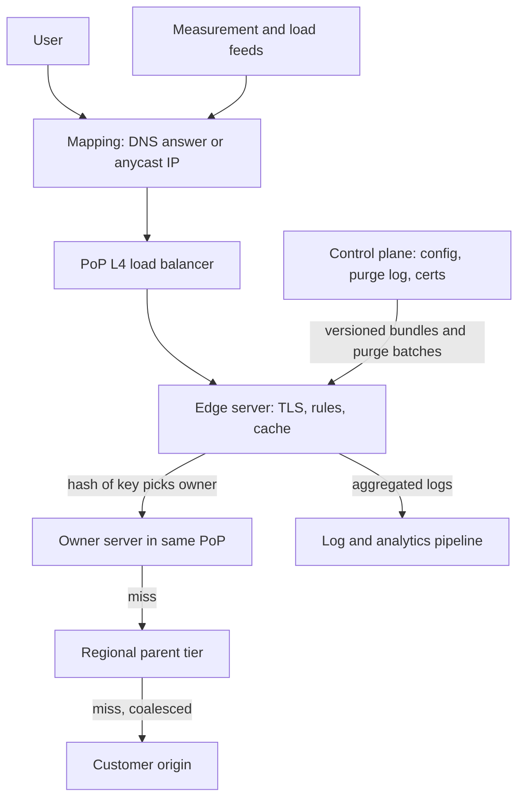
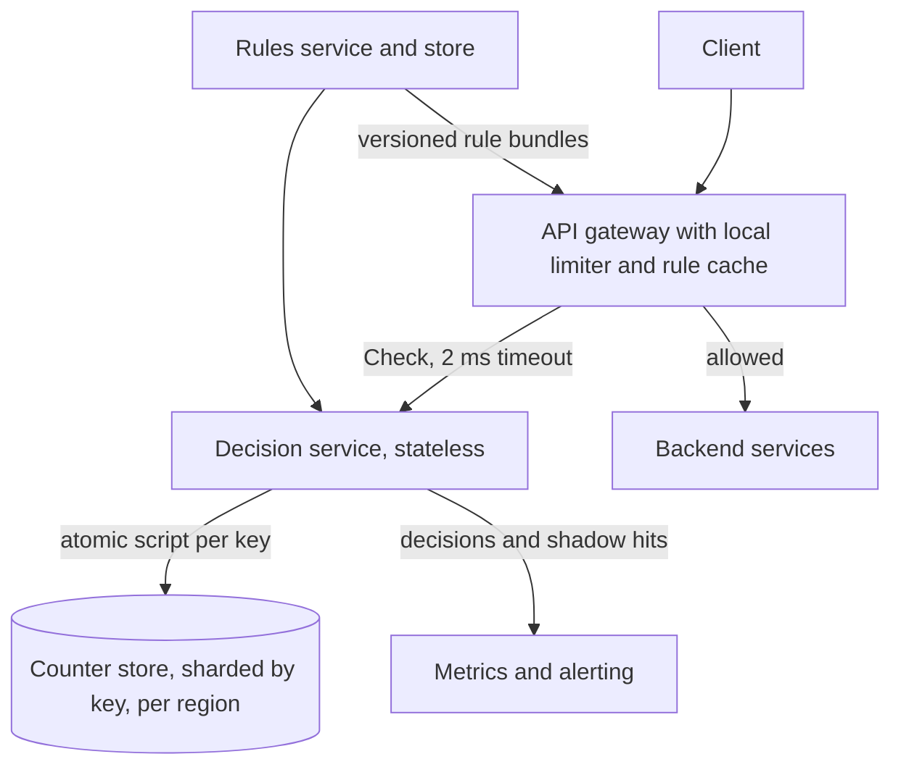
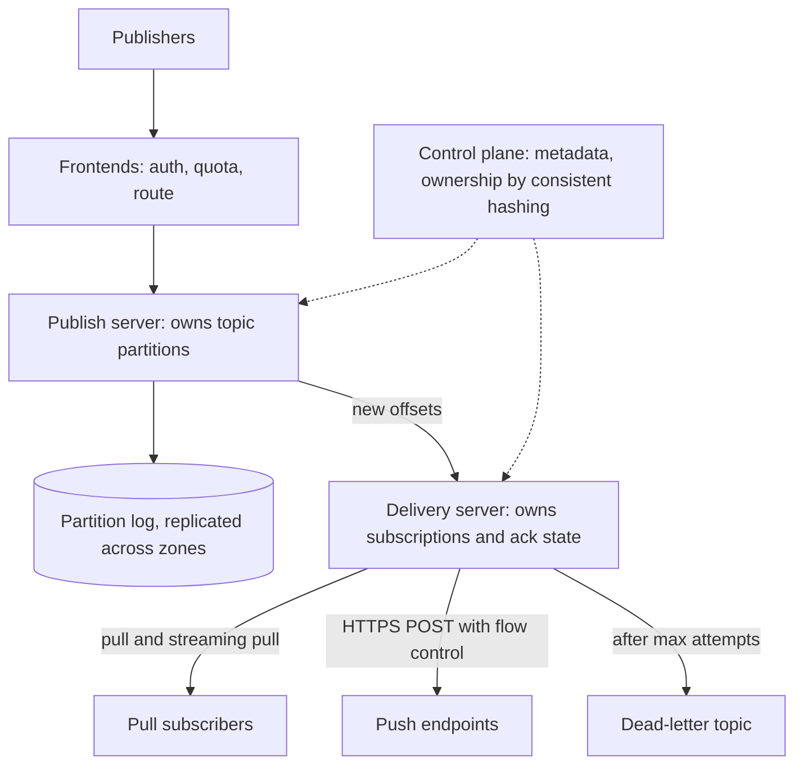

# Module 23 — Case Studies: Edge and Messaging Building Blocks

**What this module is.** Three building blocks Module 13 did not design end to end: a **CDN**, a shared **rate limiter** service and a managed **publish-subscribe** service. The pattern lessons ([CDN](../08-api-and-edge/README.md#cdn), [Rate Limiting](../08-api-and-edge/README.md#rate-limiting), [Publish-Subscribe](../02-moving-data/README.md#publish-subscribe)) are not re-taught; each case asks what changes when you *build and run* the block as a multi-tenant platform. Format as in [Module 13](../13-case-studies-building-blocks/README.md).

---

## Case 1 — Design a CDN

**The prompt (in short).** Build a multi-tenant CDN like Akamai, Cloudflare or CloudFront. Customers point a hostname at it; it serves their static files, video segments and API responses from about 300 sites worldwide, keeps content fresh when they purge, and protects their origins (their own servers).

**What makes it hard.** Caching one file is the [CDN lesson](../08-api-and-edge/README.md#cdn). The platform problems: (1) **routing** each user to a close, healthy, not-overloaded site with only DNS and BGP; (2) **cache efficiency** with finite disk and a long-tailed catalogue; (3) **freshness**: a purge must reach 300 sites in seconds, including ones unreachable when sent; (4) **blast radius**: one bad config push can break every site at once.

### 1. Requirements and numbers
**Functional:** onboard a hostname (origin address, cache rules, TLS certificate); serve `GET`/`HEAD`, including byte ranges; purge by URL, by tag and by prefix; accelerate uncacheable (dynamic) requests; optional edge code; per-customer logs and analytics.

**Non-functional:** time to first byte (TTFB) on a hit under 30 ms for most users; 99.99% availability per hostname; at least 95% of bytes served without touching the origin; purge visible everywhere within ~5 s at p99; never serve one tenant's private response to another user.

**Numbers (assumptions):**
- **300 PoPs** (points of presence: CDN sites, each a rack or more of servers), **50 Tbps peak egress** (terabits per second leaving the CDN), average response **150 KB** → 50 Tbps ÷ 8 = 6.25 TB/s ÷ 150 KB ≈ **40M requests/s**.
- The biggest PoP carries ~2% → **1 Tbps, ~0.8M req/s**. At ~80 Gbps of real throughput per server: 1,000 ÷ 80 ≈ 13 servers, plus spares → **16 servers**.
- Each server holds **30 TB** of cache (SSD for hot objects, HDD for large video). Shared well, the PoP holds **480 TB**; if every server caches independently it holds **30 TB** of distinct content (Deep dive 2).
- Edge byte hit ratio 90% → 5 Tbps go upward. Parent tier hit ratio 80% → **1 Tbps reaches all origins combined**: 98% offload.
- Purges: **2,000 purge requests/s** platform-wide × 300 PoPs = 600K deliveries/s if sent one by one. Batched every 50 ms per PoP: 300 × 20 = **6,000 messages/s**.
- Access logs: 40M req/s × 400 B = 16 GB/s ≈ **1.4 PB/day** → aggregate at the edge and ship samples plus counters.

**What the numbers say:** bandwidth and disk decide the hardware, hit ratio the origin bill, purge fan-out the control plane.

### 2. The five-questions pass
- **Flow:** user → nearest PoP (DNS or anycast) → edge server → (miss) parent tier → (miss) origin; purges and config flow from a central control plane to every PoP.
- **Storage:** edge disks hold *disposable copies*; the origin is the source of truth. The control plane owns two durable things: customer config and the purge log.
- **Speed:** the hit path stays inside one PoP, with no cross-PoP or central lookups.
- **Failure:** servers, PoPs, parents and origins all fail; each failure should lower hit ratio or add latency, never return errors (stale content is acceptable).
- **Growth:** add servers to a PoP and PoPs to the map; the mapping system and consistent hashing absorb both.

### 3. API
| Plane | Call | Purpose |
|---|---|---|
| Control | `PUT /v1/properties/{host}` `{origin, rules[], tls_cert_id, version}` | Create or change a property (one customer hostname); returns a new config version |
| Control | `POST /v1/purge` `{host, urls[] \| tags[] \| prefixes[], mode: hard\|soft}` → `{purge_id, seq}` | Invalidate content; `soft` marks it stale instead of deleting it |
| Control | `GET /v1/purge/{purge_id}` → `{pops_done, pops_total}` | Lets customers see propagation |
| Data | `GET /path` with `Range`, `If-None-Match` | The cached request itself |
| Origin → CDN | `Cache-Control`, `CDN-Cache-Control` (RFC 9213: a header aimed at CDNs only), `Surrogate-Key: product-42 home` (tags), `Vary` | Origin sets TTL and tags per response |
| CDN → client | `Age`, `Cache-Status` (RFC 9211: standard "hit/miss, and why" header) | Debugging which tier answered |

### 4. Data model
- **Property config** (control plane, versioned): `host → {origin, rules, cert, version}`; compiled and shipped to every PoP as an immutable bundle.
- **Cache index** (per server, RAM): `hash(cache_key) → {disk_location, size, expires_at, etag, tags[], stored_at, purge_seq_at_store}`. The **cache key** = scheme + host + path + normalised query + the request headers listed in `Vary`.
- **Tag index** (per server): `tag → [key hashes]` so a tag purge is a lookup, not a disk scan.
- **Purge log** (control plane, replicated, append-only): `seq → {host, matcher, mode, created_at}`. Each PoP stores `last_applied_seq`.
- **Mapping table** (mapping system): `client network prefix → ranked PoP list`, recomputed every few seconds from latency measurements and PoP load.

### 5. The architecture, annotated



1. **Mapping** picks a PoP (Deep dive 1); the PoP's **L4 load balancer** spreads connections with consistent hashing ([Maglev](../19-algorithms-deep-dive/README.md#consistent-hashing-variants-jump-rendezvous-maglev-and-bounded-loads)).
2. The **edge server** terminates TLS, applies the property's rules and computes the cache key; if another server in the PoP *owns* the key, it fetches from the owner (Deep dive 2).
3. On a PoP miss the owner asks the **parent tier** (a few large regional PoPs, the origin shield), which merges identical concurrent misses into one origin fetch (**request coalescing**, the global form of [stampede prevention](../04-caching/README.md#cache-stampede-prevention)).
4. The **control plane** ships config as versioned bundles and purges as batched log entries (Deep dive 3); edges ship pre-aggregated logs plus sampled raw lines.

### 6. Deep dives

**Deep dive 1 — request routing: DNS mapping, anycast and client steering.**

| Method | How the PoP is chosen | Strength | Weakness |
|---|---|---|---|
| **DNS mapping** (Akamai style) | The CDN's authoritative DNS returns the best PoP's IP for the resolver, or for the user's subnet via [EDNS Client Subnet](../00-system-design-fundamentals/README.md#dns--the-internets-phone-book) (RFC 7871) | Live load and latency data; drains a PoP by changing answers | Answers cached for the DNS TTL (20–60 s); without ECS sees the resolver, not the user |
| **Anycast** (Cloudflare style) | Every PoP announces the same IP prefix over BGP (the internet's routing protocol); routing policy delivers to the "nearest" | Simple, instant failover (withdraw the route), spreads DDoS floods over all PoPs | BGP knows neither load nor latency; Microsoft measured anycast sending ~20% of Bing clients to a suboptimal front-end |
| **Client/URL steering** (Netflix Open Connect) | A steering service returns ranked URLs of specific servers in the playback response | Per-file, per-server precision (knows which server *has* the file) | Needs your own client or manifest; only for apps you control |

*Combined answer:* anycast for DNS servers and small objects (robust, DDoS-friendly); DNS mapping with ECS to steer bulk traffic by load; URL steering for video. The mapping system feeds on PoP-to-prefix latency probes, real-user measurements (RUM) and PoP spare capacity, and rebalances some prefixes at a time, never all at once.

**Deep dive 2 — making 16 disks act like one cache, then adding tiers.**
- *Problem and fix:* if every server caches what it sees, a popular object sits on all 16 and the PoP holds only 30 TB of distinct content. Hash the cache key onto a ring of the PoP's servers (consistent hashing, invented by Karger et al. in 1997 for exactly this) so each key has one **owner**: 16 × 30 = **480 TB** distinct, and losing a server remaps only its 1/16 of keys.
- *Hot objects:* a viral file would overload its one owner, so count requests per key (a [heavy-hitters sketch](../19-algorithms-deep-dive/README.md#heavy-hitters-misra-gries-space-saving-and-streaming-top-k)) and let *every* server copy the top few thousand keys.
- *Admission and eviction:* many objects are requested only once ("one-hit wonders"): admit to disk only on the second request, and evict with a frequency-aware policy (S4LRU, TinyLFU: [Cache eviction beyond LRU](../19-algorithms-deep-dive/README.md#cache-eviction-beyond-lru)). Facebook's photo-serving study found a larger cache and S4LRU noticeably raised edge hit ratio.
- *Tiers:* in the same study browser caches served 65.5% of requests, edge 20.0%, origin cache 4.6%, backend 9.9%. Two CDN tiers (edge + regional parent) are the usual sweet spot; a third adds miss latency without many hits.
- *Placement:* PoPs in internet exchange points (IXPs) reach many ISPs at once; **embedded** caches inside ISPs (Netflix Open Connect) get closer, and Netflix fills them **proactively** off-peak because viewing is predictable: a **push** CDN, where the unpredictable web is **pull** ([pull vs push](../00-system-design-fundamentals/README.md#cdns-and-anycast)).

**Deep dive 3 — freshness: TTLs, leases, and a purge system that cannot forget.**
- **TTL + revalidation** (the default): serve while fresh, then send `If-None-Match` and accept a cheap `304`. Staleness is bounded by the TTL; nothing needs coordinating.
- **Polling**: edges periodically ask the origin "changed?"; simple, but load grows with edges × objects.
- **Leases** (Gray & Cheriton, 1989): the parent promises to notify a child of changes for the lease duration, so invalidations go only to lease holders; a child that loses contact lets the lease expire and revalidates. Bounded staleness without a broadcast ([Leases](../19-algorithms-deep-dive/README.md#leases-and-lease-based-leader-election)).
- **Push purge** (what customers expect, "gone in seconds"): the control plane appends to the **purge log**, and a fan-out tree pushes batches to all PoPs. Fastly and Cloudflare both report global purges completing in around 150 ms (Cloudflare: under 150 ms at p50 for tag, hostname and prefix purges).

The hard part is a PoP partitioned while purges were sent: every PoP applies purges in `seq` order, reports `last_applied_seq`, and on reconnect pulls the gap from the log; if its lag exceeds a bound (say 30 s), the mapping system takes it out of rotation until it catches up.

Purge mechanics per server: URL purge is one index delete; tag purge uses the tag index; prefix purge or "purge everything" bumps a **generation number** in the cache key (`v7` → `v8`), O(1), leaving old entries to age out. **Soft purge** marks entries stale: the next request revalidates while others still get the stale copy, so the origin sees no stampede. For assets, prefer fingerprinted URLs and skip purging ([Fingerprinted URLs vs purging](../08-api-and-edge/README.md#fingerprinted-urls-vs-purging)).

**Deep dive 4 — dynamic content and edge compute.**
- Uncacheable responses still gain: TLS ends ~15 ms away instead of ~200 ms, the edge keeps **warm connections** to the origin, and **overlay routing** (Akamai) forwards through intermediate PoPs when the default path is slow or lossy.
- **Microcaching:** cache "uncacheable" shared responses (a scoreboard, a stock page) for 1 s: at 5,000 req/s for one URL, the origin sees 1 req/s per PoP.
- **Edge compute:** customer code for auth checks, redirects, A/B bucketing and personalising a cached page. Cloudflare Workers run in V8 isolates (sandboxes inside one process), which Cloudflare's docs say start ~100× faster than a Node process in a container. State needs an eventually consistent edge KV store or a call back to a region.

**Deep dive 5 — large files and evaluation.**
- **Video and large downloads:** cache in fixed **slices** (e.g. 2 MB byte ranges), so a 4 GB file's popular first minutes are cached alone and a `Range` request needs only the slices it covers. Video design: [Case 3 — Video Platform](../14-case-studies-messaging-and-media/README.md#case-3--video-platform-youtube-like).
- **How you know it works:** request hit ratio *and* byte hit ratio (they differ: small objects dominate requests, video dominates bytes), origin offload per customer, TTFB p50/p95 by country from RUM, purge latency p99, PoP lag, and cost per GB delivered.

### 7. The failure walk
1. **A cache server dies:** health checks remove it in seconds; its keys move to ring neighbours and hit ratio dips ~1/16 while they refill from the parent.
2. **A whole PoP fails:** anycast withdraws its route and DNS mapping stops returning it; neighbours absorb the traffic, so plan **N+1 headroom per region** (a PoP runs at most ~70% of capacity at peak).
3. **The parent tier is down:** edges go straight to the origin (configured fallback); origin load jumps, so the origin shield should be two PoPs, not one.
4. **The origin is down:** serve stale via `stale-if-error` ([Graceful Degradation](../05-reliability/README.md#graceful-degradation)); for uncacheable requests return the customer's error page from the edge.
5. **Purge channel partitioned:** the lag rule (Deep dive 3) takes the PoP out of rotation: better 20 ms further away than recalled content.
6. **Bad global config push:** the classic CDN outage. In June 2021 a valid customer config triggered a latent Fastly bug and **85% of its network returned errors**; in July 2019 a globally pushed WAF regex rule exhausted Cloudflare's CPUs ([Module 26](../26-postmortems-when-systems-fail/README.md#2019--cloudflare-waf-regex-outage)). Defences: validate bundles, canary PoPs then regions ([Canary Deployment](../09-operating-in-production/README.md#canary-deployment)), one-command rollback, and per-tenant config isolation so one property's bug cannot crash the server process.
7. **Viral object / flash crowd:** coalescing at edge and parent plus hot-key replication (Deep dive 2).
8. **Cache poisoning:** an attacker sends a header the origin uses but the cache key ignores (an "unkeyed" header), so a bad response is cached for everyone. Defence: key on every header the origin varies on, strip the rest.
9. **DDoS:** anycast spreads the flood over 300 PoPs; per-IP rate limits and challenge pages at the edge ([Case 2](#case-2--design-a-rate-limiter)) drop it before the cache.

### 8. Trade-offs

| Decision | Chosen | Alternative | Why |
|---|---|---|---|
| Routing | Anycast + DNS mapping (+ URL steering for video) | One method only | Each fixes another's blind spot: resilience vs load-awareness vs per-file precision |
| In-PoP placement | Hash key to an owner + replicate hot keys | Every server caches independently | 16× more distinct capacity; hot keys still spread |
| Tiers | Edge + regional parent | Edge only / three tiers | Parent coalesces misses; a third tier adds little hit ratio |
| Freshness | TTL + revalidation; push purge via a sequenced log | Polling, or purge-by-broadcast without sequence | Bounded staleness with no coordination on the hit path; the sequence catches PoPs that missed messages |
| Broad purge | Generation number in key | Scan and delete | O(1); old entries expire naturally |
| Fill | Pull for web; proactive push for predictable video | Pull everywhere | Predictable demand lets you use off-peak bandwidth |
| Config rollout | Staged by PoP group | Global instant push | Limits the blast radius of one bad bundle |

### 9. The follow-up questions
- **"How do you serve HTTPS for millions of customer hostnames?"** TLS SNI (the client names the hostname in the handshake) selects the certificate, fetched lazily and cached per PoP. Private keys can stay in a few hardened locations that sign handshakes for the edges (Cloudflare's Keyless SSL). *Trap:* copying every private key to every PoP without discussing the risk.
- **"Private or paid content?"** **Signed URLs or cookies**: the origin signs `(path, expiry, user)` with a key the edge can verify, so cached bytes go only to holders of a valid signature while staying shared-cacheable.
- **"Multi-CDN?"** A DNS or client-side steering layer splits traffic across providers by measured performance and cost; purges go to all, and cache-key rules must match.
- **"Live video?"** Tiny, short-lived segments: coalescing at every tier matters more than disk ([Live Streaming](../14-case-studies-messaging-and-media/README.md#case-5--live-streaming)).
- **"What hit ratio do you need?"** Work back from origin capacity: if origins can take 1 Tbps and peak is 50 Tbps, combined offload must be ≥ 98%, which is where the two-tier hierarchy comes from.

**Interview one-liner:** "Route with anycast plus load-aware DNS; inside each PoP, hash keys to one owner server and replicate only hot keys; put a regional parent tier in front of origins that coalesces misses; keep content fresh with TTLs and revalidation, and run purges as a sequenced log that every PoP must keep up with or be taken out of rotation; roll config out in stages."

### TL;DR
- **Problem:** 40M req/s and 50 Tbps from 300 PoPs, with 98% origin offload and purges in seconds.
- **Price:** a global control plane whose mistakes are global, large spare capacity per region, and staleness that you bound but never fully remove.

**Sources**
- Nygren, Sitaraman, Sun, *The Akamai Network: A Platform for High-Performance Internet Applications*, ACM SIGOPS OSR 44(3), 2010: https://pdos.csail.mit.edu/6.824/papers/akamai.pdf
- Karger et al., *Consistent Hashing and Random Trees: Distributed Caching Protocols for Relieving Hot Spots on the World Wide Web*, STOC 1997: https://cs.brown.edu/courses/csci2950-u/f09/papers/chash97stoc.pdf
- Huang et al., *An Analysis of Facebook Photo Caching*, SOSP 2013: https://www.cs.princeton.edu/~wlloyd/papers/fb-photo-caching-sosp13.pdf
- Calder et al., *Analyzing the Performance of an Anycast CDN*, IMC 2015: https://courses.cs.duke.edu/fall19/compsci514/papers/anycast-imc15.pdf
- Gray and Cheriton, *Leases: An Efficient Fault-Tolerant Mechanism for Distributed File Cache Consistency*, SOSP 1989: https://pages.cs.wisc.edu/~remzi/Classes/739/Fall2015/Papers/leases89.pdf
- Netflix, *Open Connect Overview*: https://openconnect.netflix.com/Open-Connect-Overview.pdf
- RFC 7871 (EDNS Client Subnet): https://www.rfc-editor.org/rfc/rfc7871 · RFC 5861 (stale-while-revalidate/stale-if-error): https://www.rfc-editor.org/rfc/rfc5861 · RFC 9211 (Cache-Status): https://www.rfc-editor.org/rfc/rfc9211 · RFC 9213 (Targeted Cache-Control): https://www.rfc-editor.org/rfc/rfc9213
- Cloudflare, *Instant Purge: invalidating cached content in under 150ms* (2024): https://blog.cloudflare.com/instant-purge/
- Fastly, *Is purging still the hardest problem in computer science?* (purge in ~150 ms): https://www.fastly.com/blog/is-purging-still-the-hardest-problem-in-computer-science · Fastly docs, *Working with surrogate keys*: https://www.fastly.com/documentation/guides/full-site-delivery/purging/working-with-surrogate-keys/
- AWS, *Use Amazon CloudFront Origin Shield*: https://docs.aws.amazon.com/AmazonCloudFront/latest/DeveloperGuide/origin-shield.html
- Cloudflare Workers docs, *How Workers works*: https://developers.cloudflare.com/workers/reference/how-workers-works/
- Fastly, *Summary of June 8 outage* (2021): https://www.fastly.com/blog/summary-of-june-8-outage · Cloudflare, *Details of the Cloudflare outage on July 2, 2019*: https://blog.cloudflare.com/details-of-the-cloudflare-outage-on-july-2-2019/

---

## Case 2 — Design a Rate Limiter

**The prompt (in short).** One rate-limiting service that every API gateway calls. Teams declare rules ("100 requests/s per API key on `/search`", "5 logins/min per account", "20,000 req/s total to the payments backend"); the service answers "allow or reject" per request in under a millisecond, across three regions.

**What makes it hard.** The algorithms and the `429`/`Retry-After` contract are in the [Rate Limiting lesson](../08-api-and-edge/README.md#rate-limiting). As a shared service the hard parts are (1) **races** between hundreds of gateways on one counter, (2) **latency vs accuracy** (a remote counter costs a hop per request), (3) **multi-region** limits with 70 ms between regions, and (4) **safe rules** (one bad rule can reject all traffic).

### 1. Requirements and numbers
**Functional:** CRUD on rules; per request, evaluate and consume from all matching rules; actions `reject`, `shadow` (log only) or `delay`; return remaining budget and reset time; per-key concurrency limits (requests in flight).

**Non-functional:** added p99 < 1 ms in-region; the limiter's failure must not take the API down (fail open by default, closed for security rules such as login); counts within ~5–10% for protection rules; rule changes live within 10 s.

**Numbers (assumptions):**
- **3M requests/s** peak across 3 regions, average **3 rules matched** per request → **9M counter operations/s**.
- **60M active keys** (API keys, users, IPs) × 3 rules × ~64 B of state ≈ **11.5 GB**: fits in memory on a small cluster.
- At a conservative **100K scripted operations/s per in-memory store node**, direct counting needs **90 primary nodes** (30 per region). Local pre-allocation (Deep dive 3) cuts this by 10× or more.
- Rules: ~10K, a few MB, changing a few times a minute.

**What the numbers say:** memory is trivial; **ops/s and the extra hop** decide the design.

### 2. The five-questions pass
- **Flow:** synchronous on the request path (gateway → limiter → counter store), bounded by a ~2–5 ms timeout and a local fallback.
- **Storage:** counters are **soft state** (rebuildable; losing them means a few seconds of looser limits); rules are durable config.
- **Speed:** one round trip to an in-region store; check and update in one atomic step.
- **Failure:** the limiter is protection, not correctness: when unsure, allow (except security rules) and log.
- **Growth:** shard counters by key ([consistent hashing](../03-storing-data/README.md#consistent-hashing)); hot keys get local pre-allocation.

### 3. API
| Call | Shape | Notes |
|---|---|---|
| Rules | `PUT /v1/rules/{id}` `{match: {route, key_type}, algo: gcra, rate: 100/s, burst: 200, action: reject\|shadow, fail_mode: open\|closed}` | Versioned; validated before going live |
| Decision (gRPC) | `Check({domain, descriptors: [{api_key: k1}, {route: /search}], cost: 1})` → `{allow, limit, remaining, reset_after_ms, matched_rule}` | Same shape as Envoy's global rate-limit service: a request carries descriptor key/value pairs, and rules match on them |
| Client response | `429 Too Many Requests`, `Retry-After: 3`, `RateLimit-Policy` / `RateLimit` headers | 429 and Retry-After from RFC 6585; the two `RateLimit*` fields are an IETF draft |

### 4. Data model
- **Rule**: `{id, domain, match, algorithm, rate, period, burst, cost_field, action, fail_mode, version}`.
- **Counter key**: `rl:{rule_id}:{descriptor_value}`, e.g. `rl:search-per-key:k1`. All of one key's state lives on one shard.
- **State per key** depends on the algorithm:

| Algorithm | Stored per key | Size |
|---|---|---|
| Fixed window | count, window id | 1 number + TTL |
| Sliding-window counter | previous count, current count | 2 numbers |
| Token bucket | tokens, last refill time | 2 numbers |
| **GCRA** | **TAT** (theoretical arrival time) | **1 timestamp** |

### 5. The architecture, annotated



1. The gateway matches the request against its **cached rules** (no remote call) and builds descriptors; hot-key and per-instance rules are decided **locally** (Deep dive 3).
2. Other rules go to the stateless **decision service** (or the same code as an embedded library), which runs one **atomic script** per key on the owning shard of the in-region **counter store**.
3. Rejections get `429` with headers; every decision, including shadow "would have rejected", becomes a metric.
4. The **rules service** validates, versions and distributes rule bundles; gateways swap them atomically.

### 6. Deep dives

**Deep dive 1 — GCRA: a token bucket that stores one number.**
- *Idea:* the **generic cell rate algorithm** (from ATM networks) keeps only the **TAT**, the time the key would next be "on schedule". **Emission interval** `T = period / rate`; **burst tolerance** `τ = T × (burst − 1)`.
- *Example:* rate 10/s, burst 5 → T = 100 ms, τ = 400 ms. Key idle, TAT = now = 0. Five requests arrive at t = 0: each sets TAT = max(TAT, now) + T → 100, 200, 300, 400, 500 ms. A request is allowed if `TAT − τ ≤ now`, checked before the update. For the fifth, 400 − 400 = 0 ≤ 0, so it is allowed. For the sixth, 500 − 400 = 100 ms > 0 → reject with `Retry-After = 100 ms`. At t = 100 ms one more request fits; the long-run rate is 10/s.
- *Why:* token-bucket behaviour, one value per key, and `Retry-After` for free. Let's Encrypt rebuilt its rate limits on Redis with GCRA in 2025.

```
function check(key, now, T, tau, cost):
    tat = store.get(key) or now
    new_tat = max(tat, now) + T * cost
    if new_tat - tau > now + T:          # beyond allowed burst
        return REJECT, retry_after = new_tat - tau - T - now
    store.set(key, new_tat, expire_at = new_tat)
    return ALLOW
```
(Runs as one server-side script, so no other request can interleave.)

**Deep dive 2 — races and clocks.**
- *Race:* gateways A and B both read `tokens = 1`, both allow, both write `0`: two requests on one token, a systematic overshoot under load.
- *Fix:* read, decide and write **inside the store** as one atomic step: a server-side script (Lua in Redis), or one atomic command such as `INCR` for fixed windows. GitHub's API limiter works this way (sharded Redis, Lua scripts, writes to primaries).
- *Clocks:* use **one clock**, the store's (`TIME` inside the script); GitHub saw `X-RateLimit-Reset` wobble by a second when reset time was partly computed in the app.
- *Own cluster:* GitHub left Memcached partly because other data **evicted live counters**, letting users exceed limits.

**Deep dive 3 — local vs global: buying latency with bounded error.**

| Strategy | Hop per request | Accuracy | Use for |
|---|---|---|---|
| Central counter (every check remote) | 1 (~0.5 ms) | Exact | Login, low-rate security rules |
| Static split: each of N gateways enforces limit/N | 0 | Wrong when traffic is uneven across gateways | Only with very even load balancing |
| **Token leasing**: a gateway takes a batch (say 10% of a key's budget) from the store and spends it locally | 1 per batch | Over-admits by at most the unspent leases | Hot keys, high-rate rules |
| Local count + periodic sync (every 100 ms) | 0 | Overshoot ≤ gateways × rate × sync interval | Edge/DDoS rules, per-PoP limits |

*Worked bound:* 50 gateways, a key limited to 1,000 req/s, sync every 100 ms: each may admit up to 100 before learning the global count, so up to 50 × 100 = **5,000 extra requests** per interval. Too loose; leasing (10 leases of 100 tokens) bounds the error to outstanding leases. Cloudflare's edge limiter counts per PoP in a memcache cluster (anycast keeps a client on one PoP); over 400M requests its two-window approximation wrongly allowed or blocked **0.003%**.

**Deep dive 4 — multi-region.**
- **Per-region budgets** (default; [Multi-Region](../06-scaling/README.md#multi-region-and-cell-based-architecture)): split each global limit by regional traffic share (e.g. 50/30/20%), re-weighted every minute; no cross-region hop, error from re-weighting lag.
- **Asynchronously replicated counts:** each region counts locally, gossips its count and enforces against the sum, a grow-only counter per region ([Distributed Counter](../16-case-studies-infrastructure/README.md#design-4--distributed-counter-likes-and-views-at-scale)). Overshoot ≤ replication lag × rate.
- **Synchronous global counter:** ~70 ms per request; only for rare, critical limits (a daily quota checked once per job, not per request).
- Billing quotas are a different system: exact, durable, reconciled from logs, never from limiter counters.

**Deep dive 5 — rules as dangerous config.**
- Validate (no rule may match `*` with a rate below current traffic unless forced), then **shadow mode** first: the rule only logs what it would reject (Envoy's per-rule `shadow_mode`; Stripe advises dark-launching every limiter). Then roll out by region with a kill switch ([Feature Flags](../09-operating-in-production/README.md#feature-flags)).
- Stripe runs four layers: request-rate limiter, concurrent-requests limiter, fleet-usage load shedder and worker-utilisation shedder; the last two are [load shedding](../00-system-design-fundamentals/README.md#load-shedding-and-graceful-degradation).

### 7. The failure walk
1. **A counter shard dies:** its replica is promoted; meanwhile checks for its keys time out (2 ms) and **fail open** to a local bucket at limit/N, so limits loosen, never tighten. Security rules fail closed.
2. **The decision service is slow:** the gateway timeout and a [circuit breaker](../05-reliability/README.md#circuit-breaker) switch to local-only mode and alert; the limiter must never add 100 ms to every request.
3. **A bad rule rejects 40% of traffic:** caught in shadow mode or the canary region; otherwise kill switch and roll back to the previous bundle.
4. **Hot key** (one tenant at 200K req/s on one shard): token leasing turns 200K ops/s into ~2K batch fetches/s.
5. **Region failover:** per-region budgets must re-weight, or surviving regions reject legitimate traffic.
6. **Retry storm after 429s:** `Retry-After` with jitter, and SDKs that obey it ([Retry with Exponential Backoff](../05-reliability/README.md#retry-with-exponential-backoff)).
7. **Shared IPs (NAT):** IP-keyed rules only as a generous backstop; key on API key or account first.

### 8. Trade-offs

| Decision | Chosen | Alternative | Why |
|---|---|---|---|
| Algorithm | GCRA / token bucket | Fixed or sliding window | Allows honest bursts; one value per key; Retry-After for free |
| Atomicity | Script inside the store | Read-then-write from the gateway | Removes the race without distributed locks |
| Placement | Hybrid: local + leased + central by rule | All central | Hot keys and latency; central kept for exact security rules |
| Multi-region | Per-region budgets, re-weighted | Global synchronous counter | Avoids 70 ms per request; error is bounded |
| Failure mode | Fail open (closed for security rules) | Always closed | The limiter must never be the outage |
| Rule rollout | Shadow → canary region → global | Direct apply | One rule can reject everyone |

### 9. The follow-up questions
- **"Concurrency limits instead of rate?"** An in-flight counter (increment at start, decrement at end) plus a TTL'd lease per request so a crashed gateway's slots expire; protects slow endpoints where rate alone misses the cost.
- **"Charge expensive calls more?"** Pass `cost` (for example 10 for search, 1 for reads); GCRA multiplies T by cost.
- **"Adaptive limits?"** Lower limits automatically as backend latency or errors rise (AIMD: add a little while healthy, halve under stress): load shedding driven by health rather than identity.
- **"Detect abusive IPs among millions without a counter each?"** A [count-min sketch](../19-algorithms-deep-dive/README.md#count-min-sketch-with-conservative-update) at the edge finds heavy hitters; only they get exact counters.
- **"How do you test it?"** Replay production traffic in shadow mode and compare per-rule would-reject rates with expectations before enforcing.

**Interview one-liner:** "Rules are versioned config cached in every gateway; each check runs as one atomic script on the shard that owns the key, using GCRA so the state is one timestamp; hot keys lease tokens in batches; regions enforce re-weighted local budgets; the limiter fails open except for security rules, and every rule ships in shadow mode first."

### TL;DR
- **Problem:** 9M checks/s, < 1 ms, many gateways, three regions, rules written by many teams.
- **Price:** limits are approximate by design, and one more critical dependency must fail open.

**Sources**
- Stripe Engineering, *Scaling your API with rate limiters*: https://stripe.com/blog/rate-limiters
- Cloudflare, *How we built rate limiting capable of scaling to millions of domains*: https://blog.cloudflare.com/counting-things-a-lot-of-different-things/
- GitHub Engineering, *How we scaled the GitHub API with a sharded, replicated rate limiter in Redis* (2021): https://github.blog/engineering/infrastructure/how-we-scaled-github-api-sharded-replicated-rate-limiter-redis/
- Envoy proxy, *ratelimit* service (descriptors, shadow_mode, per-second Redis): https://github.com/envoyproxy/ratelimit
- Let's Encrypt, *Scaling Our Rate Limits to Prepare for a Billion Active Certificates* (2025): https://letsencrypt.org/2025/01/30/scaling-rate-limits/
- Brandur Leach, *Rate Limiting, Cells, and GCRA*: https://brandur.org/rate-limiting
- RFC 6585 (429 Too Many Requests): https://www.rfc-editor.org/rfc/rfc6585 · IETF draft, *RateLimit header fields for HTTP*: https://datatracker.ietf.org/doc/draft-ietf-httpapi-ratelimit-headers/

---

## Case 3 — Design a Pub-Sub Service

**The prompt (in short).** A managed, multi-tenant [publish-subscribe](../02-moving-data/README.md#publish-subscribe) service like Google Cloud Pub/Sub or Amazon SNS. Publishers send messages to a **topic**; each **subscription** on it receives every message by **pull** (consumers ask) or **push** (the service POSTs to an HTTPS endpoint). At-least-once delivery with per-message acks, redelivery, dead-lettering, optional ordering keys, filtering, 7-day retention and replay.

**What makes it hard, and how it differs from [Module 13 Case 4](../13-case-studies-building-blocks/README.md#case-4--design-a-distributed-message-queue).** A Kafka-style log hands consumers an offset; here the **service** tracks every message's ack state per subscription, redelivers individually and pushes to endpoints it does not control. Hard parts: (1) **fan-out** to thousands of subscriptions without thousands of copies; (2) **per-message ack state** at millions of acks/s; (3) **isolation**, so one slow subscriber slows nobody else.

### 1. Requirements and numbers
**Functional:** create topics and subscriptions; publish batches; pull and streaming pull; push to HTTPS endpoints; ack and extend ack deadlines; dead-letter topic after N attempts; attribute filters; ordering keys; retention and **seek** (replay from a time).

**Non-functional:** an acknowledged publish is never lost; publish p99 < 100 ms; delivery p99 < 1 s when consumers keep up; a backlog in one subscription does not affect others; per-region availability 99.95%.

**Numbers (assumptions):**
- **500K publishes/s** average (1.5M peak), **2 KB** average → **1 GB/s** ingest.
- Average fan-out **4 subscriptions** per topic → **2M deliveries/s**, **4 GB/s** egress, and **2M acks/s**.
- Retention 7 days: 1 GB/s × 604,800 s ≈ **605 TB**, × 3 replicas ≈ **1.8 PB**. Messages are stored **once per topic**, not per subscription; otherwise the figure would be ×4.
- 200K topics and 800K subscriptions; the largest topic has **10,000** subscriptions (Google Cloud Pub/Sub's per-topic limit; SNS standard topics allow 12.5M).

**What the numbers say:** storage is moderate. Ack bookkeeping (2M/s) and fan-out isolation decide the design.

### 2. The five-questions pass
- **Flow:** publish is synchronous until durable; delivery is asynchronous, per subscription.
- **Storage:** an append-only **message log per topic partition** (written once), plus **per-subscription ack state** (small, hot, heavily written).
- **Speed:** caught-up consumers are served from memory at the log tail; only replay and backlog reads touch disk.
- **Failure:** at-least-once; duplicates are expected, so consumers must be [idempotent](../05-reliability/README.md#idempotency).
- **Growth:** split hot topics into more partitions ([Partitioned Consumption](../10-batch-and-streaming/README.md#partitioned-consumption)); move subscriptions between delivery servers by [consistent hashing](../03-storing-data/README.md#consistent-hashing).

### 3. API
| Call | Shape |
|---|---|
| `CreateTopic(name, retention?)` | Topic-level retention optional (Google allows up to 31 days) |
| `CreateSubscription(topic, {pull \| push_endpoint}, ack_deadline=10s, filter?, ordering?, dead_letter={topic, max_attempts}, retry={min,max backoff})` | One subscription = one independent copy of the stream |
| `Publish(topic, [{data, attributes, ordering_key?}])` → `[message_id]` | Returns only after a quorum write |
| `Pull(sub, max_messages)` / `StreamingPull(sub)` → `[{ack_id, message, delivery_attempt}]` | `ack_id` identifies one delivery, not the message |
| `Acknowledge(sub, [ack_id])`, `ModifyAckDeadline(sub, [ack_id], seconds)` | Extend while still working on a message |
| `Seek(sub, time \| snapshot)` | Replay: move the subscription's ack state |

Push delivery is a POST of the message to the endpoint; a `2xx` response counts as the ack. The ack deadline is the same idea as the queue's [visibility timeout](../02-moving-data/README.md#message-queue).

### 4. Data model
- **Topic / subscription metadata** (strongly consistent metadata store): names, config, `partition_count`, owners.
- **Message log** per `(topic, partition)`: segment files of `offset → {message_id, publish_time, attributes, data}`, replicated across zones.
- **Ack state** per `(subscription, partition)`:
  - `ack_floor`: every offset below it is acknowledged;
  - an **acked-above-floor set** stored as ranges/bitmap (for example `{1003–1010, 1015}`);
  - an **outstanding lease table**: `ack_id → {offset, deadline, delivery_attempt}`, held in memory and checkpointed.
- **Dead-letter topic**: an ordinary topic; the subscription records `max_attempts`.

Storing ranges instead of one row per ack is what makes 2M acks/s cheap: in-order acks just move `ack_floor`.

### 5. The architecture, annotated



1. Stateless **frontends** authenticate, apply per-tenant quotas and route by `(topic, partition)`.
2. The owning **publish server** appends and replicates the batch, acking the publisher only after a **majority** write (Google's Pub/Sub: ⌈N/2⌉ of N clusters; [Quorum](../07-consistency/README.md#quorum), [Write-Ahead Log](../03-storing-data/README.md#write-ahead-log)).
3. **Delivery servers** read new messages **once** and serve every subscription they own from that copy (Google splits the roles into publishing and subscribing forwarders). They lease or push messages, track acks, redeliver on expiry and move poison messages to the **dead-letter topic** ([DLQ](../05-reliability/README.md#dead-letter-queue)).
4. The **control plane** assigns partitions and subscriptions by consistent hashing and moves them on failure; clients stay connected to the data plane, so control-plane upgrades do not disconnect them.

### 6. Deep dives

**Deep dive 1 — store once, fan out by cursor.**
- *Naive:* one queue per subscription turns one 2 KB publish into 20 MB of writes at 10,000 subscriptions. *Instead:* write once; a subscription is **its ack state over the shared log**, so creating one costs a metadata row, and retention, not acks alone, decides deletion.
- *Large fan-out:* spread a 10,000-subscription topic over many delivery servers, each reading the hot tail into memory once. A new subscription sees only messages published after its creation (Google's "sync point").

**Deep dive 2 — per-message acks, redelivery and dead letters.**
- *Lease:* a delivery assigns `ack_id` and `deadline = now + ack_deadline` (Google: default 10 s, maximum 600 s). Consumers working longer call `ModifyAckDeadline`.
- *Example:* a subscription's partition has offsets 1000–1019 outstanding. Acks arrive for 1000–1002 → `ack_floor = 1003`. Acks for 1005–1010 → stored as the range `{1005–1010}`. 1003 and 1004 expire → redelivered with `delivery_attempt = 2`, after a backoff (Google: configurable, 10 s to 600 s). 1004 fails 5 times → published to the dead-letter topic and acked on the original (Google allows 5–100 attempts). When 1003 is acked, the floor jumps over the range to 1011.
- *At-least-once, and why:* a consumer can finish the work and crash before acking, indistinguishable to the service from no work done. **Exactly-once delivery** (an option in Google's service) only guarantees a confirmed ack is final and the message is not redelivered after it; side effects still need idempotent consumers ([Exactly-Once Semantics](../10-batch-and-streaming/README.md#exactly-once-semantics)).

**Deep dive 3 — push delivery and isolation.**
- Each push subscription has its own **outstanding window** (messages in flight to the endpoint): grow it while the endpoint returns `2xx` quickly, halve it on errors or timeouts (AIMD, as in TCP). A failing endpoint slows only its own subscription ([Backpressure](../10-batch-and-streaming/README.md#backpressure)).
- Own ack state, window and retry timers per subscription form a [bulkhead](../05-reliability/README.md#bulkhead): a 50M-message backlog costs only disk, never other subscriptions' latency.
- **Filters** (on attributes only, fixed at creation in Google's service) are applied at delivery. Non-matching messages are auto-acked, so they never count as backlog.
- Pull vs push: pull lets consumers control their own rate and works behind firewalls; push suits serverless endpoints and webhooks ([Webhooks](../02-moving-data/README.md#webhooks)).

**Deep dive 4 — ordering keys.**
- Messages with the same `ordering_key` hash to the same partition, so the log holds them in publish order.
- Delivery must keep **at most one unacked batch per key** in flight, or a redelivery could overtake a later message. Different keys proceed in parallel, so throughput scales with the number of active keys, not partitions.
- A message that keeps failing **blocks** its key (head-of-line blocking) until acked or dead-lettered: the price of order. Publishers must also stop publishing on a key after a failed publish, or a gap appears.

**Deep dive 5 — retention, replay and storage tiers.**
- Unacked messages are kept for the subscription's retention (Google: 7 days default, 10 min to 31 days); optionally acked ones too, which makes **seek** to a past time possible.
- **Seek(time)** sets `ack_floor` to the first offset at or after `time` and clears the range set. **Snapshots** save a subscription's ack state, so a bad deploy can "re-process from before v2".
- Log segments older than a few hours move to object storage; the delivery path reads the tail from memory or SSD.
- Unused subscriptions expire (Google: 31 days by default) so abandoned ones stop holding retention.

### 7. The failure walk
1. **Publish server dies:** its partitions move to another server, which reads the replicated log tail and fences the old owner with a new **epoch** (a number that rises with each ownership change, so the old owner's writes are rejected). Publishers retry; a retry after an unseen ack can **duplicate a publish**, so the frontend deduplicates on a publisher-supplied ID within a short window.
2. **Delivery server dies:** its subscriptions move; the new owner loads the last ack-state checkpoint, and messages leased since then are redelivered: duplicates, not losses.
3. **A zone is lost:** majority writes mean acked messages survive; ownership moves to the remaining zones.
4. **Consumer outage for 3 days:** the backlog grows on disk only; on return it streams from SSD or object storage under the subscription's flow control, while other subscriptions still read the hot tail from memory.
5. **Poison message:** attempts reach `max_attempts`, then dead-letter. Alert on dead-letter rate, not individual messages.
6. **Hot topic exceeds one partition:** add partitions. Only keyed ordering is affected (a key may hash to a new partition), so drain or pause per key during the split.
7. **Push endpoint returns 500s:** the window shrinks to 1 and backoff grows to its maximum; backlog and oldest-unacked-age alerts go to the subscription owner.

### 8. Trade-offs

| Decision | Chosen | Alternative | Why |
|---|---|---|---|
| Storage | One log per topic + ack state per subscription | A copy per subscription | Fan-out of 10,000 without 10,000× writes |
| Ack tracking | Floor + ranges + leases | One row per message per subscription | 2M acks/s; in-order acks just move a number |
| Guarantee | At-least-once (+ optional confirmed acks) | Exactly-once end to end | The service cannot see consumer side effects |
| Delivery | Pull and push, per-subscription windows | Push only | Pull for heavy consumers, push for serverless; windows isolate failures |
| Ordering | Opt-in per key | Total order per topic | Total order caps throughput at one consumer |
| vs log-based queue (Case 4, Module 13) | Service-managed acks and redelivery | Consumer-managed offsets | Easier for many small consumers; less raw throughput and replay control |

### 9. The follow-up questions
- **"When would you choose Kafka instead?"** Very high throughput with a few consumer groups that process in order, need long replay and can manage offsets. Pub-sub wins for many independent subscribers, per-message retry, push delivery and zero consumer state ([Inside Kafka](../10-batch-and-streaming/README.md#inside-kafka)).
- **"Global topics across regions?"** Publish locally and ack after the in-region quorum; replicate the log asynchronously to subscribers' regions. Ordering then holds per key per region only.
- **"Exactly-once processing for a payment consumer?"** The consumer writes its effect and the message ID in one transaction (an inbox table) and ignores repeats, whatever the broker guarantees.
- **"Notifications to 100M phones?"** That is not a topic with 100M subscriptions; mobile push goes through APNs/FCM fan-out services ([notification capstone](../02-moving-data/README.md#capstone---designing-a-notification-system)).
- **"What do you monitor?"** Per subscription: backlog count, oldest unacked message age, ack rate, dead-letter rate, and push latency.

**Interview one-liner:** "Write each message once to a replicated per-topic partition log and ack after a majority write; model each subscription as ack state over that log (floor, ranges, leases), so fan-out costs no copies; deliver by pull or windowed push with per-subscription isolation; redeliver on lease expiry with backoff and dead-letter after N attempts; ordering keys serialise delivery per key."

### TL;DR
- **Problem:** 1 GB/s in, 4 GB/s out, 2M acks/s, up to 10,000 subscriptions per topic, 7-day replay.
- **Price:** at-least-once with duplicates, head-of-line blocking per ordering key, and the service rather than the consumer owning delivery state.

**Sources**
- Google Cloud, *Pub/Sub architecture overview*: https://docs.cloud.google.com/pubsub/architecture
- Google Cloud, *Subscription properties* (ack deadline, retention, retry, dead-letter, filters, ordering): https://docs.cloud.google.com/pubsub/docs/subscription-properties
- Google Cloud, *Pub/Sub quotas and limits* (10,000 subscriptions per topic, 10 MB messages): https://docs.cloud.google.com/pubsub/quotas
- AWS, *Amazon SNS endpoints and quotas* (12.5M subscriptions per standard topic): https://docs.aws.amazon.com/general/latest/gr/sns.html
- Apache Pulsar docs, *Architecture overview* (stateless brokers, BookKeeper, cursors per subscription): https://pulsar.apache.org/docs/next/concepts-architecture-overview/
- Kreps, Narkhede, Rao, *Kafka: a Distributed Messaging System for Log Processing*, NetDB 2011: https://people.csail.mit.edu/matei/courses/2015/6.S897/readings/kafka.pdf
