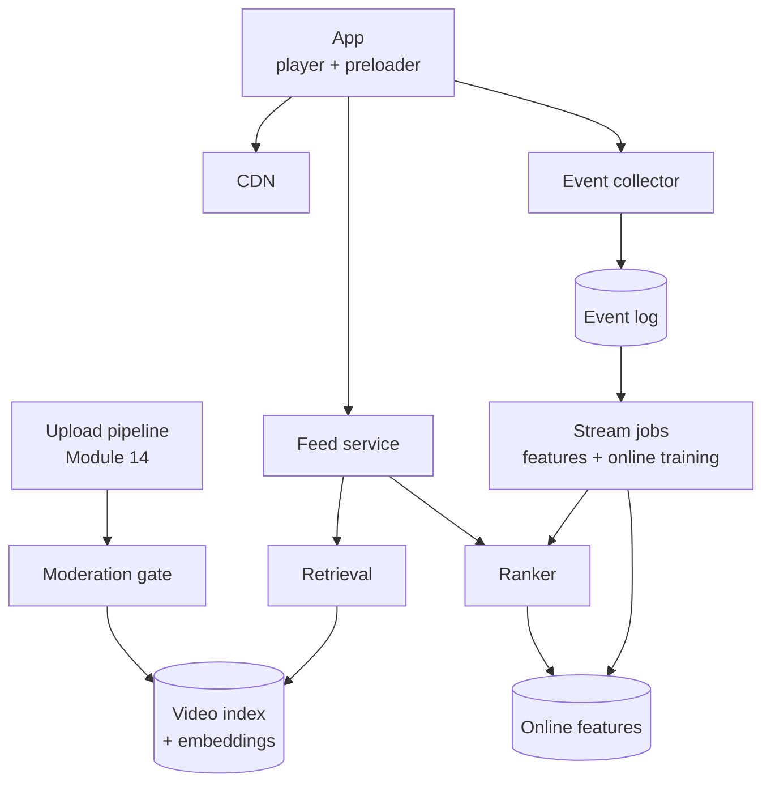
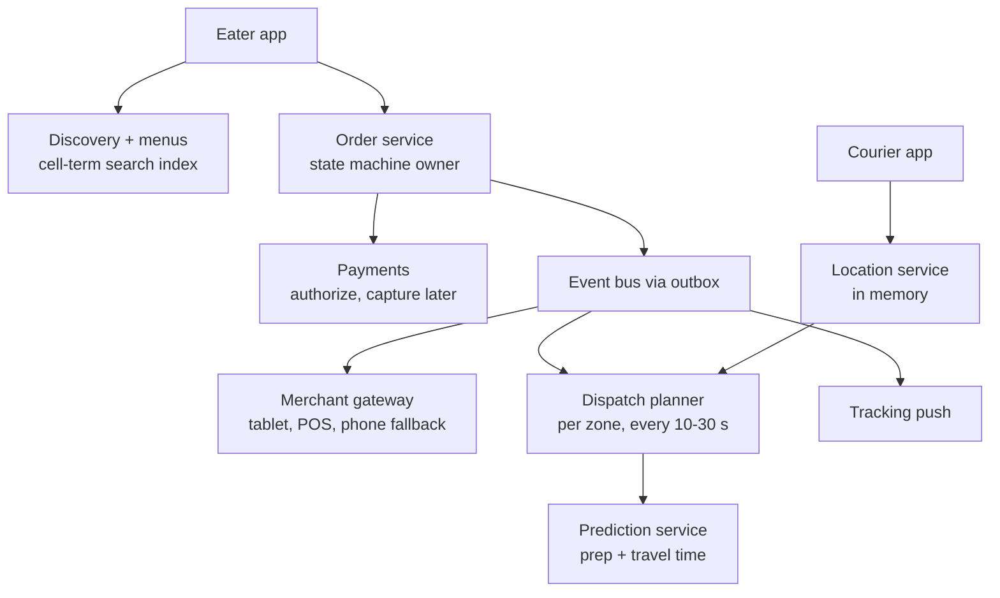
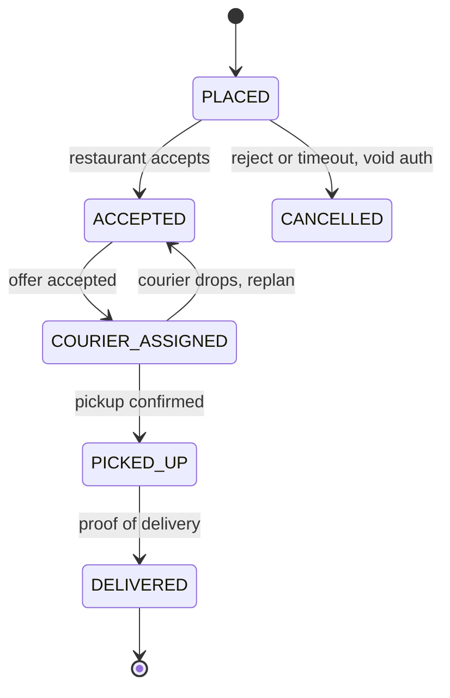
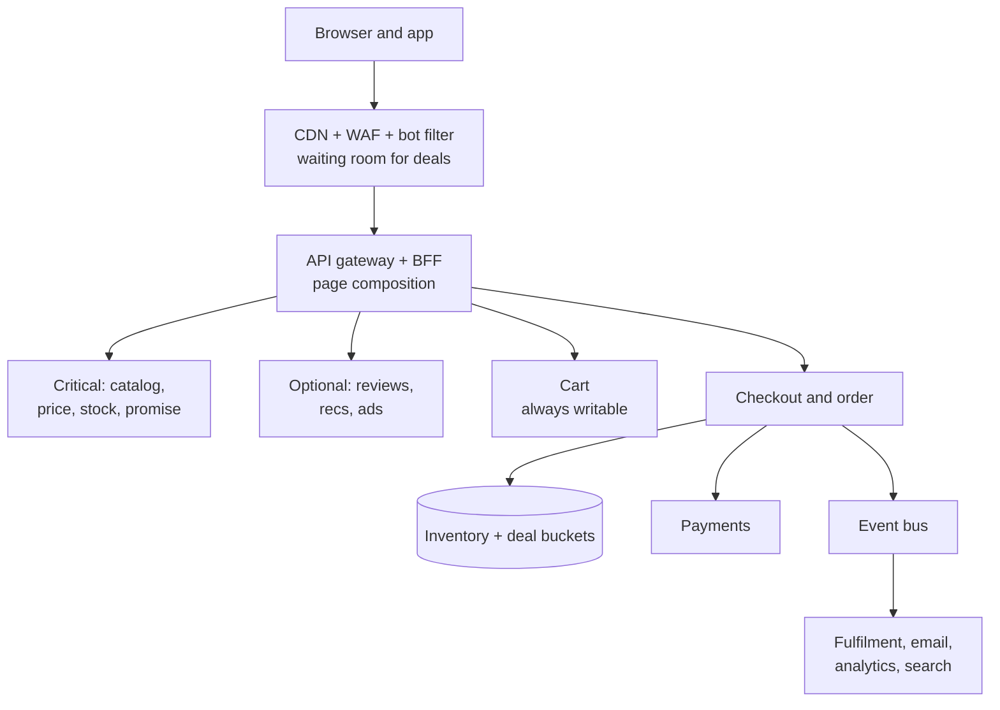
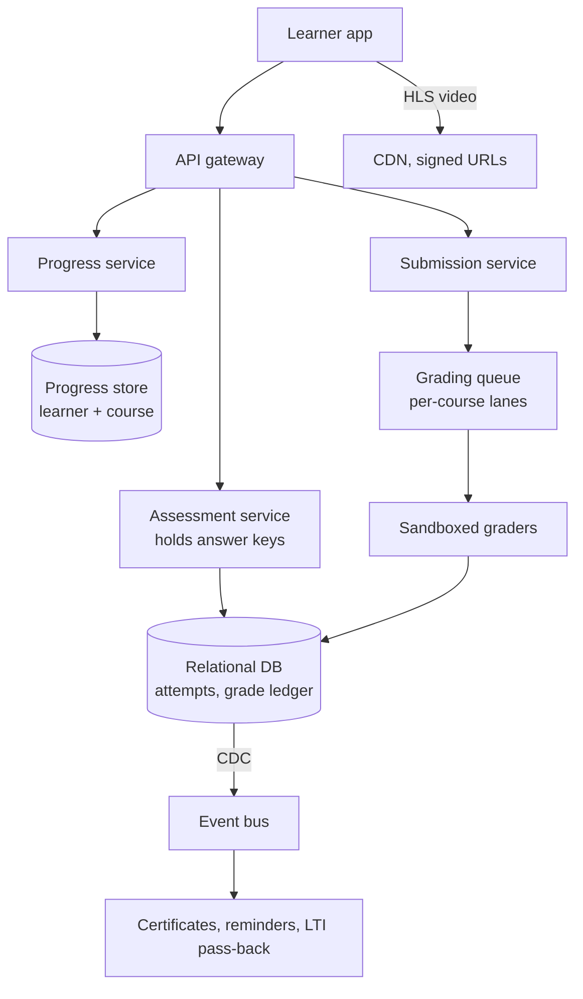
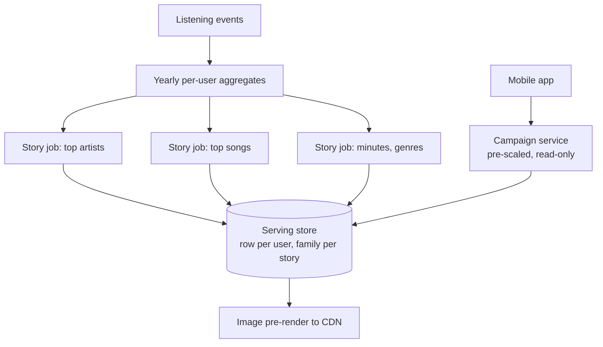
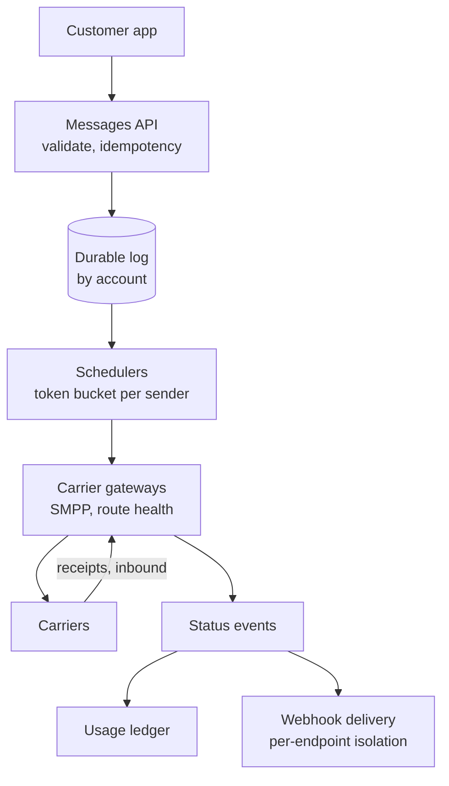

# Module 25 — Case Studies: Commerce, Media and Platforms

Six product designs in the case-study format. The first three expand [question-bank](../22-interview-question-bank/README.md) outlines Q21, Q50 and Q63: a **short-video feed** (a recommender picks every next video, playback starts instantly), a **food-delivery marketplace** (three parties and a prediction of when food is ready) and an **e-commerce platform** at a Prime-Day-style peak. Then online education, Spotify Wrapped and a Twilio-style communications API. Blocks designed earlier (video delivery 14, dispatch 12, geo-indexing 15, flash-sale inventory 17, feed ranking 19) get one sentence and a link. Scale figures are assumptions unless a source is cited.

---

## Case 1 — TikTok-Style Short-Video Feed

**The prompt.** Build TikTok, Reels or Shorts: users upload short vertical videos, and viewers swipe through an endless **For You** feed chosen by a recommender, plus likes, comments, shares and follows.

**What is new here.** Upload, transcoding and CDN are the [Video Platform case](../14-case-studies-messaging-and-media/README.md#case-3--video-platform-youtube-like); the funnel is [Feed ranking](../19-algorithms-deep-dive/README.md#feed-ranking). Specific to short video: (1) **every swipe is a recommendation**, about every 15 s, with no follow list to fall back on; (2) **the next video starts with no visible wait**; (3) **the system learns within minutes** from skips and new videos' performance.

### 1. Requirements and numbers
**Functional:** upload with caption, sound and hashtags; personalised endless feed; engagement actions; watch signals (finished, rewatched, skipped) feed the recommender; moderation before wide reach.
**Non-functional:** swipe-to-first-frame **< ~200 ms at p95**; interests picked up within the session; a new upload reaches first viewers within minutes; a degraded feed is acceptable, an empty one is not.

| Quantity | Assumption → result |
|---|---|
| Views | 600M daily users × 100 videos = **60B/day ≈ 700K/s**, ~1.4M/s peak |
| Feed requests | batches of 10 → **~140K/s peak** |
| Ranking work | ~1,000 candidates per request → **~140M candidate scores/s** at peak: this sizes the ML fleet |
| Events | ~5 per view (impression, play, progress, finish/skip, like) → **~3.5M/s**, needed within minutes |
| Egress | ~30 s watched at ~1.5 Mbps ≈ 5.6 MB per view → 336 PB/day ≈ **31 Tbps average** (336×10¹⁵ B × 8 ÷ 86,400 s) |
| Storage | 30M uploads × (30 MB source + 20 MB renditions) = 1.5 PB/day, **~800 PB/year** with erasure coding (~1.5× overhead) |

**What the numbers say:** the Module 14 CDN design solves bandwidth; the new problems are **ranking compute** and an **event stream that must change the model within minutes**.

### 2. The five-questions pass
| Question | Answer |
|---|---|
| Flow | Upload is asynchronous. The feed is request-response over **precomputed candidate pools, ranked at request time**. Events are client-batched and fire-and-forget into a log |
| Storage | Bytes in object storage; metadata in a sharded key-value store; events in a log and data lake; user/video **features** (numeric model inputs such as "skip rate on cooking videos in the last hour") in a [feature store](../11-ai-era-systems/README.md#feature-store) |
| Speed | Swipe-to-frame is solved on client and CDN (deep dive 3); the feed call hides behind the 3–4 buffered videos |
| Failure | Every ranking stage has a cheaper fallback, ending at regional trending |
| Growth | Retrieval must stay sub-linear in catalogue size, so it uses approximate nearest-neighbour search |

### 3. API
| Endpoint | Purpose |
|---|---|
| `POST /v1/videos` → `{video_id, upload_url}`; `POST /v1/videos/{id}/publish` | Pre-signed direct upload, as in Module 14; publish is idempotent per `video_id` |
| `GET /v1/feed/foryou?cursor=&count=10` | 10 items: `video_id`, manifest URL, cover URL, **`rec_token`** |
| `POST /v1/events` (batched) | `[{rec_token, video_id, type, watch_ms, ts}]` |

The **`rec_token`** names the request, model version and candidate source behind each item, so training can join "what we showed" with "what the viewer did" (deep dive 2).

### 4. Data model
| Store | Key → contents |
|---|---|
| `videos` | `video_id` → author, caption, sound, duration, `status` (processing/limited/public/removed), renditions |
| Event log | topic partitioned by `user_id` (keeps each user's events in order) |
| Online feature store | `user:{id}` → recent-interest vector, short-window skip/finish rates; `video:{id}` → embedding, completion rate last hour |
| Embedding index | one vector per eligible video (an **embedding** is a list of numbers that places users and videos in one space where "close" means "likely to enjoy") |
| `seen` filter | per-user Bloom filter (a compact bit array answering "definitely not seen / probably seen") of recently served IDs |
| Counters | [distributed counters](../16-case-studies-infrastructure/README.md#design-4--distributed-counter-likes-and-views-at-scale) for views and likes |

### 5. The architecture, annotated

Uploads use the Module 14 pipeline with **short segments**; the **moderation gate** sets `limited` (small first audience) or sends to human review, rechecking before large audiences; the stateless **feed service** runs retrieval → ranking → re-ranking; stream jobs turn **events** into features within seconds and model updates within minutes.

### 6. Deep dives

**Deep dive 1 — the funnel tuned for short video** (stages and budgets: [Feed ranking](../19-algorithms-deep-dive/README.md#feed-ranking)):
| Stage | Short-video specifics |
|---|---|
| Retrieval (billions → ~1,000) | Main source is a **two-tower** model (one network embeds the user, one embeds each video) queried with [HNSW](../19-algorithms-deep-dive/README.md#vector-search-with-hnsw-ivf-and-product-quantization); minor sources are followed creators, regional trending, and an **explore slice** of new videos |
| Ranking | Multi-task model predicting **completion, watch time, rewatch, share, follow, skip**. Watch fraction is a dense label (every view has one), while likes are rare. TikTok's 2020 explainer names finishing a longer video as a strong signal |
| Re-ranking (→ 10) | Drop `seen` and removed items; no two in a row from the same creator or sound (also stated by TikTok); cap sensitive categories; keep one exploration slot |

Optimising watch time alone rewards clickbait, so the value score also includes shares, follows and "not interested" taps.

**Deep dive 2 — the minute-level feedback loop.** A nightly model keeps showing cooking videos all evening to someone who skipped three at 7 PM, so two faster loops:
1. **Seconds: real-time features.** Stream jobs over the user-partitioned log keep short-window features (topics skipped in the last 10 min, per-video completion in the last hour), seen by the *next* feed request even with a fixed model.
2. **Minutes: online training** (ByteDance's Monolith, RecSys 2022 workshop). A Flink job joins user actions from one Kafka topic with features logged at serving time from another, producing training examples continuously. **Only embeddings touched since the last sync are pushed to serving every few minutes**, dense layers less often, making minute-level updates of a multi-terabyte model affordable. Memory is bounded by a collisionless (cuckoo-hash) embedding table, frequency filtering (an ID gets a vector only after a few sightings) and expiry of inactive IDs. Training state is snapshotted only **daily**; a lost day is relearned from the stream.

*The join:* a like can arrive minutes after the impression, so the joiner buffers impressions by `rec_token` for a window, emitting positives as actions arrive and a negative when the window closes empty: windowed [stream processing](../10-batch-and-streaming/README.md#stream-processing) with late events.

**Deep dive 3 — instant start is moved before the swipe.** DNS, TLS, the manifest fetch, the first segment and decoder start-up cannot fit in 200 ms once the swipe has happened.
| Technique | Effect |
|---|---|
| Preload manifest + first 1–2 s of the next 2–3 videos; pre-decode the first frame of N+1 | The swipe shows a frame already in memory |
| 1–2 s segments (RFC 8216 calls 10 s "typical" for HLS) | A small first download; adaptive bitrate can step up quickly |
| One warm HTTP/2 or HTTP/3 connection to the edge | No new handshake per video |
| Preload less on cellular data or low battery; cancel when the viewer swipes fast | Limits wasted bytes (10–20% of egress if left unchecked) |
| Edge request coalescing for fresh viral videos | One origin fetch per region for a hot object ([CDN](../08-api-and-edge/README.md#cdn)) |

**Deep dive 4 — cold start by staged exposure** (explore/exploit: spend a little traffic learning about unknowns). A new video gets a few hundred impressions via the explore slot, targeted by content embedding; its completion, rewatch, share and early-skip rates are compared with **similar videos** (length, topic), not raw likes; beating that cohort moves it to a pool 10× larger, and so on, with a second moderation check before very large pools. Follower count is not a direct factor (TikTok), so unknown creators can go viral. New users start from an optional interest picker plus regional popular videos until real-time features take over after a few dozen swipes.

### 7. The failure walk
| Failure | Response |
|---|---|
| Ranker slow or down | 150 ms deadline → light model → cached last pool → regional trending ([Graceful Degradation](../05-reliability/README.md#graceful-degradation)); the 3–4 buffered videos hide short outages |
| Feature store down | Rank with defaults plus the features from the last response |
| Bad model push | Parameters ship as a [canary](../09-operating-in-production/README.md#canary-deployment) with guardrails (watch time per session, skip rate); auto-rollback to the last good snapshot |
| Event pipeline lag | The feed adapts more slowly; shed progress pings before finish/like/follow ([Backpressure](../10-batch-and-streaming/README.md#backpressure)) |
| Harmful video goes viral | `status=removed` is checked on every response from a fast cache, and the CDN URLs are purged; staged exposure limits its reach before the second check |

### 8. Trade-offs
| Decision | Chosen | Alternative | Why |
|---|---|---|---|
| Feed source | Interest graph | Follow graph | Discovery of unknown creators; follow feed remains a tab ([news feed](../12-capstones/README.md#design-1--the-news-feed)) |
| When to rank | Request time over precomputed pools | Fully precomputed feed | Precomputed feeds go stale within a session |
| Model freshness | Minute-level sparse sync | Daily retrain | Trends and interests move in hours |
| Training durability | Daily snapshot | Frequent checkpoints | A lost day is relearned from the stream |
| Start-up | Preload 2–3 videos | Fetch on swipe | Meets 200 ms at the cost of some wasted egress |

### 9. The follow-up questions
- **"Filter bubbles?"** Exploration and diversity slots in re-ranking, per-session caps on one topic, and a long-term metric (7-day return rate) next to watch time.
- **"How do you ship a new model?"** Offline replay on logged data, then an A/B test (a random share of users gets the new model) with guardrails; the online result decides.
- **"Re-uploads of someone else's video?"** Perceptual fingerprints at upload plus [near-duplicate detection](../19-algorithms-deep-dive/README.md#near-duplicate-detection-with-simhash-minhash-and-lsh); serve one copy and credit the original.
- **"The client?"** [Module 18 App 6](../18-client-and-mobile-system-design/README.md#app-6--video-streaming-app): player pool, preload queue, offline event buffer.

**Interview one-liner:** "Reuse the video pipeline and CDN. Run a two-tower ANN retrieval, multi-task ranking and diversity re-ranking per request. Let streamed events update real-time features in seconds and push only touched embeddings to serving every few minutes. Preload the next videos so a swipe never waits, and let new videos earn reach through staged exposure."

**The price:** ~140M candidate scores/s, a 3.5M/s event firehose, ~800 PB/year of mostly cold video, and wasted preload bytes.

**Sources**
- TikTok Newsroom, "How TikTok recommends videos #ForYou" (18 June 2020): https://newsroom.tiktok.com/en-us/how-tiktok-recommends-videos-for-you
- Liu et al. (ByteDance), "Monolith: Real Time Recommendation System With Collisionless Embedding Table", ORSUM @ ACM RecSys 2022: https://arxiv.org/abs/2209.07663
- Covington, Adams, Sargin, "Deep Neural Networks for YouTube Recommendations", ACM RecSys 2016: https://research.google/pubs/deep-neural-networks-for-youtube-recommendations/
- R. Pantos, W. May, RFC 8216 "HTTP Live Streaming" (2017): https://www.rfc-editor.org/rfc/rfc8216
- B. H. Bloom, "Space/Time Trade-offs in Hash Coding with Allowable Errors", CACM 13(7), 1970: https://dl.acm.org/doi/10.1145/362686.362692

---

## Case 2 — Food Delivery (Uber Eats / DoorDash style)

**The prompt.** Eaters browse nearby restaurants, order and pay. The restaurant accepts and cooks, a courier picks the food up and delivers it, and the eater tracks the order live.

**What is new here.** Location streams, cell sharding, atomic offers with a TTL, ETAs and surge are [Ride-Sharing Dispatch](../12-capstones/README.md#design-2--ride-sharing-dispatch); discovery is the [Proximity Service](../15-case-studies-location-and-realtime/README.md#design-1--proximity-service-nearby-places); payments follow [How Money Moves](../17-case-studies-money-and-reservations/README.md#how-money-moves-primer). Specific to food: (1) **the start time is a prediction**: the courier should arrive when the unseen *food* is ready; (2) **a courier carries several orders**, so assignment is route planning; (3) **the restaurant is a third, unreliable party** with its own states; (4) **demand comes in waves** (meals, bad weather, when couriers also drop).

### 1. Requirements and numbers
**Non-functional:** no lost orders and no double charges; the checkout ETA is a range the platform actually meets; tracking refreshes every few seconds; a problem in one city stays in that city.

| Quantity | Assumption → result |
|---|---|
| Orders | 3M/day, 30% in a 2-h dinner peak → **~125 orders/s peak** |
| Browse | 30M sessions × 20 calls = 600M/day, 30% in the 2-h peak → **~25K req/s**, ~200× the order writes |
| Courier GPS | 300K online, every 5 s → **60K writes/s**, worthless after seconds |
| Orders in flight | [Little's law](../00-system-design-fundamentals/README.md#littles-law): 125/s × 2,400 s ≈ **300K active orders** |
| Menus | 500K stores × 150 items × 1 KB ≈ **75 GB**, which fits in cache |

**What the numbers say:** the volume is modest. The difficulty is **prediction and coordination** among three parties.

### 2. The five-questions pass
| Question | Answer |
|---|---|
| Flow | Checkout is synchronous until the order is placed; after that, events (`OrderPlaced → Accepted → CourierAssigned → PickedUp → Delivered`) |
| Storage | Orders are durable, relational, sharded by city, with an append-only event history; courier positions live only in memory |
| Speed | Discovery and menus come from cache and a search index; after checkout only tracking freshness matters |
| Failure | Positions may be lost; orders and payments may not; a silent restaurant is a *normal* case |
| Growth | City and zone are the shard key and the [bulkhead](../05-reliability/README.md#bulkhead) |

### 3. API
| Caller | Endpoint | Note |
|---|---|---|
| Eater | `GET /v1/stores?lat=&lng=` | Only stores that deliver here, open now, with an ETA range |
| Eater | `POST /v1/checkout {cart_id, address_id, payment_method_id, idempotency_key}` | Returns `order_id` and an ETA range |
| Eater | `WS /v1/orders/{id}/track` | State + courier position |
| Restaurant | `POST /v1/merchant/orders/{id}/accept {prep_minutes}` / `reject` / `ready` | Tablet or POS (the restaurant's till system) |
| Restaurant | `PATCH /v1/merchant/items/{id} {available}`, `POST /v1/merchant/pause` | Mark an item sold out, or "too busy, pause orders" |
| Courier | `POST /v1/courier/location`, `POST /v1/courier/offers/{id}/accept`, `POST /v1/courier/tasks/{id}/status` | Accept is [idempotent](../05-reliability/README.md#idempotency) per offer |

### 4. Data model
| Table | Key → contents |
|---|---|
| `stores` | `store_id` → location, **delivery area as a set of H3 cells**, hours, status (open/paused) |
| `menus` | versioned document per store; `item_availability` is a separate small overlay, so marking an item sold out does not invalidate the whole menu |
| `orders` | `order_id` (sharded by city) → item **snapshot** with prices at checkout, state, `version`, quoted ETA range, payment ref, route ID |
| `order_events` | `(order_id, seq)` → append-only audit trail and outbox source |
| `courier_state` (memory) | `courier_id` → position, status, current route, remaining capacity |

### 5. The architecture, annotated

1. **Discovery:** the address maps to an H3 cell (Uber's hexagonal grid; resolution 9 averages ~0.1 km²); stores are indexed by the cells they deliver to, so "who delivers here" is an exact lookup, ranked partly by predicted delivery time.
2. **Order service:** validates the cart against the menu version, **authorizes** the card, writes `PLACED` plus an outbox row in one transaction.
3. **Merchant gateway** pushes the order and runs the silent-store fallback (§7); the per-zone **dispatch planner** uses predictions (deep dives 1–2) and ride-sharing's atomic claim with TTL.
4. **Tracking** pushes state and courier position only while the screen is open (1–3 watchers per courier).

### 6. Deep dives

**Deep dive 1 — dispatch at the food-ready time.** Dispatch at order time leaves the courier waiting at the counter. Uber Eats engineers described an early fixed rule ("25 min prep + 5 min trip → dispatch 20 min after the order") that ignored order size and the actual courier. The fix: plan for `courier_arrival_at_store ≈ predicted_ready_time`.
| Piece | How |
|---|---|
| Prep-time model | Uber (InfoQ, 2019): gradient-boosted trees (XGBoost) on [feature-store](../11-ai-era-systems/README.md#feature-store)-style *historical* features (store's average prep time over the past week), *near-real-time* features (average over the last 10 min, which captures a slammed kitchen) and *real-time* features (time, day, order size), plus menu-item embeddings |
| Ground truth | "Ready" is inferred from the restaurant's ready tap (often late) and courier departures: noisy labels, retrained continuously |
| Travel time | Routing plus learned correction, as in the ride-sharing ETA deep dive, per vehicle type |
| Dispatch moment | When `predicted_ready − now ≤ best travel time + buffer`; the buffer grows with prediction uncertainty, because cold food costs more than a few minutes of courier waiting |
| Order release | For fast kitchens, the reverse: hold the order back from the kitchen until a courier is near (DoorDash has written about tuning this) |

**Deep dive 2 — batching orders into routes.** The unit of assignment is a **route**: an ordered list of pickups and drop-offs.
1. **Window:** every 10–30 s per zone (a few H3 resolution-7 cells, ~5 km² each), take soon-dispatchable orders and couriers who are idle or a few minutes from finishing a drop-off.
2. **Candidates:** insert each order, or a pair from nearby stores, into each courier's route at every feasible position. Hard rules: pickup before drop-off, promise windows kept, a cap on minutes added to any order already in the bag.
3. **Score:** courier minutes + lateness against the quote + courier waiting + food time in the bag, using predicted means *and* variances.
4. **Solve:** pick candidates so each order and courier is used at most once. DoorDash (2020) solves this as a **mixed-integer program** (yes/no decision variables), choosing the commercial Gurobi solver after benchmarking open-source CBC; its 2021 post on its dispatch system, DeepRed, describes the split: ML predicts how each order would unfold, an optimiser decides.
5. **Offer:** atomic claim with TTL; a declined order returns to the next window.

Zones keep each solve to about a second; a few seconds of deliberate waiting beat greedy "nearest courier now" on total cost.

**Deep dive 3 — the order state machine across three parties.**

- **One owner, conditional transitions:** the order service applies an event only if legal from the current `state` and `version`, so duplicate or late events cannot move an order backwards.
- **[Saga](../07-consistency/README.md#saga) with the pivot at pickup:** before pickup every step can be undone (void the authorization, release the courier, notify the kitchen); after pickup, recovery only goes forward (redeliver, refund a missing item).
- **Authorize at checkout, capture at delivery** for the final amount (substitutions, tip changes). Cancellations become voids, not refunds.
- **Durable timers** ("no accept in 3 min → phone the store; 7 min → cancel and void") live in a workflow engine (DoorDash described adding Cadence as a fallback for delivery creation) or a [job scheduler](../16-case-studies-infrastructure/README.md#design-3--distributed-job-scheduler), never in one process's memory.

**Honest ETAs.** Quote a range from prep, wait and travel distributions, re-estimate on each event, push only changes over a minute, and track "delivered inside the quoted range" per city.

### 7. The failure walk
| Failure | Response |
|---|---|
| Restaurant tablet silent | Durable timer → automated call → auto-cancel + void; repeat offenders are auto-paused so new orders stop |
| Kitchen slammed | The 10-minute prep features raise ETAs and lower the store's rank; the store can self-pause or is throttled to a maximum number of open orders |
| Zone planner crashes | A standby takes the zone lease and rebuilds from the orders DB and the next courier pings; assigned routes are durable, so there is no double assignment |
| Payment provider slow | Idempotency key and a reconciler that asks the provider by key ([Hardening a Payment Flow](../05-reliability/README.md#capstone-hardening-a-payment-flow)); browsing continues |
| Storm: demand ×2, couriers −30% | Zone fees and courier incentives up, quoted ranges wider, delivery radius shrunk, then per-zone [rate limiting](../08-api-and-edge/README.md#rate-limiting) at checkout rather than accepting orders that would arrive cold |

### 8. Trade-offs
| Decision | Chosen | Alternative | Why |
|---|---|---|---|
| When to dispatch | At predicted ready time | At order time | Courier idle time is the biggest waste |
| Assignment | Batched optimisation per zone | Greedy nearest courier | Lower total cost; a few seconds of delay |
| Orders per trip | 2–3 with a freshness cap | One | More deliveries per courier-hour at peak |
| Consistency | Saga + durable timers | 2PC | Restaurants and card networks cannot join a transaction |
| Payment | Authorize, then capture at delivery | Charge at checkout | Cheap cancellations, final amount can change |

### 9. The follow-up questions
- **"Grocery delivery?"** Add a picking step with substitutions the eater approves, inventory data that is often wrong, and capture after picking.
- **"Scheduled orders?"** A durable timer injects the order at `target time − predicted lead time`, after which it runs the normal flow.
- **"Menu updates from 500K stores?"** A new menu version, then [cache-aside](../04-caching/README.md#cache-aside) invalidation and [CDC](../10-batch-and-streaming/README.md#change-data-capture) into search; availability goes through the fast overlay.

**Interview one-liner:** "Reuse ride-sharing's location stream and atomic offers, but dispatch to the predicted food-ready time. Every few seconds per zone, solve a small optimisation that can put two or three orders on one route. Run each order as a saga owned by one service, with durable timers for silent restaurants and pickup as the pivot. Authorize at checkout, capture at delivery, and quote ETA ranges you keep."

**The price:** per-city models and solvers to retrain and monitor, plus human fallbacks (phone calls, support, refunds).

**Sources**
- Zi Wang (Uber), "Predicting Time to Cook, Arrive, and Deliver at Uber Eats", InfoQ, 20 Nov 2019: https://www.infoq.com/articles/uber-eats-time-predictions
- Holly Jin (DoorDash), "Next-Generation Optimization for Dasher Dispatch at DoorDash", 28 Feb 2020: https://careersatdoordash.com/blog/next-generation-optimization-for-dasher-dispatch-at-doordash/
- Alex Weinstein (DoorDash), "Using ML and Optimization to Solve DoorDash's Dispatch Problem", 17 Aug 2021: https://careersatdoordash.com/blog/using-ml-and-optimization-to-solve-doordashs-dispatch-problem/
- Alan Lin (DoorDash), "Building Reliable Workflows: Cadence as a Fallback for Event-Driven Processing", 14 Aug 2020: https://careersatdoordash.com/blog/building-reliable-workflows-cadence-as-a-fallback-for-event-driven-processing/
- H3 documentation, cell statistics by resolution (res 7 ≈ 5.16 km², res 9 ≈ 0.105 km²): https://h3geo.org/docs/core-library/restable/
- J. D. C. Little, "A Proof for the Queuing Formula L = λW", Operations Research 9(3), 1961: https://doi.org/10.1287/opre.9.3.383

---

## Case 3 — E-Commerce Platform and Peak-Day (Prime Day) Readiness

**The prompt.** Build an online store (Amazon, Flipkart, BigBasket): catalogue and search, product pages, cart, checkout, orders, returns, and third-party sellers. Then the favourite follow-up: *"Prime Day is in four months, traffic will be 10× normal with spikes at every deal launch. How do you get ready?"*

**What is new here.** The parts have lessons: [catalog caching](../04-caching/README.md#capstone---caching-the-product-catalog), the [order saga](../07-consistency/README.md#capstone---order-fulfillment-built-twice), [holds and the waiting room](../17-case-studies-money-and-reservations/README.md#design-an-event-ticketing-and-flash-sale-system-ticketmaster-like), [search](../20-case-studies-content-search-and-platforms/README.md#case-1--distributed-search-twitterelasticsearch-style). New: **isolating** the paths that must never go down (browse, cart) from the one that must never be wrong (checkout); **hot deal stock**; and **peak-day readiness**, an operations programme rather than a diagram.

### 1. Requirements and numbers
**Non-functional:** browse and cart at 99.99% availability (under ~53 min of downtime a year), p99 page latency under ~1 s, staleness acceptable; checkout never wrong (no money without an order, no duplicate orders, no overselling of limited deals); same behaviour at 10× load.

| Quantity | Assumption → result |
|---|---|
| Normal page views | 2B/day ≈ 23K/s, ~50K/s daily peak; ~30 backend calls per page → **~1.5M backend req/s** |
| Normal orders | 5M/day ≈ 58/s average |
| Peak day | 10× daily volume, plus ~5× spikes at deal launch → plan for **~500K page views/s (~15M backend req/s) and ~3,000 orders/s** |
| Catalogue | 500M products × 10 KB = **5 TB**; images ≈ 1.2 PB on a CDN |
| Carts | 100M × 2 KB = **200 GB** |

**Calibration from published figures:** AWS reported Amazon's DynamoDB use peaking at **151M requests/s** and SQS at **166M messages/s** over the four-day Prime Day 2025, after **over 6,800** fault-injection experiments; for Prime Day 2026 (23–26 June) **192M requests/s**, **213M messages/s** and **over 44,000** experiments. Shopify peaked at **284M requests/min at its edge** during BFCM 2024 (Black Friday–Cyber Monday). Alibaba reported a peak of **544,000 orders/s** on Singles Day 2019.

**What the numbers say:** reads are the volume problem (caches); writes are only thousands per second but valuable and **contended**; plan for the deal-launch spike, not the average.

### 2. The five-questions pass
| Question | Answer |
|---|---|
| Flow | Browse: synchronous over caches. Checkout: synchronous up to a **durable order acceptance**, then everything (capture, picking, emails, analytics) runs asynchronously from events |
| Storage | Catalogue in a document store → search index by CDC; price/offers strongly consistent with caches; inventory per `(sku, fulfilment centre)`; carts in a highly available key-value store; orders in a relational store sharded by customer |
| Speed | CDN and page shell at the edge; parallel page composition with per-widget deadlines |
| Failure | Every dependency is tagged **critical** (price, buy box, checkout) or **optional** (recommendations, reviews, ads) |
| Growth | Planned peaks mean capacity is set on the calendar, with reactive autoscaling only on top |

### 3. API
| Endpoint | Note |
|---|---|
| `GET /v1/products/{id}` | Composed: static parts long-cached; price, stock badge and delivery promise short-TTL |
| `POST /v1/cart/items {sku, qty}` | Always accepted (deep dive 2) |
| `POST /v1/orders {cart_version, address_id, payment_method_id, idempotency_key}` | → `order_id`, `ACCEPTED`; safe to retry ([Idempotency](../05-reliability/README.md#idempotency)) |
| `POST /v1/deals/{id}/claim` | Hot deals only: → claim token valid ~15 min (deep dive 4) |

### 4. Data model
| Table | Key → contents |
|---|---|
| `products` | product ID → attributes (vary by category), variants (**SKU** = stock-keeping unit, one sellable variant), images |
| `offers` | `(sku, seller_id)` → price, deal price and window, `version` |
| `inventory` | `(sku, fc_id)` → `on_hand, reserved` (FC = fulfilment centre, a warehouse) |
| `deal_buckets` | `(deal_id, bucket)` → `remaining` (deep dive 4) |
| `carts` | `customer_id` → lines `{sku, qty, price_seen}`, `version` |
| `orders` | sharded by `customer_id`; unique `(customer_id, idempotency_key)`; line snapshot with prices; state |

### 5. The architecture, annotated

The **edge** ([CDN](../08-api-and-edge/README.md#cdn)) serves assets and a cacheable page shell, drops bots (WAF) and hosts the waiting room; the **[BFF](../08-api-and-edge/README.md#backend-for-frontend)** composes critical and optional calls in parallel (deep dive 1); the **cart** accepts every write (deep dive 2); **checkout** runs dedupe → reserve with TTL → authorize → `ACCEPTED` + outbox as in the [Module 07 capstone](../07-consistency/README.md#capstone---order-fulfillment-built-twice), and everything downstream catches up from the bus.

### 6. Deep dives

**Deep dive 1 — a page is only as available as its critical path.** Waiting for all 30 calls makes a page as slow as the slowest and as fragile as the weakest.
| Mechanism | Setting |
|---|---|
| Critical vs optional | Critical: title, images, price, buy box, stock badge, delivery promise. Optional: everything else |
| Deadlines | Critical ~300 ms with one hedged retry (a duplicate request to another replica if the first is slow); optional ~150 ms, then render without the widget and fill it in client-side later ([Timeout](../05-reliability/README.md#timeout)) |
| [Bulkheads](../05-reliability/README.md#bulkhead) | Separate connection pools per dependency, so a slow recommender cannot use up pricing's threads |
| [Circuit breakers](../05-reliability/README.md#circuit-breaker) | On optional dependencies; when open, render without them |

Availability then depends on four or five services, not thirty.

**Deep dive 2 — the always-writable cart** (the motivating example of Amazon's Dynamo paper, SOSP 2007, with a 300 ms target at the 99.9th percentile). Any reachable replica accepts "add to cart"; conflicting versions merge later:
- **Merge, don't reject:** the union of items wins. A deleted item may reappear (harmless); a lost "add" is a lost sale ([Quorum](../07-consistency/README.md#quorum) replication with [vector clocks](../07-consistency/README.md#vector-clocks)).
- **A cart is not a reservation**, or idle carts would lock up deal stock; `price_seen` only warns "price changed" at checkout.
- **Guest-cart merge at sign-in** is a union with the max quantity per SKU, made idempotent by `version`.

**Deep dive 3 — the overselling budget.** Ordinary items: reserve with a conditional update (`… WHERE on_hand − reserved ≥ :q`), falling back to the next fulfilment centre, and accept a tiny oversell risk: stock counts are already imperfect (damaged and misplaced units) and an apology plus cancellation is cheap. Limited deals: budget **zero** (deep dive 4).

**Deep dive 4 — the lightning deal (hot stock).** 10,000 units at 12:00 and hundreds of thousands of buyers in the first seconds all hit one row.
1. **Pre-split** the stock into, say, 50 `deal_buckets` of 200 units; a claim decrements a random non-empty bucket (`… SET remaining = remaining − 1 WHERE remaining > 0`), cutting per-row contention 50×: Module 17's bucketed counter and the [distributed counter](../16-case-studies-infrastructure/README.md#design-4--distributed-counter-likes-and-views-at-scale).
2. **Claim, then check out:** a successful decrement issues a **claim token** valid ~15 minutes, consumed by normal checkout; expired tokens return the unit to a bucket. Winning a unit (contended, tiny) is separated from paying (slow, uncontended).
3. **Waiting room** at the edge for the largest launches, admitting buyers at the claim service's measured rate (Module 17).
4. **Display is not truth:** "73% claimed" comes from a lagging stream; only the decrement decides. Per-account limits are enforced inside the claim transaction.

**Deep dive 5 — peak-day readiness, a four-month programme.** Answer with a timeline that has exit criteria, not "add servers".

| When | Activity | Exit criterion |
|---|---|---|
| T−16 wk | **Forecast:** business orders/day and deal schedule → per-service peak req/s through the call graph (page views × calls per page), × 1.5–2 margin | Every owner signs a target |
| T−14 wk | **Critical journeys** (Shopify's term: browse, cart, checkout, payment, order creation) mapped to dependencies, including third parties (payment, tax, SMS) and their quotas | Owner + dependency map per journey |
| T−12→4 wk | **Production load tests** with tagged synthetic shoppers (browse → cart → checkout), ramped until something breaks. Shopify ran five scale tests for BFCM 2025 with its Genghis load generator, one reaching 146M req/min and 80K+ checkouts/min, the last 200M req/min | Each break fixed or documented with a mitigation |
| T−10→2 wk | **Fault injection and game days under load:** kill instances, inject dependency latency, fail an availability zone, exhaust pools. AWS reported 6,800+ experiments for Prime Day 2025 and 44,000+ for 2026, many run inside CI/CD | Each journey survives loss of one zone and of any optional dependency |
| T−6 wk | **Pre-provision** compute, raise database, queue and third-party limits, pre-split hot partitions and deal buckets, warm the CDN. Size for peak *with one zone lost* (**static stability**: nothing new needs to be launched during a failure) | Load test passes at target × margin |
| T−4 wk | **Degradation switches** as [feature flags](../09-operating-in-production/README.md#feature-flags): recommendations off, personalisation off, static homepage, non-critical emails deferred; each tested in production | Runbook with switch order and load saved per switch |
| T−2 wk | **Change freeze** on critical journeys; dashboards on journey success rates (checkouts/min vs forecast, payment authorization rate), not CPU | War room and on-call staffed |
| Day 0 | Incident commander with pre-agreed triggers ("checkout p99 > 2 s for 3 min → flip switches 1–2") | |
| T+1 wk | Review forecast vs actual and near misses | Feeds next year's forecast |

**Priority load shedding** ties it together: the edge tags each request's priority and overloaded services reject low priorities first, early and cheaply (bots, optional widgets, deep browse, then cart and checkout last); fast rejection keeps accepted work fast (Amazon Builders' Library, "Using load shedding to avoid overload").

**Why it matters (2018).** CNBC reported, citing internal documents, that minutes into Prime Day 2018 Amazon ran short of server capacity, switched to a simplified fallback homepage, temporarily cut international traffic and added servers by hand; the trouble was traced to an internal compute and storage system many services shared. Call-graph forecasts, load tests and pre-provisioning target exactly this; the ready-made fallback page limited the damage.

### 7. The failure walk
| Failure | Response |
|---|---|
| Recommender down | Breaker opens, pages render without it, switch removes it from the homepage |
| Search overloaded | Drop facet counts and personal re-ranking, serve cached results for top queries, cap depth |
| Unplanned hot SKU | Move units from the main row into new bucket rows in one transaction, then route claims there |
| Payment provider slow | Reservations hold for their TTL; unknown results go to `PAYMENT_PENDING` plus a reconciler that asks by key; a second provider if one exists |
| Zone lost | Static stability: survivors were already sized for it; databases fail over; checkouts retry with the same keys |
| Event bus lag | Orders are already durable; confirmation emails arrive late |
| Traffic beyond plan | Waiting room on deal pages, priority shedding, static homepage: slower and smaller, never down ([Graceful Degradation](../05-reliability/README.md#graceful-degradation)) |

### 8. Trade-offs
| Decision | Chosen | Alternative | Why |
|---|---|---|---|
| Cart | Always writable, merged | Strongly consistent | A lost add is a lost sale |
| Reserve stock | At checkout / claim | At add-to-cart | Idle carts would lock stock |
| Oversell | Small budget for ordinary items, zero for deals | Strict everywhere | Strict locks cost latency for little benefit |
| Deal stock | Buckets + claim token | One counter row | Removes the single hot row |
| Peak capacity | Pre-provisioned on the calendar + [autoscaling](../06-scaling/README.md#auto-scaling) | Autoscaling alone | Deal spikes outrun instance start-up |
| Near peak | Change freeze | Normal release cadence | Most incidents start with a change |

### 9. The follow-up questions
- **"Delivery promise ('Get it Tuesday')?"** Per centre with stock: pick-and-pack time + next carrier cut-off + transit to the postcode; precompute tables per `(fc, postcode region)` and take the best.
- **"Many sellers per product?"** Offers are `(sku, seller_id)` rows; the buy box picks one by price, speed and seller rating.
- **"Multi-region?"** Catalogue replicated everywhere; orders have a home region per customer; [cells](../06-scaling/README.md#multi-region-and-cell-based-architecture) (independent stack copies, each serving a slice of customers) limit blast radius.
- **"Testing at 10× without a 10× copy?"** In production at low-traffic hours with tagged synthetic traffic and a test payment endpoint, ramped in steps, stopping at the first error-budget breach.

**Interview one-liner:** "Separate a read path that must always answer (CDN, caches, parallel composition where only critical widgets can fail the page) from a write path that must never be wrong (an always-writable cart, then reserve → authorize → durable accept with an outbox). Split hot deal stock into buckets with claim tokens behind a waiting room. Prepare for peak day with a call-graph forecast, production load tests, fault-injection game days, capacity pre-provisioned for a lost zone, tested kill switches, a change freeze and priority load shedding."

**The price:** peak-only capacity, many caches and derived copies, and months of readiness work every year.

**Sources**
- DeCandia et al., "Dynamo: Amazon's Highly Available Key-value Store", SOSP 2007: https://www.allthingsdistributed.com/files/amazon-dynamo-sosp2007.pdf
- AWS News Blog, "AWS services scale to new heights for Prime Day 2025: key metrics and milestones": https://aws.amazon.com/blogs/aws/aws-services-scale-to-new-heights-for-prime-day-2025-key-metrics-and-milestones/
- AWS News Blog, "All the numbers: Amazon Prime Day 2026 powered by AWS" (6 Oct 2026): https://aws.amazon.com/blogs/aws/all-the-numbers-amazon-prime-day-2026-powered-by-aws/
- Shopify Engineering, "How we prepare Shopify for BFCM (2025)" (20 Nov 2025): https://shopify.engineering/bfcm-readiness-2025
- CNBC, Amazon internal documents on the Prime Day 2018 outage (19 July 2018): https://www.cnbc.com/2018/07/19/amazon-internal-documents-what-caused-prime-day-crash-company-scramble.html
- David Yanacek, "Using load shedding to avoid overload", Amazon Builders' Library: https://aws.amazon.com/builders-library/using-load-shedding-to-avoid-overload/
- TechNode, "Alibaba's Singles Day sales reach $26.4 billion in first 12 hours" (11 Nov 2019; 544,000 orders/s peak): https://technode.com/2019/11/11/alibabas-singles-day-sales-reach-26-4-billion-in-first-12-hours/

## Case 4 — Online Education Platform (Coursera / Udemy style)

**The prompt (in short).** Instructors publish **courses** of videos, readings, quizzes and programming assignments. Learners enroll (free or paid), watch on any device, take graded quizzes, submit auto-graded code, track progress against deadlines, and earn a **certificate** an employer can verify.

**What makes it hard.** Video, sandboxed execution and queues are solved elsewhere; the new problems are in the seams: (1) **progress** is almost all the writes, and no retry or second device may move a learner backwards; (2) **grades carry weight**: keys never reach the browser, timed exams need an honest clock, every score is auditable; (3) **load follows deadlines** (the last hour before Sunday 23:59); (4) **courses change mid-run** without silently changing earned grades.

### 1. Requirements and numbers
**Functional:** catalog; enrollment and **entitlements** (the record that a learner may access paid content, via purchase, subscription or employer); video with resume; quizzes, timed exams, auto-graded code, peer review; progress and gradebook; deadlines and reminders; verifiable certificates; versioned instructor authoring.

**Non-functional:** progress never lost or reversed; grade writes durable and auditable; code feedback p95 < 2 min at deadline peak; playback and catalog stay up when grading is degraded.

**Numbers (assumptions; Coursera reported 191M registered learners in September 2025):**

| Quantity | Arithmetic | Result |
|---|---|---|
| Daily active learners | assumption | 10M |
| Video egress | 10M × 40 min × ~11 MB/min (1.5 Mbps) | ~4.4 PB/day, all on the CDN |
| Peak concurrent viewers | 15% of DAU | 1.5M |
| Progress heartbeats | 1.5M players / one per 30 s | **50K writes/s** |
| Quiz submits, deadline hour | ~10% of a week's 140M in one hour | ~4K/s |
| Code grading | 1M submissions/day × 60 vCPU-s | ~700 vCPUs average, **~7,000** (10×) in the deadline hour |

**What the numbers say:** video is big but bought from a CDN; the design load is **50K tiny progress writes/s** and a **weekly 10× grading spike**; grade data is small but must be exactly right.

### 2. The five-questions pass
- **Flow:** playback reads from the CDN; progress and quiz submits are fast synchronous writes; code grading is asynchronous; a "course passed" event triggers certificates.
- **Storage:** relational DB for enrollments, attempts and grades (transactions); wide-column store for progress; object storage for video and submissions.
- **Speed:** "course home" (outline + my progress + my deadlines) is the hot read: cached outline per immutable version + one progress partition read.
- **Failure:** a lost heartbeat is fine; a lost completion or grade is not; grading retries must be idempotent.
- **Growth:** grading load grows with cohort-based courses whose deadlines align.

### 3. API

| Method and path | Purpose |
|---|---|
| `POST /enrollments {course_id, mode}` | Enroll; pins the learner to the current course version |
| `GET /items/{id}/playback` | Entitlement check, then a short-lived **signed URL** (expiry + signature the CDN verifies without calling us) |
| `PUT /progress/{course}/{item} {position_s, watched_bitmap, client_seq}` | Heartbeat; merged, never overwritten |
| `POST /quizzes/{item}/attempts` → `{attempt_id, questions, expires_at}` | Server picks questions and starts the clock |
| `POST /attempts/{id}/submit` + `Idempotency-Key` | Graded server-side, returns score |
| `POST /assignments/{item}/submissions` → `202 {submission_id}` | Async code grading |
| `GET /certificates/{id}` (public) | Signed credential and revocation status |

### 4. Data model

| Table | Key | Notes |
|---|---|---|
| `course_versions` | `(course_id, version)` | Published versions are **immutable**; items referenced as `(item_id, item_version)` |
| `enrollments` | `(learner_id, course_id)` | `course_version, session_id` (a **session** is one run of a course with its own deadline calendar), `mode` |
| `progress` | partition `(learner_id, course_id)`, row per item | `max_position_s, watched_bitmap` (bit *i* = 10-second slice *i* watched), `resume_pos, client_seq, completed_at` |
| `question_bank` | `(item_id, item_version, question_id)` | Holds answer keys; readable only by the assessment service |
| `attempts` | `attempt_id` | `item_version, seed, started_at, expires_at, answers, score` |
| `grade_ledger` | append-only | `(learner, course, item, score, source_ref, reason, at)`; the gradebook is derived from it ([Event Sourcing](../03-storing-data/README.md#event-sourcing)) |
| `certificates` | `cert_id`, unique `(learner, course, version)` | `signature, revoked_at` |

### 5. The architecture, annotated

1. **Video** is the [CDN](../08-api-and-edge/README.md#cdn) + [Video Platform](../14-case-studies-messaging-and-media/README.md#case-3--video-platform-youtube-like) pipeline plus an entitlement check before signing the URL; **progress** merges heartbeats (deep dive 1); **assessment** sends questions without answers and grades on the server (deep dive 2).
2. **Code submissions** go to object storage and a [queue](../02-moving-data/README.md#message-queue); workers run the instructor's grader image in the [Online Judge](../21-case-studies-developer-and-ai-platforms/README.md#case-1--online-judge-leetcode-like) sandbox (Coursera's open-source grader tooling: Docker images with 1, 2 or 4 vCPUs, up to 16 GB memory, 300–3,600 s timeout).
3. Grade changes leave by [CDC](../10-batch-and-streaming/README.md#change-data-capture) to certificates, reminders, analytics and university pass-back.

### 6. Deep dives

**Deep dive 1 — progress that never goes backwards.** Overwriting (`SET position = ?`) lets a delayed retry or the second device replace newer data with older. Instead every field merges monotonically:

| Field | Merge rule | Why |
|---|---|---|
| `max_position_s` | `max(old, new)` | Furthest point reached |
| `watched_bitmap` | `old OR new` | Never loses a watched slice; offline weeks merge cleanly |
| `completed_at` | first non-null wins | Completion can't be undone |
| `resume_pos` | last writer by `client_seq` | "Resume" should follow your latest device |

These merges are **commutative and idempotent** (order and repeats don't matter), the property of a [CRDT](../07-consistency/README.md#vector-clocks) (conflict-free replicated data type), so duplicates, reordering and multi-region writes are harmless. "Complete" means ≥ 80% of bitmap bits set, computed server-side, so skipping to the end doesn't count. At 50K/s the server may buffer each partition for a second ([Write-Behind](../04-caching/README.md#write-behind)), losing at most a second of position on a crash; completions are written through synchronously.

**Deep dive 2 — assessments you can trust.**
- **Keys stay on the server**; shipping them to the browser for instant feedback leaks them within hours.
- **Pools and seeds:** each attempt draws N questions from a larger pool, shuffled by a seed stored on the attempt, so papers differ and a regrade reproduces exactly what the learner saw.
- **Server clock:** `expires_at` is set at attempt start; submits after it plus ~30 s network grace are rejected; the client timer is display only.
- **Idempotent submit:** `Idempotency-Key` plus `status = in_progress` check means a double-click never burns a second attempt ([Idempotency](../05-reliability/README.md#idempotency)).
- **Regrades:** fixing a wrong key creates a new item version and a regrade job that **appends** ledger rows with `reason = key_fix`; history stays for disputes.
- **Peer review:** after the deadline a batch job assigns each essay to 3–4 peers; the score is the median, robust to one harsh or lazy reviewer.

**Deep dive 3 — the Sunday-night spike.** Deadlines are known weeks ahead, so graders are **pre-scaled from the deadline calendar** and topped up by queue-depth [autoscaling](../06-scaling/README.md#auto-scaling). **The deadline applies to upload time, not grading time** ("received 23:58, grading…"). Per-course lanes stop one slow grader starving the rest ([Bulkhead](../05-reliability/README.md#bulkhead)); a submission that crashes graders three times goes to a [DLQ](../05-reliability/README.md#dead-letter-queue).

**Deep dive 4 — certificates and university integration.** A certificate is a JSON credential signed with the platform's key, verifiable offline, in the open **Open Badges 3.0** format (1EdTech), which models badges as W3C **Verifiable Credentials**. Issuance is idempotent on `(learner, course, version)`; revocation sets `revoked_at`, checked on verification. Universities' LMSs (e.g. Canvas) connect via **LTI 1.3**: launches carry a signed JWT through an OpenID Connect flow and grades return through Assignment and Grade Services, so one learner maps to many external identities and pass-back is one more ledger consumer.

### 7. The failure walk
1. **CDN degraded:** player fails over to an alternate CDN and drops bitrate ([Graceful Degradation](../05-reliability/README.md#graceful-degradation)).
2. **Progress store slow:** clients buffer and retry; idempotent merges mean nothing double-counts.
3. **Grading backlog at deadline:** submissions still accepted and timestamped; only feedback is late.
4. **Buggy grader gives everyone zero:** alert on per-item score distribution; fix, then regrade by appending ledger rows; certificate eligibility is re-evaluated from the same events.
5. **Region outage:** catalog, playback and progress run active-active (CRDT merges are safe across regions); the grade ledger has one writer region, so quiz submits pause for minutes during failover rather than forking grade history ([Multi-Region](../06-scaling/README.md#multi-region-and-cell-based-architecture)).

### 8. Trade-offs

| Decision | Chosen | Alternative | Why |
|---|---|---|---|
| Progress | Monotonic merge in a wide-column store | Overwrite in the grades DB | Multi-device + retries; keep 50K/s off the grades DB |
| Grades | Append-only ledger | Mutable column | Regrades and disputes need history |
| Course edits | Immutable versions, learners pinned | Edit in place | Edits must not change earned grades |
| Quiz grading | Server-side | Client-side | Keys leak |
| Certificates | Signed Open Badges 3.0 credential | PDF + lookup page | Verifiable without us, for decades |
| Live classes | Integrate a meeting provider | Own WebRTC stack | Rare, bursty, not the core product |

### 9. The follow-up questions
- **"Stop answer sharing?"** Large pools, per-attempt seeds, attempt limits with cool-downs, similarity fingerprinting on code and text, proctoring for high stakes; none is perfect alone.
- **"'Continue learning' row?"** A per-learner read model (next incomplete item per enrollment) updated on progress events, read with one key lookup ([CQRS](../03-storing-data/README.md#cqrs)).
- **"Deadline reminders across timezones?"** Deadlines stored in UTC; a scheduler scans hourly buckets and enqueues notifications ([Job Scheduler](../16-case-studies-infrastructure/README.md#design-3--distributed-job-scheduler), [Notification capstone](../02-moving-data/README.md#capstone---designing-a-notification-system)).
- **"An AI tutor?"** [RAG](../11-ai-era-systems/README.md#rag-pipeline) over the course version's transcripts and readings, never over the question bank; rate-limited and logged for integrity review.

**Interview one-liner:** "Video is a CDN with entitlement-signed URLs; progress is a monotonic CRDT-style merge so retries and devices never move anyone backwards; quizzes are graded server-side against immutable item versions with server clocks; code goes through pre-scaled, per-course grading lanes with the deadline stamped at upload; grades are an append-only ledger whose events drive certificates and pass-back."

**The price:** two stores (relational + wide-column), a grading fleet idle most of the week, versioning for every item.

**Sources**
- Coursera, Q3 2025 results (191M registered learners): https://www.businesswire.com/news/home/20251023606409/en/Coursera-Reports-Third-Quarter-2025-Financial-Results
- Coursera autograder tooling (Docker graders, CPU/memory/timeout limits): https://github.com/coursera/coursera_autograder
- 1EdTech, LTI Core Specification 1.3: https://www.imsglobal.org/spec/lti/v1p3
- 1EdTech, Open Badges 3.0 as W3C Verifiable Credentials: https://www.1edtech.org/1edtech-article/new-open-badges-30-standard-provides-enhanced-security-and-mobility/411060
- Shapiro, M. et al., "Conflict-free Replicated Data Types", SSS 2011: https://inria.hal.science/inria-00609399

---

## Case 5 — Spotify Wrapped: a Yearly Batch Personalisation Pipeline

**The prompt (in short).** Once a year every active listener gets a personalised story (top artists, top songs, minutes listened, genres, podcasts) with shareable cards. Compute it for hundreds of millions of people and serve it on launch day.

**What makes it hard.** (1) One giant batch over a year of history with an immovable public deadline. (2) Serving is idle 364 days, then tens of millions arrive in hours: Spotify's load-testing post names the first three to four hours as heaviest, and Spotify reported over 200M engaged users (viewed at least one story) in the first 24 hours of Wrapped 2025. (3) Wrong numbers get screenshotted by millions.

### 1. Requirements and numbers
**Functional:** per-user yearly "data stories", localized; share images; global launch; fix one story late without recomputing all. **Non-functional:** compute done days early with room for a rerun; launch p99 of a few hundred ms; nobody sees another user's data.

| Quantity | Arithmetic (assumptions) | Result |
|---|---|---|
| Input | 300M users × 30 plays/day × 365 × ~100 B | ~3.3T events, ~330 TB |
| Serving data | 300M × 20 stories × ~1 KB | ~6 TB, one row per user |
| Launch load | 60M users × 10 calls / 14,400 s, ×2–3 peak | ~42K/s avg, plan ~100K/s |
| Share images | 2019 actual: pre-rendered | ~535M images in a 42-hour job |

Spotify's 2022 post expected "tens of thousands requests per second" per region, consistent with the estimate.

### 2. The five-questions pass
- **Flow:** batch weeks ahead → bulk load → read-only API on launch day.
- **Storage:** immutable event lake in; row per user, column family per story out.
- **Speed:** serving is one key lookup plus cached metadata and translations.
- **Failure:** batch re-runnable per story; serving degrades story-by-story.
- **Growth:** input with users; launch peak with marketing success.

### 3. API
`GET /wrapped/{year}` returns the caller's stories (no `user_id` parameter, so one user cannot request another's); `GET /wrapped/{year}/cards/{story_id}` returns a [CDN](../08-api-and-edge/README.md#cdn) URL for the share image.

### 4. Data model
Input: daily-partitioned events `(user_id, track_id, ms_played, ts)`. Intermediate: per-user, per-year aggregates. Serving: **one row per user, one column family per story** (a column family is a named group of columns stored together) in Bigtable, as Spotify describes; each story job writes only its own family.

### 5. The architecture, annotated

1. **Aggregate once, reuse.** Grouping by user needs a **shuffle** (moving records so equal keys meet on one machine), the costly part of any [MapReduce](../10-batch-and-streaming/README.md#mapreduce)-style job. Spotify's 2018 pipeline was one of the largest Dataflow jobs on Google Cloud and hit shuffle limits; for 2019's decade view it combined per-year aggregates already in Bigtable, processing ~5× the data for 25% less spend.
2. **One job per story**, so a late rule change reruns one job and jobs run in parallel.
3. **Row-per-user output** is pre-grouped, so serving is one read.
4. **Campaign service** (Spotify's backend that returns personalised, localised data) joins the row with cached metadata and translations.

### 6. Deep dives

**Deep dive 1 — a safe once-a-year batch.** Story jobs overwrite their own family, so reruns are idempotent; outputs are tagged by run ID and serving points at a run, so switching is a pointer flip ([Idempotency](../05-reliability/README.md#idempotency)). Test on a fixed sub-sample and sanity-check with scripts reading the store directly (Spotify wrote a small Bigtable reader). Before flipping, compare distributions with last year (median minutes, share with a podcast story); a sudden shift blocks release. A listening cut-off well before launch leaves time for one emergency rerun.

**Deep dive 2 — launch as a planned stampede.**

| Lever | What it does |
|---|---|
| Pre-scale to forecast | Autoscaling reacts in minutes; launch arrives in seconds ([Auto-Scaling](../06-scaling/README.md#auto-scaling)) |
| Load-test the real path | Spotify drove HTTP/gRPC load with Moshpit (its Backstage load-testing plugin) against the campaign service and its dependencies (metadata, translation, image generation, personalisation) in US, EU and Asia; requests with employee flags skipped caches and had to be fixed to mirror production. In 2019, tests three days out forced the forecast up |
| Regional waves behind a flag | Turns one global spike into several, with an instant off switch ([Feature Flags](../09-operating-in-production/README.md#feature-flags)) |
| Cache shared data | Metadata and translations are the same for millions ([Cache Stampede Prevention](../04-caching/README.md#cache-stampede-prevention)) |

**Deep dive 3 — share images.** Pre-rendering everything is predictable but wastes work on unshared cards; rendering on demand puts CPU-heavy work on the launch path. Spotify did both in 2019: a real-time renderer (HTML templates via CEF, the Chromium Embedded Framework) plus a precautionary batch of ~535M images finished two hours before launch. Default: pre-render for the early wave, render-and-cache the tail.

### 7. The failure walk
1. **Wrong numbers in one story:** caught by the distribution gate; rerun that job, flip its pointer.
2. **Batch late:** launch without that story (hidden by flag); the pointer never moves to a partial run.
3. **Metadata slow at launch:** serve stale from cache; show the story without an image ([Graceful Degradation](../05-reliability/README.md#graceful-degradation)).
4. **Renderer saturated:** fall back to pre-rendered or generic cards.

### 8. Trade-offs

| Decision | Chosen | Alternative | Why |
|---|---|---|---|
| Compute | Yearly batch, saved intermediates | Streaming counters all year | Rules change late; batch over immutable events can be recomputed, a year of stream state cannot |
| Job split | One job per story | Monolith | Isolated reruns, parallelism |
| Layout | Row per user | Table per story | One read at launch |
| Images | Pre-render early wave + on-demand | All one way | Bounded risk, bounded waste |

### 9. The follow-up questions
- **"Top-K per user efficiently?"** Sum `(user, artist) → ms_played` with a combiner (partial sums before the shuffle), then a size-K heap per user in the reducer.
- **"Privacy?"** Token-scoped reads only, share images contain only what the user shares, serving data deleted after the campaign.

**Interview one-liner:** "Batch-then-serve: aggregate a year of immutable events once, compute each story in its own re-runnable job into a row-per-user store, pre-render cards for the early wave, and serve read-only lookups from a pre-scaled, load-tested service launched in flagged regional waves."

**The price:** a big one-off compute bill and a fleet sized for a few hours.

**Sources**
- Spotify Engineering, "Spotify Unwrapped: How we brought you a decade of data" (2020): https://engineering.atspotify.com/2020/2/spotify-unwrapped-how-we-brought-you-a-decade-of-data
- Spotify Engineering, "Spotify Unwrapped 2019: How We Built an In-App Experience Just for You" (2020): https://engineering.atspotify.com/2020/9/spotify-unwrapped-2019-how-we-built-an-in-app-experience-just-for-you
- Spotify Engineering, "Load Testing for 2022 Wrapped" (2023): https://engineering.atspotify.com/2023/3/load-testing-for-2022-wrapped
- TechCrunch, "Spotify says Wrapped 2025 is its biggest yet, with 200M users in its first day" (4 Dec 2025): https://techcrunch.com/2025/12/04/spotify-says-wrapped-2025-is-its-biggest-yet-with-200m-users-in-its-first-day

---

## Case 6 — A Twilio-Style Communications API Platform

**The prompt (in short).** A developer platform where `POST /Messages {to, from, body}` sends an SMS through hundreds of carriers worldwide, and the platform calls the customer back with **webhooks** for delivery status and incoming messages.

**What makes it hard.** (1) It is a giant rate-matching buffer **between two systems it doesn't control**: customers sending a million messages at once, carriers accepting a few per second per number. (2) **Every message costs money**: a duplicate charges twice and pesters a person. (3) Callbacks go to thousands of customer servers; one slow one must not delay the rest.

### 1. Requirements and numbers
**Functional:** send SMS/MMS; status lifecycle `queued → sending → sent → delivered / undelivered / failed`; status and inbound webhooks; number provisioning; usage billing. **Non-functional:** accept in < 200 ms and never lose an accepted message; honour per-sender limits exactly; tenant isolation; signed, retried webhooks.

| Quantity | Value | Note |
|---|---|---|
| Volume | 5B msgs/day ≈ 58K/s, ~300K/s peak | assumption |
| US sender limits (Twilio docs) | long code ~1 segment/s, toll-free 3/s, short code 100/s | higher by account agreement |
| **Segment** | 160 GSM-7 chars (153 when split); one emoji forces UCS-2: 70 (67) | the unit sent and billed |
| One campaign | 1M SMS from 10 toll-free numbers = 30/s | **~9.3 h** to drain |
| Queue limit (Twilio docs) | messages queued over 10 h fail with error 30001 | so queue age must be visible |
| Webhooks | ~2 per message | ~600K/s peak |

**What the numbers say:** the API is easy; the hard part is **millions of slow, independently rate-limited queues**.

### 2. The five-questions pass
- **Flow:** accept → durable log → `queued` returned → async dispatch → async callbacks.
- **Storage:** message records, an append-only usage ledger, per-sender queues.
- **Speed:** one durable write on the request path.
- **Failure:** carriers, customer servers and our hosts all fail, so retries and idempotency everywhere. Twilio's early principles (InfoQ, 2011) agree: the unit of failure is a single host; short timeouts with quick retries; idempotent service interfaces; small stateless services; relaxed consistency where possible.
- **Growth:** queue cardinality (accounts × senders) grows faster than volume.

### 3. API
`POST /Accounts/{sid}/Messages` + `Idempotency-Key` → `{sid, status: queued, num_segments}`; `GET …/Messages/{sid}` for status, error and price; outbound webhooks for status and inbound SMS, each carrying `X-Twilio-Signature`, an HMAC-SHA1 (a keyed hash only the key holder can produce) of the URL and parameters keyed by the account's auth token. The webhook mechanics are those of [Webhooks](../02-moving-data/README.md#webhooks).

### 4. Data model

| Table | Key | Notes |
|---|---|---|
| `messages` | `(account_id, day)`, `msg_sid` | segments, encoding, status history, carrier route and ID, price, error |
| `idempotency_keys` | `(account_id, key)` → `msg_sid` | TTL 24 h |
| `sender_queues` | `(account_id, sender, channel)` | token-bucket rate ([Rate Limiting](../08-api-and-edge/README.md#rate-limiting)) |
| `usage_ledger` | append-only | balance is derived; any cached balance is a hint |
| `webhook_jobs` | `job_id` | url, payload, attempts, next_attempt_at, expires_at |

### 5. The architecture, annotated

1. **API** counts segments, checks the idempotency key, writes the durable log ([Message Queue](../02-moving-data/README.md#message-queue)), returns `queued` ([Idempotency](../05-reliability/README.md#idempotency)).
2. **Schedulers** (sharded by account) release each sender queue at its rate. Twilio's docs describe two levels: an account-level queue per channel and sender type, feeding phone-number queues.
3. **Carrier gateways** pick a route by country, cost and health, and hold SMPP connections (Short Message Peer-to-Peer, the carriers' binary SMS protocol) with a cap on unacknowledged messages.
4. **Status events** feed the message record, the ledger and webhook delivery.

### 6. Deep dives

**Deep dive 1 — millions of tiny queues.** One shared FIFO lets one 1M-message campaign at 30/s block everyone behind it (**head-of-line blocking**); one broker topic per sender fails because brokers don't handle millions of topics. So queues are **logical** (rows or in-memory structures on the owning scheduler shard), each with a token bucket, and the scheduler **round-robins across queues that have tokens** under an account-level ceiling ([Backpressure](../10-batch-and-streaming/README.md#backpressure)). Messages past their validity period fail explicitly instead of arriving hours late.

**Deep dive 2 — webhooks that isolate bad endpoints.** Segment's Centrifuge post (2018) is the reference: a shared queue let one slow endpoint back up everyone, and per-destination queues still let one big customer block others on the same endpoint. Centrifuge kept delivery jobs in MySQL (each database owned by exactly one "director"), retried with exponential backoff until jobs expired after 4 hours, then archived them to S3 for replay. At ~400K outbound requests/s, one degraded partner API absorbed ~85M events during its outage, which drained within ~30 minutes afterwards without affecting other integrations. Take-aways: per-endpoint isolation ([Bulkhead](../05-reliability/README.md#bulkhead)); short timeouts (Twilio webhooks default to 5 s connect, 15 s total, overridable per URL); bounded [backoff with jitter](../05-reliability/README.md#retry-with-exponential-backoff); a replayable [dead-letter](../05-reliability/README.md#dead-letter-queue) archive; and receivers dedupe on a retry token (Twilio sends `I-Twilio-Idempotency-Token`).

**Deep dive 3 — billing must never act on missing data.** Twilio's July 2013 post-mortem: balances lived in a Redis cluster (an in-memory store). A network blip made all replicas resync at once and overloaded the primary; restarted with the wrong config, it came back empty and read-only, so balances read as zero. Usage then **auto-recharged** customer cards over and over and some accounts were suspended; **1.4% of customers** were affected while calls and SMS kept working. Fixes: promote a replica instead of restarting the primary; never charge or suspend when balance data is missing or unwritable; reconcile in real time against the independent double-entry ledger. Rule: **the ledger is truth, the cache is a hint, money actions fail safe** (see the [Digital Wallet design](../17-case-studies-money-and-reservations/README.md#design-a-digital-wallet)).

**Deep dive 4 — regions and cells.** Customers choose an **edge location** (Twilio's webhook default is `ashburn`); accounts are partitioned into **cells** (independent full stacks, each serving a subset of accounts) so a bad deploy or noisy tenant hurts one cell ([Cell-Based Architecture](../06-scaling/README.md#multi-region-and-cell-based-architecture)).

### 7. The failure walk
1. **Carrier route degrades:** route health drops and new traffic shifts to an alternate; handed-off messages are re-sent only on explicit rejection, avoiding visible duplicates.
2. **Scheduler shard dies:** queues move by [consistent hashing](../03-storing-data/README.md#consistent-hashing); the new owner rebuilds from the log; unacked sends retry with the same internal ID and the gateway dedupes.
3. **Customer endpoint down:** its webhooks back off and archive; nobody else notices.
4. **Customer floods the API:** `429`; accepted messages drain at that account's rate only.
5. **Billing anomaly:** pause money actions, keep messaging.

### 8. Trade-offs

| Decision | Chosen | Alternative | Why |
|---|---|---|---|
| API semantics | Accept-and-queue | Synchronous send | Carriers are slow and rate-limited |
| Queues | Logical per-sender + fair scheduler | Shared FIFO / topic per sender | Head-of-line blocking / broker limits |
| Webhooks | Per-endpoint isolation, bounded retry, archive | Shared queue, infinite retry | One bad endpoint must not hurt others |
| Billing | Ledger + fail-safe cache | Balance only in cache | The 2013 incident |
| Carrier delivery | At-least-once + dedupe by ID | Fire and forget | Lost paid messages are worse |

### 9. The follow-up questions
- **"Exactly-once to the customer?"** Not across carriers; offer idempotent acceptance (same key → same SID) and at-least-once internally with dedupe by SID.
- **"STOP / opt-out?"** An inbound STOP writes an opt-out record per (sender, recipient) and the API rejects later sends: the platform enforces compliance, not customers.
- **"Toll fraud?"** Per-account velocity limits by destination country, anomaly checks on new accounts, premium-rate prefixes blocked by default.

**Interview one-liner:** "Accept and durably log every message, return `queued`, and drain millions of logical per-sender token-bucket queues to carriers with a fair scheduler; status events feed an append-only ledger and webhook delivery that isolates each endpoint with short timeouts, bounded retries and a replayable archive; idempotency everywhere, and billing never acts on missing data."

**The price:** a stateful scheduling tier and heavy per-tenant bookkeeping.

**Sources**
- InfoQ, "Twilio's Cloud Architecture Principles" (2011): https://www.infoq.com/news/2011/04/twilio-cloud-architecture
- Twilio, "Billing Incident Post-Mortem: Breakdown, Analysis and Root Cause" (2013): https://www.twilio.com/en-us/blog/company/communications/billing-incident-post-mortem-breakdown-analysis-and-root-cause-html
- Twilio Segment, "Centrifuge: a reliable system for delivering billions of events per day" (2018): https://www.twilio.com/en-us/blog/archive/2018/introducing-centrifuge/
- Twilio Docs, Account Based Throughput Overview: https://www.twilio.com/docs/messaging/guides/account-based-throughput-overview
- Twilio Docs, Webhooks Connection Overrides: https://www.twilio.com/docs/usage/webhooks/webhooks-connection-overrides
- Twilio Docs, Webhooks security (X-Twilio-Signature): https://www.twilio.com/docs/usage/security
- Twilio Docs, SMS character limit and segments: https://www.twilio.com/docs/glossary/what-sms-character-limit
- Twilio Support, Rate Limits and Message Queues: https://support.twilio.com/hc/en-us/articles/115002943027-Understanding-Twilio-Rate-Limits-and-Message-Queues
