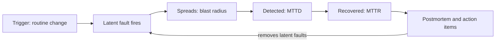

# Module 26 — When Systems Fail: Postmortems as Patterns

Every pattern in this volume exists because something once broke. This module works backwards from seven well-documented outages (Facebook 2021, AWS us-east-1 in 2020, 2021 and 2025, GitLab 2017, Cloudflare 2019, CrowdStrike 2024): timeline, root cause, fix, and links to the patterns that would have contained it (not re-explained here). Facts come from the companies' own postmortems or primary observers such as Cloudflare's network data. In an interview, "this is the outage that design choice prevents" is one of the clearest signs you have run production systems.

## How to read a postmortem

A **postmortem** is the written record of an **incident** (an unplanned event that hurts users or puts them at risk): impact, mitigation, root causes and follow-up actions ([alerting and on-call, Module 0](../00-system-design-fundamentals/README.md#dashboards-alerting-on-call-and-slo-based-alerts)). Teams decide in advance which incidents need one, so nobody argues about it at 3 AM. Typical triggers (Google's SRE book): user-visible downtime or degradation beyond a threshold; any data loss; on-call having to intervene (e.g. a rollback); a long time to resolve; a monitoring failure, where a human noticed before the alerts did.

### Anatomy

| Section | Answers | What a designer looks for |
|---|---|---|
| Summary and impact | What broke, for whom, for how long | The **blast radius** (the share of users or systems one failure reached) |
| Timeline | What happened when | Three gaps: trigger to detection, detection to diagnosis, diagnosis to recovery |
| Trigger | The event that started it | Usually a routine change: deploy, config push, capacity addition |
| Root cause | The weakness that let the trigger do harm | Usually **latent**: present for months, waiting for a trigger |
| Contributing factors | What made it worse or longer | The design lessons live here |
| Action items | Fixes, each with an owner and a priority | Sorted into *prevent*, *detect faster*, *recover faster* |

Five terms appear in every story below:

- **Trigger vs. root cause.** The trigger starts the failure; the root cause is the flaw that let it do harm. Fix only the trigger ("don't add capacity") and the flaw waits for the next one.
- **Latent fault.** A *fault* is a defect; a *failure* is when users see it. A latent fault exists but has not yet fired.
- **Control plane vs. data plane.** The control plane creates and changes things (launches servers, updates DNS records or routes); the data plane serves requests and forwards packets. A **statically stable** system keeps its data plane running on its last known state when the control plane or another dependency fails (AWS's term; [Module 6](../06-scaling/README.md#multi-region-and-cell-based-architecture)).
- **MTTD / MTTR.** Mean time to *detect* and to *recover*. Most action items shrink one of these, because preventing every failure is impossible.
- **Shared fate.** One failure takes out both things: a status page hosted on the platform it reports on, or repair tools that need the network they repair.

### Blameless culture

A **blameless** postmortem assumes everyone acted in good faith and asks what in the *system* made the mistake easy and its consequences large: fix systems and processes, not people. It is an engineering choice: punishment teaches people to hide near-misses, the best data an organisation has about where it is fragile. GitLab's postmortem below is the model: one sentence on the command that wiped the database, pages on why five recovery mechanisms failed.

To read any postmortem as a designer, ask: (1) What changed? (2) Why did it spread? (3) Why was detection slow? (4) Why was recovery slow (shared fate? recovery that is itself a load spike?) (5) Which pattern contains it?

### In the interview

**Q:** An engineer ran the command that caused the outage. What do you do about them?

**A:** Nothing punitive. Ask why one command could do that much damage, why no guard rail stopped it, and why recovery was slow; make an action item for each answer.

**Sources**
- Google, *Site Reliability Engineering*, ch. 15 "Postmortem Culture": https://sre.google/sre-book/postmortem-culture/
- AWS Builders' Library, "Static stability using Availability Zones": https://builder.aws.com/content/3K9SiqiJ369TGkkGzqPM95BuYWI/static-stability-using-availability-zones

## 2021 — Facebook BGP and DNS outage

On 4 October 2021, Facebook, Instagram, WhatsApp and Messenger disappeared from the internet for about six hours (Cloudflare saw `facebook.com` unresolvable from about 15:50 to 21:20 UTC). **BGP** (Border Gateway Protocol) is how networks announce "these IP addresses are reachable through me"; withdrawing an announcement makes them unreachable. [DNS](../00-system-design-fundamentals/README.md#dns--the-internets-phone-book) maps names to IPs, and a domain's **authoritative name servers** hold its official answers.

### What happened

Times are UTC, from Cloudflare's external measurements. Meta's posts give the sequence of events but no clock times.

| Time (UTC) | Event |
|---|---|
| ~15:40 | Spike of BGP updates from Facebook's normally quiet network |
| 15:50 | `facebook.com` stops resolving on 1.1.1.1. Public resolvers return SERVFAIL for Facebook, Instagram and WhatsApp |
| 15:58 | Facebook is no longer announcing routes to its DNS server prefixes (e.g. 185.89.218.0/23, 129.134.30.0/23) |
| During | Retrying clients push DNS resolvers to ~30x usual query volume. Internal tools and out-of-band access are down; engineers go to the data centres in person |
| ~21:00–21:17 | BGP activity from Facebook resumes and peaks |
| 21:20–21:28 | Names resolve and Facebook is reconnected; services return gradually |

### Why it happened

- **Trigger.** During routine maintenance, a command meant to *assess* global backbone capacity instead took down every connection in the **backbone**, Facebook's private fibre network between its data centres.
- **A failed guard.** An audit tool meant to block such commands had a bug that let it through.
- **Root cause of the disappearance.** Facebook's DNS servers withdraw their own BGP announcements when they cannot reach the data centres, so an unhealthy site stops attracting traffic. With the backbone down, *every* DNS site judged itself unhealthy at once and withdrew. The name servers were still running, but nothing could reach them.
- **Contributing factors.** Internal diagnosis tools depended on the same network and DNS; out-of-band management access was also down; strict physical and hardware security slowed on-site work (a trade-off Meta judges worth it for everyday security).

### How it was fixed

Engineers on site restored the backbone, and the DNS announcements returned. Turning everything back on at once was its own risk: data centres had dropped power draw by **tens of megawatts**, and a sudden return to full load could stress electrical systems and caches. Meta's **"storm" drills** (planned exercises that take services or regions offline) had prepared teams to ramp traffic back gradually, and no further system-wide failure followed. The drills had never simulated a global backbone failure; Meta said it would explore doing so.

### The patterns that would have contained it

- Staged rollout of network changes, so one command reaches one failure domain first: [Canary Deployment, CI/CD — Module 9](../09-operating-in-production/README.md).
- Independent failure domains: [Multi-Region and Cell-Based Architecture — Module 6](../06-scaling/README.md).
- Health checks that never remove *all* capacity; if every site looks unhealthy, distrust the signal: [Health Check Endpoint — Module 9](../09-operating-in-production/README.md).
- Gradual recovery and client backoff, so the restart is not a second outage: [Retry with Exponential Backoff — Module 5](../05-reliability/README.md).
- Out-of-band access that does not share fate with production, exercised in drills.

### In the interview

**Q:** The DNS servers were up. Why was Facebook unreachable?

**A:** Each DNS site withdrew its BGP routes when it lost contact with the data centres, and with the backbone down everywhere, all withdrew at once. A local "remove myself when unhealthy" rule needs a global floor that never lets the health signal remove all capacity.

**Sources**
- Meta, "More details about the October 4 outage": https://engineering.fb.com/2021/10/05/networking-traffic/outage-details/
- Meta, "Update about the October 4th outage": https://engineering.fb.com/2021/10/04/networking-traffic/outage/
- Cloudflare, "Understanding how Facebook disappeared from the Internet": https://blog.cloudflare.com/october-2021-facebook-outage/

## 2020 — AWS Kinesis outage (us-east-1)

On 25 November 2020, **Amazon Kinesis Data Streams** (managed ingestion of ordered record streams split into **shards**) failed in us-east-1 for most of a day. Its **back-end** was already divided into cells; its **front-end** was a single fleet of "many thousands" of servers that authenticate, throttle and route requests to shards. Each front-end server caches a **shard-map** (fleet membership and shard ownership), built partly by talking to peers, and **creates one OS thread for every other server in the front-end fleet.**

### What happened

| Time (PST) | Event |
|---|---|
| 2:44–3:47 AM | Small capacity addition to the front-end fleet; peers take up to an hour to learn of new members |
| 5:15 AM | First alarms on Kinesis put/get errors. CloudWatch and EventBridge errors begin |
| 7:51 AM | Every candidate cause needs a full front-end restart; the new capacity is removed |
| 9:39 AM | Root cause confirmed: every server has exceeded the OS thread limit |
| 10:07 AM | First restarted servers take traffic, at a few hundred servers per hour |
| 10:23 PM | Kinesis fully recovered, about 17 hours after the first alarm |

### Why it happened

- **Root cause.** The design was all-to-all: in a fleet of N servers, each needs about N peer threads. Every capacity addition pushed every server closer to an OS thread limit, and no alarm watched that margin. Once it was crossed, shard-map construction failed and servers could not route requests.
- **Trigger.** The capacity addition; AWS states plainly it was the trigger, not the root cause.
- **Why recovery was slow.** Building a shard-map competes with serving traffic for CPU, so servers restarted too fast would perform badly, be marked unhealthy and be removed. The team also chose not to raise the thread limit fleet-wide untested.
- **Contributing factors: hidden dependencies.**
  - **Cognito** (AWS sign-in) sent analytics to Kinesis through a buffer; a latent bug made its web servers block when the buffer backed up.
  - **CloudWatch** lost metrics, alarms went to "insufficient data", and metric-driven **Auto Scaling** was delayed until 5:47 PM.
  - **Lambda** saw memory contention from buffered metrics; **EventBridge** delays hurt ECS and EKS provisioning.
  - The **status page** posting tool depended on Cognito; the minimal-dependency backup tool was manual and unfamiliar to staff.

### How it was fixed

AWS removed the new capacity, let servers bootstrap from the authoritative metadata store instead of from peers, and restarted the fleet slowly. Action items: larger servers (so fewer of them); fine-grained alarms on thread use; testing a higher OS thread limit; a dedicated fleet for the front-end cache; a separate, partitioned front-end for large internal users such as CloudWatch; and **faster cellularisation of the front-end** to match the back-end. Cognito now tolerates Kinesis errors without exhausting its buffers, CloudWatch keeps three hours of metrics locally, and support staff are trained on the backup status-page tool.

### The patterns that would have contained it

- Cells, so each server tracks only peers in a bounded, tested cell: [Multi-Region and Cell-Based Architecture — Module 6](../06-scaling/README.md).
- A bulkhead per large tenant, such as CloudWatch's own partition: [Bulkhead — Module 5](../05-reliability/README.md).
- Non-critical side paths (Cognito's analytics buffer) that degrade instead of blocking: [Graceful Degradation and Timeout — Module 5](../05-reliability/README.md).
- Alarms on usage as a percentage of a limit, not only on errors, and a designed cold-start path: [Module 9](../09-operating-in-production/README.md).

### In the interview

**Q:** How can adding servers break a system?

**A:** When per-server cost grows with fleet size: each server held a thread per peer, so adding servers pushed *every* server past the OS thread limit at once.

**Q:** How would you redesign it?

**A:** Bounded-size cells for the front-end; routing metadata from an authoritative store, not fleet-wide peer traffic; own partitions for big internal tenants; alarms on thread headroom.

**Sources**
- AWS, "Summary of the Amazon Kinesis Event in the Northern Virginia (US-EAST-1) Region": https://aws.amazon.com/message/11201/

## 2021 — AWS us-east-1 internal network congestion

On 7 December 2021, congestion inside AWS's network impaired the us-east-1 control plane for about seven hours. AWS runs two networks in the region: the **main AWS network** (customer workloads and most services) and a separate **internal network** hosting foundational services such as monitoring, internal DNS, authorisation and parts of the EC2 control plane. Networking devices between them route and translate traffic.

### What happened

| Time (PST) | Event |
|---|---|
| 7:30 AM | Automated scaling of a service on the main network triggers unexpected behaviour in many internal-network clients; a connection surge overwhelms the devices between the networks |
| 7:30–7:33 AM | EC2 API errors and latency begin, and Route 53 APIs are impaired. Support case creation is down until 2:25 PM |
| 8:22 AM | The Service Health Dashboard posts updates; its failover to a standby region had itself been impaired |
| 9:28 AM | Internal DNS moved off the congested paths; DNS errors recover, congestion persists |
| 1:34 PM | Congestion significantly improved |
| 2:22 PM | All network devices fully recovered |
| 2:40 PM – evening | EC2 launches recover; API Gateway, Fargate and EventBridge tails last until 4:37, 5:00 and 6:40 PM |

### Why it happened

- **Root cause.** Internal clients' back-off should slow retries under congestion, but a latent bug in a long-standing code path stopped it engaging. Delays caused retries, and retries kept the devices congested: a self-sustaining **retry storm**.
- **Trigger.** A routine automated capacity-scaling activity.
- **Contributing factors.** The congestion knocked out the real-time monitoring operators needed, so they worked from logs; internal deployment systems ran on the same network, slowing every fix; the status page's failover and the support contact centre both depended on the internal network.
- **What held.** The data plane was statically stable: running EC2 instances, existing DNS answers, existing load balancers and Lambda invocations were unaffected. What failed were the control-plane APIs (launches, provisioning, logins) and services that needed the internal network, such as API Gateway, STS, Connect, VPC endpoints for S3 and DynamoDB, and container restarts in ECS, EKS and Fargate.

### How it was fixed

Operators moved DNS traffic off the congested paths, isolated the largest traffic sources, turned off heavy network services (EventBridge delivery was paused from 12:35 to 2:35 PM), and added capacity. Action items: disable the scaling activities until all fixes ship; fix the back-off bug (expected within two weeks); add network configuration protecting the devices against similar surges; keep API Gateway servers healthy when the internal network is unavailable; build a new status dashboard and a support system running actively across several regions.

### The patterns that would have contained it

- Backoff with jitter, tested under real congestion, and a retry budget: [Retry with Exponential Backoff, Circuit Breaker — Module 5](../05-reliability/README.md).
- Load shedding and admission control at shared chokepoints: [Rate Limiting — Module 8](../08-api-and-edge/README.md), [Backpressure — Module 10](../10-batch-and-streaming/README.md).
- Static stability, why running workloads survived: [Multi-Region and Cell-Based Architecture — Module 6](../06-scaling/README.md).
- Monitoring, deploy tooling and status communication that do not share fate with the network they observe: [Module 9](../09-operating-in-production/README.md).

### In the interview

**Q:** Why did the congestion last for hours instead of clearing itself?

**A:** The clients' back-off failed to engage, so every timeout produced a retry that kept the devices overloaded: a classic retry storm, broken only by shedding load from outside.

**Sources**
- AWS, "Summary of the AWS Service Event in the Northern Virginia (US-EAST-1) Region" (Dec 2021): https://aws.amazon.com/message/12721/

## 2025 — AWS us-east-1 DynamoDB DNS outage

On 19–20 October 2025, the DNS record for DynamoDB's regional endpoint, `dynamodb.us-east-1.amazonaws.com`, was left **empty**, so every client of AWS's managed key-value database, including many AWS services, lost the ability to find it. Recovery then set off further failures in EC2 and Network Load Balancer (NLB). Impact lasted from 11:48 PM to 2:20 PM PDT, about 14.5 hours.

Two parts of DynamoDB's DNS automation matter: the **DNS Planner** watches load-balancer health and capacity and produces numbered **plans** (sets of load balancers and weights per endpoint); the **DNS Enactor** runs independently in three Availability Zones, applies plans to Route 53 and then cleans up old ones.

### What happened

| Time (PDT) | Event |
|---|---|
| 11:48 PM (Oct 19) | DynamoDB endpoint DNS resolution fails; EC2's server-management system (DWFM) starts losing leases |
| 12:38 AM | Engineers identify DynamoDB's DNS state as the source |
| 2:25 AM | All DNS information restored |
| 2:40 AM | Cached DNS entries expire; customers can connect again |
| 2:25–5:28 AM | DWFM collapses under congestion re-leasing every server; recovers after throttling and selective restarts |
| 5:30 AM – 2:09 PM | NLB connection errors from health checks that flip back and forth |
| 10:36 AM | EC2 network propagation is back to normal |
| 1:50 PM / 2:20 PM | EC2 APIs and launches normal / last services recovered |

### Why it happened

- **Root cause: a latent race condition** in the DNS management system. The sequence:
  1. One Enactor was badly delayed while applying an old plan.
  2. A second Enactor applied the newest plan and then started its cleanup, which deletes plans much older than the one just applied.
  3. The delayed Enactor finally wrote its old plan over the new one. Its "is my plan newer?" check had run only *once, at the start*: a **time-of-check to time-of-use** bug (a decision made on a fact that changed before it was acted on).
  4. Cleanup then deleted that old plan, now the active one. Every IP address for the endpoint was removed, in a state that blocked further automatic updates; engineers repaired it by hand.
- **Second failure: congestive collapse in EC2.** The **DropletWorkflow Manager (DWFM)** manages the physical servers ("droplets") that host instances, holding a **lease** on each, renewed by state checks that depend on DynamoDB. The leases expired during the outage; afterwards DWFM tried to re-lease the whole fleet at once, and work timed out and was re-queued faster than it could finish. Without a lease a droplet cannot accept launches, so launches failed with "insufficient capacity".
- **Third failure: health-check flapping in NLB.** New instances came up before their network configuration had propagated, so NLB health checks failed, passed and failed them again. The extra load triggered **automatic AZ DNS failover**, which removed healthy capacity.

### How it was fixed

Operators repaired the DynamoDB DNS record by hand, throttled DWFM's incoming work and selectively restarted hosts (from 4:14 AM), and disabled NLB's automatic health-check failover at 9:36 AM, which brought healthy nodes back. Action items: disable the DNS Planner and Enactor worldwide until the race is fixed and protections against incorrect plans are added; a **velocity control** limiting how much capacity one NLB can remove through failover; a test suite for DWFM's recovery workflow; queue-size-driven throttling in EC2's data propagation.

### The patterns that would have contained it

- Check freshness at commit time, not at start: conditional writes with a version or fencing token (a number that rejects a stale writer): [Consensus, leader election and distributed locks — Module 0](../00-system-design-fundamentals/README.md).
- Refuse to publish an empty or drastically smaller DNS plan, keeping the last good state (static stability): [Graceful Degradation — Module 5](../05-reliability/README.md).
- Admission control by queue size, so recovery cannot collapse under its backlog: [Backpressure — Module 10](../10-batch-and-streaming/README.md), [Rate Limiting — Module 8](../08-api-and-edge/README.md).
- Rate limits on automated failover, so health checks can never remove all capacity: [Health Check Endpoint — Module 9](../09-operating-in-production/README.md).
- Regional cells, so one regional endpoint is not a single point of failure: [Multi-Region and Cell-Based Architecture — Module 6](../06-scaling/README.md).

### In the interview

**Q:** How can three redundant DNS Enactors produce an *empty* record?

**A:** Redundancy without coordination: one slow Enactor wrote a stale plan after its freshness check had gone stale, and another's cleanup deleted it as obsolete. Fix: conditional writes at commit time, plus a guard that never publishes an empty answer.

**Q:** DynamoDB was back at 2:40 AM. Why did EC2 launches fail until 1:50 PM?

**A:** Recovery was a load spike: DWFM tried to renew leases for the whole fleet at once, timed out, retried and collapsed; a network-configuration backlog and NLB health-check flapping followed. Recovery paths need their own throttling and tests.

**Sources**
- AWS, "Summary of the Amazon DynamoDB Service Disruption in the Northern Virginia (US-EAST-1) Region" (Oct 2025): https://aws.amazon.com/message/101925/

## 2017 — GitLab.com database deletion

On 31 January 2017, a GitLab.com engineer rebuilding a broken **replica** (a copy that follows the primary) wiped the **primary's** data directory instead. The site was down about 18 hours and about six hours of database changes were lost; Git repositories and wikis, stored separately, were unaffected.

### What happened

| Time (UTC) | Event |
|---|---|
| ~17:20 | An engineer takes a manual LVM snapshot (Linux volume manager; a point-in-time disk copy) of production to load into staging |
| ~19:00 | Database load spikes, probably from spam plus a background job removing a flagged employee's data |
| ~23:00 | Replication lag: the secondary needs WAL (PostgreSQL's write-ahead log) segments the primary already deleted. No WAL archive, so the secondary must be rebuilt by hand |
| ~23:00–23:30 | `pg_basebackup` hangs silently. Settings are changed: `max_wal_senders` from 3 to 32, `max_connections` from 8000 to 2000 |
| ~23:30 | The engineer wipes the primary's data directory, meaning to target the secondary; stopped within a second or two, ~300 GB already gone |
| Feb 1, ~18:00 | Restore from the 6-hour-old staging snapshot is complete, after an ~18-hour copy over disks throttled to about 60 Mbps |

### Why it happened

The deletion was the trigger; the real story is that **none of the recovery mechanisms worked**:

| Mechanism | Why it failed |
|---|---|
| Daily `pg_dump` to S3 | pg_dump 9.2 run against PostgreSQL 9.6 failed; the S3 bucket was empty |
| Failure emails | Rejected by the receiver because DMARC (an email authentication standard) was not enabled for them, so nobody knew |
| Azure disk snapshots | Enabled for NFS servers but not for database servers |
| LVM snapshots | Daily, for staging, not designed for disaster recovery; the manual 17:20 snapshot saved six hours |
| Replication | Built for failover, not recovery: copies a deletion as faithfully as a write |

Contributing factors from GitLab's "five whys": a manual replica rebuild, neither automated nor well documented; no WAL archiving, so lag could break replication; an abuse workflow that made it easy to hard-delete an account by mistake; and **no owner for testing backups**. About 5,000 projects, 5,000 comments and 700 user accounts were affected.

### How it was fixed

The team copied the staging LVM snapshot to production, restored webhooks separately, and bumped ID sequences by 100,000 so IDs would not be reused. Tracked action items include hourly LVM snapshots; Azure snapshots for the database; a sensible `max_connections`; point-in-time recovery with continuous WAL archiving; **automated testing of backup restores**; better replication runbooks; an owner for data durability; monitoring and a public dashboard for backups.

### The patterns that would have contained it

- Continuous WAL archiving and point-in-time recovery (recovery point in minutes, not hours): [Write-Ahead Log, Primary-Replica — Module 3](../03-storing-data/README.md).
- Restore drills with a stated **RPO** (how much data you may lose) and **RTO** (how long recovery may take). A backup does not count until it has been restored: [Disaster recovery — Module 0](../00-system-design-fundamentals/README.md#disaster-recovery).
- Alerts on the *absence* of a successful backup, not on emailed failures: [Module 9](../09-operating-in-production/README.md).
- Automated, runbook-driven replica rebuilds, with clearly different prompts and hostnames for primary and replica, so manual destructive work is rare and hard to misaim.

### In the interview

**Q:** What is the single most valuable action item?

**A:** Automated, regular restore tests with an owner and an alert on failure; they would have revealed every other gap long before.

**Sources**
- GitLab, "Postmortem of database outage of January 31": https://about.gitlab.com/blog/2017/02/10/postmortem-of-database-outage-of-january-31/

## 2019 — Cloudflare WAF regex outage

On 2 July 2019, one new rule in Cloudflare's **WAF** (web application firewall: checks requests against attack signatures) pushed CPU to nearly 100% on every HTTP-serving server worldwide. Cloudflare lost about 80% of its traffic for 27 minutes; users saw 502 errors.

### What happened

| Time (UTC) | Event |
|---|---|
| 13:31 | A pull request adding a cross-site-scripting detection rule is merged after review |
| 13:37 | Build and tests pass; tests do not measure CPU use |
| 13:42 | The rule is deployed globally in seconds through Quicksilver, Cloudflare's config store (p99 propagation 2.29 s) |
| ~13:45 | First page, then global traffic-drop and CPU-exhaustion alerts |
| 14:00 | WAF identified as the cause; attack ruled out |
| 14:07 | A **global terminate** (kill switch) disables the WAF everywhere |
| 14:09 | Traffic and CPU are back to normal |
| 14:52 | Fix verified in one city; WAF re-enabled globally |

### Why it happened

- **Root cause.** The rule contained `.*(?:.*=.*)`. The WAF's regex engine (PCRE under Lua) uses **backtracking**: when a match fails, it tries every other way of splitting the input, so with two greedy `.*` before an `=` the steps grow faster than linearly with input length. Cloudflare's example: 20 characters with no `=` take 4,067 steps just to conclude nothing matches. Nothing limited the work one match could do.
- **Trigger.** The rule was meant to run in "simulate" mode (log, don't block), but a simulated rule still executes, so it still burned CPU.
- **Contributing factors (Cloudflare's own list).** A protection against excessive regex CPU had been removed by accident weeks earlier in a refactor; tests could not detect CPU use; WAF rule changes could go global without a staged rollout; rollback required two full WAF builds; the traffic-drop alert was slow; engineers' access to internal tools went through Cloudflare's own edge and failed with it (the bypass was rarely used, and some credentials had timed out for security reasons); customers' dashboard and API also ran through the failing edge.

### How it was fixed

The global kill switch restored service at 14:07–14:09. Action items: restore the CPU protection (done); inspect all 3,868 WAF rules for backtracking (done); add performance profiling to rule tests; switch to RE2 or Rust's regex engine, which guarantee linear-time matching; **stage WAF rule rollouts** like other software, keeping a global emergency path for active attacks; a way to move the dashboard and API off the edge; automated status-page updates.

### The patterns that would have contained it

- Config and rules are code: staged rollout with automatic checks ([Canary Deployment, Feature Flags — Module 9](../09-operating-in-production/README.md)); the kill switch, a feature flag, ended the outage.
- A per-request work budget, so one expensive operation cannot take a whole core: [Timeout, Bulkhead — Module 5](../05-reliability/README.md).
- Algorithms with guaranteed cost: a linear-time regex engine removes this whole class of failure.
- Management and recovery access that does not share fate with the edge it manages.

### In the interview

**Q:** What two changes give the most protection?

**A:** Staged rollout of rule and config changes (small initial blast radius), and a linear-time matching engine or a hard per-match budget.

**Sources**
- Cloudflare, "Details of the Cloudflare outage on July 2, 2019": https://blog.cloudflare.com/details-of-the-cloudflare-outage-on-july-2-2019/

## 2024 — CrowdStrike Channel File 291

On 19 July 2024, a content update for CrowdStrike's Falcon security sensor crashed Windows machines worldwide with a blue screen. Microsoft estimated **8.5 million** devices, under 1% of all Windows machines, but enterprises running many critical services, so the harm was large. Mac and Linux were not affected. ([Module 0](../00-system-design-fundamentals/README.md#deployment-strategies-and-rollback) uses it as the canonical staged-rollout lesson.)

Terms from CrowdStrike's root cause analysis (RCA):

- The **sensor** includes a Windows **kernel driver** (`csagent.sys`) that loads early during boot; a fault in the kernel crashes the whole machine.
- **Rapid Response Content** is configuration data, not code, pushed from the cloud to change detections without a sensor release.
- A **Template Type** is a detection capability compiled into the sensor, with a fixed set of input fields. **Template Instances** are its matching rules, delivered in numbered **channel files**.
- The **Content Validator** checks content before publishing; the **Content Interpreter** on the sensor evaluates it.

### What happened

| Date / time (UTC) | Event |
|---|---|
| 28 Feb 2024 | Sensor 7.11 introduces the IPC Template Type (detects abuse of Windows named pipes); its content arrives in Channel File 291 |
| 5 Mar 2024 | Template Type passes a stress test; first instance ships |
| 8–24 Apr 2024 | Three more instances ship without problems |
| 19 Jul, 04:09 | Two new instances ship to every online Windows sensor (7.11+); machines crash on the next named-pipe event, many again at every boot |
| 19 Jul, 05:27 | Content reverted; machines that stay up long enough to fetch it recover, the rest need manual repair |

### Why it happened

- **Root cause.** The IPC Template Type was *defined* with 21 input fields, but the sensor code calling the Content Interpreter supplied only **20**. Earlier instances and test cases all used a wildcard for field 21, so it was never read. A 19 July instance was the first to use a real value there; the interpreter read past the end of the 20-entry array (an **out-of-bounds read**), and the kernel crashed.
- **Contributing factors (CrowdStrike's six findings).**
  1. The field count was not validated at compile time.
  2. There was no runtime bounds check in the interpreter.
  3. Tests used wildcards for every field.
  4. The Content Validator had a logic error: it checked against 21 fields.
  5. Validation did not run instances through the real interpreter.
  6. Template Instances were not deployed in stages, so the update reached every customer at once.
- **Why recovery was slow.** The kernel crashed during boot, before the fix could download. Repair was manual, machine by machine: boot into Safe Mode or the recovery environment and delete `C-00000291*.sys`; BitLocker-encrypted disks needed recovery keys first.

### How it was fixed

CrowdStrike reverted the content at 05:27 UTC and published manual and cloud-VM remediation steps and bootable recovery images; Microsoft released a recovery tool. Mitigations from the RCA: field-count validation at compile time (in production from 27 July); runtime bounds checks in the Content Interpreter (backported to 7.11+); testing every field with non-wildcard values; new Content Validator checks; testing every Template Instance in the interpreter; **staged deployment rings with canaries and bake time**; **customer control over when content is deployed**; two independent third-party code and process reviews.

### The patterns that would have contained it

- Configuration is code and needs staged rings and bake time ([Canary Deployment, CI/CD — Module 9](../09-operating-in-production/README.md)); even a 1% first ring would have shown crashes within minutes.
- Defensive parsing at the consumer: check bounds, reject bad content and fall back to the last good content instead of crashing: [Graceful Degradation — Module 5](../05-reliability/README.md).
- Customer-controlled update rings (a test fleet first) give each customer a bulkhead against vendor pushes: [Bulkhead — Module 5](../05-reliability/README.md).
- Automatic safe mode: a boot-time agent that crashes repeatedly disables its latest content itself, because a fix you cannot download is not a rollback.

### In the interview

**Q:** If the bad file was reverted after 78 minutes, why did recovery take days?

**A:** The file crashed the kernel at boot, so many machines never stayed up long enough to fetch the revert; each needed hands-on repair, often with BitLocker recovery keys. Rollback only works if the broken system can still receive it.

**Sources**
- CrowdStrike, "External Technical Root Cause Analysis — Channel File 291" (6 Aug 2024): https://www.crowdstrike.com/wp-content/uploads/2024/08/Channel-File-291-Incident-Root-Cause-Analysis-08.06.2024.pdf
- CrowdStrike, Preliminary Post Incident Review: https://www.crowdstrike.com/en-us/blog/falcon-content-update-preliminary-post-incident-report/
- CrowdStrike, "Technical Details: Falcon Content Update for Windows Hosts": https://www.crowdstrike.com/blog/falcon-update-for-windows-hosts-technical-details/
- CrowdStrike, Remediation and Guidance Hub: https://www.crowdstrike.com/en-us/blog/statement-on-falcon-content-update-for-windows-hosts/
- Microsoft, "Helping our customers through the CrowdStrike outage" (8.5 million devices): https://blogs.microsoft.com/blog/2024/07/20/helping-our-customers-through-the-crowdstrike-outage/
- Microsoft, KB5042421 (manual recovery steps): https://support.microsoft.com/en-us/help/5042421

## Patterns across all the outages

| Incident | Trigger | Latent root cause | Why it spread | Why recovery was slow | Containing patterns |
|---|---|---|---|---|---|
| Facebook 2021 | Backbone maintenance command | Audit-tool bug, and DNS sites that withdraw when unhealthy | One command reached the whole backbone, and every DNS site withdrew together | Tools and out-of-band access shared fate. On-site security. Load had to be ramped | Staged change, failure domains, fail-open health checks, independent repair path |
| AWS Kinesis 2020 | Capacity addition | One thread per peer, near the OS limit | One un-celled front-end fleet. Dependents blocked | Restart paced by cache rebuild | Cells, bulkheads per tenant, graceful degradation, limit alarms |
| AWS Dec 2021 | Automated scaling activity | Client back-off bug | Retry storm on shared network devices | Monitoring and deploy tools on the congested network | Backoff with jitter, load shedding, static stability, independent tooling |
| AWS Oct 2025 | Delayed DNS Enactor | Time-of-check to time-of-use race in plan apply and cleanup | Regional endpoint used by many AWS services | Lease storm in EC2, NLB health checks flapping | Conditional writes, never publish empty state, queue-based throttling, failover velocity limits |
| GitLab 2017 | Command run on the wrong host | Untested, broken backups | Single primary, and replication copies deletions | Only a slow-disk staging snapshot worked | WAL archiving and PITR, restore drills, backup alerting |
| Cloudflare 2019 | WAF rule deploy | Backtracking regex, CPU guard removed | Global push in seconds | Access and dashboards ran through the failed edge | Staged config rollout, kill switch, per-request budgets, linear-time algorithms |
| CrowdStrike 2024 | Content update | 21 fields defined, 20 supplied, no bounds check | Global push to every sensor | Boot loop blocked the revert. Manual repair per machine | Staged rings, defensive parsing, last-known-good fallback, customer-controlled rollout |

Six lessons recur, and each maps to a pattern taught elsewhere in this volume:

1. **Configuration changes are deploys.** None of the seven began with an ordinary code deploy: a command, a capacity change, an automated workflow, a rule or a content file. Give them canaries, rings and kill switches ([Module 9](../09-operating-in-production/README.md)).
2. **Blast radius is a design choice.** Cells, regions and per-tenant bulkheads decide in advance how far a fault can spread ([Module 6](../06-scaling/README.md), [Module 5](../05-reliability/README.md)).
3. **Safety checks are code and can fail.** Facebook's audit tool, CrowdStrike's validator and Cloudflare's removed CPU guard each had bugs. Layer defences, and make the consumer safe too.
4. **Recovery is a load event.** Retry storms, lease storms, cache rebuilds and power ramps hit at the worst moment: use backoff, throttling, backpressure and gradual ramps ([Module 5](../05-reliability/README.md), [Module 10](../10-batch-and-streaming/README.md)).
5. **Repair paths must not share fate.** Monitoring, deploy tools, admin access and status pages failed with the systems they serve at Facebook, Cloudflare and in two AWS events.
6. **Test the recovery, not just the system.** Untested backups (GitLab), cold restart (Kinesis) and lease recovery (DWFM), and an undrilled global failure (Facebook), turned short faults into long outages.
